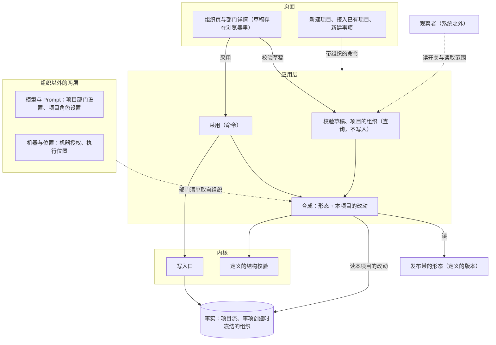
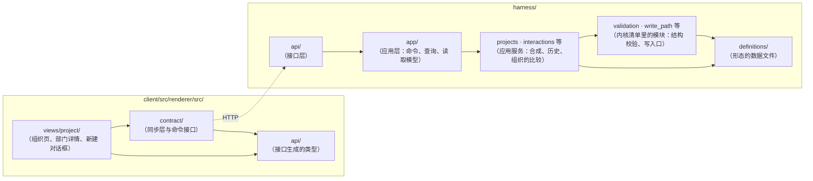
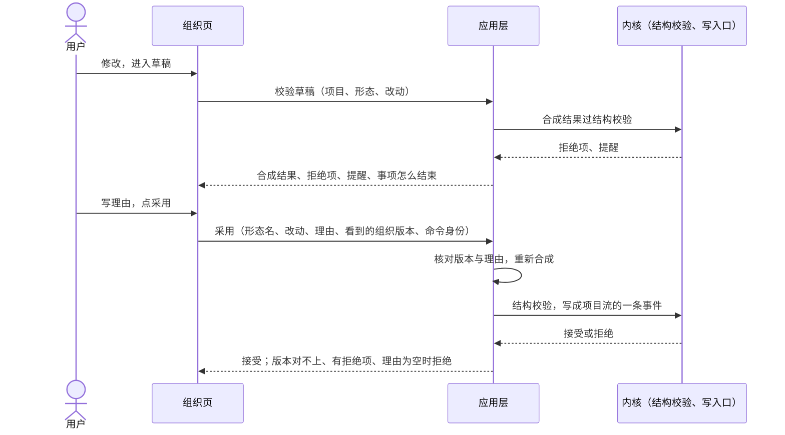

# 项目的组织设计说明

总图位置：第二节「定义」方框与四层；第一节「页面」「下一个部门」「观察者」方框；第三节「开环完成」「子组织」两条规矩；第四节「定义」「接口」「执行」「观察者」四道缝。依据：[ADR-0045 项目的组织是一份形态加本项目的改动](../adr/0045-project-organization-form-plus-changes.md)、[ADR-0044 核验是角色的性质](../adr/0044-verifier-role-and-open-loop.md)、[基础规则](../foundation-rules.md)第 5 条、[形态与核验角色设计说明](forms-and-verifier-role.md)「四层各认识什么」「形态随事项冻结」「定义的校验」、[规则登记与参数设计说明](rules-and-parameters.md)「采用与撤回」「命令与事件」、[模型管理设计说明](model-management.md)「部门与角色的模型选择」、[部门内多角色设计说明](department-roles.md)「角色清单」、[D31 部门内的外包角色](../requirements/outsourced-agent-roles.md)、[D28 元观察与规则检查部门](../requirements/meta-observer.md)。

## 1. 功能与依据

用户在一个项目上看清并改动这个项目用什么组织：有哪些部门，每个部门有哪些角色，谁关注什么成果，谁核验谁，事项怎么结束。范围从一个部门一个外包角色，到 N 个部门加观察者、部门内再分形，同一个页面、同一套规矩。默认是产品、工程、质检三个部门，方案里的例子与验收的主线都用它。

总图把部门、角色、轮转方式、核验角色写成填进结构的内容，住在定义里。一个项目的组织是发布带的一份形态加本项目的改动，合成以后过同一套结构校验，新建事项时整份冻结进事实。用户在自己的项目上采用一份组织，经结构校验与确认就生效，范围只有这个项目。新增的部门或角色要写明它对什么负责、凭什么判断、怎么工作（基础规则第 5 条）。

## 2. 边界与范围

同一个页面、同一套规矩覆盖下面四种组织。三部门是默认，也是方案里的例子与验收的主线；最少与复杂两头只在本表和各自的验收条里出现。

| 形态 | 部门 | 角色 | 轮转方式 | 核验角色 | 观察者 | 怎么结束 |
| --- | --- | --- | --- | --- | --- | --- |
| 最少：一个外包角色直做 | 一个 | 一个外包角色 | 直做 | 没有 | 没有 | 交回快照，开环完成并注明外包 |
| 一个角色直做 | 一个 | 一个自有角色 | 直做 | 没有 | 可有可无 | 交完成，开环完成 |
| 默认：三部门 | 产品、工程、质检 | 每个部门一个 | 按成果 | 质检 | 可有可无 | 质检放行 |
| 复杂 | N 个 | 部门内部可以是子组织，一层套一层 | 任选 | 可以有几个 | 若干 | 每个核验角色都放行 |

做：

- 项目上组织的合成、校验、采用、历史、冻结与升级。
- 组织页与部门详情；新建项目、接入已有项目、新建事项时选组织。
- 加部门；给角色选由谁做（自有、外包、子组织）。
- 观察者的开关与读取范围。

不做：

- 运行中改组织。
- 观察者的实现与新增。
- 组织的图形编辑；画面里的编辑入口接到同一条采用命令。
- 修改基础规则与内核清单。

和相邻说明的分界：

| 说明 | 它管 | 本说明管 |
| --- | --- | --- |
| [形态与核验角色设计说明](forms-and-verifier-role.md) | 四层各认识什么、核验角色、直做、开环完成、形态随事项冻结、定义的校验 | 项目上怎样选形态、怎样改、怎样改回 |
| [规则登记与参数设计说明](rules-and-parameters.md) | 发布带的默认形态与系统提出的候选：对照、限定采用、撤回 | 用户在自己的项目上采用组织 |
| [模型管理设计说明](model-management.md) | 模型目录、部门默认与角色默认、项目部门设置与项目角色设置的解析顺序；模型管理页 | 部门清单从组织得出；自己加的部门怎样选模型 |
| [部门内多角色设计说明](department-roles.md) | 默认三部门的角色清单与中心型协作的内容 | 项目上怎样改角色清单 |
| [执行环境服务设计说明](execution-environment.md)、[网络取回与 MCP 工具设计说明](network-and-mcp.md) | 机器授权、执行位置、MCP 服务器 | 各部门的选项从组织得出 |

本说明没有自己的常量。子组织的嵌套深度上限见[循环与收敛设计说明](loops-and-convergence.md)「循环层的声明」。

## 3. 接口

组织在总图第四节「定义」的缝上：形态、本项目的改动和合成规则是定义格式的一部分，合成结果过加载与校验的同一套结构校验。用户从页面经「接口」的缝发命令、读查询；观察者在事项外面读项目现在的组织；外包角色与子组织走「执行」的缝，组织页只选用哪一种，合同不变。

| 缝 | 谁调用谁 | 交换什么 |
| --- | --- | --- |
| 定义 | 应用层 → 加载与校验 | 输入：形态、本项目的改动，以及它们的合成结果；输出：通过，或拒绝项与提醒。定义的格式增加三样，只增字段、带版本：形态（一份完整定义的一个版本，有名字）、本项目的改动（按身份只写不同的项）、身份与显示名分开 |
| 接口：命令 | 页面 → 应用层 | 采用：项目、形态名、改动、理由、用户看到的组织版本，带命令身份。新建项目、接入已有项目、新建事项：增加组织（可选） |
| 接口：查询 | 页面 → 应用层 | 校验草稿（不写入）：输入项目、形态、改动，输出合成结果、拒绝项、提醒、「这样改以后事项怎么结束」。项目的组织：合成结果与每项的来源、版本、历史、发布带的形态清单、和上一个事项用的组织的不同 |
| 写入口 | 应用层 → 内核 | 采用写成项目流的一条事件；新建事项把合成结果整份写进事项创建事实 |
| 执行 | 薄驱动 → 执行实现 | 外包角色：快照进，快照与差异出，经写入口成为提案；子组织：一轮工作开子事项的请求。组织只决定哪个角色用哪一种 |
| 观察者 | 观察者 → 接口、写入口 | 按读取范围读事实；开关与读取范围写在项目的组织里，读项目现在的这份，不读事项冻结的那份 |

包图：

合成与组织的比较放在应用服务里，只读定义的数据与内核的公开接口；结构校验在内核里，合成结果与别处的定义过同一套；页面只经接口层读与发。

## 4. 方案

### 4.1 项目上配的三层

项目上配的东西分三层，生效的时候不同：

| 层 | 内容 | 什么时候生效 | 由谁保存 |
| --- | --- | --- | --- |
| 组织 | 轮转方式、部门与角色、成果种类、谁关注什么、谁核验谁、谁交完成、由谁做（自有、外包、子组织）、工具许可、写入范围、观察者 | 之后新建的事项；事项创建时冻结 | 项目事件 |
| 模型与 Prompt | 模型、推理档位、部门 Prompt、角色 Prompt | 下一次模型请求，包括进行中的事项 | 项目部门设置、项目角色设置 |
| 机器与位置 | 可用的机器、运行工作区的位置、各部门做检查的位置 | 创建 run 时 | 机器授权、执行位置 |

组织决定事项怎么走：谁开工、谁核验、怎么结束。事项走到一半不能换人，所以按事项冻结。模型和 Prompt 只影响下一次模型请求，请求的字节已经记进事实，随时能换。后两层的规矩不变，部门清单从组织读：项目部门设置与项目角色设置的对象、各部门检查的位置、MCP 服务器可以使用的部门，都取自组织。

两点特殊：

- 可见范围写在定义里，现值按参数的规矩改（[规则登记与参数设计说明](rules-and-parameters.md)「命令与事件」）；组织页上它和工具许可放在同一组。
- 观察者在事项外面读事实，它的开关与读取范围在采用以后立即生效，不随事项冻结。

### 4.2 组织是形态加本项目的改动

发布带四份形态，每份是一份完整的定义版本：

- 三部门（默认）。
- 一个角色直做：用工程这个部门的名字与工具，模型按工程的设置解析。
- 一个外包角色直做：同样用工程这个部门的名字与工具。
- 中心型小组：工程架构师是中心角色，主程、探索者是同伴，审查者是这个子组织的核验角色。它给部门内部用，只出现在「由谁做」选子组织的时候。

本项目的改动按身份只写不同的项，其余跟随发布。身份归部门、角色、成果种类、观察者所有，由系统给出，显示名可以另改。例如本项目把质检改名为「验收」、给工程多加一个工具、新增一个设计部门：改动里写三项，其余全部跟随发布。

合成结果的内容摘要就是这份组织的版本。

只写不同的项，是因为发布会一直改工具、提案合同与内置材料：项目没有改过的项始终是发布的最新内容。OpenCode `fe8cd6596f` 的 `packages/core/src/config/plugin/agent.ts` 第 93 至 125 行（在内置 agent 上逐项覆盖，`disabled` 去掉内置的 agent）与 OMP `338d2ce665` 的 `packages/coding-agent/src/task/discovery.ts` 第 76 至 177 行（项目、用户、内置按名字覆盖）是同一种做法。

### 4.3 合成规则

1. 单值的项（显示名、由谁做、写入范围、核验声明、三样说明：它对什么负责、凭什么判断、怎么工作）整项替换。
2. 清单类的项（工具许可、关注的成果、交出的成果）记「增加」与「去掉」；发布以后往清单里加的新工具照样进来。
3. 可以新增部门、角色、成果种类，改动里写全部内容。
4. 可以去掉形态里的部门、角色、成果种类；要去掉的对象在形态里已经不存在时（发布升级以后可能出现），这条去掉不起作用。
5. 改名只改显示名，身份不变。改了名的质检仍然跟随全局「部门使用」里原来那一行；内置材料提到别的部门时按身份引用，发给模型时填当时的显示名。
6. 子组织也是一份形态加改动，同一套规则，按路径写（工程 › 内部 › 主程）。

### 4.4 草稿与校验

改动先进草稿。草稿存在这个浏览器里，不进事实，别的电脑看不到。草稿的基准是用户看到的组织版本；基准变了（别处采用了新的组织，或发布升级了形态），页面按新的版本重新校验草稿。

校验草稿是一个查询，不写入：输入是项目、形态、改动；输出是合成结果、拒绝项、提醒、「这样改以后事项怎么结束」。

「这样改以后事项怎么结束」由合成结果得出：看轮转方式，再看事项最后采纳的成果有没有核验角色核验。例如「质检放行才算完成，打回时工程返工」，或「交了完成就结束，记为开环完成」；外包时注明外包。

### 4.5 采用与历史

- 采用是一条命令，带形态名、改动、理由、用户看到的组织版本；写成项目流的一条事件。版本对不上时拒绝，页面按新的版本重新校验草稿；理由为空拒绝；重发不重做。
- 只有用户能采用。部门与观察者不能改组织（基础规则：运行中 agent 与观察者不能修改定义）。
- 用户在自己的项目上采用，经结构校验与确认就生效，范围只有这个项目，不经对照。对照与限定采用管发布的默认形态和系统提的候选（[规则登记与参数设计说明](rules-and-parameters.md)「采用与撤回」）。系统提的候选也显示在组织页，写明差异与证据，通过对照以后走同一条命令。
- 历史：每次采用的时间、谁、原版本、新版本、理由、差异。差异按两条采用事件里的形态名与改动比较。改回就是把那一条的形态与改动再采用一次；采用时照常合成、校验，版本是合成当时的内容摘要。
- 换一份形态：本项目的改动清空，页面列出会丢掉哪些；历史里还在，改回能找回。

### 4.6 拒绝与提醒

结构校验在三个时候跑，是同一套，属于定义的加载与校验：采用前、新建事项时（发布可能已经变了）、加载时。

拒绝（不能采用，写明是哪一项）：

1. 谁能拒绝谁有环，含核验自己。
2. 核验对象不存在。
3. 没有部门接用户的输入，事项开始不了。
4. 关注的成果没有部门交（你的输入与指导除外）。
5. 事项无法结束：直做没有指定谁交完成；按成果没有写明事项最后采纳哪种成果，或没有部门交它。
6. 核验角色外包。
7. 运行工作区有两个写入者。
8. 新增的部门或角色缺基础规则第 5 条要的三样：它内聚的目标函数、证据来源、工作过程；页面写「它对什么负责」「凭什么判断」「怎么工作」。
9. 子组织超过嵌套深度的上限。
10. 未知的字段，或这个发布没有的工具、轮转方式。

提醒（可以采用）：

1. 事项最后采纳的成果没有核验角色核验，事项以开环完成结束（外包时注明外包）。
2. 核验角色只核验中途的成果，同样开环。
3. 核验角色的模型不具备建议能力（[模型管理设计说明](model-management.md)「部门的建议能力」）。
4. 部门还没有可用的模型，新建事项会被拒绝。
5. 部门不交出任何成果，只回答询问。
6. 还有几个事项在按旧组织跑或在排队。

### 4.7 冻结与升级

- 新建事项时：合成、校验，把合成结果整份存进事实（总图方程里事实包含冻结的定义版本），事项记录形态名与版本。之后写入核对、路由、装配、执行、重放都读这一份。观察者一节不在冻结的内容里。
- 事项详情有「这个事项用的组织」：形态名、版本、和项目现在的组织相同或不同（比较部门、角色、成果、核验与轮转，不含观察者），能打开只读的那一份。
- 发布升级以后，跟随发布的项下一个事项自动用上新内容。组织页写明和这个项目上一个事项用的组织相比有什么不同；比较的是两份合成结果，不另存状态。
- 发布的改动与本项目的改动合不到一起（合成结果过不了校验，或形态已经不在发布里）：组织页写明原因，新建事项被拒绝并给同样的原因，用户在草稿里处理；进行中的事项不受影响。事项记录的定义版本与当前加载的不同时，「定义版本不同时继续或停止」的决定请求照旧（[骨架与应用设计说明](skeleton-and-application.md)「薄驱动」）。

### 4.8 组织页

项目标签多一个「组织」，排在「观测」之后、「设置」之前。部门页看它现在在做什么，组织页看它是怎么安排的。页面从上到下：

1. 头部：用哪份形态、改过几处、版本；轮转方式一句话；事项怎么结束一句话。按钮：修改、换一份。提示：改动只对之后新建的事项生效，有几个事项在按旧组织跑（能点开）。
2. 部门表：每个部门一行，写部门名（带核验角色、外包、内部是子组织的标记）、目标、什么时候开工、交出什么、谁核验它或它核验谁、模型、来源（跟随发布、本项目改过、本项目加的）。点一行进部门详情。列跟着轮转方式变：按成果时「什么时候开工」写关注的成果；直做时写接到你的输入、指导或询问，多一列谁交完成；任务池时多一列工作单元的大小。去掉的部门灰着显示，能恢复。
3. 成果怎么走：几行文字，由关注关系与核验声明得出。三部门是「你的输入 → 产品 → PRD → 工程、质检」「工程 → 交付 → 质检」「质检 → 缺陷记录 → 工程」「质检 → 放行 → 事项完成」。一个外包角色时只有一行「你的输入 → 工程（外包）→ 交回快照 → 开环完成」。
4. 观察者：表格，名字、看什么（读取范围）、产出什么（证据、提案、振荡信号）、开或关、最近的产出（链到系统页）。观察者不算部门，不进部门表，不能核验。观察者的实现随发布，页面只改开关与读取范围。子组织里没有这一块。
5. 待采用的候选：系统提的候选，平时没有就不显示。
6. 历史。

修改状态：顶部一条「草稿，还没有生效」，校验结果常驻显示（拒绝项、提醒、这样改以后事项怎么结束）；按钮「采用」（有拒绝项时不可用，点了写理由、看差异）与「放弃草稿」。旁边有「编辑定义」：文档视图，左边编辑本项目的改动，右边只读显示合成结果，和表单过同一套校验，做法同模型管理页的编辑 JSON（[模型管理设计说明](model-management.md)「目录文档（编辑 JSON、导入、导出）」）。

设置页留下：基本信息、源目录、成果写回、机器授权、执行位置（各部门一项，从组织得出）、MCP 服务器（部门的选项从组织得出）。部门设置与各角色设置并进部门详情。

### 4.9 部门详情

路径「组织 › 工程」。一个部门一个角色时，部门与角色合成一页。分组，每组标明生效时机，每项标跟随发布或本项目改过，能恢复：

- 职责（之后新建的事项）：显示名；它对什么负责、凭什么判断、怎么工作；关注的成果；交出的成果；核验声明（不核验，或核验某部门的某种成果）。
- 由谁做（之后新建的事项）：自有角色、外包（选一个外部 agent）、子组织（打开内部）。
- 权限（之后新建的事项）：工具许可按类别分组；写入范围（运行工作区、只写检查材料、不写入，核验角色固定只写检查材料）；可见范围。
- 模型与 Prompt（下一次模型请求）：模型、推理档位、部门 Prompt、角色 Prompt，写入本项目，没写入的跟随；建议能力的提醒照旧。
- 位置（创建 run 时）：做检查的地方，只读显示，链到设置页；能用哪些 MCP 服务器，只读显示，链到设置页。
- 事项种类的工作说明：折叠显示，要改在「编辑定义」里。

子组织的路径是「组织 › 工程 › 内部」：同一个页面，同样的头部、表与「成果怎么走」，每一行是一个角色。层数到上限时「由谁做」不再能选子组织。

### 4.10 加部门

- 起点：复制一个已有部门（带上工具、写入范围、核验声明，模型预选被复制部门的生效模型），或者空白。
- 必填：它对什么负责、凭什么判断、怎么工作。这三样同时生成 Prompt 的底稿，用户可以改。
- 关注的成果、交出的成果：从已有种类里选，或者新建一种成果。
- 新建成果种类填：名字、一句说明、依据哪种成果的当前版、要不要带检查回执、要不要带代码快照。这几项对应提案合同里已有的条件，更细的写法在「编辑定义」。新种类走通用的成果接纳（[形态与核验角色设计说明](forms-and-verifier-role.md)「四层各认识什么」）。
- 模型：必选，写进项目部门设置。自己加的部门不进全局的部门默认与角色默认；部门的内置 Prompt 就是加部门时写的那份，以后改 Prompt 写项目部门设置，和别的部门同一种用法。
- 身份由系统给，用户只看到显示名。

### 4.11 外包与分形

- 外包角色：页面选一个外部 agent；模型与工具走受控入口，模型按同一条解析顺序；交回快照与差异，经写入口成为提案；核验角色不能外包。最少的形态就是一个部门一个外包角色。
- 子组织：「由谁做」选子组织，从一份形态起步（默认中心型小组）。部门页（看状态的页面）显示内部的角色在做什么，并链到子事项。子事项的规矩见[形态与核验角色设计说明](forms-and-verifier-role.md)「子组织（位置与规矩）」。

### 4.12 新建的入口

- 新建项目：名称、长期目标、起始文件夹（可选）、组织。组织默认三部门，可以选发布带的形态，或「和某项目一样」。
- 和某项目一样：复制一次形态名、本项目的改动、项目部门设置与项目角色设置；机器授权、执行位置、源目录、MCP 服务器不复制；之后两边各改各的。
- 接入已有项目：名称、长期目标、源目录、组织。没有核验角色的组织按[形态与核验角色设计说明](forms-and-verifier-role.md)「开环完成」的建档规矩走。
- 新建事项：原文、标题（可选）、组织。组织默认本项目的组织，也可以临时选发布带的一份形态，只影响这个事项，项目的组织不变。对话框写明这段话先交给谁（由关注「你的输入」的部门得出），选了开环的组织时写明以开环完成结束。合成结果过不了校验时不能新建。

### 4.13 项目页跟着组织变

- 事项详情、指导的接收方、决定请求里的部门都读这个事项冻结的组织。
- 项目的部门清单 = 当前组织的部门 + 还在跑的事项里旧组织的部门，后者标「只在旧组织里」。
- 只有一个部门时：去掉「流转」页、「所在部门」列、「谁问谁」一块。
- 放行写核验角色的显示名；没有核验角色时写开环完成，并注明是否外包。
- 项目头部一行标签：形态名、轮转方式、有核验或开环。
- 部门多到标签放不下时，部门收进一个「部门」下拉。
- 系统页（模型管理、机器、运行与执行槽位、工具与扩展）结构不变。

## 5. 验收

主线用三部门。

1. 新建项目默认三部门：组织页显示三个部门，质检标核验角色，事项以放行结束，全部标跟随发布；没有改动时事件序列基准与交给模型的请求快照一字不变。
2. 把质检改名并采用：新建的事项跑完，事件序列除名字外相同，模型仍跟随全局「部门使用」里原来那一行；进行中的事项按改名之前的名字跑完。
3. 在草稿里去掉质检：出现以开环完成结束的提醒；采用后新建的事项以开环完成结束；改回以后新建的事项以放行结束；历史里两条都在。
4. 加一个设计部门，新建一种成果，工程关注它：事项跑完；缺那三样时被拒绝；模型只写在本项目，全局「部门使用」没有多一行。
5. 「拒绝与提醒」里每一条拒绝各有一个反例；每一条提醒都不挡采用。
6. 看到的版本已被别处改过，采用被拒绝；命令重发不重做；理由为空被拒绝。
7. 发布改了工程的工具，本项目的改动里没有碰它：下一个事项用上新工具，组织页写明不同；本项目加过的工具仍在。合不到一起时新建事项被拒绝并写明原因，进行中的事项不受影响。
8. 新建事项临时选一个角色直做：事项按它跑完，项目的组织不变，记录上写开环完成。
9. 和某项目一样：改动与模型、Prompt 复制过来，机器与源目录没有；之后两边互不影响。
10. 一个部门一个外包角色：快照进、快照出，到上限会停，以开环完成结束并注明外包；项目页没有流转页。
11. N 个部门、观察者与分形：工程的角色指向子组织，同一个页面打开；子事项的结果作为提案回到上一层；超过嵌套上限被拒绝；观察者不进部门表，关掉以后不再写入，它的写入只经写入口。
12. 项目的部门清单在冻结着旧组织的事项还在跑时包含旧组织的部门并标出；事项详情打开的是它冻结的那一份。
13. 上面任何一种形态，都不改事实与裁决、循环两层（总图四层的判据）。

## 6. 未决问题

- 外部 agent 在哪里登记，外包角色可用的工具范围是什么（[D31](../requirements/outsourced-agent-roles.md) 留下的）。
- 观察者用哪个模型；观察者的设置是每个项目一份，还是整个实例一份。
- 自举项目怎样识别，从而拒绝没有核验角色的组织（[形态与核验角色设计说明](forms-and-verifier-role.md)「开环完成」写了自举不用开环）。
