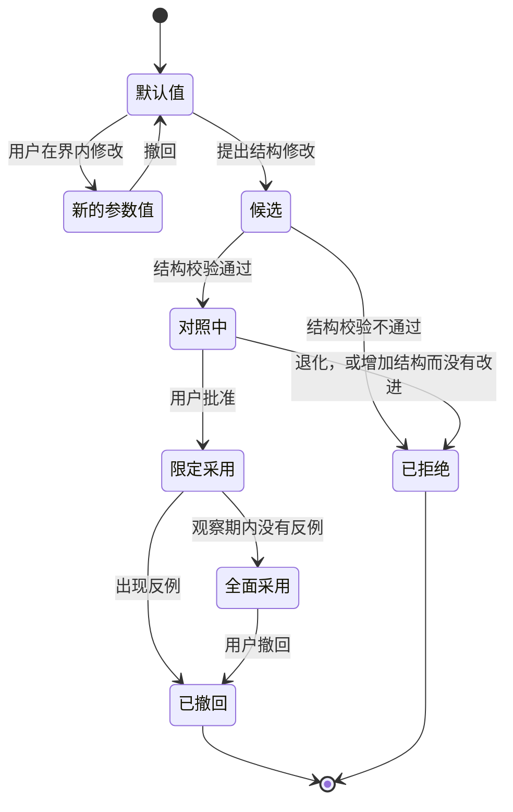
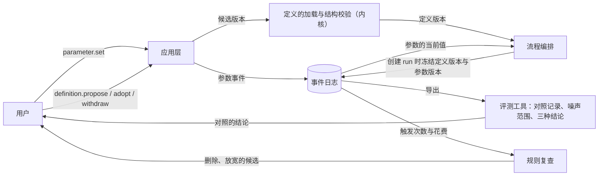

# 规则登记与参数设计说明

总图位置：第二节「定义」方框；第四节「定义」的缝；第五节第二层的限定采用。依据：[D38 系统意图与基础规则](../requirements/system-intent.md)（N-T2、N-T3、N-P1 至 N-P3、N-A3 至 N-A5、N-K5、N-K6）、[实验规约](../research/experiment-protocol.md)、[评测场景设计说明](evaluation-scenarios.md)、[D09 循环次数与超时限制](../requirements/execution-limits.md)。

## 1. 要解决的问题

规则登记与参数要做到下面几条：

- **规则带理由。** 每条规则写明数值、理由与可调性，同一个数值只写在一处；规则可以按证据放松或删除，文档之间的数值一致。
- **改数值不用发布新版本。** 应用层有读取与修改的命令，改动便宜、可以撤回，对照实验做得了。
- **版本比较有噪声范围。** 偶然的波动不被当成改进或回归。
- **成本在度量里。** 用量配上单价算出费用，质量相同的两个版本可以按成本选择。

## 2. 规则登记

规则登记不另建系统：在定义现有的条目上增加四项记录与取值界限，全部条目合起来就是规则登记。

```json
{
  "run_time_limit_sec": {
    "value": 7200,
    "bounds": [600, 86400],
    "kind": "parameter",
    "form": "boundary",
    "guards": "不收敛的 run 持续消耗",
    "cost": "正在收敛的长任务被记为失败，需要另开事项",
    "relax_when": "因 time_limit 失败的 run，未满足的验收条件数在最后三轮仍在下降",
    "tighten_when": "超时的 run 都处于停滞",
    "origin": "D09，用户原话：尽可能放开限制，确定收敛即可"
  }
}
```

- `kind`：`parameter` 在界限以内由用户直接修改；`structure`（组织、许可关系、角色、判定点、循环层）走候选、结构校验与用户批准。
- `form`：`permission`（许可）、`boundary`（边界）、`admission`（接纳条件）。规则只能写成这三种形式之一，表达顺序的规则没有对应的形式（[循环与收敛设计说明](loops-and-convergence.md)「防止滑向静态编排的判据」）。
- 基础规则不在登记里，写在[基础规则文本](../foundation-rules.md)与内核清单中。
- 登记的范围包括设计说明里的全部常量：语义系统的工作上限与栏目上限、旧工具结果的保留量、校准的样本数与精确率、停滞的轮数、执行槽位、心跳与就绪时限、各种等待的时长上限。每个常量的默认值、范围和理由写在对应的设计说明里，登记照着实现（见下一条）。
- 设计说明与登记的关系：登记里的 value 是初始值，bounds 是界限，随发布走；设计说明是它们的来源。每个常量在设计说明的「边界与范围」里写默认值、范围和理由，范围型的写范围就够；登记照着实现，界限同设计说明的范围，origin 写回那份说明的小节标题（不写节号和行号）；一个常量只在一份设计说明里写数，别的文档引用那份的小节标题；改常量先改设计说明（改动记在 `docs/CHANGELOG.md`），再由工单改登记，实施者认为范围不合适就交回架构师，不自己改；运行中的现值是参数事件（本说明第 3 节），不在登记里也不在文档里，调参不改设计说明。

## 3. 参数怎样成为带版本的数据

1. 发布的定义给出默认值与界限。事项创建时冻结定义版本及其中每条规则的取值界限。事项创建流程同时把当时解析出的运行实际数值限额写入事项记录；这些数值限额属于事项事实，后续恢复缺失的 run 时保持不变。
2. 参数的当前值写成事件，带修改者、原值、新值与理由。全局参数版本保留为全局现值的内容摘要。项目覆盖按项目范围记录来源与内容摘要；运行的冻结快照保存全局来源版本、该项目的覆盖来源、事项已解析限额及最终有效取值，先应用全局值，再应用允许的项目覆盖，最后沿用事项已解析的实际限额。全局摘要相同不代表两个项目的有效取值相同，重放按运行中保存的有效快照核对。全局修改以全局参数版本作为基准，项目级修改以该项目有效参数的版本作为基准，相应查询返回所需版本。
3. 创建 run 时按事项冻结的定义校验当前参数值，并把本 run 使用的参数取值与参数版本写进运行开始事件；该 run 进行期间不变。事项记录中已经解析出的运行实际数值限额沿用事项记录，不被恢复时的参数现值覆盖；其余按 run 生效的参数在创建时从当前值取样。进程重启且事项记录的定义版本仍是当前版本时，事项事件已提交但 运行开始事件 尚未提交的启动恢复按事项记录的定义版本、取值界限和运行实际数值限额补建 run，并只为尚未解析为事项实际限额的参数取恢复时现值。若应用升级后事项记录的定义版本与当前版本不同，恢复不得静默用新定义补建；按定义版本差异的恢复决定处理，保留事项记录并保持没有 运行开始事件，直到按该决定建立新事项或恢复到可用的定义版本。已有 运行开始事件 的 run 恢复时只使用事件记录的冻结值，不重新读取参数现值。
4. 每次请求与每次裁决记录定义版本与参数版本。
5. 修改者有三种：用户；确定的调节规则（例如[验证密度](independent-verification.md)，界内、写成事件）；观察者与部门只能提出候选。
6. 参数修改只作用于之后创建的 run；达到上限而停止的 run 不因为参数修改而继续。同一事项产生的返工 run 在各自 运行开始事件 时按该事项冻结的定义与当时适用的参数现值建立自己的快照。普通事项因升级重新开始时建立新事项并关联原运行，新事项重新冻结定义。建档因升级重新开始沿用建档事项身份与原始快照，是否采用新定义按定义版本差异的决定处理，不能仅因创建新 run 静默改变已有事项的定义；建档修改轮同样沿用事项定义。每个新 run 在上述定义与事项限额约束下冻结其余参数。
7. 项目级参数：检查时限与建档的单轮上限可以按项目设置，写在项目流中，在每个新 run 创建时与全局参数现值一并冻结。

## 4. 对照

对照记录由评测工具保存在被评系统之外，采样之前写好：

```json
{
  "experiment": "ctx-shared-vs-isolated-01",
  "question": "共享上下文是否减少询问与返工，同时不增加质检误放行",
  "factor": ["roles.*.visibility", "verification.judge_before_explanation"],
  "baseline": {"definitions": "sha256:aaa…", "parameters": "sha256:bbb…"},
  "candidate": {"definitions": "sha256:aaa…", "parameters": "sha256:ccc…"},
  "tasks": ["scenario-1@3", "scenario-2@2", "scenario-3@2"],
  "runs_per_task": 3,
  "runs_per_task_max": 6,
  "primary": {"metric": "qa_false_release", "rule": "non_inferior", "margin": 0},
  "secondary": ["asks", "reworks", "completion", "requests", "cost", "elapsed"],
  "noise": {"source": "同一版本的重复运行", "method": "配对的随机化检验"},
  "fixed_before_sampling": "<采样之前的日期>",
  "verdict": null
}
```

判断改动的效果是否超过噪声：

1. 改动分两类。只影响裁决、阈值、检测与画面的改动不改变模型看到的内容，用已有的事件日志离线重新裁决：同一批记录的模型输出，新旧规则各判定一遍，没有模型带来的噪声。影响模型输入或行为的改动（上下文、Prompt、限额、组织）才重新运行。
2. 重新运行的对照按实验规约：采样之前写好约定；同一任务两个版本配对；独立的样本单位是任务。
3. 噪声范围来自同一版本的重复运行。候选与基线的差值用配对的随机化检验，同时列出逐任务的差值。
4. 三种结论：
   - 改进：主要指标的差值超出噪声范围，并且没有任何任务出现超出范围的退化；
   - 退化：任一任务出现超出范围的下降，或过程检查点失败，或质检误放行增加；
   - 无差别：其余情况。
5. 无差别的改动只在它降低成本或删除结构时采用；增加结构的改动必须达到改进。
6. 次数：先按每个场景 3 次判定；结论是无差别、并且预期的效果值得继续时，补到事先写好的次数（6 次）。只在 3 次与 6 次两个位置查看结果，不因中途看见优势而停止。
7. 优先使用波动小的指标：隐藏检查的通过数优先于裁判的打分。
8. 三个场景、每边 3 至 6 次只能分辨较大的差异；分辨不出的小改进按无差别处理。
9. 本节是 Yudao 两个版本之间的对照。Yudao 对单个 agent（OpenCode）的对照不用这里的主要指标，按[评测场景设计](evaluation-scenarios.md)「Yudao 对单个 agent」判定。

由用户发起的前两次对照：共享上下文对比隔离上下文（3.9 中完成，见[验证的独立性设计说明](independent-verification.md)「共享上下文的一组对照」）；质检重新运行工程检查的比例。

## 5. 采用与撤回



- 版本不可变，按内容摘要标识；撤回就是采用上一个版本。
- 正在运行的 run 按自己冻结的值结束；事项冻结的定义版本与上限不随参数修改或进程重启改变。
- 已经发生的外部效果按动作契约处理，撤回不会让它们消失。
- 收紧可以由确定的规则在界内自动生效；放宽只经对照与用户。

## 6. 规则复查与淘汰

- 发起：每个阶段结束时的规则复查，由代码从事件统计每条规则的触发次数与花费，生成一张表；用户随时可以发起；阶段五起由演化模块提出候选。
- 证据：
  - 触发次数为 0，并且它拦截的失败属于质量或效率类：列为删除的候选；
  - 触发次数高，并且被拒绝以后重新提交的内容摘要没有实质变化：列为放宽或改写的候选；
  - 删除与放宽都在回归场景上对照，结论是不劣于才采用。
- 拦截严重后果的规则（越界写入、未授权的外部动作、内核守卫）不按触发次数淘汰，它们的租金是一条故障注入测试，证明该拦截的时候确实拦截。
- 撤回：被删除的规则所拦截的那类失败再次出现时（按停止原因或缺陷类别识别），恢复上一个版本；这一步属于收紧，可以在界内自动生效。
- 结构（部门、角色、观察者、判定点、循环层）用同一个办法：独立性声明里写的那类错误，最近的运行里它有没有拦截到；去掉它的对照不劣于时删除。核验角色不按这一条删成开环；自举的定义必须有核验角色（[形态与核验角色设计说明](forms-and-verifier-role.md)「开环完成」）。

## 7. 成本

- 度量四种花费：模型用量与费用、经过的时间、占用用户的次数与等待时长、检查与工具的执行时间。费用等于用量乘以单价，单价由用户在模型管理页为每个模型访问定义填写；没有单价时费用保持未知，不填零。
- 用量缺失时费用同样保持未知；统计列出有效与未知样本数，缺失值不参与均值和噪声范围。统一计算合同见 [评测场景设计](evaluation-scenarios.md)「指标」与「报告与版本比较」。
- 成本进入采用规则：质量不劣于时选择成本更低的；质量更好而成本更高时，报告每提高一个百分点完成度多花的费用，由用户决定；增加结构的改动同时列出维护成本（内核行数与规则条数的变化）。
- 规则的租金使用同一组单位。
- 收敛检测把单位进展的花费（每满足一条验收条件的用量）作为停滞的辅助信号。
- 运行中的硬边界仍然只有时间与轮次，不建立费用预算与额度预留。

## 8. 规则登记的初始内容

初始内容已按本节转写进 [harness/definitions/rules.json](../../harness/definitions/rules.json)，此后四项记录写在定义里；数值（默认值与范围）与理由写在对应的设计说明里，登记照着实现，不在本节重复。全部条目由 `definitions.Rule` 校验：缺四项记录、界限、种类、形式或来源，以及形式不在这三种之内，都会使定义加载失败并写明文件与条目。

没有先行的数值约束的条目同样登记，功能实现时从登记读取现值。条目名按「领域.条目」命名：`context.column_limit.catalog`、`wait.desktop.max_sec`、`verification.recheck_ratio`。

下面保留这次转写的依据：

| 规则 | 出处 | 拦截什么 | 花费多少 | 放松或收紧的证据 |
| --- | --- | --- | --- | --- |
| 运行时间上限 7200 秒 | `limits.json` | 不收敛的 run 持续消耗 | 正在收敛的长任务被记为失败，需要另开事项 | 放松：因时间上限失败的 run，未满足的验收条件数在最后几轮仍在下降。收紧：超时的 run 都处于停滞 |
| 激活次数与模型步数上限 999999 | `limits.json` | 现值拦截不到任何失败 | 没有 | 收敛状态上线以后，按停滞与震荡出现时的轮次分布确定数值；拿不到证据就删除这两个字段 |
| 连续第 4 次回复不调用工具时暂停 | `limits.json`、D09 | 模型只回复文字、不推进工作 | 误伤的次数，加上用户处理一次决定请求 | 放松：用户对这类决定请求选择「继续」并且随后正常完成的比例高 |
| 检查与命令的时限 600 秒 | `limits.json` | 检查停住不返回 | 长检查无法运行，Yudao 自己的集成层超过这个时限 | 成为项目级参数，按项目记录的检查用时分布设定 |
| 询问链不超过 3 层（`organization.ask_chain_max_depth`） | `rules.json` | 两个部门来回追问，花费过高才失败 | 超过层数的追问被拒绝 | 被层数上限拒绝的询问记录显示挡住了需要的追问时放松 |
| 核验角色只认自己本次激活的回执（`verification.recheck_ratio` 为 1.0） | `harness/validation.py` | 核验角色照搬被核验方的结论 | 同一快照上的同一检查重复运行 | 阶段一、二保持现值；调节规则在阶段四（[验证的独立性设计说明](independent-verification.md)「先判断后看解释」） |
| 可见范围的现值 | `roles.json` | 验证者被作者的材料带偏 | 重复探索与部门之间的询问 | D32 新增的一组对照 |
| 审查者看不到本部门记录的事实、决定、推测与画像 | 部门内多角色设计 | 审查被已有结论带偏 | 审查者重复查证 | D26 的对照里加一组可见的取值 |
| 同一项目一次只进行一个事项；同一时刻只有一个角色写代码 | [Stage 3 计划](../archive/stage-3-plan.md)、D35 | 合并冲突与基线变化 | 吞吐量受限 | 采纳写回与合并后重新验证建成以后放开 |
| 嵌套深度的上限（`loop.nesting_max`） | [循环与收敛设计](loops-and-convergence.md)「循环层的声明」、总图第三节、[形态与核验角色设计说明](forms-and-verifier-role.md)「子组织（位置与规矩）」 | 记录变成一棵难以审计的树 | 更深的拆分不可用 | 上限必须存在，由内核的边界核对；子循环与子事项共用这一个上限，都计入嵌套深度；数值写在定义里，随子循环与子事项的运行记录调整，经用户批准 |
| 连续 3 轮没有进展时重新规划；同一计划条目第 2 次被退回时提醒用户 | D26 | 停滞、反复退回 | 重新规划的请求；对用户注意力的占用 | 提醒以后用户有动作的比例；重新规划以后恢复进展的比例 |
| 同一故障连续 2 次修复失败后停止自动修复；观察窗口 24 小时；备份保留 3 份 | 运维部门需求 | 修复循环不收敛 | 等待用户 | 阶段三运行以后的故障记录 |
| 每个场景每边的运行次数与最多次数；每次运行的时长 | 评测场景设计 | 单次运行的偶然结果 | 模型用量与时间 | 属于评价标准，只由用户修改 |
| 判定点的校准样本的批数与每批条数；随机抽取由用户裁定的比例；启用所需的精确率 | 语义系统设计、元观察需求 | 阈值在样本上偶然成立 | 标注与用户裁定的时间 | 复核批次上的准确率区间足够窄时减少 |
| 工作上限；旧工具结果的保留量与最少省量 | 语义系统设计 | 请求过长、缓存失效 | 用量超过工作上限时提前清理旧工具结果，压缩阈值不受它限制 | 按模型与任务的实际请求长度分布调整；理由沿用 Anthropic 工具结果清理的默认触发值 |
| 栏目上限：目录、画像、常驻教训、账本、轨迹节录 | 语义系统设计 | 单个栏目挤占请求 | 内容被截断或合并 | 上下文清单记录的「被上限挡在外面的条目数量」持续为 0 时可以收紧，持续很大时放宽 |
| 每次对外提交必有一条针对该版本的审查通过记录（`review.ratio`） | 部门内多角色设计 | 没有经过第二双眼睛的成果交出部门 | 每次提交多一次审查请求 | 连续一致以后按比例抽审 |
| 执行槽位默认 3 个，由 `parameter.set` 修改 | 阶段需求概览 | 机器与模型服务过载 | 并行度 | 槽位长期占满或动作排队时放宽 |
| 新建事项之前解析事项所用定义里的每个角色，任何一个失败时拒绝新建 | [模型管理设计](model-management.md)「部门与角色的模型选择」 | 事项中途因模型不可用而失败 | 任一角色的引用失效都挡住整个项目 | 只解析本事项种类会用到的角色 |
| 摘要与整理请求使用模型声明的最低推理档位 | [模型管理设计](model-management.md)「推理档位」 | 摘要请求的推理成本 | 摘要质量 | 压缩失败率与压缩后的返工率 |
| 截图等比缩小到限定尺寸以内；每个桌面会话开始前经用户同意 | [浏览器与 computer use 设计](browser-and-computer-use.md)「屏幕与桌面会话」与「坐标空间与截图」 | 请求成本；与用户争用鼠标键盘 | 细节丢失；等待用户 | 前者按模型的图像输入能力调整；后者在用户不在场的时段可以改为常设授权 |
| 就绪时限 | 浏览器与 computer use 设计 | 启动失败的交付占住试用会话 | 启动慢的交付被判为失败 | 按项目记录的启动用时分布调整 |
| 等待的时长上限：等待模型服务 24 小时、等待机器 24 小时、等待桌面 8 小时、等待桌面解锁 8 小时；超过时发出决定请求，选项是继续等待或停止事项 | [循环与收敛设计](loops-and-convergence.md)「一定会停」 | 用户不在场时长时间无声的等待 | 超过时占用用户一次 | 覆盖用户一个工作日或一个晚上不在场；按等待的实际时长分布调整，用户在超过以后多数选择继续等待时放宽 |

数值与范围写在「出处」一列那份设计说明里。

## 9. 命令与事件

| 命令 | 对象 | 生效方式 |
| --- | --- | --- |
| `parameter.set` | 界内的参数：时间上限、轮次上限、验证密度、可见范围、判定点的阈值、等待的时长上限、执行槽位、项目级的检查时限 | 写成事件，之后创建的 run 使用；执行槽位从下一次调度起生效 |
| `definition.propose` | 循环方式：增减角色、部门、核验角色、观察者；路由；许可关系；判定点的位置；是否允许子循环 | 生成候选版本并运行结构校验 |
| `definition.adopt`、`definition.withdraw` | 候选与已采用的版本 | 用户批准后在写明的范围内采用；撤回即采用上一个版本 |
| `experiment.start` | 两个版本与任务集 | 交给评测工具，结果回填对照记录 |

没有指定某个部门开始工作的命令（谁开工由事项所用的路由决定，见[形态与核验角色设计说明](forms-and-verifier-role.md)「直做」与[三部门的循环结构](department-loop.md)「部门按关注的成果开始工作」），也没有修改基础规则与内核清单的命令。读取模型与界面见[应用层与接口层设计说明](app-and-interface.md)。

## 10. 模块交互



## 11. 验收

- 修改一个限额或一个角色的可见范围不需要发布新版本；修改写成事件；撤回是一条命令。
- 参数修改以后，已有 运行开始事件 的 run（包括已停止的 run）使用事件中冻结的值；之后创建的 run 使用创建时的参数现值，并按所属事项冻结的定义校验；重放可以核对。事项创建事件 已提交而 运行开始事件 缺失时，恢复使用事项记录的定义版本、规则界限和已解析的运行实际数值限额；仅对尚未解析为事项实际限额的 run 参数记录恢复时的现值。
- 定义中每条限额与规则有四项记录与界限；结构校验拒绝没有填写的条目。
- 一份对照报告给出改进、无差别、退化之一，附噪声范围、逐任务的差值与费用。
- 一次规则复查表：每条规则的触发次数、花费与结论。

## 12. 与现有设计的关系

- [总体架构](architecture/overall-architecture.md)「十项长期决定」：定义仍然带版本，参数的当前值写成事件。
- [评测场景设计说明](evaluation-scenarios.md)：版本比较使用本说明第 4 节的规则；报告包括费用与检验覆盖比例。
- [语义系统设计说明](semantic-system.md)：工作上限与栏目上限是规则登记的条目。
- [验证的独立性设计说明](independent-verification.md)：可见范围、先判断后看解释与验证密度都是本说明的参数。
- [循环与收敛设计说明](loops-and-convergence.md)：循环层与等待的时长上限是登记的条目。
