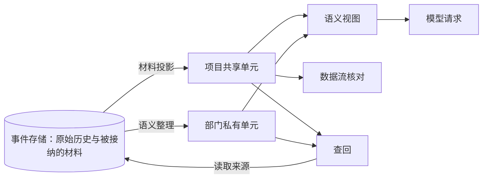
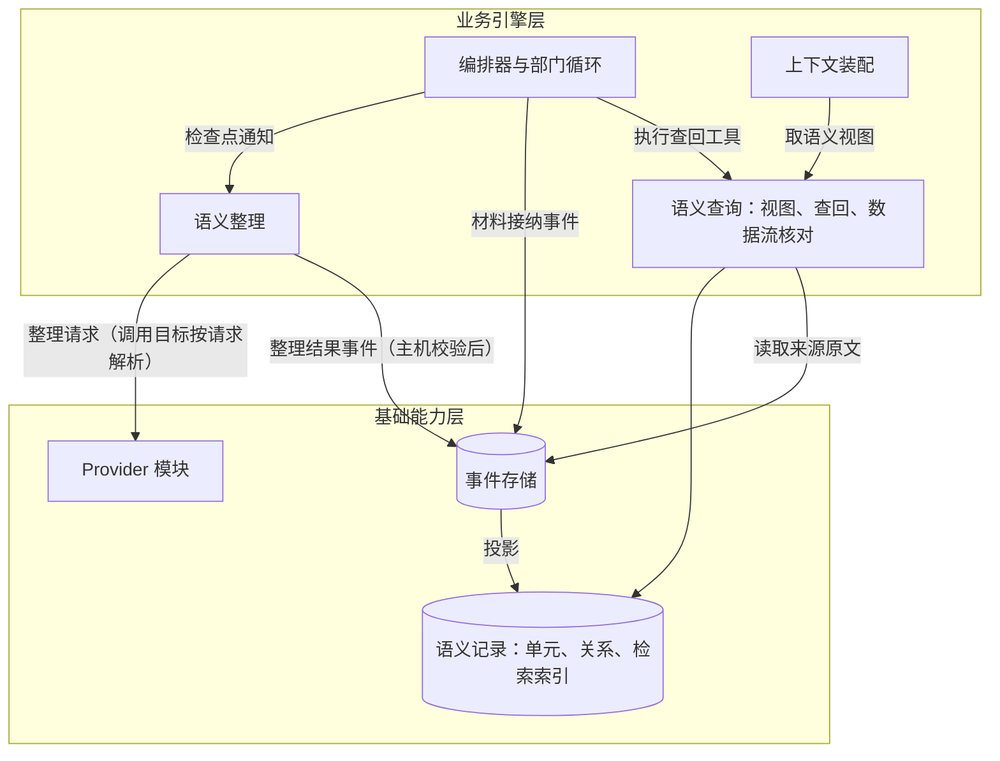
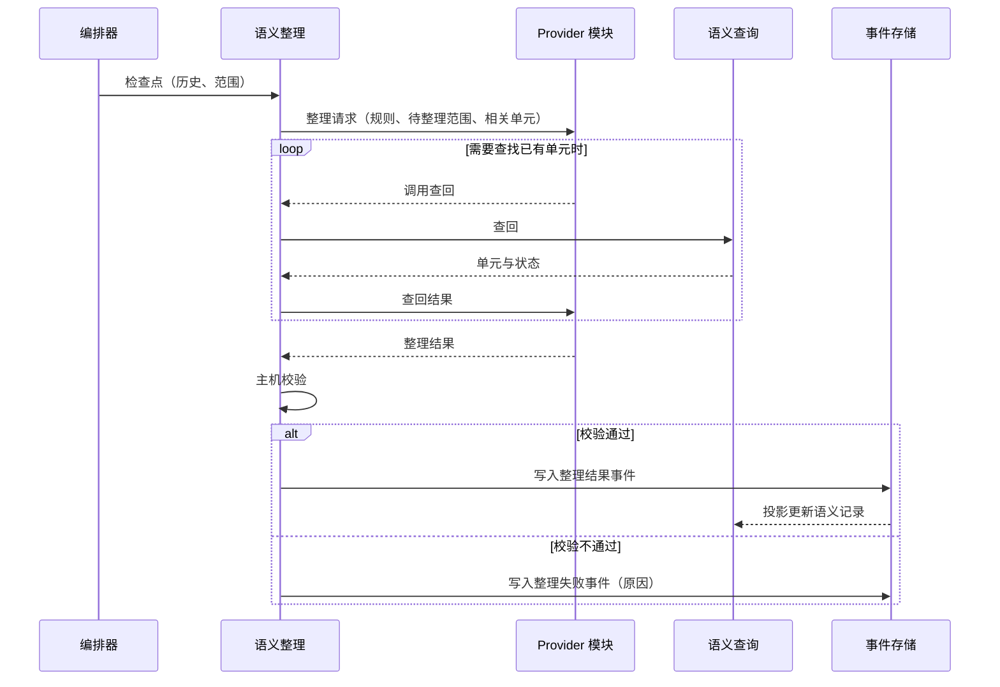

# 语义系统设计说明

日期：2026-09-24。状态：设计草案，未实施。用户决定语义系统作为单独的项讨论，检索方式列为 TODO（第 7.4 节）；第 11 节的规则待用户确认。需求：[D25 语义系统](../requirements/semantic-system.md)。调研：[语义系统与部门内多角色：参照调研](../research/semantic-system-and-department-roles.md)。相关设计：[模型管理设计说明](model-management.md) 第 8 节（上下文容量与压缩）、[部门内多角色设计说明](department-roles.md)。术语以 [CONTEXT.md](../../CONTEXT.md) 为准，本说明新增的术语在用户确认后写入。

## 1. 要解决的问题

1. 部门历史只增加。当前在接近窗口上限时生成一段文字摘要。旧决定与新决定同时出现在摘要或历史中时，模型会把旧内容当作候选事实，并偏向与自身已有认识一致的那一条（调研第 4 节）。
2. 项目上下文没有上限，也会丢失早期要求。项目上下文文本逐条列出全部已采纳事项，随采纳增长（模型管理设计说明第 12 节「固定材料上限」）；它只携带最近一次采纳成果的产品合同，更早事项确立的要求不再进入请求。
3. 数据流转无法核对。产品合同中的要求与验收条件是没有编号的文本列表，工程计划、交付、质检检查与缺陷之间没有明确关联，无法判断每条要求是否都被计划、实现并检查。
4. 部门内多角色（D26）需要部门内共享、带来源的知识，角色之间不共享对话。

语义系统把被接纳的材料与部门历史分解为带类型、来源与有效状态的语义单元及其关系。每次模型请求只放入当前有效的单元和简短的更替链。原始历史与旧单元保存在事件存储中，按需查回，查回结果带失效说明。

## 2. 参照对象与取舍

| 方面 | 参照 | Yudao |
| --- | --- | --- |
| 原始记录 | Graphiti 保留 episode 原文；Letta 保留完整消息库 | 事件存储保存全部原始历史（D08）。语义记录是事件的投影，可以从事件重放重建 |
| 更新方式 | Graphiti 给旧事实写入失效时间，保留不删除；Mem0 论文版由模型在新增、更新、删除、不变中选择，v3 改为只新增后，会变化的属性新旧并存 | 模型提出新增、取代、失效、关联与冲突；主机校验后写入事件；旧单元保留 |
| 整理时机 | Letta sleep-time 在若干步之后或压缩时整理；OMP local 记忆先抽取、再合并 | 在一段工作结束、压缩之前与事项结束时整理，不在每一步整理 |
| 检索 | Graphiti、Mem0 使用向量、全文与图关系混合召回 | TODO，单独讨论（第 7.4 节） |
| 注入量 | Graphiti 约 1.6k token；OMP 记忆上限 5000 token；Claude Code 记忆加载 25KB | 语义视图上限 8192 token，更替链不超过 10 行 |
| 与压缩的关系 | Claude Code 压缩后从磁盘重新注入记忆；OMP 在压缩前把记忆拼进摘要请求 | 压缩前先整理；摘要只记录工作过程，有效状态由语义视图重新提供 |
| 旧工具结果 | Anthropic context editing 把旧工具结果换成占位文本；OpenCode prune 清除 40k token 之外的旧工具输出 | 已整理范围内、位于近期保留区之前的工具结果，在请求中换成带事件引用的占位文本 |

## 3. 概念

- **语义单元**：一条有类型的陈述，带来源事件、作用范围与有效状态。
- **语义关系**：两个语义单元之间有类型的关联。
- **作用范围**：项目共享或部门私有。项目共享单元只由主机接纳的结构化材料生成，项目内所有部门可见。部门私有单元由该部门的历史整理而来，只有该部门可见；D26 实施后，该部门的全部角色可见。
- **有效状态**：有效、已取代、已失效、有冲突。
- **材料投影**：主机接纳结构化材料时，按固定规则生成项目共享单元，不调用模型。
- **语义整理**：在检查点对一段历史发出的模型请求，产出新增、取代、失效、关联与冲突，由主机校验后写入。
- **语义视图**：一次模型请求中由语义系统选出的单元与更替链。
- **查回**：部门在工作中按需查询语义单元及其来源原文的工具。
- **数据流核对**：主机根据项目共享单元之间的关系，计算要求、计划、交付、检查与缺陷之间的覆盖情况。

## 4. 分层与模块关系

| 层 | 语义系统的部分 | 职责 | 边界 |
| --- | --- | --- | --- |
| 用户与观察层 | 部门工作间的语义面板 | 显示有效单元、冲突、更替链与来源 | 只读，不修改单元 |
| 业务引擎层 | 语义整理、语义查询 | 在检查点发出整理请求并校验结果；为请求选出语义视图；执行查回；计算数据流核对 | 不改变事项状态，不决定部门交接与放行 |
| 基础能力层 | 语义记录 | 由事件投影出单元、关系与检索索引，保存在现有 SQLite 中；检索方式为 TODO | 只由事件生成，没有其他写入途径 |

依赖规则：

- 语义系统依赖事件存储、工件存储与 Provider 模块。整理请求的调用目标按[模型管理设计说明](model-management.md)第 6 节解析。
- 编排器通过三个入口使用语义系统：通知检查点、取语义视图、执行查回工具。语义系统不调用编排器，不改变事项状态。
- 语义记录只由事件投影生成。整理结果、材料接纳都先写成事件，重放事件即可重建全部单元，重放不调用模型。

## 5. 语义单元与关系

### 5.1 单元类型

| 类型 | 作用范围 | 来源 | 内容 |
| --- | --- | --- | --- |
| 用户输入 | 项目共享 | intend 的每个版本 | 原文引用，作为追踪的起点 |
| 要求 | 项目共享 | ProductSpec 的要求 | 一条要求 |
| 验收条件 | 项目共享 | ProductSpec 的验收条件 | 一条验收条件，关联它细化的要求 |
| 约束 | 项目共享 | ProductSpec 的边界、约束、非目标、致命条件 | 一条约束，标明属于哪一类 |
| 决定 | 项目共享 | 当前有效的补充决定 | 一条决定与理由 |
| 计划项 | 项目共享 | 工程计划的任务 | 一个计划项，关联它实现的要求 |
| 交付 | 项目共享 | 交付说明 | 一次交付，关联它完成的计划项与处理的缺陷 |
| 检查结果 | 项目共享 | 质检结论中的检查 | 一次检查的结果与证据引用，关联它验证的验收条件 |
| 缺陷 | 项目共享 | 质检结论中的缺陷 | 一个缺陷，关联它违反的验收条件或要求 |
| 放行 | 项目共享 | 质检放行结论 | 一次放行与所依据的交付 |
| 事实 | 部门私有 | 部门历史 | 部门观察到的项目、代码、环境或用户情况 |
| 发现 | 部门私有 | 部门历史 | 查资料得到的结论，带外部来源 |
| 理由 | 部门私有 | 部门历史 | 部门内部某项选择的原因 |
| 待决问题 | 部门私有 | 部门历史 | 尚未得到回答的问题 |
| 工作做法 | 部门私有 | 部门历史 | 在本项目中有效的工作做法，例如测试命令需要的参数 |

每个部门私有单元是一条陈述，长度上限 500 字符，超过时拆成多个单元。

### 5.2 关系类型

| 关系 | 方向 | 说明 |
| --- | --- | --- |
| 取代 | 新单元 → 旧单元 | 同一类型，旧单元变为已取代 |
| 细化 | 验收条件 → 要求 | |
| 实现 | 计划项 → 要求 | |
| 完成 | 交付 → 计划项 | |
| 验证 | 检查结果 → 验收条件 | |
| 违反 | 缺陷 → 验收条件或要求 | |
| 处理 | 计划项或交付 → 缺陷 | |
| 依据 | 事实、发现或理由 → 任一单元 | 私有单元支持某项要求、决定或计划 |
| 冲突 | 单元 ↔ 单元 | 两个单元互相矛盾，尚未决定哪一个有效 |

### 5.3 材料条目编号与关联

数据流核对依赖材料条目之间的明确关联，因此结构化材料的格式需要修改：

- ProductSpec 的要求、验收条件与约束，每条带项目内稳定的编号；每条验收条件写明它细化的要求编号。
- 工程计划的每个任务写明它实现的要求编号。
- 交付说明写明本次完成的计划项编号与处理的缺陷编号。
- 质检结论的每个检查写明它验证的验收条件编号；每个缺陷写明它违反的验收条件或要求编号。
- 主机校验提案时，检查引用的编号存在并且当前有效；引用不存在时按现有的提案拒绝流程处理。
- ProductSpec 的变更记录按编号逐条写明新增、修改、保留或废止及理由。修改的条目保留原编号，生成新版本单元并取代旧版本；废止的条目变为已失效，原因取自变更记录。

编号在项目内稳定。项目中的新事项从项目当前有效的要求集合开始：修改已有要求时引用原编号，新增要求取得新编号，未提到的已有要求保持有效。编号的具体格式由实施工单确定。

### 5.4 有效状态与位置

每个单元记录：类型、内容、作用范围、所属事项、所属部门（私有单元）、来源事件、开始位置（生成它的事件）、结束位置（使它被取代或失效的事件）、取代者、原因，以及写入时的日期。开始与结束位置使用事件序号，因此可以按任一事件位置回答「当时哪些单元有效」，结果与重放一致。日期用于显示与更替链排序。

## 6. 写入

### 6.1 材料投影

主机接纳以下事件时，按固定规则生成或更新项目共享单元，不调用模型：用户输入版本、ProductSpec、补充决定、工程计划、交付说明、质检结论。映射规则见第 5.1 节的「来源」列与第 5.3 节。材料投影在投影计算中完成，与事件同步，重放时得到相同结果。

### 6.2 语义整理

**触发**（检查点）：

1. 一段工作结束：部门激活结束；D26 实施后，也包括每个角色任务结束。
2. 压缩之前：对将要进入摘要的范围中尚未整理的部分先整理。
3. 事项结束（完成、失败或取消）：整理剩余范围，并对本事项新增的私有单元做一次重复合并（第 6.4 节）。

**请求**：

- 调用目标与请求档位：与该历史所属部门（D26 实施后为所属角色）的工作请求相同，按模型管理设计说明第 6 节解析。输出上限与摘要请求相同，为 13107。
- 输入：整理规则；待整理范围（该历史自上次成功整理之后的原始记录，工具输出按压缩的规则截断到 2000 字符）；与范围内提到的要求、计划项、文件路径有结构关联的有效单元。
- 整理请求可以多次调用查回工具查找已有单元，最后提交整理结果。整理请求的步数与时间计入事项的模型步骤统计与运行时间限制，与压缩请求一样可以观察、可以取消。

**整理结果**：一组操作。

| 操作 | 内容 |
| --- | --- |
| 新增 | 类型、内容、来源事件、关系 |
| 取代 | 新单元、被取代的已有单元、原因 |
| 失效 | 已有单元、原因、来源事件 |
| 关联 | 两个单元与关系类型 |
| 冲突 | 两个单元与矛盾之处 |

**主机校验**：

- 来源事件在待整理范围内，并属于该部门。
- 被取代、被失效的单元存在、当前有效、属于该部门的私有范围，并与新单元类型相同。项目共享单元只能作为依据与冲突关系的对象，不能被整理取代或失效。
- 类型属于第 5.1 节的部门私有类型，内容长度符合上限。

任何一项不通过时，整个整理结果不生效，记录原因；该范围保持未整理状态，下一个检查点再次整理时覆盖它。整理失败不改变事项状态。

### 6.3 冲突

冲突不会让两个互相矛盾的单元同时以「有效」出现在请求中。有冲突的单元成对显示在语义视图的最前面，并写明矛盾之处；D26 实施后同时列入部门账本。

- 两个私有单元冲突：部门在之后的工作中核实，下一次整理用取代或失效解决。
- 私有单元与项目共享单元冲突（例如代码中的事实与某条要求矛盾）：部门通过专家请求（D07）交给产品，产品以新的 ProductSpec 版本处理；材料投影更新后，整理把对应私有单元失效或保留，冲突关系随之结束。

### 6.4 重复合并

事项结束时的整理把本事项新增的私有单元按类型分组，连同与它们关联的已有单元交给模型，由模型提出取代操作合并重复。校验规则与第 6.2 节相同。

## 7. 读取

### 7.1 语义视图

语义视图放在固定材料之后、部门历史之前。内容依次为：

1. 有冲突的单元，成对显示并写明矛盾之处。
2. 项目共享的有效单元。本次请求的固定材料中已经全文包含的材料（例如当前 ProductSpec 与工程计划），其单元不再重复列出。
3. 本部门私有的有效单元，按待决问题、工作做法、事实、发现、理由分组。
4. 更替链：与以上单元相关的最近更替，每条一行，写明日期、旧内容摘要、新单元编号与原因，从旧到新排列，总共不超过 10 行。

每个单元显示编号、类型与来源事件编号。

**上限**：8192 token。超出时按上面的顺序保留，同一顺序内先保留与当前工作关联的单元（当前工作涉及的要求、计划项、缺陷及其关联单元），其次按时间从新到旧；未放入的单元只写一行「另有 N 条有效单元未列出，可以用查回工具查询」。

**稳定性**：语义视图只在语义记录变化时（检查点与材料接纳）重新计算，两次检查点之间保持不变，请求的前段因此保持相同，提示缓存继续有效。

**记录**：每次请求的上下文清单（ContextManifest）记录语义视图包含的单元编号与版本。

### 7.2 查回与读取来源

两个工具，供部门（D26 实施后为全部角色）与整理请求使用：

- **查回**：参数为查询文本、类型、是否包含已取代与已失效的单元、关联于某个单元。范围是项目共享单元加本部门私有单元，任何情况下不返回其他部门的私有单元。检索方式见第 7.4 节；命中的单元可以按关系扩展一层，再按类型与状态过滤。结果从旧到新排列；非有效单元附「已被 U-x 取代，日期，原因」或「已失效，日期，原因」；来自未被采纳事项的单元附「来自未采纳事项」。
- **读取来源**：按单元的来源事件返回原文，范围限制与查回相同；原文过长时按现有的大结果规则截断，并可以继续取回。

### 7.3 数据流核对

主机根据项目共享单元的关系计算以下事实，不调用模型：

| 核对项 | 何时有意义 |
| --- | --- |
| 每个已接收的用户输入版本都已被 ProductSpec 处理 | 产品提交之后 |
| 每条有效决定在新版本 ProductSpec 中已保留、整合或废止 | 产品提交之后 |
| 每条有效要求至少有一条验收条件 | 产品提交之后 |
| 每条有效要求至少有一个计划项 | 工程计划接纳之后 |
| 每个计划项在交付中已完成，或写明未完成的原因 | 交付之后 |
| 每个未关闭的缺陷在下一次交付中有处理 | 返工交付之后 |
| 每条有效验收条件都有检查结果与证据 | 质检结论之后 |
| 有冲突的单元数量 | 任何时候 |

每一项给出通过与否以及缺失的条目编号。核对结果用于部门账本（D26）、事项总览，以及下面这条放行规则：质检放行时，本事项 ProductSpec 的每条有效验收条件都必须有通过的检查结果与证据引用，否则主机拒绝放行提案。

### 7.4 检索方式（TODO）

用户决定语义系统作为单独的项讨论，检索方式先列为 TODO。讨论时需要确定：

- 是否使用向量检索。Graphiti、Mem0 采用向量、全文与图关系混合召回（调研第 2 节）。Yudao 的 Provider 模块目前只接入对话协议，使用向量检索需要新增向量协议、向量模型的测试与准入，以及本地向量存储。路线图第 4 节的原则是已有存储能满足时不新增图数据库或向量库。
- 全文检索的中文处理。本机 SQLite 3.50.4 的 FTS5 trigram 分词已验证可以对中文做子串匹配。
- 换一种说法的内容怎样找到，以及重复单元怎样合并（第 6.4 节）。

语义视图的选择按结构关系完成（第 7.1 节），不依赖检索方式。

## 8. 与压缩的关系

压缩规则以[模型管理设计说明](model-management.md)第 8 节为准，语义系统修改其中的摘要内容，并增加工具结果占位：

- 压缩前，对将要进入摘要的范围中尚未整理的部分先整理（第 6.2 节触发条件 2）。整理失败时压缩照常进行。
- 摘要只记录工作过程：目标与当前任务、进展（已完成、进行中、受阻）、下一步、关键上下文（正在处理的文件、未完成的操作）。决定、约束、事实等已经成为语义单元的内容，摘要只写单元编号；没有成为单元的内容（整理失败或未覆盖）照常写入摘要。
- 摘要引用的单元已被取代或失效时，请求中在该编号后附「已被 U-x 取代」或「已失效」。
- 工具结果占位：已整理范围内、位于近期保留区（约 20000 token，模型管理设计说明第 8.5 节）之前的工具结果，在请求中换成「工具结果已整理：事件 E，单元 U-a、U-b」。原文可以用读取来源工具取回。占位只在检查点更新，与语义视图一起保持两次检查点之间的请求前段不变。
- 继续有效的规则：原始历史完整保留；部门分别压缩；摘要有来源、可以回查；固定材料不进入摘要；失败处理按模型管理设计说明第 8.7 节。

## 9. 跨事项

- 单元记录所属事项。事项成果被项目采纳后，该事项的单元进入项目层，之后新事项的语义视图可以包含它们。未被采纳的事项，其单元只在本事项内有效，其他事项查回时标注「来自未采纳事项」，不进入语义视图。
- 项目共享单元构成项目的要求集合：项目内各事项确立的要求、验收条件、约束与决定，连同跨事项的取代关系。新事项的产品部门从这个集合开始（第 5.3 节）。
- 项目上下文文本保留项目名称、长期目标、当前采用成果与本事项；已采纳事项列表与仍有效的决定改由语义视图提供。项目上下文文本因此有上限，更早事项确立的要求也不再丢失。
- 同一项目的并行事项（3.4B）：陈旧成果未被采纳时，它的单元留在本事项内。
- 部门私有单元跨事项延续：同一项目中，后续事项的同一部门可以看到已采纳事项的私有单元。

## 10. 界面与观察

- 部门工作间新增语义面板：按类型列出有效单元、冲突与更替链；每个单元可以打开来源事件；可以切换显示已取代与已失效的单元。
- 请求详情显示本次语义视图包含的单元（来自上下文清单）。
- 整理请求与压缩请求一样，在模型请求记录中可以查看输入、输出与用量。
- 事项总览显示数据流核对结果与缺失条目。
- 界面细节需要先做原型，之后按原型修改本节。

## 11. 待用户确认的规则

以下规则按参照对象与现有约束提出，用户尚未逐项决定：

1. 语义视图上限 8192 token，更替链不超过 10 行（第 7.1 节）。
2. 整理只在一段工作结束、压缩之前与事项结束时进行（第 6.2 节）。
3. 已整理的旧工具结果在请求中换成占位文本，原文按需读取（第 8 节）。
4. 结构化材料的条目带项目内编号并写明关联，主机校验引用（第 5.3 节）。这修改四类提案的内容格式。
5. 质检放行要求每条有效验收条件都有通过的检查结果与证据（第 7.3 节）。
6. 项目上下文文本中的已采纳事项列表与有效决定改由语义视图提供（第 9 节）。
7. 未被采纳事项的单元不进入其他事项的语义视图（第 9 节）。

## 12. 对现有设计与实现的影响

| 位置 | 改动 |
| --- | --- |
| [模型管理设计说明](model-management.md) | 第 8.4 节摘要结构按本说明第 8 节修改；第 12 节 TODO 中「部门知识图谱、语义压缩与事实检索」「固定材料上限」两行改为指向本说明 |
| [D10](../requirements/context-compaction.md)、[D08](../requirements/department-history.md) | 开头补充说明：语义分解与数据流按本说明实施，原始历史保留的要求不变 |
| 提案合同 | 四类提案的条目增加编号与关联（第 5.3 节）；质检放行增加验收条件覆盖检查 |
| 上下文装配 | 增加语义视图部分与清单记录；项目上下文文本删去已采纳事项列表与有效决定 |
| 事件与投影 | 新增材料投影、整理请求与整理结果事件；投影生成语义记录与检索索引 |
| 工具 | 新增查回与读取来源两个工具，所有部门可用 |
| 恢复（3.1） | 整理请求没有外部副作用，中断后重新整理同一范围 |
| ADR | 用户确认后新增：语义记录是事件的投影，模型整理结果经主机校验后写入 |
