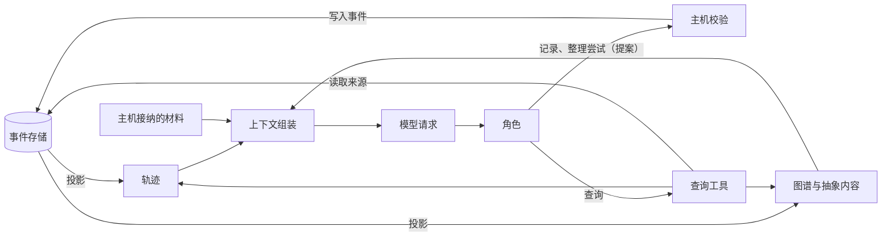
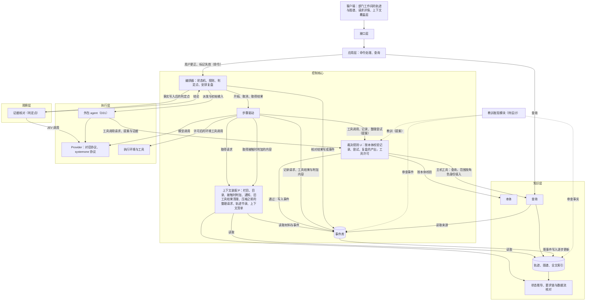
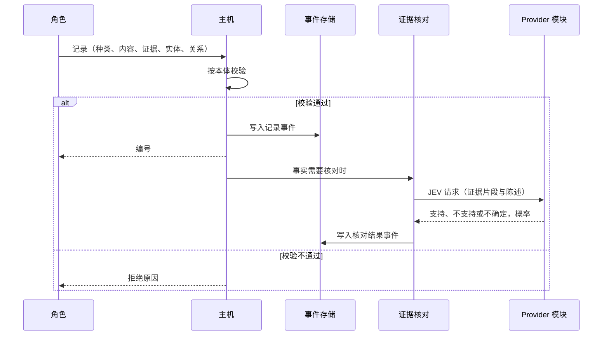
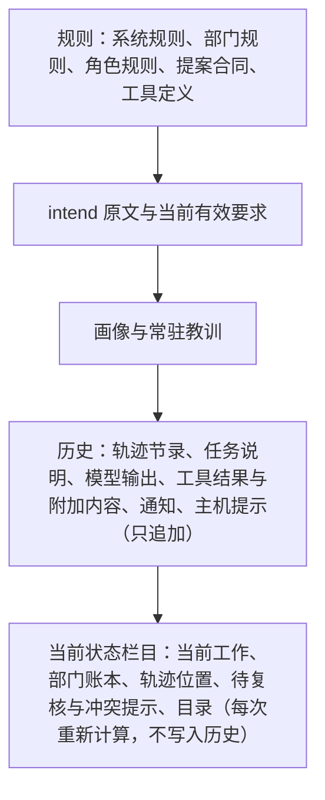
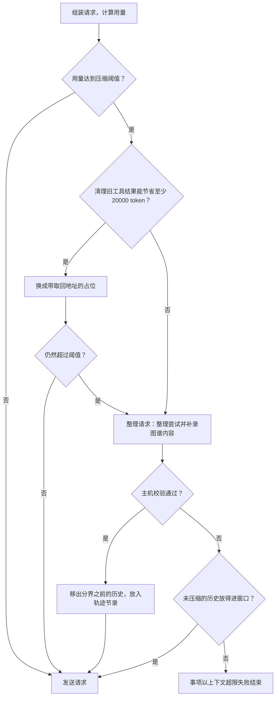

# 语义系统设计说明

日期：2026-09-26。状态：设计说明，规则已由用户确认（[D25](../requirements/semantic-system.md) 2026-09-25 至 2026-09-26）；2026-09-26 按[总体架构](architecture/overall-architecture.md)与用户的决定修改：第 4 节写明语义系统在总体架构中的位置，教训与洞见由教训发现模块找出（第 8、15 节）。未实施；路线位置为 Stage 5（部门内协作、上下文与界面）。2026-10-07 按 [ADR-0029](../adr/0029-departments-form-by-information-cohesion.md) 与 [ADR-0030](../adr/0030-rules-are-provisional-defaults.md)：第 7.2 节证据核对按判定点合同，第 9 节可见范围，第 10.8 节审查者，第 10、11 节的上限与阈值进入规则登记。需求：[D25 语义系统](../requirements/semantic-system.md)。调研：[Semantica 参照调研](../archive/research/semantica-reference.md)、[上下文组装：参照调研](../archive/research/context-assembly-reference.md)、[JEV 决策模型](../research/jev-decision-model.md)、[惊讶与预测误差](../archive/research/surprise-and-prediction-error.md)、[语义系统与部门内多角色：参照调研](../archive/research/semantic-system-and-department-roles.md)。ADR：[0008](../adr/0008-trajectory-and-graph-as-event-projections.md)、[0009](../adr/0009-deterministic-context-assembly.md)、[0010](../adr/0010-control-core-drives-role-steps.md)、[0019](../adr/0019-project-stream-across-versions.md)。相关设计：[总体架构：职责分层](architecture/overall-architecture.md)、[模型管理设计说明](model-management.md)第 8 节、[部门内多角色设计说明](department-roles.md)。术语以 [CONTEXT.md](../../CONTEXT.md) 为准。

2026-10-14 状态补充：交接已改为部门按关注的成果开始工作（[ADR-0039](../adr/0039-departments-work-from-watched-outputs.md)），轨迹的「交接」一层改称「一轮工作」；本文的用语在实施语义系统之前按[术语表](../../CONTEXT.md)修改。

## 1. 要解决的问题

Agent 最重要的是上下文管理。一个长任务运行很久以后，只靠对话历史，上下文会放不下，内容也会混乱：旧决定与新决定同时出现时，模型会把旧内容当作候选事实。模型得到的上下文越长，表现越差，即使相关信息全部在里面（调研第 4.7 节）。

语义系统分两部分：

1. **整理**：把工作过程记录成轨迹，把工作中得到的内容记录成图谱。轨迹与图谱是事件的投影，可以完整重放。
2. **上下文组装**：每次模型请求时，从轨迹、图谱与材料中选出正确、当前有效的内容，按固定的栏目交给角色；其余内容由角色按需取得。

语义系统还承担第二项职责：为系统演化（Stage 6）提供过程记录（轨迹与决定）与语义工程（项目术语、教训、洞见）。

现行实现的具体问题（调研第 1 节）：

- 25 个部分全部由主机推送，拼成一条消息，各部分都不设上限；动态内容与固定规则交错排列，跨激活时提示缓存几乎不命中。
- 部门没有读取材料、查询事件或历史的工具。
- 项目上下文文本逐条列出全部已采纳事项，随采纳增长；更早事项确立的要求不再进入请求。
- 要求、计划、交付、检查与缺陷之间没有编号与关联，无法核对每条要求是否被计划、实现并检查。
- 压缩生成一段文字摘要，旧决定与新决定混在摘要里。

## 2. 参照对象与取舍

| 方面 | 参照 | Yudao |
| --- | --- | --- |
| 图谱的存放 | Semantica 的 ContextGraph 在进程内，来源模块另用 SQLite 保存版本链，写入不经许可 | 轨迹与图谱是事件的投影，存放在现有 SQLite 中；角色只提交记录，主机按本体校验后写成事件（[ADR-0008](../adr/0008-trajectory-and-graph-as-event-projections.md)） |
| 来源与时间 | Semantica 借用 W3C PROV-O；Zep 的事实带现实中成立的时间与系统中写入、失效的时间 | 来源关系对应 PROV-O；每条内容有有效开始、有效结束、记录时间、被取代时间 |
| 本体 | Semantica 用类与属性定义本体，约束写成形状 | 本体由系统定义，随系统版本发布；主机按本体校验每次记录 |
| 常驻与按需 | Claude Code 预先放入 CLAUDE.md，文件即时取得；OMP 规则只列名称与描述，全文用 `rule://` 读取；Letta 常驻块有上限，存档按需搜索 | 常驻栏目、目录、按需取得、接触时附加四种方式配合使用 |
| 按接触的文件附加 | opencode 读取文件时附加该目录的 AGENTS.md；OMP 按编辑路径注入规则 | 角色读取或修改文件时，附加关联在这个文件实体上的要求与本部门内容 |
| 选择方式 | Zep 用向量、全文与图关系混合召回再重新排序；OMP、opencode 的规则放入按固定规则 | 只按结构关系与固定规则，不调用模型，不使用向量检索（[ADR-0009](../adr/0009-deterministic-context-assembly.md)） |
| 缓存 | Manus 把 KV 缓存命中率作为最重要的指标，前段稳定、只追加；Zep 把上下文块放在历史之后 | 栏目按变化频率排列，历史只追加，当前状态栏目放在末尾 |
| 旧工具结果 | Anthropic 清理旧工具结果；OMP、opencode 保护最近 40000 token；Manus 换成只含路径的紧凑表示 | 达到压缩阈值时，先把旧工具结果换成带取回地址的占位 |
| 压缩 | OMP 与 opencode 生成文字摘要；Anthropic 的长时运行 harness 用进度文件与功能清单在窗口之间交接状态 | 由角色整理的尝试与图谱内容代替被移出的历史，历史开头放主机生成的轨迹节录 |
| 可靠程度 | Semantica 按佐证来源数分四级 | 显示证据种类与数量；证据是否支持陈述由 JEV 核对 |
| 每次请求的记录 | OMP、opencode 都没有逐请求的清单 | 上下文清单记录每条内容与放入原因 |

## 3. 概念

- **轨迹**：一个事项工作过程的结构化记录，分事项、交接、计划条目、角色任务、尝试五层。
- **图谱**：由证据、事实、知识、决定、要求、实体、推测七类内容及其关系构成；在七类内容之上有教训、洞见、画像三类抽象内容。
- **本体**：图谱的类型规则，由系统定义，主机据此校验每次记录。
- **状态**：有效、待复核、取代、失效。
- **证据核对**：记录事实时，由 JEV 判断证据是否支持陈述。
- **栏目**：一次请求中的一个组成部分，有固定的来源、上限与重新计算的时机；分常驻栏目与当前状态栏目。
- **焦点**：当前工作直接引用的条目；目录按与焦点一步相连的关系选出内容。
- **目录**：与焦点相关的图谱内容的清单，只列编号、种类、一行标题与状态。
- **接触时附加**：角色读取或修改文件时，主机把关联在这个文件上的有效内容附在工具结果后面。
- **通知**：主机在安全节点追加进角色历史的消息，说明已经发生的变更或新到达的输入。
- **轨迹节录**：压缩以后放在历史开头、由主机按轨迹节点生成的工作过程记录。
- **工作上限**：与模型窗口无关的请求长度上限，压缩阈值不超过它。
- **上下文清单**：一次请求实际放入的内容、版本、放入原因与排除项的记录。

## 4. 分层与模块关系

层次沿用[总体架构：职责分层](architecture/overall-architecture.md)。每次模型请求都由控制核心装配。自有角色不设单独的会话执行者，控制核心驱动每个角色任务的步骤：装配请求（P），经 Provider 调用模型（f），每个工具调用先经过 U 的工具许可，主机工具由控制核心执行、环境工具在执行环境中执行，记录结果并附加内容，进入下一步（[ADR-0010](../adr/0010-control-core-drives-role-steps.md)，总体架构第 5 节）。执行层只有 Provider、执行环境与工具、外包 agent（[D31](../requirements/outsourced-agent-roles.md)）。控制核心的每个决定只依据已记录的事实与事先规定的去向，判定点上的模型判断先写成事件再被使用（[ADR-0028](../adr/0028-three-means-of-adjudication.md)）。本说明其余各节中的「主机」指控制核心。

语义系统在总体架构中分布在四个位置（总体架构第 3 节）：

| 位置 | 语义系统的部分 | 边界 |
| --- | --- | --- |
| 知识层 | 本体；轨迹、图谱、全文索引这三种投影；状态推导（有效、待复核、取代、失效）；要求链与数据流核对；查询 | 只由事件生成，不调用模型，不写入事实 |
| 控制核心 · P | 栏目、目录、接触时附加、通知送达、旧工具结果清理、压缩之前的整理请求、轨迹节录、上下文清单 | 只读取知识层、材料与事件 |
| 控制核心 · U | 按本体校验记录、尝试、复盘的产出 | 校验与写入在写入口的同一个事务里完成，并行角色同时新建同名实体时只有一个成功 |
| 控制核心 · 流程编排 | 在成果被接纳后与事项结束时安排复盘，由中心角色通过一次单独的请求完成 | 复盘的产出作为提案经过 U |
| 观察层 | 证据核对，是第一个判定点；JEV 的判断先写成 `judgement_recorded` 事件，再交给编排器 | 只能让事实变为待复核 |

教训与洞见由教训发现模块找出，它的位置待设计（第 8、15 节）；找出的教训与洞见作为提案经过 U。

依赖规则：

- 依赖方向：事件库 ← 知识层与运行状态投影 ← P 与 U ← 应用层 ← 接口层 ← 客户端；控制核心只通过合同调用执行层。
- 投影只由事件生成，随事件写入逐步更新并保存；从头重放只用于重建与核对重放一致，重放不调用模型，证据核对的结果从事件中读取。
- 角色只提交记录与尝试，由 U 按本体校验后写成事件。需要调用模型的整理工作（压缩之前的整理请求、复盘）由角色自己的请求完成，产出作为提案经过 U；教训发现模块找出的教训与洞见同样经过 U。知识层只保留确定的派生内容。
- 工具分两类（总体架构第 5.3 节）：主机工具（提交、记录、查询、读取材料、分派）由控制核心执行，查询范围由核心按角色身份填入，模型给出的参数不能扩大范围；环境工具（读写文件、运行命令）在执行环境中执行，结果回到核心后由 P 附加内容。
- P 与查询只读取知识层、材料与事件，不写入任何内容。
- 证据核对与模型请求都只通过 Provider 模块（[ADR-0007](../adr/0007-boundaries-for-distributed-deployment.md) 第 6 条）。
- 数据类型用 pydantic 定义，与 D30 的接口合同一起导出。

**事件流**（[ADR-0019](../adr/0019-project-stream-across-versions.md)）：事件日志中的流分项目流与 run 流。跨事项延续的语义内容写入项目流，跨 Yudao 版本保存；只在一次 run 中使用的内容写入 run 流，跟随应用版本。

| 内容 | 所属的流 |
| --- | --- |
| 要求类条目与要求编号（项目的要求集合）；主机接纳的材料中的条目（计划任务、交付、检查结果、缺陷、放行）与要求链关系 | 项目流 |
| 实体，以及文件实体的移动与删除 | 项目流 |
| 部门记录的事实、知识、决定、推测，以及它们的证据引用与关系；补充决定 | 项目流 |
| 画像；教训与洞见（教训发现模块写入） | 项目流 |
| 改变上述内容状态的记录：取代、冲突、失效、用户更正、待复核的触发与复核结论、证据核对结果 | 项目流 |
| 事项层轨迹的来源：事项的创建、在队列中的位置与最终结果 | 项目流 |
| 交接、计划条目、角色任务三层轨迹的来源事件；尝试的整理 | run 流 |
| 接触时附加、通知、主机提示、旧工具结果清理、整理请求、复盘请求、轨迹节录等压缩检查点、上下文清单 | run 流 |

整理请求与复盘请求产出的图谱内容与画像写入项目流。

- 项目流中的语义事件种类遵守 ADR-0019：只增加字段、事件种类或已有字段的取值，已有字段的含义不变；事件种类的字段登记在项目流的字段清单中。
- 图谱、全文索引、事项层轨迹与状态推导从项目流重建；交接、计划条目、角色任务与尝试四层轨迹从 run 流重建。上下文组装与查询读取两者。
- 升级时 run 事件版本相同：两类投影照常重建，run 按 3.1 自动继续。run 事件版本不同：跨事项的语义内容全部从项目流重建；未结束 run 的轨迹、尝试与压缩检查点不继续，事项按 ADR-0019 重新开始时，新的 run 从项目流中的要求集合、图谱与画像开始。
- 旧 run 事件版本的 run 流保留供查阅，不重建成投影：查询轨迹对这些事项只返回事项层节点；证据或依据引用的旧 run 事件，用读取来源查看事件原文。

## 5. 本体

本体由系统定义，随系统版本发布；本体的变化属于 Stage 6 的演化。图谱内容写入项目流（第 4 节），本体的变化只增加内容种类、实体类型、关系与字段，已有种类与字段的含义不变。主机按本体校验每次记录，不符合时拒绝并说明原因。

### 5.1 内容种类

| 种类 | 含义 | 必须附带 | 记录者 |
| --- | --- | --- | --- |
| 证据 | 可以查看的原始材料：事件、工件或外部来源；本身不作陈述 | 引用（事件编号、文件路径与行范围、外部来源工件的编号与行范围并附地址，或登记名与工具名；[网络取回与 MCP 工具设计说明](network-and-mcp.md)第 9 节） | 主机按引用建立 |
| 事实 | 关于本项目当前状态的陈述 | 至少一条证据；关于的实体 | 角色 |
| 知识 | 不依赖本项目状态、可以在事项之间复用的认识 | 外部来源，或在本项目中验证过的证据 | 角色 |
| 决定 | 一次选择 | 理由、依据、作出决定的角色 | 角色；产品部门的补充决定由主机从接纳的材料生成 |
| 要求 | 要求、验收条件与约束 | 项目内稳定编号（第 5.5 节） | 主机从接纳的 ProductSpec 生成 |
| 实体 | 被谈论的对象 | 类型、名称、一句说明 | 角色在第一次引用时建立；文件实体的移动与删除由主机记录 |
| 推测 | 还没有证据的陈述 | 关于的实体 | 角色 |
| 教训 | 以后应该怎样做或应该避免什么 | 依据（轨迹节点或图谱内容） | 教训发现模块（待设计，第 8 节） |
| 洞见 | 从多条内容中归纳出的规律或判断 | 依据 | 教训发现模块（待设计，第 8 节） |
| 画像 | 某个部门对一个实体的整体描述 | 依据；关于的实体 | 中心角色在复盘时 |

主机接纳的材料中的条目，由主机按固定规则生成，不调用模型：工程计划的任务、交付、检查结果、缺陷、放行。它们与要求一起组成要求链（第 5.3 节），所有部门可见。

项目术语表是语义工程的一部分：ProductSpec 中的术语条目作为「术语」类型的实体，由产品部门定义。

### 5.2 实体类型与实体身份

实体类型是固定清单：项目、模块、文件、接口、页面、数据表、外部服务、术语、用户角色。项目领域中的概念作为术语类实体。

- 实体的身份由「类型 + 名称」确定，在项目内唯一。文件以路径为名称，接口以调用方式为名称，术语以 ProductSpec 中的术语名为名称。
- 实体在第一次被引用时建立：角色在同一次记录中新建，附类型与一句说明；文件实体由主机校验路径存在；主机拒绝同类型同名的重复新建。
- 文件的移动与删除由主机按工作区的变化记录，移动记为取代，删除记为失效；关联在上面的事实变为待复核。
- 其他实体的改名或重复，由中心角色在复盘时合并，记为取代。

### 5.3 关系

| 组 | 关系 | 说明 |
| --- | --- | --- |
| 来源（对应 PROV-O） | 产生于、归属于、派生自、使用了 | 内容产生于哪个活动（事件、角色任务），归属于哪个角色，派生自哪些内容，活动使用了哪些内容 |
| 证据 | 支持、反驳 | 证据与事实、知识之间 |
| 关于 | 关于 | 内容与实体之间 |
| 依据 | 依据 | 决定、计划条目、抽象内容依据哪些内容 |
| 要求链 | 细化、实现、完成、验证、违反、处理 | 验收条件细化要求；计划任务实现要求；交付完成计划任务；检查结果验证验收条件；缺陷违反验收条件或要求；计划任务或交付处理缺陷 |
| 更替 | 取代、冲突 | 新内容取代旧内容；两条内容互相矛盾，尚未决定哪一条有效 |
| 轨迹 | 包含、导致 | 轨迹节点的层级；一个节点导致另一个节点（例如审查退回导致返工） |
| 实体之间 | 属于、依赖 | 文件属于模块；模块依赖外部服务 |

本体为每种关系规定可以连接的种类，主机校验。冲突关系记录冲突的类型（事实矛盾、要求矛盾、决定矛盾）与来源。

### 5.4 时间与来源

每条内容记录：种类、内容、所属事项、所属部门（部门记录的内容）、来源关系、状态，以及四个时间：有效开始、有效结束、记录时间、被取代时间。有效开始与有效结束使用事件序号，因此可以按任一事件位置回答「当时哪些内容有效」，结果与重放一致。

语义系统保留由惊讶得出的知识与教训，它们的来源关系指向那一次惊讶（第 15 节）。

### 5.5 要求类条目的编号

- ProductSpec 的要求、验收条件与约束，每条带项目内稳定的编号；每条验收条件写明它细化的要求编号。
- 工程计划的每个任务写明它实现的要求编号；交付说明写明完成的计划任务编号与处理的缺陷编号；质检结论的每个检查写明它验证的验收条件编号，每个缺陷写明它违反的验收条件或要求编号。
- 交付说明按完成的计划任务列出修改的文件；这些计划任务实现的要求，由知识层按要求链关联到这些文件实体（第 10.5 节）。
- 主机校验提案时，检查引用的编号存在且当前有效；不存在时按现有的提案拒绝流程处理。
- ProductSpec 的变更记录按编号逐条写明新增、修改、保留或废止及理由。修改的条目保留原编号并取代旧版本；废止的条目变为失效。
- 项目中的新事项从项目的要求集合开始：修改已有要求时引用原编号，新增要求取得新编号，没有提到的已有要求保持有效。编号写入项目流，跨 Yudao 版本保持含义；编号的格式由实施工单确定。

## 6. 轨迹

### 6.1 五层

| 层 | 节点 | 来源 |
| --- | --- | --- |
| 事项 | 一个事项 | 事项的创建与结束事件 |
| 交接 | 外层三部门循环中的每一轮交接 | 部门交接与提交接纳事件 |
| 计划条目 | 中心角色的工作计划条目 | 中心角色更新计划的提案事件 |
| 角色任务 | 中心角色分派给工具角色的一项工作 | 分派、交回、取消、失败事件 |
| 尝试 | 角色任务内部为同一个目的连续进行的一段工作；中心角色的尝试挂在本部门当前的交接节点下 | 角色整理后提交的尝试记录 |

每个节点记录起止位置（事件序号）、结果与因果（导致关系）。一个事项只有一份轨迹。事项层来自项目流，其余四层来自 run 流（第 4 节）。

### 6.2 生成

事项、交接、计划条目与角色任务四层由主机按固定规则从事件生成，不调用模型。尝试由角色整理（第 6.3 节），主机校验后写入。

### 6.3 尝试的整理

- 整理的时机：角色任务结束时，以及压缩之前（第 11.3 节）。中心角色没有角色任务，它的尝试挂在本部门当前的交接节点下，在部门交出成果之前与压缩之前整理。
- 每个尝试写明：目的、起止事件范围、结果、换用其他方法的原因。进行中的尝试另外写明已完成的部分、下一步、正在处理的文件与未完成的操作。
- 主机校验：事件范围属于该角色本任务的历史，范围之间不重叠，并覆盖需要整理的全部范围；不通过时拒绝并说明原因。

### 6.4 部门账本

部门账本是轨迹在部门这一层的视图：计划条目、每条分派给哪个角色、状态、审查次数与最近的审查意见、结果摘要，以及每一轮的进展判断与主机记录的进展事实（[部门内多角色设计说明](department-roles.md)第 12 节）。账本在上下文中的显示见第 10.3 节。

## 7. 写入

### 7.1 记录工具与主机校验

- 角色在工作中随时用记录工具记录事实、知识、决定与推测；工具角色的角色结果按同一结构提交。
- 主机按本体校验：种类存在；必须附带的项齐全；引用的证据、实体、要求与内容存在且在该角色的可见范围内；关系连接的种类符合本体。通过后写成事件，不通过时拒绝并说明原因，原因作为工具结果返回。
- 记录一条与已有事实矛盾的新事实时，必须写明取代哪一条，或记录为冲突；主机校验被取代的条目存在且有效。
- 压缩之前，角色检查即将移出的历史，补录漏记的事实与决定（第 11.3 节）。
- 每次记录、更正与失效都先写成事件；投影从事件生成。

### 7.2 证据核对

**适用范围**：证据种类为外部文档或需要解读的运行输出的事实。推测、阅读代码得出的判断、主机能精确计算的内容（检查是否通过、文件版本、引用是否存在）与跨多步的因果判断不做证据核对。

证据核对是第一个判定点，按[总体架构](architecture/overall-architecture.md)第 7.2、7.5 节的合同声明：问题（Noul）、参照材料（证据片段与陈述）、固定版本的模型、两个阈值、三种结果的去向、校准状态、拦截什么与花费多少。三种结果的去向：支持，事实保持不变；不支持，事实变为待复核；不确定，升级给更强的、与记录这条事实所用模型不同的模型，仍然不确定时只显示「不确定」标记，不改变事实的状态，并作为开环列出（判定点声明的去向）。

**做法**：

- 事实写入以后，主机把证据片段作为状态、把「只根据证据判断，陈述是否得到支持」作为 Noul 问题交给 JEV。Noul 只返回陈述为真的概率；主机按校准选出的两个阈值把概率分为支持、不确定、不支持。概率、分类、所用阈值与模型版本写成事件，附在支持关系上。
- 角色记录证据时，引用精确到行范围或片段，使核对的输入不超过 JEV 的长度上限（状态加问题 32000 token）。
- 证据与陈述都来自模型的产出或工作区，按不可信内容处理：核对结果只能使事实变为待复核，不能拒绝记录。
- JEV 请求失败时按 D17 的规则有界重试，仍然失败时写入核对失败事件并附原因，该事实显示为「未核对」。
- 组装时只读取记录的结果，每次请求不调用 JEV。

**接入**：JEV 的 systemone 接口作为 Provider 模块的一种协议接入（[ADR-0001](../adr/0001-endpoints-by-protocol-not-vendor.md)、[ADR-0033](../adr/0033-protocol-belongs-to-model-access.md)），在 Stage 5 完成；准入以判定点为单位，依靠校准。

**校准**（D28 的规则）：

- 样本集属于系统，按固定的 JEV 版本（例如 `jev-1.13.0`）校准一次；更换版本时重新校准。
- 样本从真实运行中记录的「陈述 + 证据」中抽取，分两批，每批 200 条（`calibration.batch_size`，暂定默认值，见规则登记）。
- 参照标注先由一个已准入的强 LLM 给出；JEV 与 LLM 结论不一致的样本，以及随机抽取的 10%（`calibration.sample_ratio`，暂定默认值，见规则登记），由用户在界面上裁定，以裁定结果为准。
- 阈值在第一批上选取，在第二批上复核；「不支持」的精确率达到 0.9（`calibration.min_precision`，暂定默认值，见规则登记）才启用。
- 启用之前，核对结果只记录，不显示给模型，也不改变内容的状态。启用之后，概率低于「不支持」阈值时，该事实变为待复核，原因写明核对结果；落在两个阈值之间为不确定，只显示标记。
- 每次核对写成 `judgement_recorded` 事件：输入摘要、问题、选项顺序（Noul 只有一条陈述，选项顺序为 `["true"]`）、模型版本、概率、所用阈值、结果与去向；重放使用记录的结果，不发出请求。模型版本变化、问题文本变化、抽样复核的不一致率超过界限时，状态自动回到只记录。

### 7.3 待复核

主机按固定规则把受影响的内容标为待复核。待复核的内容仍然可见并附原因，由相关角色复核后写入确认、取代或失效。

| 触发 | 变为待复核的内容 |
| --- | --- |
| 证据指向的文件或材料出现新版本 | 以旧版本为证据的事实 |
| 要求类条目被修改或废止 | 依据它的决定与计划条目 |
| 文件实体被移动或删除 | 关联在该实体上的事实 |
| 证据核对启用后，JEV 判断不支持 | 该事实 |
| 抽象内容的依据失效或变为待复核 | 依赖它们的教训、洞见与画像 |

知识不因项目变化自动变为待复核，只能由角色附证据记录失效。

### 7.4 取代与冲突

- 取代：新内容写明取代的旧内容与原因，旧内容的被取代时间与有效结束位置随之写入。
- 冲突：两条内容互相矛盾而尚未决定哪一条有效时，记录冲突关系与冲突类型。冲突的两条内容在上下文中成对显示，写明矛盾之处（第 10.9 节），并列入部门账本。部门记录的内容与要求矛盾时，部门通过专家请求（D07）交给产品部门，产品以新的 ProductSpec 版本处理。

### 7.5 用户查看与纠正

- 部门工作间可以查看本部门的轨迹与图谱，每条内容可以打开证据；事项总览显示从要求到计划、交付、检查的覆盖情况（第 13 节）。
- 用户可以把部门记录的事实、知识、决定或推测标为失效，或写入更正。这个操作作为用户命令写成事件，同时作为指导（D20）送到该部门经理。
- 要求类条目通过追加需求交给产品部门处理；轨迹只能查看。

## 8. 抽象层与复盘

教训、洞见与画像是在七类内容与轨迹之上归纳出的内容，都必须关联依据，主机校验依据存在。依据失效或变为待复核时，依赖它们的抽象内容也变为待复核。

- **教训与洞见**由教训发现模块找出：这个模块单独审查事件与事实，找出以后应该怎样做或应该避免什么（教训），以及从多条内容中归纳出的规律或判断（洞见），作为提案交给 U，按本体校验后写成事件；合并重复的教训与洞见、把被证明错误的标为失效，也由这个模块进行。模块可能与元观察（[D28](../requirements/meta-observer.md)）结合，参考主动推断与自由能原理，待设计，见 [D25](../requirements/semantic-system.md)「TODO：惊讶机制与教训发现模块」。设计完成之前，系统中没有教训与洞见。
- 教训关联实体时，通过接触时附加进入上下文；与具体实体无关的教训进入常驻栏目（第 10.2 节）。
- 洞见只能通过查询取得，主机不主动放入上下文。
- 教训是参考内容，主机不强制执行。需要强制执行的教训成为规则的候选，按 Stage 6 的规则变更流程处理，或由用户写进部门 Prompt。
- **复盘**由部门的中心角色进行，时间点是部门交出的成果被主机接纳之后，以及事项结束时。复盘由流程编排安排，中心角色通过一次单独的请求完成：读取本部门的轨迹与图谱，写出或更新画像，合并重复的实体；产出作为提案经过 U。D26 的角色机制实现之前，复盘由部门的单个 Agent 通过一次单独的复盘请求完成。
- **画像**按部门各自编写，每份上限 2000 token，写入时校验，超过时主机拒绝并说明原因。项目实体的画像称为项目画像。
- 教训、洞见与画像默认只有本部门可见（取值是参数），在同一项目的后续事项中继续有效。跨项目复用属于持续改进工作线，重复出现的教训作为候选，经过独立验证才能采用。

## 9. 可见范围与跨事项

**可见范围**：

| 内容 | 可见范围 |
| --- | --- |
| 事项层与交接层的轨迹 | 所有部门 |
| 要求类条目、主机接纳的材料中的条目、补充决定 | 所有部门 |
| 实体的名称、类型与说明 | 所有部门 |
| 部门记录的事实、知识、决定 | 共享一类：是否对其他部门只读可见由可见范围参数决定，现值是本部门可见，默认值取 D32 新增一组的结果 |
| 计划条目、角色任务与尝试（作者的过程） | 本部门 |
| 部门记录的推测 | 本部门 |
| 教训、洞见与画像 | 默认本部门可见，取值是参数 |

各部门使用同一套实体名称；关联在同一实体上的事实、知识与决定按可见范围参数显示，推测、教训、洞见与画像默认只有本部门可见。可见范围的宽度是角色定义中的参数（`roles.<角色>.visibility`，现值是暂定默认值，见规则登记），按信息的内聚划分，见[验证的独立性设计说明](independent-verification.md)第 2 节。知识只在本项目内使用。

**跨事项**：

- 跨事项读取的内容都来自项目流（第 4 节），Yudao 升级以后照常可用。
- 项目上下文文本包括项目名称、长期目标、当前采用的成果与本事项。已采纳事项的历史与仍有效的决定，由部门的项目画像与事项层轨迹提供。
- 项目内各事项确立的要求类条目构成项目的要求集合，新事项的产品部门从这个集合开始（第 5.5 节）。
- 已采纳事项中记录的内容在后续事项中继续有效，照常进入目录、接触时附加与查询。
- 未采纳事项中，知识与教训继续有效，处理与已采纳事项相同；事实、决定、推测与画像只能查询取得，标注「来自未采纳事项」。
- 还没有画像时，画像栏目写「尚无画像」；部门交出的成果第一次被接纳后的复盘写出画像。

## 10. 上下文组装

上下文组装在每次模型请求时由主机完成，只按结构关系与固定规则选择内容，不调用任何模型（[ADR-0009](../adr/0009-deterministic-context-assembly.md)）。同样的事件得到同样的请求内容。

### 10.1 栏目与顺序

栏目按变化频率从少到多排列：

- 历史只追加，已发出的内容不修改。历史的改写只发生在旧工具结果清理与压缩时（第 11 节）。
- 当前状态栏目放在历史之后，每次请求重新计算，不写入历史，由上下文清单记录。
- 一次角色任务中，工具定义保持不变；当前不允许的工具调用由主机拒绝并说明原因。
- 工具角色的分派说明、审查者的待审查成果与上一轮审查意见，作为任务历史的第一条消息放入。

### 10.2 常驻栏目

| 栏目 | 内容 | 上限 |
| --- | --- | --- |
| 规则 | 系统规则、部门规则（部门 Prompt）、角色规则（角色 Prompt）、提案合同、工具定义 | 不截断，计入工作上限 |
| intend 原文 | 事项原文的全部版本 | 不截断，计入工作上限 |
| 当前有效要求 | 本事项 ProductSpec 的要求、验收条件与约束（编号与原文），以及当前有效的补充决定 | 不截断，计入工作上限 |
| 项目上下文 | 项目名称、长期目标、当前采用的成果、本事项 | 固定格式 |
| 项目画像 | 本部门写的项目画像 | 2000 token |
| 常驻教训 | 本部门与具体实体无关的有效教训 | 4000 token |

- 规则、intend 原文与当前有效要求本身超过压缩阈值时，按[模型管理设计说明](model-management.md)第 8.7 节以上下文超限失败结束。
- 常驻教训超出上限时，依据多的在前，依据一样多时较新的在前，末尾写「另有 N 条教训，可以查询」；重复的教训由教训发现模块合并（第 8 节）。
- 还没有教训时，常驻教训栏目写「尚无教训」（第 8 节）。
- 每个有上限的栏目在标题中显示已用多少与上限。
- 项目中其他仍有效的要求，通过接触时附加（第 10.5 节）、目录（第 10.4 节）与查询（第 10.7 节）取得。产品架构师起草新事项的 ProductSpec 时，用查询分页取得项目的全部有效要求。

### 10.3 当前状态栏目

| 项 | 内容 | 上限 |
| --- | --- | --- |
| 当前工作 | 中心角色：进行中的计划条目与本部门当前的交接；经理：账本与数据流核对结果；工具角色：任务编号、目标与状态 | 随内容 |
| 部门账本 | 中心角色与经理：进行中与未开始的计划条目完整显示（状态、分派的角色、审查结论），已完成的条目每条一行 | 4000 token，超出时已完成的条目从最早的开始合并为一行「已完成 N 条」 |
| 数据流核对 | 经理：只列未通过的核对项与缺少的编号，通过的项合并为一行「其余 N 项通过」 | 计入账本的上限 |
| 轨迹位置 | 事项、交接、计划条目、角色任务、进行中的尝试 | 随内容 |
| 待复核与冲突提示 | 焦点与已附加内容中待复核的条目（附原因）与冲突的条目 | 2000 token，超出时写「另有 N 条」 |
| 目录 | 第 10.4 节 | 2000 token |

### 10.4 焦点与目录

- **焦点**：中心角色为本部门当前的交接引用的条目，以及进行中的计划条目与它们引用的要求与实体（D26 的角色机制实现之前，每个部门的单个 Agent 按中心角色取得焦点）；工具角色为分派说明引用的要求、计划条目、材料与实体。
- 目录列出与焦点一步相连、本角色可见（第 9 节）、状态为有效或待复核的内容。更远的内容由角色用查询取得。
- 排列：待复核与冲突在前；其余按依据焦点的决定、关于焦点实体的事实与知识、关联的要求、关联的教训与推测分组，组内较新的在前。
- 每条只列编号、种类、一行标题与状态，全文按需取得。
- 超出上限时写一行「另有 N 条，可以查询」。已经通过接触时附加进入历史的内容不再列入目录。

### 10.5 接触时附加

- 角色用读取或修改工具接触某个文件时，主机把以下内容附在工具结果后面：关联在这个文件实体上的有效要求与验收条件，以及关联在它上面、本角色可见的有效事实、决定、教训与实体画像。
- 关联在文件上的要求包括两种：直接关于这个文件实体的要求；通过交付关联的要求，即交付说明中修改了这个文件的计划任务所实现的要求（第 5.5 节）。
- 排列：待复核与冲突的条目、要求、有运行验证的内容、其他内容。每个实体上限 2000 token，超出时末尾写「另有 N 条，可以查询」。
- 同一任务中同一实体只附加一次；附加过的内容变化后再附加一次。压缩以后，附加记录清空，角色再次接触文件时重新附加。
- 附加内容随工具结果写入历史，参照 opencode 读取文件时附加 AGENTS.md 的做法（调研第 3.2 节）。

### 10.6 通知

- 变更与新到达的输入由主机在下一个安全节点作为通知追加进角色的历史：其他部门的询问与回答、用户指导、缺陷、要求被修改、关联内容变为待复核或失效、提案被拒绝的原因。
- 通知写明发生了什么、涉及的编号与一行说明，全文按需取得。通知留在历史中，直到压缩。
- 送达对象沿用 D26：其他部门与用户的输入经经理转交中心角色，中心角色用追加说明转给工具角色。角色目录或已附加内容中的条目变为待复核、失效或出现冲突时，主机直接通知该角色。
- 安全节点的规则与 D06、D20 相同。
- 主机提示与通知分开：主机针对模型自己的回复追加的消息（例如回复没有调用工具时提示需要调用工具或提交提案）称为主机提示，同样写成事件、进入历史并留到压缩；连续达到上限时以 `no_tool_call` 暂停（#47）。

### 10.7 查询工具

| 工具 | 作用 |
| --- | --- |
| 查询图谱 | 按实体、编号、种类、关系、状态、时间与全文查询图谱内容；可以要求包含已取代与已失效的内容，结果写明被哪一条取代、日期与原因 |
| 查询轨迹 | 按事项、交接、计划条目、角色任务、尝试查询轨迹节点及其起止位置与结果；旧 run 事件版本的事项只有事项层节点（第 4 节） |
| 读取来源 | 读取证据原文与事件原文，包括被清理的旧工具结果 |
| 读取材料 | 读取 PRD、工程计划、交付说明、质检结论等被接纳的材料，以及本部门的草案与角色产出的材料 |

- 全文检索使用 SQLite FTS5 trigram，可以对中文做子串匹配；不使用向量检索。换一种说法的内容，靠实体身份与关系找到；重复的实体在复盘时合并，重复的教训由教训发现模块合并。
- 结果每条写明编号、种类、状态、证据种类与证据核对结果；开头一行说明状态的含义；分页返回；提供简洁与详细两档。
- 查询范围不超过角色的可见范围（第 9 节）与角色的查询范围（第 10.8 节）。来自未采纳事项的内容标注来源。

### 10.8 各角色的上下文

| 角色 | 常驻栏目 | 当前工作 | 目录与接触时附加 | 按需取得 | 历史 |
| --- | --- | --- | --- | --- | --- |
| 中心角色 | 全部 | 账本中进行中的计划条目 | 有 | 本部门可见范围 | 在事项内连续 |
| 经理 | 规则、intend 原文、当前有效要求、项目上下文、项目画像 | 账本与数据流核对结果 | 没有 | 本部门可见范围，只读 | 本部门的对外往来 |
| 探索者、主程 | 全部 | 分派说明 | 有，焦点来自分派说明 | 本部门可见范围 | 探索者只在本任务内；主程在事项内连续 |
| 审查者 | 规则、intend 原文、当前有效要求 | 分派说明、待审查的成果、上一轮审查意见 | 接触时只附加要求与验收条件、知识与教训 | 要求、材料、证据原文、知识与教训 | 只在本任务内 |

- 审查者每次从新的上下文开始，看不到作者的历史，先提交独立判断，再看作者的解释（[验证的独立性设计说明](independent-verification.md)第 4 节）。看不到本部门记录的事实、决定、推测与画像是审查者可见范围的暂定默认值（见规则登记），另设一组可见的取值用于对照；审查者自己从成果与依据出发核对（调研第 4.5 节 Cognition 的审查 Agent）。
- 中心角色看不到工具角色的历史，只看到角色结果；需要细节时用查询与读取来源。
- 预测性探索的任务按工具角色处理，焦点来自分派说明；PRD 更新后，依据旧版本的预测性任务取消，它们记录的内容变为失效。

### 10.9 状态与可靠程度的呈现

- 主机主动放入的内容（常驻栏目、目录、接触时附加、通知）只包括有效与待复核两种状态；待复核的条目附原因，例如「证据文件 src/a.py 已有新版本」。取代与失效的内容只在查询时按要求显示。
- 互相冲突的条目成对显示，写明矛盾之处。
- 事实与知识附证据种类及各类的数量。证据种类由主机按引用确定：检查与命令的运行事件为「运行验证」，工作区文件为「阅读代码」，外部来源为「外部文档」，主机接纳的材料与部门往来记录为「材料」。推测单独标为推测。
- 证据核对启用后，附核对结果（支持、不支持、不确定与概率）；核对失败的显示「未核对」。
- 主机不计算综合的可靠分数。栏目上限不够时，同一栏目中依次优先保留有运行验证的内容、证据核对结果为支持的内容。

### 10.10 上限

各栏目上限是规则登记中的暂定默认值（`context.column_limit.<栏目>`，见规则登记），下表写现值；本说明第 10.2、10.3、10.5 节与第 11.3 节出现的栏目上限数值同样如此。

| 栏目 | 上限 | 超出时 |
| --- | --- | --- |
| 规则、intend 原文、当前有效要求 | 不截断，计入工作上限 | 本身超过压缩阈值时以上下文超限失败结束 |
| 项目画像 | 2000 token | 写入时拒绝 |
| 常驻教训 | 4000 token | 按依据数量与时间排列，写「另有 N 条教训，可以查询」 |
| 部门账本（含数据流核对） | 4000 token | 已完成的条目合并为「已完成 N 条」 |
| 待复核与冲突提示 | 2000 token | 写「另有 N 条」 |
| 目录 | 2000 token | 写「另有 N 条，可以查询」 |
| 接触时附加 | 每个实体 2000 token | 写「另有 N 条，可以查询」 |
| 轨迹节录 | 13107 token | 从最早的条目开始合并为每个计划条目一行 |
| 角色结果摘要 | 5000 字符 | 提交时拒绝（D26） |

### 10.11 上下文清单

每次请求的上下文清单记录：每个栏目的来源、版本、token 估算、已用与上限；栏目中每条内容的编号、版本与放入原因（例如「关联当前计划条目 P-3」「角色读取了 src/a.py」「依据焦点 R-12」）；被上限挡在外面的条目数量；缓存断点位置或缓存键；压缩与清理的覆盖范围。清单写入请求事件，界面按栏目显示（第 14 节）。

## 11. 长度控制

### 11.1 工作上限与阈值

- 用量按[模型管理设计说明](model-management.md)第 8.2 节计算。
- 压缩阈值取「窗口 − 预留量」与工作上限两者中较小的一个。工作上限取规则登记中 `context.work_limit_tokens` 的值（暂定默认值 100000 token，见规则登记；理由：Anthropic 工具结果清理的默认触发值）。预留量按模型管理设计说明第 8.3 节。

### 11.2 旧工具结果清理

- 达到压缩阈值时，先清理旧工具结果：最近 40000 token（`context.tool_result_keep_tokens`，暂定默认值，见规则登记）之外的工具结果换成带取回地址的占位，写明工具名称、参数摘要与事件编号，角色用读取来源取回原文。
- 能节省至少 20000 token（`context.tool_result_clear_min_tokens`，暂定默认值，见规则登记）才执行清理。
- 清理后仍超过阈值，或节省量不足，进行压缩（第 11.3 节）。
- 原文始终保留在事件中。清理不调用模型。

### 11.3 压缩与轨迹节录

- 分界位置：从最新记录向前保留最近约 20000 token 的原始记录，分界只在步骤边界上，工具调用与它的结果不分开（模型管理设计说明第 8.5 节）。
- **整理请求**：使用该角色本次的调用目标，推理档位按模型管理设计说明第 7.5 节；输入为整理规则、常驻栏目、分界之前的历史与本任务已有的轨迹节点；可以调用查询工具，通过提交尝试与记录工具输出；输出上限 13107 token。角色在请求中整理分界之前的尝试（进行中的尝试写明目标、已完成的部分、下一步、正在处理的文件与未完成的操作），并补录漏记的事实与决定。整理请求可以观察、可以取消，计入模型步骤统计与运行时间限制。
- 主机按第 6.3 节与第 7.1 节校验。通过后，分界之前的历史从请求中移出，历史开头放轨迹节录，接触时附加的记录清空。
- **轨迹节录**由主机按轨迹节点生成，不调用模型：进行中的尝试全文；当前角色任务中已结束的尝试，每条一行（做了什么、结果、换用其他方法的原因）；本事项中更早的角色任务或计划条目，每条一行写明结果；被移出范围内记录的图谱内容，只列编号与一行标题。上限 13107 token，超出时从最早的条目开始合并为每个计划条目一行。节录中的每一项都可以用查询取回详细内容。
- D10 要求的依据、覆盖范围与来源，由轨迹节点的起止位置与证据引用承担。原始历史完整保留在事件中。

### 11.4 失败处理

- 整理没有通过校验或整理请求失败：本次压缩不生效，这一步的工作请求按未压缩的历史照常发送，下一步再次压缩（模型管理设计说明第 8.7 节）。
- 未压缩的历史已经放不进窗口时，事项以上下文超限失败结束。
- 上游返回上下文超限时，按模型管理设计说明第 8.7 节处理。

## 12. 提示缓存

- Messages 协议在常驻栏目末尾与历史末尾各放一个缓存断点。
- Responses 与 Chat 协议按角色任务传入缓存键。
- 前段在两次清理或压缩之间保持不变：常驻栏目只在规则、要求、画像或常驻教训变化时变化，历史只追加，当前状态栏目在缓存断点之后。
- 清理与压缩使其后的缓存失效一次；清理规定最少节省量，以抵消缓存失效的成本。
- 上下文清单记录每次请求的缓存断点或缓存键，请求事件记录上游回报的缓存读写用量。

## 13. 数据流核对与质检放行

主机根据要求链计算以下核对项，不调用模型：

| 核对项 | 何时有意义 |
| --- | --- |
| 每个已接收的用户输入版本都已被 ProductSpec 处理 | 产品提交之后 |
| 每条有效决定在新版本 ProductSpec 中已保留、整合或废止 | 产品提交之后 |
| 每条有效要求至少有一条验收条件 | 产品提交之后 |
| 每条有效要求至少有一个计划任务 | 工程计划接纳之后 |
| 每个计划任务在交付中已完成，或写明未完成的原因 | 交付之后 |
| 每个未关闭的缺陷在下一次交付中有处理 | 返工交付之后 |
| 每条有效验收条件都有检查结果与证据 | 质检结论之后 |
| 冲突的数量 | 任何时候 |

每一项给出通过与否以及缺少的编号。核对结果用于部门账本、经理的当前状态栏目与事项总览。

**质检放行**：本事项 ProductSpec 的每条有效验收条件都必须有通过的检查结果与证据引用，否则主机拒绝放行提案。以前事项的要求是否被破坏，由质检通过查询与接触时附加核对。这条规则在 3.2D 实施：QAReview 逐条给出结论，证据是绑定当前交付快照的检查回执或试用用例，验收条件用「ProductSpec 摘要 + 验收条件序号」引用；第 5.5 节的稳定编号实施时改用稳定编号（[浏览器与 computer use 设计说明](browser-and-computer-use.md)第 8.1、8.3 节）。

## 14. 界面与观察

- 部门工作间可以查看本部门的轨迹与图谱，按种类与状态筛选，每条内容可以打开证据；用户可以标记失效或写入更正（第 7.5 节）。
- 事项总览显示数据流核对的结果与缺少的编号。
- 请求详情按栏目显示来源、已用与上限、每条内容的放入原因；通知、接触时附加的内容与旧工具结果的占位在历史中标出，并可以打开原文。
- 在部门工作间点击角色，可以看到它当前的焦点、目录与已附加的实体。
- 「上下文」覆盖层显示每个角色的上下文用量占工作上限的比例，标出接近压缩阈值、发生清理或压缩的时刻；数值取自上下文清单与请求事件。
- 证据核对的校准界面：列出需要用户裁定的样本，显示陈述、证据片段、LLM 的参照标注与 JEV 的结论。
- 界面细节在 D30 的原型中确定。

## 15. 惊讶机制与教训发现模块的扩展点

惊讶机制、随之而来的事件系统整理与教训发现模块是同一个专题，放到后面设计（[D25](../requirements/semantic-system.md)「TODO：惊讶机制与教训发现模块」，已确认第 25、27 条）。教训发现模块单独审查事件与事实，找出教训与洞见；可能与元观察（[D28](../requirements/meta-observer.md)）结合；参考主动推断与自由能原理。以下设计使它们以后能正常接入：

- 本体随系统版本增加种类与关系，例如预期与惊讶；已有种类与字段的含义不变（第 5 节）。
- 轨迹与图谱是事件的投影；增加新的投影后重放项目流，项目中跨事项的全部内容即可按新规则重建。run 流只在同一个 run 事件版本之内重放（第 4 节）。
- 教训与洞见是本体中的内容种类，它们的依据、待复核、常驻教训栏目、接触时附加、查询与可见范围的规则已经确定（第 5.1、7.3、8、9、10 节）。教训发现模块把找出的教训与洞见作为提案交给 U，按本体校验后写成事件；合并重复的内容与把被证明错误的内容标为失效，同样作为提案经过 U。
- 知识与教训的来源关系可以指向任何事件，由惊讶得出的内容指向那一次惊讶。
- 尝试记录了目的、结果与换用其他方法的原因，以后可以增加「预期」一项，与结果比较。
- 模型与 JEV 的判断都写成事件，记录模型版本，可以按模型统计。

## 16. 验收

所有验收使用真实运行留下的事件与真实后端，不使用模拟。

1. 删除投影后重放事件，得到相同的轨迹、图谱与全文索引；重放不发出任何模型或 JEV 请求。
2. 角色提交不符合本体的记录（缺少证据的事实、不存在的实体、不允许的关系、重复的实体），主机拒绝并返回原因。
3. 证据文件出现新版本、要求被修改、文件被移动，受影响的内容变为待复核并附原因；待复核的内容出现在当前状态栏目中。
4. 证据核对启用前，核对结果只记录，不出现在任何请求中；启用后，判断不支持的事实变为待复核。
5. 同样的事件得到同样的请求内容；上下文清单中每条内容都有放入原因。
6. 请求的顺序符合第 10.1 节；同一角色任务中连续两次请求的前段完全相同，上游回报的缓存读取大于 0。
7. 每个有上限的栏目在超出时按第 10.10 节处理；画像超过上限时写入被拒绝。
8. 角色读取一个文件，工具结果后附有该文件的要求与部门内容；同一任务中再次读取时不重复附加。
9. 其他部门的回答与要求变更作为通知出现在角色历史中，并在之后的请求中保留。
10. 达到压缩阈值时，先清理旧工具结果；清理后的占位可以用读取来源取回原文；仍超过阈值时压缩，历史开头是轨迹节录。
11. 审查者的可见范围取暂定默认值时，用查询工具取不到本部门记录的事实、决定、推测与画像；质检各角色取不到工程部门的计划条目、角色任务、尝试与角色历史（作者的过程）；部门记录的事实、决定与知识按第 9 节的可见范围参数取值。
12. 未采纳事项的事实在后续事项中不进入目录与接触时附加，查询时标注来源；知识与教训照常进入。
13. 质检放行时，有效验收条件缺少通过的检查结果与证据，主机拒绝放行。
14. 界面按第 14 节显示请求的栏目、放入原因与上下文覆盖层，数值与上下文清单一致。
15. run 事件版本改变的升级之后，删除投影再从项目流重建，要求集合、实体、图谱内容、画像与它们的状态与升级前逐条相同；以前事项在查询轨迹中只有事项层节点；强制升级时未结束 run 的轨迹不继续，重新开始的事项从项目流中的内容开始。
16. 项目流的语义事件种类登记在字段清单中；删除字段、删除取值或改变字段类型时测试失败。

## 17. 对现有设计与实现的影响

| 位置 | 改动 |
| --- | --- |
| [模型管理设计说明](model-management.md) | 第 8.3 节压缩阈值加入工作上限；第 8.4 节摘要请求由整理请求代替；第 8.5 节保留规则加入旧工具结果清理；第 12 节 TODO 指向本说明 |
| [部门内多角色设计说明](department-roles.md) | 各角色的上下文、查询工具、分派说明的引用与焦点、账本的显示、停滞后的历史，按本说明第 10 节 |
| [D08](../requirements/department-history.md)、[D10](../requirements/context-compaction.md) | 压缩由尝试、图谱内容与轨迹节录代替被移出的历史；新到达的输入作为通知追加进历史 |
| [D28](../requirements/meta-observer.md)、[总体路线图](../program-roadmap.md) | JEV 同时用于证据核对，协议接入在 Stage 5 |
| 提案合同 | ProductSpec、工程计划、交付说明、质检结论的条目带编号与引用（第 5.5 节）；质检放行增加验收条件覆盖检查 |
| 上下文装配（`harness/context.py`） | 按第 10 节的栏目与顺序重写；上下文清单记录每条内容的放入原因 |
| 项目上下文（`harness/projects.py`） | 只保留项目名称、长期目标、当前采用的成果与本事项 |
| 压缩（`harness/compaction.py`） | 按第 11 节重写：旧工具结果清理、整理请求、轨迹节录 |
| 工具（定义在 `harness/definitions/tools.json`，主机工具由步骤驱动执行，环境工具由执行环境 `harness/environment.py` 执行） | 新增记录工具（事实、知识、决定、推测）、提交尝试工具与四个查询工具，按主机工具与环境工具分为两类（第 4 节）；读取与修改文件的工具在结果后附加内容 |
| Provider 模块 | 按协议设置缓存断点与缓存键；新增 systemone 协议 |
| 事件与投影 | 新增记录、更正、失效、尝试、证据核对、通知、清理与压缩事件，按第 4 节分别写入项目流与 run 流；项目流的事件种类登记在字段清单中（[ADR-0019](../adr/0019-project-stream-across-versions.md)）；投影生成轨迹、图谱与全文索引，随事件写入逐步更新并保存（`harness/projection.py` 现在每次调用从头重放） |
| 界面 | 按第 14 节 |
