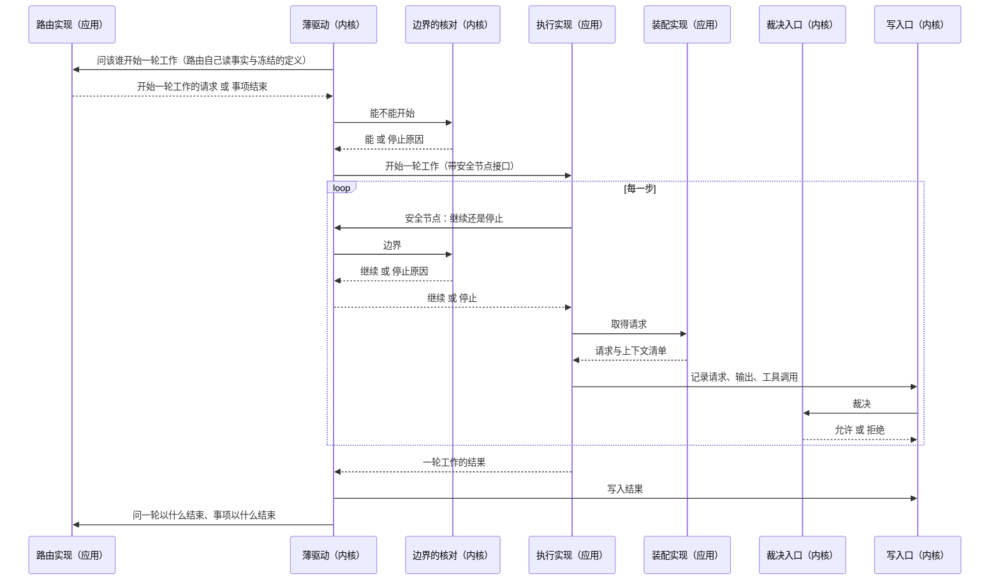
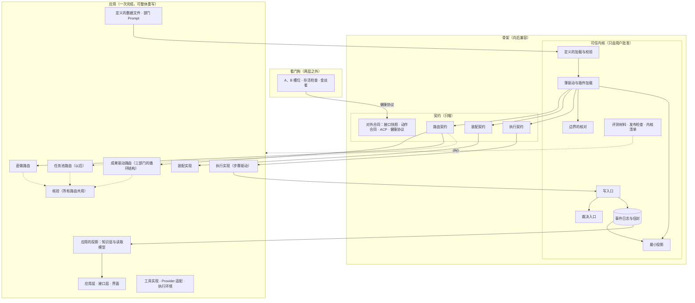

# 骨架与应用设计说明

总图位置：第二节三环；第四节「路由」「装配」「执行」三道缝与「投影」的缝里的最小投影。依据：[D40 骨架与应用](../requirements/skeleton-and-application.md)、[D38 系统意图与基础规则](../requirements/system-intent.md)（N-T3、N-T5、N-A1 至 N-A3）、[ADR-0019](../adr/0019-project-stream-across-versions.md)、[基础规则](../foundation-rules.md)、[可信内核设计说明](trusted-kernel.md)、[三部门的循环结构](department-loop.md)。

## 1. 要解决的问题

骨架与应用要做到下面几条，它们是这份说明各节的来由：

- **内核不跟着应用长。** 裁决只读一份由骨架事件折叠的最小投影；应用每加一种事件，内核不用改，内核稳得下来，也读得完（第 4 节）。
- **路由、驱动、边界与调度分开。** 换一种路由（例如任务池）有自己的位置，改调度不牵动驱动（第 5、6 节）。
- **缝有契约文字。** 路由、装配与执行三道缝各有带版本的契约，写明哪些接口必须保持；应用重写时知道哪些不能动（第 5 节）。
- **必须兼容的合同在一张表里。** 升级时按表核对，不逐个判断（第 9 节）。
- **升级与回退有兜底。** 自举第一层成为常态以后，升级出了问题要能退回（第 10 节）。

## 2. 两层的判据

骨架是三种东西：

1. 下一个版本必须读得懂的事实，它们不能重算：事件日志、用户改过的定义与参数、交付快照与工件。
2. 不会和 Yudao 同时换版本的对方所依赖的合同：浏览器里的界面（同一发布，但快照测试守住合同）、远程执行代理、外包 agent、看门狗、检查下一版的上一版。
3. 应用整体重写时必须仍然成立的保证：一定会停、写入经裁决、生成者不裁决自己。机制在骨架，规则在定义里。

其余是应用：能从事实重算、只在一个进程里和自己说话、重写以后外面看不出区别。

骨架内部再分两部分，分法按「谁能改」与「怎么改」：

| 部分 | 谁能改 | 怎么改 | 范围 |
| --- | --- | --- | --- |
| 可信内核 | 只由用户批准（内核清单，[可信内核设计说明](trusted-kernel.md)） | 行数只降不升，只导入内核、标准库与 pydantic | 第 3.1 节 |
| 契约 | 按普通流程（工单、审查、合并） | 只能向后兼容：字段只增、事件种类只增、接口只加可选参数、契约带版本 | 第 3.2 节 |

## 3. 骨架清单

### 3.1 可信内核

| 项 | 现在的代码 | 兼容规则 |
| --- | --- | --- |
| 事件日志的信封与追加规则 | `event_store.py`；`kernel_events.py` 的 `Event`、`ProjectEvent`、`CatalogEvent` | 信封字段（全局位置、流、流内版本、种类、来源、时间）只增；事件一经写入不重新解释 |
| 写入口 | `write_path.py` | 接口只加可选参数；流版本、身份、执行权的核对不删 |
| 裁决入口：工具许可、提案校验、提交前复核 | `adjudication.py`、`validation.py`、`tools.py`、`contracts.py`、`path_rules.py`、`actions.py` 的事实合同；路由的收紧检查接口（第 5.5 节） | 机制不变；规则在定义里（工具清单、提案合同、许可规则）。已有的许可只能收紧；新的工具、提案与成果种类随定义的新版本加入，加入以后照常经过工具许可与提案校验（第 5.4 节） |
| 边界的核对与停止原因 | `bounds.py`、`stop_reasons.json` | 停止原因清单只增 |
| 最小投影 | `minimal_projection.py`（第 4 节） | 字段只增，只由骨架事件折叠，不含成果的内容 |
| 定义的加载与结构校验 | `definitions/__init__.py` | 定义文件字段只增；旧版本的定义文件能被新版本加载，用户改过的定义升级以后继续有效 |
| 判定点的准入与记录 | 没有 | 同总图第三节「判定点」与[总体架构](architecture/overall-architecture.md)「判定点的校准、记录与重放」 |
| 薄驱动与插件加载 | `orchestrator.py`（第 6 节）；插件加载是启动时把路由、装配、执行三个槽位的实现接上薄驱动，不做不重启的热替换。路由按组织定义里写的名字接上；装配与执行现在各只有一种产品实现，由组装处（`runtime.py`）经构造参数交给薄驱动，有了第二种产品实现再在定义里写名字 | 不含部门、成果、阶段的名称；只调用三道缝与内核的其余部分；修改经用户批准 |
| 评测材料、发布检查、内核清单、基础规则 | `evals/scenarios/*/checks`、`evals/scorer`、`release_check.py`、`scripts/release.py`、`kernel-manifest.json`、`foundation-rules.md` | 由运行中的上一版提供，被开发的版本改不了 |

### 3.2 契约

| 项 | 现在的代码 | 兼容规则 |
| --- | --- | --- |
| 路由契约 | `routing_contract.py`（第 5.1 节）；实现是 `watched_outputs.py`，它的收紧检查在 `tightening.py`（收紧检查的接口是 `tightening_contract.py`） | 带版本；实现声明实现哪一版；骨架在一个发布里同时接受当前版与上一版 |
| 装配契约 | `assembly_contract.py`（第 5.2 节）；实现是 `assembly.py` 的 `ContextAssembly` | 同上 |
| 执行契约 | `execution_contract.py`（第 5.3 节）；实现是 `engine.py` 的 `StepDriver`，`SafeNode` 协议由薄驱动实现 | 同上 |
| 骨架事件的种类（第 7 节） | 内核事件模块的登记表 | 种类与字段只增，停用不删除 |
| 对外的合同（第 9 节） | `api/` 与 OpenAPI 快照；`actions.py` 与执行代理的 HTTP 合同；ACP；健康协议 | 快照测试守住；合同带版本，旧版的对方能继续说话一个发布 |

看门狗在两层之外（第 10 节），与内核一样只由用户批准（总图第二节）。

## 4. 最小投影

裁决只读这一份，由骨架自己从骨架事件折叠，纯函数，保存下来并可以重算。应用也可以读它，但内核不为应用加字段（总图第四节「投影」缝）：

| 内容 | 来源 | 谁用它判断什么 |
| --- | --- | --- |
| 每条流的当前版本 | 每条事件的流内版本 | 写入口：提议者看到的版本是不是最新的，中间有没有别人写过 |
| 谁持有执行权 | 事项创建与执行权的领取 | 写入口：有没有资格写 |
| 已用的时间、激活次数、模型步数（事项一级与会话一级） | 时间与激活次数来自一轮工作开始与结束事件里的用量字段；模型步数按「模型请求」事件计数（下面第 1 条） | 边界的核对：上限到了没有，重启以后接着算 |
| 每种正式成果的当前版本 | 成果接纳事件。接纳事件带统一的一组字段（成果种类、版本、依据），最小投影按这组字段折叠，不按事件种类逐个写；成果的种类来自事项所用定义里的成果种类与提案合同，内核不认识具体有哪几种（成果驱动是 PRD、交付、质检结论、结构说明、基线核验、产品决定） | 提案校验：引用的成果是不是当前有效的那一版 |
| 运行状态（进行中、暂停、等待、结束）与待回答的决定请求 | 事项的状态事件与决定请求事件 | 写入口拒绝结束以后的写入；安全节点的停止判断 |
| 当前定义版本与参数版本 | 事项创建事件 | 裁决按哪一版的许可关系、工具清单与上限判断 |

上表之外还要几样（清点见第 5.5 节），仍然只来自骨架事件：

- 契约（现在的 `contract_accepted`，由主机签发）算一种成果种类；
- 事项种类、项目与事项的编号（事项创建事件）；
- 上限的数值，不只是参数版本（事项创建事件）；
- 每个成果版本的工件引用与内容摘要，裁决按版本取摘要，不读内容；
- 每个会话当前这一轮的编号，检查回执要来自这一轮。

第 5.5 节的六条通用条件还要几样（最小投影给不了它们；仍然只来自接纳事件与骨架事件，不是成果的内容）：

- 接纳事件的统一字段加作者部门（`issuer`）与记下的树摘要（有这一项的成果才带，交付记代码树、建档记快照的树）：通用条件 5 的作者分离与条件 4 的树一致读它们；
- 一种成果可以多版并存时（现在只有产品决定），最小投影按种类记当前有效各版的摘要清单，通用条件 6 的不重复接纳读它；
- 每个部门主线会话当前这一轮的编号按部门取（一轮工作开始事件带部门），通用条件 3 的「回执来自这一轮」读它。

会话一级除了累计的模型步数，另记上一次一轮工作结束时已结算的累计步数（`settled_steps`，与时间的 `settled_ms` 对称，在同一处更新）。会话的上限按一轮算，中断那一轮用掉的步数等于累计减已结算，驱动这样扣，不从事件里数。

不补、归收紧检查的：质检测试材料的摘要、PRD 的内容、用户输入与指导的版本、询问栈与分支会话。

下面四条与上表一起读：

1. **模型步数按「模型请求」事件一条条数**，不读一轮结束事件里的用量字段。进程在一轮中间崩溃时没有结束事件，按结束事件算会让这个会话重启以后多拿步数；按请求数则中断以后上限仍然准确。代价是「模型请求」是骨架事件，只加字段，不删改。
2. **中断那一轮还没结算的运行时间不计**，不为它加定时写入的心跳事件。第 1 条成立以后「一定会停」由步数上限兜住，时间少记一段不会让事项一直跑下去。
3. **驱动的计时读投影**：编排器的已用时间与步数是「投影里的已结算量 + 当前这一段的起点」，编排器不从事件数用量。正在跑的那一段只有驱动知道，投影给不了，所以驱动只记每个会话这一段从什么时候开始。
4. **应用可以读最小投影，内核不为应用加字段**：查询与恢复页里的激活次数、模型步数、执行权读最小投影，应用不自己数；重试次数不是上限，不进最小投影，留在应用。

成果失效是一条记下来的事件，不由投影从别的事件推出来。「非质检部门写了文件，当前交付就失效」这条规则属于成果驱动，由角色的写入范围表达（[形态与核验角色设计说明](forms-and-verifier-role.md)「核验角色」）：成果驱动在写文件以后记一条成果失效（骨架事件，带成果种类、版本与原因）。

不在最小投影里、归应用的投影：部门历史、模型请求与输出、上下文清单、压缩记录、询问栈与分支会话、证据与材料、工作区摘要、评审内容、教训候选、循环实例、收敛状态、资料页与部门工作间要显示的一切。

成果之间的关系（交付必须引用当前 PRD、放行必须绑定当前交付）写在定义的提案合同（`proposal_contracts.json`，已有）里，门卫按合同核对「引用的版本是不是当前版本」这一件通用的事。合同写错时由内核的不变式测试与评测的隐藏检查兜住，与现在相同。

## 5. 三道缝的契约

三道缝回答三类问题。路由的实现由定义选择，装配与执行的实现由组装处接上（第 3.1 节）；骨架不认识任何一个实现的名字以外的东西。每道契约有版本号，实现声明它实现哪一版；一个发布里骨架同时接受当前版与上一版。

### 5.1 路由契约

回答三个问题：现在让哪些部门（会话）开始一轮工作；一轮工作以什么结束；事项以什么结束。

- 输入：只读的事实（事件日志与最新事件）与事项创建时冻结的定义。路由自己从事件折叠要用的状态，不保存事件之外的状态；不读最小投影，最小投影不为任何路由加字段（总图第四节「路由」）。各入口收到的是运行流的投影，成果驱动够用；路由要读投影里没有的事件（例如任务池自己发布的任务）时，声明可选方法 `use_facts(reader)`，组装处接上路由以后把只读的事件读取器（只有 `list_events(run_id)`）交给它，契约版本 3，版本 2 继续被接受。
- 输出：开始一轮工作的请求（部门、会话、依据的成果版本、这一轮的上限，以及路由自己的工作引用，例如任务池的任务）；一轮工作结束的判断；事项结束的判断与停止原因（属于封闭清单，第 5.4 节第 7 条）；结束原因写明是放行还是开环完成，由路由按定义里有没有核验角色给出。
- 不做：不写事件（结果经薄驱动交给写入口）、不调模型、不核对边界、不执行工具。
- 选择：组织定义写明路由实现的名称（`routing`），默认 `watched_outputs`，即成果驱动：关注的成果有了新版本、部门在等待工作时开始一轮工作，一轮以提交正式成果或回答用户结束，只有核验角色（默认是质检）对当前 PRD 与当前交付的放行结束事项（[三部门的循环结构](department-loop.md)）。直做是另一个名称（[形态与核验角色设计说明](forms-and-verifier-role.md)「直做」）。任务池以后是另一个名称，进来时只增加一个实现与它自己的一份定义，不改骨架（第 5.4 节）。可用的名称是定义里的一份封闭清单（`routings.json`，每条写名称与说明）：组织定义的 `routing` 不在清单里时加载失败，错误写明可用的名称；实现在模块加载时按名称登记，组装处按名称接上并核对契约版本。
- 路由实现与它的收紧检查（第 5.5 节）是同一条路由的两半，现在分在 `watched_outputs.py` 与 `tightening.py` 两个文件，怎么分由实现定。
- [循环与收敛设计说明](loops-and-convergence.md)「防止滑向静态编排的判据」的五条判据，对每个路由实现都适用。

### 5.2 装配契约

- 输入：事件日志里这个部门与会话的历史、定义、材料、调用目标的窗口与输出上限。
- 输出：装配好的请求与上下文清单，清单与请求都记进日志（现在的 `context_assembled`、`model_request_serialized`）。
- 不做：不改事实；需要模型整理时（压缩前的整理）经执行契约发一次请求，产出作为提案经裁决。
- 现在的接口：`ContextAssembly` 的 `department_history`、`pin`、`request`、`finish_compaction`。
- 接法：组装处（`runtime.py`）经构造参数把装配实现交给薄驱动，默认是 `ContextAssembly`；薄驱动构造时按契约核对版本，不自己构造装配实现。测试接上第二种实现走同一个参数。

### 5.3 执行契约

- 输入：一轮工作（部门、会话、提示、这一轮的上限、路由的工作引用；工作引用原样交给装配）。
- 过程：每一步先经安全节点问薄驱动继续或停止；取得调用目标；按装配契约取得请求；模型调用；每个工具调用经裁决入口；动作交给执行环境；记录。
- 输出：一轮工作的结果：这一轮写下的事件的范围与停止原因，另带三样中性的观察：这一轮用提交类工具交上来的参数、带来它的那次回答、这一轮的发言记录（薄驱动要把它们经写入口交给裁决并存成发言记录工件，从事件里反解会改工件的摘要）。这一轮算不算结束、结束成什么，由路由按事件判断（「这一轮交的是不是正式成果」看路由自己定义里的提议方式）；契约不把结果的种类写死成「提交了正式成果」或「回答了询问」，那是成果驱动路由的判断。
- 不做：不决定下一个轮到谁，不核对边界（只问），不写事实（经写入口）。
- 以后的出：开子事项的请求（总图第四节「执行」）随子组织进来，按契约只增字段、带版本；现在不预留（[形态与核验角色设计说明](forms-and-verifier-role.md)「子组织（位置与规矩）」）。
- 现在的接口：`StepDriver.start`、`StepDriver.cancel`；`SafeNode` 协议的 `proceed`、`settle`、`end`、`department_selection`、`department_prompt`。
- 接法：组装处经构造参数把执行实现交给薄驱动（执行实现是每轮开始一个驱动的工厂，默认是 `StepDriver`）；薄驱动构造时按契约核对版本，源码里不点名执行实现的类。

### 5.4 其他路由：骨架要满足的条件

用户的话：第二种路由不受之前 ADR 的限制，复用骨架，不改动旧的成果和结构；任务池比成果驱动多解决了什么，以后用评测回答，关键是骨架能支持两种模式。现在已有三种（成果驱动、直做、任务池），下面的条件对每一种都成立。

含义：其他路由是同一副骨架上的另一套应用。约束它的只有骨架（可信内核与契约）与[基础规则](../foundation-rules.md)；成果驱动的规定（例如[三部门的循环结构](department-loop.md)里按关注的成果开始工作与询问）不约束它。核验是所有路由共用的一套，规矩见[形态与核验角色设计说明](forms-and-verifier-role.md)「核验角色」。它也不改成果驱动已有的成果、合同与定义，自己要的东西在自己的定义里另加。一个事项按开始时的定义版本确定用哪种路由，中途不换。

骨架为此要满足下面七条：

1. 应用可以登记自己的事件种类，增加一种不改内核文件。
2. 每种路由有自己的一份定义：按名字引用组织里的角色、提议方式、路由自己的上限；成果种类与提案合同在事项所用的定义里。它由路由实现自己校验；内核只核对 `routing` 的名称与这份定义的结构，两种路由的定义互不影响。
3. 第二种路由可以带来新的工具、提案与成果种类：随定义的新版本加入，照常经过工具许可与提案校验；已有的许可不能放松（第 3.1 节）。做法：路由带来的工具与提案种类写在它所在那个定义版本的工具清单与提案合同里，路由自己的定义按名称引用它们（「提议方式」）；工具许可与提案校验读这个事项所用的那份定义，不读模块加载时的全局常量；提案的格式检查与成果内容的组装归路由（第 5.5 节）。
4. 开始一轮工作的请求带路由自己的工作引用，原样交给装配与执行（第 5.1、5.3 节）。
5. 一轮工作怎么结束由路由按事件判断，执行契约不写死结果的种类（第 5.3 节）。
6. 最小投影按成果接纳事件的统一字段折叠，成果的种类来自事项所用定义里的成果种类与提案合同；加一种成果不改最小投影的代码（第 4 节）。
7. 一定会停对任何路由都成立：靠内核的时间、轮次、步数上限。路由自己的上限（例如任务数、打回次数）归路由，不进最小投影。内核自己的停止原因（上限、取消、升级等）对所有路由相同；路由自己的结束原因写在它的定义里，属于那个定义版本的封闭清单。

基础规则对其他路由同样适用，其中规则 3「生成者不裁决自己」由核验角色满足：完成一件事的部门不能自己宣布它合格；有核验角色时只有它的结论能放行，路由只问它的结论，不各写一套；没有核验角色时事项以开环完成结束，不记放行（[形态与核验角色设计说明](forms-and-verifier-role.md)「核验角色」与「开环完成」）。骨架保证这种检查做得到（裁决只依据已记录的事实，写入只经写入口）。

证明：有一个只在测试里用的第二种路由，形状像任务池（发布任务、指派、完成、打回，有自己的成果种类、事件种类与提议方式），用假模型跑完一个事项，不改任何骨架文件，也不改成果驱动的定义与合同。它不进产品。

### 5.5 裁决的分工：内核的通用检查与路由的收紧检查

内核裁决模块读取运行状态投影的地方（[清点](../research/kernel-projection-reads-2026-10-24.md)）：59 处，其中 25 处是版本与状态，最小投影接得住（12 处要补第 4 节列的几样）；9 处要读成果的内容；11 处是通用的关系规则，但写死在 `validation.py` 与 `collaboration.py` 的代码里，`validation.py` 不读提案合同；14 处是成果驱动特有的（询问栈、分支会话、指导、用户输入的版本、探索轮）。`collaboration.py` 的 `allowed_proposal_kinds` 在裁决时把成果驱动的调度整个算了一遍：成果驱动的路由有一部分住在内核里。

用户选「分开放」：

- **内核做通用检查**：流版本、执行权、运行状态、边界、工具许可（定义里的工具清单），以及提案合同里的通用条件。
- **提案合同里的通用条件**由内核按合同核对，成果驱动现在写死的关系规则改写成这几种：
  1. 引用的成果是当前版本；
  2. 引用的成果所依据的成果也是当前版本（例如质检结论依据的交付，要基于当前的 PRD 与契约）；
  3. 列出的检查都有主机执行的回执，回执来自这个会话的这一轮，并绑定当前的依据；
  4. 工作区的树与引用的成果记下的树一致（交付的树、建档时的快照）；
  5. 提出评价类成果的部门，不是被评价成果的作者部门（基础规则 3）；
  6. 同样内容的成果不重复接纳。
- **路由提供收紧检查**：在同一个写入事务里、内核的检查通过以后运行，结果三种：通过、拒绝、等待（「放行等产品处理完输入」是许可的第三种结果，读的是输入与指导，归路由；等待由写入口按现有的安全节点处理）。它不能放行内核拒绝的东西（与第 3.1 节「已有的许可只能收紧」同一原则）。收紧检查读路由自己的投影。成果驱动的收紧检查包括：这个部门现在能交哪些种类；询问分支里能用的工具与回问的深度；工作依据里输入与指导的版本；探索轮不能交质检结论；放行要用当前的质检测试材料（这两条以后归所有路由共用的核验，[形态与核验角色设计说明](forms-and-verifier-role.md)「核验角色」）；放行等产品处理完输入；按内容的结构检查（PRD 的每条要求覆盖一次、有效决定逐条保留或退役、标为「设计中，未实施」的边界不能记为现有缺陷）。
- **成果的内容由路由组装，内核盖统一字段**：提案的格式检查与成果内容的组装是路由的事，放在收紧检查里。收紧检查通过时给出成果的内容；路由不组装的种类，内容就是提案的参数。成果驱动六种成果的格式检查与组装（文件清单、检查回执、依据的摘要等）在它的收紧检查模块里。内核在内容之外盖统一字段（种类、版本、依据、作者部门、记下的树摘要），算内容摘要，写接纳事件，不按成果种类写分支；第二种路由加一种成果不改内核（第 5.4 节第 3 条）。通过时给出的成果内容包括一个只增的 `facts`（成果驱动放行 PRD 时给回 PRD 记下的用户输入版本，内核写进 PRD 的内容）。
- **新种类的成果写通用的接纳事件**：成果驱动的六种成果和契约保留各自的接纳事件种类（已写入的事件不重新解释）。路由带来的新种类，写一种通用的接纳事件（骨架事件，新增一种，第 7 节），载荷是收紧检查给出的内容加统一字段；最小投影本来就按统一字段折叠，不用改。成果驱动接纳以后的附带写入（材料文件、git 版本、PRD 的渲染与契约的重新签发）仍由接纳的写入模块（`submissions.py`）按种类做，通用种类只写这一条事件。没有这一条，测试定义里的新种类过得了校验，到写入时报「unhandled artifact kind」。
- 收紧检查算错时，后果是该拒绝的没拒绝，或不该拒绝的拒绝了。它由路由自己的测试、内核的不变式测试（通用条件）与评测的隐藏检查发现；一定会停、写入经裁决、生成者不裁决自己这三件保证仍由内核守住。

## 6. 薄驱动

薄驱动只连接。它做的事按顺序：

1. 问路由实现（它自己读事实与冻结的定义），取得要开始的一轮工作与结束的判断；薄驱动自己只读最小投影。
2. 对每一轮工作，问边界的核对能不能开始；能，则按执行契约开始它，把安全节点接口交给执行。
3. 安全节点被问到时：问边界的核对（时间、轮次、步数、深度），问是否有取消、暂停、新输入与指导（新输入与指导的送达由路由实现决定送给谁，薄驱动只转交）。
4. 一轮工作的结果、提案、工具调用的记录，经写入口写入；写入口在同一事务里调用裁决入口。
5. 事项结束的判断来自路由实现或边界的核对，停止原因写入时核对流版本。
6. 派发编号（总图第三节「重派与迟到的结果」）：开始一轮工作时薄驱动经写入口写一条事件，取得这一轮的派发编号，交给执行；这一轮的写入都带它，写入口与执行权编号一起核对。重派先写事件、编号加一，旧编号交回的结果只记录。现在一个进程里一轮工作与它的激活一一对应；会话放到别处之前实施（[总体架构](architecture/overall-architecture.md)「身份」）。

薄驱动不含部门、成果与阶段的名称；一项单元层测试在薄驱动的源码里检索组织定义中的部门标识与成果种类，命中即失败。

薄驱动要的身份从定义推：

- 处理用户输入的部门，是组织定义里关注 `user_input` 的部门（现在是产品）。
- 工作区的政策在执行环境（`environment.py` 的 `Workspaces`）里按定义推：工具清单里能提交交付的部门在运行工作区工作；核验角色有自己的检查工作区（现在按关注交付的部门推），从最新封存的交付建立，新交付封存时重建。薄驱动只问它要。
- 继续一个事项时，定义版本不同的决定请求（总图第四节「定义」的缝）留在恢复（`recovery.py` 的 `RunRecovery`），不归决定请求的流转（`decision_flow.py`）：它只在继续一个 run 时发。

## 7. 骨架事件与应用事件

规则：内核写入或读取的事件是骨架事件，种类与字段只增，停用不删除；其余 run 流事件是应用事件，按 [ADR-0019](../adr/0019-project-stream-across-versions.md) 跟随应用版本，升级前排空。应用事件的种类由应用登记，增加一种不改内核文件（第 5.4 节第 1 条）。项目流的事件全部是骨架事件（它们是长期事实）。

按 `EventType` 划分（`model_requested` 属于骨架事件，与第 4 节第 1 条一致）：

| 骨架事件 | 应用事件 |
| --- | --- |
| 事项的创建与状态：`run_created`、`run_done`、`run_paused`、`run_failed`、`run_resumed`、`run_continued` | 输入与指导的送达：`user_input_received`、`product_input_assigned`、`department_guidance_*`、`department_input` |
| 一轮工作的开始与结束及其用量：`department_activated`、`activation_finished` | 装配与模型调用：`context_assembled`、`model_request_serialized`、除 `model_requested` 以外的 `model_*`、`compaction_recorded`、`tool_call_required` |
| 模型请求：`model_requested`（模型步数按它计数，第 4 节第 1 条） | 工具的跳过与动作的核实：`tool_skipped`、`action_verified` |
| 工具许可与工具的开始：`tool_called`、`tool_started` | 询问与教训：`ask_started`、`ask_answered`、`lesson_candidate_recorded`、`qa_tests_saved` |
| 提案与正式成果：成果失效、通用的成果接纳（第 5.5 节）、`proposal_submitted`、`proposal_rejected`、`spec_accepted`、`spec_superseded`、`contract_accepted`、`delivery_accepted`、`qa_submitted`、`structure_accepted`、`baseline_review_accepted`、`product_decision_accepted` | |
| 决定请求：`decision_requested`、`decision_answered`、`decision_withdrawn` | |
| 项目流与目录流的全部事件 | |

内核事件模块（`kernel_events.py`）放事件信封、骨架事件的种类与数据结构、登记表，以及内核要用、又只能放在内核里的几样：决定请求的数据结构与折叠（写入口在同一事务里更新它；保存与还原留在 `event_store.py`）、检查回执、信封的序列化与摘要、运行状态的取值、骨架事件载荷里的封闭取值、写入口的流处理者接口。`models.py` 与 `projection.py` 从它转出这些名字，应用的导入不变。契约模块从它取事件信封；契约里出现的应用侧类型（运行流的投影、部门 Prompt）按 `Any` 标注，具体类型由实现给出。

## 8. 应用清单与「一次完成」

应用包括：成果驱动的路由实现（三部门的循环结构）、直做路由、核验（所有路由共用，[形态与核验角色设计说明](forms-and-verifier-role.md)）、装配实现、执行实现（步骤驱动）、应用的投影（知识层：循环实例、收敛状态、资料、部门历史、读取模型）、应用层的查询与命令处理、接口层的页面与界面、工具实现、Provider 适配、执行环境的本机实现、定义的数据文件与部门 Prompt、评测运行器。

放在哪里：接在薄驱动上的应用模块（路由实现与它的收紧检查、决定请求与建档的流转 `decision_flow.py`、装配、执行、恢复）放在 `harness/` 顶层，不进 `harness/app/`。`harness/app/` 是[应用层与接口层](app-and-interface.md)说的应用层，只给接口层用（import-linter 合同「控制核心不导入应用层与接口层」）。两个词说的不是一回事：「应用」与「骨架」相对，「应用层」与「接口层」相对；应用层是应用的一部分。路由实现、收紧检查与决定请求的流转由组装处（`runtime.py`）交给薄驱动，薄驱动不导入它们，它们要用薄驱动时由薄驱动把自己作为参数交进去；装配与执行同样（第 5.2、5.3 节）。

「一次完成」的含义：

- 应用按三道缝的契约与骨架事件一次写完，内部没有兼容义务：应用的投影推倒重算，应用事件的版本按 ADR-0019 排空升级，事件序列基准按[测试分层设计说明](test-pyramid.md)「事件序列基准的范围」重写。
- 应用的验收用三样东西：真实用户场景验收（第 11 节）、评测的版本回归（[评测场景设计](evaluation-scenarios.md)「报告与版本比较」）、内核的不变式测试。三样都在应用之外。

## 9. 对外合同的兼容

| 对方 | 合同 | 为什么不同时换版本 | 兼容办法 |
| --- | --- | --- | --- |
| 浏览器里的界面 | 接口层的命令、查询与事件流（OpenAPI 快照） | 同一发布，但用户可能开着旧页面 | 删除或改变已有合同而接口版本没有提高时快照测试失败 |
| 远程执行代理 | 动作合同与执行代理的 HTTP 合同 | 登记机器上的代理可能是旧版 | 合同带版本；执行代码摘要核对；旧版代理在一个发布内继续可用 |
| 外包 agent | ACP（D31） | 外部程序 | 合同带版本 |
| 看门狗 | 健康协议（第 10 节） | 看门狗是最老的进程，不随 Yudao 升级 | 协议只增字段 |
| 检查下一版的上一版 | 发布检查的输入（提交、内核清单、评测材料） | 上一版已经发布 | 发布检查取自运行中的版本（[可信内核设计说明](trusted-kernel.md)「四项技术保证」） |

## 10. 看门狗与健康协议

成果由 Yudao 直接采纳之前，升级与回退都由用户手动进行。设计的要点如下，细节在设计看门狗时补全：

- 看门狗是一个几百行的独立程序，不依赖 Yudao 的任何代码，Yudao 的 agent 对它没有写权限，每次修改由用户批准；它的源码列进内核清单的材料一类。
- 两个槽位：A 是稳定版，B 是候选版。用户批准一个候选以后，看门狗在 B 启动候选版、计时、等候选版报告冒烟通过，然后把流量指向 B；超时或失败把槽位指回 A。同一个候选连续失败到上限以后标为坏版本，等人处理。运行中的事项状态在进程外（事件日志在磁盘），切换不丢。
- 健康协议三层：存活（心跳，抓崩溃与卡死，看门狗自己判断）；功能（定期派金丝雀任务，由确定性代码核对答案，答对才算健康；题目与判分器是评测材料的副本，随稳定版安装，不从候选版取）；业务指标（成功率、质检打回率、耗时，观察期内与旧版本比较，由观察者与运维读，只产出证据）。观察者不触发回退，回退只由看门狗按存活与金丝雀触发。
- 与已有决定的关系：升级仍是用户决定（[可信内核设计说明](trusted-kernel.md)「版本关系」，总图第二节），看门狗只做切换与回退的机械；发布检查在升级之前，金丝雀在升级之后；Windows 上服务与交互桌面的关系按[网页界面的提供与发布设计说明](web-interface-and-release.md)「遗留」处理。

## 11. 真实用户场景验收

放进[测试分层设计说明](test-pyramid.md)「各角色运行哪一层」中「里程碑发布之前」一层。形状：

- 一个代理扮演新用户，只读 README 与页面，任务只给一句目标（例如「配好一个模型，然后让它修这个 bug」），不写点击步骤；网页用 Playwright 操作，多模态模型看截图决定下一步。
- 判分由确定性代码做：是否真的配上了模型、事项是否走到放行、交付是否通过隐藏检查，查数据库与文件来判，不让被测系统自己说通过。判分代码属于评测材料（内核）。
- 任务集十到二十个由易到难的小任务，每个带自动判定条件；可以从仓库历史里取修复前的提交作起点、修复后的测试作判分。
- 关键控件带固定的测试标识；每一步留截图与操作日志，失败可回放。
- 成本：完整跑一轮约二十多分钟，适合里程碑发布之前与每日定时，不适合每次提交。
- 说明书就是 README，不另写一份；代理照 README 走不通，说明书不清楚或产品不好用，两者都是要修的问题。

## 12. 模块交互

## 13. 与现有设计的关系

- [总体架构](architecture/overall-architecture.md)「固定的结构与内核的位置」的内核段落、「各层的职责与边界」的可信内核一行、「模块」的流程编排一行与本文一致；「依赖方向」里薄驱动在流程编排的位置。
- [可信内核设计说明](trusted-kernel.md)「内核的边界」里裁决读取的是最小投影，「内核清单」的条目与本文一致。
- [三部门的循环结构](department-loop.md)是成果驱动路由实现的设计说明；[循环与收敛设计说明](loops-and-convergence.md)「防止滑向静态编排的判据」的五条判据对每个路由实现适用。
- [规则登记与参数设计说明](rules-and-parameters.md)：路由实现的名称是定义，随定义版本改变，不是参数。
- 暂缓的黑板编排恢复时按第 5.1、5.4 节写成第二个路由实现：路由是骨架的契约，每种模式都是应用里的路由实现；其他路由不受成果驱动的规定限制，只受骨架与基础规则约束。

## 14. 验收

1. 内核清单里没有整份运行状态投影；最小投影模块的行数与内容与第 4 节一致，内核的不变式测试通过。
2. 组织定义里有 `routing`，默认值跑出的事件序列与现在的基准一致；换成不存在的名称时加载失败。
3. 三道契约有版本号与实现声明；契约模块只导入内核与标准库。
4. 薄驱动的源码里没有部门标识与成果种类；行数写进验收记录。
5. 骨架事件有登记表，删除一种或删一个信封字段时测试失败。
6. 换骨架期间各工单的事件序列基准不变（假模型，结果确定）。
7. 测试用的第二种路由跑通，骨架文件与成果驱动的定义、合同都没有改动（第 5.4 节）。
