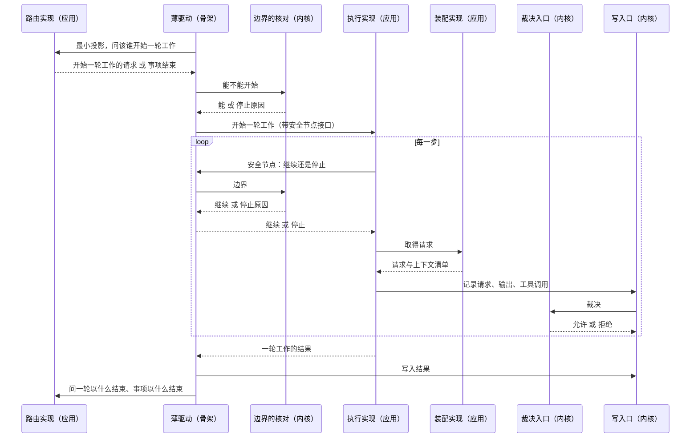
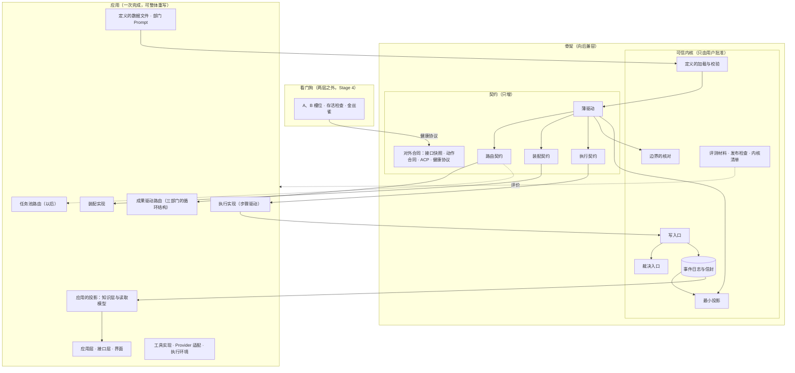

# 骨架与应用设计说明

更新：2026-10-23；2026-10-24 按用户要求补第 5.4 节（骨架接住第二种路由的条件），相应修改第 3.1 节裁决规则的兼容说法、第 4 节成果的折叠、第 5.1 与 5.3 节、第 7 节、第 12 节 S1、S2、S3、S5、S6 与第 15 节（[任务池地图](https://github.com/bender2333/yudao/issues/836)）。状态：设计已确认（用户 2026-10-23 同意两层的判据、最小投影归骨架、看门狗只写设计、MCP 与技能照做；2026-10-24 同意第 5.4 节），未实施。路线位置：Stage 3 工作包「骨架与应用」，里程碑 M0.5，排在 M0 之后、M2 之前（[总体路线图](../program-roadmap.md)第 2 节第 17 项）；看门狗的建设在 Stage 4；真实用户场景验收的运行器在评测工作线。

依据：[D40 骨架与应用](../requirements/skeleton-and-application.md)、[ADR-0042](../adr/0042-skeleton-and-application-two-layers.md)、[D38 系统意图与基础规则](../requirements/system-intent.md)（N-T3、N-T5、N-A1 至 N-A3）、[ADR-0013](../adr/0013-event-log-and-single-write-path.md)、[ADR-0014](../adr/0014-versioned-definitions.md)、[ADR-0019](../adr/0019-project-stream-across-versions.md)、[ADR-0027](../adr/0027-trusted-kernel-outside-self-modification.md)、[ADR-0039](../adr/0039-departments-work-from-watched-outputs.md)、[基础规则](../foundation-rules.md)、[可信内核设计说明](trusted-kernel.md)、[三部门的循环结构](department-loop.md)。

## 1. 要解决的问题

| 问题 | 现状（main `95c97f8`） | 影响 |
| --- | --- | --- |
| 内核跟着应用一起长 | 裁决读整份运行状态投影（`RunProjection`，80 多个字段），投影与事件定义在内核清单里；10 月以来改代码的提交里 22% 碰了内核清单里的文件，`models.py` 与 `projection.py` 一起改了 36 次 | 内核稳不下来，也读不完；应用每加一种事件就是一次内核修改 |
| 路由、驱动、边界、调度写在一处 | `harness/orchestrator.py` 2437 行，改动热点第一；#556 删掉阶段状态机以后，按关注的成果开始一轮工作的逻辑仍与调度、激活的准备、决定请求的处理写在同一个类里 | 换一种路由（任务池）没有位置；改调度牵动驱动 |
| 缝没有契约文字 | 步骤驱动经安全节点接口（`SafeNode`）回调流程编排，装配经 `ContextAssembly` 的四个方法；两者都没有版本，也没有写明哪些是必须保持的 | 应用重写时不知道哪些接口不能动 |
| 什么必须兼容没有一张表 | ADR-0019 分了项目流与 run 流；定义文件、动作合同、接口快照各有规则，散在各处 | 升级时逐个判断，容易漏 |
| 升级与回退靠手工 | 发布检查与保留上一版供回滚是设计（可信内核设计说明第 4 节），实例升级是用户决定，没有槽位、存活检查与自动回退 | 自举第一层成为常态以后没有兜底 |

## 2. 两层的判据

骨架是三种东西：

1. 下一个版本必须读得懂的事实，它们不能重算：事件日志、用户改过的定义与参数、交付快照与工件。
2. 不会和 Yudao 同时换版本的对方所依赖的合同：浏览器里的界面（同一发布，但快照测试守住合同）、远程执行代理、外包 agent、看门狗、检查下一版的上一版。
3. 应用整体重写时必须仍然成立的保证：一定会停、写入经裁决、生成者不裁决自己。机制在骨架，规则在定义里。

其余是应用：能从事实重算、只在一个进程里和自己说话、重写以后外面看不出区别。

骨架内部再分两部分，分法按「谁能改」与「怎么改」：

| 部分 | 谁能改 | 怎么改 | 范围 |
| --- | --- | --- | --- |
| 可信内核 | 只由用户批准（内核清单，[ADR-0027](../adr/0027-trusted-kernel-outside-self-modification.md)） | 行数只降不升，只导入内核、标准库与 pydantic | 第 3.1 节 |
| 契约 | 按普通流程（工单、审查、合并） | 只能向后兼容：字段只增、事件种类只增、接口只加可选参数、契约带版本 | 第 3.2 节 |

## 3. 骨架清单

### 3.1 可信内核

| 项 | 现在的代码 | 兼容规则 |
| --- | --- | --- |
| 事件日志的信封与追加规则 | `event_store.py`；`models.py` 的 `Event`、`ProjectEvent`、`CatalogEvent` | 信封字段（全局位置、流、流内版本、种类、来源、时间）只增；事件一经写入不重新解释 |
| 写入口 | `write_path.py` | 接口只加可选参数；流版本、身份、执行权的核对不删 |
| 裁决入口：工具许可、提案校验、提交前复核 | `adjudication.py`、`validation.py`、`tools.py`、`contracts.py`、`collaboration.py`、`path_rules.py`、`actions.py` 的事实合同 | 机制不变；规则在定义里（工具清单、提案合同、许可规则）。已有的许可只能收紧；新的工具、提案与成果种类随定义的新版本加入，加入以后照常经过工具许可与提案校验（第 5.4 节） |
| 边界的核对与停止原因 | `bounds.py`、`stop_reasons.json` | 停止原因清单只增 |
| 最小投影 | 从 `projection.py` 分出的新模块（第 4 节） | 内容固定，只由骨架事件折叠 |
| 定义的加载与结构校验 | `definitions/__init__.py` | 定义文件字段只增；旧版本的定义文件能被新版本加载，用户改过的定义升级以后继续有效 |
| 判定点的准入与记录 | Stage 5 | 同 ADR-0028 |
| 评测材料、发布检查、内核清单、基础规则 | `evals/scenarios/*/checks`、`evals/scorer`、`release_check.py`、`scripts/release.py`、`kernel-manifest.json`、`foundation-rules.md` | 由运行中的上一版提供，被开发的版本改不了 |

### 3.2 契约

| 项 | 现在的代码 | 兼容规则 |
| --- | --- | --- |
| 薄驱动 | `orchestrator.py` 拆分以后剩下的部分（第 6 节） | 不含部门、成果、阶段的名称；只调用三道缝与内核 |
| 路由契约 | 新（第 5.1 节） | 带版本；实现声明实现哪一版；骨架在一个发布里同时接受当前版与上一版 |
| 装配契约 | `assembly.py` 的 `ContextAssembly` 接口（第 5.2 节） | 同上 |
| 执行契约 | `engine.py` 的 `StepDriver.start`、`cancel` 与 `SafeNode` 协议（第 5.3 节） | 同上 |
| 骨架事件的种类（第 7 节） | `models.py` 的 `EventType`、`ProjectEventType` 中的一部分 | 种类与字段只增，停用不删除 |
| 对外的合同（第 9 节） | `api/` 与 OpenAPI 快照；`actions.py` 与执行代理的 HTTP 合同；ACP；健康协议 | 快照测试守住；合同带版本，旧版的对方能继续说话一个发布 |

看门狗在两层之外（第 10 节）。

## 4. 最小投影

裁决只读这一份，由骨架自己从骨架事件折叠，纯函数，保存下来并可以重算：

| 内容 | 来源 | 谁用它判断什么 |
| --- | --- | --- |
| 每条流的当前版本 | 每条事件的流内版本 | 写入口：提议者看到的版本是不是最新的，中间有没有别人写过 |
| 谁持有执行权 | 事项创建与执行权的领取 | 写入口：有没有资格写 |
| 已用的时间、激活次数、模型步数（事项一级与会话一级） | 一轮工作开始与结束事件里的用量字段 | 边界的核对：上限到了没有，重启以后接着算 |
| 每种正式成果的当前版本 | 成果接纳事件。接纳事件带统一的一组字段（成果种类、版本、依据），最小投影按这组字段折叠，不按事件种类逐个写；成果的种类来自当前路由的定义，内核不认识具体有哪几种（成果驱动是 PRD、交付、质检结论、结构说明、基线核验、产品决定） | 提案校验：引用的成果是不是当前有效的那一版 |
| 运行状态（进行中、暂停、等待、结束）与待回答的决定请求 | 事项的状态事件与决定请求事件 | 写入口拒绝结束以后的写入；安全节点的停止判断 |
| 当前定义版本与参数版本 | 事项创建事件 | 裁决按哪一版的许可关系、工具清单与上限判断 |

不在最小投影里、归应用的投影：部门历史、模型请求与输出、上下文清单、压缩记录、询问栈与分支会话、证据与材料、工作区摘要、评审内容、教训候选、循环实例、收敛状态、资料页与部门工作间要显示的一切。

成果之间的关系（交付必须引用当前 PRD、放行必须绑定当前交付）写在定义的提案合同（`proposal_contracts.json`，已有）里，门卫按合同核对「引用的版本是不是当前版本」这一件通用的事。合同写错时由内核的不变式测试与评测的隐藏检查兜住，与现在相同。

## 5. 三道缝的契约

三道缝回答三类问题，实现由定义选择，骨架不认识任何一个实现的名字以外的东西。每道契约有版本号，实现声明它实现哪一版；一个发布里骨架同时接受当前版与上一版。

### 5.1 路由契约

回答三个问题：现在让哪些部门（会话）开始一轮工作；一轮工作以什么结束；事项以什么结束。

- 输入：最小投影，以及路由自己从事件日志算的投影（应用投影，路由实现自己维护）。
- 输出：开始一轮工作的请求（部门、会话、依据的成果版本、这一轮的上限，以及路由自己的工作引用，例如任务池的任务）；一轮工作结束的判断；事项结束的判断与停止原因（属于封闭清单，第 5.4 节第 7 条）。
- 不做：不写事件（结果经薄驱动交给写入口）、不调模型、不核对边界、不执行工具。
- 选择：组织定义写明路由实现的名称（`routing`），默认 `watched_outputs`，即成果驱动：关注的成果有了新版本、部门在等待工作时开始一轮工作，一轮以提交正式成果或回答用户结束，只有质检对当前 PRD 与当前交付的放行结束事项（[ADR-0039](../adr/0039-departments-work-from-watched-outputs.md)，[三部门的循环结构](department-loop.md)）。任务池以后是另一个名称，进来时只增加一个实现与它自己的一份定义，不改骨架（第 5.4 节）。
- [循环与收敛设计说明](loops-and-convergence.md)第 6 节防止滑向静态编排的五条判据，对每个路由实现都适用。

### 5.2 装配契约

- 输入：事件日志里这个部门与会话的历史、定义、材料、调用目标的窗口与输出上限。
- 输出：装配好的请求与上下文清单，清单与请求都记进日志（现在的 `context_assembled`、`model_request_serialized`）。
- 不做：不改事实；需要模型整理时（压缩前的整理）经执行契约发一次请求，产出作为提案经裁决。
- 现在的接口：`ContextAssembly` 的 `department_history`、`pin`、`request`、`finish_compaction`。

### 5.3 执行契约

- 输入：一轮工作（部门、会话、提示、这一轮的上限、路由的工作引用；工作引用原样交给装配）。
- 过程：每一步先经安全节点问薄驱动继续或停止；取得调用目标；按装配契约取得请求；模型调用；每个工具调用经裁决入口；动作交给执行环境；记录。
- 输出：一轮工作的结果：这一轮写下的事件的范围与停止原因。这一轮算不算结束、结束成什么，由路由按事件判断；契约不把结果的种类写死成「提交了正式成果」或「回答了询问」，那是成果驱动路由的判断。
- 不做：不决定下一个轮到谁，不核对边界（只问），不写事实（经写入口）。
- 现在的接口：`StepDriver.start`、`StepDriver.cancel`；`SafeNode` 协议的 `proceed`、`settle`、`end`、`department_selection`、`department_prompt`。

### 5.4 第二种路由：骨架要满足的条件

用户 2026-10-24：第二种路由不受之前 ADR 的限制，复用骨架，不改动旧的成果和结构；任务池比成果驱动多解决了什么，以后用评测回答，关键是骨架能支持两种模式。

含义：第二种路由是同一副骨架上的另一套应用。约束它的只有骨架（可信内核与契约）与[基础规则](../foundation-rules.md)；成果驱动的 ADR（例如 [ADR-0039](../adr/0039-departments-work-from-watched-outputs.md) 按关注的成果开始工作、[ADR-0036](../adr/0036-concurrent-departments-and-nested-asks.md) 的询问、[验证的独立性](independent-verification.md)）不约束它。它也不改成果驱动已有的成果、合同与定义，自己要的东西在自己的定义里另加。一个事项按开始时的定义版本确定用哪种路由，中途不换。

骨架为此要满足下面七条（S1 至 S6 照此实现）：

1. 应用可以登记自己的事件种类，增加一种不改内核文件（S5）。
2. 每种路由有自己的一份定义：部门、成果种类、提议方式、路由自己的上限。它由路由实现自己校验；内核只核对 `routing` 的名称与这份定义的结构，两种路由的定义互不影响（S2）。
3. 第二种路由可以带来新的工具、提案与成果种类：随定义的新版本加入，照常经过工具许可与提案校验；已有的许可不能放松（第 3.1 节）。
4. 开始一轮工作的请求带路由自己的工作引用，原样交给装配与执行（第 5.1、5.3 节，S2、S3）。
5. 一轮工作怎么结束由路由按事件判断，执行契约不写死结果的种类（第 5.3 节，S3）。
6. 最小投影按成果接纳事件的统一字段折叠，成果的种类来自当前路由的定义；加一种成果不改最小投影的代码（第 4 节，S1）。
7. 一定会停对任何路由都成立：靠内核的时间、轮次、步数上限。路由自己的上限（例如任务数、打回次数）归路由，不进最小投影。内核自己的停止原因（上限、取消、升级等）对所有路由相同；路由自己的结束原因写在它的定义里，属于那个定义版本的封闭清单。

基础规则对第二种路由同样适用，其中规则 3「生成者不裁决自己」由路由用自己的方式满足：完成一件事的部门不能自己宣布它合格。骨架保证这种检查做得到（裁决只依据已记录的事实，写入只经写入口），不规定它的形式；成果驱动用质检的独立放行，任务池怎么做在它自己的设计里定。

证明：S6 的验收里有一个只在测试里用的第二种路由，形状像任务池（发布任务、指派、完成、打回，有自己的成果种类、事件种类与提议方式），用假模型跑完一个事项，不改任何骨架文件，也不改成果驱动的定义与合同。它不进产品。

## 6. 薄驱动

薄驱动只连接。它做的事按顺序：

1. 读最小投影，交给路由实现，取得要开始的一轮工作与结束的判断。
2. 对每一轮工作，问边界的核对能不能开始；能，则按执行契约开始它，把安全节点接口交给执行。
3. 安全节点被问到时：问边界的核对（时间、轮次、步数、深度），问是否有取消、暂停、新输入与指导（新输入与指导的送达由路由实现决定送给谁，薄驱动只转交）。
4. 一轮工作的结果、提案、工具调用的记录，经写入口写入；写入口在同一事务里调用裁决入口。
5. 事项结束的判断来自路由实现或边界的核对，停止原因写入时核对流版本。

薄驱动不含部门、成果与阶段的名称；一项单元层测试在薄驱动的源码里检索组织定义中的部门标识与成果种类，命中即失败。

## 7. 骨架事件与应用事件

规则：内核写入或读取的事件是骨架事件，种类与字段只增，停用不删除；其余 run 流事件是应用事件，按 [ADR-0019](../adr/0019-project-stream-across-versions.md) 跟随应用版本，升级前排空。应用事件的种类由应用登记，增加一种不改内核文件（第 5.4 节第 1 条）。项目流的事件全部是骨架事件（它们是长期事实）。

按现在的 `EventType` 划分（准确清单由第 12 节的 S5 工单核对）：

| 骨架事件 | 应用事件 |
| --- | --- |
| 事项的创建与状态：`run_created`、`run_done`、`run_paused`、`run_failed`、`run_resumed`、`run_continued` | 输入与指导的送达：`user_input_received`、`product_input_assigned`、`department_guidance_*`、`department_input` |
| 一轮工作的开始与结束及其用量：`department_activated`、`activation_finished` | 装配与模型调用：`context_assembled`、`model_request_serialized`、`model_*`、`compaction_recorded`、`tool_call_required` |
| 工具许可与工具的开始：`tool_called`、`tool_started` | 工具的跳过与动作的核实：`tool_skipped`、`action_verified` |
| 提案与正式成果：`proposal_submitted`、`proposal_rejected`、`spec_accepted`、`spec_superseded`、`contract_accepted`、`delivery_accepted`、`qa_submitted`、`structure_accepted`、`baseline_review_accepted`、`product_decision_accepted` | 询问与教训：`ask_started`、`ask_answered`、`lesson_candidate_recorded`、`qa_tests_saved` |
| 决定请求：`decision_requested`、`decision_answered`、`decision_withdrawn` | |
| 项目流与目录流的全部事件 | |

## 8. 应用清单与「一次完成」

应用包括：成果驱动的路由实现（三部门的循环结构）、装配实现、执行实现（步骤驱动）、应用的投影（知识层：循环实例、收敛状态、资料、部门历史、读取模型）、应用层的查询与命令处理、接口层的页面与界面、工具实现、Provider 适配、执行环境的本机实现、定义的数据文件与部门 Prompt、评测运行器。

「一次完成」的含义：

- 应用按三道缝的契约与骨架事件一次写完，内部没有兼容义务：应用的投影推倒重算，应用事件的版本按 ADR-0019 排空升级，事件序列基准按[测试分层设计说明](test-pyramid.md)第 11 节重写。
- 应用的验收用三样东西：真实用户场景验收（第 11 节）、评测的版本回归（[评测场景设计](evaluation-scenarios.md)第 6 节）、内核的不变式测试。三样都在应用之外。
- 这一次的「应用」就是现在的三部门循环按新结构重排；任务池是以后的第二个路由实现，不在这一次里。

## 9. 对外合同的兼容

| 对方 | 合同 | 为什么不同时换版本 | 兼容办法 |
| --- | --- | --- | --- |
| 浏览器里的界面 | 接口层的命令、查询与事件流（OpenAPI 快照） | 同一发布，但用户可能开着旧页面 | 删除或改变已有合同而接口版本没有提高时快照测试失败（#619） |
| 远程执行代理 | 动作合同与执行代理的 HTTP 合同（3.2C） | 登记机器上的代理可能是旧版 | 合同带版本；执行代码摘要核对；旧版代理在一个发布内继续可用 |
| 外包 agent | ACP（D31，Stage 5） | 外部程序 | 合同带版本 |
| 看门狗 | 健康协议（第 10 节） | 看门狗是最老的进程，不随 Yudao 升级 | 协议只增字段 |
| 检查下一版的上一版 | 发布检查的输入（提交、内核清单、评测材料） | 上一版已经发布 | 发布检查取自运行中的版本（可信内核设计说明第 4 节） |

## 10. 看门狗与健康协议（Stage 4，只写设计）

用户 2026-10-23 决定现在只写设计不建：成果由 Yudao 直接采纳之前，升级与回退都由用户手动进行。设计的要点，细节在 Stage 4 设计时补全：

- 看门狗是一个几百行的独立程序，不依赖 Yudao 的任何代码，Yudao 的 agent 对它没有写权限，每次修改由用户批准；它的源码列进内核清单的材料一类。
- 两个槽位：A 是稳定版，B 是候选版。用户批准一个候选以后，看门狗在 B 启动候选版、计时、等候选版报告冒烟通过，然后把流量指向 B；超时或失败把槽位指回 A。同一个候选连续失败到上限以后标为坏版本，等人处理。运行中的事项状态在进程外（事件日志在磁盘），切换不丢。
- 健康协议三层：存活（心跳，抓崩溃与卡死，看门狗自己判断）；功能（定期派金丝雀任务，由确定性代码核对答案，答对才算健康；题目与判分器是评测材料的副本，随稳定版安装，不从候选版取）；业务指标（成功率、质检打回率、耗时，观察期内与旧版本比较，由观察者与运维读，只产出证据）。观察者不触发回退，回退只由看门狗按存活与金丝雀触发。
- 与已有决定的关系：升级仍是用户决定（ADR-0027），看门狗只做切换与回退的机械；发布检查在升级之前，金丝雀在升级之后；Windows 上服务与交互桌面的关系按[网页界面的提供与发布设计说明](web-interface-and-release.md)第 10 节处理。

## 11. 真实用户场景验收

放进[测试分层设计说明](test-pyramid.md)第 4 节「里程碑发布之前」一层。形状：

- 一个代理扮演新用户，只读 README 与页面，任务只给一句目标（例如「配好一个模型，然后让它修这个 bug」），不写点击步骤；网页用 Playwright 操作，多模态模型看截图决定下一步。
- 判分由确定性代码做：是否真的配上了模型、事项是否走到放行、交付是否通过隐藏检查，查数据库与文件来判，不让被测系统自己说通过。判分代码属于评测材料（内核）。
- 任务集十到二十个由易到难的小任务，每个带自动判定条件；可以从仓库历史里取修复前的提交作起点、修复后的测试作判分。
- 关键控件带固定的测试标识；每一步留截图与操作日志，失败可回放。
- 成本：完整跑一轮约二十多分钟，适合里程碑发布之前与每日定时，不适合每次提交。
- 说明书就是 README，不另写一份；代理照 README 走不通，说明书不清楚或产品不好用，两者都是要修的问题。
- 运行器的工单放在评测工作线（第 12 节 S7），在本工作包的代码工单之后。

## 12. 从现有代码过去的路径（工单）

父工单 #823。S1 至 S6 都是 `touches-core`，一次只进行一张；M0 剩下的循环结构工单（#557 至 #561）关闭以后放出。每张工单的「只改」以放出时核对的 main 为准。

| 工单 | 内容 | 只改（主要） | 验收 | 前置 |
| --- | --- | --- | --- | --- |
| S1 最小投影（#824） | 新模块 `harness/kernel_projection.py`（名称在工单里定）从骨架事件折叠第 4 节的六项；写入口、裁决入口、边界的核对改读它；`RunProjection` 保留给应用 | `projection.py`、`models.py`、`write_path.py`、`adjudication.py`、`validation.py`、`bounds.py`、`orchestrator.py`、`kernel-manifest.json`、内核测试 | 内核的不变式测试通过；裁决模块不再导入 `RunProjection`；成果接纳按统一字段折叠，测试里加一种成果种类不改最小投影的代码（第 5.4 节第 6 条）；事件序列基准不变；内核清单的修改由用户在合并时批准 | 无 |
| S2 路由契约与成果驱动路由（#825） | 路由契约（第 5.1 节）成为一个带版本的协议；成果驱动的实现从 `orchestrator.py` 分出，名称 `watched_outputs`；组织定义增加 `routing`，默认值即现状 | `orchestrator.py`、新路由模块、`definitions/organization.json`、`definitions/__init__.py`、相关测试 | 用假模型跑完三部门循环的事件序列与基准一致；定义里把 `routing` 改成不存在的名称时加载失败并写明原因；路由自己的那份定义由路由校验，内核只核对名称与结构；开始一轮工作的请求带路由的工作引用（第 5.4 节第 2、4 条） | S1 |
| S3 执行契约与装配契约（#826） | `StepDriver` 与 `SafeNode`、`ContextAssembly` 的接口写成带版本的协议，薄驱动只经它们调用 | `engine.py`、`assembly.py`、`recording.py`、`orchestrator.py`、相关测试 | 接口模块只导入内核与标准库；实现声明版本；工作引用原样交给装配；一轮的结果不写死种类，是否结束由路由判断（第 5.4 节第 4、5 条）；基准不变 | S1 |
| S4 薄驱动（#827） | `orchestrator.py` 剩下的部分只做第 6 节的五件事；拆出决定请求的处理与建档的流转到应用层 | `orchestrator.py`、`runtime.py`、`app/` 中接收拆出部分的模块、相关测试 | 一项单元层测试检索薄驱动源码里的部门标识与成果种类，命中即失败；薄驱动行数写进工单的验收 | S2、S3 |
| S5 骨架事件与应用事件（#828） | 按第 7 节把 `EventType` 分成两组；事件信封与骨架事件的数据结构留在内核文件，应用事件的数据结构移出；应用的投影从 `projection.py` 移到知识层 | `models.py`、新的应用事件模块、`projection.py`、`app/` 的读取模型、`kernel-manifest.json`、相关测试 | 内核文件的行数下降并写进清单；应用登记一种新的事件种类不改内核文件（第 5.4 节第 1 条）；导入方向的测试通过；重放核对通过 | S1 |
| S6 兼容的检查（#829） | import-linter 增加合同：契约模块只导入内核与标准库，应用不导入薄驱动的内部；骨架事件种类的登记表与「只增」的测试；路由契约版本的测试 | `pyproject.toml` 或 `importlinter` 配置、`harness/tests/kernel/`、登记表 | 删除一种骨架事件或一个信封字段时测试失败；测试用的第二种路由（任务池形状）用假模型跑完一个事项，骨架文件与成果驱动的定义、合同都没有改动（第 5.4 节「证明」） | S2 至 S5 |
| S7 真实用户场景验收的运行器（#830） | 第 11 节的运行器与第一批五个任务 | `evals/` | 代理照 README 完成「配模型并跑完一个事项」，判分代码从数据库核对 | 评测工作线，S4 之后 |

现有工单的关系：迭代底座的 B2（#344、#350）已完成，`bounds.py` 就是分出来的边界核对；B1 的内核清单与不变式测试（#352 至 #354）继续，S1 与 S5 修改清单的条目；B7（#348、#355、#356）不变。#620（应用层只导入控制核心的公开接口）与 S6 合并处理；#619（接口版本快照）是第 9 节的兼容办法。暂缓的黑板编排（PR #751）恢复时按第 5.1 节写成第二个路由实现。

## 13. 模块交互

## 14. 与现有设计的关系

- [总体架构](architecture/overall-architecture.md)第 1.1 节的内核段落、第 2 节的可信内核一行、第 6.1 节的流程编排一行按本文修改；第 5 节的依赖方向不变，薄驱动在原来流程编排的位置。
- [可信内核设计说明](trusted-kernel.md)第 2 节「裁决读取的运行状态投影」改为最小投影，第 3 节清单的 `projection.py`、`models.py` 条目随 S1、S5 修改。
- [三部门的循环结构](department-loop.md)是成果驱动路由实现的设计说明；[循环与收敛设计说明](loops-and-convergence.md)第 6 节的五条判据对每个路由实现适用。
- [规则登记与参数设计说明](rules-and-parameters.md)：路由实现的名称是定义，随定义版本改变，不是参数。
- [ADR-0041](../adr/0041-two-orchestration-modes-share-control-core.md)（暂缓）恢复时按第 5.1、5.4 节改写：路由是骨架的契约，两种模式都是应用里的路由实现；第二种路由不受成果驱动的 ADR 限制，只受骨架与基础规则约束。

## 15. 验收

工作包关闭的条件：

1. 内核清单里不再有整份运行状态投影；最小投影模块的行数与内容与第 4 节一致，内核的不变式测试通过。
2. 组织定义里有 `routing`，默认值跑出的事件序列与现在的基准一致；换成不存在的名称时加载失败。
3. 三道契约有版本号与实现声明；契约模块只导入内核与标准库。
4. 薄驱动的源码里没有部门标识与成果种类；行数写进验收记录。
5. 骨架事件有登记表，删除一种或删一个信封字段时测试失败。
6. 评测的版本回归在工作包前后比较，结论是无差别或改进。
7. 测试用的第二种路由跑通，骨架文件与成果驱动的定义、合同都没有改动（第 5.4 节）。
