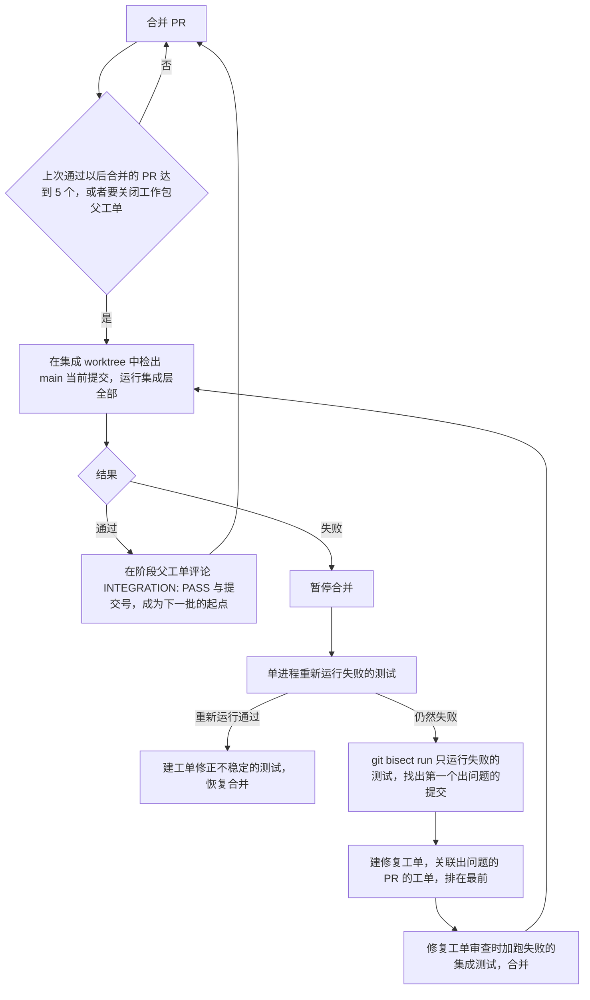
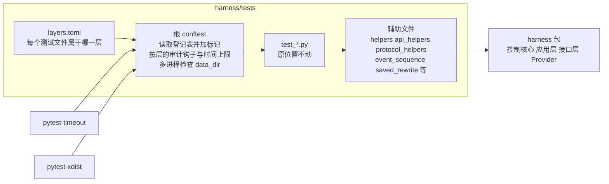

# 测试分层设计说明

状态：2026-09-29 设计，用户已确认分层方式、各角色运行的层与集成层的批量运行（每 5 个 PR 一批、失败时暂停合并）；同日用户确认用登记表表示分层、测试文件原地不动，以减少与进行中工单的冲突，规则文件已按本文修改；同日随后暂缓。2026-10-02 增加操作真实桌面的 `desktop` 标记（第 3、4 节），默认的全部运行排除它。2026-10-07 用户决定恢复，放进 Stage 3 的 M2，排在自举试点之前；实施顺序按 2026-09-29 用户确认的两步做法（第 9 节）。未实施，工单为父工单 #157（#158、#406、#159 至 #161）。本文规定 `harness/tests/` 的三层划分、每层的边界与检查方式、执行者、审查者与架构师各自在什么时候运行哪一层，以及测试输出的读取方式。

## 1. 出发点

2026-09-29 在控制主机（Windows，32 GB 内存）上单进程顺序运行全量测试的实测结果：

| 单项耗时 | 项数 | 合计 |
| --- | --- | --- |
| 不到 0.1 秒 | 538 | 9 秒 |
| 0.1 至 1 秒 | 330 | 177 秒 |
| 1 至 5 秒 | 386 | 964 秒 |
| 5 秒以上 | 64 | 539 秒 |

共 1318 项，28 分钟。三个现象决定了本设计：

1. 时间集中在跑完整三部门循环的测试上。一次完整循环（`test_orchestrator.py::test_happy_path_requires_quality_release`）约 3.4 秒，其中 2.3 秒是 75 次 git 子进程（Windows 上每次约 31 毫秒）。约 60 个测试文件使用 `LoopSystem`，许多测试只检查一个局部结论，也先跑完整循环；`test_smoke.py` 的 64 项共 290 秒，每一项都重新跑一次循环取得运行记录。
2. 单个测试进程的内存不大：顺序运行 `test_smoke.py`、`test_web.py`、`test_projects.py` 时 pytest 进程峰值 212 MB，连同 git 与 node 子进程 360 MB。内存耗尽来自数量叠加：执行者与审查者自行使用 `-n 4`、`-n 6`，每个工作进程两百多 MB，再乘以同时运行的执行者、审查者与 omp 进程本身。
3. 每个执行者与审查者都运行全量测试，失败时完整的调用堆栈进入模型上下文；`test_web_ui.js` 由规则单独运行一次，又由 `test_web.py` 的一项测试经子进程运行一次。

现有结构：真正的单元测试只有 7 个文件；约 20 个文件混合了不同层级的测试；测试文件之间互相导入辅助函数；没有超时设置，曾有一次全量运行停滞 46 分钟（[3.0B 基线](../stage-3/3.0b-baseline-2026-09-21.md) 第 4.1 节）。

## 2. 三层的定义

层级按测试用到的真实资源划分。每个测试文件属于一层，写在登记表 `harness/tests/layers.toml` 中（第 3 节）；登记表是唯一的分类，测试文件的位置不表示层级。

| 层 | 标记 | 允许使用 | 不允许使用 |
| --- | --- | --- | --- |
| 单元 | `unit` | 内存数据、纯函数、单个类，读取仓库内的静态文件与定义 | 临时目录、子进程、网络 |
| 功能与模块 | `module` | 一个模块连同它的真实依赖：SQLite 事件库、git 仓库、工件库与工作区文件、线程；`LoopSystem` 上的一次部门激活（`activate_once`） | 网络（包括本机端口）、完整三部门循环 |
| 集成 | `integration` | 完整三部门循环、HTTP 服务与本地 Provider 服务、事件序列基准、命令子进程与进程树、控制台入口、服务进程 | 不限 |

判断一项测试属于哪一层时，看它检查的结论需要哪些资源才能到达，用能到达的最低一层。一个文件中的测试用到不同层级的资源时，整个文件登记为其中最高的一层；按第 5 节把局部结论的测试移到新的低层文件以后，原文件的登记随之降低。

### 2.1 边界检查

根 `conftest.py` 按登记表给每项测试加上层的标记，并在测试执行期间按层检查边界，越界的测试直接失败，报告写明使用了哪种资源：

- 单元层：用 Python 的审计钩子（`sys.addaudithook`）拒绝 `subprocess.Popen`、`socket.connect`、`socket.bind` 事件；收集阶段拒绝请求 `tmp_path`、`tmp_path_factory` 或 `data_dir` 夹具的测试。
- 模块层：用同一个审计钩子拒绝 `socket.connect`、`socket.bind` 事件。
- 集成层：不检查。

事件循环自带的回环自管道放行。Windows 上 `asyncio.run` 与 `asyncio.new_event_loop` 创建 `ProactorEventLoop` 时，标准库的 `socket.socketpair` 用一对回环连接实现，产生一次 `socket.bind` 与一次 `socket.connect` 审计事件；`activate_once` 内部使用 `asyncio.run`，所以这两个事件在单元层与模块层都放行。判断方法：审计钩子检查调用栈，栈里有标准库 `socket.py` 的 `socketpair` 帧时放行，其余事件照旧拒绝。按地址（回环、端口 0）放行会同时放过测试里绑定 `127.0.0.1:0` 起服务的写法，所以不用地址判断。

「完整三部门循环」无法由程序可靠识别（`run_until_stop` 在模块层也用于停在第一个阻塞处），由审查者按第 2 节的定义核对。

### 2.2 单项时间上限

使用 pytest-timeout（加入 dev 依赖组）。根 `conftest.py` 按层给测试加上上限：单元层 5 秒，模块层 60 秒，集成层 300 秒。Windows 上 pytest-timeout 使用线程方式：超时时打印全部线程的调用堆栈并结束测试进程。这样一次卡住的测试以失败和堆栈结束，不会让运行停滞几十分钟。

### 2.3 多进程运行

只有集成层的批量运行（第 4.2 节）使用 `pytest-xdist`。根 `conftest.py` 在 `-n` 大于 0 而选中的测试中有集成层以外的测试时拒绝运行。事件序列基准与 OpenAPI 快照的重写（`--write-event-baselines`、`--write-openapi-snapshot`）同样只允许单进程。

## 3. 登记表与共用代码

测试文件、辅助文件与基准目录都留在 `harness/tests/` 原来的位置。分层由一份登记表表示：

```toml
# harness/tests/layers.toml
[layers]
"test_stop_reasons.py" = "unit"
"test_write_path.py" = "module"
"test_smoke.py" = "integration"
```

- 键是 Python 测试文件相对 `harness/tests/` 的路径（包括 `kernel/` 等子目录中的文件），值是 `unit`、`module` 或 `integration`。根 `conftest.py` 用标准库 `tomllib` 读取。
- 收集阶段：每项测试按所在文件得到 `pytest.mark.unit`、`module` 或 `integration` 标记；`harness/tests/` 下有没有登记的测试文件时，收集以错误结束并列出这些文件；登记表中写了而文件不存在时同样报错。三个标记在 `pyproject.toml` 的 `markers` 中声明，并启用 `--strict-markers`。
- 新增测试文件时在登记表中加一行。登记表只追加与修改单行，不同分支同时新增文件时的合并冲突容易解决。
- 测试文件之间不再互相导入。被其他测试文件导入的辅助函数与常量移到已有的辅助文件中（`helpers.py`、`api_helpers.py`、`protocol_helpers.py`、`event_sequence.py` 等，按用途选择），范围以下面的导入检查找出的为准。一项单元层测试用标准库 `ast` 读取每个测试文件的导入语句，发现导入测试文件时失败，并写明文件与导入的名称。
- 搬移共用代码时容易删掉同一文件里仍在使用的 `import` 行，这类缺漏只在测试跑到那一行时才报 `NameError`，集成层的用例要完整跑一次才暴露（`helpers.py` 丢掉 `import time` 使四项取消运行中命令的用例必然失败，工单 #430）。同一个文件里的另一项单元层测试用 `pyflakes` 检查 `harness/` 下全部源文件的未定义名称（F821），信息写明文件与行列；`pyflakes` 在 dev 依赖组中。
- 混合了不同层级的文件不拆分，按第 2 节登记为其中最高的一层。
- 操作控制主机真实桌面的测试（3.2D 的桌面会话与屏幕工具，[浏览器与 computer use 设计说明](browser-and-computer-use.md)第 5 节）登记为 `desktop`。这些测试移动真实的鼠标、按下真实的按键、最小化用户的窗口，在用户使用电脑时运行会打断用户。`desktop` 标记同样在 `markers` 中声明；它不属于三层中的任何一层，`-m "unit or module"` 与 `-m integration` 都不选中它，第 4 节的默认运行全部排除它。界面的 Playwright 测试中操作真实桌面的用例加 `@desktop` 标签，默认运行用 `--grep-invert @desktop` 排除。登记表建立之前，`desktop` 标记直接写在测试文件中，`pyproject.toml` 的默认参数排除它，明确写 `-m desktop` 时才运行（#150 先建立这个标记）。
- 内核的不变式测试放在 `harness/tests/kernel/`，每个文件按第 2 节的规则登记层；它们同时列在内核清单里，每条基础规则对应的测试名称由发布检查核对存在并运行（[可信内核设计说明](trusted-kernel.md)第 3 节）。

## 4. 各角色运行哪一层

| 时机 | 角色 | 运行内容 | 方式 |
| --- | --- | --- | --- |
| 开发中 | 执行者 | 与改动相关的测试文件 | 单进程 |
| 交付前 | 执行者 | 单元层与模块层全部，本次改动或新增的集成层测试文件，前端测试 | 单进程 |
| 审查 | 审查者 | 同交付前 | 单进程 |
| 每 5 个 PR 合并以后，以及工作包父工单关闭之前 | 架构师 | 集成层全部 | 多进程 |

本次改动或新增的集成层测试文件在 PR 中运行，保证合并进 main 的集成测试本身可以运行，例如重写了事件序列基准的 PR。

`desktop` 测试只在明确选择时运行（`-m desktop`）：执行者与审查者处理 #150、#155 等改动桌面会话的工单时运行本工单涉及的 `desktop` 测试，架构师在里程碑交给用户试用之前运行全部 `desktop` 测试；这些工单派发之前与里程碑交付之前，架构师先在对话中问用户什么时间可以交出桌面，按用户给的时间运行。

### 4.1 常用命令

```bash
uv run python -m pytest -m "unit or module"
uv run python -m pytest harness/tests/<本次改动或新增的集成层文件>
cd client && npm test
cd client && npm run test:e2e
uv run python -m pytest -m integration -n 4 --junitxml=.tmp/test-results/integration.xml
uv run python -m pytest -m desktop   # 只在用户同意的时间运行
```

集成层的多进程命令只由架构师的批量流程使用；桌面命令只在用户同意的时间使用。

### 4.2 集成层的批量运行



- 集成 worktree 的位置是 `C:\project\yudao-worktrees\integration`，每次运行前检出 main 的当前提交并执行 `uv sync --frozen`。主工作区经常有未提交的文档，不在那里运行。
- 起点是阶段父工单上最近一条 `INTEGRATION: PASS` 评论中的提交号；「合并的 PR 数」按起点之后 main 上的 squash 合并提交计数。
- 暂停合并期间，已经 `review-passed` 的 PR 等待；执行者与审查者照常工作。
- squash 合并使每个 PR 在 main 上只有一个提交，`git bisect` 找到的提交对应一个 PR。
- 重新运行能通过的失败说明测试依赖机器负载或时间，这本身是缺陷，由工单修正测试，不暂停合并。
- 并行失败、单进程重新运行通过时，原批次保留 `INTEGRATION: FAIL` 与首次计数，评论记录重新运行结果和处理工单；恢复合并是流程决定。新的通过起点必须来自实际完成的全部集成检查。工作包关闭和里程碑试用前，关联的不稳定测试工单必须完成。

## 5. 测试往下层移

分层以后大多数测试仍在集成层，就没有形成金字塔。按下面的规则把测试移到能到达其结论的最低一层：

1. 只需要一份真实运行记录的测试（审计、投影、导出、归档完整性，例如 `test_smoke.py`、`test_smoke_guidance_audit.py`、`test_release_archive_integrity.py`、`test_event_log.py`）：每个文件用 module 作用域的夹具跑一次完整循环并保存数据目录，每项测试复制一份数据目录后再改写与检查。数据仍来自真实运行，开销从每项一次循环变为每个文件一次。这类测试属于集成层。
2. 检查单个部门一步的结论（提案校验、裁决、工具结果、上下文装配）：改用 `activate_once` 构造状态，放进模块层。
3. 检查纯规则或纯转换（停止原因、视图计算、载荷校验、工具描述）：直接调用函数，放进单元层。
4. OpenAPI 快照测试中核对接口说明的一项直接取 `harness.api.app.create_app` 返回的 FastAPI 应用的 `openapi()` 文档与快照比较。生成文档不经过生命周期，不打开 `Application`，也不启动服务。同一文件中核对客户端类型的一项要用子进程按快照重新生成类型，整个文件登记为模块层；单元层与模块层在每次交付前运行，每个 PR 都核对接口合同。
5. 等待某个条件成立时使用事件或提交通知，不用固定时长的 `sleep`；检查时间限额本身的等待保留，属于集成层。
6. `test_service_lock.py` 先占用再释放端口（`_free_port`）交给子进程的写法在多进程运行中会冲突，改为子进程自己绑定端口 0 并报告实际端口。

## 6. 输出的读取

- pytest 的默认参数（`pyproject.toml` 的 `addopts`）为 `-q --tb=line -rfE -p no:warnings`：每项失败只打印一行位置与错误信息，结尾是失败与错误的清单和计数。
- 需要细节时，只对失败的那一项重新运行并加 `--tb=short`。
- 交付评论与审查评论写每层的计数行与失败项名称，不粘贴测试输出。
- 集成层批量运行的完整结果写入 `.tmp/test-results/integration.xml`，失败时从中读取失败项名称用于重新运行与 `git bisect`。

## 7. 前端与浏览器测试

- 旧 Web 控制台的界面测试已随旧控制台删除：`test_web_ui.js`、`test_b3_shell_browser.spec.js` 与 `test_s3_acceptance_browser.spec.js`（后两者是 Stage 2 的验收证据脚本，固定日期、固定端口、写死的 Chromium 路径，没有接入任何运行入口）。界面的端到端测试用 Playwright 驱动浏览器打开 Yudao 服务提供的页面（[ADR-0032](../adr/0032-interface-served-as-web-pages.md)、[D30](../requirements/web-game-frontend.md)、#71）。

## 8. 模块交互



依赖方向：测试文件只依赖辅助文件与 `harness` 包；辅助文件不依赖任何测试文件；测试文件之间不互相导入（第 3 节的单元层测试检查）。

## 9. 实施顺序

1. 登记表与检查（#158）：`layers.toml` 登记全部现有测试文件，这一步全部登记为 `integration`；根 `conftest.py` 的标记、未登记检查、按层的边界检查与时间上限、多进程检查；`pyproject.toml` 的 `markers`、`--strict-markers` 与 `addopts` 输出参数；pytest-timeout 加入 dev 依赖组。不移动文件，不改测试内容。
2. 按固定做法降层（#406）与测试文件之间不互相导入（#159），两部分可以同时进行：
   - 降层只改登记表，不逐个阅读测试文件判断层级：调用 `run_until_stop` 的文件留在集成层（完整三部门循环无法由第 2.1 节的检查识别）；其余文件逐个先登记为单元层运行，被边界检查或时间上限拒绝时改为模块层再运行，仍被拒绝时留在集成层。
   - 测试文件之间导入的辅助函数移到辅助文件，加上检查导入的单元层测试。
3. 审计钩子放行事件循环的自管道（第 2.1 节，#437）：修改根 `conftest.py`，并把因此能通过本层检查的文件在登记表中降层（沿用第 2 步的固定做法，只重试因 `socket.bind` 与 `socket.connect` 被拒绝而留在集成层的文件）。
4. 往下层移（#160、#161），分成互不重叠的两部分，可以同时进行（#161 被 #437 阻塞）：
   - 第 5 节第 1、4、6 项：只需要运行记录的测试改为每个文件一次循环，OpenAPI 快照测试不启动服务，`_free_port`。
   - 第 5 节第 2、3、5 项：局部结论改用 `activate_once` 或直接调用函数，放进新的单元层或模块层文件，去掉等待用的固定时长。

第 1、2 步不移动文件，进行中的工单分支合并 main 时只需要在登记表中登记自己新增的测试文件。第 3 步只改根 `conftest.py` 与登记表，第 4 步改动具体测试文件的内容。

每一步完成后，三层合计的测试项数与改动前相同。

规则文件（AGENTS.md「常用命令」、执行者与审查者的测试步骤，CLAUDE.md 自主推进模式的集成层一步）按本文修改。第 1 步完成时单元层与模块层只有检查本身的测试，第 2 步的降层合并以后，执行者与审查者的测试步骤改为第 4 节的做法。在这之前的做法是：执行者与审查者运行与改动相关的测试文件与前端测试，单进程；架构师按批运行的是 `harness/tests` 全部。
