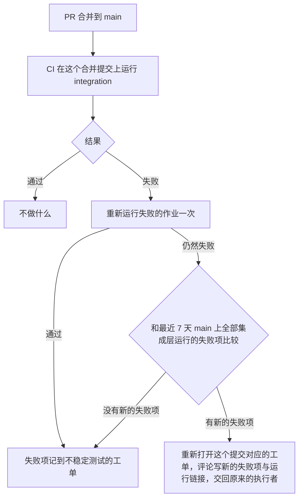
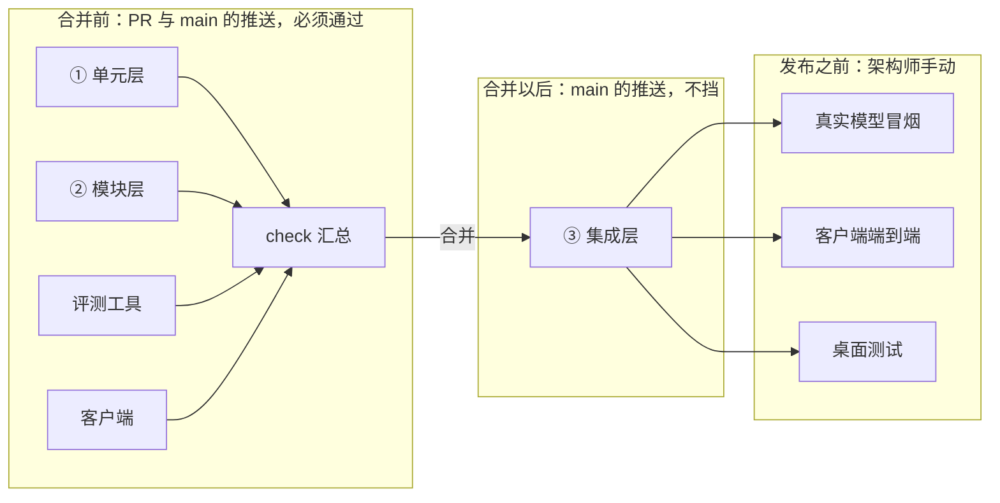
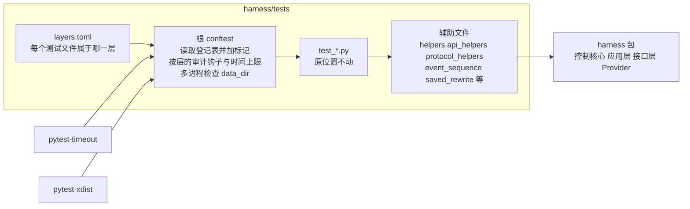

# 测试分层设计说明

状态：用户已确认，在用（2026-09-29 设计，各节确认的经过见 `docs/CHANGELOG.md`）；最近一次改动 2026-10-28，第 10 节加第 7 条：两件同时进行的事谁先谁后由事件或信号决定，第 5 节第 5 条改为引用它。总图位置：第五节验收表；本文的单元、模块、集成按测试用到的资源分，总图的内核、缝、真实场景按查什么分，两种划分交叉：内核的验收（给定事件序列的状态与决定，用真实存储）多在模块层，缝的验收（合同快照与确定性断言）在单元与模块层，真实场景是评测工作线的真实用户场景验收（#830），不在 `harness/tests/` 里。

## 1. 出发点

2026-09-29 在控制主机（Windows，32 GB 内存）上单进程顺序运行全量测试的实测结果：

| 单项耗时 | 项数 | 合计 |
| --- | --- | --- |
| 不到 0.1 秒 | 538 | 9 秒 |
| 0.1 至 1 秒 | 330 | 177 秒 |
| 1 至 5 秒 | 386 | 964 秒 |
| 5 秒以上 | 64 | 539 秒 |

共 1318 项，28 分钟。三个现象决定了本设计：

1. 时间集中在跑完整三部门循环的测试上。一次完整循环（`test_orchestrator.py::test_happy_path_requires_quality_release`）约 3.4 秒，其中 2.3 秒是 75 次 git 子进程（Windows 上每次约 31 毫秒）。约 60 个测试文件使用 `LoopSystem`，许多测试只检查一个局部结论，也先跑完整循环；`test_smoke.py` 的 64 项共 290 秒，每一项都重新跑一次循环取得运行记录。
2. 单个测试进程的内存不大：顺序运行 `test_smoke.py`、`test_web.py`、`test_projects.py` 时 pytest 进程峰值 212 MB，连同 git 与 node 子进程 360 MB。内存耗尽来自数量叠加：执行者与审查者自行使用 `-n 4`、`-n 6`，每个工作进程两百多 MB，再乘以同时运行的执行者、审查者与 omp 进程本身。
3. 每个执行者与审查者都运行全量测试，失败时完整的调用堆栈进入模型上下文；`test_web_ui.js` 由规则单独运行一次，又由 `test_web.py` 的一项测试经子进程运行一次。

现有结构：真正的单元测试只有 7 个文件；约 20 个文件混合了不同层级的测试；测试文件之间互相导入辅助函数；没有超时设置，曾有一次全量运行停滞 46 分钟（[3.0B 基线](../archive/stage-3/3.0b-baseline-2026-09-21.md) 第 4.1 节）。

## 2. 三层的定义

层级按测试用到的真实资源划分。每个测试文件属于一层，写在登记表 `harness/tests/layers.toml` 中（第 3 节）；登记表是唯一的分类，测试文件的位置不表示层级。

| 层 | 标记 | 允许使用 | 不允许使用 |
| --- | --- | --- | --- |
| 单元 | `unit` | 内存数据、纯函数、单个类，读取仓库内的静态文件与定义 | 临时目录、子进程、网络 |
| 功能与模块 | `module` | 一个模块连同它的真实依赖：SQLite 事件库、git 仓库、工件库与工作区文件、线程；`LoopSystem` 上的一次部门激活（`activate_once`） | 网络（包括本机端口）、完整三部门循环 |
| 集成 | `integration` | 完整三部门循环、HTTP 服务与本地 Provider 服务、事件序列基准、命令子进程与进程树、控制台入口、服务进程 | 不限 |

判断一项测试属于哪一层时，看它检查的结论需要哪些资源才能到达，用能到达的最低一层。一个文件中的测试用到不同层级的资源时，整个文件登记为其中最高的一层；按第 5 节把局部结论的测试移到新的低层文件以后，原文件的登记随之降低。

### 2.1 边界检查

根 `conftest.py` 按登记表给每项测试加上层的标记，并在测试执行期间按层检查边界，越界的测试直接失败，报告写明使用了哪种资源：

- 单元层：用 Python 的审计钩子（`sys.addaudithook`）拒绝 `subprocess.Popen`、`socket.connect`、`socket.bind` 事件；收集阶段拒绝请求 `tmp_path`、`tmp_path_factory` 或 `data_dir` 夹具的测试。
- 模块层：用同一个审计钩子拒绝 `socket.connect`、`socket.bind` 事件。
- 集成层：不检查。

事件循环自带的回环自管道放行。Windows 上 `asyncio.run` 与 `asyncio.new_event_loop` 创建 `ProactorEventLoop` 时，标准库的 `socket.socketpair` 用一对回环连接实现，产生一次 `socket.bind` 与一次 `socket.connect` 审计事件；`activate_once` 内部使用 `asyncio.run`，所以这两个事件在单元层与模块层都放行。判断方法：审计钩子检查调用栈，栈里有标准库 `socket.py` 的 `socketpair` 帧时放行，其余事件照旧拒绝。按地址（回环、端口 0）放行会同时放过测试里绑定 `127.0.0.1:0` 起服务的写法，所以不用地址判断。

「完整三部门循环」无法由程序可靠识别（`run_until_stop` 在模块层也用于停在第一个阻塞处），由审查者按第 2 节的定义核对。

### 2.2 单项时间上限

使用 pytest-timeout（加入 dev 依赖组）。根 `conftest.py` 按层给测试加上上限：单元层 5 秒，模块层 60 秒，集成层 300 秒。Windows 上 pytest-timeout 使用线程方式：超时时打印全部线程的调用堆栈并结束测试进程。这样一次卡住的测试以失败和堆栈结束，不会让运行停滞几十分钟。

集成层用 `-n` 运行（第 4.2 节），结束的进程就是一个 worker：xdist 报「node down」与「worker crashed」，堆栈也跟着丢掉，看到的是崩溃而不是一条失败。两处补齐：

- 工作量天然超过本层上限的文件单独定时限，写在根 `conftest.py` 的 `FILE_TIMEOUTS` 里（工单 #753：`test_release_script.py` 1200 秒——它要装依赖、构建页面并构建 wheel，CI 上要三百多秒，正好在 300 秒上下）。
- 这一类文件自己把时限写在子进程上（工单 #753 的 `RELEASE_BUILD_TIMEOUT_SEC`）：构建超过时限时测试以一条说清原因的失败结束，worker 不消失。它比 `FILE_TIMEOUTS` 里的上限小，超时先由它接手。

### 2.3 多进程运行

只有集成层的运行（第 4.2 节）使用 `pytest-xdist`。根 `conftest.py` 在 `-n` 大于 0 而选中的测试中有集成层以外的测试时拒绝运行。事件序列基准与 OpenAPI 快照的重写（`--write-event-baselines`、`--write-openapi-snapshot`）同样只允许单进程。

## 3. 登记表与共用代码

测试文件、辅助文件与基准目录都留在 `harness/tests/` 原来的位置。分层由一份登记表表示：

```toml
# harness/tests/layers.toml
[layers]
"test_stop_reasons.py" = "unit"
"test_write_path.py" = "module"
"test_smoke.py" = "integration"
```

- 键是 Python 测试文件相对 `harness/tests/` 的路径（包括 `kernel/` 等子目录中的文件），值是 `unit`、`module` 或 `integration`。根 `conftest.py` 用标准库 `tomllib` 读取。
- 收集阶段：每项测试按所在文件得到 `pytest.mark.unit`、`module` 或 `integration` 标记；`harness/tests/` 下有没有登记的测试文件时，收集以错误结束并列出这些文件；登记表中写了而文件不存在时同样报错。三个标记在 `pyproject.toml` 的 `markers` 中声明，并启用 `--strict-markers`。
- 新增测试文件时在登记表中加一行。登记表只追加与修改单行，不同分支同时新增文件时的合并冲突容易解决。
- 测试文件之间不再互相导入。被其他测试文件导入的辅助函数与常量移到已有的辅助文件中（`helpers.py`、`api_helpers.py`、`protocol_helpers.py`、`event_sequence.py` 等，按用途选择），范围以下面的导入检查找出的为准。一项单元层测试用标准库 `ast` 读取每个测试文件的导入语句，发现导入测试文件时失败，并写明文件与导入的名称。
- 搬移共用代码时容易删掉同一文件里仍在使用的 `import` 行，这类缺漏只在测试跑到那一行时才报 `NameError`，集成层的用例要完整跑一次才暴露（`helpers.py` 丢掉 `import time` 使四项取消运行中命令的用例必然失败，工单 #430）。`test_undefined_names.py` 用 `pyflakes` 检查 `harness/` 下全部源文件的未定义名称（F821），信息写明文件与行列；`pyflakes` 在 dev 依赖组中。它要读完包内全部源文件再逐个检查，机器有其他任务在跑时超过单元层的 5 秒上限，登记为 `module` 层（#445）。
- 混合了不同层级的文件不拆分，按第 2 节登记为其中最高的一层。
- 操作控制主机真实桌面的测试（3.2D 的桌面会话与屏幕工具，[浏览器与 computer use 设计说明](browser-and-computer-use.md)第 5 节）登记为 `desktop`。这些测试移动真实的鼠标、按下真实的按键、最小化用户的窗口，在用户使用电脑时运行会打断用户。`desktop` 标记同样在 `markers` 中声明；它不属于三层中的任何一层，`-m "unit or module"` 与 `-m integration` 都不选中它，第 4 节的默认运行全部排除它。界面的 Playwright 测试中操作真实桌面的用例加 `@desktop` 标签，默认运行用 `--grep-invert @desktop` 排除。登记表建立之前，`desktop` 标记直接写在测试文件中，`pyproject.toml` 的默认参数排除它，明确写 `-m desktop` 时才运行（#150 先建立这个标记）。
- 内核的不变式测试放在 `harness/tests/kernel/`，每个文件按第 2 节的规则登记层；它们同时列在内核清单里，每条基础规则对应的测试名称由发布检查核对存在并运行（[可信内核设计说明](trusted-kernel.md)第 3 节）。

## 4. 各角色运行哪一层

| 时机 | 谁 | 运行内容 | 方式 |
| --- | --- | --- | --- |
| 开发中与交付前 | 执行者 | 与改动相关的测试文件，包括本次改动或新增的集成层文件；CI 报告失败的测试；改动涉及 `client/` 时相关的前端测试 | 单进程 |
| 每次推送到 PR 与 main | CI | 四个作业并行：① 单元层、② 模块层（各含一项固定检查）、评测工具（`evals/tests`，`real_model` 默认不选）、客户端（类型检查、单元测试（逐场景回放测试除外）、编译页面与 wheel）；`check` 汇总四项，合并必须通过；PR 上另有「用例变化」（第 4.4 节），只显示 | 单进程 |
| 审查 | 审查者 | 与改动相关的测试文件，反向验证 | 单进程 |
| 每次合并到 main 以后 | CI | ③ 集成层（作业 `integration`）：集成层全部；不挡合并，失败由派发者交回那张工单（第 4.2 节） | 多进程 |
| 里程碑发布之前 | 架构师 | 要发布的 main 提交：CI 的 `integration` 通过；真实模型冒烟；全部客户端端到端测试（`cd client && npm run test:e2e`）；全部 `desktop` 测试；真实用户场景验收（[骨架与应用设计说明](skeleton-and-application.md)第 11 节：代理扮演新用户照 README 完成一句话目标，确定性代码判分；运行器建成以后加入） | 多进程 |

执行者运行本次改动或新增的集成层测试文件，保证提交的集成测试本身可以运行，例如重写了事件序列基准的 PR。CI 的定义是 `.github/workflows/ci.yml`，在 GitHub 提供的 Windows 运行机上运行（[运行配置](../agents/autopilot-runtime.md)第 5 节）。

`desktop` 测试只在明确选择时运行（`-m desktop`）：执行者与审查者处理 #150、#155 等改动桌面会话的工单时运行本工单涉及的 `desktop` 测试，架构师在里程碑交给用户试用之前运行全部 `desktop` 测试；这些工单派发之前与里程碑交付之前，架构师先在对话中问用户什么时间可以交出桌面，按用户给的时间运行。

需要真实模型的测试（`real_model`）同样只在明确选择时运行（`-m real_model`）：凭据在环境中本身不触发运行，选择了而变量缺失时跳过，并写明缺哪个变量。执行者与审查者只在工单要求时运行，CI 没有凭据，不运行这类测试。地址、凭据与模型见运行配置第 4 节（2026-10-18；标记由 #593 加入）。

客户端端到端测试（`client/tests/e2e/`）不在 CI 中运行：执行者与审查者只运行与改动相关的文件，架构师在里程碑发布之前在要发布的提交上运行全部，失败时不发布（2026-10-19 用户决定）。这是先采用的做法，失败要到发布前才发现；看过第一次运行的用时与结果以后，再决定是否放进合并以后的 CI，与集成层并行。

### 4.1 常用命令

```bash
uv run python -m pytest -m "unit or module"
uv run python -m pytest harness/tests/<本次改动或新增的集成层文件>
cd client && npm test
cd client && npm run test:e2e
uv run python -m pytest -m integration -n 4 --junitxml=.tmp/test-results/integration.xml
uv run python -m pytest -m desktop   # 只在用户同意的时间运行
uv run python -m pytest <测试文件> -m real_model   # 只在工单要求时运行
```

集成层的多进程命令在本机只用于和 CI 的结果对照；桌面命令只在用户同意的时间使用。

### 4.2 集成层在每次合并以后运行

测试按时机分层，三层对应三个时机：每次推送运行单元层与模块层，必须通过才能合并；每次合并以后运行集成层，不挡审查、合并与派发（改控制核心的工单例外，见本节「改控制核心的工单例外」一条）；里程碑发布之前在要发布的提交上运行集成层、真实模型冒烟、客户端端到端与桌面测试，挡发布，不挡开发。只有一个长期分支 main，里程碑由发布时的 tag 标出（2026-10-18 用户决定，不用 dev 分支）。

CI 在 main 的每次推送（每次合并）以后运行 `integration`，每个合并提交各自运行到底，失败能对应到一次合并、一张工单。派发者处理失败（[派发者规则](../agents/dispatcher.md)第 5 节）：



- 只看新的失败项：最近 7 天里 main 上任何一次集成层运行（推送、重新运行、手动触发）失败过的项，不是这次合并引起的，不重新打开这次的工单，记到不稳定测试的工单。只和前一个合并提交比较时，偶发的失败会算成这次合并引起的（2026-10-19 复盘：`test_release_script.py` 在 20 次运行里崩溃 3 次，前一个提交恰好通过）。
- 不暂停其他 PR 的合并，不另建修复工单。重新打开的工单由同一个执行者从 main 重新建分支修；修的时候在本机单进程运行失败的测试，只在 GitHub 运行机上失败的，用手动触发在自己的分支上运行（[运行配置](../agents/autopilot-runtime.md)第 5 节）。
- 重新运行能通过的失败说明测试依赖机器负载或时间，这本身是缺陷，记到一张打开的不稳定测试工单。每个测试文件一张，标题带文件名，派发者新建时交架构师写成修复工单；这些打开的工单就是不稳定项的清单（派发者规则第 5 节）。工作包关闭与里程碑发布之前，关联的不稳定测试工单必须完成。
- 代价：坏的改动会先进入 main，大约 23 分钟以后才被发现；其他工单的 `check` 不受影响，照常开发与合并。
- 改控制核心的工单例外（2026-10-24 用户决定）：带 `touches-core` 的工单在交付前对自己的分支跑一次集成层，失败项都是最近 7 天 main 上失败过的才交付（`AGENTS.md` 执行者第 5 步）。起因是 #822（部门同时运行）：合并前在分支上跑过一次，有 17 个失败，集成层不挡合并，照样合了；之后的失败按不稳定项记录，暂停以后答「继续」事项被记成已取消的缺陷因此晚了一天才查出来（#856）。控制核心的改动影响面大，失败的来源不显眼，多等约 15 分钟值得；其余工单仍在合并以后运行。
- 2026-10-18 第一次在 GitHub 运行机上运行：约 23 分钟（本机 `-n 4` 约 12 分钟），11 项只在运行机上失败，其中 7 项是派发机器不能建符号链接、一直跳过的用例。
- 以前的做法：2026-10-14 以前，合并满 5 个 PR 以后对 main 运行一次，失败时暂停合并、用 `git bisect` 找出问题提交，另建修复工单；六个改动合同的 PR 连续合并以后出现 97 个失败，拆出的修复工单用了约 19 小时。2026-10-14 至 10-18，派发者在交付以后、审查以前在本机对 PR 的合并提交运行一次，集成 worktree 只有一个，几个 PR 同时交付时排队，审查等在后面。现在逐个合并提交运行，既不攒批，也不排在审查前面。

### 4.3 CI 中的分层

2026-10-18 用户要求分层在 CI 中看得见。每一层是 CI 中一个单独的作业，作业名带层的编号；合并前的四个作业并行，汇总作业 `check` 是 main 的规则要求的检查：



`check` 在运行摘要里写出一张表：每层的文件数、用例数、通过、失败、跳过与用时；集成层在 PR 上只列出登记的文件数，main 上由 ③ 集成层作业写出自己的一行。表由 `scripts/ci_layers.py summary` 从各层的 junit 结果生成，金字塔的形状与第 5 节往下层移的效果每次运行都看得到。

### 4.4 用例的变化

流程固定的是用例怎样变，用例清单本身跟着需求变（2026-10-18 用户确认）：

1. 用例随工单写明的行为变（2026-10-27 用户决定，取代 10-26「用例只由架构师删」）：删减功能的工单在「只改」与验收中写明删除的行为，执行者随工单删守着这些行为的用例，交付说明逐条列出，依据是第 13 节的口径或 ADR 的某一条；工单没有写明删除的行为，用例只改写不删。架构师仍可以在清理单或自己的 PR 里删。守住评价标准的办法是事后对照：CI「用例变化」把删除逐条列出，审查者与架构师拿它对照工单；`harness/tests/kernel/` 只增不删。
2. CI 在 PR 上运行「用例变化」：分别收集合并前后的用例（只收集，不运行，包括 PR 上不运行的集成层），按层列出用例数、新增、删除与换层，删除与换层的用例逐条列出。改名的用例显示为一删一增。由 `scripts/ci_layers.py inventory` 生成。
3. 交付说明列出的删除用例与「用例变化」的删除清单一致；审查者逐条对照工单与交付说明，对不上时要求修改。
4. 用例写行为、不写实现（第 10 节），重构不牵动用例，用例的变化只来自需求的变化。

「用例变化」先只显示、不挡合并。观察一个里程碑以后，再决定删除没有写在交付说明里的用例时要不要挡合并。没有采纳的做法：每个用例登记对应的需求条目（登记的成本高，删掉功能以后测它的用例会失败，过时会自己暴露）；把用例清单作为快照提交（几张工单同时改会冲突）。

## 5. 测试往下层移

分层以后大多数测试仍在集成层，就没有形成金字塔。按下面的规则把测试移到能到达其结论的最低一层：

1. 只需要一份真实运行记录的测试（审计、投影、导出、归档完整性，例如 `test_smoke.py`、`test_smoke_guidance_audit.py`、`test_release_archive_integrity.py`、`test_event_log.py`）：每个文件用 module 作用域的夹具跑一次完整循环并保存数据目录，每项测试复制一份数据目录后再改写与检查。数据仍来自真实运行，开销从每项一次循环变为每个文件一次。这类测试属于集成层。
2. 检查单个部门一步的结论（提案校验、裁决、工具结果、上下文装配）：改用 `activate_once` 构造状态，放进模块层。
3. 检查纯规则或纯转换（停止原因、视图计算、载荷校验、工具描述）：直接调用函数，放进单元层。
4. OpenAPI 快照测试中核对接口说明的一项直接取 `harness.api.app.create_app` 返回的 FastAPI 应用的 `openapi()` 文档与快照比较。生成文档不经过生命周期，不打开 `Application`，也不启动服务。同一文件中核对客户端类型的一项要用子进程按快照重新生成类型，整个文件登记为模块层；单元层与模块层在每次交付前运行，每个 PR 都核对接口合同。
5. 去掉等待用的固定时长，写法按第 10 节第 7 条；检查时间限额本身的等待保留，属于集成层。
6. `test_service_lock.py` 先占用再释放端口（`_free_port`）交给子进程的写法在多进程运行中会冲突，改为子进程自己绑定端口 0 并报告实际端口。

## 6. 输出的读取

- pytest 的默认参数（`pyproject.toml` 的 `addopts`）为 `-q --tb=line -rfE -p no:warnings`：每项失败只打印一行位置与错误信息，结尾是失败与错误的清单和计数。
- 需要细节时，只对失败的那一项重新运行并加 `--tb=short`。
- 交付说明与审查写所运行测试的计数行与失败项名称，并附 CI 运行的链接，不粘贴测试输出。
- 集成层运行的完整结果写入 `.tmp/test-results/integration.xml`，失败时从中读取失败项名称，用于单进程重新运行。

## 7. 前端与浏览器测试

- 旧 Web 控制台的界面测试已随旧控制台删除：`test_web_ui.js`、`test_b3_shell_browser.spec.js` 与 `test_s3_acceptance_browser.spec.js`（后两者是 Stage 2 的验收证据脚本，固定日期、固定端口、写死的 Chromium 路径，没有接入任何运行入口）。界面的端到端测试用 Playwright 驱动浏览器打开 Yudao 服务提供的页面（[ADR-0032](../adr/0032-interface-served-as-web-pages.md)、[D30](../requirements/web-game-frontend.md)、#71）。
- 端到端装置的模型回答由 `FakeAdapter` 的脚本给出（`client/tests/e2e/backend.py`）。**脚本按部门给出**，每个部门一份；每一轮按请求里看到的事实决定做什么（质检在没有交付的一轮是预测性探索，有交付的一轮是核验；工程按有没有缺陷记录决定交付什么），与 `harness/demo.py` 同一做法（工单 #852）。一份按先后排队的脚本在部门同时运行以后不再成立：先到的会话会把后面那个项目的轮次取走，项目之间因此串了位。
- 装置的预置是端到端用例的底座，它的状态由 `client/tests/e2e/seed.spec.ts` 钉住（四个项目各自的状态、停在等待回答的决定请求上的那个项目、还没有事项的那个项目，以及执行槽位被占时新建事项被拒）。

## 8. 模块交互



依赖方向：测试文件只依赖辅助文件与 `harness` 包；辅助文件不依赖任何测试文件；测试文件之间不互相导入（第 3 节的单元层测试检查）。

## 9. 实施顺序

1. 登记表与检查（#158）：`layers.toml` 登记全部现有测试文件，这一步全部登记为 `integration`；根 `conftest.py` 的标记、未登记检查、按层的边界检查与时间上限、多进程检查；`pyproject.toml` 的 `markers`、`--strict-markers` 与 `addopts` 输出参数；pytest-timeout 加入 dev 依赖组。不移动文件，不改测试内容。
2. 按固定做法降层（#406）与测试文件之间不互相导入（#159），两部分可以同时进行：
   - 降层只改登记表，不逐个阅读测试文件判断层级：调用 `run_until_stop` 的文件留在集成层（完整三部门循环无法由第 2.1 节的检查识别）；其余文件逐个先登记为单元层运行，被边界检查或时间上限拒绝时改为模块层再运行，仍被拒绝时留在集成层。
   - 测试文件之间导入的辅助函数移到辅助文件，加上检查导入的单元层测试。
3. 审计钩子放行事件循环的自管道（第 2.1 节，#437）：修改根 `conftest.py`，并把因此能通过本层检查的文件在登记表中降层（沿用第 2 步的固定做法，只重试因 `socket.bind` 与 `socket.connect` 被拒绝而留在集成层的文件）。已完成：钩子按调用栈放行标准库 `socket.py` 的 `socketpair` 帧，`test_layer_boundaries.py` 增加三项检查钩子本身的测试，登记表 19 个文件降层（1 个降到单元层、18 个降到模块层）；单元层与模块层合计从 32 个文件 670 项变为 51 个文件 820 项（新增的 3 项是检查钩子本身的测试），三层合计 141 个文件 2003 项变为 2006 项。
4. 往下层移（#160、#161），分成互不重叠的两部分，可以同时进行（#161 被 #437 阻塞）：
   - 第 5 节第 1、4、6 项：只需要运行记录的测试改为每个文件一次循环，OpenAPI 快照测试不启动服务，`_free_port`。
   - 第 5 节第 2、3、5 项：局部结论改用 `activate_once` 或直接调用函数，放进新的单元层或模块层文件，去掉等待用的固定时长。

第 1、2 步不移动文件，进行中的工单分支合并 main 时只需要在登记表中登记自己新增的测试文件。第 3 步只改根 `conftest.py` 与登记表，第 4 步改动具体测试文件的内容。

每一步完成后，三层合计的测试项数与改动前相同。

规则文件（AGENTS.md「常用命令」、执行者与审查者的测试步骤，派发者规则的集成层一步）按本文修改。第 1 步完成时单元层与模块层只有检查本身的测试，第 2 步的降层合并以后，执行者与审查者的测试步骤改为第 4 节的做法。在这之前的做法是：执行者与审查者运行与改动相关的测试文件与前端测试，单进程；架构师按批运行的是 `harness/tests` 全部。

## 10. 测试的写法

2026-10-14 用户确认。一次合同改动牵动几十个测试文件，主要因为测试检查的是「怎么做的」，而不是「做成了什么」：手写的提案缺少新增的必填字段，测试数模型被调用的次数，假模型脚本按顺序写死每一步。

1. 提案用 `harness/proposals.py` 的构造函数生成（`product_spec_turn`、`delivery_turn`、`review_turn`、`baseline_review_turn` 等），由构造函数按当前版本填写依据字段，不手写提案的字段。合同新增字段时只改构造函数。
2. 断言做成了什么：事件、裁决、状态与工件。不数模型被调用的次数，不依赖部门激活的先后；只有次数本身就是被测的行为时才数，例如达到上限以后停止、停止以后不再调用。
3. 测试不决定产品的文字。依赖提示总长度的场景，按场景需要设置上下文窗口与阈值，不随工具说明与部门提示的长短变化；工具说明写多长，由模型用得好不好决定。
4. 已有的测试不集中改写：工单改到哪个测试，就按本节的写法改。
5. 行为已被 ADR 或工单删除的用例按第 4.4 节第 1 条删：工单写明了删除的行为时由执行者随工单删，其余由架构师在清理单或自己的 PR 里删。还要保留的行为，测试随新合同迁移，与引起它的改动在同一张工单里完成。
6. 进程内的假模型脚本按部门给出（`FakeAdapter({"engineering": [...], "quality": [...]})`），凡是事项会走到 PRD 被接纳以后的用例都这样写。PRD 被接纳以后工程与质检同时工作（[三部门的循环结构](department-loop.md)第 3 节），一条按先后排队的列表脚本被两个部门同时取用时，谁拿到哪一项随调度变化，用例时好时坏，坏的时候报的还是别处的错。列表脚本只给始终只有一个部门在取用的场景用。假模型发现一条列表脚本同时被工程与质检取用时让用例失败，并写明是哪条脚本。这是正确性问题，不受第 4 条「不集中改写」的限制，已有的用例集中改写（2026-10-24 分诊，见决定记录）。
7. 两件同时进行的事谁先谁后，由事件、信号文件或提交通知决定，不用时长去赌：要求 A 在 B 之前发生，就让 A 发出信号、B 等到信号再动，或者断言事件日志里两者的先后。「慢的那一步这时一定还没做完」「准备阶段一定很快」这类假设，在机器忙的时候不成立。等待都有上限，到了上限以一条写明在等什么的失败结束。Windows 上删除或重新打开还被别的进程占用的文件，做有次数上限的重试。检查时间限额本身的等待保留，属于集成层。第 4.2 节的不稳定测试工单按这一条修（2026-10-28 总架构师，依据 #1100、#1101、#1108、#1117、#1134 五个不稳定项的修法）。

## 11. 事件序列基准的范围

2026-10-14 用户确认，由 #514 实施。改动之前，42 份基准（`harness/tests/event_sequences/*.json`）把每次模型请求的工具说明全文、部门提示全文与 token 估算都写在里面，改一句工具说明就要重写约 40 份基准，同时进行的工单在基准上互相冲突。

- 基准比较：事件的种类与顺序；因果，即每个事件由哪个事件引起；每类事件的关键字段，例如裁决结果、拒绝原因、依据的版本、停止原因。
- 基准不比较：模型请求里的工具说明全文与部门提示全文、token 估算，以及随它们变化的派生值。
- 部门提示与工具说明集中在一份快照里：每个部门在每种激活下看到的提示与工具清单各记一次。说明改动时只有这份快照变化，`--write-event-baselines` 同时重写它；审查者从这份快照的差异看出说明改了什么。
- token 估算的计算由单元测试覆盖，不进基准与快照。

### 11.1 做法（2026-10-15 架构师补充，#514 拆分时按实验确定）

实验（记录在 #514 的拆分评论里）：把 bash 的工具说明加长一倍并重写 42 份基准，40 份变化，事件的种类、顺序与数量都没有变，变化全部是两类字段：说明全文（请求材料与模型请求的工件内容）与 token 估算。最近三次改合同的合并（#471、#481、`run_check` 改为命令字符串）各改了 16 至 40 份基准，事件种类与顺序同样没有变；其中只去掉说明与估算还剩下工具清单、提案参数与检查载荷的变化。用下面的做法核对这三次合并，需要改动的基准是 0 份；删除工程计划那一次（事件种类变了）仍然改动全部基准，那是行为的真实变化。

基准按「保留的字段」写，不按「去掉的字段」写：

- 每条事件保留信封字段（种类、提出者、部门、状态迁移、引起它的事件、会话、停止原因、错误）与这类事件的关键载荷字段。关键载荷字段登记在 `harness/tests/event_sequence.py` 的一张表里，按事件种类列出：裁决与结论（例如 `verdict`、`status`、`ok`、`reason`、`errors`）、依据的版本与内容摘要（例如 `revision`、`content_hash`、`product_spec_hash`、`effective_contract_hash`、`input_version`、`definitions_version`）、因果与关联编号（例如 `activation_id`、`step_id`、`attempt_id`、`id`、`request_id`、`context_event_id`）、计数与上限（例如 `attempt`、`max_attempts`、`count`、`limit`、`cycle_count`、`max_cycles`）、停止与人工处理（`stop_reason`、`human_action`）。工具调用结果另外保留回执里的退出码、状态与工作区是否改变（`exit_code`、`status`、`tree_changed`）。没有登记的事件种类，测试失败并写明需要登记哪个种类。
- 不进入基准：工件内容（包括请求材料与模型请求）、说明全文、token 估算及随它变化的值（输出上限、压缩的切分位置）、模型与连接配置、时间、提案正文。工件引用与编号只在被保留的字段里出现时编号，所以去掉的字段不影响编号。
- 投影保留阶段、停止原因、结果、错误、等待原因、计数与版本，以及当前 PRD、交付说明、审查与有效合同的修订号、状态与内容摘要。
- 可信内核的两项测试（`kernel/test_every_stop_has_reason.py`、`kernel/test_tool_needs_permission.py`）读取的字段都在保留之列，内核测试不需要修改。
- 比较不一致时，信息写明场景、会话、会话内第几个事件、事件种类与不一致的字段名。
- 部门同时运行以后（#557）基准按会话比较：会话内的事件按顺序比，会话之间只比因果关系。会话里的事件只保留不随会话之间先后变化的值（2026-10-24 架构师补充）：
  - 引用别的事件的字段，`parent_event_id` 与载荷里的 `context_event_id`、`compaction_event_id`、`source_event_id`、`guidance_created_event_id`、`result_event_ids` 等，都写成被引用事件在它自己会话里的位置，不写全局位置。
  - 整个事项的累计数不进会话内事件的比较：激活结束里的 `activations`、`model_steps`，激活开始里的轮次 `cycle`。会话自己的累计数（`session_activations`、`session_model_steps`）保留，事项的总数在投影里比较。
  - 依据的版本（`input_version`、`guidance_version`、PRD 修订号）随先后变化时，说明场景本身的先后没有定下来：用按部门给出的脚本把先后定下来（第 10 节第 6 条），不从比较里去掉。

快照：

- 文件 `harness/tests/prompt_snapshot.json`，不放在 `event_sequences/` 下（内核测试读取该目录下的全部 JSON）。
- 键是「部门/请求目的」，回答询问时加上 `/request`，有待处理的指导时加上 `/guidance`，只能回应指导时加上 `/guidance_only`；这几种情况下部门可用的工具不同。42 个场景中出现的是：产品、工程、质检的工作请求，产品的压缩请求，产品回答询问，工程有待处理的指导，工程只能回应指导。每个键记一次：部门 Prompt、事项种类的工作说明、全体共同的三段规则、提案合同、可用工具名，以及工具清单（名称、说明、参数）；压缩请求记摘要请求的固定说明。不记 token 数，不记随场景变化的材料（意图、当前工作、版本引用、待处理输入、部门历史）。
- 由 `test_event_sequence.py` 里单独的一项测试生成与比较：它运行覆盖这些键的最少场景（`handoff_release`、`compaction_success`、`ask_answer_with_spec_revision`、`guidance_response_explained`、`tool_denied_guidance_only`），从请求材料取出上面的内容。同一个键在两个场景里取到的内容不同时测试失败，写明场景与键。

- 依赖说明总长度的测试与场景（第 10 节第 3 条）：窗口与阈值由「固定材料的实测 token 数」加上场景需要的余量算出，不写固定的数字。实验中依赖长度的有三处：`test_context.py` 的窄窗口测试（固定上限 3600）、`test_compaction_engine.py` 中注释写明为说明长度调过窗口的两项（窗口 5000），以及事件序列场景 `history_exceeds_the_window`（窗口由固定材料的实测 token 数加余量推出：固定材料的 token 数实测恒定，摘要请求也放不下，运行以 compaction_failed 失败、没有模型调用；余量低于实测下界时失败原因会变成「固定材料放不下摘要」，高于上界时摘要请求放得下、运行会真的调用模型）。

### 11.2 只为真实变化重写（2026-10-25 用户确认）

清点 #892 以前以来 16 次重写基准的提交（用现有的比对函数对比每次的旧基准与新基准）：整批重写有四个原因，前三个是机械的——投影里的事件版本号（`run_event_version`）在每个场景都是同一个常数，升一次版 43 份全改；摘要与编号按整份文件首次出现的顺序编号，前面多一个产物后面全部顺移（7bd3f037 的 21 份忽略编号后全部相同）；一个各场景都有、几乎总是默认值的字段增删（`guidance_only`，43 份里 42 份是 false）；第四个是行为真的变了。

- **事件版本号不进每个场景的投影比对**，由一条单独的测试核对当前值。
- **编号按一一对应比较**：基准与实际之间的编号（`<sha256#N>`、`<act#N>`、`<art#N>`、`<git#N>` 等）只要能建立一一对应就算相同，数字不比；同一个值在各处是同一个编号、不同的值是不同编号，这层相等关系照样核对。
- **`--write-event-baselines` 只重写比对不过的文件**，比对通过的文件不动。
- **关键字段等于默认值（false、0、null、空串、空列表、空对象）时不写进这条事件**：新加一个默认值字段不改基准，删掉一个几乎总是默认值的字段只改它不是默认值的场景。字段缺了还是等于默认值，基准不区分，由载荷合同（`harness/app/payloads.py` 的严格校验）与接口快照负责。内核测试（`harness/tests/kernel/`）按值区分的字段照写不省略，现在是工具调用的 `ok`；内核测试不改。

前三条不让基准少查任何东西；第四条把「字段在不在」交给载荷合同，基准只管行为。改的是评价控制核心的办法，环是需你批准。

## 12. 缝的合同检查

总图第五节的验收表有三层：内核、缝、真实场景。本文的单元、模块、集成按用到的资源分，缝的检查按查什么分，两种划分交叉，所以没有第四层。缝的合同检查（导入方向，骨架事件、停止原因与契约公开名称只增，契约与接口版本；内容见[骨架与应用设计说明](skeleton-and-application.md)第 12 节 S6a 一行）登记在 `harness/tests/layers.toml`，属于单元层或模块层，由 CI 的 `unit`、`module` 作业在每次推送时运行，是 `check` 的一部分，失败就不能合并。登记为 `integration` 的只在合并以后运行，阻止不了合并，所以新的缝检查登记为 `unit` 或 `module`。骨架契约的快照放在 `harness/tests/kernel/`，它在内核清单里；OpenAPI 快照留在 `harness/tests/openapi/`，随接口版本改动。真实场景验收不在 `harness/tests/` 里（第 4 节最后一行）。审查者核对快照的每处改动都带版本提高。

## 13. 测试按三环留（2026-10-26 总架构师，用户确认）

起因：总图与路线图 10-25 定稿以后，用总图的三环看测试套件，它是按「每个功能多测几个侧面」长大的，没有按总图验收表的三层长。当时的数字（main 8e638be3 的 CI）：2248 项，其中单元层 338 项（9 秒）、模块层 596 项（189 秒）、集成层 1314 项（串行 62 分钟，CI 上四路并行约 16 分钟）。第 10 节记过的症状同出一源：改一处合同牵动几十个文件，重写一个实现要同步改一串测试。总图第二节说第一环「重写以后外面看不出区别」，钉在里面的测试恰好反着来：重写越大，误报越多，测试成了重写的负担。

### 13.1 一个测试凭什么留

每个用例只问一件事：它守的是总图哪一环的什么。

| 环 | 测试守什么 | 怎么查 |
| --- | --- | --- |
| 第三环（写入口、裁决、边界、薄驱动、评价材料、看门狗） | 不变式 | 用真实存储，给定事件序列看状态与决定 |
| 第二环（三道槽位契约、骨架事件、对外合同、定义的格式） | 合同 | 快照与确定性断言：字段只增、旧文件新版本能读 |
| 第一环（路由、装配、执行的实现，模型与执行环境的适配，投影，画面，观察者） | 不为它的内部写测试 | 只经合同（命令、查询、事件流、事实里的事件与工件）检查它做成了什么 |

留下的用例至少命中下面一条：

- **R1 第三环的不变式**：事实只经写入口写入；写入先过裁决（执行权、派发编号、期望版本、按消息身份去重）；边界保证一定会停（封闭的停止原因，已用时间与次数跨重启连续）；工具调用先有许可；同样的事件重放出同样的状态，重放不调模型。
- **R2 第二环的合同**：命令、查询、事件流的字段与版本；骨架事件只增；定义文件的格式；契约的公开名称；OpenAPI 快照；各缝的交换字段；画面合同。
- **R3 路线图阶段一、二写明的行为**，并且通过合同检查，不看内部：外环九个状态与内环六步；询问；决定请求；中途的指导；独立证据（质检在独立副本上跑检查，放行绑定回执）；压缩保留意图、有效合同与近期回合；重启后接续、结果未知的核实、重派与迟到；接入已有仓库与采纳写回；模型目录、准入、按部门选模型、凭据不进事实；本机改文件与跑命令带差异与回执；排空与强制升级；发布检查。

命中下面任一条就删：

- **D1 无位置**：被测的东西总图与路线图里没有位置。阶段三以后才有的东西（运维、看门狗、远程机器、任务池、语义图谱、城）现在不该有测试。
- **D2 钉实现**：断言内部数据怎么摆、私有函数、提示词与工具说明的文字、模型被调用几次、某个 SDK 线格式的偶然细节。
- **D3 重复**：同一结论在更低的层或别处已有测试，留断言更全或层更低的一处。
- **D4 过渡**：只为一次迁移、一个旧格式、一张已关闭工单的现场写的回归，它守的行为已被 R1 至 R3 覆盖。用工单号命名的测试文件逐个看它守的行为。
- **D5 恒真**：断言永远成立、永久跳过、被测的东西新运行里不可能产生、没人调用的辅助。

特别规则：

1. `harness/tests/kernel/` 不在清点范围：内核测试守不变式，不做减法；改动按 `AGENTS.md` 共同要求「内核路径的测试覆盖」，用例只增不删（2026-10-26 起不再只由用户改）。
2. 测试基础设施（登记表、层边界、CI 的层汇总、导入检查、未定义名称）留，除非它检查的东西已经不存在。
3. 只核对「已删除的东西不出现」的防回退护栏留。
4. 判定到用例：一个文件里有的该留有的该删，就只删那几个，不因为一两个用例整个文件留或删。
5. 删之前问删了以后还有没有别的测试守着：有，写明接替的用例；没有而命中 R1 至 R3，就留；没有而不命中，才删。
6. 拿不准的留，写明两边的道理，由总架构师判断。

### 13.2 新增测试怎么进来

套件重新长胖的原因是进来的门没有关。新增的测试文件与用例，在交付说明里逐条写它守的是 R1、R2、R3 的哪一条；写不出来的不加。审查者核对。这也是规则文件（`AGENTS.md` 执行者第 3 步、审查者第 2 步）里的一句话。

### 13.3 这一次做减法的做法

- 判定分十二组并行读完（`harness/tests` 按主题分十组，客户端单元、客户端端到端与评测工具各一组），每个文件判留、删整个文件或删几个用例，写明理由与由谁接替。
- 用例由架构师直接删（第 4.4 节第 1 条），经 PR 与 CI：单元层与模块层在 PR 上运行，集成层在合并以后运行，失败的由架构师修，不交给执行者。
- 删除的清单、删前删后的用例数与集成层用时记在 `docs/evaluation/test-subtraction-2026-10-26.md`。
- 结果（PR #1024）：harness 三层 2228 → 1506 项，客户端单元 415 → 270、端到端 157 → 71，evals 158 → 125；集成层在 CI 上约 16 → 10 分钟（合并后 main 的实测，全部通过）。裁定与留给用户的三件事在记录第 3、4 节。
- 先删后下移：#598 把集成层的用例往下层移，在这一次减法以后再做，免得移了又删。
- 在途的旧清理工单 #969 至 #973 的清单并进这一次，各工单剩下的部分（改注释与用例名、删孤儿辅助）留给执行者。
