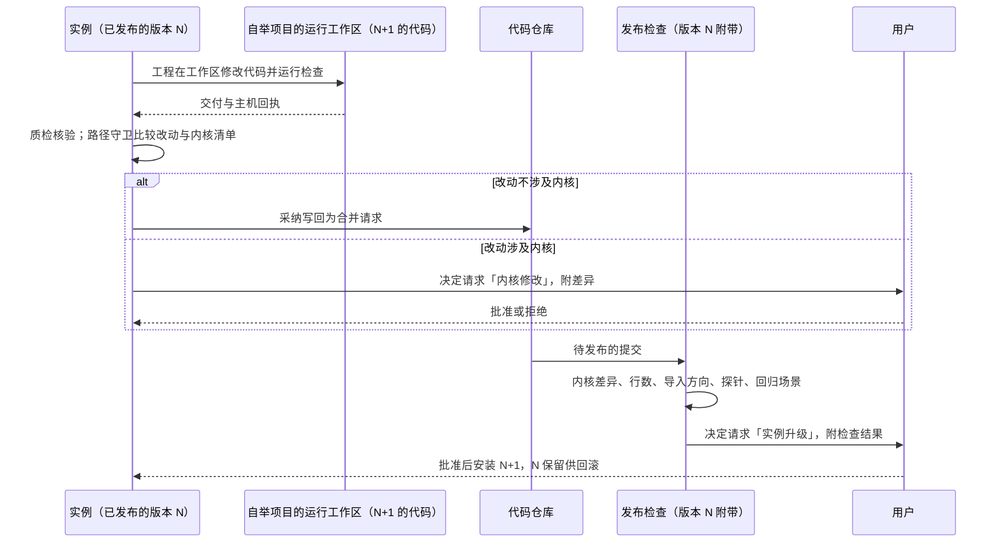
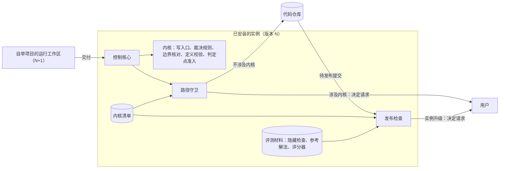

# 可信内核设计说明

更新：2026-10-23（按 [ADR-0042](../adr/0042-skeleton-and-application-two-layers.md)：第 2 节裁决读取的投影改为骨架自己算的最小投影，应用的投影移出内核；第 3 节清单的 `projection.py`、`models.py` 条目随[骨架与应用设计说明](skeleton-and-application.md)第 12 节的 S1、S5 修改；B2 已随 #350 完成，`harness/bounds.py` 就是分出来的边界核对）；2026-10-07。状态：设计已确认（2026-10-07 用户确认按意图校准整理项目），未实施。路线位置：Stage 3「迭代底座」工作包的 B1（内核清单、不变式测试、导入方向与行数的检查）与 B7（接口令牌、由已安装的实例提供的发布检查），都在里程碑 M3；边界的核对从流程编排中分出来、已用时间写入事件是 B2，挂在 3.1 下（M2）。

依据：[D38 系统意图与基础规则](../requirements/system-intent.md)（N-K3、N-K4、N-T5）、[ADR-0027](../adr/0027-trusted-kernel-outside-self-modification.md)、[ADR-0013](../adr/0013-event-log-and-single-write-path.md)、[ADR-0014](../adr/0014-versioned-definitions.md)、[ADR-0020](../adr/0020-block-only-when-no-downstream-check.md)、[ADR-0022](../adr/0022-run-directly-without-containers.md)、[D35 自举](../requirements/self-hosting.md)、[基础规则文本](../foundation-rules.md)。

## 1. 要解决的问题

| 问题 | 现状 | 影响 |
| --- | --- | --- |
| 没有内核的边界 | 文档有「小而明确的原生核心」的说法，没有清单，也没有检查 | 自举以后无法说明哪些修改需要用户批准 |
| 发布的检查在被开发的仓库里 | `scripts/release.py` 由执行者编写，只核对工作区干净、提交在 main 上、版本号一致与工具可用，不运行测试与评测 | 自举以后发布脚本本身成为被开发的对象 |
| 评价材料与被评的代码在同一个仓库 | 评测场景的隐藏检查、参考解法与评分器在 `evals/` 下 | 被评价者有机会修改评价标准 |
| 执行位置能读写实例的数据 | 默认执行位置是本机进程，能读写同一账户的全部文件，包括事件日志与工件；接口没有访问令牌，本机进程可以用 `user:local` 调用全部命令 | 被开发的代码在测试时可能改动实例的事实或替用户回答决定请求 |
| 停止的保证分散在调度代码里 | 运行时间、轮次的计数与停止原因的写入在 `orchestrator.py` 的调度类中，运行时间的起点只在进程内存里 | 进程重启以后运行时间重新计算，内核的范围也无法与调度分开 |

## 2. 内核的边界

内核是「决定什么成为事实」与「评价一个版本好不好」所用到的全部东西。控制核心里的调度、步骤驱动与上下文装配不属于内核，它们的错误由内核的规则与测试发现。

| 部分 | 是否属于内核 | 依据 |
| --- | --- | --- |
| 写入口与事件日志的追加规则 | 属于 | 事实只从这里进入（ADR-0013） |
| 骨架自己算的最小投影：每条流的当前版本、执行权、已用限额、每种正式成果的当前版本、运行状态与待回答的决定请求、定义与参数版本 | 属于 | 裁决只读它；只由骨架事件折叠，纯函数，可以重算（[ADR-0042](../adr/0042-skeleton-and-application-two-layers.md)，[骨架与应用设计说明](skeleton-and-application.md)第 4 节） |
| 应用的投影：部门历史、模型请求、上下文清单、询问栈、循环实例、收敛状态、资料、读取模型 | 不属于 | 能从事件重算；算错只影响路由或画面，裁决不受影响 |
| 裁决规则：工具许可、提案校验、提交前复核，以及它们调用的合同与协作规则 | 属于 | 生成者不裁决自己 |
| 边界的核对：时间、轮次、深度的计数，停止原因的写入 | 属于 | 一定会停 |
| 定义的加载与结构校验，包括组织候选的三条权威关系校验 | 属于 | ADR-0014、ADR-0020 |
| 判定点的准入与记录 | 属于 | 未校准的判断不能推进流程（[ADR-0028](../adr/0028-three-means-of-adjudication.md)） |
| 内核的不变式测试 | 属于 | 它们评价控制核心的其余部分 |
| 评测场景的隐藏检查、参考解法与评分器 | 属于 | 评价用的任务集 |
| 发布检查 | 属于 | 发布的闸门 |
| 内核清单与[基础规则文本](../foundation-rules.md) | 属于 | 守卫自身 |
| 流程编排的调度：队列、执行槽位、下一个工作的选择 | 不属于 | 调度出错影响效率与路径，事实仍然经过裁决 |
| 步骤驱动 | 不属于 | 每个工具调用仍然经过工具许可；不变式测试核对「没有许可记录就没有工具开始事件」 |
| 上下文装配与压缩 | 不属于 | 它决定模型看到什么，是对照实验最多的地方；它的产出（上下文清单）由不变式测试核对 |
| 知识层投影、读取模型、应用层、接口层 | 不属于 | 只读 |
| 执行层与工具实现 | 不属于 | 其中产生证据的部分（检查的运行与回执、封存与摘要）由发布检查的探针核对 |
| 定义的数据文件、部门 Prompt | 不属于 | 按[规则登记与参数设计说明](rules-and-parameters.md)的流程修改 |

边界的核对现在与调度写在同一个类中，B2 把它分到单独的内核模块，已用的时间与次数在每个安全节点写入事件（[循环与收敛设计说明](loops-and-convergence.md)第 3 节）。

## 3. 内核清单

内核清单是一份数据文件，由用户所有：

```json
{
  "owner": "user",
  "paths": [
    "harness/write_path.py",
    "harness/event_store.py",
    "harness/projection.py",
    "harness/models.py",
    "harness/adjudication.py",
    "harness/validation.py",
    "harness/collaboration.py",
    "harness/contracts.py",
    "harness/tools.py",
    "harness/actions.py",
    "harness/public_tree.py",
    "harness/definitions/__init__.py",
    "harness/definitions/kernel-manifest.json",
    "harness/tests/kernel/**",
    "harness/release_check.py",
    "scripts/release.py",
    "evals/scorer/**",
    "evals/scenarios/*/checks/**",
    "evals/scenarios/*/reference/**",
    "docs/foundation-rules.md"
  ],
  "python_lines_max": "<建立清单时内核文件的实际行数>",
  "allowed_imports": ["内核文件", "标准库", "pydantic"],
  "rules": [
    {"rule": "事实只经写入口写入", "test": "kernel/test_single_write_path.py"},
    {"rule": "每个工具开始事件之前有一条允许的许可记录", "test": "kernel/test_tool_needs_permission.py"},
    {"rule": "每个 run 以封闭清单里的原因结束或进入等待", "test": "kernel/test_every_stop_has_reason.py"},
    {"rule": "已用的时间与次数跨重启连续", "test": "kernel/test_limits_survive_restart.py"},
    {"rule": "验证者提交独立判断之前看不到作者的解释", "test": "kernel/test_judge_before_explanation.py"},
    {"rule": "未校准的判定点不改变事实事件", "test": "kernel/test_uncalibrated_point_is_inert.py"}
  ],
  "probes": ["reference_passes_all", "seeded_defect_fails", "out_of_scope_write_denied", "false_release_reported"]
}
```

- `paths` 列的是写入口、事件日志、运行状态投影、裁决规则、提案校验、定义加载，以及它们导入的模块，来自导入语句的检索；准确范围在 B1 逐个函数核对后确定。投影与模型文件里与裁决无关的内容（项目、目录等）移出内核文件。2026-10-23 按 ADR-0042：`projection.py` 的条目改为最小投影模块，`models.py` 的条目改为事件信封与骨架事件的数据结构，应用的投影与应用事件的数据结构移出内核文件（S1、S5 工单）；修改清单由用户在合并时批准。
- 构建脚本 `scripts/release.py` 在清单里：它产出的发布包就是下一个实例，构建过程被修改时，发布包可能与经过检查的提交不一致。
- 行数上限的初值取建立清单时内核文件的实际行数，以后只允许下降。
- 导入方向：内核文件只导入内核文件、标准库与 pydantic，一条测试核对导入语句。
- 每条内核规则在清单里有一行说明与一个测试名称。用户阅读这张表与测试名称，需要时再读对应的函数。
- 内核修改每次由用户经决定请求「内核修改」批准；修改清单本身同样如此。

## 4. 四项技术保证

### 4.1 版本关系

检查下一个版本所用的裁决代码、评测材料与发布检查，全部取自当前运行的已发布版本。运行的实例从安装的发布包运行，被开发的代码只在项目的运行工作区里；升级实例是一次用户决定。



### 4.2 路径守卫

采纳之前，控制核心把交付相对基线的改动路径与内核清单比较，清单取自运行的实例。有交集时不自动采纳，发出决定请求「内核修改」并附差异。发布检查对上一个发布标签与待发布提交再比较一次，结果写进决定请求「实例升级」。

### 4.3 执行位置与接口令牌

自举项目的执行位置设在控制主机以外的一台登记机器上，被开发的代码与它的测试接触不到实例的事件日志、工件与评测材料。这沿用 ADR-0022 对来源不明代码的做法，不增加新的机制。接口的局域网访问方式加入访问令牌（ADR-0015 列为待做的一项），执行位置上的代码取不到令牌；本机访问方式保持 `user:local`，在本机打开的界面与本机命令行不需要配置令牌。自举项目的执行位置在另一台机器上，只能经局域网访问接口，令牌在这里生效。

### 4.4 发布检查与探针

仓库里的发布脚本只负责构建与上传。发布检查由已安装的实例提供（例如 `yudao release-check <仓库>`），用当前运行版本里的检查、评测材料与内核清单检查待发布的提交：内核差异、行数、导入方向、探针与回归场景。

探针是一组结果已知的样例，核对检查本身仍然有效：

| 探针 | 期望结果 |
| --- | --- |
| `reference_passes_all` | 参考解法通过全部隐藏检查 |
| `seeded_defect_fails` | 植入缺陷的交付被评分器判为失败 |
| `out_of_scope_write_denied` | 带越界写入的事件序列被工具许可拒绝 |
| `false_release_reported` | 质检放行一份隐藏检查失败的交付时，过程检查点报出质检误放行 |

发布检查另外在部门 Prompt、定义与工具说明里检索评测场景的专有内容，命中即失败。

## 5. 自我修改按风险分级放开

「谁实现」与「谁提出」是两条线。

第一条线：修改由用户提出、Yudao 实现，按文件范围放开。级别按离裁决的远近排列：

| 级别 | 范围 | 出错的后果 | 由什么发现 |
| --- | --- | --- | --- |
| 1 | 界面的表演层 | 观感 | 画面诚实性不变式 H2 |
| 2 | 界面的事实层、读取模型、应用层的查询 | 用户看到错误的状态，裁决不受影响 | H1、H4 至 H7 |
| 3 | 工具、执行环境、Provider 的适配、接口层 | 工具行为错误，生成质量下降 | 质检的独立核验、回归场景、探针 |
| 4 | 定义的数据文件：Prompt、工作说明、默认值、可见范围 | 质量在回归中变化 | 每次修改是一个新版本，经过回归 |
| 5 | 控制核心的非内核部分：上下文装配、步骤驱动、调度 | 独立性或边界在没有察觉时变弱 | 内核的不变式测试、事件序列基准 |
| 不放开 | 内核 | 评价失去意义 | 每次修改由用户逐项批准 |

自举第一层的试点期间，Yudao 的成果以合并请求交给现有的审查流程（审查者、集成层与架构师合并），这道检查对各级工单同样有效，所以试点不按级别限制工单。级别用在 Stage 4：成果不再经过这个流程、由 Yudao 直接采纳时逐级放开；每一级放开的条件是上一级连续三次发布没有归因到它的回归，并且本级对应的测试已经在发布检查里。路径守卫、接口令牌、另一台执行机器与实例提供的发布检查，是直接采纳开始之前的条件。

第二条线：修改由系统提出，按对象放开。界内的参数先由用户发起对照，再由系统提出候选；结构性的定义在 Stage 6。

## 6. 评价不只依赖自举

1. 两类任务同时存在：外部来源的评测场景与 Yudao 自己的工单。采用任何定义版本与升级实例，都要求外部场景不退化；只在自举工单上出现的改善不算数。
2. 留出场景从三个现有来源（WebGen-Bench、FeatBench、PRDBench）各取 2 个，评分器的结构沿用，不参与日常的调整；第一次运行在 Stage 4 结束时，以后每个阶段结束时与每次结构性采用之前各运行一次；用过的转为回归场景，再补入新的。
3. 现实的反馈：Stage 4 起，放行以后在观察窗口内由运维发现的故障数，是质检误放行的外部度量；用户试用时用 `/qa` 提出的问题按工单归属统计，是自举工单质量的外部度量。
4. 评分器与隐藏检查取自当前运行的已发布版本（第 4.1 节）。

## 7. 模块交互



## 8. 验收

- 内核清单存在；六条不变式测试、导入方向与行数的检查在发布检查里运行。
- 演练：提交一份修改内核路径的交付，核对它没有被自动采纳、发出了决定请求「内核修改」，并留下记录。
- 四个探针在发布检查里运行，各自得到期望结果。
- 终止进程再启动，已用的运行时间与重启之前连续。
- 执行位置上的代码调用接口时被拒绝（没有令牌）。

## 9. 与现有设计的关系

- [总体架构](architecture/overall-architecture.md)的分层图标出内核在控制核心中的位置。
- [网页界面的提供与发布设计说明](web-interface-and-release.md)：仓库里的发布脚本只负责构建与上传；集成层通过与回归结果由发布检查核对。
- [评测场景设计说明](evaluation-scenarios.md)：评分器与隐藏检查列入内核清单，取自当前运行的已发布版本。
- [执行环境设计说明](execution-environment.md)：自举项目的执行位置是一台登记的机器。
- [应用层与接口层设计说明](app-and-interface.md)：接口的访问令牌；决定请求「内核修改」与「实例升级」。
