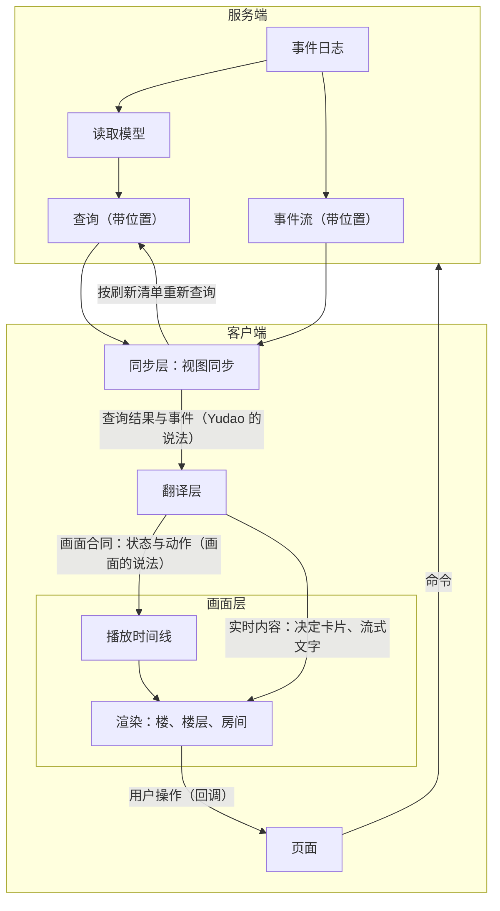
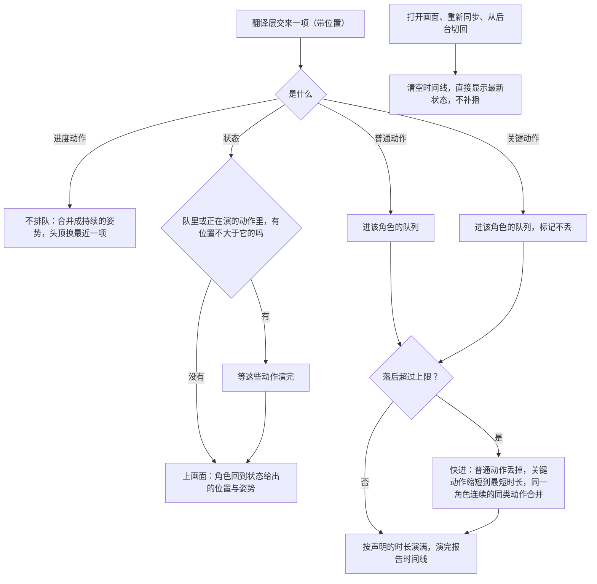
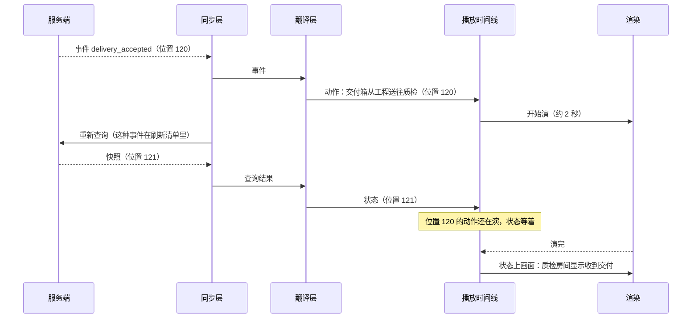

# 画面与播放设计说明

总图位置：第四节「画面」的缝；第一节「界面」方框；[画面总图](../architecture-view.html)全部六节；[总体架构](architecture/overall-architecture.md)第 1.6、2、5 节相应写有。依据：[ADR-0021](../adr/0021-client-pixel-view-follows-v9-structure.md)、[应用层与接口层设计说明](app-and-interface.md)第 4.2 节与第 5 节、[原型 v13 设计说明](../prototypes/v13/design.md)。

这份说明写像素画面（首页的楼、项目楼层、部门房间）怎样从事实得到画面：分几层、每层管什么、事件与查询结果怎样变成画面上的状态与动作、动作什么时候演、堆积了怎么取舍。页面怎样取得数据（快照、事件流、刷新清单）在[应用层与接口层设计说明](app-and-interface.md)第 4.2 节与第 5 节，这里不重复。

## 1. 要解决的问题

画面要回答用户一件事：此刻系统里真实发生着什么，刚才发生过什么。为此要同时满足下面几条，它们是这份说明各节的来由：

- **排队与取舍只有一份规矩。** 楼、楼层、房间三个场景演动作的节奏、堆积时丢什么留什么，用同一条播放时间线，不各写一套（第 5 节）。
- **画面不认识宿主的说法。** 画面层不按服务端的事件种类、查询名与状态值分支；服务端加一种事件、改一个字段，只改翻译层（第 3、6 节）。
- **状态不跑到动作前面。** 交付箱还在管道里走，收件的房间不能先显示收到；状态的变化也不打断正在演的动作（第 5.2 节）。
- **服务端的状态值只翻一次。** 对应写在翻译层一处，场景不再各自解释（第 4.1 节）。
- **诚实性有测试守。** 画面上能当真的每样东西都能回到一条事实，换画法也照过（第 8 节）。
- **画面跟着定义伸缩。** 一个事项用几个角色、谁是核验角色、谁关注谁，都来自它冻结的定义；画面代码里不写部门的名字，没有的东西不画（第 11 节）。
- **开环完成看得出来。** 没有经过核验角色就结束的事项，与放行结束的事项画法不同，任何画面都不能把前者画成后者（第 12 节）。
- **画布只画看得见的事实。** 原始事件、差异与回执这类要逐字读的内容在页面上看，画布交出「点开回链」这一个操作（第 13 节）。

## 2. 原则

用户 2026-10-24 的话：

> 根据之前的讨论，事实只来自数据库，画面的独立是指，怎么画出来，表现形式需要与数据库解耦合的，比如之前的缓冲层就是可视化部分自己的内容

用户同日给出的方案（与 Sonnet 讨论所得）要点：事件时间与画面的叙事时间解耦；事件先排队，按最小时长演满；事件产生得比播放快很多时合并、只播关键事件，次要的快进或省略；播放节奏是可视化自己的逻辑，不反向影响事件的产生；画面分事实层与表演层；事件日志属于骨架，播放节奏属于可以替换的部分。

由此两条原则：

1. **事实只来自数据库。** 画面上的事实由服务端的查询给出。画面不自己把事件一条条累加出状态：那等于在客户端再写一份 Yudao 的业务规则，Yudao 每加一种事件、改一条规则，画面都要跟着改，反而不独立；打开页面与重新同步时也还是需要一份快照作起点。
2. **画面的独立是表现形式的独立。** 画成什么样、什么时候演、演多久、堆积了怎么取舍，都属于画面，不受数据库字段与事件种类的牵制，也不反过来影响数据。

## 3. 分层与边界

| 层 | 职责 | 边界 |
| --- | --- | --- |
| 服务端（不变） | 事件日志、读取模型、查询，是事实的唯一来源 | 每个查询登记会改变它结果的事件种类，宁多勿漏，由重放核对保证（应用层与接口层设计说明第 4.2 节） |
| 同步层（不变） | 打开时取快照，接收事件，按刷新清单重新查询；断线续传与重新同步 | 只管数据是不是最新，不管怎么画（应用层与接口层设计说明第 5.4 至 5.7 节） |
| 翻译层（新增） | 把查询结果翻成状态，把事件翻成动作，转交实时内容 | 唯一同时认识 Yudao 的说法与画面的说法的地方（第 6 节） |
| 画面层（独立模块） | 播放时间线与三个场景的渲染 | 只认画面合同；不导入 Yudao 的任何代码；不发命令（第 5 节） |

依赖方向：

- 画面层不导入页面、React 组件、接口生成的类型、`client/src/renderer/src/contract/` 与命令接口，由导入方向的测试守住（第 8 节 H3）。
- 翻译层导入画面合同的类型与接口生成的类型，不导入画面层的实现。
- 同步层不知道画面的存在。
- 页面组件只做连接：把同步层的数据交给翻译层，把翻译层的输出交给画面，把画面的回调变成命令。

独立的程度：同一个客户端里的独立模块，有自己的目录与测试。画面合同是唯一的边界，现在只有 Yudao 客户端一个使用方，不拆成单独的 npm 包或单独的应用；以后要拆，只是搬代码。

## 4. 画面合同

画面合同是画面层唯一认的输入，有三样，加上一组回调。合同里只用画面的说法，不出现服务端的事件种类、查询名与状态值。具体的取值与字段由原型 v13 定。

总图第四节「画面」的缝说画面只收元件断言与动作，每条断言带回链到事件。下面的状态是一组元件断言（某个元件此刻是什么状态），动作是一件发生过的事；两者都带位置，这个位置就是回链：从画面上的任何一样东西都能回到它依据的那一刻的事实（状态回到它来自的查询快照的位置，动作回到它的来源事件）。画面层只传递位置，不解读它；回放按位置读取（第 5.2 节）也靠它。

### 4.1 状态

- 一份状态是一个场景此刻应该画出的事实，带位置（它来自的查询快照的位置）。
- 三个场景各一份：楼（项目与它们的楼层）、楼层（事项、房间的状态与原因、管道、成果库）、房间（角色、姿势、桌面物件、等待原因）。楼层与楼的状态还带这一层的拓扑：有几间屋、各是什么外观种类、谁有盖章台、哪些管道，都由翻译层从事项冻结的定义得出（第 11 节）。状态里只有画面的说法，不搬服务端的字段与状态值。
- 服务端状态值到画面状态的对应只写在翻译层，只写一次。

### 4.2 动作

- 一个动作是发生了什么，用来演，带位置（来源事件的位置）。
- 内容：动作种类（例如成果送达、缺陷记录送回、询问、回答、放行、开环完成、采纳、决定送出、决定收到、开始工作、读材料、写文件、运行命令、进度）、参与方（部门、角色）、关联的事项、要显示的一句话。
- 一条事件可以翻成零个、一个或几个动作。例如 PRD 被接纳，既是产品房间里的一次接纳，又是一次包裹从产品送往工程（原型 v12 设计说明第 3.6 节）。
- 动作不带级别与时长：级别与时长是画面自己的声明（第 5.1 节）。
- 「成果送达」是一份成果被接纳以后包裹送到关注它的部门。原型 v13 的声明表里这个动作叫「交接」，指的是同一个画面动作；它只是画面里的动作名，不是控制上的交接，页面上给用户看的文字不用这个词。

### 4.3 实时内容

不进播放时间线、到了就显示的两样：

- **决定卡片**：用户要据此操作；浏览器的系统通知是实时发的，用户点通知进来时卡片必须已经在画面上。
- **流式文字**：本来就是进度，比打字的动作早一点出现，不会把顺序讲反。

画布以外的页面文字（列表、详情）不属于画面，照旧实时。

### 4.4 回调

画面只以回调交出用户在画面里的操作：选择决定选项（带说明）、点击跳转、聚焦某个事项或角色、点开回链（哪个元件、哪个位置，第 13 节）。命令由页面发出；点开回链以后看到的细内容也由页面显示。

## 5. 画面层

### 5.1 声明表

每个场景一张声明表：每种动作的级别、时长、由哪个角色做、走到哪里、什么姿势、说什么；屋子、人物、管道按外观种类长什么样（第 11 节）。三个场景用同一种写法。动作的时长就是它的最小播放时长，不另设一个全局的时长。

| 级别 | 例子 | 规则 |
| --- | --- | --- |
| 关键 | 成果送达、缺陷记录送回、询问与回答、核验结论、开环完成、采纳、决定送出与收到、失败与中断 | 一定演，不丢；堆积时可以缩短 |
| 普通 | 开始一件事、读材料、写文件、运行命令 | 排队演；队伍过长或画面落后超过上限时丢掉 |
| 进度 | 工具调用、模型请求、输出片段、上下文组装 | 不排队；合并成一个持续的姿势，头顶显示最近的一项 |

进度一级的动作来自的事件，正是刷新清单里归入「不刷新」的那组高频事件（应用层与接口层设计说明第 4.2 节）：它们只改变进度，不改变用户据此操作的状态。

### 5.2 播放时间线

播放时间线决定演什么、什么时候演、丢什么。用户讨论中也叫它缓冲层。

它把两种时间分开：

- **事件时间**：数据库里事情发生的先后，用位置表示；查询结果与事件都带着它，服务端只有这一种时间。
- **叙事时间**：画面演出来的先后。它只存在于画面层里，由播放时间线决定；用户看到的是叙事时间。

两种时间之间只有两条关系：叙事时间的顺序与事件时间一致（下面「状态等动作」）；叙事时间最多落后事件时间一个上限（下面「落后上限」）。落后按状态到达客户端以后经过的时间计，不用服务端的写入时间，两边的时钟不同。

- **排队**：动作按位置进入时间线。同一个角色一次只做一件事，按声明的时长演满；不同角色可以同时演。
- **状态等动作**：一份状态只等位置不大于它、还在队里或正在演的动作，这些动作演完它再上画面；没有这样的动作时立刻上画面。所以状态不会卡住，也不要求事件流里每个位置都到齐。画面上显示的每一个状态，都是数据库在某个位置上真实有过的状态。
- **落后上限**：画面上的状态最多落后最新到达的状态一个上限（数值见下面「播放的常量」）。超过时快进：普通动作丢掉；关键动作按比例缩短，不短于最短时长；正在演的关键动作也不截断，剩下的部分加快、在最短时长内演完（包裹加快走到终点，不凭空消失）；同一个角色连续的同类动作合并成一次。
- **跳到最新**：打开画面、重新同步（发现缺口或收到 `resync`）、标签页从后台切回来时，清空时间线，直接显示最新的状态，不补播。标签页在后台时浏览器会暂停动画，切回来时队里可能积了几分钟的事件；错过的经过由离开报告交代。
- **回放**：回放模式（按位置读取）拖到哪个位置，就直接显示那个位置的状态，不播动作，与现在相同。
- **迟到的动作**：状态只等已经到达的动作。查询与事件流走两条连接，极少数情况下位置不大于状态的动作会在状态上画面以后才到，这时它照演，故事顺序在这一处颠倒；状态不再额外等事件流读到它的位置。颠倒在试用里常见时怎样处理，见第 15 节。

**播放的常量**（画面总图第二节「调节参数」：是填进去的内容，在调节面板里改，不改合同；2026-10-25 随原型 v13 定稿）：

| 常量 | 默认值 | 范围 | 理由 |
| --- | --- | --- | --- |
| 落后上限 | 5 秒 | 2 至 10 秒 | 少于 2 秒，一次成果送达（约 2 秒）都演不完就要快进；多于 10 秒，用户看到的已经不是「此刻」 |
| 最短时长 | 0.3 秒 | 0.1 至 1 秒 | 关键动作缩到这么短仍看得出发生过；再短就等于丢掉 |
| 时长倍率 | 1 | 0.25 至 4 | 用户看效果时整体放慢或加快，各动作之间的比例不变 |

### 5.3 渲染

- 楼、楼层、房间三个场景只负责把一个动作演出来，演完告诉时间线。走动、补间、待机活动照旧，属于表演层。
- 状态上画面时，角色回到状态给出的位置与姿势；表演不改变状态，状态的变化也不在动作演到一半时打断它（状态本来就等动作演完）。

## 6. 翻译层

- **输入**：同步层给出的查询结果（带位置）与事件（带位置），以及决定与输出片段。
- **输出**：三个场景的状态、动作与实时内容。
- **事实只来自查询**：状态由查询结果翻译而来；翻译层不累加事件得出事实，事件只翻成动作。
- **什么时候更新**：由同步层按刷新清单决定，翻译层不另设规则。
- **覆盖核对**：能力清单 `event_types` 里的每种事件，在每个场景里要么翻成某个动作，要么列入这个场景的「不画」清单并写一句理由。新增事件种类而两边都没写时，测试失败。做法与刷新清单的重放核对相同。
- 原型 v12 已经有雏形：界面层按一张对照表把成果事件与询问事件交给像素画面，像素代码继续读 v11 的说法（原型 v12 设计说明第 3.6 节，`js/ui/scenes.js` 的 `pixelEvents`）。翻译层把它补完整，状态也经它翻译。

## 7. 逻辑与交互

### 7.1 交付到达

### 7.2 事件堆积

工程连续调用工具、几个部门同时工作时，几秒内可能到达几十条事件：

- 工具调用与模型请求是进度一级，不排队，工程的角色保持敲键盘的姿势，头顶换成最近的工具；
- 普通动作排队，画面落后接近上限时丢掉排在后面的；
- 成果送达、询问这类关键动作全部演，落后超过上限时按比例缩短；
- 状态跟在它之前的动作后面上画面，最多落后 5 秒。

### 7.3 断线与切回

同步层发现缺口或收到 `resync`，重新查询快照；翻译层把新的查询结果交给画面，画面清空时间线，直接显示最新状态。标签页从后台切回时同样处理。

## 8. 画面诚实性的不变式

原在应用层与接口层设计说明第 5.8 节，2026-10-24 移到这里；H1 至 H7 的编号不变，H3 收紧为「画面层不导入 Yudao 的任何代码」，另加 H8、H9 与覆盖核对。

画面分两层：事实层是事件日志的函数，进入自动化测试；表演层可以有自己的状态，但不占用承载事实的视觉通道，不回写。角色当前的任务与流式输出属于事实。

| 编号 | 不变式 | 测试 |
| --- | --- | --- |
| H1 | 事实层是事件的函数 | 同一段事件前缀两次计算的事实层相同；增量更新与从头计算一致；同一份状态两次上画面，事实层相同 |
| H2 | 表演层不占用承载事实的视觉通道 | 视觉通道表写明哪些通道承载事实；关闭表演层前后，这些通道上的取值相同 |
| H3 | 表演层不回写，画面层不依赖 Yudao | 导入方向的测试：画面层不导入命令接口与任何 Yudao 代码；命令只由用户的操作经页面发出 |
| H4 | 每条事实带来源 | 事实层里每个事实元素的来源非空，决策模型判定的带概率 |
| H5 | 开环可见 | 没有可执行检验的验收条件带开环标记；以开环完成结束的事项，任何场景的事实通道里都没有实心的放行章，页面与离开期间的报告里没有「放行」字样，只有虚线的开环完成章与「开环完成」（第 12 节） |
| H6 | 固定画出的只有边界、裁决点与权威关系 | 事件为空时轨迹元素的数量为 0；房间的集合等于楼层上事项冻结的定义里角色的并集，连线的集合等于这些定义中的关注、询问与打回关系，盖章台只出现在核验角色的屋里（第 11 节） |
| H7 | 回放一致 | 时间轴上某个位置的事实层，等于当时那段事件前缀的计算结果；直播时画面上的每个状态也是某个位置的快照 |
| H8 | 落后有上限 | 确定的时钟下，任何时刻画面上状态的位置与最新到达的状态相比，落后不超过上限，包括堆积的场景 |
| H9 | 关键动作不丢 | 堆积时关键一级的动作全部演完（可以缩短），正在演的不被截断 |
| — | 对照表全覆盖 | 能力清单里的每种事件，在每个场景里要么翻成动作，要么列在「不画」里并有理由；每个覆盖层、画面合同里的每个事实元素与视觉通道都在七种元件的对照表里有一行（第 10 节） |

H1、H2、H4 至 H9 写成页面代码的单元测试，使用录制的事件夹具与确定的时钟；H3 写成导入方向的测试。九条在三处运行：执行者与审查者运行与改动相关的测试，架构师的集成层批量运行，发布检查。固定画出的连线由组织定义的许可关系导出，包裹的移动表示轨迹；机器在线状态来自机器流中的事件。

H4 至 H6 属于事实来源与覆盖层。

**逐像素回放核对比什么**（2026-10-26，用户确认这个办法继续，[ADR-0021](../adr/0021-client-pixel-view-follows-v9-structure.md)）。比的是画面本身：同一份画面合同状态，客户端的画法与 v13 的画法在每段录制的最后一个检查点逐像素相同、逐个小人的字段相同。回放测试要用浏览器，不进 CI，由执行者按工单单独运行。两边的输入形状不同（v13 的模拟接口已经被它的翻译层翻成画面的词），所以回放里状态取 v13 的画面合同状态、只换字段名，事件经客户端的翻译层；翻译层对真实接口形状的核对，由翻译覆盖和翻译层自己的测试做，不放进逐像素里。

范围只含真实接口给得出数据的画法。原型的模拟数据按真实接口的字段写；真实接口还给不出的数据放在能一键关掉的覆盖层里，录制时关掉，数据有了再打开。

### 8.1 视觉通道表

H2 用这张表（架构师 2026-10-25 补上）。承载事实的通道只由状态与实时内容决定，表演层不改：

| 场景 | 承载事实的通道 |
| --- | --- |
| 楼层 | 有哪几间屋、各是什么外观种类、哪些管道（来自定义）；事项在哪个房间或在大厅、事项的颜色；房间亮灯与屏幕滚动；门口的小旗与牌子文字；大厅板上的决定单；成果库里的成果与它们身上的章；盖章台与出口托盘在谁的屋里；章的种类（实心的放行、虚线的开环完成）；传信管里等待回答的询问数；等待模型服务的文字；各房间的角色与角色的状态 |
| 房间 | 房间的外观种类；有没有盖章台、出口托盘；房间状态与状态文字；状态给出的姿势；角色与角色的状态；信箱、卷轴等物件的数量；头顶的流式文字 |
| 楼 | 每层的状态灯、这一层有几间屋与哪几间亮灯、小旗 |

表演层的通道：
- 小人的走位与路径；
- 待机活动：喝茶、闲逛、思考；
- 眨眼、目光与动画相位；
- 管道里的包裹与飞行物；
- 动作的姿势与说话气泡。

动作演出来的东西都属于表演层。动作演完、状态上画面以后，承载事实的通道只由状态决定。

H2 的测试：同一份状态上画面以后，分别开着与关掉表演层（待机活动与动作）各读一次承载事实的通道，两次相同。

## 9. 与其他文档的关系

- 同步层的规则：应用层与接口层设计说明第 5.7 节；刷新清单与重放核对：同一说明第 4.2 节。
- [ADR-0021](../adr/0021-client-pixel-view-follows-v9-structure.md)：客户端画面跟当前定稿的原型走，继续有效；从原型 v13 起，传给画面的不再是查询结果与事件，而是画面合同。
- [骨架与应用设计说明](skeleton-and-application.md)：画面属于应用层；画面合同是画面这一块自己的契约，与骨架的契约无关。服务端的接口合同不变。

不做的事：

- 不引入 Redis 一类的消息总线：现有的事件流带位置、能断线续传、有缺口检测，已经是画面订阅的接口。
- 画面不自己累加事实（第 2 节）。
- 不拆成单独的包或应用（第 3 节）。
- 服务端不为画面新增专用的查询或事件流。

## 10. 七种元件与对照表

系统的每个概念在画面上归入一种元件（画面总图第一节「七种元件」、第四节「映射」的缝）。归不进去的是装饰，装饰不承载事实。

| 元件 | 是什么 | 例子 |
| --- | --- | --- |
| 地点 | 事情在哪里发生 | 楼（项目列表）、楼层（一个项目）、房间（定义里的一个角色）、大厅（你与决定）、成果库（已采纳的成果）、机房（机器）、屋里的小屋（子事项） |
| 物 | 能被送来送去、能被盖章的东西 | 包裹（某种成果的某一版）、决定单、章（核验结论或开环完成）、成果库的箱子、房间里的卷轴与信箱 |
| 连接 | 定义里写着的关系 | 管道（谁接收谁的哪种成果）、传信管（谁能问谁）、回流管（核验角色打回给谁） |
| 流 | 沿连接发生的一次经过 | 包裹沿管道走、询问与回答来回、决定单送出与收回 |
| 规则 | 看得见的边界与裁决点 | 盖章台（核验角色）、出口托盘（交完成的角色）、门框上的余量与层数（子事项） |
| 操作 | 你在画面里能做的事，每一项对应一条现有命令或一个回调 | 在决定板上回答、拖队列、点开回链、聚焦与跳转 |
| 仪表 | 读数 | 状态灯、轮次与已用时间、上下文容量刻度、覆盖层（流转、等待、恢复、上下文用量、语义记录、来源、循环、检验） |

**对照表**是一张声明：每个概念一行，写它归哪种元件、来源（哪个查询或哪种事件）、状态与变化、在哪个空间哪个场景、对应的操作、仪表，以及不画的部分与理由。行名用 [CONTEXT.md](../../CONTEXT.md) 的词，页面上给你看的文字也用这些词。

**全覆盖的核对**：下面四份清单里的每一项，在对照表里都要有一行，缺一行时测试失败，提示写明缺的是哪一项：

1. 事件种类：每个场景里要么翻成动作，要么写明不画与理由（第 6 节）。清单取两端共读的事件种类夹具。
2. 覆盖层：能力清单列出的每个覆盖层。清单取两端共读的覆盖层夹具。
3. 画面合同里的事实元素（门牌、包裹、章、箱子、轮次、已用时间……）。
4. 视觉通道表里承载事实的每个通道（第 8.1 节）。

后两份是画面自己的清单，前两份来自服务端；服务端新增一种事件或一个覆盖层，服务端的夹具测试先失败，夹具更新以后这里失败，提示补行。

## 11. 画面跟着定义伸缩

画面里有几间屋、几个人、哪些管道、谁有盖章台，都从事项冻结的定义来（画面总图第二节「定义」、第五节）。定义变了画面跟着变，不另写代码；画面层的代码里不出现部门的名字。

### 11.1 输入

楼层的查询给出楼层上每个事项所用的那份冻结定义里的组织：

- 角色：标识、显示名、外观种类（可以不写）；
- 哪些角色是核验角色、各核验谁；
- 直做时由哪个角色交完成；
- 关注关系（谁接收谁的哪种成果）、询问关系（谁能问谁）、打回关系（核验角色打回给谁）；
- 子事项：哪个角色的一轮工作开了子事项，余量与层数（阶段四）。

这些是事项本身的事实，页面别处也用得到，所以放在已有的楼层查询里，服务端不为画面另加查询（第 9 节「不做的事」）。翻译层把它们翻成楼层与楼的状态里的拓扑（第 4.1 节）。

### 11.2 推出的规则

| 定义里有 | 画面上 |
| --- | --- |
| 一个角色 | 一间屋，屋名是角色的显示名 |
| 交完成的角色（直做） | 它的屋里有出口托盘 |
| 核验角色 | 它的屋里有盖章台；没有核验角色的定义，楼层上没有盖章台 |
| 关注关系 | 两间屋之间的管道，包裹沿它走 |
| 询问关系 | 传信管 |
| 打回关系 | 红色回流管，从核验角色的屋到被打回的角色的屋 |
| 子事项 | 屋里的一间小屋，门框上是余量与层数；远看是一个在转的小盒子，推近进去（阶段四） |

- 大厅与成果库总在：大厅是你与决定，成果库是已采纳的成果，任何形态都有。运维的屋只在定义里有运维时画。
- 定义里没有的不画，不留空屋。定义里有、此刻没有事做的角色照画，灯不亮：这个角色存在本身是事实。
- 房间按定义里角色的先后排；三部门按成果驱动时三间屋连成环。
- 一层楼上同时有几个事项、用的定义不同时，房间是这些定义里角色的并集，按角色标识合并；每个事项只在自己定义里的屋之间走，管道也只画各定义里有的关系。
- 回放到某个位置时，拓扑是那个位置上楼层查询给出的拓扑。

### 11.3 外观

- 屋子、人物、管道长什么样写在场景的声明里，按外观种类取（画面总图第四节「声明」的缝）。默认三部门各有一种外观种类，画法与当前定稿原型相同。
- 定义里的角色没有写外观种类时，用通用外观：一张工位，门牌写显示名。通用外观是声明里的一种；定义可以不写外观种类。
- 画面层的代码只认外观种类与角色标识，不认部门名；部门名只出现在定义与声明里。

### 11.4 楼

首页的楼上，每层亮灯的格子按这一层的拓扑画：这一层有几间屋就有几个格子，哪几间在工作就亮哪几格，不再是固定的几个部门。

## 12. 开环完成与放行

画面上有两种「开环」，用不同的记号：

- **开环的验收条件**：一条验收条件没有可执行的检验（检验方式是开环）。它在覆盖层「检验」里带开环标记，计入开环的条数（[验证的独立性设计说明](independent-verification.md)「检验覆盖与开环」）。
- **开环完成**：事项没有核验角色，交了完成就结束（[形态与核验角色设计说明](forms-and-verifier-role.md)「开环完成」）。它是事项的结束方式，画在事项身上。

两种结束方式的画法：

| | 放行 | 开环完成 |
| --- | --- | --- |
| 谁盖章、在哪里 | 核验角色在自己屋里的盖章台上 | 交完成的角色在自己屋里的出口托盘上 |
| 章 | 实心的「放行」章 | 虚线的「开环完成」章；外包角色交回的，章上加「外包」 |
| 成果库 | 箱子上是实心章 | 箱子上是虚线章，一直留着 |
| 前面的经过 | 包裹送到核验角色的屋；打回时走红色回流管 | 没有送去核验这一段 |
| 页面上的事项状态 | 放行 | 开环完成（外包的加注） |
| 离开期间的报告 | 列在「放行」一组 | 列在「开环完成」一组，不计入放行的件数 |

- 开环完成是关键一级的动作（第 5.1 节），一定演。
- 直做加一个核验角色时：交完成的包裹送到核验角色的屋，按核验结论盖实心章或打回；这种定义没有出口托盘上的虚线章。
- 页面与报告上，开环完成与放行分开显示，不放在同一个计数里；概览的事项看板同样分开。这样你一眼能看出一个事项有没有经过独立核验。
- 换宿主时同样成立：来源里没有独立核验，就画开环完成（画面总图第六节）。

## 13. 回链的细内容在页面

画布上的每样事实都带回链（第 4 节）。点开回链以后要逐字读的内容在页面上看，画布不画（画面总图第一节「页面」）：

- 你点画布上的一个事实元件时，画布只把它高亮，交出「点开回链」的回调：哪个元件、哪个位置、哪个事项（第 4.4 节）。
- 页面在画布旁边打开回链的详情：原始事件（中文说明、种类、提出者、时间，按位置向服务端取，页面打开以前的事件也取得到）、上下文摘要、真实的差异、动作的回执、来源种类，以及「在时间轴上查看」。
- 详情属于页面文字，实时显示，不进播放时间线（第 4.3 节）。
- 画布上留下的只有承载事实的视觉通道：覆盖层「来源」的描边、图例与缺来源的标记照旧画在画布上，它们是读数。
- 没有页面的宿主只看画面，回调怎样处理由宿主定（画面总图第六节）。

## 14. 验收

1. 默认三部门的定义下，楼、楼层、房间与当前定稿原型的画法逐像素相同：拓扑改由定义推出，默认画面不变。
2. 把三部门改名的定义跑同一段录制，画面除了门牌与屋名以外逐像素相同；画面层的代码里找不到部门名。
3. 一个角色直做的事项：楼层上是一间屋加大厅与成果库，屋里有出口托盘，没有盖章台；结束时在出口托盘上盖虚线的开环完成章，成果库的箱子带虚线章；页面与离开期间的报告写开环完成，不出现放行。
4. 直做加一个核验角色：核验角色的屋里有盖章台，放行盖实心章，打回走回流管。
5. 一层楼上两个事项用不同的定义：房间是两份定义里角色的并集，每个事项只在自己的屋之间走。
6. 对照表：事件种类、覆盖层、事实元素、视觉通道四份清单里任意少一行，测试失败并写明缺的是哪一项。
7. 点开任何事实元件，页面显示它的原始事件（含页面打开以前的事件）、差异或回执；画布上不出现这些文字。
8. 第 8 节的 H1 至 H9 照过，H5、H6 按本说明改写后的判据。

## 15. 未决问题

- 同一个角色标识在楼层上两个事项的定义里外观种类不同时，并集里那间屋画哪一种。
- 角色多到一层楼排不下时怎样排，随下一版原型定。
- 迟到的动作造成的顺序颠倒在试用里常见时，是否让状态再等事件流读到它的位置（这段等待同样受落后上限约束）。

## 变更记录

- 2026-10-29 / claude-sonnet-5-5 / 按设计说明规范整理：开头改为总图位置与依据一行，删去状态、用户确认、实现情况与最近一次改动的说明；删去第 1、3、8、9、10 节里的工单号，第 8 节回放核对的三步改用先后表达 / 设计与实施分离（decision.md 2026-10-29）
- 2026-10-31 / claude-opus-5-5 / 关键一级的「质检结论」改为「核验结论」；H5 补开环完成的事项不画放行盖章 / 按总图 ADR-0044 的改动核对
- 2026-10-31 / claude-opus-5-5（子架构师） / 第 1 节由 2026-10-24 的现状描述改为问题陈述；删去第 10 节「实施」，原型 v13 定下的三个播放常量收进第 5.2 节「播放的常量」并写范围与理由；新增第 10 节「七种元件与对照表」、第 11 节「画面跟着定义伸缩」、第 12 节「开环完成与放行」、第 13 节「回链的细内容在页面」、第 14 节「验收」、第 15 节「未决问题」；H5、H6 与覆盖核对一行按新节改写，视觉通道表补拓扑、章的种类、盖章台与出口托盘；回调加「点开回链」；关键动作加开环完成；「迟到的动作」只留结论；第 8 节回放核对去掉阶段性的说明 / 按画面总图（2026-10-31）与路线图第 4 节步 1 核对；小节标题「10. 实施」删去，编号 10 改给「七种元件与对照表」
