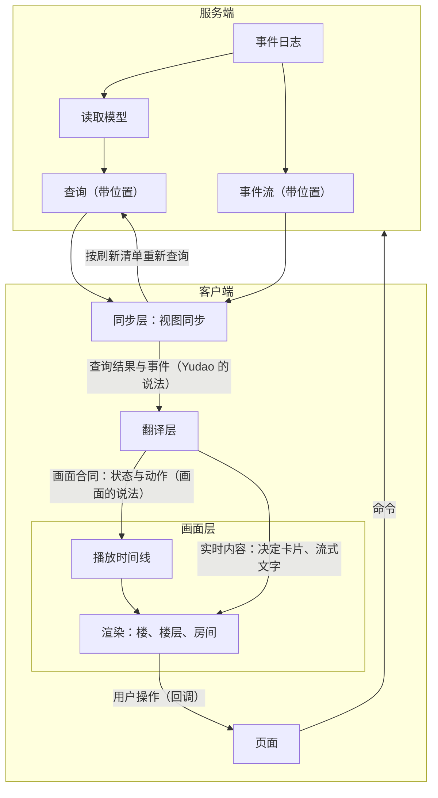
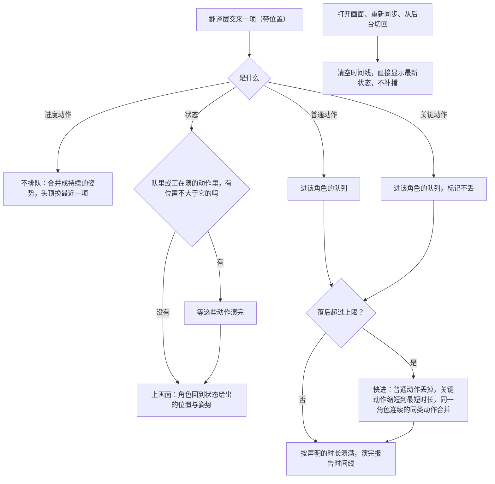
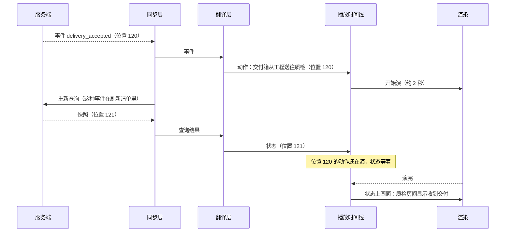

# 画面与播放设计说明

状态：2026-10-24 用户在架构师会话中逐项确认（[ADR-0043](../adr/0043-scene-contract-and-playback-belong-to-the-view.md)、[决策记录](../decision.md)同日一条），未实施。同日架构师补第 5.2 节：两种时间的说法、播放时间线的流程图与「迟到的动作」一条（待原型 v13 核对）；[总体架构](architecture/overall-architecture.md)第 1.6（2026-10-25 之前是第 1.2 节）、2、5 节与[系统架构原理](architecture/core-and-materials.md)第 9 节相应修改。先做原型 v13，定稿以后客户端工单放进里程碑 M0.5，标题前缀「骨架与应用 · 画面」（第 10 节）。 总图位置：第四节「画面」的缝；第一节「界面」方框。

这份说明写像素画面（首页的楼、项目楼层、部门房间）怎样从事实得到画面：分几层、每层管什么、事件与查询结果怎样变成画面上的状态与动作、动作什么时候演、堆积了怎么取舍。页面怎样取得数据（快照、事件流、刷新清单）在[应用层与接口层设计说明](app-and-interface.md)第 4.2 节与第 5 节，这里不重复。

## 1. 要解决的问题

2026-10-24 在 main（b978d504）上核对的现状：

- **排队与取舍写了三份。** 楼层每个角色有一条动作队列，最多留 3 条可以挤掉的任务，标了 `must` 的不挤掉（`client/src/renderer/src/pixel/world/characters.ts`）；部门房间的驱动另写一套（`pixel/room/driver.ts`）；首页的楼又是一套。
- **画面认识 Yudao 的事件与查询。** 事件翻译一半在页面组件里（`floorEventOf`、`roomEventOf` 与楼的那份），一半在画面驱动里，驱动直接按 `qa_submitted`、`spec_accepted`、`tool_started` 这些事件种类分支；画面数据与查询结果的字段一一对应（房间数据就是 `department.workspace` 的 room 原样搬过来）。Yudao 新增事件种类或改一个字段，画面就要跟着改。
- **状态与动作各走一条路。** 事件到达，画面立刻开始演动作；同一条事件让页面按刷新清单重新查询，大约 0.2 秒加上查询的耗时以后，新的查询结果整体替换画面状态。于是状态跑在动作前面：交付箱还在管道里走，质检房间已经显示收到；房间的状态一变，还会把正在演的动作取消。
- **服务端的状态值在客户端被解释了几遍。** 楼层只认原型的状态名（`running` 等），服务端给的是 `in_progress`，进行中的事项不进房间；同一个对应在 `labels.ts` 里写过一遍，楼层没有用到（#900）。
- **画面诚实性的不变式没有测试。** 原在应用层与接口层设计说明第 5.8 节的七条（现在是本说明第 8 节），客户端没有一条对应的测试，H2 要用的视觉通道表也不存在。

## 2. 原则

用户 2026-10-24 的话：

> 根据之前的讨论，事实只来自数据库，画面的独立是指，怎么画出来，表现形式需要与数据库解耦合的，比如之前的缓冲层就是可视化部分自己的内容

用户同日给出的方案（与 Sonnet 讨论所得）要点：事件时间与画面的叙事时间解耦；事件先排队，按最小时长演满；事件产生得比播放快很多时合并、只播关键事件，次要的快进或省略；播放节奏是可视化自己的逻辑，不反向影响事件的产生；画面分事实层与表演层；事件日志属于骨架，播放节奏属于可以替换的部分。

由此两条原则：

1. **事实只来自数据库。** 画面上的事实由服务端的查询给出。画面不自己把事件一条条累加出状态：那等于在客户端再写一份 Yudao 的业务规则，Yudao 每加一种事件、改一条规则，画面都要跟着改，反而不独立；打开页面与重新同步时也还是需要一份快照作起点。
2. **画面的独立是表现形式的独立。** 画成什么样、什么时候演、演多久、堆积了怎么取舍，都属于画面，不受数据库字段与事件种类的牵制，也不反过来影响数据。

## 3. 分层与边界

| 层 | 职责 | 边界 |
| --- | --- | --- |
| 服务端（不变） | 事件日志、读取模型、查询，是事实的唯一来源 | 每个查询登记会改变它结果的事件种类，宁多勿漏，由重放核对保证（应用层与接口层设计说明第 4.2 节，#891） |
| 同步层（不变） | 打开时取快照，接收事件，按刷新清单重新查询；断线续传与重新同步 | 只管数据是不是最新，不管怎么画（应用层与接口层设计说明第 5.4 至 5.7 节） |
| 翻译层（新增） | 把查询结果翻成状态，把事件翻成动作，转交实时内容 | 唯一同时认识 Yudao 的说法与画面的说法的地方（第 6 节） |
| 画面层（独立模块） | 播放时间线与三个场景的渲染 | 只认画面合同；不导入 Yudao 的任何代码；不发命令（第 5 节） |

依赖方向：

- 画面层不导入页面、React 组件、接口生成的类型、`client/src/renderer/src/contract/` 与命令接口，由导入方向的测试守住（第 8 节 H3）。
- 翻译层导入画面合同的类型与接口生成的类型，不导入画面层的实现。
- 同步层不知道画面的存在。
- 页面组件只做连接：把同步层的数据交给翻译层，把翻译层的输出交给画面，把画面的回调变成命令。

独立的程度：同一个客户端里的独立模块，有自己的目录与测试。画面合同是唯一的边界，现在只有 Yudao 客户端一个使用方，不拆成单独的 npm 包或单独的应用；以后要拆，只是搬代码。

## 4. 画面合同

画面合同是画面层唯一认的输入，有三样，加上一组回调。合同里只用画面的说法，不出现服务端的事件种类、查询名与状态值。具体的取值与字段由原型 v13 定。

### 4.1 状态

- 一份状态是一个场景此刻应该画出的事实，带位置（它来自的查询快照的位置）。
- 三个场景各一份：楼（项目与它们的楼层）、楼层（事项、部门房间的状态与原因、管道、成果库）、房间（角色、姿势、桌面物件、等待原因）。现有的 `BuildingModel`、`FloorModel`、`RoomModel` 是起点，去掉其中直接搬过来的服务端字段与状态值。
- 服务端状态值到画面状态的对应只写在翻译层，只写一次。

### 4.2 动作

- 一个动作是发生了什么，用来演，带位置（来源事件的位置）。
- 内容：动作种类（例如交接、缺陷记录送回、询问、回答、放行、采纳、决定送出、决定收到、开始工作、读材料、写文件、运行命令、进度）、参与方（部门、角色）、关联的事项、要显示的一句话。
- 一条事件可以翻成零个、一个或几个动作。例如 PRD 被接纳，既是产品房间里的一次接纳，又是一次包裹从产品送往工程（原型 v12 设计说明第 3.6 节）。
- 动作不带级别与时长：级别与时长是画面自己的声明（第 5.1 节）。

### 4.3 实时内容

不进播放时间线、到了就显示的两样：

- **决定卡片**：用户要据此操作；浏览器的系统通知是实时发的，用户点通知进来时卡片必须已经在画面上。
- **流式文字**：本来就是进度，比打字的动作早一点出现，不会把顺序讲反。

画布以外的页面文字（列表、详情）不属于画面，照旧实时。

### 4.4 回调

画面只以回调交出用户在画面里的操作：选择决定选项（带说明）、点击跳转、聚焦某个事项或角色。命令由页面发出。

## 5. 画面层

### 5.1 声明表

每个场景一张声明表：每种动作的级别、时长、由哪个角色做、走到哪里、什么姿势、说什么。楼层现在的 `floor-decl` 已经是这种写法，房间与楼改成同样的写法。动作的时长就是它的最小播放时长，不另设一个全局的时长。

| 级别 | 例子 | 规则 |
| --- | --- | --- |
| 关键 | 交接、缺陷记录送回、询问与回答、质检结论、采纳、决定送出与收到、失败与中断 | 一定演，不丢；堆积时可以缩短 |
| 普通 | 开始一件事、读材料、写文件、运行命令 | 排队演；队伍过长或画面落后超过上限时丢掉 |
| 进度 | 工具调用、模型请求、输出片段、上下文组装 | 不排队；合并成一个持续的姿势，头顶显示最近的一项 |

进度一级的动作来自的事件，正是刷新清单里归入「不刷新」的那组高频事件（应用层与接口层设计说明第 4.2 节）：它们只改变进度，不改变用户据此操作的状态。

### 5.2 播放时间线

播放时间线决定演什么、什么时候演、丢什么。用户讨论中也叫它缓冲层。

它把两种时间分开：

- **事件时间**：数据库里事情发生的先后，用位置表示；查询结果与事件都带着它，服务端只有这一种时间。
- **叙事时间**：画面演出来的先后。它只存在于画面层里，由播放时间线决定；用户看到的是叙事时间。

两种时间之间只有两条关系：叙事时间的顺序与事件时间一致（下面「状态等动作」）；叙事时间最多落后事件时间一个上限（下面「落后上限」）。落后按状态到达客户端以后经过的时间计，不用服务端的写入时间，两边的时钟不同。

- **排队**：动作按位置进入时间线。同一个角色一次只做一件事，按声明的时长演满；不同角色可以同时演。
- **状态等动作**：一份状态只等位置不大于它、还在队里或正在演的动作，这些动作演完它再上画面；没有这样的动作时立刻上画面。所以状态不会卡住，也不要求事件流里每个位置都到齐。画面上显示的每一个状态，都是数据库在某个位置上真实有过的状态。
- **落后上限**：画面上的状态最多落后最新到达的状态 5 秒（2026-10-25 随原型 v13 定稿）。超过时快进：普通动作丢掉；关键动作按比例缩短，最短 0.3 秒；正在演的关键动作也不截断，剩下的部分加快、在最短时长内演完（包裹加快走到终点，不凭空消失）；同一个角色连续的同类动作合并成一次。
- **跳到最新**：打开画面、重新同步（发现缺口或收到 `resync`）、标签页从后台切回来时，清空时间线，直接显示最新的状态，不补播。标签页在后台时浏览器会暂停动画，切回来时队里可能积了几分钟的事件；错过的经过由离开报告交代。
- **回放**：回放模式（按位置读取）拖到哪个位置，就直接显示那个位置的状态，不播动作，与现在相同。
- **迟到的动作**（架构师 2026-10-24 补充，待原型 v13 核对）：状态只等已经到达的动作。查询与事件流走两条连接，极少数情况下位置不大于状态的动作会在状态上画面以后才到，这时它照演，故事顺序在这一处颠倒。要堵住它，可以让状态再等事件流读到的位置（事件或检查点）不小于它自己的位置，这段等待同样受落后上限约束；同步层已经记着事件流读到的位置，服务端不用改。原型 v13 的堆积场景里看一次：颠倒出现得多就加这条，否则不加。v13 定稿时没有核对这一条，也没有加；客户端先不加，上线以后看到颠倒再加。

### 5.3 渲染

- 楼、楼层、房间三个场景只负责把一个动作演出来，演完告诉时间线。走动、补间、待机活动照旧，属于表演层。
- 状态上画面时，角色回到状态给出的位置与姿势；表演不改变状态，状态的变化也不在动作演到一半时打断它（状态本来就等动作演完）。

## 6. 翻译层

- **输入**：同步层给出的查询结果（带位置）与事件（带位置），以及决定与输出片段。
- **输出**：三个场景的状态、动作与实时内容。
- **事实只来自查询**：状态由查询结果翻译而来；翻译层不累加事件得出事实，事件只翻成动作。
- **什么时候更新**：由同步层按刷新清单决定，翻译层不另设规则。
- **覆盖核对**：能力清单 `event_types` 里的每种事件，在每个场景里要么翻成某个动作，要么列入这个场景的「不画」清单并写一句理由。新增事件种类而两边都没写时，测试失败。做法与刷新清单的重放核对相同。
- 原型 v12 已经有雏形：界面层按一张对照表把成果事件与询问事件交给像素画面，像素代码继续读 v11 的说法（原型 v12 设计说明第 3.6 节，`js/ui/scenes.js` 的 `pixelEvents`）。翻译层把它补完整，状态也经它翻译。

## 7. 逻辑与交互

### 7.1 交付到达

### 7.2 事件堆积

工程连续调用工具、几个部门同时工作时，几秒内可能到达几十条事件：

- 工具调用与模型请求是进度一级，不排队，工程的角色保持敲键盘的姿势，头顶换成最近的工具；
- 普通动作排队，画面落后接近上限时丢掉排在后面的；
- 交接、询问这类关键动作全部演，落后超过上限时按比例缩短；
- 状态跟在它之前的动作后面上画面，最多落后 5 秒。

### 7.3 断线与切回

同步层发现缺口或收到 `resync`，重新查询快照；翻译层把新的查询结果交给画面，画面清空时间线，直接显示最新状态。标签页从后台切回时同样处理。

## 8. 画面诚实性的不变式

原在应用层与接口层设计说明第 5.8 节，2026-10-24 移到这里；H1 至 H7 的编号不变，H3 收紧为「画面层不导入 Yudao 的任何代码」，另加 H8、H9 与覆盖核对。

画面分两层：事实层是事件日志的函数，进入自动化测试；表演层可以有自己的状态，但不占用承载事实的视觉通道，不回写。角色当前的任务与流式输出属于事实。

| 编号 | 不变式 | 测试 |
| --- | --- | --- |
| H1 | 事实层是事件的函数 | 同一段事件前缀两次计算的事实层相同；增量更新与从头计算一致；同一份状态两次上画面，事实层相同 |
| H2 | 表演层不占用承载事实的视觉通道 | 视觉通道表写明哪些通道承载事实；关闭表演层前后，这些通道上的取值相同 |
| H3 | 表演层不回写，画面层不依赖 Yudao | 导入方向的测试：画面层不导入命令接口与任何 Yudao 代码；命令只由用户的操作经页面发出 |
| H4 | 每条事实带来源 | 事实层里每个事实元素的来源非空，决策模型判定的带概率 |
| H5 | 开环可见 | 没有可执行检验的验收条件带开环标记 |
| H6 | 固定画出的只有边界、裁决点与权威关系 | 事件为空时轨迹元素的数量为 0；连线的集合等于组织定义中的许可关系 |
| H7 | 回放一致 | 时间轴上某个位置的事实层，等于当时那段事件前缀的计算结果；直播时画面上的每个状态也是某个位置的快照 |
| H8 | 落后有上限 | 确定的时钟下，任何时刻画面上状态的位置与最新到达的状态相比，落后不超过上限，包括堆积的场景 |
| H9 | 关键动作不丢 | 堆积时关键一级的动作全部演完（可以缩短），正在演的不被截断 |
| — | 翻译覆盖每种事件 | 能力清单里的每种事件，在每个场景里要么翻成动作，要么列在「不画」里并有理由 |

H1、H2、H4 至 H9 写成页面代码的单元测试，使用录制的事件夹具与确定的时钟；H3 写成导入方向的测试。九条在三处运行：执行者与审查者运行与改动相关的测试，架构师的集成层批量运行，发布检查。固定画出的连线由组织定义的许可关系导出，包裹的移动表示轨迹；机器在线状态来自机器流中的事件。

画面重构的工单补上 H1、H2、H3、H7、H8、H9 与覆盖核对；H4 至 H6 属于事实来源与覆盖层，由各自的工单补上（#396、#398、#154）。

### 8.1 视觉通道表

H2 用这张表（架构师 2026-10-25 补上）。承载事实的通道只由状态与实时内容决定，表演层不改：

| 场景 | 承载事实的通道 |
| --- | --- |
| 楼层 | 事项在哪个房间或在大厅、事项的颜色；房间亮灯与屏幕滚动；门口的小旗与牌子文字；大厅板上的决定单；成果库里的成果；传信管里等待回答的询问数；等待模型服务的文字；各部门的角色与角色的状态 |
| 房间 | 房间状态与状态文字；状态给出的姿势；角色与角色的状态；信箱、卷轴等物件的数量；头顶的流式文字 |
| 楼 | 每层的状态灯、亮灯的房间、小旗 |

表演层的通道：
- 小人的走位与路径；
- 待机活动：喝茶、闲逛、思考；
- 眨眼、目光与动画相位；
- 管道里的包裹与飞行物；
- 动作的姿势与说话气泡。

动作演出来的东西都属于表演层。动作演完、状态上画面以后，承载事实的通道只由状态决定。

H2 的测试：同一份状态上画面以后，分别开着与关掉表演层（待机活动与动作）各读一次承载事实的通道，两次相同。

## 9. 与其他文档的关系

- 同步层的规则：应用层与接口层设计说明第 5.7 节；刷新清单与重放核对：同一说明第 4.2 节（#891）。
- [ADR-0043](../adr/0043-scene-contract-and-playback-belong-to-the-view.md)：这份说明的决定。[ADR-0021](../adr/0021-client-pixel-view-follows-v9-structure.md)：客户端画面跟当前定稿的原型走，继续有效；从原型 v13 起，传给画面的不再是查询结果与事件，而是画面合同。
- [骨架与应用设计说明](skeleton-and-application.md)：画面属于应用层；画面合同是画面这一块自己的契约，与骨架的契约无关。服务端的接口合同不变。

不做的事：

- 不引入 Redis 一类的消息总线：现有的事件流带位置、能断线续传、有缺口检测，已经是画面订阅的接口。
- 画面不自己累加事实（第 2 节）。
- 不拆成单独的包或应用（第 3 节）。
- 服务端不为画面新增专用的查询或事件流。

## 10. 实施

1. **原型 v13**（架构师做）：由 v12 复制。
   - 把 `pixelEvents` 对照表扩成完整的翻译层，状态也经它翻译；
   - 加播放时间线，三张声明表写上级别与时长；
   - 楼、楼层、房间三个场景都改；
   - 新增两个场景：短时间内大量事件堆积；标签页在后台放几分钟以后切回；
   - 加一个调节面板，可以调落后上限与动作时长的倍率，用户看效果时直接调；
   - 回放维持现状。
   定稿以后重新录制，客户端的回放核对按新的录制比较。
   2026-10-25 用户确认定稿（PR #948，合并提交 c40c3c6e）：落后上限 5 秒、最短时长 0.3 秒、时长倍率 1，各动作时长按 [v13 设计说明](../prototypes/v13/design.md)第 6 节。
2. **客户端**：原型 v13 定稿以后拆工单，放进里程碑 M0.5，标题前缀「骨架与应用 · 画面」，与 M0.5 的服务端工单并行，不设依赖（2026-10-25 拆成九张，父工单 #950）。范围包括：
   - 翻译层、播放时间线、三张声明表与三个场景改按画面合同工作；
   - 2026-10-24 原型 v12 定稿时留下的「客户端跟上 v12」（像素登记表与录制改从 v12 生成，跟上 v12 的画法与数据变化），直接按 v13 做；
   - 从 #477 移出的像素画面一条：几个房间同时显示在工作，询问在房间之间传；
   - 第 8 节列出的测试。
3. **先修的缺陷**：楼层的房间里看不到进行中的事项（第 1 节第 4 条），在 M0 用一张小工单（#900）按现在的结构修掉，不等重构；重构时这个对应搬进翻译层。
