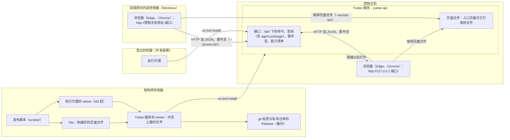

# 网页界面的提供与发布设计说明

更新：2026-10-07（界面由 Yudao 服务以网页提供，见 [ADR-0032](../adr/0032-interface-served-as-web-pages.md)；发布检查由已安装的实例提供，发布脚本只负责构建与上传，见 [ADR-0027](../adr/0027-trusted-kernel-outside-self-modification.md)，第 6.3、6.4、6.5 节）。状态：设计已确认（发布的做法 2026-10-01、局域网访问方式 2026-10-02、网页界面 2026-10-07，用户逐轮采纳推荐，第 9 节）。命令行入口、数据目录与发布脚本由 #206、#209 实施；接口层提供页面文件、启动以后打开浏览器、系统通知与发布脚本构建页面文件的部分未实施。路线位置：[Stage 3 计划](../stage-3-plan.md)界面工作线。工单见第 11 节。

依据：[ADR-0032](../adr/0032-interface-served-as-web-pages.md)（界面由 Yudao 服务以网页提供，服务手动启动）；[ADR-0015](../adr/0015-desktop-client-and-http-contracts.md)（FastAPI 接口层与 HTTP 合同，页面使用的技术）；[ADR-0018](../adr/0018-single-control-host-remote-execution.md)（一台控制主机）；[ADR-0019](../adr/0019-project-stream-across-versions.md)（升级与排空）；[ADR-0021](../adr/0021-client-pixel-view-follows-v9-structure.md)（像素画面与定稿原型的核对）；[ADR-0022](../adr/0022-run-directly-without-containers.md)；[ADR-0027](../adr/0027-trusted-kernel-outside-self-modification.md)（发布检查）；[应用层与接口层设计说明](app-and-interface.md)第 5.7、6、7.2、10 节；[执行环境服务设计说明](execution-environment.md)第 5.3 节。用词以 `CONTEXT.md` 为准。

## 1. 范围

交付：

- 控制主机上 Yudao 服务的安装、命令行入口、数据目录、启动与停止。
- 接口层提供构建好的页面文件；启动命令在服务就绪以后打开浏览器；浏览器的系统通知与「安装此站点为应用」。
- 一次发布的构成、版本号与发布脚本。

不在范围内：

- Yudao 服务注册为系统服务、登录时或开机自动启动、崩溃后重新启动与看门狗：随 Stage 4 的长时间运行进行。现阶段服务由用户手动启动（ADR-0032）。
- 手机，以及 Windows 以外的系统上的浏览器：页面以 Windows 上的 Edge 与 Chrome 为准。
- 访问令牌与 TLS：应用层与接口层设计说明第 6.3 节。

## 2. 概念与模块

- **发布**：一个带版本号的 Yudao 版本，是一个 Yudao 服务的 wheel，内含构建好的页面文件与执行代理的安装包，三者同版本。
- **页面文件**：页面代码（React、PixiJS 画面）构建得到的入口页面、脚本、样式、字体与图片。接口层在提供接口的同时提供这些文件，浏览器打开服务的地址就是界面。
- **发布版本号与接口版本**：发布版本号标记一次发布；接口版本在删除或改变已有的查询、命令、事件种类与字段时提高（应用层与接口层设计说明第 6.1 节）。页面与 Yudao 服务出自同一个 wheel，页面构建时的接口版本与服务相同。

## 3. 安装

### 3.1 前提

- 控制主机与需要安装执行代理的机器上有 uv。
- 打开页面的电脑是 Windows，有 Edge 或 Chrome。局域网中的其他电脑不需要安装 Yudao 的任何部分。

### 3.2 控制主机上的 Yudao 服务

- 安装：`uv tool install --python 3.12 <发布的 wheel 的路径>`。`yudao` 命令安装到 uv 的可执行文件目录（Windows 为 `%USERPROFILE%\.local\bin`）；目录不在 PATH 中时 uv 提示运行 `uv tool update-shell`。
- 升级：按 ADR-0019 先排空，停止 Yudao 服务（第 4.2 节），`uv tool install --reinstall --python 3.12 <新的 wheel>`，再启动。已经打开的页面在重新连接以后自动重新加载，使用新版本的页面文件（第 5.1 节）。同一个地址上的文件被替换以后，没有 `--reinstall` 的再次安装按「已经安装」结束。
- 控制主机换到另一台机器时，从私有仓库的 Release 取得 wheel（`gh release download`）。

### 3.3 数据目录

- 默认位置：Windows 为 `%LOCALAPPDATA%\Yudao`；Linux 为 `~/.local/share/yudao`，遵守 `XDG_DATA_HOME`；`--data-dir` 指定其他目录。
- 内容：事件日志、工件、进程锁 `service.lock`、Provider 目录文件 `providers.json`、`.env`、日志目录 `logs/`。Provider 目录文件与 `.env` 默认在数据目录内，不相对当前目录。
- 开发、评测与走查使用 `--data-dir` 指向其他目录。M1 试用从空的数据目录开始，开发时 `.yudao/` 下的数据不迁移；模型管理页里配置 Provider 与 Key 是试用内容之一。

## 4. Yudao 服务的运行

### 4.1 命令行入口

`pyproject.toml` 的 `[project.scripts]` 中的 `yudao`：

- `yudao api`：与 `python -m harness api` 相同，参数为 `--data-dir`、`--host`、`--port`、`--access`、`--provider-config`、`--no-browser`；数据目录的默认值按第 3.3 节，端口默认 8765。
- `yudao --version`：输出发布版本号。
- `replay`、`project`、`smoke`、`demo` 等子命令见应用层与接口层设计说明第 7.4 节。

### 4.2 启动与停止

- `yudao api` 在启动它的命令行窗口中运行。服务就绪（开始接受请求）以后，在命令行输出页面地址，并用默认浏览器打开 `http://127.0.0.1:<端口>/`。局域网访问方式下打开的同样是这个本机地址：浏览器在本机地址上允许系统通知与「安装此站点为应用」（第 5.3 节），而且通知的许可与安装的应用按地址区分，固定一个地址，这些设置才能在每次启动以后沿用。
- 带 `--no-browser` 时不打开浏览器，供测试、走查与没有桌面的控制主机使用。
- 停止服务就是结束这个进程：在命令行窗口中按 Ctrl+C。服务停止接受新请求，关闭事件流连接，等待进行中的写入完成，释放进程锁，进程退出。进行中的 run 不等待结束，下次启动时按 3.1 自动继续（[恢复契约](recovery-contract-and-fault-matrix.md)）；结果未知的外部动作照常交给用户决定。
- 停止与排空的区别：排空停止开始新事项并等待 run 结束，用于升级之前；停止立即结束服务。

### 4.3 单实例与日志

- 每个数据目录只允许一个服务进程，已有的 `service.lock` 保证（应用层与接口层设计说明第 7.2 节）；第二次启动失败并写明占用的数据目录。
- 日志写在 `<数据目录>/logs/`，按大小轮换。

### 4.4 局域网访问

访问方式是服务的启动参数：`yudao api --access lan --host 0.0.0.0`。不带 `--access lan` 时为本机访问方式，只能从这台电脑打开页面。能力清单的 `deployment.access` 给出当前的访问方式。

- 加入访问令牌之前（B7，应用层与接口层设计说明第 6.3 节），局域网内不校验身份。
- 第一次以局域网访问方式启动时，Windows 防火墙询问是否允许 Python 访问网络，需要管理员确认；电脑所在网络是「公用」类型时勾选「公用网络」，或者在 Windows 设置中把这个网络改为「专用」。Yudao 不修改防火墙，试用指南写明这些做法。
- 远程机器下载执行代理的安装包同样需要局域网访问方式（执行环境服务设计说明第 5.3.2 节）。

Stage 4 由操作系统的服务管理负责开机启动时，访问方式写在那份服务定义的启动参数中。

## 5. 页面

### 5.1 接口层提供页面文件

- 页面文件来自 wheel 内的发布资源目录 `harness/release_assets/`（第 6.1 节），服务运行时只读取，不生成。
- 路径的划分：
  - `/api/` 下是命令、查询、事件流与能力清单（应用层与接口层设计说明第 7.1 节），执行代理的安装包（`agent.package`）是其中的一个查询；另有 `/openapi.json`。
  - 其余的 GET 路径是页面文件：`/` 返回入口页面，入口页面引用的脚本、样式、字体与图片按构建产生的相对路径提供。页面内的导航写在地址 `#` 之后（`#/home`、`#/sys/machines`），服务只按文件路径返回文件。
  - 页面文件只读、不含数据，不属于查询与命令，不经过注册表，不列入 OpenAPI 与能力清单。
- 入口页面每次向服务确认有没有新的版本（`Cache-Control: no-cache`）；文件名带内容摘要的文件可以长期缓存。
- 页面与服务按接口版本对齐：页面在每次连接（包括服务重启以后的重新连接）时读取能力清单中的接口版本，与页面构建时的接口版本比较。发布版本号不作判据，改服务端代码时它不一定变。
  - 服务的接口版本比页面新：先自动重新加载一次，取得服务提供的页面文件；重新加载以后仍然较旧，说明服务提供的页面文件没有跟着更新（从源码运行而没有重新构建时出现），页面写明两边各是第几版，下一步是重新构建页面文件，不再给「重新加载」。
  - 页面的接口版本比服务新：服务在跑旧的代码，页面写明两边各是第几版，下一步是重启服务。
  - 两种情形下页面不可用，只显示这一页说明；wheel 发布时页面与服务同出一个包，不会出现。
- 访问方式的 Host 检查对页面文件同样适用。页面与接口同一来源：带 `Origin` 的请求只接受 `http://` 加本次请求的 `Host` 这一个来源，接口层不发送 CORS 响应头（应用层与接口层设计说明第 6.2 节）。
- 没有页面文件时（从源码运行而没有构建页面），`/` 返回 404，响应写明「没有页面文件」。

### 5.2 浏览器与显示

- 在控制主机上打开 `http://127.0.0.1:<端口>/`；服务以局域网访问方式运行时，局域网中的其他电脑打开 `http://<控制主机的局域网地址>:<端口>/`。
- 页面以 Windows 上的 Edge 与 Chrome 为准。外观以当前定稿的原型为准（版本写在[原型变更记录](../prototypes/CHANGELOG.md)开头）；页面内容区最宽 1280 像素、居中，整体放大使用浏览器的缩放。
- 每个页面与像素画面的验收包括截图对照：1440×900、1920×1080 两种窗口，设备像素比 1、1.25、1.5，浅色与深色主题，与当前定稿的原型同一场景的截图并排交给用户查看（ADR-0021）。
- 页面所在的标签页或窗口不可见时，浏览器暂停画面的绘制；回到可见时画面按当前状态继续。

### 5.3 系统通知与「安装此站点为应用」

- 浏览器只允许 https 页面与本机地址使用系统通知与「安装此站点为应用」。在控制主机上经本机地址打开的页面两者都可以使用；在其他电脑上经局域网的 http 地址打开时，没有系统通知，只能在普通标签页中使用，离开局域网之前加入 TLS 时一起解决（应用层与接口层设计说明第 6.3 节）。
- 需要单独的窗口时，用 Edge 或 Chrome 菜单中的「安装此站点为应用」。
- 系统通知：页面打开期间，出现决定请求、进入等待模型服务、磁盘空间不足时发出浏览器的系统通知（[D30](../requirements/web-game-frontend.md)；其中磁盘空间不足的通知在 Stage 4 加入：它的阈值参数与事件随路线图「数据保留」一条一起定，Stage 3 的页面只有前两种通知（2026-10-19，[决策记录](../decision.md)同日一条）），点击决定请求的通知回到页面并打开对应的决定卡片；标签页的标题显示待决定的数量。通知需要用户在浏览器中允许。几个页面同时打开时，同一件事只显示一条通知（以决定请求或事件的身份作为通知的标记）。页面关闭期间没有通知，离开期间发生的事由首页的待回答决定与离开期间的报告给出（ADR-0032）。页面一侧的规则见应用层与接口层设计说明第 5.7 节。
- 长时间放在后台的标签页可能被 Edge 的睡眠标签页或 Chrome 的节省内存功能暂停，暂停期间没有系统通知。试用指南写明把服务的地址加入浏览器中「始终保持这些网站处于活动状态」的列表。

## 6. 发布

### 6.1 一次发布的内容

一个 wheel `yudao_harness-<版本>-py3-none-any.whl`。除 Yudao 服务的代码以外，`harness/release_assets/` 中有：

| 文件 | 来源 | 用途 |
| --- | --- | --- |
| 页面文件（入口页面与它引用的文件） | 发布脚本用 Vite 构建 | 界面（第 5 节） |
| `yudao_agent-<版本>-py3-none-any.whl` | 发布脚本；M3 由 #144 加入 | 执行代理的安装（执行环境服务设计说明第 5.3.2 节） |

### 6.2 版本号

- 格式 `主.次.修订`。Stage 3 的 M1 至 M4 依次为 0.1.0、0.2.0、0.3.0、0.4.0，以后的里程碑接着递增次版本号；试用中 `/qa` 发现的问题修好以后发布修订版本，例如 0.1.1。
- `pyproject.toml` 的 `version` 是发布版本号，git 标签为 `v<版本>`。页面显示的版本号取自能力清单中的服务版本。

### 6.3 发布脚本

脚本放在仓库的 `scripts/` 下，由执行者编写（#209），架构师在试用流程中运行。脚本只负责构建与上传：构建所需的核对与构建、上传的步骤如下；发布检查（内核差异、行数、导入方向、探针、回归场景与集成层结果）由已安装的实例提供（`yudao release-check <仓库>`，[可信内核设计说明](trusted-kernel.md)第 4.4 节），用当前运行的版本里的检查、评测材料与内核清单检查待发布的提交，结果写进决定请求「实例升级」；脚本不运行也不修改这些检查，带 `--publish` 的上传在发布检查通过以后进行。`scripts/release.py` 列在内核清单里，修改它每次由用户经决定请求「内核修改」批准。步骤：

1. 核对：工作区干净；当前提交在 main 上并已推送；Node 版本不低于 22.12，uv 可用。
2. 构建页面：`npm ci`，用 Vite 构建页面文件。
3. M3 起构建执行代理的 wheel。
4. 清空 `harness/release_assets/`（该目录被 git 忽略），把以上文件复制进去；删除仓库根下的 `build/` 与 `*.egg-info`，`uv build --wheel` 生成 Yudao 服务的 wheel；核对 wheel 内的页面文件与页面构建输出目录中的文件一致，M3 起另核对 wheel 内有同版本的执行代理 wheel。
5. 仅在带 `--publish` 时：打标签 `v<版本>` 并推送，`gh release create v<版本>` 把 wheel 上传到私有仓库的 Release，作为备份。
6. 输出 wheel 的路径与 SHA-256。

脚本只构建与上传，不安装、不升级这台电脑上已经安装的 Yudao 服务。构建在架构师的 Windows 电脑上进行，不使用 GitHub Actions：构建需要的 Node 22.12 以上这台电脑已满足（24.14）；私有仓库的 Actions 每月免费 2,000 分钟，Windows 运行器按约 1.67 倍计，偶尔发布够用，但要维护流水线。

### 6.4 谁在什么时候发布

每个试用里程碑的工单全部关闭、要发布的提交通过里程碑发布之前的测试（[测试分层设计说明](test-pyramid.md)第 4 节：集成层、真实模型冒烟、客户端端到端与桌面测试）以后，架构师先让已安装的实例对待发布的提交运行发布检查，通过以后发布（[CLAUDE.md](../../CLAUDE.md)「工作流程」第 7 步），再写试用指南。发布记入 `docs/CHANGELOG.md` 与 `claude_jour.md`。平时开发不发布，执行者与审查者照旧在开发目录与 worktree 中工作。

### 6.5 架构师的走查

架构师按试用指南走一遍时使用发布出来的版本，不动用户已经安装的那一份：

- 把 wheel 安装到临时目录的虚拟环境（`uv venv` 加 `uv pip install`）。`uv tool install` 会覆盖用户的 `yudao` 命令，所以不使用它。
- 使用单独的数据目录与端口（例如 18765），启动时带 `--no-browser`。
- 用 Playwright 驱动这台电脑上的 Edge 与 Chrome 打开 `http://127.0.0.1:<端口>/`，浏览器使用 Playwright 的临时配置，不动用户的浏览器数据。
- 走完删除这个数据目录与虚拟环境。

升级用户已经安装的那一份是一次用户决定（决定请求「实例升级」），走查不替代它。

### 6.6 试用的交接

- 试用指南写在该阶段的文档目录（例如 `docs/stage-3/`），写明怎样安装这个版本；架构师先用发布出来的版本按指南走一遍（真实模型，第 6.5 节的办法），再把试用工单改为 `ready-for-human`，交给用户。
- 走查按用户的操作路径进行。指南写的操作与用户的合理预期不一致时，建缺陷工单，不修改指南去迁就。
- 用户用 `/qa` 反馈的问题建成工单，排在队列最前面；用户确认以后关闭试用工单与里程碑。
- 试用期间继续推进下一个里程碑。

## 7. 与现有设计的关系

| 现有内容 | 改变 |
| --- | --- |
| 应用层与接口层设计说明第 6.2 节：接口层的路径 | 另提供页面文件与执行代理的安装包；页面与接口同一来源 |
| 同上 `agent.package`：按当前的执行代码生成 | 发布时构建，随 wheel 提供 |
| 执行环境服务设计说明第 5.3.2、5.3.4 节 | 同上 |
| 命令行默认数据目录 `.yudao/native-loop`，Provider 目录文件 `.yudao/providers.json`，`.yudao/.env` | 用户数据目录内（第 3.3 节） |
| `CLAUDE.md` 工作流程第 7 步 | 试用之前先发布 |

## 8. 验收

全部使用真实运行的系统，不使用模拟。

1. 发布脚本（不带 `--publish`）在干净的检出中得到 wheel；wheel 内的页面文件与页面构建输出目录中的文件一致；工作区不干净时脚本拒绝。
2. 把 wheel 安装进临时虚拟环境：`yudao --version` 输出发布版本号；`yudao api --data-dir <临时目录> --port <端口> --no-browser` 启动；请求 `/` 得到入口页面，入口页面引用的文件都能取得；`/api/capabilities` 给出与 `yudao --version` 相同的服务版本。
3. 同一数据目录第二次启动 `yudao api` 失败并写明原因；默认数据目录在 Windows 上为 `%LOCALAPPDATA%\Yudao`，Provider 目录文件与 `.env` 在其中。
4. 不带 `--no-browser` 启动时，服务就绪以后用默认浏览器打开 `http://127.0.0.1:<端口>/`，局域网访问方式下同样如此。
5. 在命令行窗口按 Ctrl+C 以后服务退出并释放进程锁，打开着的事件流连接不阻止退出；进行中的 run 在下次启动时自动继续。
6. Playwright 驱动 Edge 与 Chrome：经本机地址打开的页面能读取查询、提交命令、接收事件流；允许通知以后出现新的决定请求时发出系统通知，点击通知打开对应的决定卡片。以 `--access lan --host 0.0.0.0` 启动时，从这台电脑的局域网地址可以打开页面与请求 health；以本机访问方式启动时只能从回环地址访问。
7. 用户已经安装的 Yudao 服务与浏览器数据在测试前后不变：测试使用不同的数据目录、端口、虚拟环境与 Playwright 的临时浏览器配置。
8. M1 发布时，架构师首次执行 `--publish`：标签与 Release 存在，wheel 的 SHA-256 与 Release 中的文件一致。

## 9. 用户确认的决定

2026-10-01 用户选择专题 5 用 grill 讨论，逐轮回答「采纳建议」「采纳推荐」：

1. 数据目录默认在用户数据目录；M1 试用从空的数据目录开始，开发时的数据不迁移。
2. 控制主机上运行的程序叫「Yudao 服务」。
3. 每个里程碑交给用户试用之前发布一次；版本号按里程碑递增，Stage 3 为 0.1.0 至 0.4.0，试用中修好的问题发布修订版本；发布由架构师执行，CLAUDE.md 工作流程第 7 步加入发布。
4. 架构师按指南走一遍时使用单独的数据目录与端口，不动用户已经安装的那一份；用户自己按指南安装与升级。
5. 命令行入口 `yudao`。
6. 在架构师的电脑上本机构建，发布脚本由执行者编写，打标签并上传到私有仓库的 Release 作为备份。

2026-10-02 用户用 grill 讨论局域网访问方式，回答「采纳建议」：

7. 访问方式是服务的启动参数。
8. 机器页的安装与升级命令按服务的每个 IPv4 地址各给一条（执行环境服务设计说明第 5.3.2 节）。
9. Windows 防火墙使用系统自己的询问，试用指南写明做法，Yudao 不修改防火墙。

2026-10-07 M1 试用以后，用户逐轮采纳推荐（[ADR-0032](../adr/0032-interface-served-as-web-pages.md)）：

10. 界面是 Yudao 服务提供的网页：构建好的页面文件随 wheel 发布，接口层在提供接口的同时提供这些文件；局域网中的其他电脑打开同一个地址；需要单独的窗口时用 Edge 或 Chrome 的「安装此站点为应用」。以 Windows 上的 Edge 与 Chrome 为准，不考虑手机。
11. 页面代码（React、PixiJS 画面）只通过接口层的合同工作；界面的端到端测试与走查用 Playwright 驱动浏览器。
12. 服务手动启动：启动命令在服务就绪以后用默认浏览器打开页面地址，停止服务就是结束这个进程；现阶段不注册为系统服务，也不在登录时启动，迭代稳定以后随 Stage 4 的长时间运行再做。局域网访问用启动参数 `--access lan`。
13. 不主动推送提醒。原来由托盘发出的系统通知（D30）在本机打开页面时由浏览器发出，点击决定请求的通知回到页面并打开对应的决定卡片。
14. 一次发布是一个 wheel，包含构建好的页面文件与执行代理的安装包；页面与服务出自同一个包，版本总是一致。
15. 外观以原型 v9 为准；页面内容区最宽 1280 像素居中，整体放大用浏览器缩放；验收时按第 5.2 节截图，与原型 v9 同一场景并排交给用户查看（ADR-0021）。
16. 2026-10-10：外观与截图对照以当前定稿的原型为准，版本号只写在[原型变更记录](../prototypes/CHANGELOG.md)开头（第 5.2 节）。

## 10. 遗留

1. Yudao 服务注册为系统服务、登录时或开机自动启动、崩溃后重新启动与看门狗：Stage 4。computer use 要在用户的交互桌面上操作程序（[ADR-0026](../adr/0026-desktop-trials-on-control-host-desktop.md)），Windows 的系统服务运行在看不到交互桌面的会话中，Stage 4 的设计要让服务运行在用户登录后的桌面会话里。
2. 局域网中其他电脑上的系统通知与「安装此站点为应用」：离开局域网之前加入 TLS 时一起解决。

## 11. 工单

全部属于里程碑 M1。

| 工单 | 交付 | 父工单 |
| --- | --- | --- |
| #206 | 命令行入口与数据目录（第 3.3、4.1、4.3 节） | #70 |
| #209 | 发布脚本、标签与 Release（第 6 节）；README 的安装与启动说明 | #71 |
| #372 | 接口层提供页面文件、同一来源、页面不经桌面桥接、端到端改为浏览器（第 5.1 节） | #370 |
| #373 | 删除桌面客户端；发布脚本只构建页面与执行代理；README（第 3、4、6 节） | #370 |
| #374 | 就绪后打开浏览器、`--no-browser`、Ctrl+C 退出、版本不同时页面重新加载（第 3.2、4.2、5.1 节） | #370 |
| #375 | 浏览器的系统通知与标签页标题（第 5.3 节） | #370 |
| #376 | 截图联系表（第 5.2 节） | #370 |

#144（执行代理的安装、系统服务与升级）把执行代理的 wheel 加入发布脚本。

## 12. 使用的技术

| 部分 | 选择 |
| --- | --- |
| 页面构建 | Vite（页面使用的技术见 ADR-0015） |
| 页面文件的提供 | Starlette 的 `StaticFiles`（FastAPI 自带） |
| 打开浏览器 | Python 标准库 `webbrowser` |
| Yudao 服务的安装 | `uv tool install`（uv 0.11.14） |
| 构建环境 | Node.js 22.12 以上（这台电脑 24.14.0） |
| 发布脚本 | Python 脚本 `scripts/`，经 `subprocess` 调用 npm、uv、git 与 gh |
| 端到端测试与走查 | Playwright 驱动 Edge 与 Chrome |
