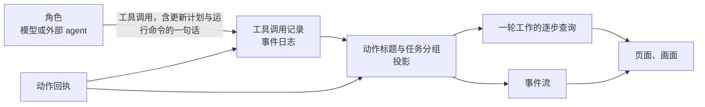

# 工作过程的任务与动作标题设计说明

总图位置：第四节「投影」「接口」「定义」三道缝、第一节「页面」方框；外部 agent 的部分在第四节「执行」的缝。依据：[项目的组织设计说明](project-organization.md) 4.14「项目页是循环图加对话」；[应用层与接口层设计说明](app-and-interface.md)「项目页四层读哪个查询」；[验证的独立性设计说明](independent-verification.md)「共享的与隔开的」；[语义系统设计说明](semantic-system.md)「五层」「压缩与轨迹节录」；[职能内多角色设计说明](department-roles.md)；[产品 · 工程 · 质检的循环结构](department-loop.md)「工程的计划」；[外包角色设计说明](outsourced-roles.md)「ACP 提供的控制手段」；[循环与收敛设计说明](loops-and-convergence.md)「收敛的检测」。

## 1. 功能与依据

项目页的工作过程是时序图里点开的最里面一层，写一轮工作或一次回答的经过。它分三层，用户平时读前两层：任务（1、2、3）→ 每个动作一行标题 → 原始数据（命令、参数、退出状态、输出、推理、模型文字）。原始数据永远点得到。

分层的理由来自真实运行的数据：运行命令的动作占全部动作的四分之一以上，命令长度的中位数约 200 字符，最长超过一万字符，直接显示读不下去；一半的轮次只有六七个动作，长的轮次有几十个动作，长轮次需要分组才读得下去。

三层各自的来源：

| 层 | 谁写 | 存在哪里 |
| --- | --- | --- |
| 任务 | 角色自己用「更新计划」写 | 存在这次工具调用里 |
| 动作标题 | 系统按工具和参数算出；只有运行命令由角色写一句 | 系统算的不保存，每次现算；角色写的一句是运行命令这次工具调用的一个参数 |
| 原始数据 | 已有的动作记录与回执 | 已有的事件，不新增 |

## 2. 边界与范围

做：

- 动作标题与动作标记的生成，只有一处。
- 运行命令的工具多一项可选的一句话。
- 「更新计划」工具与任务分组。
- 老事件的显示。
- 外部 agent 的对应关系。
- 谁读这些内容。

不做：

- 不另外调用模型来总结工作过程：多一份成本与延迟，又多一个可能说错的来源。模型的推理当不了标题：只有约四成的步骤有可读的推理，一段的中位数约 700 字。
- 不新增事件种类：任务与角色写的话都在已有的工具调用记录里，骨架事件不动。
- 任务、状态与角色写的一句话都是作者的陈述，属于作者的过程（[验证的独立性设计说明](independent-verification.md)「共享的与隔开的」），不作证据，不进裁决、边界、路由、收敛判断与放行，也不进别的角色的上下文，质检看不到；用户在页面上看得到。
- 系统算的动作标题不放进任何角色的上下文；角色写的一句话只留在它自己的历史里。
- 运行命令以外的工具不让角色写一句话：读文件、写文件、搜索这些，系统算出来的句子准确且不会说错；「为什么做」由任务那一层回答。
- 离开期间的报告不读这些内容（它只算事项一级的数字）；循环图节点上的字不变，只写状态。
- 页面的排版归[项目的组织设计说明](project-organization.md) 4.14 与原型；画面的措辞归画面自己的翻译层。

本说明的常量：

| 常量 | 默认值 | 范围 | 理由 |
| --- | --- | --- | --- |
| 动作标题的显示上限 | 60 字符 | 30–120 | 一行放得下标记、标题与用时；超出时截断并加省略号，原文在原始数据里。系统算的与角色写的共用这一个上限 |
| 运行命令带一句话的比例下限 | 95% | 80%–100% | 这一项是可选参数，允许模型偶尔漏写，漏写时的显示仍然读得懂 |

## 3. 接口

- 定义的缝：运行命令的工具多一项可选的一句话；工具清单多一个「更新计划」；哪些角色有这个工具写在角色定义里，默认每个自有角色都有。
- 动作的缝不变：那一句话只被记录，不交给执行环境；「更新计划」是主机工具，不经过动作的缝。
- 写入口：不加新的写入方式，更新计划与运行命令照常经工具许可，结果写成普通的工具调用记录。
- 投影的缝：两个纯函数，都能从事实重算。一个是动作标题：输入工具定义、动作的参数与回执，输出动作标记、动作标题与标题的来源（系统或作者）。另一个是任务分组：输入一轮工作的工具调用记录，输出任务与每个动作的归属。
- 接口的缝：一轮工作的逐步查询给每个动作带标记、标题、来源与所属任务，每轮带任务列表；事件流里工具事件带的那句系统生成的文字用同一个函数算，所以两处逐字相同。接口字段只增，随接口版本提高。
- 执行的缝：外包派发把 ACP 的内容对应过来（4.7「外部 agent」）。
- 画面的缝：画面只经接口读事件流与查询，不要专用查询，翻译层自己决定怎么说。

本说明没有新增或调整代码的包，不配包图。

## 4. 方案

### 4.1 动作标记

标题前面的标记只由系统给，角色写不了。种类有五种：

- 读：读文件、列文件、搜索、读外部来源、取回网页。
- 写：写文件、修改、删除、移动。
- 运行：运行命令、检查、基线检查、后台命令的输出与停止、试用、浏览器动作、MCP 工具、其余主机工具。
- 询问：询问、回答。
- 提交：各种提交成果的工具。

种类由工具定义里已有的动作类别与「是否提交成果」得出，定义里不用新增一栏。

除了种类，再标系统量到的事实：失败（退出状态非零或工具报错）、超时、结果未知、被拒绝、改了文件（动作前后公开树的摘要不同；回执里没有两个摘要时不标）。

标记的作用是：标题写得再好听也盖不住实际做了什么。角色写「查看配置」却改了文件，这一行会标出来。

### 4.2 动作标题

每类工具的标题写法：

| 工具 | 标题 |
| --- | --- |
| 读文件 | 读取 <路径>；带行范围时写第几行 |
| 列文件 | 列出 <前缀> 下的文件 |
| 搜索 | 搜索「<内容>」 |
| 取回网页 | 取回 <地址> |
| 写文件 | 写入 <路径> |
| 修改 | 修改 <路径> |
| 删除 | 删除 <路径>：<原因> |
| 移动 | 移动 <来源> 到 <目标>：<原因> |
| 运行命令 | 角色写的一句话；缺了写「运行命令：<命令开头>」 |
| 检查 | 运行检查 <名字> |
| 基线检查 | 在基线上运行检查 <名字> |
| 询问 | 问 <职能显示名>：<问题开头> |
| 回答 | 回答询问 |
| 提交 | 提交 <成果名> |
| 试用 | 开始试用 <启动名>、结束试用 |
| 试用用例 | 开始用例：<标题>、结束用例：<结果> |
| MCP 工具 | 调用 <服务器> 的 <工具> |
| 不认识的工具 | 工具名 |

规则：

- 角色写的话和给用户看的其他叙述用同一种语言（角色提示里已有要求）；只说这条命令要做什么，不说结果。
- 这一项在工具定义里是可选的：标题缺失不影响动作执行，不会让角色返工，这也是它不设为必填的理由。
- 运行命令以外的工具不让角色写：OMP 默认让每个工具都写意图（见出处），本说明只取运行命令一种，因为其余工具的标题系统算得出，让角色写只会多一份可能说错的文字。
- 标题函数要能处理任意输入：参数不是合法 JSON、工具已经不存在时写工具名，页面不报错。
- 角色写的话里的换行合成空格，空白的算缺失。
- 角色写的话和命令原文用同一条规则去掉凭据，已知凭据显示为凭据的名称。
- 标题带来源（系统或作者），页面上两种写法分得开。
- 模型这一步只有文字、没有动作时，这段文字的开头作一行，不带种类标记，来源记作者。

### 4.3 任务

任务对应语义系统里的计划条目（[语义系统设计说明](semantic-system.md)「五层」）。工具名叫「更新计划」，是记录类的主机工具（[职能内多角色设计说明](department-roles.md)已经为中心角色列了这个工具），这里每个自有角色都能用。

写法：每次整份替换，每条一句话加状态（待做、进行中、完成），和 ACP 的 plan、OpenCode 的 todowrite 同样的形状。工具的说明写明：事情分几部分时才用，小事不用；尽量和下一个动作在同一步发出，不单独占一步；同时只有一条进行中；和给用户看的其他叙述用同一种语言。

规矩：

- 计划不拦任何工作。格式错误（空条目、未知状态）作为工具结果返回，其余情况都接受，不检查条目数量，不拒绝多条进行中。
- 不经裁决，不是正式成果（[产品 · 工程 · 质检的循环结构](department-loop.md)「工程的计划」），不算进展事实（[循环与收敛设计说明](loops-and-convergence.md)「收敛的检测」），和别的工具调用一样计入步数与用量。
- 范围是一轮工作或一个询问分支，计划只在写下它的那一轮或那个分支里起分组作用。
- 压缩以后由轨迹节录带回（[语义系统设计说明](semantic-system.md)「压缩与轨迹节录」），不新增栏目。

### 4.4 任务分组

分组由投影按事件位置算：

- 一个动作归它开始时最新一份计划里排在最前的进行中条目。ACP 的工具调用和计划条目之间没有关联，自有角色和外部 agent 都用这一条规则。
- 同一句话算同一条任务，一条任务可以有几段动作；角色改了措辞的算新的一条。
- 任务的顺序按第一次进行中的时间排，编号 1、2、3；状态取最后一次写的；后来的计划里没有了的写「已从计划里去掉」；从没进行过的排在最后。
- 没有进行中条目时的动作不编号，按时间放在两段任务之间。
- 「更新计划」自己不单独成行。
- 一轮没有计划时动作平铺，连续同一种类的动作由页面折成一行（如「读了 12 个文件」），点开看每一行。这条折叠规则也用在任务内部。

### 4.5 谁来读

| 读者 | 读什么 |
| --- | --- |
| 工作过程 | 三层全部 |
| 节点详情的「在做什么」与外部 agent 的状态条 | 当前任务加最近一个动作的标题，读同一个逐步查询 |
| 事件流的文字 | 动作标题 |
| 画面头顶 | 画面保留自己的说法（翻译层），运行命令时用角色写的那一句 |
| 语义系统的轨迹 | 计划条目这一层读更新计划的调用 |

下面这些不读：裁决、边界、路由、收敛、别的角色的上下文、评分、离开期间的报告、循环图节点上的字。

### 4.6 老事件

老事件没有那一句话，也没有更新计划的调用。不迁移、不重写事件：运行命令显示「运行命令：<命令开头>」，动作平铺并按同一种类折叠。重放结果不变。

### 4.7 外部 agent

外部 agent 经 ACP 接入（[外包角色设计说明](outsourced-roles.md)「ACP 提供的控制手段」），对应关系：

| ACP 的内容 | 对应到 |
| --- | --- |
| tool_call 的 title（以后 tool_call_update 改的，取最后一个） | 动作标题，来源记作者；协议本身要求客户端把它当作者写的文字 |
| kind | 动作标记的种类：read、search、fetch 算读，edit、delete、move 算写，其余算运行；这是自报的 |
| rawInput、rawOutput 与 content | 原始数据 |
| plan | 更新计划；优先级不用 |
| agent_thought_chunk 与 agent_message_chunk | 原始数据里的推理与模型文字 |

自报的种类和受控入口量到的回执不一致时，标记按回执。外部 agent 在自己进程里做、没有经过受控入口的动作，这一行只有自报的内容，页面上写明自报。

### 4.8 实现顺序

只按依赖排，每一项完成以后单独可用：

1. 动作标记、动作标题与查询、事件流、页面；老事件当场能读。
2. 运行命令的一句话：工具定义、提示词快照。
3. 更新计划与任务分组：工具定义、角色定义、提示词快照。
4. 外部 agent 的对应，随外包派发一起做。

可信内核的代码不动；工具定义与提示词快照属于核心文件，按核心改动的流程做。

## 5. 验收

全部用真实运行的系统。

1. 打开一轮工作的工作过程：每个动作一行，标记加标题，看不到整段命令；点开看到命令原文、参数、退出状态、输出与这一步的推理和模型文字。
2. 系统算的标题：读、写、搜索、检查、询问、提交各写明对象；参数不是合法 JSON 或工具已不存在时写工具名，页面不报错。
3. 用默认模型在回归场景上运行，运行命令带一句话的比例不低于下限；缺的显示「运行命令：<命令开头>」。
4. 用老的事件日志打开，同样显示，事件不变，重放结果不变。
5. 标记只来自系统：角色写「查看配置」而动作实际改了公开树时，这一行标「改了文件」；失败、超时、结果未知、被拒绝同样；角色写的话改变不了标记。
6. 任务分组：一轮里更新三次计划，动作归到当时进行中的条目；改了措辞的成为新的一条；从没进行过的排在最后；没有进行中条目时的动作不编号；没有计划的轮次平铺，连续同一种类折成一行。
7. 计划不拦工作：格式错误的调用作为工具结果返回，其他动作照常；同一组事件去掉更新计划的调用以后，事项的流转、裁决与边界的结果不变。
8. 可见范围：工程写的一句话与计划不出现在质检和产品的模型请求里；用户在页面上看得到。
9. 一处生成：事件流里工具事件的文字与工作过程的标题逐字相同。命令与一句话里带已知凭据时，显示的是凭据的名称。
10. 对照：在回归场景上配对运行带与不带更新计划的角色定义，完成度与质检误放行的差值不超过噪声范围，用量的差值写进对照报告。
11. 外部 agent（一个经 ACP 接入的真实 agent）：工具调用显示它的标题并标明作者写的，计划显示为任务，原始输入输出点得到；自报种类与受控入口的回执不一致时按回执标记。

## 6. 未决问题

- ACP 的工具调用与受控入口的请求怎样配对：许可请求带工具调用身份，终端以工具调用内容里的终端编号相连，文件请求没有直接关联。接入时按实际消息顺序定。
- 各外部 agent 给的标题写得好不好，接入时逐个核对（[外包角色设计说明](outsourced-roles.md)的未决问题同样按接入时核对）。

出处：

- https://agentclientprotocol.com/protocol/tool-calls
- https://agentclientprotocol.com/protocol/agent-plan
- https://agentclientprotocol.com/protocol/schema
- OpenCode（anomalyco/opencode@a98e3fa7a1）`packages/core/src/tool/plugin/todo.ts`
- OMP（can1357/oh-my-pi@d697217279）`docs/settings.md` 的 `tools.intentTracing`：默认让每个工具写意图，本说明只取运行命令一种，取舍见 4.2。
