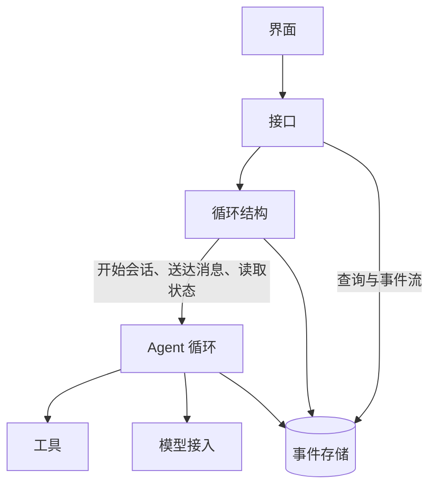
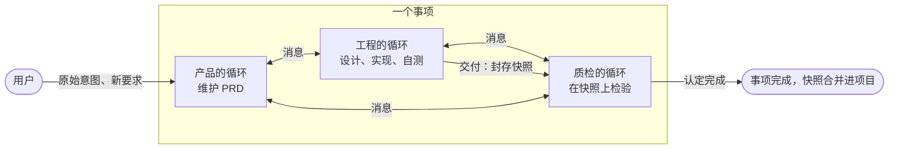
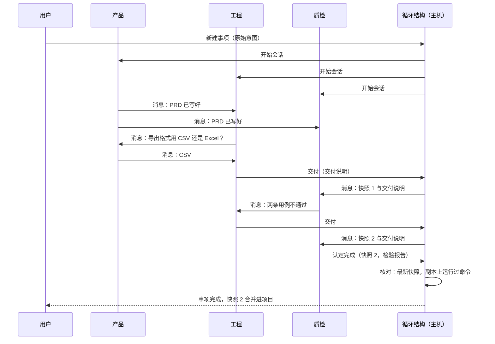

# Yudao 设计说明

更新：2026-10-12。状态：核心结构经用户确认（三个部门的循环同时运行，彼此发消息，事项是否完成由质检认定），全文待逐节讨论。

依据：`CLAUDE.md` 的项目表述；用户 2026-10-12 的意图：第一个版本是带有循环结构、由三个部门的 agent 循环驱动的 harness，其余部分与 OpenCode、pi、omp 这类 harness 一致，图形界面只负责显示。

参照实现：OpenCode（`anomalyco/opencode` @ bcf23b6，下文写作 OC，路径相对 `packages/core/src`）；oh-my-pi（@ e3106be，下文写作 OMP，路径相对仓库根）。

写法：第 3 节「循环结构」是 Yudao 自己的设计。其余各节与参照实现一致的部分写明参照的位置；与参照实现不同的地方写明多出来的这一项防止了什么问题，说不出来的不写进本文。

## 1. 目的

1. 同一个模型下，交付质量高于单个 agent。依据是错误独立：三个部门的目标函数不同（产品维护目标，工程完成，质检挑错），证据来源不同（写代码与运行检验）。质检在封存的快照上独立运行检验，工程无法宣布自己完成。
2. 用户不在场时，系统自己运行，直到质检认定完成，或者有原因地停下。完成只由质检认定，循环因此不会过早停止。

## 2. 分层

| 层 | 职责 | 参照 |
| --- | --- | --- |
| 界面 | 显示事件；发出新建事项、取消、给某个会话发消息等命令 | — |
| 接口 | HTTP 命令与查询，事件流 | — |
| 循环结构 | 三个会话的启动、消息传递、交付与认定完成、停止 | Yudao 自己的设计（第 3 节） |
| Agent 循环 | 一个会话：模型请求与工具调用的循环、压缩、步数上限、消息送达与唤醒 | OC `session/runner/llm.ts`、`session/run-coordinator.ts`、`session/compaction.ts`；OMP `packages/agent/src/agent-loop.ts` |
| 工具 | 文件、搜索、shell、网络取回、待办、子代理、技能、MCP；权限规则 | OC `tool/plugin/`、`shell.ts`、`permission.ts` |
| 模型接入 | Responses、Chat Completions、Anthropic Messages 三种协议，流式输出，重试，模型配置 | OC 与 OMP 的模型接入 |
| 事件存储 | 唯一的事实来源；会话历史与事项状态都是事件的投影 | OC 按会话分开的事件流加投影表 |

依赖只能向下。循环结构这一层通过三个操作使用 Agent 循环：

| 操作 | 说明 |
| --- | --- |
| 开始一个会话 | 带上系统提示词、模型与工具 |
| 向会话送达一条消息 | 会话运行中时，在当前这一步结束以后进入历史；会话空闲时唤醒它 |
| 读取会话的状态 | 运行中或空闲 |

Agent 循环不知道部门的存在。发消息、交付、认定完成三个工具由循环结构这一层提供，Agent 循环执行它们的方式与执行其他工具相同。

## 3. 循环结构

### 3.1 两层循环

- 内层：每个部门一个 agent 循环。一轮是模型请求与它要求的工具调用，模型不再调用工具时本轮结束，会话进入空闲，等待下一条消息。
- 外层：三个会话之间的循环。工程交付，质检检验；检验不通过时，质检把结果发给工程或产品，工程修改以后再交付；质检认定完成时，外层循环结束。产品在整个过程中维护 PRD，回答另外两个部门的问题。
- 外层循环以完成结束的方式只有一种：质检认定完成。其余的结束都是停止，并写明原因（第 3.7 节）。

### 3.2 部门定义

每个部门一个配置文件，形式同 OC 的 agent 定义文件（`config/plugin/agent.ts`），写明：名称、目标、系统提示词、模型、工具与权限、写入范围、是否持有交付工具、是否持有认定完成工具。

| 部门 | 目标 | 写入范围 | 交付 | 认定完成 |
| --- | --- | --- | --- | --- |
| 产品 | 维护用户原始意图与 PRD，裁决目标与取舍 | 需求目录 | 否 | 否 |
| 工程 | 按 PRD 设计、实现、自测 | 工作区 | 是 | 否 |
| 质检 | 按 PRD 在封存的快照上检验 | 检验目录 | 否 | 是 |

- 加载定义时核对：持有认定完成工具的部门不能写入工作区，也不能持有交付工具。
- 主机代码里不出现部门名称。增加一个部门只需要增加一个定义文件。

### 3.3 启动

事项开始时，主机同时开三个会话。每个会话的第一条消息是用户的原始意图、本部门的目标与三个目录的位置。

- 产品整理 PRD，写入需求目录，写好以后发消息通知另外两个部门。
- 工程读代码、做设计，PRD 写好以后按它实现。
- 质检按原始意图与 PRD 准备检验用例。

### 3.4 发消息

- 工具的参数是接收方（产品、工程、质检、用户之一）与内容，内容可以附上文件路径。
- 调用以后立即返回，发送方继续工作。
- 送达：接收方运行中时，消息在它当前这一步结束以后作为一条新消息进入历史；接收方空闲时，消息唤醒它。发出与送达都写成事件。
- 询问：发一条消息，结束本轮，回复到达时被唤醒。不另设询问工具。
- 参照：OC 在会话有新输入时唤醒会话（`session/run-coordinator.ts`），后台子代理的结果以消息唤醒父会话（`session/subagent-completion.ts`）；OMP 有代理之间互发消息的工具（`packages/coding-agent/src/tools/hub/messaging.ts`），异步结果在会话空闲时作为新的一轮送入（`packages/coding-agent/src/session/async-job-delivery.ts`）。

### 3.5 写入范围与可见范围

- 三个部门的写入范围互不重叠（第 3.2 节的表），三个会话同时运行也不会改到同一个文件，不需要加锁。
- 文件工具按路径核对写入范围；shell 的工作目录固定在本部门的目录。没有操作系统层面的隔离，这些规则只防止误操作，同 OC 的做法。
- 三个部门都可以读取全部目录。
- 每个会话只包含自己的历史与收到的消息，看不到另外两个会话的历史。质检因此只依据 PRD、交付说明、快照与自己运行的检验作出判断。

### 3.6 交付与认定完成

- 交付（工程）：参数是交付说明。主机把工作区提交为一个快照（git 提交），在检验目录中准备这份快照的副本，并给质检发一条消息，附上快照编号与交付说明。交付以后工程可以继续工作。
- 检验（质检）：在快照的副本上运行检验，shell 的工作目录是这份副本。结果用发消息的工具告诉工程或产品。
- 认定完成（质检）：参数是快照编号与检验报告。主机核对两条：
  - 编号是最新一次交付的快照；
  - 质检在这份快照的副本上至少运行过一条命令。

  两条都满足时事项完成：三个会话停止，这份快照合并进项目，检验报告随事项保存。不满足时以工具结果说明原因，质检继续工作。
- 产品和工程没有认定完成的工具。
- 与参照实现的差别：OC 的单个 agent 自己决定何时结束；这里由另一个上下文在独立运行检验之后决定，防止生成者自己宣布完成。

### 3.7 停止

| 原因 | 条件 | 之后 |
| --- | --- | --- |
| 完成 | 质检认定完成 | 事项结束 |
| 用户取消 | 用户发出取消命令 | 事项结束 |
| 达到上限 | 运行时间或费用达到事项的上限 | 用户提高上限以后可以继续 |
| 停滞 | 三个会话都空闲，没有正在传递的消息，没有在后台运行的命令，也没有等待用户回复的消息 | 用户发一条消息即可继续 |
| 等待用户 | 三个会话都空闲，并且有发给用户、还没有回复的消息 | 用户回复以后继续 |
| 模型服务失败 | 某个会话的模型请求重试次数用完 | 用户处理以后继续 |

- 每个会话每一轮的步数有上限，达到时下一步关闭工具、只输出文字，同 OC `session/runner/llm.ts`。
- 运行时间只计算至少有一个会话在运行的时间。
- 上限的默认值写在配置里。

### 3.8 用户

- 用户可以给任何一个会话发消息，送达方式同第 3.4 节。
- 用户的新要求发给产品，由产品更新 PRD 并通知另外两个部门。
- 发给用户的消息显示在界面上。用户不在场时，其他会话照常工作。

### 3.9 部门内部

子代理工具同 OC `tool/plugin/subagent.ts`：开一个新会话，结果作为工具结果交回，深度上限为 1。子代理继承本部门的写入范围。

### 3.10 一个事项的经过

## 4. Agent 循环

- 模型还有工具调用就继续；达到步数上限时，下一步关闭工具，只输出文字。同 OC `session/runner/llm.ts`、OMP `packages/agent/src/agent-loop.ts`。
- 历史接近模型窗口时压缩，同 OC `session/compaction.ts`、OMP `packages/agent/src/compaction/`。
- 同一个会话同一时间只有一个执行，新消息唤醒空闲的会话，同 OC `session/run-coordinator.ts`。
- 每一步前后各取一次所在目录的快照，记录改动的文件，同 OC `session/runner/step.ts`、`snapshot.ts`。
- 会话历史长期保存，是事件的投影。

## 5. 工具

| 工具 | 部门 | 参照 |
| --- | --- | --- |
| 读取、写入、编辑（编辑之前必须读过） | 全部，写入受第 3.5 节限制 | OC `tool/plugin/` |
| 文件匹配、内容搜索 | 全部 | OC `tool/plugin/` |
| shell | 全部，工作目录在本部门的目录 | OC `shell.ts`、`tool/plugin/shell.ts` |
| 网络取回、待办 | 全部 | OC 的同名工具 |
| 子代理 | 全部 | OC `tool/plugin/subagent.ts` |
| 技能、MCP | 按部门定义 | OC 与 OMP 的技能与 MCP 客户端 |
| 发消息 | 全部 | 第 3.4 节 |
| 交付 | 工程 | 第 3.6 节 |
| 认定完成 | 质检 | 第 3.6 节 |

- 权限同 OC `permission.ts` 的 allow/ask/deny 通配规则，最后一条匹配的规则生效，按部门配置。默认值：本部门目录内允许，明显危险的命令拒绝。
- ask 规则命中时，这次调用等待用户回复，其他会话照常工作。
- shell 的输出只保留尾部交给模型，全文保存到文件并告诉模型路径；有超时，可以在后台运行，同 OC `shell.ts`。

## 6. 事件与恢复

- 事件存储是唯一的事实来源（SQLite），全部写入经过一个写入口。会话历史与事项状态都是事件的投影，可以从事件重建。
- 事件种类：会话消息、模型请求与输出、工具调用与结果（同 OC）；消息的发出与送达；交付与快照；认定完成及核对结果；停止及原因。
- 进程重启以后，未结束事项的三个会话恢复：正在运行的会话接着运行本轮，被中断的工具调用记为已中断并交回模型，没有送达的消息重新送达。同 OC `session/execution/restart.ts`。

## 7. 项目、事项与目录

- 项目是一个代码仓库。事项是一次外层循环。
- 每个事项有三个目录：需求目录、工作区（项目仓库的 git worktree）、检验目录。
- 事项完成时，认定完成的快照合并进项目分支。
- 同一个项目同一时间只有一个事项在运行；不同项目可以同时运行。

## 8. 界面

界面只显示事件、发出命令，后端不为界面的画法建立结构。

- 显示：事项列表与状态；三个会话各自的状态与实时输出；三个会话之间的消息往来，也就是外层循环的轨迹；每次交付与检验结果；发给用户的消息。
- 命令：新建事项、取消、给某个会话发消息、提高上限以后继续。

## 9. 度量

固定一组场景，Yudao 与 OpenCode 用同一个模型各运行若干次，记录完成度、正确性、交付次数、消息数、费用与耗时，比较两边。

## 10. 不在范围内

自我演化与规则登记、可信内核、判定点、语义系统与知识层、部门内的多角色、运维部门、外包角色、观察者、远程执行机器、computer use、收敛状态的判定。
