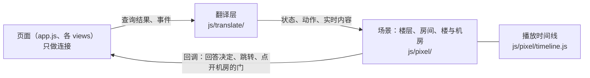

# 原型 v13：画面合同、翻译层与播放时间线

更新：2026-10-25。状态：待用户确认，未定稿；当前定稿仍是 [v12](../v12/design.md)。

本文件只写跟 v12 不一样的地方，其余照旧：v13 沿用 v12，v12 沿用 [v11](../v11/design.md)，依次往前。构建约定见 [BUILD.md](BUILD.md)。用词以 [CONTEXT.md](../../../CONTEXT.md) 为准。

依据：[ADR-0043](../../adr/0043-scene-contract-and-playback-belong-to-the-view.md)、[画面与播放设计说明](../../design/visualization.md)第 10 节第 1 条。v13 不改页面的结构、数据与文字，只改画面怎样从查询结果与事件得到，以及动作什么时候演。

## 1. 本版做的事

| 做的 | 在哪 |
| --- | --- |
| 画面合同：画面层唯一认的输入，写成取值表与校验，画面层收到别的取值就报错 | `js/pixel/contract.js` |
| 翻译层：查询结果翻成状态，事件翻成动作，决定与输出片段作为实时内容转交；服务端的状态值到画面状态的对应只写一次 | `js/translate/` |
| 播放时间线：三个场景共用，纯逻辑，时钟从外面传入 | `js/pixel/timeline.js` |
| 三张声明表：每种动作的级别与最短时长 | `floor-decl.js`、`room-decl.js`、`building-decl.js` |
| 楼层、房间、楼与机房改按画面合同工作，原来各自的排队规则删除 | `floor.js`、`room.js`、`building.js`、`ecs.js` |
| 两个新场景与调节面板（「节奏」） | 场景 24、25；`js/ui/toolbar.js` |
| 检查：H3、H8、H9、翻译覆盖 | `checks/timeline.js`、`checks/playback.js` |

不做：回放模式（拖到哪个位置就直接显示那个位置的状态，不播动作，与 v12 相同）；服务端的接口合同；页面的结构与文字。

## 2. 分层

依赖方向：`js/pixel/` 只用 `Y13.pixel` 与档位 `Y13.LEVELS`，不引用页面、查询、登记表、命令与时间格式；翻译层读登记表与时间格式，输出画面合同的形状。`checks/playback.js` 的 H3 逐个文件核对这一点，并核对 `js/pixel/` 里没有出现登记表里的事件种类与查询名。

## 3. 画面合同

三样输入，加一组回调；取值表与校验在 `js/pixel/contract.js`。

### 3.1 状态

带 `position`（来自的查询快照的位置）。三个场景各一份：

| 场景 | 接口 | 内容 |
| --- | --- | --- |
| 楼层 | `setState(s)`、`jump(s)` | 事项（状态取 `queued`、`waiting_slot`、`working`、`asking`、`waiting_model`、`waiting_resume`、`waiting_user`、`paused`、`interrupted`、`failed`、`done`、`cancelled`、`upgrade_stopped`、`adopted`；`departments` 写「部门 → `working`、`answering`、`waiting_user`」）、未回答的询问、成果库、槽位、等待模型服务（`retry_text` 是写好的文字）、运维、机器、各部门的角色、来源引用 |
| 房间 | 同上 | 房间状态（`idle`、`working`、`asking`、`paused`、`failed`、`done`、`cancelled`、`interrupted`、`waiting_resume`）、姿势（`pose.anim`）、角色、信箱与卷轴等数量、机器与试用台等 |
| 楼 | 同上 | 每层的状态灯（`working`、`queued`、`waiting_slot`、`waiting_model`、`waiting_resume`、`waiting_user`、`interrupted`、`idle`）、亮灯的房间、小旗 |
| 机房 | 同上 | 机器、使用关系 |

服务端状态值到画面状态值的对应只写在 `js/translate/translate.js` 的几张 `table(...)`，缺一个值就报错。

### 3.2 动作

带 `position`（来源事件的位置），`kind` 取自这个场景的声明表。一条事件翻成零个、一个或几个动作：PRD 被接纳翻成「盖有效章」加「交接」。公共字段：`item`、`room`、`role`、`say`、`sayTo`（做事的一方与收东西的一方头顶说的话，翻译层写好）。交接带 `from`、`to`、`artifact`（`prd`、`box`、`defect`、`release`）与管道里包裹的来源 `fact`；传信带 `from`、`to`、`answer`。

接口：楼层、房间、楼与机房各自的 `play(action)`。

### 3.3 实时内容

不进时间线，到了就显示：

| 内容 | 接口 |
| --- | --- |
| 决定卡片 | 楼层的 `setDecisions(list)` |
| 流式文字 | 楼层与房间的 `stream({ room, role }, text)` |
| 覆盖层 | 楼层的 `setOverlay(id, data)`，数据由翻译层的 `T.floor.overlay` 写成画面的形状（文字已经写好） |

### 3.4 回调

`onDecide`（选择决定选项）、`onGo`（点击跳转）、`onDoorClick`（点开机房的门）、`onSeek`（在时间轴上查看）、`describe(position)`（来源卡片要写的事件说明，翻译层的 `T.floor.describe`）。命令由页面发出。

## 4. 翻译层

| 接口 | 做什么 |
| --- | --- |
| `T.floor.state`、`T.room.state`、`T.building.state`、`T.building.machineState` | 查询结果（带位置）→ 状态 |
| `T.floor.actions(ev, ctx)`、`T.room.actions(ev, dept, ctx)`、`T.building.actions(ev)` | 事件 → 动作列表 |
| `T.stream(ev)` | 输出片段 → 流式文字 |
| `T.floor.cards(decisions)` | 决定请求 → 卡片 |
| `T.coverage` | 三个场景翻成动作、转交实时内容、列入「不画」的事件种类（每个「不画」写一句理由） |

事实只来自查询：状态由查询结果翻译，翻译层不把事件累加成事实。v12 的 `pixelEvents`（派生 `transition`、`collaboration_*` 给画面）删除，画面不再认这些词。

## 5. 播放时间线

规则与设计说明第 5.1、5.2 节一致，实现里取定的细节：

- **参与方**：一个动作占用它涉及的角色（交接占交出方与接收方的经理）；同一个参与方一次只演一件事，不同参与方同时演；楼与机房的动作不占参与方。
- **三级**：关键一定演；普通排队演，一个参与方排着的普通动作最多 3 条，再多丢最早的；进度不排队，合并成做它的角色的一个持续姿势，头顶写最近的一项，演别的动作时到达的进度在演完以后接上。
- **时长**：动作演满声明的最短时长，并且等渲染报告演完才结束；走路的时间不算在声明里。
- **状态等动作**：状态只等位置不大于它、还在队里或正在演的动作；没有时下一帧上画面。位置比画面上更旧的状态不上画面。
- **落后**：一份状态到达以后最多等「落后上限」。来不及时依次：丢普通动作；同一个参与方连续排着的同类关键动作合并；关键动作按比例缩短，不短于「最短时长」；到了上限仍没有演完的，正在演的动作立刻结束（它的角色任务、沿管道走的包裹与飞行物一并去掉），状态上画面，排着的关键动作接着演完。
- **跳到最新**：`jump(state)` 清空时间线，正在演的立刻结束，直接显示；页面在打开、回放拖动、标签页从后台切回时用它。
- **H8 的量法**：落后 = 最早一份还没有上画面的状态到达以后过了多久，逐帧推进，最多比上限多一帧。

暂定数（待用户看过效果再定，调节面板可以调）：

| 数 | 暂定值 |
| --- | --- |
| 落后上限 | 5 秒 |
| 缩短时的最短时长 | 0.3 秒 |
| 声明时长的倍率 | 1 |

## 6. 声明表

时长是动作的最短播放时长（毫秒）。楼层的任务取自 v12 `floor-decl.js` 的 `ms`，房间的取自 `room.js` 里那段演出的主要部分（到可以被下一个动作接上的地方），楼与机房的是闪光与包裹的时长。全部待用户看过效果再定。

**楼层**（`floor-decl.js` 的 `TASKS`、`EFFECTS`）

| 级别 | 动作与时长 |
| --- | --- |
| 关键 | 盖有效章 800、装箱封存 900、放行 1100、缺陷记录 1100、暂停 1200、失败 1200、完成 1200、因升级停止 1200、模型服务恢复 700、停止自动修复 1200、发布 700、回滚 700、发现故障 1200；交接 1800、传信 1800、决定单送出 1600、决定单收下 1600、采纳 1800、包裹进入第一个房间 1200、自动继续 800、进入等待模型服务 900 |
| 普通 | 搜索 1200、阅读 1100、编辑 1200、执行命令 1600、网络取回 1200、调用工具 1200、试用网页 1400、自测网页 1400、阅读旧档案 1200、检查 1200、工具被拒绝 700、提交提案 900、提案被退回 900、指导三项 700 至 900、压缩两项 900、分派 700、交回 600、审查通过与退回 1100、探索 1400、请求失败 900；信箱 900、队列多一个包裹 700、队列顺序改变 900、房间亮一下 700、结果未知 1400、远程动作 1400 |
| 进度 | 整理资料 900、思考 1400、有想法 600、等待重试 1400 |

**房间**（`room-decl.js`）：关键 18 种（1000 至 3200：交接 2400、发出询问 3000、取信回答 2600、四种盖章 2400 至 3200、终止与等待 1000 至 2200、发布 2400、回滚 2200、发现故障 3000 等），普通 30 种（700 至 4500），进度 5 种。

**楼与机房**（`building-decl.js`）：层闪光 1200、撒彩带 1200（关键）、通往机房的管线上的包裹 900、设备闪光 1200、包裹到设备 900。

## 7. 新场景与调节面板

| 编号 | 场景 | 档位 | 看什么 |
| --- | --- | --- | --- |
| 24 | 短时间内大量事件堆积 | Stage 5 | 两批共 40 多条事件一下子到达：进度合并成姿势，普通动作被丢掉，关键动作缩短或合并，状态最多落后上限 |
| 25 | 标签页在后台放几分钟以后切回 | Stage 5 | 工具条「模拟」里勾上「标签页在后台」，画面暂停、事件照样到达；取消勾选，画面跳到最新，积下的动作不补播 |

调节面板：工具条的「节奏」，三个滑块（落后上限 1 至 15 秒、最短时长 0.1 至 1 秒、时长倍率 0.25 至 3）与一行读数（落后几秒、排着几个、在演几个、丢掉、合并、缩短、强制上画面的次数）；设置存在这个浏览器里。

## 8. 与 v12 画面的差异

- 状态不再抢在动作前面：交付箱还在管道里走时，质检房间不会提前显示收到；房间的状态变化不再打断正在演的动作。
- 楼层认服务端的 `in_progress`（翻成 `working`），进行中的事项进房间（#900 在原型里的对应）。
- 「待核实」这个状态（ADR-0038 已删除）的画面分支删除；房间里结果未知的动作只演一次头顶黄色问号。
- 决定单一到就贴在大厅的板上，部门门口飞来的决定单是「送出」这个动作；不再藏到飞到为止。
- 房间的「计划贴上白板」「经理对外」两个演法删除（对应的事件 v12 已不存在）。
- 楼与机房的逐像素比较仍然通过（`checks/identity-building.js` 对 v9）。楼层回放对 v12 的逐像素比较还没有通过，见第 9 节。

## 9. 未做与未决

| 事项 | 说明 | 由谁决定 |
| --- | --- | --- |
| 楼层回放对 v12 的逐像素比较未通过 | `checks/replay.js`：二十二段录制、247 个检查点，14 段共 65 个检查点有像素差异，每处只在工位一排的一个小人身上（75 至 230 个像素，位置在 `[192..437, 175..195]`），所有小人的位置、姿势、图标的比较没有差异。已经固定了全部角色的动画时钟。看过的一处是小人脸部的一帧不同（睁眼与眨眼），其余处没有逐个看，原因没有查清。 | 执行者或下一次会话 |
| `matrix-home.js`、`matrix-floor.js` 未运行 | 十档 × 项目 × 两种宽度 × 两种主题的页面检查（各 160 组），v13 还没有跑 | 下一次会话 |
| `life.js`、`sheets.js` 没有按画面合同改 | 它们喂的是 v12 的调用形状 | 下一次会话 |
| 原型的调节面板与两个新场景没有在浏览器里逐项走查 | 只有 `playback.js` 与 `scenarios.js` 的自动检查 | 用户看效果时 |
| 暂定数与各动作的时长 | 见第 5、6 节，要看过效果再定 | 用户 |
| 关键动作在到了上限时被截断以后不补完 | 例如包裹被去掉；设计说明第 5.2 节写「缩短」，没有写截断的画面 | 架构师 |
| 房间的复杂演出在高倍率或很短的时长下的表现 | 声明的时长是下限，走路与演出本身的时长不随倍率变 | 用户看效果 |
