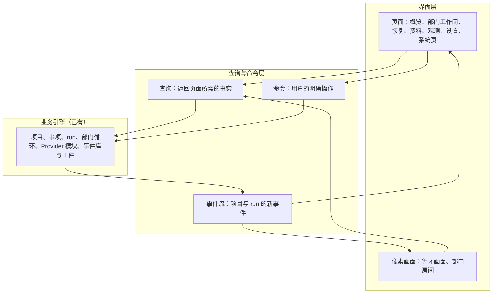
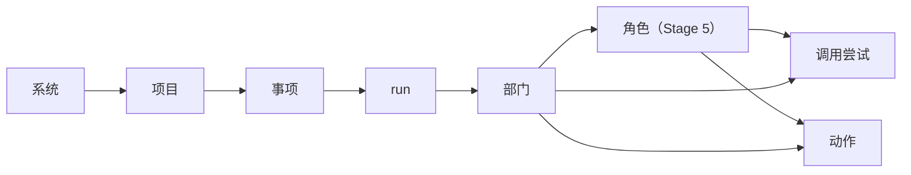

# 界面原型 v7 设计说明

日期：2026-09-24。状态：原型已完成（2026-09-25）；2026-09-28 本说明的阶段编号按路线图修改，原型文件中的档位与阶段标注仍是修改之前的编号。取代 [v6 原型](../../archive/prototypes/department-workspace-v6.html)。

依据：[总体路线图](../../program-roadmap.md)、[Stage 3 计划](../../stage-3-plan.md)、[模型管理设计说明](../../design/model-management.md)第 9 节、[恢复契约](../../design/recovery-contract-and-fault-matrix.md)、[部门内多角色设计说明](../../design/department-roles.md)（草案）、[语义系统设计说明](../../design/semantic-system.md)（草案）、[D19 按原型建设 Web 工作台](../../requirements/web-workspace-prototype.md)、D27 与 D28 需求记录、[ADR-0007](../../adr/0007-boundaries-for-distributed-deployment.md) 第 5 条。用词以 [CONTEXT.md](../../../CONTEXT.md) 为准。

## 1. 原型要回答的问题

1. 路线图各阶段的能力加入之后，界面怎样组织，用户在哪里找到每一项。
2. 三部门循环做到了哪里、停在哪里，怎样用一幅画面让用户看出来。
3. 部门里的小人怎样用动作表现真实发生的事，每个动作由哪一个事实驱动。
4. 每个界面读取哪个查询、提交哪个命令；后端完成一项能力后，对应界面怎样接入。
5. 恢复、并行、部门内多角色、运维与元观察加入时，已有界面怎样扩展，已实现的能力都保留在哪里。

## 2. 界面分层

界面只通过查询读取、只通过命令提交（ADR-0007 第 5 条）。原型用示例数据代替查询与命令层，数据的形状与第 7 节的查询一致；真实前端接入时替换这一层，界面层不变。

画面的每一个动作由查询结果中的状态或事件流中的事件决定。界面不自行计时推进状态，也不显示没有来源的数据。

对象按层次组织，每一层有自己的页面或区块：

## 3. 导航

### 3.1 左侧栏

- 上部：品牌、「从想法新建」、项目搜索、项目列表。每个项目显示名称和状态标记：运行中、排队中、中断、待核实、待恢复、已归档。有多个事项同时进行时，标记旁显示数量。
- 底部「系统」分组：
  - 模型管理（D24）
  - 运行与执行槽位（3.4A）
  - 工具与扩展（3.2B、3.7）
  - 元观察（Stage 6）
  - 预留入口，灰色显示并写明所属阶段：演化（Stage 6 受治理的系统演化）、经验（持续改进工作线）
- 服务重启后，中断的事项自动继续；其中有待核实或待恢复的事项时，系统分组上方显示一条提示：「服务已重启，N 个事项待处理」，点击进入第一个事项的恢复页。

### 3.2 顶栏与项目标签

- 顶栏：路径（项目 / 项目名 / 事项 / 页面）、事项选择框、服务状态、项目菜单。模型管理等系统页的路径只显示系统页名称。
- 事项选择框：「整个项目」或某个事项（标题与状态）。概览、部门工作间、资料、观测按所选范围显示。
- 项目标签：概览、产品、工程、质检、运维（Stage 4）、资料、观测、设置。
- 所选事项不在运行中时，标签栏右侧显示该事项的状态和下一项合法操作，例如「待恢复 · 继续执行」「待核实 · 查看核实」。

### 3.3 页面路径

| 页面 | 路径 |
| --- | --- |
| 概览 | `#/p/{项目}/overview` |
| 部门工作间 | `#/p/{项目}/dept/{product、engineering、quality、operations}` |
| 恢复与动作核实 | `#/p/{项目}/w/{事项}/recovery` |
| 资料 | `#/p/{项目}/materials` |
| 观测 | `#/p/{项目}/observe`，请求详情 `#/p/{项目}/observe/{调用尝试}` |
| 设置 | `#/p/{项目}/settings` |
| 系统页 | `#/sys/models`、`#/sys/runtime`、`#/sys/tools`、`#/sys/meta` |
| 预留入口 | `#/sys/nodes`、`#/sys/evolution`、`#/sys/lessons` |
| 动作图鉴（原型专用） | `#/gallery` |

事项范围写在路径参数 `?w={事项}` 中；刷新、后退、切换项目后保持所选对象与未提交的草稿（D19）。从系统页返回时回到进入前的页面（D24 第 9.1 节）。

## 4. 页面

### 4.1 概览

从上到下：

1. **项目摘要**：名称、长期目标、当前成果（采纳版本与摘要，没有时显示「尚未采纳」）、事项统计（进行中、排队中、已采纳）。
2. **循环画面**：第 5 节。
3. **当前事项**：所选事项的输入记录与处理进度（已接收、已交给产品处理、已由有效需求接纳）、「追加需求」输入框、「取消事项」。没有进行中的事项时，输入框提供「记录原文」和「作为新事项开始」；新事项可以另外选择一个可信源目录作为代码快照（3.2A）。
4. **事项看板**：列为排队中（3.4A）、产品、工程、质检、已放行、已采纳；卡片显示标题、状态、所在部门、第几轮、待决问题或停止原因。
5. **流转记录**：时间、方向（例如「工程 → 产品」）、类型（需求交接、版本交付、问题反馈、咨询、返工）、内容、状态；返工行用醒目的颜色，点击打开原始事件。
6. **元观察发现**（Stage 6）：本项目的流转统计摘要与不符合项数量，链接到元观察页。

### 4.2 部门工作间

1. **标题区**：部门名、职责、当前生效的模型及来源（项目设置或部门默认）、最近一次请求实际使用的模型、协议与发送的档位（D24 第 9.3 节）、部门状态、「部门设置」按钮。
2. **部门房间**：第 6 节。
3. **检查区**（房间下方，页签切换）：
   - 动作与回执：本部门的动作列表，第 4.3 节。
   - Context：沿用现有 Context 快照。
   - 部门 Prompt：项目当前配置与所选请求实际使用的版本。
   - 角色名单（Stage 5）：角色、状态、模型、当前任务；点击查看该角色的历史与请求。
   - 部门账本（Stage 5）：工作计划条目、分派对象、状态与结果摘要、已核实事实、待决问题、进展判断。
   - 语义面板（Stage 5）：本部门可见的有效语义单元、冲突、更替链。
4. **部门消息与指导**：部门消息日志（每条可打开原始事件）、部门指导输入与指导记录（已接收、已进入模型输入、已解释、动作已核实、已说明边界、需要后续处理）。
5. **部门设置弹窗**：按 D24 第 9.2 节，标题「本项目 · 某部门设置」，模型、推理档位、部门 Prompt；Stage 5 增加本项目各角色的设置（按多角色草案第 12 节）。

运维部门工作间（Stage 4）另有：运行责任（交付物版本、环境、接收时间）、发布记录（发布版本与采纳版本对照）、故障链路（症状已报告、影响已确认、缓解已执行、修复进入事项、确认恢复、复盘）、运行指标（带分母）、登记的运行环境与常设授权清单、待授权的外部动作（常设授权清单以外的动作，逐项授权）。

### 4.3 恢复与动作核实（3.1）

- 事项的恢复观察状态：运行中、中断、待核实、待恢复、已终止。
- **待恢复**：写明原因。进程中断时写明中断位置；模型引用无法使用时写明部门、模型与具体问题（定义被移除、准入已作废、窗口未知、凭据缺失、凭据被上游拒绝），并链接到模型管理或本项目的部门设置。
- **继续执行**：是否可用由服务端判断；不可用时写明原因（应用版本不兼容、事项已完成或已取消、已有有效执行者、原因尚未修复、先已生效的取消）。
- **动作核实**：最后已确认的位置；未完成动作列表，每项显示动作身份、所属部门、输入依据、执行前后快照、状态（未发送、已完成、结果未知）、核实依据与核实结果；下一项合法操作。核实由主机执行，按[恢复契约](../../design/recovery-contract-and-fault-matrix.md)第 4 节逐项进行，结果追加到核实记录，原始观察不改写。
- **对结果未知的动作作出决定**：主机无法确定结果时，事项停在待核实，由用户作出决定。可选项由服务端按该动作的契约给出：「重新执行」（只对契约声明可以重复的动作提供）、「按当前实际状态继续」（把用户的决定记为核实依据，不补造原来的执行回执）、「停止事项」。
- **限额**：已用时间与时间上限、已用激活次数、模型步骤与重试尝试；恢复不清零。
- **执行所有权**：当前执行者与取得时间；旧执行者的迟到结果作为历史事实列出，不推进状态。

### 4.4 资料

只读，按事项查看：

- intend 原文：首次与逐次输入，版本、字节范围、接收时间。
- PRD：各版本、接纳来源、「查看原文」。
- PLAN：各版本、目标、「查看原文」。
- 交付：各版本、文件清单、摘要、Git 差异、文件下载。
- 质检：结论、理由、检查回执。
- 项目材料：「记录原文」保存的材料（项目或部门）。
- 语义记录（Stage 5）：项目共享的有效要求集合、更替链、冲突、数据流核对结果（8 项核对与缺失条目编号）。

### 4.5 观测

沿用现有请求记录、用量统计与请求详情，增加：

- 请求详情中的调用目标：连接、协议、地址、上游模型、容量、凭据引用与版本、选择来源、请求档位与实际发送的档位、部门 Prompt 版本（D24 第 6 节）。
- 语义视图（Stage 5）：本次请求包含的语义单元编号与版本。
- 按角色筛选（Stage 5）。
- 运行限制：时间上限与已用时间、循环次数；用量只读显示，不显示成预算。

### 4.6 设置

- 基本信息：名称、长期目标、置顶、归档或恢复项目。
- 部门设置：三个部门（Stage 4 加运维）的项目部门设置，内容同部门设置弹窗。
- 登记命令（3.2A）：登记名、固定参数、允许的额外参数、时限、输出上限、版本；新增、修改，版本冲突时提示重新读取。
- 工具授权（3.2B）：网络取回与各 MCP 工具在本项目的授权范围；超出授权时逐次批准，批准一次不作为永久授权。

### 4.7 模型管理（D24）

按 [模型管理设计说明](../../design/model-management.md)第 9.1 节制作，包括 Provider 配置卡片、添加与编辑表单、编辑 JSON（格式化、重置、复制、导入、导出）、凭据、候选、模型访问定义表（容量「接受」、推理档位声明、只读的准入列）、连接测试与模型测试、页面底部的部门默认。Stage 5 在部门默认下增加角色默认，协议下拉框增加决策模型协议，并标注「准入以判定点为单位」。

### 4.8 运行与执行槽位（3.4A）

执行槽位数量（默认 3）与占用情况；正在执行的事项（项目、部门，Stage 5 起为角色任务）；跨项目的排队列表（顺序、等待时长、「取消排队」）；重启后的队列状态说明。

### 4.9 工具与扩展（3.2B、3.7）

- 网络取回：授权范围与最近的取回记录。
- MCP 工具：已接入的服务与工具、每类动作的恢复约定（结果未知时怎样核实，能否重复），没有恢复约定的工具标明「不自动重试」。
- 准入钩子与只读观察者（3.7）：已登记的钩子（只能收紧，不能授权）、观察者与订阅范围。

这一页的依据只有路线图与 Stage 3 计划的工作包说明，页面上标注「设计待定」，进入 3.2B、3.7 时细化。

### 4.10 元观察（Stage 6）

流转统计（交接、询问与回答、缺陷、放行、返工的次数与间隔）、规则审查的不符合项、判定点列表（问题、校准状态、最近判定的结果、概率与置信度、去向）、置信度不足等待用户决定的判定。

### 4.11 预留入口

演化、经验两个入口各有一页，只写所属阶段、产品结果（取自路线图第 1 节）与「进入该阶段时设计」。

## 5. 循环画面

### 5.1 布局

一层像素风楼层，从左到右：

- **大厅**：用户的输入以信件送到信箱；排队中的事项在这里排队，手持号码牌（3.4A）；墙上一排执行槽位灯，显示占用数与总数。
- **三个部门房间**：产品、工程、质检排成一个环，房间之间有走廊。每个房间门口插着正在该房间的事项的小旗，旗的颜色与事项一一对应。
- **成果库**：环的出口。架子上放已采纳的成果（版本号）。
- **运维房间**（Stage 4）：成果库之后，有机柜、告警灯与发布推车。
- **观察台**（Stage 6）：楼层上方，元观察部门的观察员拿着记录板。

画面上方的信息条显示所选事项：第几轮、已用时间与时间上限、当前部门、恢复观察状态。

### 5.2 状态与画面

| 事实 | 来源 | 画面 | 阶段 |
| --- | --- | --- | --- |
| 部门正在工作 | 事项的当前部门与 `department_activated` | 该房间亮灯，房间里的小人在工位工作 | 当前 |
| 交接 | `transition` 与交接内容 | 送件小人沿走廊搬运：产品到工程搬 PRD 卷轴，工程到质检搬封存的交付箱，质检到成果库搬放行单与箱子 | 当前 |
| 返工 | `qa_submitted` 的结论为 `rework_engineering` 或 `rework_product` | 箱子贴红色返工单，沿原路退回工程或产品 | 当前 |
| 询问与回答 | `collaboration_requested`、`collaboration_responded`、`collaboration_closed` | 纸飞机在两个房间之间往返；发问方的小人在门口等待 | 当前 |
| 循环次数与时间 | run 的 `cycle_count`、已用时间与 `run_time_limit_sec` | 信息条显示「第 N 轮」与时间进度条；接近上限时进度条变为警示色 | 当前 |
| 采纳 | `deliverable_adopted` | 箱子放上成果库的架子，架子上的版本号加一 | 当前 |
| 排队 | 队列与执行槽位 | 大厅排队，槽位灯亮起的数目等于占用数 | 3.4A |
| 中断 | 恢复观察状态为中断 | 整层变暗，墙上时钟停住，门上挂「中断」牌 | 3.1 |
| 待核实 | 恢复观察状态为待核实 | 涉及的房间亮黄灯，未完成动作的物件闪烁，小人头顶出现问号 | 3.1 |
| 待恢复 | 模型引用无法使用 | 涉及的房间门口挂「待恢复」牌，写明缺少的项 | 3.1 |
| 终止 | `run_done`、`run_failed`、`run_paused`、取消 | 门上挂完成、失败（停止原因）、暂停或已取消的牌子 | 当前 |
| 运行与故障 | 运维状态 | 推车把箱子送进机柜；故障时告警灯旋转，信件从运维房间送回大厅成为新事项 | Stage 4 |
| 判定点 | 元观察判定记录 | 观察员在交接经过的走廊上方举牌：通过、不通过或不确定，以及置信度 | Stage 6 |

模型调用成功、工具返回成功、质检放行、事项完成、项目采纳使用不同的图标与文字，不共用一种绿色完成标记。

### 5.3 多个事项

每个进行中的事项有自己的颜色，送件小人背上的包、门口的小旗与看板卡片使用同一种颜色。选择框选中一个事项时，其他事项的画面变淡。

### 5.4 窄屏与减少动画

- 宽度不足时，画面按比例缩小；再窄时画面下方提供同样内容的列表（事项、所在部门、第几轮、状态）。
- 系统设置为减少动画时，小人与物件停在当前状态对应的姿势，交接用箭头表示，不做移动动画。

## 6. 部门房间与小人

### 6.1 房间

每个房间有：后墙的 CRT 监视器（目标、模型、协议、状态、第几轮）、白板（工作计划，Stage 5 为部门账本）、文件柜（搜索与读取）、终端与拉杆（登记命令）、门与门缝下的信箱（部门指导）、提案托盘，以及各部门自己的工作台：产品的卷轴架、工程的封存台、质检的检验台、运维的机柜。

### 6.2 角色

| 阶段 | 产品 | 工程 | 质检 | 运维 |
| --- | --- | --- | --- | --- |
| 当前、Stage 3 | 产品部门 Agent | 工程部门 Agent | 质检部门 Agent | — |
| Stage 4 | 同 Stage 3 | 同 Stage 3 | 同 Stage 3 | 运维部门 Agent |
| Stage 5 | 产品部门经理、产品架构师、产品探索者 | 工程经理、工程架构师、开发者、工程探索者 | 质检经理、测试工程师、质检探索者 | 运维部门的角色（在 Stage 5 设计时确定） |

小人的外形：衣服颜色按部门区分；角色靠配件区分：经理拿记录板、系领带；架构师戴眼镜、拿图纸卷；开发者戴耳机、穿连帽衫；探索者背背包、戴帽子；测试工程师穿白大褂、拿放大镜；运维戴耳麦；元观察员穿灰色外套、拿记录板。

### 6.3 动作与事实

| 事实 | 来源 | 小人动作 | 房间变化 | 阶段 |
| --- | --- | --- | --- | --- |
| 部门未工作 | 部门状态 | 坐在工位喝茶，偶尔伸懒腰 | 灯光调暗 | 当前 |
| 部门开始工作 | `department_activated` | 起身走到工位 | 屏幕亮起，CRT 显示目标 | 当前 |
| 装配上下文 | `context_assembled` | 从文件柜取出文件夹放到桌上 | — | 当前 |
| 模型请求中 | `model_requested`、`model_request_serialized` | 打字，头顶思考气泡 | 屏幕滚动字符 | 当前 |
| 流式输出 | `model_stream_progress` | 气泡中逐字出现文字 | — | 当前 |
| 请求完成 | `model_attempt_finished` | 气泡变成灯泡 | — | 当前 |
| 等待重试 | `model_retry_scheduled` | 头顶沙漏与「第 n/m 次」 | — | 当前 |
| 请求失败 | `model_attempt_failed` | 趴在桌上 | 桌上红灯 | 当前 |
| 搜索 | `tool_started`（`search`） | 翻文件柜，举放大镜 | 文件柜抽屉打开 | 当前 |
| 按区间阅读 | `tool_started`（`read_range`、`read_file`） | 捧着文件阅读 | — | 当前 |
| 编辑 | `tool_started`（`edit_range`、`write_file`） | 在文件上写字 | 屏幕显示增删的行 | 当前 |
| 执行登记命令 | `tool_started`（`run_command`）到 `tool_called` | 走到终端拉下拉杆 | 终端滚动输出；结束时退出状态灯亮绿灯或红灯；超时时终端冒烟 | 当前 |
| 工具被拒绝 | `tool_skipped` | 摇头，把纸团扔进废纸篓 | — | 当前 |
| 提交提案 | `proposal_submitted` | 把文件放进提案托盘 | — | 当前 |
| 提案被退回 | `proposal_rejected` | 文件被退回，小人挠头 | — | 当前 |
| 需求接纳 | `spec_accepted`、`contract_accepted` | 产品在卷轴上盖「有效」章 | 卷轴放上卷轴架 | 当前 |
| 计划接纳 | `plan_accepted` | 工程把计划贴上白板 | — | 当前 |
| 交付封存 | `delivery_accepted` | 工程装箱、贴封条、盖封存章 | 送件小人取走箱子 | 当前 |
| 质检核验 | 质检的检查动作 | 用放大镜检查箱子，清单逐项打勾 | — | 当前 |
| 放行 | `qa_submitted`（`release`） | 盖绿色「放行」章 | — | 当前 |
| 返工 | `qa_submitted`（`rework_engineering`、`rework_product`） | 盖红色「返工」章 | 箱子退回 | 当前 |
| 发出询问 | `collaboration_requested` | 写纸条折成纸飞机，从门口放出，在门口等待 | — | 当前 |
| 收到询问并回答 | `collaboration_responded` | 接住纸飞机，写回答后放回 | — | 当前 |
| 收到指导 | `department_guidance_received` | — | 门缝塞进纸条，信箱灯亮 | 当前 |
| 指导进入输入 | `department_guidance_applied` | 拿起纸条阅读，钉在墙上 | — | 当前 |
| 回应指导 | `department_guidance_responded` | 在纸条上写回复 | — | 当前 |
| 压缩 | `compaction_recorded` | 把桌上成堆的纸整理进「摘要」档案盒 | 档案盒上的编号加一 | 当前 |
| 压缩未生效 | `compaction_failed` | 纸堆散落，小人重新整理 | — | 当前 |
| 暂停、失败、完成、取消 | `run_paused`、`run_failed`、`run_done`、取消 | 坐下、趴下、举手欢呼、收拾桌面 | 门上挂对应的牌子 | 当前 |
| 排队 | 队列 | 在大厅排队，手持号码牌 | — | 3.4A |
| 中断 | 恢复观察状态 | 静止不动 | 灯灭，墙上时钟停住 | 3.1 |
| 待核实 | 恢复观察状态与未完成动作 | 站在未完成动作的物件旁，头顶黄色问号 | 物件闪烁 | 3.1 |
| 待恢复 | 模型引用无法使用 | 举牌，牌上写缺少的项 | — | 3.1 |
| 用户对结果未知的动作作出决定 | 决定记录 | 从门缝接过决定单，读完后按决定走向终端重新执行、回到工位继续或收拾桌面 | 未完成动作的物件停止闪烁 | 3.1 |
| 继续执行 | Yudao 启动时自动继续，或待恢复的继续执行命令被接受 | 伸懒腰后回到工位 | 灯亮起，时钟继续走 | 3.1 |
| 分派角色任务 | 角色任务事件 | 经理把任务卡递到角色桌上 | 白板上的计划条目标上分派对象 | Stage 5 |
| 角色交回结果 | 角色结果事件 | 角色把结果卡交回经理 | 条目改为已交回 | Stage 5 |
| 探索者查资料 | 探索者的网络取回（3.2B） | 背上背包走出门，回来时抱着资料 | — | Stage 5 |
| 停滞后重新规划 | 部门账本的进展判断 | 经理在白板上擦掉计划重写 | — | Stage 5 |
| 语义整理 | 语义整理事件 | — | 墙边的语义记录柜里卡片增加 | Stage 5 |
| 发布 | 运维发布记录 | 运维推车把箱子送进机柜 | 机柜灯亮 | Stage 4 |
| 告警 | 运维故障记录 | 运维跑向机柜 | 告警灯旋转 | Stage 4 |
| 外部动作待授权 | 运维对常设授权清单以外动作的授权申请 | 举着申请单等待 | 申请单出现在工作间的待授权列表 | Stage 4 |
| 判定 | 元观察判定记录 | 观察员举牌，牌上是结果与置信度 | — | Stage 6 |

表中阶段为「当前」的事件已在事件库中存在；3.1 及之后的事实由对应工作包的设计确定事件名，原型数据中使用临时名称，并在构建约定中列出。

### 6.4 动作图鉴

原型专用页面 `#/gallery` 按角色与动作列出全部小人动画，每一项写明驱动它的事实与所属阶段，用于逐项检查动作是否清楚。

## 7. 界面数据合同

「已有」表示当前后端已有对应接口；「新增」表示需要在对应工作包中增加的查询或命令。查询与命令的名称是界面合同中的名称，接口路径由实现工单确定。

### 7.1 查询

| 查询 | 内容 | 使用的界面 | 现状 |
| --- | --- | --- | --- |
| `projects.list` | 项目名称、置顶、归档、每个项目的进行中事项数量与状态标记 | 左侧栏 | 已有 `GET /api/projects`；状态标记中的排队、中断、待核实、待恢复为新增（3.1、3.4A） |
| `project.overview` | 长期目标、当前成果、事项统计、事项列表 | 概览摘要、事项看板 | 已有 `GET /api/projects/{id}` 与 `/board` |
| `project.loop` | 每个事项的颜色序号、状态、当前部门、第几轮、已用时间与时间上限、恢复观察状态、最近交接与询问、采纳状态；运维状态（Stage 4）与判定记录（Stage 6） | 循环画面 | 新增；当前阶段的内容可由已有 run 查询中的交接、协作请求与计数得到 |
| `project.flow` | 流转记录：时间、方向、类型、内容、状态、原始事件 | 流转记录 | 新增；数据来自已有 run 查询的 `timeline` 与 `board` |
| `work_item.inputs` | 输入记录与处理进度 | 当前事项 | 已有 `GET /api/runs/{id}` 的 `inputs` |
| `department.workspace` | 部门状态、消息、指导记录、Context 快照、部门 Prompt、当前生效模型及来源、最近一次调用目标；角色名单与部门账本（Stage 5） | 部门工作间 | 已有 `GET /api/runs/{id}/departments/{dept}`；生效模型及来源为新增（D24）；角色与账本为新增（Stage 5） |
| `run.actions` | 动作列表：身份、部门或角色、类型、输入依据、前后快照、状态、回执（命令的登记名、参数、退出状态、输出、超时） | 动作与回执、动作核实 | 新增（3.2A 回执已在事件中，3.1 增加状态与核实） |
| `run.recovery` | 恢复观察状态、待恢复原因、最后已确认位置、未完成动作、核实记录、下一项合法操作、继续执行是否可用及原因、限额、执行所有权与迟到结果 | 恢复与动作核实、状态标记 | 新增（3.1） |
| `work_item.materials` | intend、PRD、PLAN、交付、质检的各版本与原文引用；项目材料 | 资料 | 已有的数据分散在 `GET /api/projects/{id}`、`GET /api/runs/{id}` 与事件详情；聚合查询为新增 |
| `semantic.records` | 有效语义单元、冲突、更替链、数据流核对 | 语义面板、资料 | 新增（Stage 5） |
| `project.attempts`、`project.usage`、`run.attempt` | 请求记录、用量、请求详情 | 观测 | 已有；调用目标为新增（D24），语义视图为新增（Stage 5） |
| `project.settings` | 基本信息、项目部门设置、登记命令、工具授权 | 设置、部门设置弹窗 | 登记命令已有 `GET /api/projects/{id}/commands`；部门 Prompt 已有；项目部门设置中的模型与档位为新增（D24）；工具授权为新增（3.2B） |
| `catalog` | Provider 配置、模型访问定义、准入记录、凭据状态、候选、部门默认、预置表 | 模型管理 | 已有 `GET /api/providers` 等；按 D24 修改 |
| `runtime.slots` | 槽位数、占用、跨项目队列、重启后的队列状态 | 运行与执行槽位 | 新增（3.4A） |
| `tools.registry` | 网络授权、MCP 服务与工具、恢复约定、钩子与观察者 | 工具与扩展 | 新增（3.2B、3.7） |
| `ops.status` | 运行责任、发布记录、故障链路、运行指标、待授权动作 | 运维部门工作间、循环画面 | 新增（Stage 4） |
| `meta.observations` | 流转统计、不符合项、判定点与判定记录 | 元观察页、概览 | 新增（Stage 6） |
| 事件流 | 项目与 run 的新事件 | 循环画面、部门房间、各页面刷新 | 已有项目与 run 的事件流 |

### 7.2 命令

| 命令 | 界面 | 现状 |
| --- | --- | --- |
| 新建项目、重命名、置顶、归档、恢复项目 | 左侧栏、设置 | 已有 |
| 记录原文、新建事项（事项原文与可选的代码快照来源） | 概览、部门工作间 | 已有；新建事项不再提交模型与容量参数（D24） |
| 追加需求、取消事项 | 概览 | 已有 |
| 发送部门指导 | 部门工作间 | 已有 |
| 保存项目部门设置（模型、推理档位、部门 Prompt，带版本） | 部门设置弹窗、设置 | 部门 Prompt 已有；模型与档位为新增（D24） |
| 登记与修改命令 | 设置 | 已有接口，界面入口为新增 |
| 回答待恢复的决定请求（修复模型配置以后继续执行，或停止事项） | 恢复页、状态标记 | 新增（#49） |
| 对结果未知的动作作出决定（重新执行、按当前实际状态继续、停止事项） | 恢复页 | 新增（3.1） |
| 取消排队、设置执行槽位数 | 运行与执行槽位、事项看板 | 新增（3.4A） |
| 授权网络与工具、逐次批准 | 设置、工作间 | 新增（3.2B） |
| 模型管理的各项操作 | 模型管理 | 已有，按 D24 修改；编辑 JSON 保存与容量「接受」为新增 |
| 保存角色设置、角色默认 | 部门设置弹窗、模型管理 | 新增（Stage 5） |
| 授权常设授权清单以外的外部动作、接收运行责任 | 运维部门工作间 | 新增（Stage 4） |
| 对置信度不足的判定作出决定 | 元观察页 | 新增（Stage 6） |

## 8. 阶段显示

原型有五档显示，每个界面元素标明从哪一档开始出现：

| 档位 | 内容 |
| --- | --- |
| 当前 | 已实现的能力，以及 3.2A 已完成的部分，按新的结构排列 |
| Stage 3 与 D24 | 加入恢复与动作核实、执行槽位与排队、登记命令入口、工具授权、工具与扩展页、D24 模型管理与部门设置 |
| Stage 4 | 加入运维部门与运维房间 |
| Stage 5 | 加入部门内多角色、部门账本、语义记录与语义视图、按角色筛选、角色默认与项目角色设置、决策模型协议 |
| Stage 6 | 加入元观察页、观察台与判定牌 |

预留入口在每一档都显示。

## 9. 原型内的辅助工具

原型底部有一条浮动工具条，外观与界面明显区分：

- **阶段切换**：在第 8 节的五档之间切换。
- **标注模式**：打开后，每个区块右上角显示它读取的查询、提交的命令与所属阶段。
- **场景播放**：选择场景后逐步播放事件，每一步显示驱动画面的事件名称与内容；可以单步、连续播放、暂停。场景包括：正常循环、返工、询问与回答、部门指导、压缩、中断与待核实、模型不可用与继续执行、并行排队、部门内多角色、运维故障、元观察判定。

原型中的数据全部是示例数据，页面顶部标明「原型示例数据」。

## 10. 用词

- 模型相关用词以 CONTEXT.md 与 D24 第 9.5 节为准：Provider 配置、服务方案、模型访问定义、候选、准入、模型测试、连接测试、凭据、推理档位、部门默认、项目部门设置、部门 Prompt。
- 恢复观察状态：运行中、中断、待核实、待恢复、已终止；动作状态：未发送、已完成、结果未知。
- 事项状态：未开始、进行中、已采纳、已放行、已停止，以及排队中（3.4A）。
- 角色名称按第 6.2 节。
- 界面不出现：供应商、模型映射、全局分配、基线（指部门默认时）、努力程度、主 Agent、SubAgent、派发协作者。

## 11. 已处理的文档冲突

| 冲突 | 处理 |
| --- | --- |
| 协议放在 Provider 配置上（ADR-0004、D24）与现有实现放在模型访问定义上 | 原型按 ADR-0004 画；协议层级的迁移已写入 D24 第 10 节「目录与校验」 |
| 模型引用无法使用时失败结束（D24 原第 5.5 节）与待恢复（Stage 3 计划、恢复契约） | 用户决定进入待恢复，文档已修改（2026-09-24 决策记录） |
| v6 废除导出与 D24 第 4.6 节保留导出 | 按 D24，编辑 JSON 弹窗保留导入与导出 |
| v6「资料与依据」配置文件路径与受控工件 | 用户决定改为按事项只读查看（第 4.4 节） |
| 新建事项只提交原文（D24）与可选的代码快照来源（3.2A） | 新建事项提交事项原文与可选的代码快照来源，不提交模型与容量参数 |
| 事项详情页的结构：D19 与可观测性草案 | 按 D19：概览、各部门工作间与检查区、独立的观测页 |
| 可观测性草案中的剩余预算 | 按路线图第 3 节，不显示预算，用量只读 |
| 部门指导是否已实现（D20 记录为未实现） | 界面与接口已实现，原型按已实现处理 |
| 限额：计数上限与时间上限 | 按 D09 当前实施选择，显示时间上限与已用时间，循环次数只作为观察 |

## 12. 待确认

以下内容按草案画出，确认对应设计时一并决定：

- 执行槽位的占用单位：3.4A 工单按 run 计，多角色草案第 9 节按角色任务计。原型在 Stage 5 档按角色任务显示。
- 角色设置的层级（多角色草案第 12 节）：项目角色设置、角色默认、项目部门设置、部门默认。
- 交接分为提出与接收两段（交接协议样例）：原型的交接只画已被控制层接受的交接。
- 运维部门的角色：在 Stage 5 设计时确定，原型只画一个运维部门 Agent。
- 语义系统的第二项职责（知识图谱与语义工程）：尚无设计，原型不画。

## 13. 原型文件

原型位于 `docs/prototypes/v7/`，用浏览器直接打开 `index.html`，不需要编译、服务端口或外部脚本。文件结构与各模块之间的约定见 [构建约定](BUILD.md)。
