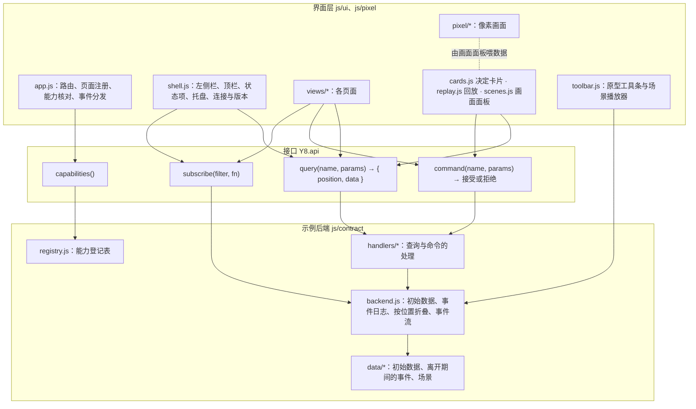

# 原型 v8 构建约定

本文件约定原型 v8 的分层、文件结构、模块接口、示例数据的形状与世界设定，供并行制作原型的执行者使用。界面内容与规则以[设计说明](design.md)为准；查询、命令、决定种类、覆盖层的名称以[应用层与接口层设计说明](../../design/app-and-interface.md)第 3 至 6 节为准。本文件与它们不一致时以它们为准，并在本文件中修正。

## 1. 基本要求

- 浏览器直接打开 `index.html` 即可运行（`file://`），不需要编译、服务端口、外部脚本、外部字体或外部图片。`assets/` 中的截图是本地文件。
- 只用普通 `<script src>` 按顺序加载，不用 ES module。
- 所有代码挂在全局对象 `window.Y8` 下，不新增其他全局变量。CSS 类名以 `y8-` 开头。
- 注释使用中文，术语保留英文，不过度注释。界面文字使用中文，用词遵守设计说明第 14 节与 `CONTEXT.md`。
- 页面顶部固定显示「原型示例数据」。
- 支持浅色与深色：颜色全部来自 `styles/base.css` 中 `:root` 的变量，使用 `light-dark()`（沿用 v7 的色板）。像素画面有自己的画面色板，两种主题下相同。
- 宽度 1440 与 390 下都可用：390 时左侧栏收为抽屉，标签可以换行，表格改为卡片，页面不出现横向滚动条。
- 系统设置为减少动画（`prefers-reduced-motion: reduce`）时，像素画面停在当前状态对应的姿势，交接用管道上的箭头表示，不做移动动画。
- 出错时让错误直接出现在控制台，不用 try/catch 吞掉错误。数据或参数不符合约定时就地抛出错误。
- 修改代码只使用文件编辑工具，不用脚本、sed 或 heredoc 批量改写。

## 2. 分层

原型分两层，与设计说明第 2 节相同。界面层只通过 `Y8.api` 读取与提交；示例后端在接口层之下，真实客户端接入时替换 `js/contract/`，界面层不变。



依赖只能向下：界面层不读取 `Y8.backend`、`Y8.data`，也不读取当前档位；页面上显示什么由能力清单与查询结果决定（查询不返回的字段，界面就不显示）。例外只有 `toolbar.js`（原型工具）与动作图鉴。

## 3. 文件结构与负责者

```
docs/prototypes/v8/
  index.html                  外壳元素与脚本加载顺序
  design.md                   设计说明
  BUILD.md                    本文件
  assets/                     质检试用台的真实截图（第 8.5 节）
  styles/base.css             变量、布局、通用组件、外壳、状态项、托盘、工具条、决定卡片、时间轴
  styles/home.css             首页、机器页
  styles/project.css          概览、恢复、资料
  styles/department.css       部门工作间、观测、设置
  styles/system.css           模型管理、运行与执行槽位、工具与扩展、预留入口、连接设置
  styles/gallery.css          动作图鉴
  js/y8.js                    命名空间、档位、总线、数据路径与补丁、克隆、时间与数字格式
  js/contract/registry.js     能力登记表
  js/contract/backend.js      示例后端
  js/contract/handlers/core.js        外壳、首页、画面使用的查询与命令
  js/contract/handlers/project.js     概览、恢复、资料的查询与命令
  js/contract/handlers/department.js  部门工作间、观测、设置的查询与命令
  js/contract/handlers/system.js      系统页的查询与命令
  js/contract/data/system.js  部署、机器、执行槽位、工具、模型目录、内置 Prompt；跨项目场景
  js/contract/data/p-todo.js  待办清单网页
  js/contract/data/p-agents.js openai-agents 增加功能
  js/contract/data/p-metro.js 北京地铁票价
  js/contract/data/p-sensor.js 家庭温湿度监测服务
  js/pixel/sprites.js         小人、物件与字体的点阵
  js/pixel/engine.js          画布、动画循环、缓动、路径移动、粒子、共用物件、事件到动作的对照表
  js/pixel/room.js            部门房间
  js/pixel/floor.js           项目楼层（概览的循环画面，含管道）
  js/pixel/building.js        楼（首页）与机房（首页地下室、机器页）
  js/ui/kit.js                界面辅助函数
  js/ui/app.js                路由、页面注册与渲染、能力核对、事件分发、草稿
  js/ui/shell.js              左侧栏、顶栏、状态项、托盘与通知、连接与版本提示
  js/ui/cards.js              决定卡片
  js/ui/replay.js             时间轴与回放
  js/ui/scenes.js             画面面板：楼、机房、项目楼层与它们的文字列表、覆盖层切换
  js/ui/toolbar.js            浮动工具条与场景播放器
  js/ui/views/home.js         首页
  js/ui/views/overview.js     概览
  js/ui/views/recovery.js     恢复与动作核实
  js/ui/views/materials.js    资料
  js/ui/views/department.js   部门工作间与部门设置弹窗
  js/ui/views/observe.js      观测与请求详情
  js/ui/views/settings.js     设置
  js/ui/views/sys-models.js   模型管理
  js/ui/views/sys-machines.js 机器
  js/ui/views/sys-runtime.js  运行与执行槽位
  js/ui/views/sys-tools.js    工具与扩展
  js/ui/views/sys-reserved.js 元观察、演化、经验三个预留入口
  js/ui/views/connect.js      连接设置
  js/ui/views/gallery.js      动作图鉴
  js/main.js                  启动
```

`index.html` 按下列顺序加载：样式按上表顺序；脚本为 `y8.js`、`contract/registry.js`、`contract/backend.js`、`contract/handlers/*.js`（core、project、department、system）、`contract/data/*.js`（system、p-todo、p-agents、p-metro、p-sensor）、`pixel/sprites.js`、`pixel/engine.js`、`pixel/room.js`、`pixel/floor.js`、`pixel/building.js`、`ui/kit.js`、`ui/app.js`、`ui/shell.js`、`ui/cards.js`、`ui/replay.js`、`ui/scenes.js`、`ui/toolbar.js`、`ui/views/*.js`、`main.js`。

每个文件只有一个负责者，其他人不修改；需要修改别人负责的文件时，在交付说明中写明需要的改动：

| 负责者 | 文件 |
| --- | --- |
| 架构师 | `BUILD.md`、`index.html`、`styles/base.css`、`styles/home.css`、`js/y8.js`、`js/contract/registry.js`、`js/contract/backend.js`、`js/contract/handlers/core.js`、`js/pixel/floor.js`、`js/pixel/building.js`、`js/ui/kit.js`、`js/ui/app.js`、`js/ui/shell.js`、`js/ui/cards.js`、`js/ui/replay.js`、`js/ui/scenes.js`、`js/ui/toolbar.js`、`js/ui/views/home.js`、`js/main.js` |
| 任务 A1 系统数据 | `js/contract/data/system.js` |
| 任务 A2 两个项目 | `js/contract/data/p-todo.js`、`js/contract/data/p-agents.js`、`assets/*` |
| 任务 A3 两个项目 | `js/contract/data/p-metro.js`、`js/contract/data/p-sensor.js` |
| 任务 D 像素房间 | `js/pixel/sprites.js`、`js/pixel/engine.js`（架构师改过的部分之外）、`js/pixel/room.js`、`js/ui/views/gallery.js`、`styles/gallery.css` |
| 任务 B 项目页面 | `js/contract/handlers/project.js`、`js/ui/views/overview.js`、`js/ui/views/recovery.js`、`js/ui/views/materials.js`、`styles/project.css` |
| 任务 C 部门页面 | `js/contract/handlers/department.js`、`js/ui/views/department.js`、`js/ui/views/observe.js`、`js/ui/views/settings.js`、`styles/department.css` |
| 任务 E 系统页 | `js/contract/handlers/system.js`、`js/ui/views/sys-models.js`、`js/ui/views/sys-machines.js`、`js/ui/views/sys-runtime.js`、`js/ui/views/sys-tools.js`、`js/ui/views/sys-reserved.js`、`js/ui/views/connect.js`、`styles/system.css` |

v7 的文件（`docs/prototypes/v7/`）可以作为参考与起点，按本文件的接口改写。

## 4. 档位

九档，每一档包含之前各档的全部内容（设计说明第 12 节）：

```js
Y8.LEVELS = ['ui', '3.1', '3.2C', '3.4A', '3.8', '3.2B', '3.2D', 'S4', 'S5'];
Y8.LEVEL_LABELS = {
  ui: '界面工作线', '3.1': '3.1 可靠恢复', '3.2C': '3.2C 执行环境服务', '3.4A': '3.4A 不同项目并行',
  '3.8': '3.8 接入已有项目', '3.2B': '3.2B 网络与 MCP', '3.2D': '3.2D 浏览器与 computer use',
  S4: 'Stage 4', S5: 'Stage 5'
};
Y8.level.current()            // 当前档位，只有示例后端、工具条与动作图鉴读取
Y8.level.atLeast(level)       // 当前档位不低于 level；level 为空时为 true
Y8.level.reached(obj)         // obj.level 已到且 obj.until 未到（until 为该对象不再出现的档位）
```

档位表示控制主机上已经部署了哪些工作包。切换档位时，示例后端按新档位重新折叠事件日志（第 5.5 节），能力清单随之改变，界面重新读取能力清单并全部重新渲染。

## 5. 接口层（示例后端）

### 5.1 `Y8.api`

```js
Y8.api.capabilities()
// → { deployment: { log_id, boot_id, service_version, api_version, access }, queries: [{ name }], commands: [{ name }],
//     decisions: [kind], event_types: [type], overlays: [{ id, label, queries }], stream: { live: true } }
Y8.api.query(name, params)       // → { position, data }；未登记或档位未到时抛出错误；连接断开时抛出错误
Y8.api.command(name, params)     // → { accepted: true, command_id, position, refs } 或 { accepted: false, command_id, reason, message }
Y8.api.subscribe(filter, fn, opts) // → 取消订阅的函数；filter: { project, work_item, department, types }，省略为全部；opts.after 为位置
Y8.cap.query(name) / Y8.cap.command(name) / Y8.cap.decision(kind) / Y8.cap.overlay(id)  // 能力清单中是否列出
Y8.CLIENT_API_VERSION             // 客户端构建时的接口版本，为 1
```

- **查询**：`params` 中可以带 `at`（全局位置），只有第 5.2 节标为「可回放」的查询接受；返回该位置时的快照，`position` 等于 `at`。其余查询带 `at` 时抛出错误。
- **命令**：`params` 可以带 `command_id`（省略时自动生成）与 `base_version`。处理函数判断接受或拒绝；接受时产生的事件立即写入事件日志，经过 `Y8.backend.latency`（默认 500 毫秒）才出现在事件流中，界面在此之前显示「已提交」（应用层设计说明第 3.1 节）。同一 `command_id` 再次提交返回原来的结果并带 `duplicate: true`。拒绝原因取自应用层设计说明第 3.1 节的封闭清单。
- **事件流**：按位置顺序向订阅者推送事件对象（第 5.4 节）。`opts.after` 给出时，先补齐已推送过、位置大于 `after` 的事件。

### 5.2 能力登记表（registry.js）

`Y8.registry` 登记每个查询、命令、决定种类、覆盖层与事件种类所属的档位，能力清单由它按当前档位生成：

```js
Y8.registry.queries   // { 'project.loop': { level: 'ui', replay: true, label: '循环画面' }, … }
Y8.registry.commands  // { 'work_item.reorder': { level: '3.4A', reasons: ['stale_base', 'not_allowed'] }, … }
Y8.registry.decisions // { waiting_resume: { level: 'ui', label: '模型引用无法使用时的待恢复', blocks: 'run' }, … }
Y8.registry.overlays  // { flow: { level: 'ui', label: '流转', queries: ['project.flow'] }, … }
Y8.registry.events    // { transition: { level: 'ui', key: 'handoff' }, x_fault_recorded: { level: 'S4', key: 'fault' }, … }
Y8.registry.levelOf(kind, name)  // 'query' | 'command' | 'decision' | 'overlay' | 'event'
Y8.registry.tagOf(kind, name)    // 界面上的档位标签：ui 为 null，其余为 '3.1'、'Stage 4' 等
```

可回放的查询：`system.status`、`projects.list`、`decisions.list`、`project.loop`、`machines.list`。

设计说明中尚未列出的名称标有 `pending: true`，标注模式显示「合同待补」；现在只有查询的 `at` 参数属于这一类。其余命令都有设计依据：`source_directory.save`（登记源目录）、`runtime.start_drain`、`runtime.force_upgrade`（3.1）见应用层设计说明；`machine.save`、`machine_authorization.save`、`execution_placement.save`（3.2C）见[执行环境服务设计说明](../../design/execution-environment.md)；`project.onboard`（名称、长期目标、源目录名称、源目录路径）与 `onboarding.restart`（3.8）见[接入已有项目设计说明](../../design/existing-project-onboarding.md)第 3 节。

决定种类的标识：

| 标识 | 名称 | 档位 |
| --- | --- | --- |
| `waiting_resume` | 模型引用无法使用时的待恢复 | ui |
| `unknown_action` | 核实结果未知的动作 | 3.1 |
| `initial_prd` | 确认接入已有项目的初始 PRD | 3.8 |
| `tool_once` | 授权网络取回与 MCP 工具 | 3.2B |
| `provider_wait` | 进入等待模型服务的通知 | S4 |
| `external_action` | 授权常设授权清单以外的外部动作 | S4 |
| `rollback_restore` | 需要恢复备份的回滚 | S4 |
| `repair_stopped` | 同一故障连续修复失败后停止自动修复 | S4 |
| `rework_reminder` | 反复退回的提醒 | S5 |

关键事实的种类（`Y8.registry.events[type].key`，时间轴刻度按种类着色）：`handoff` 交接、`ask` 询问、`answer` 回答、`rework` 返工、`release` 放行、`adopt` 采纳、`fault` 故障、`repair` 修复、`deploy` 部署与回滚、`wait` 进入与离开等待、`decision` 决定请求的发出与回答。`qa_submitted` 按 `payload.verdict` 分为放行或返工。

### 5.3 处理函数（handlers/*.js）

```js
Y8.backend.query('project.loop', (params, db) => data);
Y8.backend.command('work_item.reorder', (params, db) => ({ reject: { reason, message } }) 或 ({ events: [event…], refs }));
```

- `db.data` 是按当前档位（查询带 `at` 时为该位置）解析后的数据，字段形状见第 8 节，只读；`db.raw` 是当前数据的原样（包含档位未到的对象），只有命令处理函数读取它，用来确认对象存在与构造补丁路径，不直接修改。
- `db` 的方法：`db.project(id)`、`db.workItem(id)`、`db.run(id)`、`db.runOf(workItemId)`、`db.workItemsOf(projectId)`、`db.decision(id)`、`db.machine(id)`、`db.settings(projectId)`、`db.now`（该位置的时间）、`db.position`、`db.log(filter)`（该位置之前、按档位过滤的事件）、`db.atLeast(level)`。
- `handlers/core.js` 提供 `Y8.backend.helpers`：`sceneStatus(db, item, run)`、`signOf(status, run)`、`loopOf(db, projectId)`、`markerOf(loop, project)`、`requireProject(db, id)`、`reject(reason, message)`、`since(db, iso)`、`adoptions(project)`。
- 决定请求的选项带 `events`（回答这个选项以后产生的事件与补丁，写在数据中）与可选的 `requires`（回答前的检查名称）。`decision.answer` 先写入 `x_decision_answered`，再写入所选选项的 `events`。检查函数登记在 `Y8.backend.checks[名称] = (db, decision) => 问题说明或 null`；`handlers/system.js` 登记 `model_ok`：决定请求 `materials.department` 在该项目中解析到的模型可以使用时返回 null。
- `handlers/system.js` 提供 `Y8.backend.models`（v7 `Y7.model` 的改写）：`label(definitionId)`、`problemOf(db, definitionId)`、`resolve(db, projectId, department)`、`resolveRole(db, projectId, department, roleId)`，其他处理文件需要模型解析时使用它。
- 查询处理函数只读取 `db`，返回的对象中字段名使用 snake_case；档位未到的字段不返回。
- 命令处理函数不直接修改数据：返回事件，每条事件带补丁（第 5.5 节）。事件的 `position`、`event_id`、`at`、`actor`、`command_id` 由后端填写。
- 命令常用的检查：项目已归档拒绝 `project_archived`；对象不存在拒绝 `not_found`；`base_version` 与对象的 `version` 不同拒绝 `stale_base`，并带 `current_version`。

### 5.4 事件对象

与应用层设计说明第 5.2 节一致：

```js
{ position, event_id, type, at, project_id, work_item_id, run_id, department, role, actor, command_id, label, payload }
```

事件日志中的事件另带 `level`、`until`（档位范围）与 `patch`（补丁），这三个字段不推送给界面。`label` 是一句中文说明。画面读取的载荷字段见第 7.5 节。

已有的事件种类：`project_registered`、`project_renamed`、`project_pinned`、`project_archived`、`project_restored`、`material_recorded`、`user_input_received`、`work_item_created`、`run_created`、`department_activated`、`context_assembled`、`model_requested`、`model_request_serialized`、`model_stream_progress`、`model_attempt_finished`、`model_retry_scheduled`、`model_attempt_failed`、`tool_started`、`tool_called`、`tool_skipped`、`proposal_submitted`、`proposal_rejected`、`spec_accepted`、`contract_accepted`、`plan_accepted`、`delivery_accepted`、`qa_submitted`、`collaboration_requested`、`collaboration_responded`、`collaboration_closed`、`department_guidance_received`、`department_guidance_applied`、`department_guidance_responded`、`compaction_recorded`、`compaction_failed`、`transition`、`run_paused`、`run_failed`、`run_done`、`deliverable_adopted`、`department_prompt_configured`、`command_configured`、`catalog_revised`、`catalog_candidates_collected`、`catalog_test_finished`、`credential_changed`。

原型的临时名称（以 `x_` 开头，事件名由对应工作包的设计确定）：

| 档位 | 事件 |
| --- | --- |
| ui | `x_decision_issued`、`x_decision_answered`、`x_decision_withdrawn`、`x_home_seen`、`x_department_settings_saved` |
| 3.1 | `x_run_interrupted`、`x_run_auto_resumed`、`x_action_unknown`、`x_drain_started`、`x_upgrade_forced`、`x_run_stopped_for_upgrade` |
| 3.2C | `x_machine_saved`、`x_machine_offline`、`x_machine_online`、`x_remote_action_started`、`x_remote_action_finished`、`x_late_receipt`、`x_machine_authorization_saved` |
| 3.4A | `x_queued`、`x_slot_acquired`、`x_queue_cancelled`、`x_queue_reordered`、`x_slots_set` |
| 3.2C（正式名称） | `execution_placement_configured` |
| 3.8（正式名称，接入已有项目设计说明第 3.3 节） | `initial_prd_proposed`、`project_decision_requested`、`project_decision_answered`、`project_decision_withdrawn`、`onboarding_revision_started`、`baseline_adopted`、`structure_accepted`、`baseline_review_accepted`；接入时的 `project_registered` 带 `source: 'existing'`，`work_item_created` 与 `run_created` 带 `kind: 'onboarding'`；「阅读已有项目」由建档事项中读取与搜索工具的 `tool_started` 驱动 |
| 3.2B | `x_network_fetch`、`x_mcp_called`、`x_tool_authorization_saved` |
| 3.2D | `x_trial_step` |
| S4 | `x_provider_wait_entered`、`x_provider_wait_left`、`x_backup_taken`、`x_deployed`、`x_rolled_back`、`x_fault_recorded`、`x_repair_created`、`x_repair_failed`、`x_auto_repair_stopped`、`x_check_in` |
| S5 | `x_role_task_assigned`、`x_role_result_returned`、`x_review_recorded`、`x_explorer_fetch`、`x_replanned`、`x_semantic_recorded`、`x_role_settings_saved` |

取消事项用 `run_failed` 加 `payload.reason: 'cancelled'`。

### 5.5 事件日志与折叠

示例后端的数据是「初始数据 + 事件日志」：

- **初始数据**：各 `data/*.js` 用 `Y8.data.define({...})` 登记，内容是 7 天窗口开始时（`2026-09-22T15:30:00+08:00`）的状态，以及窗口内才出现的对象在出现那一刻的状态。
- **离开期间与更早的事件**：各文件在 `history` 中登记，按 `at` 排序后从 1 开始编号为全局位置。
- **当前状态** = 初始数据依次应用档位已到的事件的补丁。场景与命令产生的事件接在后面。
- **按位置读取**（`at`）= 初始数据应用到该位置为止的补丁，再隐藏 `born_at` 晚于该位置时间的对象。

规则：

1. 任何对象都可以带 `level` 与 `until`：档位不在范围内时，解析后的数据中没有这个对象。事件同样带 `level`、`until`，档位不在范围内的事件不参与折叠，也不出现在事件流与报告中。
2. 任何对象都可以带 `born_at`（ISO 时间）：按位置读取时，`born_at` 晚于该位置时间的对象不出现。窗口内新建的项目、事项、run、询问、决定请求、故障记录都要写 `born_at`，并由一条事件在同一时间表示它的出现（例如 `work_item_created`、`x_decision_issued`）。
3. 事件的补丁只修改状态字段：事项的 `status`、`queue_pos`；run 的 `phase`、`department`、`last_department`、`cycle`、`elapsed_sec`、`stop_reason`、`recovery.state` 等；项目的 `adoption`、`last_activity_at`；询问的 `status`；决定请求的 `status` 与 `answer`；机器的 `online`、`last_heartbeat_at`、`actions`；执行槽位与队列；运维状态。调用尝试、动作、消息、上下文、资料等详细记录直接写在初始数据中（写最终的内容），事件不追加它们。
4. 补丁的形式：`{ path, value }` 修改字段；`{ path, push }` 追加到数组；`{ path, remove: { key, value } }` 从数组删除；`{ path, put: { key, value } }` 向对象增加一个键（例如新建项目时向 `project_settings` 增加该项目）。`path` 用点号分隔，按 `id` 找数组中的对象写作 `runs[id=r-metro-2].recovery.state`，其他键名写作 `work_items[id=w-1].status`、`project_settings.p-todo.version`。路径不存在时抛出错误。
5. 每个对象的 `version` 在补丁修改它时由后端自动加一，作为命令的基准版本。

启动时 `Y8.backend.validate()` 检查：标识唯一；引用的项目、事项、run、机器、决定请求存在；决定种类、事件种类在登记表中；每条事件的补丁都能应用；`born_at` 的对象都有对应的出现事件。检查不通过时抛出错误。

### 5.6 模拟

`Y8.backend.sim` 由工具条调用：

- `setConnected(false)`：`Y8.api.query` 与 `command` 抛出「连接已断开」，事件流停止推送；重新连接时按位置补齐断开期间写入的事件。
- `setApiVersion(n)`：能力清单中的接口版本改为 `n`。
- `setLastSeen(iso)`：修改上次查看的时间（「离开的时长」）。
- `reset()`：回到默认数据与事件日志。

## 6. 界面层

### 6.1 路由与页面

- 路径见设计说明第 3.3 节；`Y8.go(hash)` 跳转，`Y8.back()` 从系统页回到进入前的页面，`Y8.route()` 返回 `{ name, params, query, hash }`。
- 页面名称：`home`、`overview`、`dept`、`recovery`、`materials`、`observe`、`observe-detail`、`settings`、`sys-models`、`sys-machines`、`sys-runtime`、`sys-tools`、`sys-reserved`（参数 `which`：`meta`、`evolution`、`lessons`）、`connect`、`gallery`。空路径进入 `#/home`。
- 查询参数：`w` 事项范围；`at` 回放位置（只由 `Y8.replay` 读写，改写时不重新渲染页面）。

```js
Y8.views.register('overview', {
  title: (ctx) => '概览',
  needs: { queries: ['project.overview', 'project.loop'] }, // 能力清单没有列出时显示说明页
  render: (ctx) => htmlString,
  mount: (ctx, root) => {},            // 可选：插入 DOM 后调用
  update: (ctx, root, event) => {},    // 可选：事件流推送了本页范围内的事件后调用；没有时整页重新渲染（保留滚动位置）
  onEvent: (ctx, root, event) => {},   // 可选：在 update 之后调用，用于画面播放动作
  scope: (ctx) => ({ project: ctx.projectId }), // 可选：本页订阅的事件范围；省略时为全部
  unmount: (ctx, root) => {}
});
```

`ctx = { route, projectId, workItemId, department, capabilities }`。页面在 `render` 与 `update` 中自己调用 `Y8.api.query`。

### 6.2 界面辅助函数（kit.js）

沿用 v7 的 `Y7.ui`，改名为 `Y8.ui`：`esc`、`icon`、`tag`、`status`、`block`、`button`、`table`、`tabs`、`tabPanels`、`selectTab`、`modal`、`closeModal`、`toast`、`empty`、`note`、`kv`、`meter`、`code`、`pre`、`time`、`duration`、`since`、`num`，以及 `Y8.esc`、`Y8.dataAttrs`。不同之处：

```js
Y8.ui.block({ title, query, command, body, actions, className, id, subtitle })
// 区块的档位标签由 query 或 command 的第一个名称在登记表中的档位决定；能力清单没有列出其中任一名称时返回空字符串；
// 标注模式打开时，右上角显示「查询：… · 命令：… · 档位：…」，合同待补的名称标出「合同待补」
Y8.ui.status(kind, text)   // kind 增加 waiting_slot（等待执行槽位）、waiting_provider（等待模型服务）、offline（离线）、repair（修复中）
```

事件委托与 v7 相同：`data-go`、`data-cmd`（调用 `Y8.api.command`，参数取元素的 dataset，键名转为 snake_case）、`data-act`（`Y8.actions.register(名称, (el, ev) => {})`）、`data-tab`、`data-close-modal`。带 `data-draft="键"` 的输入框自动保存草稿。

### 6.3 决定卡片（cards.js）

```js
Y8.cards.render(decision, { compact })  // decisions.list 中的一项 → 卡片 HTML
Y8.cards.list(filter)                   // 查询 decisions.list 并渲染等待回答的卡片；filter: { project }
```

卡片的内容与操作按设计说明第 6 节。回答调用 `decision.answer`（`decision_id`、`option`、`note`、`base_version`）；提交后卡片显示「已提交」，事件流推送 `x_decision_answered` 或 `x_decision_withdrawn` 后刷新。「在项目中查看」跳到决定请求的 `view` 字段给出的路径。

### 6.4 画面面板与回放（scenes.js、replay.js）

```js
const panel = Y8.scenes.mountBuilding(el);                    // 首页的楼与机房、文字列表、回放时间轴
const panel = Y8.scenes.mountMachineRoom(el);                 // 机器页上方的机房放大画面
const panel = Y8.scenes.mountFloor(el, { projectId, workItemId }); // 概览的项目楼层、覆盖层切换、文字列表、回放时间轴
panel.update(event);   // 重新查询并 setModel
panel.onEvent(event);  // 播放动作
panel.destroy();
```

页面只负责把面板放进容器，并在 `update`、`onEvent`、`unmount` 中转交。回放由面板内的时间轴控制（设计说明第 5.5 节），回放期间面板使用带 `at` 的查询。

### 6.5 外壳（shell.js）

左侧栏、顶栏、项目标签、状态项、托盘与通知、连接断开与接口版本不同时的整窗提示，按设计说明第 3、4.1、10 节。状态项与托盘图标使用同一份数据：`system.status` 的 `home_status` 与 `decisions.list` 中等待回答的数量。

## 7. 像素画面接口

### 7.1 引擎

`js/pixel/engine.js` 沿用 v7（`Y8.pixel.createScene`、小人合成、缓动、粒子、飞行物、`P.box`、`P.sign`、`P.text`、`P.paint.*`），另有：

```js
scene.setSize(W, H)       // 改变画面的逻辑尺寸（楼的层数变化时使用）
P.levelAtLeast(level, min) // 按 Y8.LEVELS 比较
P.ACTIONS / P.EVENT_ACTIONS / P.resolveAction(event) // 内容与设计说明第 8.3 节逐行对应
P.renderSprite(canvas, spriteId, action, frame)
```

### 7.2 部门房间（room.js）

```js
const room = Y8.pixel.createRoomScene(canvas, { department });
room.setModel(roomModel); room.playEvent(event); room.resize(); room.destroy();
```

`roomModel` 沿用 v7 构建约定第 5.2 节，字段改为 snake_case，另有：`machine`（终端屏幕上显示的执行机器名称，3.2C）、`remote_unknown`（远程动作结果未知，终端显示雪花）、`trial`（质检试用台：`{ screenshot, text_lines, step }`，3.2D）、`tool_panel`（MCP 工具按钮与亮灯的按钮，3.2B）、`waiting_provider`（等待模型服务，看着墙上的时钟）、`pipes`（交接管道口与传信管口的状态：`{ out: 'idle'|'flowing'|'stopped', letters_waiting: n }`）、`existing_read`（阅读已有项目，白板出现「现有行为」清单，3.8）、`self_test`（工程自测网页时显示器上的截图，3.2D）、`ops`（运维房间：`{ version, backup }`，备份柜亮起的格数，S4）、`monitor_alarm`（运维监控屏告警，S4）。完整说明见 `room.js` 的 `setModel` 与任务 D 的交付说明。

### 7.3 项目楼层（floor.js）

```js
const floor = Y8.pixel.createFloorScene(canvas, {});
floor.setModel(floorModel); floor.playEvent(event); floor.focus(workItemId); floor.setOverlay(id, data); floor.resize(); floor.destroy();
```

逻辑尺寸 640×320。`floorModel` 由 `project.loop` 的结果得到：

```js
{
  items: [{ id, title, color_index, status, department, cycle, elapsed_sec, limit_sec, waiting_provider_sec, queue_pos, kind, sign }],
  // status：'queued'|'waiting_slot'|'running'|'asking'|'waiting_provider'|'paused'|'failed'|'done'|'cancelled'|
  //         'interrupted'|'pending_verification'|'waiting_resume'|'waiting_decision'|'stopped_for_upgrade'|'adopted'
  // waiting_decision：事项已有 run、停下来等用户的决定（事项 queued、queue_reason 为 decision），在最后所在的房间等待
  // kind：'request' 用户的新要求 | 'repair' 修复事项（S4）
  focus_id,
  slots: { total, used } | null,                 // 3.4A
  shelves: { adopted: ['r1', 'r2'] },
  open_requests: [{ from, to, work_item_id }],
  waiting_provider: [{ department, next_retry_at }], // S4
  machines: [{ id, name, actions, unknown }] | null,  // 3.2C
  ops: { version, fault, auto_repair_stopped } | null,// S4
  interrupted: false
}
```

画面按设计说明第 5.2 至 5.4 节：大厅（信箱、队列包裹、槽位灯）、产品·工程·质检三个房间与交接管道、传信管、回流管道、成果库、运维房间（S4）、通往机房的门（3.2C）。

### 7.4 楼与机房（building.js）

```js
const b = Y8.pixel.createBuildingScene(canvas, { onFloorClick(projectId) {} });
b.setModel(buildingModel); b.playEvent(event); b.resize(); b.destroy();
const m = Y8.pixel.createMachineRoomScene(canvas, { onMachineClick(machineId) {} });
m.setModel(machineRoomModel); m.playEvent(event); m.resize(); m.destroy();
```

`buildingModel = { floors: [{ project_id, name, status, lit: { product, engineering, quality, operations }, flags: [{ work_item_id, color_index, department }], valve_closed, machine_ids }] }`；楼层状态：`running`、`queued`、`waiting_slot`、`waiting_provider`、`pending_verification`、`waiting_resume`、`interrupted`、`idle`。

`machineRoomModel = { machines: [{ id, name, kind, online, actions: [{ project_id, department, label, state }], late_receipt, runtime_for: [{ project_id, version }], fault, containers }], links: [{ project_id, color_index, machine_id, active }] }`；`kind`：`host`、`desktop`、`pi`、`laptop`；动作 `state`：`running`、`unknown`。

### 7.5 画面读取的事件载荷

| 事件 | 字段 |
| --- | --- |
| `transition` | `from`、`to`（`hall`、`product`、`engineering`、`quality`、`library`、`operations`、`machine_room`）、`artifact`（`prd`、`box`、`defect`、`release`、`letter`） |
| `qa_submitted` | `verdict`（`release`、`rework_engineering`、`rework_product`） |
| `collaboration_requested`、`collaboration_responded` | `from`（发问方）、`to`（回答方）、`request_id` |
| `model_stream_progress` | `text` |
| `model_retry_scheduled` | `n`、`of` |
| `tool_started`、`tool_called` | `tool`；`tool_called` 另有 `exit_code`、`timed_out` |
| `run_failed` | `reason` |
| `deliverable_adopted` | `version` |
| `x_queued`、`x_slot_acquired`、`x_queue_cancelled` | 无 |
| `x_queue_reordered` | `order`（事项标识的新顺序） |
| `x_action_unknown` | `action_id`、`machine_id`（3.2C 起） |
| `x_remote_action_started`、`x_remote_action_finished` | `machine_id`、`action_id`、`label` |
| `x_machine_offline`、`x_machine_online`、`x_late_receipt` | `machine_id` |
| `x_provider_wait_entered` | `department`、`next_retry_at`、`category` |
| `x_provider_wait_left` | `department` |
| `x_deployed` | `version`、`machine_id` |
| `x_rolled_back` | `from_version`、`to_version`、`machine_id` |
| `x_fault_recorded` | `fault_id`、`machine_id` |
| `x_repair_created` | `fault_id` |
| `x_trial_step` | `screenshot`（`assets/` 中的文件名）、`text`、`step` |
| `x_decision_issued`、`x_decision_answered`、`project_decision_requested`、`project_decision_answered` | `decision_id`、`kind`（`initial_prd` 是项目流中的决定，发出与回答使用 `project_decision_*`，其余种类使用 `x_decision_*`） |
| `x_role_task_assigned`、`x_role_result_returned` | `to` |

## 8. 示例数据

### 8.1 登记方式

```js
Y8.data.define({
  seed: { projects: [], work_items: [], runs: [], decisions: [], materials: [], project_settings: {}, machines: [], … },
  history: [ { at, type, project_id, work_item_id, run_id, department, role, actor, label, payload, level, until, patch } ],
  scenarios: [ … ]
});
```

多个文件的 `seed` 合并：数组拼接，`project_settings` 等按键合并，标识重复时抛出错误。`system.js` 另外登记 `now`、`deployment`、`home`、`system`、`machines`、`runtime`、`tools`、`catalog`、`default_prompts`。

### 8.2 形状

所有字段名使用 snake_case，时间使用带 `+08:00` 的 ISO 字符串。

```js
{
  now: '2026-09-29T15:30:00+08:00',
  deployment: { log_id: 'log-7f3a', boot_id: 'boot-0929-0312', service_version: '0.8.0', api_version: 1, access: 'lan' },
  home: { last_seen_at: '2026-09-26T21:10:00+08:00' },
  system: {
    booted_at, auto_resumed: 2,                           // 3.1：本次启动自动继续的 run 数
    provider_ready: { ready: 3, total: 3 }, catalog_revision: 14,
    drain: { state: 'none'|'draining'|'forced', since, running: [run_id] }, // 3.1
    disk: { free_gb: 38, threshold_gb: 10, snapshots_gb: 6.2, workspaces_gb: 3.1 }, // S4
    check_in: { last_at, every_min: 30, ok: true }        // S4：外部报到
  },
  machines: [{ id, name, address, purpose, kind, version, online, last_heartbeat_at, containers, actions: [{ project_id, work_item_id, department, action_id, label, state }], late_receipts: [{ at, action_id, text }], level: '3.2C' }],
  projects: [{ id, name, goal, pinned, archived, version, created_at, last_activity_at, source: 'idea'|'existing',
               adoptions: [{ version: 'r1', work_item_id, summary, adopted_at }], born_at }],
  // adoptions 是采纳的历史，最后一项为当前成果；采纳时由事件补丁追加
  work_items: [{ id, project_id, title, color_index, kind: 'request'|'repair', status, queue_reason, run_id, queue_pos, version, created_at, born_at }],
  // status：'not_started'|'queued'|'in_progress'|'adopted'|'released'|'stopped'
  // queue_reason（排队中时）：'project' 同一项目有进行中的事项 | 'slot' 执行槽位已满（3.4A）| 'decision' 被决定请求挡住
  runs: [{
    id, work_item_id, project_id, yudao_version, phase, department, last_department, cycle, started_at, elapsed_sec, limit_sec,
    waiting_provider_sec,                                 // S4：等待模型服务的时间，不计入上限
    waiting_provider: { department, since, next_retry_at, category } | null, // S4
    stop_reason: { code, text } | null,
    recovery: { state, reason, unusable, last_confirmed, owner, late_results, verifications, unfinished, limits, auto_resumed_at },
    // state：'running'|'waiting_resume'|'terminated'（各档）、'interrupted'|'pending_verification'（3.1 起）；
    // unusable：{ department, model, problem }，待恢复时写明；其余字段供恢复页使用（3.1）
    // stop_reason.code：'cancelled' 用户取消 | 'upgrade' 因升级停止（3.1）| 'stopped_by_user' 决定中选择停止 | 其他为失败原因
    inputs: [{ version, kind, text, at, progress, bytes }],
    flow: [{ seq, at, from, to, kind, content, status, event_position }],
    requests: [{ id, from, to, kind, question, status: 'open'|'answered'|'closed', answer, born_at }],
    guidance: [{ id, department, version, text, status, response, at }],
    messages: { product: [], engineering: [], quality: [], operations: [] },
    actions: [{ id, department, role, tool, summary, input, state, receipt, before, after, machine_id, at }],
    trials: [{ step, at, action, screenshot, text_lines, requirement }],   // 3.2D
    contexts, prompts, compactions, effective_model, roles, ledger, attempts, source
  }],
  decisions: [{ id, kind, project_id, work_item_id, run_id, status: 'waiting'|'answered'|'withdrawn', issued_at, born_at, version,
                blocks: { scope, work_item_id, queued_behind }, materials: { … }, view, answer: null | { option, label, note, at },
                options: [{ id, label, kind: 'primary'|'danger'|null, requires, events: [事件与补丁] }] }],
  // view：「在项目中查看」跳转的路径，例如 '#/p/p-metro/w/w-metro-transfer/recovery'
  materials, project_settings, catalog, runtime, tools, ops, semantic, default_prompts
}
```

`runs` 中 `contexts`、`prompts`、`compactions`、`effective_model`、`roles`（S5）、`ledger`（S5）、`attempts` 的内容沿用 v7 构建约定第 4 节，字段改为 snake_case。`materials`、`catalog`、`runtime`（3.4A）、`tools`（3.2B）、`semantic`（S5）同样沿用 v7，字段改为 snake_case。`project_settings[项目]` 另有 `machines: [{ machine_id, dirs, operations, runtime_env, standing }]`（3.2C；`runtime_env` 与 `standing` 为 S4）与 `ops: { observe_hours: 24, max_repair_failures: 2 }`（S4）。`ops[项目]`（S4）：`{ env: { machine_id, version }, releases, faults: [{ id, title, status, repair_work_item_ids, failures, observe_until, born_at }], backups, indicators, check_in }`。

决定请求的 `materials` 按种类：

| 种类 | `materials` |
| --- | --- |
| `waiting_resume` | `department`、`model`、`problem`、`links: ['#/sys/models', '#/p/…/settings']` |
| `unknown_action` | `action_id`、`department`、`machine_id`（3.2C）、`input`、`before`、`after`、`basis`、`repeatable` |
| `tool_once` | `tool`、`target`、`scope`、`exceeds` |
| `initial_prd` | `prd_summary`、`prd_material_id`、`structure_material_id` |
| `provider_wait` | `department`、`provider`、`category`、`next_retry_at` |
| `external_action` | `action`、`machine_id`、`reason`、`evidence` |
| `rollback_restore` | `fault_id`、`to_version`、`backup: { id, at }`、`incompatible` |
| `repair_stopped` | `fault_id`、`repairs: [{ work_item_id, evidence }]`、`running_version` |
| `rework_reminder` | `plan_item`、`returns`、`last_review` |

### 8.3 世界设定

现在是 2026-09-29（星期二）15:30。用户上次查看是 2026-09-26（星期六）21:10，离开了三天。报告的「最近 7 天」从 2026-09-22 15:30 开始。

机器（3.2C 起出现）：

| 标识 | 名称 | 种类 | 地址 | 用途 | 现在 |
| --- | --- | --- | --- | --- | --- |
| `m-host` | 控制主机（小主机） | host | 192.168.1.10 | 控制核心与本机容器，工程构建 | 在线，3 个容器 |
| `m-study` | 书房台式机 | desktop | 192.168.1.21 | 质检的检查与试用 | 在线；3.2D 起正在执行待办清单的试用 |
| `m-pi` | 客厅树莓派 | pi | 192.168.1.40 | 温湿度监测服务的运行环境 | 在线；S4 起是温湿度服务的运行环境，版本 r3 |
| `m-laptop` | 笔记本 | laptop | 192.168.1.33 | 外出时的备用执行环境 | 09-29 03:10 起离线；地铁票价的一个动作结果未知 |

项目授权（3.2C）：待办清单用 `m-host`、`m-study`；openai-agents 用 `m-host`；地铁票价用 `m-host`、`m-laptop`；温湿度服务用 `m-host`、`m-pi`（S4 起 `m-pi` 为运行环境）。执行槽位（3.4A）共 3 个。

项目与事项：

| 项目 | 事项与离开期间发生的事 | 现在 |
| --- | --- | --- |
| `p-todo` 待办清单网页（评测场景 1，WebGen-Bench 000080；09-26 20:30 新建） | `w-todo-base` 建立待办清单页面：09-27 08:00 开始，产品写 PRD，工程实现，质检试用（3.2D 起有截图）发现筛选按钮不生效退回工程一次，第 2 轮放行，18:40 采纳 r1。`w-todo-due` 增加截止日期与逾期提醒：09-28 10:00 开始，工程询问产品「逾期是否按本地时区」并得到回答，09-29 14:05 交到质检 | `w-todo-due` 在质检，第 1 轮，质检正在试用（3.2D 起在 `m-study` 上操作浏览器，试用台显示截图）；3.2B 起质检申请取回 MDN 的日期输入控件说明，超出本项目的网络授权，等待一次性批准 |
| `p-agents` openai-agents 增加功能（评测场景 2，FeatBench openai-agents-python-842；3.8 起出现，经接入已有项目建立） | 09-27 09:00 接入：产品阅读已有代码与文档写初始 PRD，工程写现有结构说明；10:05 发出「确认初始 PRD」的决定请求 | `w-agents-onboard` 等待用户确认初始 PRD；`w-agents-842` 实现 issue 842 在队列中，被这个决定挡住 |
| `p-metro` 北京地铁票价（评测场景 3，PRDBench 44；09-26 18:00 新建） | `w-metro-fare` 按里程计算票价：09-26 18:10 开始，工程询问产品「12 公里整是否按 6 元」，得到回答；工程做了 1 次压缩；09-28 11:20 放行，11:25 采纳 r1。`w-metro-transfer` 换乘站与最短路径：09-28 13:00 开始，09-29 03:11 工程执行登记命令 `unit_tests`；3.1 起：03:12 控制主机断电重启，启动后自动继续了中断的 run（本次共 2 个），这个动作结果未知 | `w-metro-transfer` 在工程，第 2 轮；3.1 起待核实（3.2C 起动作在 `m-laptop` 上执行，笔记本离线）；3.4A 起队列中还有 `w-metro-card` 公交卡折扣（第 1 位）与 `w-metro-report` 导出月度出行统计（第 2 位） |
| `p-sensor` 家庭温湿度监测服务（09-10 新建） | `w-sensor-base` 采集与网页展示：09-12 采纳 r1，09-25 采纳 r2。S4 之前：`w-sensor-chart` 增加 7 天曲线 09-28 09:00 开始，09:40 质检的模型 `glm-5` 准入已作废，待恢复。S4 起：09-25 运维在 `m-pi` 部署 r2；09-28 02:14 故障 F-1「树莓派重启后传感器读取超时，服务反复重启」，自动建立修复事项 `w-sensor-fix1`，06:30 采纳 r3，06:42 部署前备份后部署 r3；09-29 12:30 故障 F-2「夜间写入数据库失败」，建立修复事项 `w-sensor-fix2`，13:05 工程进入等待模型服务（上游返回 503） | S4 之前：`w-sensor-chart` 待恢复（质检部门，`glm-5`，准入已作废）；S4 起：`w-sensor-chart` 不出现，`w-sensor-fix2` 在工程等待模型服务，下一次重试 15:42 |

等待回答的决定请求（首页「待你决定」）：

| 档位 | 决定 | 项目 | 发出时间 |
| --- | --- | --- | --- |
| ui 至 3.2D | `waiting_resume` 质检部门 `glm-5` 准入已作废 | 温湿度服务 `w-sensor-chart` | 09-28 09:40 |
| 3.1 | `unknown_action` 登记命令 `unit_tests`，契约声明可以重复 | 地铁票价 `w-metro-transfer` | 09-29 03:14 |
| 3.8 | `initial_prd` 初始 PRD | openai-agents `w-agents-onboard`，挡住 `w-agents-842` | 09-27 10:05 |
| 3.2B | `tool_once` 网络取回 developer.mozilla.org | 待办清单 `w-todo-due` | 09-29 14:20 |
| S4 | `provider_wait` 工程部门，上游 503，下一次重试 15:42 | 温湿度服务 `w-sensor-fix2` | 09-29 13:05 |
| S5 | `rework_reminder` 计划条目「逾期提醒的时区换算」被工程审查者退回 3 次 | 待办清单 `w-todo-due` | 09-29 11:50 |

首页状态项在各档的结果：待你决定按上表累计；结果未知的动作 1（3.1）；离线的机器 1（3.2C）；等待模型服务 1（S4）；磁盘空间 38 GB，高于 10 GB 的提示线，显示「无」（S4）；正在修复的故障 1（S4）。

报告的汇总（自上次查看）：完成与放行的事项 2（`w-todo-base`、`w-metro-fare`），S4 起为 3（另有修复事项 `w-sensor-fix1`）；用量取范围内调用尝试的合计；S4 起另有故障 2、自动修复 2（`w-sensor-fix1`、`w-sensor-fix2`）、部署 1、进入等待模型服务 1、报到正常。汇总按事件如实统计，数据不为凑数字改写事件。

离开期间的每一次交接、询问、回答、返工、放行、采纳、故障、修复、部署、进入等待与决定请求的发出都要有对应的事件；每个项目在窗口内至少有 8 条关键事实。

### 8.4 跨文件的标识与事件

几个数据文件共用下列标识与事件，写法固定：

- 地铁票价结果未知的动作：`a-metro-unit-17`（`w-metro-transfer` 的 run `r-metro-transfer`，工程，`run_command unit_tests`，09-29 03:02 开始）。3.2C 起它在 `m-laptop` 上执行：`p-metro.js` 写 03:02 的 `x_remote_action_started`（补丁向 `machines[id=m-laptop].actions` 追加 `{ project_id, work_item_id, department, action_id, label, state: 'running' }`）与 03:14 的 `x_action_unknown`（补丁把该动作的 `state` 改为 `unknown`，同时改 run 中动作与恢复观察状态）。
- 待办清单的试用动作：`a-todo-trial-3`（`w-todo-due` 的 run `r-todo-due`，质检）。3.2D 起在 `m-study` 上执行，`p-todo.js` 写 14:10 的 `x_remote_action_started` 与各步的 `x_trial_step`。
- 温湿度服务的运行环境：S4 起 `m-pi`，`p-sensor.js` 写部署、故障与回滚的事件及对 `machines[id=m-pi]` 的补丁。
- `system.js` 已经写好：09-29 03:10 笔记本离线（`x_machine_offline`）；03:13 控制主机重新启动、自动继续 2 个 run（`x_run_auto_resumed`，3.1）。`p-todo.js` 与 `p-metro.js` 各自写本项目 run 的 03:12 `x_run_interrupted` 与 03:13 `x_run_auto_resumed`（3.1）。
- 执行槽位（3.4A）：各项目文件在事项开始与结束时用补丁修改 `runtime.slots.used`（`{ work_item_id, department, role: null }`）；现在占用执行槽位的是 `w-todo-due`，S4 起另有 `w-sensor-fix2`。
- run 的标识写作 `r-` 加事项标识去掉 `w-` 的部分，例如 `w-todo-due` 的 run 为 `r-todo-due`。决定请求的标识写作 `d-` 加简短名称，例如 `d-sensor-glm`。

### 8.5 截图

`assets/` 中放质检试用台使用的截图：用 Playwright 打开一个按 WebGen-Bench 000080 要求写的示例待办页面（页面源文件放在 `.tmp/`，不进入仓库），在试用的各步截图，保存为 `assets/todo-trial-1.png` 至 `todo-trial-6.png`（宽 480，PNG）。事件与数据中用文件名引用。

## 9. 场景

```js
{ no, id, name, level, go: '#/…', setup: [patch…],
  steps: [{ delay: 1200, go, event: { type, project_id, work_item_id, run_id, department, role, label, payload }, patch: [patch…] }
          | { delay, go, act: 'replay.start'|'replay.step'|'replay.live', label }] }
```

- 选择场景时，示例后端回到默认数据，再把 `setup` 作为一条不进入报告的事件应用，然后跳到 `go`。档位低于场景要求时切到要求的档位。
- 每一步：有 `go` 时先跳转；有 `event` 时追加一条事件（带 `patch`），立即推送；有 `act` 时调用界面动作（回放控制）；只有 `go` 与 `label` 的一步只跳转，用于「打开某个页面查看」，不借用其他事件种类。工具条显示事件种类与 `label`。
- 部门默认、角色默认与项目部门设置中的推理档位字段名为 `request_level`（`level` 只表示档位范围）。
- 每个场景 8 到 20 步，覆盖设计说明第 5.4 与 8.3 节中对应的事实。

| 编号 | 场景 | 档位 | 所在文件 |
| --- | --- | --- | --- |
| 1 | 正常循环 | ui | p-todo |
| 2 | 返工 | ui | p-todo |
| 3 | 询问与回答 | ui | p-metro |
| 4 | 部门指导 | ui | p-todo |
| 5 | 压缩 | ui | p-metro |
| 6 | 模型引用无法使用与待恢复 | ui | p-sensor |
| 7 | 中断与自动继续 | 3.1 | p-metro |
| 8 | 结果未知的动作与决定 | 3.1 | p-metro |
| 9 | 排空与因升级停止 | 3.1 | system |
| 10 | 执行代理离线导致结果未知 | 3.2C | p-metro |
| 11 | 跨项目并行与等待执行槽位 | 3.4A | system |
| 12 | 同一项目排队与调整顺序 | 3.4A | p-metro |
| 13 | 接入已有项目并确认初始 PRD | 3.8 | p-agents |
| 14 | 质检试用网页 | 3.2D | p-todo |
| 15 | 等待模型服务 | S4 | p-sensor |
| 16 | 故障、修复与回滚（含需要恢复备份的回滚决定） | S4 | p-sensor |
| 17 | 连续修复失败后停止自动修复 | S4 | p-sensor |
| 18 | 部门内多角色 | S5 | p-todo |
| 19 | 离开三天后回来：首页状态项、决定卡片、报告与回放 | ui | system |

## 10. 测试

- 用 Playwright（安装在 `.tmp/` 中，不写入仓库）打开 `index.html` 的每个页面，在 1440×900 与 390×844 两种尺寸、浅色与深色两种主题下截图，收集控制台错误；控制台错误必须为零。截图放在 `.tmp/v8-shots/`。
- 九档逐一切换，每个页面都能渲染，能力清单没有列出的区块不出现。
- 每个场景从头播放到最后一步，控制台错误为零，截图检查画面变化。
- 390 宽度下 `document.documentElement.scrollWidth <= 390`。
- 启动时 `Y8.backend.validate()` 不抛出错误。

## 11. 交付

每个任务结束时在 `.tmp/v8/deliveries/<任务>.md` 写交付说明：修改的文件、测试命令与结果、需要别人修改的地方、与本文件或设计说明不一致之处。不运行 `git add`、`git commit`、`git push` 或任何改变 git 状态的命令，提交由架构师完成。
