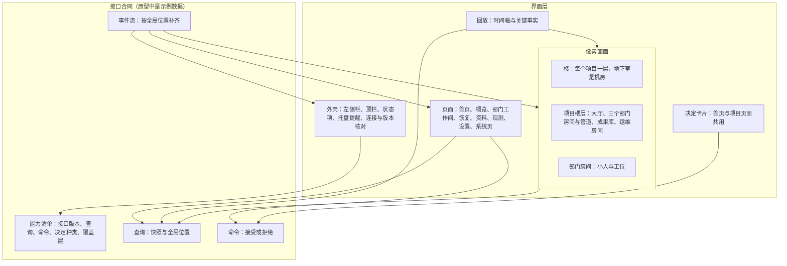
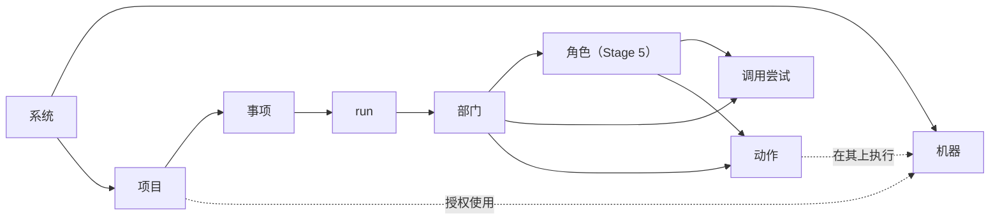

# 界面原型 v8 设计说明

日期：2026-09-29。状态：设计说明待用户审阅，原型文件尚未制作。完成后取代 [v7 原型](../v7/design.md)，v7 归档，[#71](https://github.com/bender2333/yudao/issues/71) 的依据改为 v8。

依据：[D30](../../requirements/web-game-frontend.md)（「长时间运行以后的界面」与「原型 v8 的方向」两节）、[应用层与接口层设计说明](../../design/app-and-interface.md)、[总体路线图](../../program-roadmap.md)、[Stage 3 计划](../../stage-3-plan.md)、[恢复契约](../../design/recovery-contract-and-fault-matrix.md)、[模型管理设计说明](../../design/model-management.md)第 5.6、9 节、[部门内多角色设计说明](../../design/department-roles.md)第 15 节、[D27 运维部门](../../requirements/operations-department.md)、[D29 远程执行环境](../../requirements/remote-execution.md)、[D33 接入已有项目](../../requirements/existing-project-onboarding.md)、[D34 浏览器与 computer use](../../requirements/browser-and-computer-use.md)、[ADR-0018](../../adr/0018-single-control-host-remote-execution.md)、[ADR-0019](../../adr/0019-project-stream-across-versions.md)。用词以 [CONTEXT.md](../../../CONTEXT.md) 为准。

## 1. 原型要回答的问题

1. 用户隔几个小时或几天回来，哪些事需要决定，离开期间发生了什么，能不能放心再离开。
2. 每个决定需要看哪些材料，怎样在一处看完并回答。
3. 整个系统（全部项目与全部机器）是否正常，怎样用一幅画面一眼看出来。
4. 三部门循环做到了哪里、停在哪里；离开期间的循环怎样按时间回放。
5. 部门里的小人怎样用动作表现真实发生的事，每个动作由哪一个事实驱动。
6. 每个界面读取哪个查询、提交哪个命令；每个工作包验收时界面应当是什么样子。

## 2. 界面分层

界面只通过查询读取、只通过命令提交，事件流推送新事件，能力清单决定显示哪些页面、区块与覆盖层（[应用层与接口层设计说明](../../design/app-and-interface.md)第 3 至 6 节）。原型用示例数据代替这一层，数据的形状与应用层设计说明中的查询、命令、事件对象一致；真实客户端接入时替换这一层，界面层不变。

画面的每一个动作由查询结果中的状态或事件流中的事件决定。界面不自行计时推进状态，也不显示没有来源的数据。

对象层次：

机器属于系统这一层，由多个项目共用；项目只保存对机器的授权（ADR-0018）。

## 3. 导航

### 3.1 左侧栏

- 上部：品牌、「首页」、「从想法新建」、「接入已有项目」（3.8）、项目搜索、项目列表。每个项目显示名称和状态标记：运行中、排队中、等待执行槽位（3.4A）、等待模型服务（Stage 4）、中断、待核实、待恢复、已归档。有待回答的决定请求时，项目名称旁显示数量。
- 底部「系统」分组：
  - 模型管理（D24）
  - 机器（3.2C）
  - 运行与执行槽位（3.4A）
  - 工具与扩展（3.2B）
  - 预留入口，灰色显示并写明所属阶段：元观察、演化（Stage 6）、经验（持续改进工作线）

### 3.2 顶栏与项目标签

- 顶栏：路径（首页 / 项目名 / 事项 / 页面）、事项选择框、状态项（第 4.1 节，顶栏只显示亮起的项）、连接状态、项目菜单。系统页的路径只显示系统页名称。
- 事项选择框：「整个项目」或某个事项（标题与状态）。概览、部门工作间、资料、观测按所选范围显示。
- 项目标签：概览、产品、工程、质检、运维（Stage 4）、资料、观测、设置。
- 所选事项不在运行中时，标签栏右侧显示该事项的状态；有待回答的决定请求时显示「待你决定」，点击展开决定卡片。

### 3.3 页面路径

| 页面 | 路径 |
| --- | --- |
| 首页 | `#/home` |
| 概览 | `#/p/{项目}/overview` |
| 部门工作间 | `#/p/{项目}/dept/{product、engineering、quality、operations}` |
| 恢复与动作核实 | `#/p/{项目}/w/{事项}/recovery` |
| 资料 | `#/p/{项目}/materials` |
| 观测 | `#/p/{项目}/observe`，请求详情 `#/p/{项目}/observe/{调用尝试}` |
| 设置 | `#/p/{项目}/settings` |
| 系统页 | `#/sys/models`、`#/sys/machines`、`#/sys/runtime`、`#/sys/tools` |
| 预留入口 | `#/sys/meta`、`#/sys/evolution`、`#/sys/lessons` |
| 连接设置 | `#/connect` |
| 动作图鉴（原型专用） | `#/gallery` |

事项范围写在路径参数 `?w={事项}` 中；回放位置写在 `?at={全局位置}` 中。刷新、后退、切换项目后保持所选对象与未提交的草稿。从系统页返回时回到进入前的页面。

### 3.4 连接与版本

- 连接设置：本机或局域网地址；访问令牌一栏灰色显示并标注「局域网内使用期间不需要」（应用层设计说明第 6.3 节 TODO）。
- 连接时读取能力清单并核对接口版本。版本不同时整个窗口只显示「请更新客户端」，写明客户端与控制主机的接口版本，不打开任何页面。
- 与控制主机的连接断开时，窗口保留最后一次的数据并整体变灰，顶部写明断开的时间与正在重新连接；重新连接后按全局位置补齐事件，发现缺口时重新读取快照。控制主机的启动身份改变时重新读取能力清单。

## 4. 首页

首页回答第 1 节的第 1 至 3 个问题。从上到下：

### 4.1 状态项

一排状态项，参照《缺氧》的状态栏：

| 状态项 | 来源 | 亮起时的链接 | 档位 |
| --- | --- | --- | --- |
| 待你决定 | `decisions.list` 中等待回答的数量 | 首页「待你决定」 | 界面工作线 |
| 结果未知的动作 | `system.status` | 第一个待核实事项的恢复页 | 3.1 |
| 离线的机器 | `system.status` | 机器系统页 | 3.2C |
| 等待模型服务 | `system.status` | 第一个等待中的事项 | Stage 4 |
| 磁盘空间 | `system.status`，低于设定值时亮起 | 运行与执行槽位页的数据保留区 | Stage 4 |
| 正在修复的故障 | `system.status` | 第一个修复事项的概览 | Stage 4 |

正常时每项显示为灰色的「无」，异常时亮起并显示数量。不显示汇总的结论。托盘图标与这一排使用同一份数据。

### 4.2 楼

一幅像素画面：一栋楼，每个项目一层，地下室是机房。

- **项目楼层**：缩小的项目楼层，只画部门房间的灯（亮灯表示该部门正在工作）、事项的小旗、楼层入口的阀门与一盏状态灯（运行中、排队中、等待执行槽位、等待模型服务、待核实、待恢复、空闲）。等待执行槽位时入口阀门关闭，旁边写「等待执行槽位」。空闲的小人在本层走动。点击楼层进入项目概览。
- **排列**：置顶的项目在上，其余按最近活动排列，归档的项目不显示。楼层多时画面纵向滚动，地下室固定在底部。
- **机房**（3.2C）：每台机器是一台设备，外形按用途区分：控制主机（机柜，里面的本机容器画成小格子）、台式机、树莓派（绿色小板）、笔记本。设备上显示名称、在线指示灯与正在执行的动作；每个项目楼层有一根管线通到它正在使用的设备，动作进行时管线上有流动的光点。执行代理心跳中断时指示灯熄灭，对应动作的标签变为黄色问号「结果未知」；迟到的回执到达时标签旁出现一张灰色的「迟到回执」纸条。
- **运行环境**（Stage 4）：作为运行环境的设备上立一块牌子，写明项目与当前部署的版本；部署与回滚时包裹经管线下到设备；故障时设备亮红灯。

### 4.3 待你决定

跨项目的决定卡片，按发出时间排列。卡片的内容与操作见第 6 节。

### 4.4 离开期间的报告

- 标题行：上次查看的时间、范围切换（「自上次查看」「最近 24 小时」「最近 7 天」）、「已看过」按钮（`home.mark_seen`）。
- 汇总项（`home.away_report`）：完成与放行的事项、用量（界面工作线）；发现的故障、自动修复、部署与回滚、进入等待模型服务的次数、磁盘与报到状态（Stage 4）。每项数字可以点击，展开来源事件，并在时间轴上标出对应刻度。没有来源事件的项不显示。
- 时间轴（第 5.5 节）：报告下方，楼的画面与时间轴联动回放。

### 4.5 项目列表

每个项目：名称、长期目标、当前成果（采纳版本）、进行中与排队中的事项数、待回答的决定数、最近活动时间。

## 5. 项目楼层（概览的循环画面）

### 5.1 概览页

从上到下：

1. **项目摘要**：名称、长期目标、当前成果（采纳版本与摘要，没有时显示「尚未采纳」）、事项统计（进行中、排队中、已采纳）。
2. **待你决定**：本项目等待回答的决定卡片。
3. **循环画面**：第 5.2 至 5.5 节。
4. **当前事项**：所选事项的输入记录与处理进度（已接收、已交给产品处理、已由有效需求接纳）、「追加需求」输入框、「取消事项」。没有进行中的事项时，输入框提供「记录原文」和「作为新事项开始」；新事项可以另外选择一个可信源目录作为代码快照（3.2A）。
5. **事项看板**：列为排队中、产品、工程、质检、已放行、已采纳；卡片显示标题、状态、所在部门、第几轮、待决问题或停止原因。排队中一列的顺序就是执行顺序，修复事项（Stage 4）固定在最前面，用户的新要求可以拖动调整顺序（`work_item.reorder`，3.4A）。
6. **流转记录**：时间、方向（例如「工程 → 产品」）、类型（需求交接、版本交付、问题反馈、咨询、返工）、内容、状态；返工行用醒目的颜色，点击打开原始事件。

### 5.2 布局

一层像素风楼层，从左到右：

- **大厅**：用户的输入以信件投进信箱。信箱接出一根管道通向产品房间，管道入口前排着同一项目排队中的事项包裹，按执行顺序排列，修复事项的包裹带红色十字；墙上一排执行槽位灯（3.4A）显示整个系统的占用数与总数。
- **三个部门房间**：产品、工程、质检排成一个环，相邻房间之间有交接管道。
- **成果库**：质检之后，架子上放已采纳的成果（版本号）。
- **运维房间**（Stage 4）：成果库之后，有监控屏、备份柜与发布推车。
- **通往机房的门**（3.2C）：走廊尽头的一扇门，门上列出本项目正在使用的机器与其上的动作数；点击回到首页并定位到机房中的这些设备。

画面上方的信息条显示所选事项：第几轮、已用时间与时间上限、当前部门、恢复观察状态；等待模型服务的时间在时间进度条上用灰色斜线段表示，不计入上限。

### 5.3 管道

部门之间的交接经过管道；小人不穿墙，也不凭空出现或消失。

- **交接管道**：产品 → 工程 → 质检 → 成果库为正向。PRD 卷轴、封存的交付箱、放行单与箱子作为包裹在管道中移动；房间里的小人把包裹放进管道口，接收方的小人从管道口取出。
- **返工**：质检退回工程时，包裹贴红色返工单沿质检与工程之间的管道反向流动；退回产品时沿质检与产品之间的回流管道流动。管道在包裹经过时闪红色。
- **传信管**：每两个部门房间之间有一根细的传信管，颜色与交接管道不同，询问与回答作为信件在其中传送。询问没有回答时，信件停在接收方的传信管出口，发问方的小人在管道口等待。
- **运维**（Stage 4）：成果库到运维房间有一段管道；发布与回滚的包裹从运维房间经通往机房的门下到运行环境；运维发现的故障写成信件，经管道送回大厅，成为排队中的修复事项包裹。
- **停止流动**：等待模型服务时，涉及部门的管道停止流动，管道上显示「等待模型服务」与下一次重试的时间（取自事件）；中断时全部管道停止。
- Stage 6 的判定阀门将来装在交接管道上，v8 只在管道上预留阀门的位置，不画阀门。

### 5.4 状态与画面

| 事实 | 来源 | 画面 | 档位 |
| --- | --- | --- | --- |
| 部门正在工作 | 事项的当前部门与 `department_activated` | 该房间亮灯，房间里的小人在工位工作 | 界面工作线 |
| 交接 | `transition` 与交接内容 | 包裹在交接管道中移动 | 界面工作线 |
| 返工 | `qa_submitted` 的结论为 `rework_engineering` 或 `rework_product` | 包裹贴红色返工单反向或经回流管道流动，管道闪红色 | 界面工作线 |
| 询问与回答 | `collaboration_requested`、`collaboration_responded`、`collaboration_closed` | 信件在传信管中往返；未回答的信件停在出口 | 界面工作线 |
| 循环次数与时间 | run 的循环计数、已用时间与时间上限 | 信息条显示「第 N 轮」与时间进度条；接近上限时变为警示色 | 界面工作线 |
| 采纳 | `deliverable_adopted` | 箱子放上成果库的架子，版本号加一 | 界面工作线 |
| 待恢复 | 模型引用无法使用的决定请求 | 涉及的房间门口立「待恢复」牌，写明缺少的项；凭据被上游拒绝在 Stage 3 各档属于这一行 | 界面工作线 |
| 中断 | 恢复观察状态为中断 | 整层变暗，墙上时钟停住，管道停止 | 3.1 |
| 自动继续 | Yudao 启动时自动继续中断的 run | 灯亮起，时钟继续走，管道恢复流动 | 3.1 |
| 待核实 | 恢复观察状态为待核实 | 涉及的房间亮黄灯，未完成动作的物件闪烁，小人头顶出现问号 | 3.1 |
| 因升级停止 | 停止原因为因升级停止 | 门口立「因升级停止」牌；该事项的新包裹排到大厅队首 | 3.1 |
| 远程动作 | 动作的执行机器（3.2C） | 通往机房的门上的动作数变化，门缝透出光 | 3.2C |
| 执行代理离线 | 心跳超时，动作结果未知 | 通往机房的门上出现黄色问号 | 3.2C |
| 同一项目排队 | 项目的排队顺序 | 大厅管道入口前的包裹队列，顺序随调整变化 | 3.4A |
| 等待执行槽位 | 执行槽位已满 | 大厅的槽位灯全亮，队首包裹停在入口，首页楼层的入口阀门关闭 | 3.4A |
| 等待模型服务 | 进入与离开等待模型服务的事件 | 涉及部门的管道停止，显示下一次重试时间；房间灯光调暗 | Stage 4 |
| 发布与回滚 | 运维的部署与回滚记录 | 发布推车把包裹送进通往机房的门；回滚时旧版本的包裹从门里送出 | Stage 4 |
| 故障与修复 | 故障记录与修复事项 | 运维房间监控屏变红；故障信件经管道送回大厅成为修复事项包裹 | Stage 4 |
| 停止自动修复 | 同一故障连续修复失败 | 运维房间门口立「停止自动修复」牌，监控屏显示两次修复的编号 | Stage 4 |
| 终止 | `run_done`、`run_failed`、`run_paused`、取消 | 门口立完成、失败（停止原因）、暂停或已取消的牌子 | 界面工作线 |

模型调用成功、工具返回成功、质检放行、事项完成、项目采纳使用不同的图标与文字，不共用一种绿色完成标记。

### 5.5 回放

- 时间轴：首页在离开期间的报告下方，概览在循环画面下方。刻度只取关键事实（`home.away_report` 的关键事实列表，概览按项目筛选）：交接、询问与回答、返工、放行、采纳、故障、修复、部署与回滚、进入与离开等待、决定请求的发出与回答。刻度按种类着色。
- 播放：画面从所选范围的起点状态开始，逐个播放关键事实；没有关键事实的时间段直接跳过，时间轴上用折断符号表示跳过的时长。支持暂停、单步、三档速度；拖动到任意刻度时画面直接显示该时刻的状态。
- 报告中的一项与时间轴互相跳转：点击报告项，时间轴高亮它的刻度；点击刻度，报告中对应的项高亮。
- 房间里小人的细节动作（打字、翻文件柜）只在实时查看与单步时播放。
- 回放期间画面上方显示「回放中」与当时的时间，结束或点击「回到现在」后恢复实时画面。

### 5.6 覆盖层

循环画面右上角的覆盖层切换，参照《缺氧》的覆盖层。覆盖层由能力清单列出（应用层设计说明第 6.1 节），依赖的查询没有登记时不显示：

| 覆盖层 | 画面 | 档位 |
| --- | --- | --- |
| 流转（`flow`） | 管道上标出每段交接的次数与最近一次的时间 | 界面工作线 |
| 等待（`waiting`） | 标出正在等待的对象：未回答的询问、决定请求、执行槽位、模型服务，以及已经等待的时长 | 界面工作线 |
| 恢复（`recovery`） | 标出恢复观察状态与未完成动作的位置 | 3.1 |
| 上下文用量（`context_usage`） | 每个角色头顶显示上下文用量占工作上限的比例，接近压缩阈值时变色 | Stage 5 |
| 语义记录（`semantic_records`） | 部门的语义记录柜显示有效条目数与冲突数 | Stage 5 |

### 5.7 多个事项、窄屏与减少动画

- 每个事项有自己的颜色，包裹、门口的小旗与看板卡片使用同一种颜色。同一项目一次只进行一个事项，其余事项的包裹在大厅排队。
- 宽度不足时，画面按比例缩小；再窄时画面下方提供同样内容的列表（事项、所在部门、第几轮、状态）。
- 系统设置为减少动画时，小人与物件停在当前状态对应的姿势，交接用管道上的箭头表示，不做移动动画。

## 6. 决定卡片

决定请求（应用层设计说明第 3.3 节）在首页与项目页面显示为同一种卡片。

- **卡片头**：种类、所属的项目与事项、已经等待的时长、挡住的对象（被阻塞的事项，以及同一项目中排在它后面的事项数量）。
- **材料**：展开后显示这个决定需要的材料，内容由决定请求携带或引用：

| 决定种类 | 卡片中的材料 | 档位 |
| --- | --- | --- |
| 模型引用无法使用时的待恢复 | 部门、模型、具体问题；「前往模型管理」「前往本项目的部门设置」 | 界面工作线 |
| 核实结果未知的动作 | 动作身份、所属部门与机器、输入依据、执行前后快照、核实依据；契约是否声明可以重复 | 3.1 |
| 授权网络取回与 MCP 工具 | 工具、目标、授权范围与超出的部分 | 3.2B |
| 确认接入已有项目的初始 PRD | 初始 PRD 摘要与原文链接、工程写出的现有结构说明 | 3.8 |
| 进入等待模型服务的通知 | 部门、模型服务、失败的分类、下一次重试时间 | Stage 4 |
| 授权常设授权清单以外的外部动作 | 动作、运行环境、运维给出的理由与证据 | Stage 4 |
| 需要恢复备份的回滚 | 故障记录、回滚的目标版本、将要恢复的备份与时间、交付说明中不兼容的说明 | Stage 4 |
| 同一故障连续修复失败后停止自动修复 | 故障记录、两次修复的事项与证据、当前运行的版本 | Stage 4 |
| 反复退回的提醒 | 计划条目、退回次数、最近一次的审查意见；「给该部门写指导」 | Stage 5 |

- **回答**：选项按钮由决定请求给出，可以附一段说明；提交后卡片显示「已提交」，事件流到达后按事件显示结果并移出等待列表。决定请求已经被回答或撤销时（`decision_closed`），卡片显示原因并刷新。
- **在项目中查看**：跳到项目中的对应页面（恢复页、资料页、运维工作间）。

## 7. 项目中的页面

### 7.1 部门工作间

1. **标题区**：部门名、职责、当前生效的模型及来源（项目设置或部门默认）、最近一次请求实际使用的模型、协议与发送的档位、部门状态、「部门设置」按钮。质检所选模型不支持图像时，模型旁显示建议能力的提醒（3.2D）。
2. **部门房间**：第 8 节。
3. **检查区**（房间下方，页签切换）：
   - 动作与回执：本部门的动作列表，每项写明执行的机器（3.2C）。
   - 试用记录（质检，3.2D）：按步骤列出操作、截图（模型不能看图时为可访问性结构的摘录）与对应的需求条目。
   - Context：上下文清单与压缩记录。
   - 部门 Prompt：项目当前配置与所选请求实际使用的版本。
   - 角色名单（Stage 5）：角色、状态、模型、当前任务；点击查看该角色的历史、每一步的模型请求、工具调用与工具许可的结果、当前的焦点、目录与已附加的实体；预测性任务单独标示。
   - 部门账本（Stage 5）：计划条目、分派对象、状态与结果摘要、审查次数与最近的审查意见、每一轮的进展判断、待决问题与对外询问。
   - 语义面板（Stage 5）：本部门可见的有效语义单元、冲突、更替链。
4. **部门消息与指导**：部门消息日志（每条可打开原始事件）、部门指导输入与指导记录（已接收、已进入模型输入、已解释、动作已核实、已说明边界、需要后续处理）。
5. **部门设置弹窗**：模型、推理档位、部门 Prompt；Stage 5 增加本项目各角色的设置。

**运维部门工作间**（Stage 4）另有：

- 运行环境：机器、当前部署的版本、放行历史、常设授权清单、备份（每个运行环境最近 3 份）。
- 故障记录：状态、关联的修复事项、修复失败次数、观察窗口剩余时间。
- 发布与回滚记录：版本、时间、方式（常设授权以内或经决定请求）。
- 运行指标：带分母；报到状态。
- 等待回答的决定：本部门发出的决定卡片。

### 7.2 恢复与动作核实（3.1）

- 事项的恢复观察状态：运行中、中断、待核实、待恢复、已终止。
- Yudao 启动时自动继续中断的 run；页面显示最后已确认的位置与自动继续的时间。
- **待恢复**：写明原因与修复入口，回答使用决定卡片。
- **动作核实**：未完成动作列表，每项显示动作身份、所属部门、执行的机器（3.2C）、输入依据、执行前后快照、状态（未发送、已完成、结果未知）、核实依据与核实结果。核实结果追加到核实记录，原始观察不改写。主机无法确定结果时，由决定卡片交给用户。
- **限额**：已用时间与时间上限（等待模型服务的时间单独列出，不计入）、已用激活次数、模型步骤与重试尝试；恢复不清零。
- **执行权**：当前执行者与取得时间；旧执行者与迟到回执作为历史事实列出，不推进状态。
- **因升级停止**：写明停止时的 Yudao 版本、用已采纳成果重新开始的新 run 与它在队列中的位置；旧 run 的事件只读列出。

### 7.3 资料

只读，按事项查看：

- intend 原文：首次与逐次输入，版本、字节范围、接收时间。
- PRD：各版本、接纳来源、「查看原文」；接入已有项目的初始 PRD 标明确认记录（3.8）。
- PLAN：各版本、目标、「查看原文」。
- 交付：各版本、文件清单、摘要、Git 差异、文件下载。
- 质检：结论、理由、检查回执、绑定到交付快照的截图（3.2D）。
- 项目材料：「记录原文」保存的材料；接入已有项目时工程写出的现有结构说明（3.8）。
- 语义记录（Stage 5）。
- 旧版本的 run：只读列出，标注所属的 Yudao 版本（ADR-0019）。

### 7.4 观测

请求记录、用量统计与请求详情：调用目标（连接、协议、地址、上游模型、容量、凭据引用与版本、选择来源、请求档位与实际发送的档位、部门 Prompt 版本）；按栏目的来源、用量与上限及放入原因；运行限制（时间上限与已用时间、循环次数），用量只读显示，不显示成预算；语义视图与按角色筛选（Stage 5）。

### 7.5 设置

- 基本信息：名称、长期目标、置顶、归档或恢复项目。
- 部门设置：各部门的项目部门设置，内容同部门设置弹窗。
- 登记命令（3.2A）：登记名、固定参数、允许的额外参数、时限、输出上限、版本；版本冲突时提示重新读取。
- 工具授权（3.2B）：网络取回与各 MCP 工具在本项目的授权范围。
- 机器授权（3.2C）：从系统登记的机器中选择本项目可以使用的机器，每台写明登记的目录、可以执行的操作；Stage 4 起可以指定为本项目的运行环境并批准常设授权清单（`machine_authorization.save`）。
- 运维（Stage 4）：观察窗口（默认 24 小时）、同一故障连续修复失败的次数上限（默认 2）。

## 8. 部门房间与小人

### 8.1 房间

每个房间有：后墙的 CRT 监视器（目标、模型、协议、状态、第几轮）、白板（工作计划，Stage 5 为部门账本）、文件柜（搜索与读取）、终端与拉杆（登记命令）、门与门缝下的信箱（部门指导）、交接管道口与传信管口，以及各部门自己的工作台：产品的卷轴架、工程的封存台、质检的检验台与试用台（3.2D）、运维的监控屏与备份柜。

Stage 5 起房间围绕中心角色布置：中心角色的工位在房间中央，工具角色的工位在四周，经理的工位靠近门与管道口。

### 8.2 角色

| 档位 | 产品 | 工程 | 质检 | 运维 |
| --- | --- | --- | --- | --- |
| Stage 5 之前 | 产品部门 Agent | 工程部门 Agent | 质检部门 Agent | 运维部门 Agent（Stage 4） |
| Stage 5 | 产品部门经理、产品架构师（中心）、产品探索者、产品审查者 | 工程经理、工程架构师（中心）、主程、工程探索者、工程审查者 | 质检经理、测试工程师（中心）、质检探索者、质检审查者 | 运维部门 Agent（角色在 Stage 5 设计时确定） |

小人的外形：衣服颜色按部门区分；角色靠配件区分：经理拿记录板、系领带；架构师戴眼镜、拿图纸卷；主程戴耳机、穿连帽衫；探索者背背包、戴帽子；审查者戴袖标、拿红笔；测试工程师穿白大褂、拿放大镜；运维戴耳麦。

### 8.3 动作与事实

| 事实 | 来源 | 小人动作 | 房间变化 | 档位 |
| --- | --- | --- | --- | --- |
| 部门未工作 | 部门状态 | 坐在工位喝茶，偶尔起身在房间里走动、伸懒腰 | 灯光调暗 | 界面工作线 |
| 部门开始工作 | `department_activated` | 起身走到工位 | 屏幕亮起，CRT 显示目标 | 界面工作线 |
| 装配上下文 | `context_assembled` | 从文件柜取出文件夹放到桌上 | — | 界面工作线 |
| 模型请求中 | `model_requested`、`model_request_serialized` | 打字，头顶思考气泡 | 屏幕滚动字符 | 界面工作线 |
| 流式输出 | `model_stream_progress` | 气泡中逐字出现文字 | — | 界面工作线 |
| 请求完成 | `model_attempt_finished` | 气泡变成灯泡 | — | 界面工作线 |
| 等待重试 | `model_retry_scheduled` | 头顶沙漏与「第 n/m 次」 | — | 界面工作线 |
| 请求失败 | `model_attempt_failed` | 趴在桌上 | 桌上红灯 | 界面工作线 |
| 搜索 | `tool_started`（`search`） | 翻文件柜，举放大镜 | 文件柜抽屉打开 | 界面工作线 |
| 按区间阅读 | `tool_started`（`read_range`、`read_file`） | 捧着文件阅读 | — | 界面工作线 |
| 编辑 | `tool_started`（`edit_range`、`write_file`） | 在文件上写字 | 屏幕显示增删的行 | 界面工作线 |
| 执行登记命令 | `tool_started`（`run_command`）到 `tool_called` | 走到终端拉下拉杆 | 终端滚动输出；结束时退出状态灯亮绿灯或红灯；超时时终端冒烟 | 界面工作线 |
| 工具被拒绝 | `tool_skipped` | 摇头，把纸团扔进废纸篓 | — | 界面工作线 |
| 提交提案 | `proposal_submitted` | 把文件放进提案托盘 | — | 界面工作线 |
| 提案被退回 | `proposal_rejected` | 文件被退回，小人挠头 | — | 界面工作线 |
| 需求接纳 | `spec_accepted`、`contract_accepted` | 产品在卷轴上盖「有效」章，卷起后放进管道口 | 卷轴放上卷轴架 | 界面工作线 |
| 计划接纳 | `plan_accepted` | 工程把计划贴上白板 | — | 界面工作线 |
| 交付封存 | `delivery_accepted` | 工程装箱、贴封条、盖封存章，把箱子推进管道口 | — | 界面工作线 |
| 质检取件 | 交接到达质检 | 从管道口取出箱子放上检验台 | — | 界面工作线 |
| 质检核验 | 质检的检查动作 | 用放大镜检查箱子，清单逐项打勾 | — | 界面工作线 |
| 放行 | `qa_submitted`（`release`） | 盖绿色「放行」章，把放行单与箱子放进通往成果库的管道 | — | 界面工作线 |
| 返工 | `qa_submitted`（`rework_engineering`、`rework_product`） | 盖红色「返工」章，把箱子放进回流管道 | — | 界面工作线 |
| 发出询问 | `collaboration_requested` | 写纸条装进信筒，塞进传信管口，在管道口等待 | — | 界面工作线 |
| 收到询问并回答 | `collaboration_responded` | 从传信管口取出信筒，写回答后塞回 | — | 界面工作线 |
| 收到指导 | `department_guidance_received` | — | 门缝塞进纸条，信箱灯亮 | 界面工作线 |
| 指导进入输入 | `department_guidance_applied` | 拿起纸条阅读，钉在墙上 | — | 界面工作线 |
| 回应指导 | `department_guidance_responded` | 在纸条上写回复 | — | 界面工作线 |
| 压缩 | `compaction_recorded` | 把桌上成堆的纸整理进「摘要」档案盒 | 档案盒上的编号加一 | 界面工作线 |
| 压缩未生效 | `compaction_failed` | 纸堆散落，小人重新整理 | — | 界面工作线 |
| 待恢复 | 模型引用无法使用 | 举牌，牌上写缺少的项 | — | 界面工作线 |
| 暂停、失败、完成、取消 | `run_paused`、`run_failed`、`run_done`、取消 | 坐下、趴下、举手欢呼、收拾桌面 | 门口立对应的牌子 | 界面工作线 |
| 中断 | 恢复观察状态 | 静止不动 | 灯灭，墙上时钟停住 | 3.1 |
| 自动继续 | Yudao 启动时自动继续 | 伸懒腰后回到工位 | 灯亮起，时钟继续走 | 3.1 |
| 待核实 | 恢复观察状态与未完成动作 | 站在未完成动作的物件旁，头顶黄色问号 | 物件闪烁 | 3.1 |
| 用户对结果未知的动作作出决定 | 决定请求的回答 | 从门缝接过决定单，读完后按决定走向终端重新执行、回到工位继续或收拾桌面 | 物件停止闪烁 | 3.1 |
| 远程执行 | 动作在登记的机器上执行（3.2C） | 走到终端，终端屏幕上显示机器名称与一根通往门外的线 | 动作结束前线上有流动的光点 | 3.2C |
| 远程动作结果未知 | 执行代理心跳超时 | 盯着终端，头顶黄色问号 | 终端屏幕变为雪花 | 3.2C |
| 网络取回 | 网络取回工具（3.2B） | 走到门口的邮筒寄出请求，取回资料 | — | 3.2B |
| 调用 MCP 工具 | MCP 工具调用（3.2B） | 在墙上的工具面板上按下对应的按钮 | 面板上该按钮亮灯 | 3.2B |
| 试用网页或桌面程序 | 浏览器与 computer use 工具调用（3.2D） | 测试工程师坐在试用台前点击与输入 | 试用台显示器嵌入最近一张真实截图的缩略图（像素边框）；模型不能看图时显示可访问性结构的文字行 | 3.2D |
| 工程自测网页 | 工程的浏览器工具调用（3.2D） | 工程在自己的显示器前点击 | 显示器嵌入截图缩略图 | 3.2D |
| 阅读已有项目 | 接入已有项目时产品与工程读取代码与文档（3.8） | 从大厅搬来一摞旧档案，逐本阅读并做摘录 | 白板上出现「现有行为」清单 | 3.8 |
| 部署 | 运维的部署记录 | 运维推车把箱子推进通往机房的门 | 备份柜先亮一格（部署前备份） | Stage 4 |
| 回滚 | 运维的回滚记录 | 运维从门里取回旧版本的箱子 | — | Stage 4 |
| 发现故障 | 故障记录 | 运维跑向监控屏，写故障信件放进通往大厅的管道 | 监控屏变红 | Stage 4 |
| 等待模型服务 | 进入等待模型服务 | 坐在工位上看着墙上的时钟 | 灯光调暗，管道停止流动 | Stage 4 |
| 外部动作待授权 | 运维对常设授权清单以外动作的决定请求 | 举着申请单在门口等待 | — | Stage 4 |
| 分派角色任务 | 角色任务事件 | 中心角色把任务卡递到工具角色的桌上 | 白板上的计划条目标上分派对象 | Stage 5 |
| 角色交回结果 | 角色结果事件 | 工具角色把结果卡交回中心角色 | 条目改为已交回 | Stage 5 |
| 审查 | 审查任务 | 审查者拿红笔在成果上批注，盖「通过」或「退回」 | — | Stage 5 |
| 探索者查资料 | 探索者的网络取回 | 背上背包走出门，回来时抱着资料 | — | Stage 5 |
| 停滞后重新规划 | 部门账本的进展判断 | 中心角色在白板上擦掉计划重写 | — | Stage 5 |
| 经理对外 | 经理转交询问、提交部门成果 | 经理走到管道口与传信管口 | — | Stage 5 |
| 语义整理 | 语义整理事件 | — | 墙边的语义记录柜里卡片增加 | Stage 5 |

表中档位为「界面工作线」的事件已在事件库中存在；3.1 及之后的事实由对应工作包的设计确定事件名，原型数据中使用临时名称，并在 v8 的构建约定中列出。

### 8.4 动作图鉴

原型专用页面 `#/gallery` 按角色与动作列出全部小人动画与管道画面，每一项写明驱动它的事实与所属档位。

## 9. 系统页

### 9.1 模型管理（D24）

按[模型管理设计说明](../../design/model-management.md)第 9.1 节：Provider 配置卡片、添加与编辑表单、编辑 JSON（格式化、重置、复制、导入、导出）、凭据、候选、模型访问定义表（容量「接受」、推理档位声明、只读的准入列）、连接测试与模型测试、页面底部的部门默认。保存部门默认时，质检所选模型不支持图像，照常保存并显示提醒：部门、模型、缺少的能力与影响（第 5.6 节，3.2D）。Stage 5 在部门默认下增加角色默认。

### 9.2 机器（3.2C）

- 机器列表：名称、地址、用途、在线状态（最近一次心跳）、正在执行的动作（项目、部门、动作）、授权使用它的项目，以及它是哪些项目的运行环境（Stage 4）。
- 登记与修改机器：名称、地址、用途（`machine.save`）；认证一栏灰色显示并标注 TODO。
- 页面上方是机房的放大画面，与首页地下室相同。

### 9.3 运行与执行槽位（3.4A）

- 执行槽位数量与占用情况；正在执行的事项（项目、部门，Stage 5 起为正在执行步骤的角色）；等待执行槽位的项目；「设置槽位数」。
- 排空（3.1）：排空状态、正在进行的 run、「开始排空」与「强制升级」（强制升级时正在进行的 run 记为因升级停止）。
- 数据保留（Stage 4）：磁盘可用空间与提示阈值、交付快照与工作区占用。

### 9.4 工具与扩展（3.2B）

- 网络取回：授权范围与最近的取回记录。
- MCP 工具：已接入的服务与工具、每类动作的恢复约定，没有恢复约定的工具标明「不自动重试」；浏览器工具（3.2D）列在这里。
- 只读观察者（Stage 5，[#98](https://github.com/bender2333/yudao/issues/98)）：已登记的观察者与订阅范围。
- 准入钩子（Stage 6）：只保留位置。

这一页的依据是路线图与 Stage 3 计划的工作包说明，页面上标注「设计待定」，进入 3.2B 时细化。

### 9.5 预留入口

元观察、演化、经验各有一页，只写所属阶段、产品结果（取自路线图第 1 节）与「进入该阶段时设计」。

## 10. 托盘提醒

客户端常驻托盘（应用层设计说明第 5.7 节），窗口关闭后仍保持一条不按项目筛选的事件流：

- 托盘图标显示等待回答的决定数，与首页状态项使用同一份数据。
- 出现新的决定请求、进入等待模型服务、磁盘空间不足时发出系统通知；点击通知打开窗口并定位到对应的决定卡片或状态项。

原型用浮动工具条上的模拟托盘与模拟通知表示这一行为。

## 11. 界面数据合同

查询、命令、决定种类、覆盖层与能力清单的名称、内容与所属工作包以[应用层与接口层设计说明](../../design/app-and-interface.md)第 3、4、6 节为唯一来源，本说明不另列一份。页面与它们的对应：

| 界面 | 查询 | 命令 |
| --- | --- | --- |
| 外壳 | `system.status`、`projects.list`、`decisions.list`、能力清单、事件流 | — |
| 首页 | `system.status`、`decisions.list`、`home.away_report`、`projects.list`、`machines.list` | `home.mark_seen`、`decision.answer` |
| 概览与循环画面 | `project.overview`、`project.loop`、`project.flow`、`work_item.inputs`、`event.detail`、`decisions.list` | `material.record`、`work_item.create`、`work_item.append_input`、`work_item.cancel`、`work_item.reorder`、`decision.answer` |
| 部门工作间 | `department.workspace`、`run.actions`、`attempt.live`、`role.detail`、`semantic.records`、`overlay.context_usage`、`ops.status` | `guidance.send`、`department_settings.save`、`role_settings.save` |
| 恢复与动作核实 | `run.recovery`、`run.actions`、`decisions.list` | `decision.answer` |
| 资料 | `work_item.materials`、`delivery.file`、`semantic.records` | `semantic.mark_invalid`、`semantic.correct` |
| 观测 | `project.attempts`、`project.usage`、`run.attempt` | — |
| 设置 | `project.settings`、`machines.list` | `project.rename`、`project.pin`、`project.archive`、`project.restore`、`department_settings.save`、`command_registration.save`、`tool_authorization.save`、`machine_authorization.save`、`role_settings.save` |
| 模型管理 | `catalog`、`catalog.document` | 模型管理的各项命令 |
| 机器 | `machines.list` | `machine.save` |
| 运行与执行槽位 | `runtime.slots`、`system.status` | `runtime.set_slots`、`queue.cancel` |
| 工具与扩展 | `tools.registry` | — |

原型的示例数据使用应用层设计说明中的字段名称（事件对象的 `position`、`project_id`、`actor` 等）与带点号的命令名称。每个区块标明读取的查询、提交的命令与所属档位。

## 12. 档位

原型按工作包分档，每一档包含之前各档的全部内容，对应一次验收要看到的界面：

| 档位 | 加入的内容 |
| --- | --- |
| 界面工作线 | 首页（待你决定、离开期间报告中已有数据的项、项目列表）、楼（项目楼层，不含机房）、状态项「待你决定」、托盘提醒、连接设置与版本核对、已有能力的项目页面（含 3.2A 的登记命令与动作回执）、待恢复的决定卡片（#49）、D24 模型管理与部门设置 |
| 3.1 可靠恢复 | 恢复与动作核实页、中断与自动继续、结果未知动作的决定卡片、状态项「结果未知的动作」、排空与因升级停止、旧版本的 run |
| 3.2C 执行环境服务 | 机器系统页、首页地下室的机房、通往机房的门、项目的机器授权、动作的执行机器、状态项「离线的机器」 |
| 3.4A 不同项目并行 | 运行与执行槽位页、大厅的槽位灯、等待执行槽位、同一项目排队与调整顺序 |
| 3.8 接入已有项目 | 「接入已有项目」入口、阅读已有项目的动作、初始 PRD 的决定卡片 |
| 3.2B 网络与 MCP | 工具与扩展页、工具授权、网络取回与 MCP 工具的动作与决定卡片 |
| 3.2D 浏览器与 computer use | 试用台与截图、试用记录、资料中的截图、建议能力的提醒 |
| Stage 4 | 运维房间与运维工作间、运行环境、部署与回滚、故障与修复事项、等待模型服务、其余状态项与报告项、运维设置 |
| Stage 5 | 部门内多角色、部门账本、审查者、上下文用量与语义记录覆盖层、语义面板与语义视图、按角色筛选、角色默认与项目角色设置、反复退回的提醒、只读观察者 |

档位的先后按路线图第 2 节的近期顺序排列；实际完成顺序不同时，只调整原型中档位的排列。预留入口在每一档都显示。

## 13. 原型内的辅助工具

原型底部有一条浮动工具条，外观与界面明显区分：

- **档位切换**：第 12 节的九档。
- **标注模式**：每个区块右上角显示它读取的查询、提交的命令与所属档位。
- **场景播放**：逐步播放事件，每一步显示驱动画面的事件名称与内容；可以单步、连续播放、暂停。场景：
  1. 正常循环
  2. 返工
  3. 询问与回答
  4. 部门指导
  5. 压缩
  6. 模型引用无法使用与待恢复
  7. 中断与自动继续
  8. 结果未知的动作与决定
  9. 排空与因升级停止
  10. 执行代理离线导致结果未知
  11. 跨项目并行与等待执行槽位
  12. 同一项目排队与调整顺序
  13. 接入已有项目并确认初始 PRD
  14. 质检试用网页
  15. 等待模型服务
  16. 故障、修复与回滚（含需要恢复备份的回滚决定）
  17. 连续修复失败后停止自动修复
  18. 部门内多角色
  19. 离开三天后回来：首页状态项、决定卡片、报告与回放
- **模拟**：托盘图标与系统通知、断开连接、接口版本不同、上次查看的位置（设定离开的时长）。

原型中的数据全部是示例数据，页面顶部标明「原型示例数据」。

### 13.1 示例数据

四个项目与四台机器：

| 项目 | 内容 | 用来展示 |
| --- | --- | --- |
| 待办清单网页 | [评测场景](../../design/evaluation-scenarios.md) 1（WebGen-Bench 000080） | 正常循环、质检试用网页与截图 |
| openai-agents 增加功能 | 评测场景 2（FeatBench openai-agents-python-842），经 3.8 接入 | 接入已有项目、初始 PRD、返工 |
| 北京地铁票价 | 评测场景 3（PRDBench 44） | 询问与回答、压缩、排队与调整顺序 |
| 家庭温湿度监测服务 | 在树莓派上长期运行的服务 | 运维、部署与回滚、故障与修复、等待模型服务 |

| 机器 | 用途 |
| --- | --- |
| 控制主机（小主机） | 控制核心与本机容器，工程构建 |
| 书房台式机 | 质检的检查与试用 |
| 客厅树莓派 | 温湿度监测服务的运行环境 |
| 笔记本 | 在「执行代理离线」场景中离线 |

## 14. 用词

- 模型相关用词以 CONTEXT.md 与 D24 第 9.5 节为准：Provider 配置、服务方案、模型访问定义、候选、准入、模型测试、连接测试、凭据、推理档位、部门默认、项目部门设置、部门 Prompt、建议能力。
- 恢复观察状态：运行中、中断、待核实、待恢复、已终止；动作状态：未发送、已完成、结果未知。
- 事项状态：未开始、进行中、已采纳、已放行、已停止、排队中。
- 系统与运维：控制主机、机器、执行代理、登记的运行环境、常设授权、故障记录、修复事项、等待模型服务、排空、决定请求、离开期间的报告。
- 角色名称按第 8.2 节。
- 界面不出现：供应商、模型映射、全局分配、基线（指部门默认时）、努力程度、主 Agent、SubAgent、派发协作者、节点、告警、事故、故障单、白名单。

## 15. 待定

- 运维部门的角色：Stage 5 设计时确定，原型只画一个运维部门 Agent。
- 3.1 以后各工作包的事件名称：由对应工作包的设计确定，原型使用临时名称。
- 心跳间隔与超时时长（3.2C）：原型的示例数据只显示「最近一次心跳」与超时状态，不写具体时长。
- 试用台截图的尺寸与缩放（D34 的虚拟屏幕尚未设计）：原型按显示器区域等比缩放。

## 16. 原型文件

原型位于 `docs/prototypes/v8/`，用浏览器直接打开 `index.html`，不需要编译、服务端口或外部脚本。构建约定沿用 v7（[v7 构建约定](../v7/BUILD.md)），v8 的构建约定在制作时写成 `docs/prototypes/v8/BUILD.md`。
