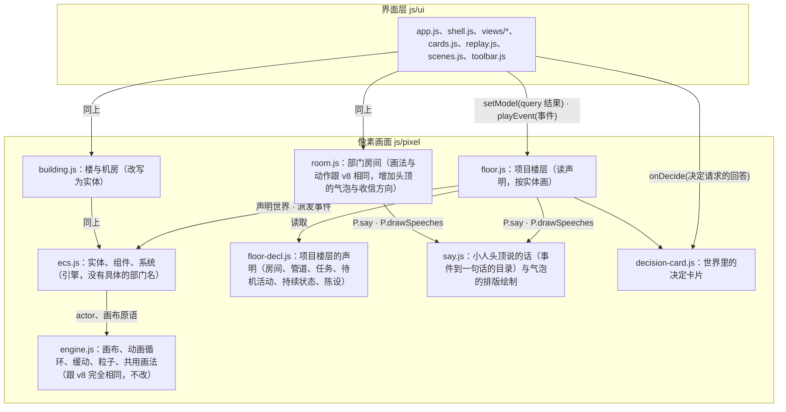

# 原型 v9 构建约定

本文件只写跟 [v8 BUILD.md](../v8/BUILD.md) 不一样的地方。第 1 节（基本要求）、第 4 节（档位）、第 5 节（接口层／示例后端）、第 6 节（界面层：路由、`kit.js`、决定卡片）、第 8 节（示例数据的登记方式与形状、世界设定、跨文件标识、截图）、第 9 节（场景）、第 10 节（测试）、第 11 节（交付）跟 v8 完全相同，直接照抄 v8 对应文件，不重新写一遍；`js/contract/`、`js/ui/`（像素画面以外）、`styles/` 原样搬过来，只有下面列出的界面层文件有改动。变的是第 2、3、7 节：像素引擎内部从"一个部门一个角色、按状态切姿势"改成实体—组件—系统。

## 1. 分层（对照 v8 BUILD.md 第 2 节）



`floor.js`、`building.js` 对外的 `setModel`/`playEvent`/`resize`/`destroy` 接口跟 v8 的函数签名一致，界面层不知道下面换了引擎。项目楼层的 `setModel` 多接受两个可选字段：`roles`（每个部门的角色列表）、`decisions`（等待回答的决定请求），缺省时画面按一个部门一个小人、没有决定板来画；`createFloorScene` 的选项多两个回调：`onDecide`（回答决定请求，返回命令的结果）、`onGo`（材料里的链接）。

## 2. 文件结构与负责者（对照 v8 BUILD.md 第 3 节）

```
docs/prototypes/v9/            由 docs/prototypes/v8/ 整份复制而来
  js/pixel/ecs.js               新增：世界、房间与管道与节点的声明、任务派发、角色与包裹的推进、管道的流动、信号、待机活动、对话框的数据
  js/pixel/say.js               新增：小人头顶说的话——事件到一句话的目录（P.say），气泡的折行、避让、淡出与绘制（P.drawSpeeches）
  js/pixel/floor-decl.js        新增：项目楼层的声明——房间、管道、任务目录、待机活动、事件到任务的解析、持续状态、陈设
  js/pixel/decision-card.js     新增：世界里的决定卡片（板上的决定单点开以后的那张纸）
  js/pixel/engine.js            原样保留
  js/pixel/sprites.js           原样保留
  js/pixel/room.js              改动：动作开始时小人头顶说话（交接、分派、传信的两端各说一句），收到询问的一方走到传信管口取信；其余原样保留
  js/pixel/floor.js             改写：读声明，房间、管道、小人、包裹按实体画，头顶有对话框，大厅有决定板
  js/pixel/building.js          改写：楼里的小人、通往机房的管线、机房里的设备与管线都是实体
  js/ui/scenes.js               改动：项目楼层的面板多读部门的角色列表与等待回答的决定请求，回答走 decision.answer
  js/ui/cards.js                改动：材料的整理拆成纯文字的版本，新增 Y8.cards.face 给画面用
  js/ui/views/overview.js       改动：页面上方的决定区块去掉（内容在大厅的板与文字列表里）
  checks/                       新增：验收脚本（第 4 节）
  其余文件                      原样保留
```

`index.html` 的脚本加载顺序：`pixel/sprites.js`、`pixel/engine.js`、`pixel/ecs.js`、`pixel/say.js`、`pixel/floor-decl.js`、`pixel/decision-card.js`、`pixel/room.js`、`pixel/floor.js`、`pixel/building.js`。

负责者：

| 负责者 | 文件 |
| --- | --- |
| 架构师 | `BUILD.md`、`js/pixel/ecs.js`、`say.js`、`floor-decl.js`、`floor.js`、`decision-card.js`、`room.js` 里的气泡、`building.js` 里楼的管线与机房的部分、`js/ui/` 里上表列出的改动、`checks/` |
| 任务 B 楼里的小人 | `js/pixel/building.js` 里楼层小人：小人是 `ecs.js` 的角色实体（`department: null`），走位目标写进 `ch.spot`，走位与待机动画由 `ECS.stepCharacters` 推进（工作时走到对应部门门口，空闲时随机走动） |
| 任务 A1／A2／A3／C／D／E | 跟 v8 完全相同的负责范围，不需要重新做（v8 的交付原样保留） |

## 3. 像素引擎（`ecs.js`）

### 3.1 实体与组件

四种实体，每种实体是一个普通对象，字段就是它的组件：

```js
// 角色：一个部门按角色设置有几个，没有角色设置时一个（id 是部门名）
{ kind: 'character', id, department, roleKind, name, seatIndex, spot: {x, y}, queue: [task…], current: task | null, rest: 与任务同形状的持续状态 | null, bubble: {text, kind} | null }

// 包裹：PRD 卷轴、交付箱、返工单、放行单、信件；放进管道时生成，到达终点后销毁
{ kind: 'package', id, workItemId, colorIndex, artifact, atRest: {roomId, spotKind} | null, transit: {linkKey, pts, ms, k, pos, onDone} | null }

// 房间：由声明生成，运行时加上算好的位置；机房里的设备是 roomKind 为 'device' 的节点
{ kind: 'room', id, label, roomKind, x, y, w, door, inPort, outPort, pipeOut, desk, seats, cabinet, terminal, monitor, def }

// 管道：由声明生成，flow 是流动的状态
{ kind: 'pipe', id, from, to, linkKind, pts, flow: {state, speed, load, phase} | null, def }
```

`ECS.world(catalog)` 返回 `{ rooms, roomOrder, links, characters, packages, signals, catalog }`：`rooms`、`links`、`characters`、`packages` 各是一个按 `id` 索引的 map（`links` 的键是 `from>to`，传信管是 `from~to`），`roomOrder` 是房间 `id` 按排布顺序的数组，`signals` 是命名信号，`catalog` 是这个世界的任务目录 `{ tasks, idle, keyOf }`。角色对应 engine.js 场景里 `id` 为 `'ch-' + 角色 id` 的 actor；包裹的画法字段（`bmp` 位图名、`color`、`small`）由画面在生成包裹时写上。

### 3.2 声明

```js
P.ecs.declareRooms(world, defs, flags)   // 房间按声明顺序从左到右排布；defs 是 P.floorDecl.rooms，flags 取自 floorModel 的字段
P.ecs.declareLinks(world, defs)          // 管道；defs 是 P.floorDecl.links，也可以自带折线 pts；重新声明保留同一根管道的流动状态
P.ecs.declareNodes(world, defs)          // 不属于房间排布的节点（机房里的设备），几何由声明给出
P.ecs.layoutSeats(room, n)               // 房间里 n 个角色的工位；n 为 1 时就是 desk
P.ecs.route(world, from, to)             // 两个房间之间交接走过的管道：直接有就是它，没有就在声明的交接管道里找最短的一段一段
```

房间声明的字段（`w`、`when`、`agentKind`、`ports`、`spots`、`pipeOutX`、`rest`、`lit`、`tint`、`props`）与管道声明的字段（`kind`、`via`、`optional`、`valve`、`pts`）见 [design.md](design.md) 第 3 节。`declareRooms` 沿用 v8 `floor.js` 的常量（`TOP`、`ROOM_B`、`DESK_Y`、`PORT_STAND`，`world.machineDoor` 是走廊尽头通往机房的固定的门）；`declareLinks` 按 `kind` 对应的路由规则算折线，`from`/`to` 引用房间的 `id`，`machine_room` 指通往机房的门，其余管道的端点未声明时抛出错误；两个函数的顺序不能颠倒（先房间后管道）。

`floor-decl.js` 导出 `P.floorDecl = { rooms, links, tasks, idle, keyOf, flags, deptRest, roleRest }`：`flags` 是房间 `when` 可以引用的 floorModel 字段名（`['ops']`）；`deptRest(ctx, 部门, 事项)` 是通用的事项状态到持续状态的表（v8 design.md 第 8.3 节的状态行）；`roleRest(ctx, 部门, 事项, 角色, 是否中心角色, 房间的持续状态)` 给出一个房间里每个角色的持续状态。`ctx` 是画面给声明的读取窗口：`{ model, order, waitingDept(d), time, sig(名字), reduced }`。

### 3.3 任务目录

一份任务定义表，由 `floor-decl.js` 提供：

```js
{
  model_requested: { label: '打字', spot: 'desk', pose: 'type', bubble: 'say', ms: 1400 },
  tool_started_search: { label: '翻找资料', spot: 'cabinet', pose: 'magnify', bubble: 'say', ms: 1200 },
  package_handoff_out: { label: '放进管道口', by: 'manager', spot: 'port_out', pose: 'side_place', bubble: 'say', ms: 520, facing: 1 },
  x_role_task_assigned: { label: '分派任务', actor: 'manager', spot: 'peer', toward: 'role', pose: 'give', bubble: 'say', ms: 700, then: 'role_task_received' },
  x_deployed: { dept: 'operations', label: '发布', spot: 'port_out', pose: 'side_place', bubble: 'say', ms: 700, facing: 1,
    fx: [{ when: 'done', send: { link: 'operations>machine_room', bmp: 'box_sealed', then: [{ signal: 'door', ms: 1800 }] } }] },
  // …覆盖 v8 design.md 第 8.3 节里所有"小人动作"的行，加上部门内角色之间的动作、运维、决定请求、待机活动
}
```

- `spot` 是房间里的一个命名位置：`desk` 工位、`stand` 工位旁站着、`cabinet` 文件柜、`terminal` 终端、`monitor` 监控屏、`inspect` 检验台、`port_in`/`port_out` 左右墙的管道口、`door` 房间的门口、`peer` 另一个角色的工位旁（`toward` 指定是谁）、`at` 任务自带的坐标（`extra.at`）。具体坐标由 `declareRooms` 生成房间时算出，房间声明的 `spots` 可以把文件柜、终端的位置对到房间里已有的陈设上。
- `pose` 是 engine.js 已注册的动作名（`P.ANIMS` 的键）；`ms` 是到达 `spot` 以后做这么久；`icon` 是做这个任务时头顶的状态图标；`facing` 是到达以后的朝向。
- `bubble` 为 `'say'` 时头顶显示说话气泡，内容为 `label`（模型请求在流式输出到达时用事件的 `payload.text` 取代默认的标签并逐字追加）；为 `null` 时不显示（待机活动）；队列里的下一项带有 `label` 的说话任务时，头顶显示思考气泡（见 `bubbleFor`）。声明里的 `label` 是备用的内容：事件类型登记在 `P.say` 的目录里时，任务的 `label` 由 `floor.js` 按事件换成第一人称的一句话（`extrasOf`），交接与传信的两端各换一句（`sayOf`）。
- `dept`、`by`、`actor`、`toward`、`then`：事件落在哪个角色上的规则（design.md 第 4.2 节）；`fx`：任务开始（`when: 'start'`）与做完（`when: 'done'`）时的效果——`signal`（命名信号亮一段时间）、`flash`（房间闪光，`room` 为 `'self'` 是做这件事的角色所在的房间）、`send`（包裹沿声明的管道走，到达以后执行 `then`）；`idle` 标出待机活动。
- 不出现在这张表里的事件类型是信号，不生成任务，由画面直接改灯、牌子、计数（见 `floor.js` 的 `playEvent`）。
- 交接与传信的任务（`package_handoff_out`、`package_handoff_in`、`package_return_out`、`package_return_in`、`letter_out`、`letter_in`、`letter_arrive_in`、`letter_arrive_out`）不由事件类型触发，由 `floor.js` 直接放进队列；待机活动由 `ecs.js` 按目录的 `idle` 列表挑选。

### 3.4 系统

```js
P.ecs.enqueue(world, who, key, extra)   // 把目录里的一项放进角色的队列；who 是角色 id 或者部门 id（部门按 extra.role 与任务的 by、actor 找角色）；extra 覆盖字段；extra.front 插到队首并放弃正在做的非 must 任务，extra.must 不会被队列上限挤掉；不是待机活动的任务进来时，正在做与排着的待机活动放弃
P.ecs.dispatch(world, ev, make)         // 事件到达：查目录，命中就 enqueue 并返回 true；没有命中返回 false，由调用方按信号处理；make(任务定义, 事件, 角色, 一方) 可以返回要合并进任务的字段（效果回调、气泡里的话），一方为 'to' 时是任务 then 后续任务里收东西的一方
P.ecs.stepCharacters(world, scene)      // 每帧调用，规则见下
P.ecs.stepPackages(world, scene)        // 每帧调用：transit 不为空的包裹沿 pts 移动，到达终点时 atRest、transit 置空并执行 onDone
P.ecs.stepPipes(world, scene, stateOf)  // 每帧调用：stateOf(管道) 给出 'flowing'｜'idle'｜'stopped'，流速与光点带着惯性跟随
P.ecs.signal / signalOn / signalValue   // 命名信号：signal(world, scene, 名字, 毫秒, 值)
P.ecs.bubbleFor(character)              // 当前应显示的气泡 {text, kind, tail}，只读；tail 为真表示是流式输出的文字，只留结尾
P.ecs.syncCharacters(world, scene, specs, spriteOf)  // specs 是 [{ id, department, roleKind, name }]：每个角色有一个实体与对应的 actor，去掉不再需要的，给每个房间排好工位
P.ecs.charFor / charsOf / primaryOf / actorOf         // 找角色：按 id 或种类、部门里的全部角色、中心角色、角色的 actor
P.ecs.spawnPackage / sendPackage / removePackage / packagePosition / linkActive  // 包裹的生成、沿管道发出、销毁、当前坐标，以及一条管道上有没有包裹在移动
P.ecs.config.autonomy                   // 自主行为（待机活动、管道的惯性）的开关，验收脚本把它关掉
```

`stepCharacters` 每帧对每个角色：

1. 没有正在做的任务、队列非空、走路的脚本已经结束、整层没有静止（`scene.frozen`）时，取队首为当前任务；待机活动的走路被真正的任务打断时，放弃走到一半的路。
2. 目标是当前任务的 `spot`；没有任务时是 `rest` 的 `spot`；两者都没有时坐在自己的工位喝茶（没有房间的角色留在 `ch.spot`，楼里的小人这样用）。`rest.away` 为真时角色从画面上消失，回来时从门口走进来。
3. 不在目标位置时起一段走路的脚本（站起来、走过去、坐下或者转身）；整层静止时不出发。
4. 到达目标位置后播放 `pose`、朝向、手里的物件与头顶图标；任务从到达的时刻起计时（开始时执行 `start`），做满 `ms` 执行 `onDone` 与 `done` 并清空当前任务，走路的时间不算在动作里。
5. 空闲（持续状态是喝茶、队列空）时隔 5 至 12 秒（房间里的角色越多越稀）从待机活动里按权重挑一项。

`rest` 由调用方在每次快照更新时写入，形状与任务相同，只在没有任务在做时生效：画面上的持续状态取自快照，动作的起点取自事件，两者走同一段推进代码。

- **流式输出**：`model_stream_progress` 事件把文字接在正在做的 `model_requested` 任务上（第一段取代默认标签，保留最后 120 个字）并让任务从这一刻起多留 `ms`；没有正在做的模型请求时不产生任务。
- **队列上限**：最多留 3 个不是 `must` 的任务，超出时挤掉最早的；交接与传信的任务是 `must` 并且放在队首。
- `stepCharacters`、`stepPackages`、`stepPipes` 只往下推进，不产生新的事实；一个域事件必须先经过 `dispatch`（或者画面对信号的处理）才会有反应，两者之间没有另一条路径。待机活动是唯一自己产生的动作，它不带对话框，也不改变任何数据。

### 3.5 渲染

`ecs.js` 不新增画布画法。`floor.js`、`building.js` 在各自的 `draw()` 里按实体当前的状态调用 `engine.js` 已有的画法（`P.drawActor`、`paint.chair`、`paint.desk`、`P.drawBitmap`……）：房间取自 `world.rooms`，管道取自 `world.links`，包裹取自 `world.packages`（正在移动的用 `packagePosition`）；角色的 actor 由 `syncCharacters` 建立，走位与姿势交给 `stepCharacters`，画面只读。部门房间的墙、屏幕、灯、门、工位由 `floor.js` 通用地画，房间自己的陈设由声明的 `props` 画。一个房间里有几个角色就画几个工位，每个工位依次画椅子、坐着的角色、桌子、显示器、角色前面的部分，站着的角色最后按纵坐标画。

管道流动的光点（沿折线按间隔画点）位置取自 `flow.phase`，数量取自 `flow.load`（`autonomy` 关闭时取 v8 的时间算式）。头顶对话框由 `floor.js` 的 `drawBubbles` 按 `bubbleFor` 收集，交给 `say.js` 的 `P.drawSpeeches` 排版绘制：说话气泡（实心尾巴）是当前任务，思考气泡（圆点尾巴）是队列里的下一项；任务做完以后这句话再留 `P.sayMs(文字)` 毫秒（`st.said`）；头顶已有状态图标时画在图标上方，开了减少动画时也画。部门房间（`room.js`）在动作开始时按事件调用 `P.say` 写进小人的 `data.say`，在 `draw()` 的最后用同一个 `P.drawSpeeches` 画。

### 3.6 世界里的决定卡片（`decision-card.js`）

```js
const card = P.createDecisionCard(scene, canvas, { onDecide, onGo });
card.setDecisions(faces)   // faces 是 Y8.cards.face(决定请求) 的列表；不在列表里的提交记录与草稿清掉
card.open(id) / close() / isOpen() / openId()
card.draw(c)               // 每帧在最上层画：遮罩、纸、抬头、材料、说明栏、选项的章、回答的章；同时收集这一帧的可点击区域
card.click(x, y)           // 世界坐标；卡片打开时处理点击并返回 true（点在纸的外面是关上）
card.cursor(x, y)          // 鼠标在可点击区域上返回 'pointer'
card.stamp(id, 文字)       // 回答事件到达时在纸上盖章
```

`Y8.cards.face(决定请求)` 返回 `{ id, kind, version, title, work_item_id, where, waited, blocks, rows, links, options, view }`：`rows` 是 `[标题, 内容]` 的列表（内容是纯文字，指向别的页面的是 `{ text, go }`），`options` 是 `{ id, label, kind, requires, note_required }`。说明栏叠一个 `<textarea>`（加在 canvas 的父元素里，位置随画布缩放），草稿按决定请求 id 保存在卡片里。回答调用 `onDecide({ decision_id, option, note, base_version })`，返回命令的结果；`floor.js` 负责板上的便条、决定单的飞行与经理的送单、收单。

## 4. 验收

跟 v8 BUILD.md 第 10 节相同的检查（九档 × 页面 × 两种宽度 × 两种主题控制台错误为零，十九个场景全部播放完），并且关闭自主行为、快照不带角色与决定请求时，项目楼层画面、楼与机房在静止时与 v8 逐像素相同。验收脚本都在 `checks/`，命令在仓库根目录运行，需要 Playwright 与本机 Chromium（环境变量 `PLAYWRIGHT_PATH`、`CHROMIUM_EXE` 可以指定位置）：

| 脚本 | 检查什么 |
| --- | --- |
| `matrix-home.js` | 九档 × 首页与机器页 × 两种宽度 × 两种主题共 72 组，控制台错误与横向溢出为零 |
| `matrix-floor.js` | 九档 × 四个项目的概览页 × 两种宽度 × 两种主题共 144 组，控制台错误与横向溢出为零，楼层画面画出了内容 |
| `scenarios.js` | 十九个场景全部按步骤播到最后一步，零错误 |
| `walkers.js` | 楼里的小人由 `stepCharacters` 推进：走位、速度、朝向、门口停靠位置 |
| `identity-building.js` | 楼与机房在同一数据、同一时间基准下与 v8 逐像素相同（关闭自主行为） |
| `record.js`、`replay.js` | 楼层画面：`record.js` 在 v8 页面（`--root` 可以指定别的页面，`--out` 指定文件名）播放全部场景，录下楼层画面收到的 `setModel`、`playEvent`、`focus`、`setOverlay` 调用；`replay.js` 用固定的时钟与随机数把同一串调用回放给 v8 与 v9，事件播完静置 14 秒后比较整张画面的像素与小人的位置、姿势、图标，全部相同才通过。`--mode burst` 是事件连续播放、只在最后比较；`--reduced` 是系统设置为减少动画。整层中断时小人停在中断前正在做的动作的位置，只比较小人以外的画面；自主行为关闭；有差异的录制重跑一次，重跑相同不算差异；有差异的检查点把 v8、v9 与差异图存进 `.tmp/v9-checks/replay/`，小人的差异列到字段 |
| `behaviors.js` | 行为检查（确定的时钟，手写的数据）：多角色（13 个角色实体、工位、同一部门至少 4 个角色同时做不同的任务、事件按角色找到人、交接由经理做、没有角色设置时一个部门一个小人）、自主行为（待机活动出现、成对说话、真正的任务立刻打断待机、关闭以后没有）、管道流动（满速、停下光点留下、空闲光点淡出）、机房与楼（包裹沿管线走、回滚往上）、决定卡片（点板子打开、点章调用回答命令、需要说明的选项不带说明不提交、盖章期间纸与说明栏留着、翻页与关闭按钮、别处文本框里的方向键不翻页、经理送单与决定单飞行）、运维数据出现时世界重新声明而在途的包裹与角色保留、回答询问的方向、说话气泡（每个会引起动作的事件类型都在目录里；工程经理提交交付说明时头顶说「现在提交交付说明」并且画在画面上，减少动画时也画，几秒后消失；部门房间与项目楼层里分派与交回、交接、询问与回答的两端各说各的话；收到询问的房间走到传信管口取信；模型请求时只有思考气泡）、回放（Stage 5 档位点时间轴的刻度与单步没有错误，带回放位置的地址能装载）、声明（引擎与画面代码里没有具体的部门名；去掉运维的房间声明照常运转；只写声明加一个新房间与一种任务） |
| `life.js` | 事件过程截图：回放录制的调用（`--recs` 指定录制文件，在 v9 页面录的带着角色），在指定事件之后每隔一段时间截一帧拼成联系表，人工查看小人走到具体位置、包裹沿管道移动、头顶对话框与待机活动 |

事件进行中的画面（小人走向具体位置、包裹沿管道移动、头顶对话框、待机活动、管道的惯性）与 v8 不同，逐像素比较只覆盖静止以后的画面，这些过程由 `behaviors.js` 与 `life.js` 检查。多角色的房间、大厅的决定板、世界里的决定卡片在快照带着这些数据的时候出现，静止画面由 `behaviors.js` 与人工截图查看。
