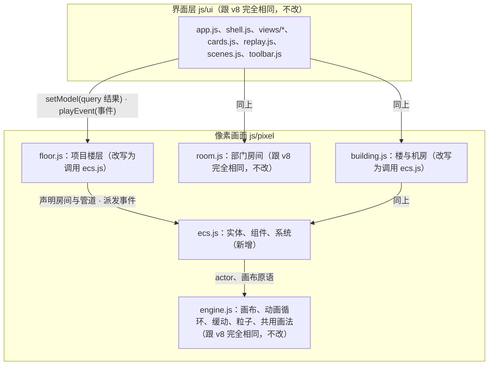

# 原型 v9 构建约定

本文件只写跟 [v8 BUILD.md](../v8/BUILD.md) 不一样的地方。第 1 节（基本要求）、第 4 节（档位）、第 5 节（接口层／示例后端）、第 6 节（界面层：路由、`kit.js`、决定卡片）、第 8 节（示例数据的登记方式与形状、世界设定、跨文件标识、截图）、第 9 节（场景）、第 10 节（测试）、第 11 节（交付）跟 v8 完全相同，直接照抄 v8 对应文件，不重新写一遍；`js/contract/`、`js/ui/`（像素画面以外）、`styles/` 全部原样搬过来，一个字符都不改。变的只是第 2、3、7 节：像素引擎内部从"一个部门一个角色、按状态切姿势"改成实体—组件—系统。

## 1. 分层（对照 v8 BUILD.md 第 2 节）



`floor.js`、`building.js` 对外的 `setModel`/`playEvent`/`resize`/`destroy` 接口跟 v8 完全一样（第 7.3、7.4 节的函数签名不变），界面层不知道下面换了引擎，这是这次改造唯一要守住的边界。

## 2. 文件结构与负责者（对照 v8 BUILD.md 第 3 节）

```
docs/prototypes/v9/            由 docs/prototypes/v8/ 整份复制而来
  js/pixel/ecs.js               新增：实体、组件、系统、房间与管道的图结构声明、任务派发、角色与包裹的推进、对话框的数据
  js/pixel/engine.js            原样保留
  js/pixel/sprites.js           原样保留
  js/pixel/room.js              原样保留
  js/pixel/floor.js             改写：房间与管道来自声明，小人与包裹走 ecs.js，头顶有对话框
  js/pixel/building.js          改写：楼层小人的走位与待机由 ecs.js 推进，机房不变（机房本来就没有"一部门一角色"的问题，见第 7.4 节）
  checks/                       新增：验收脚本（第 4 节）
  其余文件                      原样保留
```

`index.html` 的脚本加载顺序在 `pixel/sprites.js` 之后、`pixel/room.js` 之前插入 `pixel/ecs.js`。

负责者：

| 负责者 | 文件 |
| --- | --- |
| 架构师 | `BUILD.md`、`js/pixel/ecs.js`、`js/pixel/floor.js`、`checks/` |
| 任务 B 楼与机房 | `js/pixel/building.js`：楼层小人是 `ecs.js` 的角色实体（`department: null`），走位目标写进 `ch.spot`，走位与待机动画由 `ECS.stepCharacters` 推进（工作时走到对应部门门口，空闲时随机走动）；机房场景不动 |
| 任务 A1／A2／A3／C／D／E | 跟 v8 完全相同的负责范围，不需要重新做（v8 的交付原样保留） |

v8 的 `docs/prototypes/v8/` 整份复制到 `docs/prototypes/v9/` 作为起点，架构师与任务 B 只改上表列出的文件。

## 3. 像素引擎（`ecs.js`）

### 3.1 实体与组件

四种实体，每种实体是一个普通对象，字段就是它的组件：

```js
// 角色：一个部门一个（Stage 5 的部门内多角色不在这一版引入）
{ kind: 'character', id, department, spot: {x, y}, queue: [task…], current: task | null, rest: 与任务同形状的持续状态 | null, bubble: {text, kind} | null }

// 包裹：PRD 卷轴、交付箱、返工单、放行单、信件；放进管道时生成，到达终点后销毁
{ kind: 'package', id, workItemId, colorIndex, artifact, atRest: {roomId, spotKind} | null, transit: {linkKey, pts, ms, k, pos, onDone} | null }

// 房间：由第 3.2 节的声明生成，运行时加上算好的位置
{ kind: 'room', id, label, roomKind, x, y, w, door, inPort, outPort, pipeOut, desk: {x, w, seatX, seatY}, cabinet, terminal, monitor }

// 管道：由第 3.2 节的声明生成
{ kind: 'pipe', id, from, to, linkKind, pts }
```

`P.ecs.world()` 返回 `{ rooms, roomOrder, links, characters, packages }`：`rooms`、`links`、`characters`、`packages` 各是一个按 `id` 索引的 map（`links` 的键是 `from>to`，传信管是 `from~to`），`roomOrder` 是房间 `id` 按排布顺序的数组。角色对应 engine.js 场景里 `id` 为 `'ch-' + 角色 id` 的 actor；包裹的画法字段（`bmp` 位图名、`color`、`small`）由画面在生成包裹时写上。

### 3.2 房间与管道的声明

```js
P.ecs.declareRooms(world, [
  { id: 'hall', label: '大厅', roomKind: 'hall' },
  { id: 'product', label: '产品', roomKind: 'dept' },
  { id: 'engineering', label: '工程', roomKind: 'dept' },
  { id: 'quality', label: '质检', roomKind: 'dept' },
  { id: 'library', label: '成果库', roomKind: 'shelf' },
  { id: 'operations', label: '运维', roomKind: 'dept', optional: true }
], { hasOps });

P.ecs.declareLinks(world, [
  { from: 'hall', to: 'product', kind: 'handoff' },
  { from: 'product', to: 'engineering', kind: 'handoff' },
  { from: 'engineering', to: 'quality', kind: 'handoff' },
  { from: 'quality', to: 'library', kind: 'handoff' },
  { from: 'quality', to: 'product', kind: 'return' },
  { from: 'product', to: 'engineering', kind: 'tube' },
  { from: 'engineering', to: 'quality', kind: 'tube' },
  { from: 'product', to: 'quality', kind: 'tube' },
  { from: 'library', to: 'operations', kind: 'handoff', optional: true },
  { from: 'operations', to: 'machine_room', kind: 'handoff', optional: true },
  { from: 'operations', to: 'hall', kind: 'return', via: 'under', optional: true }
]);
```

`declareRooms` 按声明顺序从左到右排布（沿用 v8 `floor.js` 的常量：`TOP`、`ROOM_B`、`DESK_Y`、`PORT_STAND`；房间宽度由种类决定：大厅 100、部门房间 110、运维房间 88、成果库在没有运维房间时 136、有运维房间时 82），`optional: true` 的房间在 `hasOps` 为假时不生成。大厅的交接管道从信箱那一侧（`pipeOut`）出发，其余房间的交接管道从右墙的管道口（`outPort`）出发。

`declareLinks` 按 `kind` 对应的路由规则算出折线：`handoff` 与相邻房间之间的 `tube` 走水平线，跨过一个房间的 `tube` 走天花板下的长传信管，`return` 默认走天花板，声明 `via: 'under'` 时走地板下；`from`/`to` 引用 `declareRooms` 里的 `id`，`machine_room` 指走廊尽头通往机房的固定的门（`world.machineDoor`）；`optional: true` 的管道在端点不存在时跳过，其余管道的端点未声明时抛出错误；两个函数的顺序不能颠倒（先房间后管道）。这两个函数替换 v8 `floor.js` 里的 `layoutFor`/`pipesFor`，声明的内容与 v8 画出来的完全一致，不引入新房间。

### 3.3 任务目录

一份任务定义表，取代 v8 `floor.js` 的 `restFor`/`tempWorker` 与 v8 design.md 第 8.3 节那张表在画面里的角色：

```js
P.ecs.TASKS = {
  // 键取自驱动它的事件类型；一个事件类型可能对应多种任务，用 payload 再分支（例如 qa_submitted 按 verdict，tool_started 按工具）
  model_requested: { label: '打字', spot: 'desk', pose: 'type', bubble: 'say', ms: 1400 },
  tool_started_search: { label: '翻找资料', spot: 'cabinet', pose: 'magnify', bubble: 'say', ms: 1200 },
  qa_submitted_release: { label: '放行', spot: 'inspect', pose: 'stamp_once', bubble: 'say', ms: 1100, icon: 'check' },
  package_handoff_out: { label: '放进管道口', spot: 'port_out', pose: 'side_place', bubble: null, ms: 520, facing: 1 },
  // …覆盖 v8 design.md 第 8.3 节里所有"小人动作"的行
};
```

- `spot` 是房间里的一个命名位置：`desk` 工位、`stand` 工位旁站着、`cabinet` 文件柜、`terminal` 终端、`monitor` 监控屏、`inspect` 检验台、`port_in`/`port_out` 左右墙的管道口、`wander` 待机走动的位置（在 `ch.wanderTo`）；具体坐标由 `declareRooms` 生成房间时一并算出。
- `pose` 是 engine.js 已注册的动作名（`P.ANIMS` 的键）；`ms` 是到达 `spot` 以后做这么久；`icon` 是做这个任务时头顶的状态图标；`facing` 是到达以后的朝向。
- `bubble` 为 `'say'` 时头顶显示说话气泡，内容为 `label`（模型请求在流式输出到达时用事件的 `payload.text` 取代默认的标签并逐字追加）；为 `null` 时不显示；队列里的下一项带有 `label` 的说话任务时，头顶显示思考气泡（见 `bubbleFor`）。
- 不出现在这张表里的事件类型是信号，不生成任务，由画面直接改灯、牌子、计数（见 `floor.js` 的 `playEvent`）。
- 交接与传信的任务（`package_handoff_out`、`package_handoff_in`、`package_return_out`、`package_return_in`、`letter_out`、`letter_in`）和待机走动的任务（`idle_wander`）不由事件类型触发，由 `floor.js`、`ecs.js` 直接放进队列。

### 3.4 系统

```js
P.ecs.enqueue(world, dept, key, extra)  // 把任务目录里的一项放进部门角色的队列；extra 覆盖字段（label、facing、onDone……）；extra.front 插到队首并放弃正在做的非 must 任务，extra.must 不会被队列上限挤掉
P.ecs.dispatch(world, event)            // 事件到达：查任务目录，命中就 enqueue 并返回 true；没有命中返回 false，由调用方按信号处理
P.ecs.stepCharacters(world, scene)      // 每帧调用，规则见下
P.ecs.stepPackages(world, scene)        // 每帧调用：transit 不为空的包裹沿 pts 移动，到达终点时 atRest、transit 置空并执行 onDone
P.ecs.bubbleFor(character)              // 返回当前应显示的气泡 {text, kind}，供渲染读取，不改变任何状态
P.ecs.syncCharacters(world, scene, depts, spriteOf)  // 让每个部门有一个角色实体与对应的 actor，去掉不再需要的
P.ecs.actorOf(world, scene, dept)       // 角色对应的 actor
P.ecs.spawnPackage / sendPackage / removePackage / packagePosition / linkActive  // 包裹的生成、沿管道发出、销毁、当前坐标，以及一条管道上有没有包裹在移动
P.ecs.config.idleWander                 // 待机时偶尔起身走动的开关，验收脚本把它关掉
```

`stepCharacters` 每帧对每个角色：

1. 没有正在做的任务、队列非空、走路的脚本已经结束、整层没有静止（`scene.frozen`）时，取队首为当前任务。
2. 目标是当前任务的 `spot`；没有任务时是 `rest` 的 `spot`；两者都没有时坐在工位喝茶（没有房间的角色留在 `ch.spot`，楼里的小人这样用）。
3. 不在目标位置时起一段走路的脚本（站起来、走过去、坐下或者转身）；整层静止时不出发。
4. 到达目标位置后播放 `pose`、朝向与头顶图标；任务从到达的时刻起计时，做满 `ms` 执行 `onDone` 并清空当前任务，走路的时间不算在动作里。

`rest` 由调用方在每次快照更新时写入，形状与任务相同，只在没有任务在做时生效：画面上的持续状态取自快照，动作的起点取自事件，两者走同一段推进代码。

- **流式输出**：`model_stream_progress` 事件把文字接在正在做的 `model_requested` 任务上（第一段取代默认标签，保留最后 120 个字）并让任务从这一刻起多留 `ms`；没有正在做的模型请求时不产生任务。
- **队列上限**：最多留 3 个不是 `must` 的任务，超出时挤掉最早的；交接与传信的任务是 `must` 并且放在队首。
- **待机走动**：没有任务、队列为空、`rest` 的 `pose` 是 `tea`（坐着喝茶）、整层没有静止、没有开减少动画时，每隔 5 至 12 秒放进一个 `idle_wander` 任务（走到房间里的一个位置伸个懒腰，再回工位）。
- `stepCharacters`、`stepPackages` 只往下推进，不产生新的事实；一个域事件必须先经过 `dispatch`（或者画面对信号的处理）才会有反应，两者之间没有另一条路径。

### 3.5 渲染

`ecs.js` 不新增画布画法。`floor.js`、`building.js` 在各自的 `draw()` 里按实体当前的组件值调用 `engine.js` 已有的画法（`P.drawActor`、`paint.chair`、`paint.desk`、`P.drawBitmap`……）：房间取自 `world.rooms`，管道取自 `world.links`，包裹取自 `world.packages`（正在移动的用 `packagePosition`）；角色的 actor 由 `syncCharacters` 建立，走位与姿势交给 `stepCharacters`，画面只读。

管道流动的亮点（`drawPipe` 里沿折线按时间间隔画点）在"快照里两端有活跃事项"或者"管道上有包裹在移动"时出现。

头顶对话框由 `floor.js` 的 `drawBubbles` 按 `bubbleFor` 画：说话气泡（实心尾巴）是当前任务，思考气泡（圆点尾巴）是队列里的下一项；头顶已有状态图标时画在图标上方，开了减少动画时不画。

## 4. 验收

跟 v8 BUILD.md 第 10 节相同的检查（九档 × 页面 × 两种宽度 × 两种主题控制台错误为零，十九个场景全部播放完），并且项目楼层画面、楼与机房在静止时与 v8 逐像素相同。验收脚本都在 `checks/`，命令在仓库根目录运行，需要 Playwright 与本机 Chromium（环境变量 `PLAYWRIGHT_PATH`、`CHROMIUM_EXE` 可以指定位置）：

| 脚本 | 检查什么 |
| --- | --- |
| `matrix-home.js` | 九档 × 首页与机器页 × 两种宽度 × 两种主题共 72 组，控制台错误与横向溢出为零 |
| `matrix-floor.js` | 九档 × 四个项目的概览页 × 两种宽度 × 两种主题共 144 组，控制台错误与横向溢出为零，楼层画面画出了内容 |
| `scenarios.js` | 十九个场景全部按步骤播到最后一步，零错误 |
| `walkers.js` | 楼里的小人由 `stepCharacters` 推进：走位、速度、朝向、门口停靠位置 |
| `identity-building.js` | 楼与机房在同一数据、同一时间基准下与 v8 逐像素相同 |
| `record.js`、`replay.js` | 楼层画面：`record.js` 在 v8 页面播放全部场景，录下楼层画面收到的 `setModel`、`playEvent`、`focus`、`setOverlay` 调用；`replay.js` 用固定的时钟与随机数把同一串调用回放给 v8 与 v9，事件播完静置 14 秒后比较整张画面的像素与小人的位置、姿势、图标，全部相同才通过。`--mode burst` 是事件连续播放、只在最后比较；`--reduced` 是系统设置为减少动画。整层中断时小人停在中断前正在做的动作的位置，只比较小人以外的画面；待机走动在脚本里关闭；有差异的录制重跑一次，重跑相同不算差异。有差异的检查点把 v8、v9 与差异图存进 `.tmp/v9-checks/replay/` |
| `life.js` | 事件过程截图：回放录制的调用，在指定事件之后每隔一段时间截一帧拼成联系表，人工查看小人走到具体位置、包裹沿管道移动、头顶对话框与待机走动 |

事件进行中的画面（小人走向具体位置、包裹沿管道移动、头顶对话框）与 v8 不同，逐像素比较只覆盖静止以后的画面，事件过程靠 `life.js` 的截图查看。这一版验证的是"背后从快照加动画换成实体与任务队列，静止的画面与 v8 相同"。
