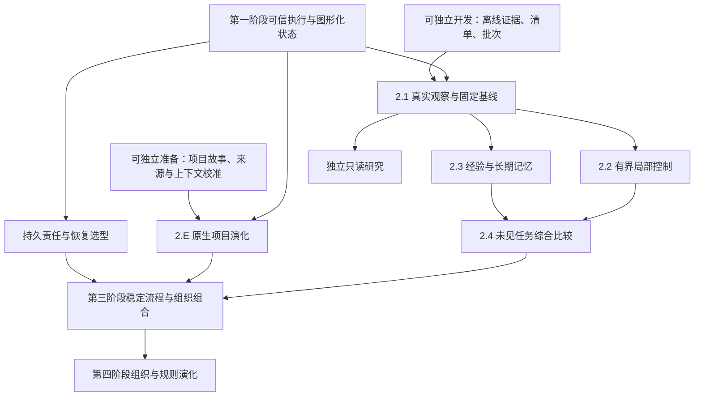

# 后续开发设计与调研资料

> 2026-09-28 新资料：[computer use 实现调研](computer-use-implementations.md)。支持 [D34](../requirements/browser-and-computer-use.md) 里尚未写进设计的虚拟屏幕、截图尺寸与动作集合，核对 Anthropic 工具合同与 `claude-quickstarts` `dee7116` 的容器参考实现、OpenAI computer 工具与容器配方、Gemini 桌面动作、OMP `fdfeef1f78` 的宿主桌面工具，以及 OSWorld 的客户机环境。

> 2026-09-28 新资料：[评测场景选题调研](evaluation-benchmarks.md)。支持 [D32](../requirements/comparison-experiment.md) 与 [评测场景设计](../design/evaluation-scenarios.md)，记录 WebGen-Bench、ArtifactsBench、FeatBench、PRDBench 中选用任务的来源、版本、需求、检查与公开成绩，同档的其他候选，以及 Terminal-Bench 2.0、Harbor 与其他没有选用的评测和原因。

> 2026-09-28 新资料：[浏览器与 computer use 调研](browser-and-computer-use.md)。支持 [D34](../requirements/browser-and-computer-use.md)，记录 Codex（`69f7140`）、OMP 与 OpenCode 的做法，以及 Playwright MCP、Chrome DevTools MCP、OpenAI 与 Anthropic computer use、browser-use 的比较。

> 2026-09-26 新资料：[Anthropic 费马大定理形式化与 Prove2Me：一手来源调研](fermat-formalization-prove2me.md)。核对 Anthropic 博客《Formalizing Fermat's Last Theorem》、Prove2Me 论文（arXiv:2608.28433）与证明仓库：早期多 agent 因丢失项目状态失败，改用陈述与证明分离且不可修改、proof-sketch 边证边拆、人审核有边界的 mission 与回读、milestone 之后成功；记录「去中心化」的准确含义与前提，与 Yudao 的对照、冲突，以及「在循环中嵌入确定性 DAG 节点」的待讨论材料（未形成决定）。

> 2026-09-26 新资料：[提示词审计（2026-09-26）](prompt-audit-2026-09-26.md)。按 `/claude-api prompt-audit` 检查规则文件、部门指令、上下文固定规则、压缩提示词与工具描述，列出 21 项结果与 5 项只登记的条目，附可以逐段采用的补丁；规则文件的补丁与 `harness/` 的补丁、工具合并都已于 2026-09-26 采用（`harness/` 部分见 #46）。

> 2026-09-25 新资料：[Loop engineering 调研](loop-engineering-2026.md)、[Graph engineering 与 2026 年基于图的 agent 编排](graph-engineering-2026.md)、[Anthropic 2026 年发布的 AI-native SDLC：一手来源调研](anthropic-ai-native-sdlc-sources.md)。三份资料核对 2026 年确定性流程工程化的三条动向，重点记录每种做法中下一步、完成与事实接纳、每次调用的上下文、持久性分别由代码还是 LLM 决定；AI-native SDLC 的架构比较见 [AI 原生 SDLC 对 Yudao 的启示](ai-native-sdlc-insights.md)。

> 2026-09-25 新资料：[上下文组装：参照调研](context-assembly-reference.md)。支持 [D25 语义系统](../requirements/semantic-system.md)「重点 TODO：上下文组装」专题，含 Yudao 现行上下文装配、清单、压缩与提示缓存的事实，OMP 与 opencode 的系统提示构造、规则的放入与按路径附加、按需取得、旧工具结果裁剪、提示缓存与子 Agent 上下文，以及 Anthropic、Manus、Letta、Zep、Cognition、ExpeL、ACE 的做法与上下文长度研究。

> 2026-09-25 新资料：[惊讶与预测误差：参照调研](surprise-and-prediction-error.md)。支持 [D25 语义系统](../requirements/semantic-system.md)「TODO：惊讶机制与教训发现模块」专题，含自由能原理与贝叶斯惊讶的定义，EM-LLM、Titans、Nemori 用惊讶决定记什么的做法，PreAct 等先写预期再比较的做法，Reflexion、ExpeL、CLIN 从失败中提取教训的做法，各家 API 是否返回 token 概率，以及 OMP 按「摩擦」写入记忆的规则。

> 2026-09-25 新资料：[Semantica 参照调研](semantica-reference.md)。支持 [D25 语义系统](../requirements/semantic-system.md)的整理部分，含 Semantica 0.7.0 的本体、来源与证据、冲突、上下文与决定模块，与 Yudao 七类内容和轨迹的对照，与事件溯源、状态主权、就地失败原则的冲突，可以借用的做法，以及 refact 的集成设计与同类项目。

> 2026-09-25 新资料：[游戏化 Web 界面的技术调研](web-frontend-technology.md)。支持 [D30 游戏化的 Web 界面与界面实现](../requirements/web-game-frontend.md)，含 Pixel Agents、AI Town、《缺氧》的覆盖层与状态管理，PixiJS、Phaser、XState、GSAP、中文像素字体的现状与许可，以及 OpenCode 的接口定义、SDK 生成与事件流补齐。

> 2026-09-24 新资料：[JEV 决策模型：能力边界与在 Yudao 中的用法](jev-decision-model.md)。支持 [D28 元观察与规则检查部门](../requirements/meta-observer.md) 与 [D25 语义系统](../requirements/semantic-system.md)的证据核对，含接口与费用、擅长与不擅长的判断、中文未经验证、状态注入与选项顺序的风险，以及论文与使用者建议的做法。

> 2026-09-24 新资料：[语义系统与部门内多角色：参照调研](semantic-system-and-department-roles.md)。支持 [语义系统](../design/semantic-system.md) 与 [部门内多角色](../design/department-roles.md) 两份设计，含 OMP、OpenCode 的子 Agent 与记忆实现，以及 Graphiti、Mem0、Letta、Anthropic、Magentic-One、MetaGPT、MAST 等一手来源。

> 2026-09-19 新资料：[OpenCode Go 与统一 Provider 层一手核对](opencode-go-provider-integration.md)。支持 [Stage 2.7](../archive/stage-2-provider-plan.md)，含 Go API Key、三协议、会话身份、模型发现限制和固定 OMP 源码依据；下文保留旧研究导入背景。

> 日期：2026-09-06。工作树：`D:/codes/yudao-stage2`；分支：`codex/framework-and-stage2`。
> 本轮交付是细化设计、论文与成熟实现研究。没有新增运行能力，没有完成正式收益实验，也没有改变第一阶段验收状态。
> 上位入口：[总体路线图](../program-roadmap.md)、总体架构、实施准备。

### 当前来源与设计状态

2026-09-06 本轮对齐依据第一阶段工作树 `D:/codes/yudao` 的 `fff4b7d` 及正在进行的未提交原生改造。最新用户决定以该树 `docs/requirements/` 的 D01-D11、`docs/confirmed-requirements.md` 和 `docs/native-loop-design.md` 为准；本目录的旧基线描述、OMP 接入与上下文方案不能覆盖它们。原 OMP 版 MVP 成功是历史验收，原生循环和新增流程须用新证据验收。

本轮结论先读第一阶段设计对齐及供原会话使用的实施提示。后者要求自主核对原工作树最新实现与决定，不直接 cherry-pick 本分支旧运行代码；本轮只形成设计和资料对齐。

后续进展见 第一阶段独立验收。当前新增 D17/R21 的模型重试正在第一阶段实施，相关责任、失败历史与只读用量边界见 [重试设计核对](../archive/research/provider-retry-design-review.md)；本目录旧基线不能覆盖新的确认要求。

## 1. 阅读路径

用户希望阶段覆盖完整能力，同时在开发前充分设计和调研。这里按能力主线组织资料，近期工作细化到可开发和验收，后续能力细化到职责、数据流、失败处理和可验证假设。代码层字段、数据库表与产品参数随对应工作包确定，不预建通用平台。

| 资料 | 解决什么问题 | 建议使用时机 |
| --- | --- | --- |
| 第一阶段设计对齐 | 最新原生循环与 SDLC、演化式设计如何合并，哪些缺口本阶段完成 | 审查第一阶段范围及给原会话补充任务前 |
| [领域知识与专家补全](domain-completion-design.md) | 怎样把想法对应到成熟知识体系，自动补齐常规缺口，只澄清关键取舍 | 理解用户意图及各工作阶段准备时 |
| [演化式开发与上下文管理](evolutionary-development-context-design.md) | 需求和架构持续变化时，怎样重构解耦、更新现状、保留原因并按需查历史 | 每项变更、重构和任务接续时 |
| [原生项目演化设计](native-project-evolution-design.md) | Yudao 怎样登记已有项目、接续变更、核对并采纳新代码，让新会话继续开发 | 2.E 设计、E0 校准与真实接入前 |
| [AI 原生 SDLC 参考与洞见](ai-native-sdlc-insights.md) | 用户提供的 SDLC playbook 对三部门职责、连续项目与评价有何启发 | 复核循环架构与吸收边界时 |
| [离线证据、复核与批次分析](../archive/research/offline-review-design.md) | 证据如何保存、搬移、核验，怎样从显式本地材料复核，如何诚实汇总 | 下一批开发前完整阅读 |
| [证据与独立评价研究](../archive/research/evidence-evaluation.md) | 来源标准、成熟评价平台、评价局限和统计方法支持哪些设计 | 复核近期合同及准备正式基线 |
| [记忆与局部控制研究](../archive/research/memory-and-control.md) | 如何从事实形成候选，如何验证、检索、采用、处理冲突和失效 | 2.2/2.3 设计与隔离实验 |
| [组织、运行与演化研究](organization-runtime-evolution.md) | 子循环、技能、协议、持久恢复、运维和规则维护怎样分工 | 第三/四阶段与恢复选型实验 |
| [可观测性详细设计](observability-design.md) | 每阶段显示什么、来源如何关联、命令和状态如何区分 | 各阶段界面接入前 |
| [改善验证与选型实验规约](experiment-protocol.md) | 怎样区分校准、选型、收益与采用；如何控制泄漏、分母和成本 | 每次正式实验之前 |

近期实施者先读离线设计，再按具体问题查研究依据。设计评审者先读本页的依赖与决定，再核对专题中的来源及限制。正式实验负责人以实验规约为入口，不能把某篇论文的收益数字直接写为本项目目标或证据。

## 2. 能力依赖与可并行内容

图表示取得执行作用和形成有效证据的依赖。文献阅读、概念设计、人工故障材料和隔离的实现选型可以提前进行。持久恢复本身不需要先学会经验，但真实接入仍依赖第一阶段事实和副作用合同；它不能从另一套状态来源独立接管任务。

领域知识是所有比较方案共有的专业基础，领域引擎在产品、设计、工程、QA、运维中补齐未定义部分。已有知识不等待本系统学习基线；图中的经验前置条件针对系统新学到的建议。补全设计与校准材料可独立准备，真实部门接入另按稳定接口实施。

项目日常演化同样从开发开始支持，图中第四阶段的前置条件不约束普通需求修改或重构。第一阶段按最新确认完成任务内持续输入、PRD 维护、工程事前计划、双向咨询与受限动作请求、prompt 可见可改；本轮另建议前移完整交付封存及受控删除、移动，尚未新增实现。第二阶段 2.E 独立交付跨 run 的持续项目、完整基线接续、状态采纳和新会话接续，不等待学习基线；E0 的固定故事、来源合同与上下文校准可以立即准备。第三阶段扩展持续并行、中断恢复、未知副作用和部署维护。

上下文区分两种范围：当前同任务同部门历史按 D08/D10 完整保留、跨激活延续，并在需要时使用有来源摘要及近期完整回合；跨 run 的项目知识和历史原因才按需选择。后续语义分解与更细粒度选择不顶替当前用户要求。当前采用循环/步骤/超时及容量限制，provider 用量只作观察；第二阶段额外资源预算仍是待明确语义与授权的候选设计。

| 当前可以完成 | 当前可以设计、尚待实测 | 取得作用前必须等待 |
| --- | --- | --- |
| 证据包加载与核验、本地清单、只读批次汇总 | 局部控制策略、经验生命周期与影响查询 | 控制及经验正式采用需要可信基线与独立比较 |
| E0 连续项目故事、来源合同与上下文校准材料 | E1-E3 项目登记、变更采纳、历史查询及项目视图 | 真实项目接续需要第一阶段稳定接口，项目采纳须核对目标、受审代码与基线 |
| 统计校准材料、失效与恢复故障场景设计 | Temporal/LangGraph 等恢复机制的合同对照 | 真实恢复接入需要责任、状态和外部副作用边界 |
| 图形化视图、查询语义和验收规约 | 内部协作、技能与协议候选 | 真实 Web 接入需要第一阶段稳定接口 |
| 来源文献、成熟实现比较、实验模板 | 规则维护及组织变更流程 | 真实变更需要相应独立评价与采用权限 |

本轮新增资料不表示表中的开发项目已经完成。

## 3. 本轮形成的架构决定

| 决定 | 依据与理由 | 当前状态 |
| --- | --- | --- |
| 保留执行、知识、评价职责分离 | 任务完成、经验可信与系统改善具有不同权威来源 | 沿用总体架构 |
| 领域引擎专指专业理解与补全 | 用户想法需映射到成熟概念，常规未定义细节按适用实践完成 | 用户最新澄清；整体层级称业务引擎层 |
| 已有知识与新学习经验分开使用 | 基础专业工作不应等待本系统实验，新增改善主张仍需验证 | 两条路径共享来源与查询，各自判断适用性 |
| 模块结构与上下文同步演进 | 需求和方向会变，代码与任务依据都不能停留在旧版本 | 日常开发共同要求，不等待第四阶段 |
| 当前状态、简短原因和项目历史分层读取 | 跨任务接续需要有效依据，也应能解释重要历史选择 | 目标与实现分别记录；同任务部门历史遵守 D08/D10，项目资料按需检索 |
| 原生项目演化作为第二阶段独立工作包 | 仅有单次运行与项目文档不能保证下一次变更正确接续 | 2.E 待实施；目标、实现和采纳分开核验，不依赖学习收益 |
| 离线材料先形成自包含证据目录 | 当前报告不能跨进程重载，绝对路径妨碍搬移；完整交付必须可取回 | 进入近期开发设计 |
| 读取只核验与派生，不重新执行 | 运行事实与后续分析分开，避免查看报告产生动作 | 进入近期验收合同 |
| 校准、人工声明和可信采集分层 | 哈希自洽不能证明真实发生，重复报告也不是独立任务 | 进入来源与统计合同 |
| 图关系围绕来源和影响查询 | 文本相似和图连接不足以证明同问题、同原因或有效经验 | 第二阶段最小知识职责 |
| 长期保存与实际注入分开 | 持久存在不等于当前有效；检索不具有采用权 | 2.3 必需边界 |
| 平台产品按明确缺口选择 | 原生主树采用官方模型 SDK，Python/SQLite 仍有基础；候选各有部署和语义成本 | 不因概念名称新增平台，OMP 只作源码参考 |
| 异步恢复单独验证未知副作用 | 事件重放、状态恢复和外部动作确认保证不同 | 第三阶段选型合同 |
| 规则和组织版本不直接替换在途任务 | 已发送信息和外部动作不能靠改版本撤回 | 第四阶段必需边界 |
| 图形化是各阶段交付面 | 运行图、轨迹、内部任务和采用视图各回答不同问题 | 第一阶段运行图仍由原会话交付 |

这些决定确定职责与证据边界。具体工作流引擎、向量索引、图数据库和监控服务尚未选定；它们需要在实际需求下比较，不以论文或产品知名度代替验证。

## 4. 论文与实现调研怎么使用

专题来源优先采用论文原文、官方标准、官方文档和官方仓库。每项记录访问日期、实际阅读范围、关键章节或源码位置、支持的设计判断和不能外推的限制。

阅读深度区分为摘要、正文相关章节、官方文档及源码；“访问论文页面”不写成“完整复现论文”。正文相关章节核验也不等于已经审查所有证明、附录和实验细节。

源码说明具体版本的实现行为，不自动构成产品性能结论。本轮未安装外部平台、运行其完整工作流或复现论文收益。重要选型进入开发时重新核对版本、Python 支持、维护状态和许可。

来源中的机制与本项目决定分别表达。例如反思论文支持研究反馈重试机制，但不直接证明跨任务经验可靠；评价平台的数据摘要可供关联运行，但不一定适合完整交付核验；持久工作流可恢复控制过程，但不能自动使任意外部动作只发生一次。

网络失败如实记录，找到官方替代路径后说明实际成功入口。既有开放性研究单独引用原核验记录，本轮不将其伪装为重新阅读的论文。

## 5. 研究资料的更新规则

每次开发前核对该工作包实际依赖及来源版本。若代码或实验推翻设计假设，在对应专题记录反例和新决定，再同步阶段计划；不让日记、路线和详细设计形成互相矛盾的当前口径。

每份结果附材料、系统、评价和方法版本。设计文档说明目标行为，代码提交及验收记录说明已实现行为；两者不能互相替代。

过时实现和接口按项目规则删除，不保留兼容层。历史研究和评价证据可以保留并标明失效，因为它们记录当时发生的事情，并不是继续运行旧接口。

## 6. 最近三份开发交付

| 独立交付 | 开发前直接使用的资料 | 完成时应留下什么 |
| --- | --- | --- |
| L1 持久证据与只读重核验 | 离线设计第 4-7、12 节；证据评价专题 | 移动目录、删除原材料、篡改和禁止执行的验收记录 |
| L2 显式本地交付复核 | 离线设计第 8、12 节 | 一份外部多轮清单和真实固定检查证据，包括失败/缺失 |
| L3 批次统计与来源查询 | 离线设计第 9-10、12 节；实验规约 | 重复、重评、缺失、损坏、混合来源和口径的校准结果 |

L1-L3 是 2.1-A/B 内部离线续批，不是新增大阶段，也不是正式基线。建议第一阶段保存每轮完整交付，不等于将可搬移证据包、重算、外部清单和批次统计前移。之后再接真实来源、Web 分析和固定基线。主代理负责设计、评审与验收，Codex 子代理实施，按可独立核验的小交付提交和推送。

与 L1-L3 并行可先准备 2.E 的 E0 固定项目故事和来源合同。E1-E3 待第一阶段稳定后接入，验收同一项目三个变更任务及新会话接续；具体顺序见实施准备。本轮仅完成新增设计，L1-L3 与 E0-E3 均不预填通过。
