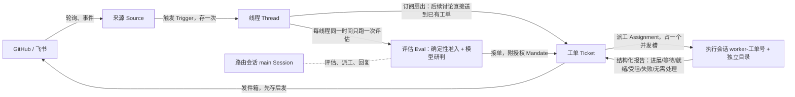

# DeepSeek Super-agent（dsh-superagent）：它做了什么，Yudao 能不能用它的异步框架

> 日期：2026-11-02。状态：调研，未安装、未运行 dsh-superagent，未复现任何结果。
> 用途：回答两件事：DeepSeek 发布的 Super-agent 到底做了什么；它那套异步执行的做法，Yudao 以后能不能直接用、能借鉴哪些、和总图冲突在哪里。支持 [总体路线图](../program-roadmap.md) 阶段二薄片 ⑤「Yudao 做自己的工单」、阶段三「常驻自转」与阶段四「拆开部署、细粒度协作」，以及共同规则第 5、8 条（先用成熟的库、先看成熟产品）。
> 阅读范围：原型仓库在固定提交 `6337fc8`（2026-10-31，唯一一次提交）上读取了 README、编号文档 000 至 003 全文、004 与 007 的相关章节、提示词与部分源码；配套设计文章的原文没有找到，只读到第三方译文；DeepSeek Harness 本体没有读源码。详见第 8 节。新闻稿只用来找一手来源，结论不以新闻稿为依据。

## 1. 结论

DeepSeek 这次发的不是新模型，是一个**常驻的、事件驱动的编码 agent 框架原型**：名字叫 dsh-superagent，是 DeepSeek Harness（DSH，它们 2026 年 8 月发布的 agent 框架）的一个插件包，MIT 许可，TypeScript，盯住一个 GitHub 仓库（可选再接飞书），有人点名要它干活，它就开一张工单，给这张工单单独开一个 agent 会话和一个工作目录去做，做完回到原来的对话里，通常是开一个 PR。核心设计是一个路由会话加多个执行会话（新闻里叫 Router 与 Worker），中间靠一个 SQLite 里的持久队列连起来。它自己说明是研究原型、不是正式产品、和内部版本不一样，文章里的一部分设计没有实现。

**Yudao 不应该直接用它的框架或代码，应该借它四个做法。** 理由一句话：它解决的是「一个 agent 怎样常驻在团队里、接活、并行干活、不吵人」，Yudao 解决的是「几个角色怎样围着一份事实把活干对，并且能查、能停、能核验」。它的底层（会话里带历史、工单状态是可改的行、完成靠执行者自己报 ready、没有核验角色）和 Yudao 的内核相反；但它的外圈（从外部接活、谁有资格派活、并发上限、长命令转后台、先存后做的副作用队列、少打扰人的规矩）正好是 Yudao 阶段二 ⑤ 到阶段四还没建的部分，而且都能放在外圈，不碰内核。

| 问题 | 判断 |
| --- | --- |
| 能不能直接用它的框架 | 不能。它是 DSH 进程里的插件，依赖还在 alpha 的 DSH，Yudao 是 Python 自己的内核；用它等于把薄驱动和一份事实放进别人的进程，违反总图第一节「只有一份」与第二节内核环 |
| 能不能直接用它的代码 | 不建议。单次提交的研究代码，没有安全审计，执行会话以操作者的系统用户身份不经批准跑命令；共同规则第 5 条要求成熟、有人维护，不满足 |
| 能不能当一份定义吸收进 Yudao | 大部分能。它的结构正好是总图写的「最差的配置」：直做、没有核验角色、开环完成，外加一个从外面接活的入口。这是检验「新的脚手架当定义与角色材料吸收、骨架不改」的一个现成样本 |
| 值得借鉴的 | 外部入口与派活资格（来源、触发、评估、授权）；长命令转后台让执行中途能接新输入；并发槽并给人留一个槽；先存后做的副作用队列与按对话保序的发件箱；「注意力是成本」的少打扰规矩 |
| 冲突的地方 | 完成由执行者自己宣布；执行会话跨轮保留历史；状态是可改的行而不是只追加的事件；路由与执行两种角色写死在代码里 |

## 2. 他们到底做了什么

### 2.1 名字、来源与成熟度

- 名字：仓库 `deepseek-ai/dsh-superagent-prototype`，包名 `dsh-superagent`，版本 0.1.0。新闻里的「Super Agent / Super-agent」指的是它和配套文章《Exploring Super-agent Design: Towards a More Autonomous Agent System》讲的设计。[S1][S2]
- 时间：仓库唯一一次提交在 2026-10-31 20:05（北京时间）。[S1]
- 许可：MIT，版权人 DeepSeek Harness Team。[S1]
- 形态：DeepSeek Harness 的 bundle，运行在 DSH 进程里，依赖 `dsh ^0.2.1-alpha.2`、Node 22 以上。约 1.5 万行 TypeScript，其中领域核心约 2100 行。[S1]
- 自述：「研究原型，仅供参考，不是 DeepSeek 的正式产品」；「为发布做过改编，和内部版本、和文章描述的实现都不完全一样；文章讨论的一部分设计是未来方向，原型里没有实现」；大部分工程由编码 agent 完成，可能有缺陷、风格不一致。[S1]
- 没有公开基准数字与用户数；没有安全审计。[S1][N1]
- 用哪个模型：仓库不规定，模型由 DSH 的模型适配器提供，路由会话与执行会话可以各配模型。[S1]

### 2.2 一张图看结构

- **来源（Source）**：一个事件流，GitHub 是通知、订阅的 Issue/PR、CI 变化；飞书是群消息。来源自己记读取位置，重启不重放；丢掉机器人自己的消息。[S1 001]
- **触发（Trigger）**：一条不可变的事件，审计与去重的单位，同一个触发接两次只开一张工单。[S1 001]
- **线程（Thread）**：按时间排的触发，同一线程同一时间只有一个评估在跑，评估期间新到的触发并进下一批。[S1 001]
- **评估（Eval）**：两层。第一层是确定性的准入：谁在允许名单上、是不是点名了 agent，给出「明确」「推断」「不接」三种强度；第二层是路由会话里的模型研判，结果是接单、停止、忽略、未完成四种之一。评估本身不存状态。[S1 001, 002]
- **授权（Mandate）**：接单时授予的东西：策略版本、范围、强度、匹配的规则、发起人在那个来源上的身份。授权不可改，范围变大就开新工单；策略改了不取消在跑的工单，只把变化作为通知送过去，工单恢复前按新策略重新核对授权。[S1 001]
- **工单（Ticket）与派工（Assignment）**：工单是一件被授权的工作，自己定义状态，不跟着执行会话走；一张工单一生可以有几次派工（重试、重启都是新派工）。[S1 001]
- **订阅（Subscription）**：工单订阅它相关的线程，之后线程里的讨论（包括 CI、机器人）直接作为上下文送到工单，不用再点名 agent，也不再过评估；但送进来的上下文不带来新的权限。[S1 001, 002]

### 2.3 它所谓的「异步」具体怎么运作

它的异步不是一个通用的工作流引擎（不像 Temporal 那样记执行历史再重放），而是下面几件事拼起来的：

1. **事件驱动的接活。** 来源轮询 GitHub 和飞书，把事件存成触发；没人找它，它不动。主动干活（没人点名）要团队写好规则，而且先以「只记录本来会做什么」的模式起步。[S1 000, 002]
2. **一个路由会话，多个执行会话。** 路由会话只做评估、派工和回复，工具集更小；每张工单一个执行会话 `worker-<工单号>` 和一个目录，目录通常用 `git worktree` 准备（准备命令限时 10 分钟）。[S1 003]
3. **并发槽。** 可配置 1 到 16 个执行槽；另外永远多留一个槽给「人的消息或状态询问」，所以新活再多也挡不住人继续一张已有工单。CI 结果之类的其他输入排队等普通槽。[S1 003, src/limits.ts]
4. **执行中途接新输入。** 执行会话里前台命令跑满 5 秒自动转后台，于是会话能在下一步就收到新消息，而不是等一个长命令跑完；一轮结束时还有后台任务，工单继续占槽，任务完成后在同一个槽里唤醒会话；每轮结束后后台任务最多再跑 30 分钟，超时就杀掉并报告「等待」。[S1 003]
5. **先存后做的副作用队列（Effects）。** 引擎做出决定以后要做的事：把候选递给路由会话、启动派工、把输入送到执行会话、往外发消息，都先在同一个事务里写进 SQLite 的 `effect` 表，提交以后再执行；同一种类同一个键只有一行，重复入队只替换内容；失败按指数退避重试，`Later` 表示暂时做不了（比如没有空槽）而不算失败；连续失败三次才报成系统问题。[S1 007]
6. **按对话保序的发件箱。** 一张工单往同一个对话发的消息按入队顺序发出，确认一定在结果前面；别的工单不受影响；对话没了才丢弃，丢弃也留记录，永不重发。[S1 003, 007]
7. **重启恢复。** 正在跑的派工记为「主机重启」结束，新派工带一段恢复说明，要执行者「在重复任何外部动作前，先查目录、git 历史和 GitHub」；没被会话吃进历史的输入在新派工里重发，且保证只有一份。[S1 003]
8. **单写者与纯核心。** 一个 SQLite 文件，只有 Store 打开它；触发、线程、决定、工单、派工只有引擎能写；`src/core` 不做 I/O，只依赖 Node 的哈希。[S1 007]

### 2.4 工单怎么结束，谁说了算

- 执行会话用 `orchestrator_report` 报告结构化的状态：进展、等待、就绪、受阻、失败、无需处理。[S1 007]
- 没有 PR 的工单，一个「就绪」报告就算完成；有 PR 的工单，在它开的 PR 都关掉或合并以后结束。[S1 003]
- 自动合并由「交付要求」提示词管，默认不让 agent 账号开自动合并；默认只允许改动少于 200 行、审批覆盖最新提交的 PR 自动合并。真正的约束靠 GitHub 的分支保护。[S1 003]
- 也就是说，**系统内部没有独立核验的一方**：执行者自己跑检查、自己报就绪，质量把关交给 GitHub 上的人和 CI。[S1 003, prompts/team/scope.md]

### 2.5 它的设计哲学

整个项目的第一原则是「**占用人尽量少的注意力，给出尽量多的价值**」：只在被点名或规则允许时动手；确认一次就安静干活，只在有结果、要决定、做不下去时开口；一次只问一个具体问题；按影响停而不是按工作量停（局部改动做到可审查的结果，需要设计决定的改动带着一个清楚的问题停下）；面板只显示要人处理的东西。[S1 000]

设计上也克制：概念少（业务需求变成某个概念的属性或一段提示词，不加新概念）、设置少、文档按编号顺序读。[S1 000]

### 2.6 配套设计文章说了什么（只读到第三方译文，未核原文）

DeepSeek 的域名上没有找到这篇文章的原文，官方的 DeepSeek Harness 页面也没有链接它；能读到的全文是 offloop.org 的英文译文，署名 DeepSeek Harness Team、2026-10-31。原型 README 确认了文章的标题。下面几点按「译文，未核原文」对待，结论不以它为准。[S2][S3]

- **要解决的问题**：现在的 agent 仍以单个会话为工作单位，并行时人要在会话之间切换、记住各自的上下文；「一个人通常只能同时跟住三到五个活跃会话」，单个任务的上限由模型能力决定，多个任务的上限由人的注意力决定。
- **四个特征**：连续（就在群聊、GitHub 评论这类熟悉的地方交互）、高效（快速响应，同时并行完成多件复杂任务）、主动（持续观察环境里的事件，值得处理的才动手，不需要时保持安静）、持久（一直在线，长时间运行中遇到异常自动恢复）。
- **路由层**：一个常驻的大模型会话，是全局的顺序点、协调点和记忆，自己不执行任务，甚至可以没有 shell 工具，可以用轻一些的模型；一轮推理期间到达的事件攒到下一轮一起处理。
- **执行层**：每个执行者上下文互相隔离、工具齐全、不直接和人说话，向路由层报告，由路由层替它回复；执行者之间不点对点通信，靠多对多的线程订阅看到彼此的动作。
- **异步**：把耗时的命令和子任务调用换成异步的 `start()`、`stop()`，模型立刻拿到「已启动」，接着做别的。文章说这个机制已经在 DeepSeek Harness 里实现，但默认没有打开。
- **看门狗**：系统外面要有一个独立的控制循环；只看进程活没活不够，很多故障是模型陷进没有进展的循环；它检查执行者有没有实质进展，外部间歇故障时持续检查直到恢复。原型里没有这个部件。
- **质量**：译文里没有独立核验执行结果的一方，靠给执行者用最强的模型和看门狗的进展检查。
- **实验**：第三方转述的数字只比较完成时间与缓存读取量（用定时工具代替真实编码），转述者明说不衡量编码正确性。
- **待解的问题**：两层结构怎么扩展、每层内部怎么组织、长期记忆（被称为扩展的主要瓶颈）、上下文边界、安全（接外部事件又连着带凭据设备的云端 agent 会面对提示注入）。

## 3. 和 Yudao 总图逐项对照

| 总图的东西 | dsh-superagent 里对应的 | 关系 |
| --- | --- | --- |
| 一份事实（只追加的事件库） | SQLite 里的触发表只追加，但工单、线程、派工是整行改写的 JSON；没有从事件重放出状态的能力 | 冲突：Yudao 的事实只追加、重放不调模型；它的状态以可改的行为准 |
| 写入口与裁决（U ≠ f） | 引擎是唯一写者，评估的准入层是确定性的；但执行者的「就绪」报告直接结束工单 | 一半相通：单写者一致；完成判定不一致 |
| 薄驱动与路由槽位 | 路由会话（模型）决定接单和派工 | 不同：Yudao 的路由是读事实、读定义的实现，不认识部门名；它的「路由」和「执行」两种角色写死在代码里，正是 Yudao 架构排查里找出的那类问题 |
| 装配槽位 | 评估上下文有固定窗口（线程前 5 条、触发前后各 5 条、截断长度），执行会话自己读资源 | 可借鉴具体参数，结构不同：Yudao 的装配从事实减出、交给模型的字节记进事实 |
| 执行槽位与外包角色 | 每张工单一个长期会话，跨轮保留历史；目录跨派工复用 | 冲突：Yudao 的外包角色是全新状态目录、无历史快照，交回快照与差异 |
| 动作的缝（回执、核实办法、能否取消） | 前台命令 5 秒转后台、后台 30 分钟上限、重启后「先查 git 和 GitHub 再重复外部动作」 | 可借鉴：转后台与上限是动作合同里「能否取消、多久算超时」的一种具体做法；它的重启核实比 Yudao 的动作核实弱 |
| 核验角色与开环完成 | 没有核验角色；就绪即完成 | 它就是 Yudao 的「开环完成」形态。Yudao 能表达它，它表达不了 Yudao 的三部门 |
| 定义（带版本、创建事项时冻结） | 策略带版本，授权记下接单时的策略版本，策略改了不取消在跑的工单、恢复前重核 | 相通，可借鉴：与「事项创建时冻结定义」「限定采用、可撤回」是同一种思路 |
| 中途的指导（D06 运行中追加输入） | 输入在执行会话的下一步送达；人的消息有专用槽 | 相通：Yudao 已定「当前工具完成后、下一次模型调用前处理新输入」；它多了「长命令自动转后台」，让「当前工具」不会一直挡着 |
| 页面与决定请求 | 面板只列要人处理的；一次只问一个结构化的问题 | 相通，可借鉴它的克制规矩 |
| 看门狗 | 原型里没有；文章（译文）里的看门狗是进程外的独立控制循环，查执行者有没有实质进展 | 思路相通，分工不同：Yudao 的看门狗管版本切换与健康，「有没有进展」由边界的上限和观察者的振荡信号管。文章这一点支持 Yudao 把两者都放在被管对象之外 |
| 接口的缝（命令、查询、事件流） | 来源是插件，经引擎的 `receive`、`bindThread` 等受限入口写；回复走发件箱 | 可借鉴：外部入口可以做成接口外的一个客户端 |
| 拆开部署 | 单进程、单机、一个状态目录加锁 | 不涉及 |

## 4. 能直接用的、能借鉴的、冲突的

### 4.1 能直接用的：几乎没有

- **代码不用。** 它和 DSH 的会话、预设、插件运行时（Cordis）缠在一起，拆出来就不剩多少；而且是单次提交的研究代码。共同规则第 5 条（成熟、有人维护）和第 7 条（不接受「先这样以后再换」）都不支持引入。
- **DSH 当外包角色的执行环境**：理论上属于执行的缝允许的「外包角色」，但本次没有核实 DSH 是否支持 ACP 这类外部代理协议，也没有读 DSH 本体的仓库，不下结论。要用，前提是它能按 Yudao 的外包合同运行：全新状态目录、无历史快照、交回快照与差异。
- **能直接拿来用的是它的提示词思路**：`prompts/team/scope.md`（按影响停、什么时候带着问题停下）、`communication.md`、`delivery.md`。这些是角色材料，正好落在 Yudao 定义层的角色材料里，按 Bender 的目标「脚手架当 prompt 吸收、不改骨架」进来。

### 4.2 值得借鉴的四个做法

按价值排序，都落在外圈，不碰内核：

**① 外部入口与派活资格：来源 → 触发 → 评估 → 授权。**
Yudao 现在只从页面接意图。阶段二 ⑤「Yudao 做自己的工单」和阶段三「常驻自转」都需要从 GitHub 这类地方接活：Issue 或评论里点名，就开一个事项。它这套做法直接可用的是：事件存一次、按身份去重；同一线程一次只评估一次、期间到的并进下一批；准入先走确定性名单、再交模型研判；接单时把当时的规则版本记进授权，规则改了不取消在跑的事、恢复前重核。

放在 Yudao 哪里：作为接口的缝外面的一个客户端，像页面、命令行一样只经命令写入，「谁有资格派活、以什么强度」是定义里的数据，由裁决按定义判。这样不加新方框、不动内核。这一点要总架构师确认（见第 6 节）。

**② 长命令自动转后台，让执行中途能接输入。**
Yudao 已定新输入在「当前工具完成后、下一次模型调用前」处理（D06）。缺口是：一个跑十分钟的测试会让「当前工具」一直挡着。它的做法是前台命令 5 秒转后台、后台任务完成时唤醒会话、每轮之后后台有时间上限、到限杀掉并把被杀的任务写进报告。在 Yudao 里这是动作合同里一类动作的规矩（多久转后台、能否取消、超时怎么记回执），上限来自定义，属于执行实现，可以整体重写。

**③ 并发槽，并永远给人留一个槽。**
阶段四要「两个项目并行」「任务池」。它的做法简单有效：执行槽上限是一个数，另外永远多留一个槽给人的消息；准备工作区慢只拖它自己。在 Yudao 里这是定义里的一个上限，由裁决与边界在派发时核对；「给人留一个槽」值得写进上限的含义里，否则自转的活会把你的指导挤在后面。

**④ 先存后做的副作用队列与按对话保序的发件箱。**
Yudao 的写入口已经保证「事实先写进来」，动作的缝也要求回执与核实办法。它可借鉴的是对外发消息这一侧：同一事务里写回执和待发任务、提交后才发；同一种类同一个键只有一行；暂时发不了不算失败；同一事项往同一个对话发的消息保序；连续失败三次才报成问题；对话没了才丢弃，丢弃也留记录。阶段三接 GitHub 评论、PR 时用得上。

此外，「**注意力是成本**」这条原则值得写进页面与决定请求的设计说明：确认一次、安静干活、只在有结果、要决定、做不下去时开口，一次只问一个结构化的问题，页面上健康状态不占地方。Yudao 用户不在场是常态，这条和 Yudao 的目的一致。

### 4.3 冲突的地方，不借

| 它的做法 | 为什么不借 |
| --- | --- |
| 执行者报「就绪」就结束工单 | 违反共同规则「状态主权」：模型只提交提案与证据，不自己宣布完成。Yudao 有核验角色时只有核验角色的结论能放行；没有核验角色时也要记成「开环完成」，不写成放行 |
| 一张工单一个长期会话，跨轮带历史 | 违反执行的缝：外包角色每次从封存快照建工作区、不带历史，上次被拒的尝试不污染这次；重放也读不出会话里的东西 |
| 工单状态是整行改写的 JSON | 违反一份事实只追加；Yudao 的状态要能从事件重放出来，重放不调模型 |
| 路由与执行两种角色写死在代码里 | 正是 Yudao 架构排查找出的根因（部门名写死在内核）的另一种形态；Yudao 里这应该是一种路由实现加一份定义 |
| 执行会话以系统用户身份不经批准跑命令，命令黑名单只是默认值 | 它自己写明这不是安全边界；Yudao 的工具请求要过裁决，路径守卫属于内核 |
| 重启时让执行者「先去查 git 和 GitHub」 | 比 Yudao 的动作核实弱：Yudao 要求每类动作在合同里写明成功证据与核实方法，由控制核心按合同查 |

## 5. 倾向

1. **不引入 dsh-superagent 或 DSH 当 Yudao 的框架。** 它的核心是「一个 agent 常驻接活」，Yudao 的核心是「围着一份事实循环、靠独立证据放行」，换底层等于换掉 Yudao 的内核。
2. **把它当成检验架构的一个样本。** 用 Yudao 的定义写出「它这种形态」：直做路由、一个分派角色、若干执行角色、没有核验角色、开环完成，角色材料从它的提示词改写。如果写得出来而骨架不改，就说明「加模式只加一种路由、加脚手架只写定义与角色材料」立住了；写不出来的地方，就是抽象缺口。这和 Bender 说的「最差的情况：普通 agent 互相对话、没有 QA、没有独立证据」是同一个检验。
3. **四个做法按阶段进路线图：**
   - ①外部入口：阶段二 ⑤ 试点用得上，最晚阶段三「常驻自转」前要有；
   - ②长命令转后台：随动作的缝与执行实现，阶段二就可以做，和 D06 一起收；
   - ③并发槽留人槽：阶段四的任务池与多项目并行，写进定义的上限；
   - ④发件箱：阶段三接 GitHub 对外发消息时。
4. **持续跟进。** 它是研究原型，文章里一部分设计没实现（新闻转述的看门狗、长期记忆、多 agent 之间的通信）。等 DSH 本体或正式版本发布、有了基准数字，再按共同规则第 5、8 条重看一次。

## 6. 要总架构师定的一件事

外部入口（GitHub、飞书 → 事项）算不算总图上的新方框。我的倾向是**不算**：它和页面、命令行一样，是接口的缝外面的一个客户端，只发现有的命令；「谁可以派活、以什么强度」放进定义，由裁决判。若总架构师认为它需要自己的缝（例如要保证外部事件按身份去重、读位置不丢），就先改总图第四节，再拆工单。

## 7. 可能错的地方

- 原型和 DeepSeek 内部版本不同，文章里的一些设计没有实现；本报告评的是公开原型，不是他们内部在跑的系统。
- 没有运行它，第 2 节的行为来自它的文档与提示词，没有在真实仓库上验证。
- DSH 本体没有读到源码，「DSH 能否当外包角色」没有结论。
- 新闻稿里的星标数、内部使用情况都没有核实，本文不引用。

## 8. 一手来源与阅读记录

访问日为 2026-11-01（UTC）。仓库通过 `git clone` 读取固定提交，没有用第三方转载代替源码。

| ID | 来源与地址 | 实际阅读范围 | 支持的结论与限制 |
| --- | --- | --- | --- |
| S1 | dsh-superagent 原型仓库，<https://github.com/deepseek-ai/dsh-superagent-prototype>，提交 `6337fc8` | README、LICENSE、package.json；docs/000、001、002、003、004 目录、007（核心类、依赖规则、持久化、模型接口、待定问题）；prompts/worker.md、prompts/team/scope.md；src/limits.ts、src/executor/dsh.ts 开头 | 第 2、3、4 节的结构与行为。006 部署、008 来源手册、面板源码未细读 |
| S2 | DeepSeek Harness 团队，《Exploring Super-agent Design: Towards a More Autonomous Agent System》，2026-10-31 | 原文未找到：DeepSeek 官方 Harness 页面 <https://www.deepseek.com/en/harness/> 与开发文档没有链接；官方 X 账号的帖子因站点拒绝自动读取未能打开。读的是 S3 译文 | 只支持第 2.6 节，且限于「译文所说」。译文第 6 节后半到第 9 节只读到摘要 |
| S3 | 第三方英文译文，<https://offloop.org/learn/exploring-deepseek-super-agent-design> | 第 1 至第 6 节前半读到原文，其余为摘要 | 译文是否忠实未核对 |
| S4 | DeepSeek Harness 官方页面 <https://www.deepseek.com/en/harness/>，仓库 <https://github.com/deepseek-ai/deepseek-harness> | 官方页面正文；仓库未打开 | DSH 公开预览、开源、MIT（页面所写）。DSH 本体的源码与能力没有读 |
| N1 | 新闻与转述：Global Times、Startup Fortune、RuntimeWire、Digital Trends、FourWeekMBA（2026-10-31 至 11-01） | 只用来定位一手来源与核对发布时间 | 不作为结论依据；Digital Trends 说它「监听开发者群聊」，与原型文档（只接 GitHub 与可选飞书、被点名才动）不符 |
