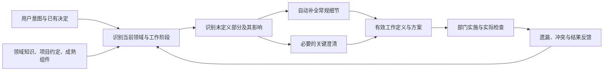

# 领域知识与专家补全设计

> 日期：2026-09-06。依据：用户对领域知识、领域引擎用途的最新澄清。
> 状态：架构设计，未新增运行实现，也不修改第一阶段另一会话的验收范围。
> 上位入口：[总体架构](../system-architecture.md)、[总体路线](../program-roadmap.md)。

## 1. 这项能力要解决什么

用户通常能描述想做什么，但不会完整给出行业概念、设计条件和每个细节。专家的价值在于理解意图，将想法对应到已有知识体系，识别真正影响方向的选择，并依据情境中的通行做法补齐其余部分。

领域引擎承担这种专家补全职责，使产品、设计、工程、质检及运维在各自工作阶段都能回答：当前表达在本领域意味着什么，哪些事情已经有约定，哪些未定义部分可以直接采用成熟做法，哪些关键选择需要用户决定。

补全的结果是可继续推进的工作定义和方案。只有真正影响用户目标与重要取舍的问题进入对话，常规细节由专家完成，不形成逐项确认问卷。

用户提出新想法时，已有知识用于解释、组合和实现该想法。找不到现成类别时保留其特殊目标，不因方便归类就把它改成常见产品。

## 2. 三种职责与名称

| 名称 | 负责什么 | 典型结果 |
| --- | --- | --- |
| 领域知识 | 某领域的概念、常见方案、约束、惯例、成熟组件、适用条件与已知例外 | 可以理解和复用的知识依据 |
| 领域引擎 | 根据当前意图、已有决定和工作阶段选择适用知识，形成补全或重要问题 | 方案建议、默认决定、关键澄清、对下游的影响 |
| 任务运行控制 | 管理任务责任、交接、预算、执行、取消和状态提交 | 实际可执行且可追溯的任务流程 |

此前总体设计用“领域引擎”泛指执行、知识和评价所在的整个业务层，容易与上述专家能力混淆。整体层级统一称“业务引擎层”；其中领域引擎专指专家理解与补全，运行控制保持自己的责任。

这些是关注点划分，不要求新增一个部门、服务或每次都额外调用一个模型。已有部门可以在准备工作和形成交付时使用共同知识与补全方法。

## 3. 两条知识路径

### 3.1 已有知识支持基础工作

行业概念、已选平台的规范、项目既有约定和成熟框架行为，都可以在明确适用条件后参与当前工作。它们不需要等 Yudao 先做出一批任务并学到经验。

例如已经选定平台和组件库，常规表单、反馈和导航先沿用相应规范与组件；没有特殊要求时，不重新发明一套交互，也不让用户决定每个提示的位置和措辞。

适用性判断仍是专家职责：“行业最佳实践”不是脱离用户、平台和目标的唯一最优答案。不同领域、环境或项目约定存在合理分歧时，先根据当前已知条件缩小范围，再决定采用默认还是提出重要取舍。

### 3.2 自己形成的经验支持后续改进

Yudao 从运行中总结的建议，例如某种取证顺序是否减少特定返工，属于待验证的经验。其跨任务采用与失效继续遵循[记忆与控制设计](memory-and-control.md)及独立评价。

这条验证路径不能泛化成“任何领域知识都必须先做本系统实验才允许使用”。同样，给系统新生成的建议贴上“行业惯例”标签，也不能跳过应有的依据和评价。

基础方案应当已经使用合理的专业知识。后续改善实验比较的是新控制或新经验的增量贡献，不能通过让基础组缺乏常识来制造优势。

## 4. 怎样处理未定义部分

| 情况 | 领域引擎的动作 | 用户通常看到什么 |
| --- | --- | --- |
| 已有明确要求或已确认决定 | 沿用并检查当前适用范围 | 一致的方案和结果，无重复提问 |
| 会改变产品方向、目标人群、平台、重要成本或关键承诺 | 给出少量有意义的选项、推荐及取舍，需要用户决定时再问 | 与目标相关的问题，避免要求用户理解底层细节 |
| 常规细节有适用惯例或已选组件行为 | 自动采用，继续工作 | 直接可用的成果，不逐项确认 |
| 存在多个近似且易调整的做法 | 根据项目约定选择简单成熟方案，保留必要假设 | 必要时在设计摘要看到选择，无额外批准步骤 |
| 缺少会影响结论的前提，且没有可靠默认 | 明确缺口，先推进不依赖它的工作 | 一个能解除关键阻塞的问题 |
| 用户明确提出特殊做法 | 保留该意图，找可实现的成熟组成部分；有冲突时说明原因和替代 | 对特殊目标的实际回应，不被默认方案覆盖 |

是否提问取决于决定的影响及是否能合理推断，不取决于“这个字段有没有填写”。研发者应为建议承担专业判断，不能把全部设计选择交还给用户。

## 5. 手机例子怎样经过专家处理

“我想做一个手机”首先对应到智能手机产品、目标用户、使用场景、硬件与软件生态等已有概念。iPhone、华为可以作为帮助用户表达偏好的参照，进一步拆出系统体验、生态、开放性或价格等相关维度；它们不是穷尽方案的二选一。

产品阶段识别会决定方向的事项，例如主要用户、价格范围、关键场景和系统生态。只询问当前无法从上下文推断、又确实影响方案的选择。

方向明确后，交互阶段沿用对应平台的操作习惯和反馈规则；工程阶段优先选择现有平台能力与成熟组件；质检阶段依据已明确的要求和适用的既定约定设计检查。常规解锁失败反馈无需逐项问用户，也不因用户没提过就专门实现新的弹窗组件。

如果用户明确需要特殊交互，领域引擎分析它影响哪些常规做法，保留用户目标并调整局部设计。特殊要求不自动要求推翻其他已经适用的默认行为。

## 6. 贯穿工作阶段的补全

| 工作阶段 | 已有输入 | 专家补全重点 | 向下游交付 |
| --- | --- | --- | --- |
| 想法与产品定义 | 用户意图、目标、限制和已有决定 | 行业概念、方案类别、关键选择、基本功能边界 | 可执行的产品要求、适用默认与少量重要待决事项 |
| 方案与交互设计 | 产品要求、平台、受众与项目规范 | 常规流程、空状态、异常反馈、可访问性等适用规范 | 符合既定方向的设计与例外说明 |
| 工程实施 | 有效方案、代码基础、依赖和环境 | 成熟组件、平台默认、工程惯例及必要技术选择 | 完整交付、关键实现决定和实际检查 |
| QA 与独立复核 | 公开要求、已生效默认、受审交付与检查条件 | 相应边界和异常的检查方法，发现遗漏或不一致 | 有依据的反例、检查结果或需补定义的问题 |
| 运行维护 | 发布对象、环境和运行承诺 | 适用监测、故障处置与恢复惯例 | 可承担的运行责任、检查与处置记录 |

这里的“各阶段”首先指一项工作的生命周期，也贯穿项目四个大阶段。补全在需要时逐步细化，不要求产品阶段提前写完全部工程细节。

每个阶段继承已确认的上游决定，只补足本阶段履责所需内容。后续阶段发现上游重要遗漏时提出影响明确的澄清或变更，不能重新猜一遍产品方向。

继承的是当前范围内仍有效的决定。用户改变方向或项目结构演进后，重新判断相关默认与方案；被取代决定的原因继续可查，但不再支配新的任务。专业补全与[演化式开发及上下文管理](evolutionary-development-context-design.md)共同更新当前工作依据。

## 7. 补全如何成为可用的工作定义

补全结果需要区分用户明确要求、继承约定、领域默认和仍未成立的假设。用户无需逐项签字，但系统内部不能把自己的默认选择记录成用户原话。

记录粒度随影响变化。项目选定的平台规范或组件库可以作为一组默认依据复用，不为每个按钮建立一份经验、一次检索和一条审批。影响验收、接口或后续责任的决定单独记录；纯局部实现细节留在对应设计与代码中。

默认做法需要让执行和检查双方在对应交付前可知。QA 可以依据已确定的要求与共同约定选择新的测试输入；发现从未定义且会改变业务语义的事项时，应记录需补定义，不能事后称作工程违反了早已存在的要求。

共同约定不要求用户逐条重述。当前领域或已选平台规范已经包含的适用基础，QA 可以直接据此检查并引用依据，无需再次请求用户批准。区分的是可共同知道的专业基础与后来新加的业务取舍，不把 QA 限制为逐字核对用户输入。

例如空输入究竟表示空结果还是非法请求，在不同任务中可能不同。工程遗漏用户已明确的行为可以形成反例；任务本来没有约定且存在合理分歧时，应先补清该行为的语义。既有约定已经明确时，则不必把每个边界测试输入另问用户。

## 8. 知识如何组织才有用

知识单元围绕实际决策组织：它涉及什么概念、适用于什么情境、通常采用何种做法、有哪些例外，以及可以复用哪个规范或组件。引擎以当前工作缺口查询这些内容，不向每个部门塞入整本行业资料。

来源优先核对项目已有约定、已选平台与官方组件文档，再按实际缺口查行业资料。模型可以利用一般知识提出补全，但对重要或随版本变化的判断应核实依据；不能虚构标准名称或把偏好包装成行业强制要求。

语义与图关系可以连接“目标概念、方案类别、适用条件、默认实践、实现组件、检查方法、来源及例外”。这是对现有来源与影响查询的用途扩展，不要求先建设大型本体、向量服务或图数据库。

用户目标、合法约束和项目现有决定限定可采用范围；在这一范围内选择适用惯例。知识冲突按情境和依据处理，不用全局固定排名决定所有专业问题。自行学习的经验只有在其已验证范围内参与建议。

## 9. 在四阶段规划中的位置

| 大阶段 | 领域知识与领域引擎怎样参与 |
| --- | --- |
| 第一阶段：可信交付 | 各部门开展工作本就应运用专业常识和项目约定；不因本次澄清给正在验收的 MVP 追加独立引擎工程 |
| 第二阶段：可验证持续改进 | 显式整理领域概念、默认依据、补全结果及影响，接入专业补全；在此基础上评价新控制和新经验 |
| 第三阶段：持续运行组织 | 内部职责、技能、部门协议和运维各使用适用知识，继承共同决定并补齐本职责缺口 |
| 第四阶段：系统演化 | 以行业成熟模式支持候选设计，系统提出的规则与组织变化仍单独比较、采用和撤销 |

可以现在完成概念设计、固定案例、知识来源整理和脱离运行时的补全校准，不依赖第一阶段收尾。真实部门接入在独立工作包中使用稳定接口；系统新经验的正式改善验证仍依赖可信基线。

领域补全不是另加第五个阶段，也不取代离线证据续批。它补齐总体框架此前缺少的专业理解职责，可以与证据工作并行准备。

## 10. 首份校准材料与验收

选一个已有规范和成熟组件的窄领域，准备相同想法的不同上下文：描述很少、方向已给定、常规细节未给定、有特殊偏好、约定冲突、缺少关键前提。校准只验证理解和补全，不调用真实运行控制器。

| 场景 | 必须观察到的结果 |
| --- | --- |
| 只描述想法，尚无专业概念 | 能映射到相关知识体系和少量有意义选项，不生成漫长规格问卷 |
| 平台和项目组件已确定 | 常规细节直接沿用，不重复询问，不定制已有标准组件 |
| 未定义事项会改变主要成本或产品承诺 | 提出有解释的推荐和必要问题，不悄悄决定方向 |
| 用户明确偏离常规 | 保留特殊意图，说明受影响部分，不以惯例覆盖 |
| 工程阶段才发现上游遗漏 | 分清本地默认与需上游决定的事项，只回传必要问题 |
| 适用平台规范已有共同基础，但用户未逐条列出 | QA 能依据该规范检查、指出可核对问题，无需再次批准 |
| QA 提出此前未有且存在合理分歧的新业务条件 | 记录定义缺口，不能追认成已有验收失败 |
| 系统尚无自己的经验库 | 仍能运用已有领域知识完成常规补全 |
| 无来源的新建议被称为最佳实践 | 能区分暂定判断、已有依据和待验证经验 |
| 更换一个重要上游选择 | 找到受影响的默认与检查，保留未受影响决定 |

评价重点是补全是否适用、是否覆盖本阶段必要缺口、是否保留用户意图、是否减少无必要提问及定制工作。不能只追求问题越少越好，也不能用补出的条目数量表示专业能力。

本文件依据用户澄清和当前架构形成，未新增一轮论文调研或声称上述校准已执行。具体领域的知识材料在对应校准准备时从实际规范和实现中核验。
