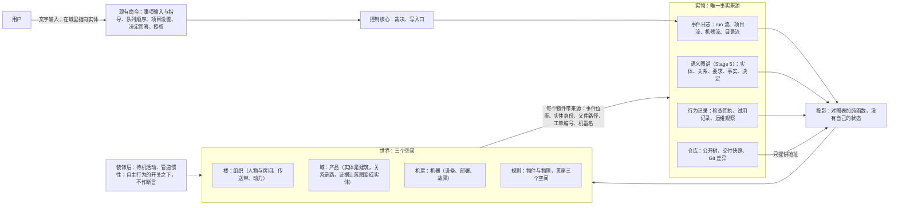
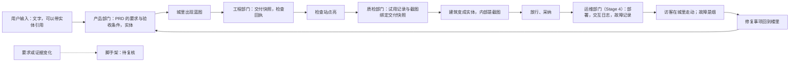

# 游戏世界与代码世界的映射：可行性、图灵完备与路径

日期：2026-10-02。状态：2026-10-25 用户采纳为路线图第 4 节「三个空间」的依据，确认的内容与六项待定的处理见 [D41 三个空间](../requirements/game-world-three-spaces.md)；文中的 Stage 与工单号是写作时的位置，与五个阶段的对应见[CONTEXT.md](../../CONTEXT.md)「旧阶段名」。服务的需求：[D30 游戏化的桌面客户端界面](../requirements/web-game-frontend.md)的后续方向。相关决定：[ADR-0021](../adr/0021-client-pixel-view-follows-v9-structure.md)（像素画面按 v9 的实体—组件—系统结构实现）。原型：[v8 设计说明](../archive/prototypes/v8/design.md)、[v9 设计说明](../archive/prototypes/v9/design.md)。相关设计：[语义系统设计说明](../design/semantic-system.md)（实体类型与图谱）、[浏览器与 computer use 设计说明](../design/browser-and-computer-use.md)（试用记录）、[应用层与接口层设计说明](../design/app-and-interface.md)（查询、命令、事件流）。参照来源的核对记录在第 11 节。

## 1. 用户的问题

2026-10-02 用户原话：

> 关于这个项目，我提到的一个方向，或者我们可以称之为可视化编程的方式，是我想了很久的问题。这个可视化并非是现在的低代码开发。我之前的想法是采用类似 3D 形式的一种编程语言，比如，面向对象编程，可以抽象成方块和组件，面向过程则在 3d 中，就像传送带或者过程组装。这种方式是为了可视化，也更好的理解抽象概念。而 yudao 项目，已经有了小人物形象。按照后续游戏的方式理解，如果我推进到全游戏方式，按类似的想法，是否可行呢？
>
> 这里我的困惑点，就是概念和规则的映射，在类似缺氧，异星工厂这类游戏中，游戏也能建造出自动化设备，但我不确定能不能图灵完备。第二点是规则，如果是 agent 编程的世界，我怎么做出验证的世界观能符合现有编程或者服务器或者代码世界的完整映射呢？也就是说，就像黑客帝国或者创战纪，无论如何，都需要真实世界的映射，我们好像再造一个新的柏拉图洞穴，我想要一个路径。

同日的两轮追问：

> 嗯，可是文件，仓库也是人类抽象出来的，如果我们从更加 native 的方式来考虑呢

> 好，那继续，到这个 yudao 的界面设计或者系统交互该怎么做呢？

拆成五个问题：

1. **可行性**。Yudao 已经有小人与房间的像素世界。沿着「面向对象是方块与组件、面向过程是传送带与装配」的想法推进到完整的游戏，是否可行。
2. **概念与规则的映射**。《缺氧》《异星工厂》这类游戏能建造自动化设备，它们是否图灵完备；图灵完备能否说明游戏可以表达程序。
3. **与真实世界的对应**。agent 在世界里工作，这个世界怎样与真实的代码、服务器形成完整并且可以核验的对应，避免再造一个柏拉图洞穴。要一条路径。
4. **更 native 的层次**。文件与仓库也是人的抽象；世界应当原生于哪一层。
5. **界面与系统交互**。按这个层次，Yudao 的界面与系统交互怎样设计。

## 2. 回答

- **这些游戏都图灵完备**。《异星工厂》的运算器与判断器、《我的世界》的红石、《缺氧》的自动化逻辑门与存储元件都造出过计算机（第 3.1 节）。图灵完备衡量的是「能不能算」，衡量不了「能不能读」与「对不对得上」。衡量一个世界能否表达系统，用第 3.2 节的三条标准：保持结构、可以回链、不说谎并且范围内不遗漏。这三条可以写成有限的表并且用测试核对。
- **文件与仓库是存储与交换的抽象，世界原生于语义与行为**（第 4 节）。往下追「更 native」没有底，native 只能相对于观察者与目的来说。代码有四个候选的本体：机器、语义、行为、模型。世界取语义与行为：实体与关系是建筑与路，观察到的行为是访客、灯与烟，文件只在门牌上作为地址出现。写代码这一侧保留文件与仓库，因为它们是生态的接口，模型也是在文件形态的代码上训练的。
- **柏拉图洞穴有两种**。模拟是第二个世界，有自己的状态，必须与第一个世界保持同步，会漂移，会撒谎。投影没有自己的状态，是事实的纯函数，从事件日志重放就能完整重建，画面上出现的每样东西在事实里都有。Yudao 已经站在投影这一边：总图第四节「写入口」的缝规定事件日志是唯一的事实来源，[语义系统设计说明](../design/semantic-system.md)第 2 节规定轨迹与图谱是投影；原型 v8 规定「界面不自行计时推进状态，也不显示没有来源的数据」，v9 规定头顶的话「只来自事件已经带着的事实」，待机活动「不产生事实」并且有开关可以整体关闭。完整的游戏沿这条规则走，洞穴里每一处影子都有一条回到实物的通道（第 5 节）。
- **在 Yudao 里人不写代码，代码由部门写**。人写的是意图、边界、优先级、授权与决定。所以这个世界对人而言是「读与指挥」的语言，指挥方式与《环世界》《缺氧》这类殖民地模拟相同：设置优先级、划定范围、下工作单，角色自主行动（第 7 节）。「面向对象是方块」成立于产品的城：页面、接口、数据表、外部服务这些实体是建筑，要求是蓝图，证据让蓝图变成实体（第 6.1 节）。「过程是传送带」成立于流程层：PRD、交付、放行作为包裹在部门之间流动，这已经是 v8 的画面；Stage 5 以后轨迹的五层在房间里装配（第 6.3 节）。用户亲手铺传送带的那一步在 Stage 6：组织定义可以由用户修改时，铺一条新管道就是提出一份新的组织定义，走受治理的采用路径。
- **界面是三个空间加一条因果链加一种新输入**（第 8 节）。楼画组织，城画产品，机房画机器，三个空间各对应一个来源，一台摄像机切换。用户的意图变成蓝图，证据让蓝图变成实体，访客与烟来自运行时的记录，这条链每一环都是现有的事件或记录。输入除了文字再加一种指向：在城里点一栋建筑再说话，输入带着实体引用，产品部门的焦点里就有这个实体的要求、事实与决定。
- **传送带画到部门之间与部门之内的流转为止，函数内部的控制流以文字显示**。可视化编程六十年的历史里，通用的可视化语言没有在工业中取代文字，成功的全部在领域内，领域本身是流图，可见元素不超过几十个（第 3.3 节）。把一个函数的控制流铺成传送带，得到的是《异星工厂》里的 CPU：能算，没有人从传送带上读程序。
- **2D 与 3D 是渲染层的选择，与映射无关**。ADR-0021 规定世界与系统不依赖渲染，换成 3D 只换渲染。选 3D 的理由只能是映射里出现了需要第三个轴的量；目前三个空间里没有这样的量。
- **路径在第 10 节**：按依赖排序，每一步画一个已经存在的来源，每一步有自己的检验，每一步单独有用。

## 3. 图灵完备

### 3.1 事实

| 游戏 | 计算元件 | 造出过什么 |
| --- | --- | --- |
| 《异星工厂》 | 电路网络的常量、运算、判断三种运算器；传送带与机械臂本身也能组成逻辑 | 社区造出可以运行程序的 CPU |
| 《我的世界》 | 红石的中继器、比较器、火把组成逻辑门与存储 | 社区造出 CPU，并在上面运行程序 |
| 《缺氧》 | 自动化系统的与门、或门、非门、异或门、缓冲门、过滤门、记忆开关 | 逻辑门加存储，原理与上面两个相同 |
| 《Turing Complete》 | 从与非门开始造计算机，游戏本身就是这件事 | 玩家在游戏里造出自己的计算机并为它写程序 |

图灵完备很便宜：Rule 110 元胞自动机（Cook，2004）、PowerPoint 的动画与超链接（Wildenhain，2017）、《万智牌》的一局对局（Churchill 等，2019）都被证明图灵完备。所以「这个世界能不能算」几乎总是能。

### 3.2 图灵完备衡量不了的东西

图灵完备回答「这个系统能不能算出任何可计算的函数」。《异星工厂》里造出来的 CPU 是对 CPU 的遮盖：程序在传送带上，谁也不从传送带上读它。可视化要回答的是另外三个问题：

1. **保持结构**。世界里的每一种东西对应系统里的一种东西；世界里把两样东西接起来，对应系统里把两样东西接起来；对应关系在组合以后仍然成立。ToonTalk 做到了这一点：它是一门完整的编程语言，机器人是过程，用演示训练；盒子是元组；鸟与巢是消息通道；卡车派生进程；炸弹终止进程；形式基础是并发约束编程。它证明「把一门语言完整地做成动画世界」可以成立。
2. **可以回链**。从世界里的任何一样东西都能回到它所对应的实物：一条事件、一个实体、一个文件、一张工单、一台机器。
3. **不说谎，范围内不遗漏**。画面上的每一处断言都为真；范围内的每一种事实都有画面，或者写明不画。

这三条可以写成有限的表并且用测试核对（第 5.3 节）。图灵完备既不能写成表，也不区分一个清晰的世界与一个遮盖的世界。

### 3.3 可视化编程的历史证据

| 做法 | 代表 | 结果 | 对 Yudao 的含义 |
| --- | --- | --- | --- |
| 通用的可视化编程语言 | Prograph | 没有在工业中取代文字。原因有三：密度（Deutsch 限制：屏幕上同时放不下超过 50 个可视元素，「你怎么写一个操作系统」）；命名与抽象在图上比在文字里费力；差异、合并与搜索没有文字方便 | 函数内部的逻辑留给文字 |
| 领域内的流图语言 | LabVIEW（仪器）、Max/MSP（声音）、Simulink（控制）、Unreal Blueprints（游戏逻辑） | 成功。共同点：领域的计算本身是流图，元件种类少，嵌套浅，每个元件在领域里有看得见的含义 | Yudao 的流程（PRD、交付、放行在部门之间流动）正是这种流图 |
| 直接操作 | Sketchpad、Smalltalk、Self 的 Morphic | 画面上的物就是实物本身时成立；两份来源各自保存再同步（UML 往返工程）失败，因为两份会分开 | 世界只能是投影，不能是第二份来源 |
| 教育与游戏里的编程 | Logo、Rocky's Boots、ToonTalk、Scratch、AgentSheets、Stagecast Creator、Human Resource Machine、TIS-100 | 映射忠实可以做到；小人可以忠实地表示执行语义（Human Resource Machine 的小人就是处理器）；规模上限在密度 | 小人与房间已经在做的事有先例 |
| 软件可视化 | CodeCity、Gource | 读结构成功：类是建筑，包是城区，高度是方法数；提交历史是生长的树，开发者是树上的小人。读逻辑没有成功的先例 | 城借用 CodeCity 的城区聚合与 Gource 的生长回放，单位换成实体 |
| 用真实代码驱动的游戏世界 | Screeps、Else Heart.Break() | Screeps 的单位由玩家写的真实 JavaScript 驱动，世界按 tick 运行；Else Heart.Break() 里日常物品与计算机都带着可以修改的源代码。游戏本身就是代码的可视化 | 世界的每个物件背后是真实的事件、实体、文件与机器 |
| 规则作为物件 | Baba Is You | 规则是地图上可以推动的方块，推动它就改变规则 | 用户可以改的规则做成物件，不可以改的规则做成物理（第 6.4 节） |

用户设想的两半各有先例：方块与组件对应 CodeCity，传送带对应流图语言与 Gource。两半都在「读结构」与「领域内的流」上成立；在「写函数内部的逻辑」上没有先例成立。

## 4. 更 native 的层次：代码的四个本体

### 4.1 没有底

文件与仓库是存储与交换的抽象：CodeCity 画的是存储结构，它与程序的意义只是大致相关。往下追「更 native」会发现没有底：进程、内存、指令也是人定的抽象，晶体管之下还有物理。所以 native 只能相对于一个观察者与一个目的来说：这个东西实际由什么构成，操作它的人实际操作什么。

### 4.2 四个候选

| 本体 | 内容 | 先例 | 对 Yudao 的高度 |
| --- | --- | --- | --- |
| 机器 | 进程、内存、系统调用 | 性能分析器；Erlang 的 observer 把运行中的进程与监督树画出来；《创战纪》里程序是人物 | 太低。只有一个用户，用户不读代码。它只在「交付软件作为一个运行中的进程」这个粒度上有用，这个粒度已经在机房里 |
| 语义 | 定义、类型、依赖、数据流 | Unison 把代码库做成按内容寻址的定义数据库，每个定义由语法树的哈希标识，名字只是分开保存的元数据，代码不在文本文件里；Smalltalk 的镜像里是活的对象与编译后的方法，源代码按方法附在后面，浏览器按包、类、方法导航与编辑；Kythe、Glean、SCIP 把代码做成可以查询的图 | 「面向对象是方块」真正指的层：方块是定义与实体，传送带是依赖与数据流 |
| 行为 | 软件运行时实际做的事：请求、状态变化、副作用、故障 | OpenTelemetry 的 trace 记录一次请求经过各个服务的完整路径；Dark 把真实请求的 trace 放在编辑器里 | 对项目目的最真实：用户要的是能工作的软件，代码只是中间产物 |
| 模型 | agent 的世界是上下文、工具与事件 | Hewitt 的 actor 模型：计算单元是收发消息的 actor | Yudao 已经原生地记录在事件日志里：部门是 actor，交接是消息，事件日志是基底。它同样看不见文件，看见的是工具交回的文字 |

### 4.3 选择：世界原生于语义与行为，文件留在工程部门

- **语义**。Yudao 的语义系统已经把实体类型定为项目、模块、文件、接口、页面、数据表、外部服务、术语、用户角色（[语义系统设计说明](../design/semantic-system.md)第 5.2 节），文件只是九种之一，主机还记录文件实体的移动与删除。城以实体与关系为单位，建筑的门牌上才写文件路径，映射因此与语言和目录布局无关。关系有两个来源：部门记录的实体带着要求、事实与决定，这是组织对系统的理解；从代码机械导出的索引（CodeGraph、import-linter 这类）给出客观的依赖。两者不一致时进入待复核。
- **行为**。行为有诚实的来源：检查回执、质检的试用记录与截图（[D34](../requirements/browser-and-computer-use.md)）、运维读取的日志、交互日志与故障记录（[D27](../requirements/operations-department.md)）、评测的隐藏检查。交付软件在机房里是一台运行中的设备；在城里，请求是流过建筑的访客，健康检查是灯，故障是烟。
- **文件与仓库留在工程部门内部**，因为它们是生态的接口：Python 与 Node 的包管理、测试运行器、部署、与 OpenCode 的对照都在文件上，模型也是在文件形态的代码上训练的（[ADR-0024](../adr/0024-git-in-process-with-pygit2.md)）。Unison 为了去掉文件重做了语言、运行时、代码库管理器与包管理，至今仍是小众；Smalltalk 镜像输给文件，输在交换与协作。

### 4.4 对洞穴的意义

行为是洞穴外的东西，代码是意图的影子，文件是影子的存放处。世界给人看的是意义与行为，存放处只在点开时出现。agent 的世界本来就是 actor 加消息，这一点与现在的像素世界已经重合。

## 5. 柏拉图洞穴：模拟与投影

### 5.1 两种洞穴

每个界面都是洞穴：终端、编辑器、像素楼层都只给影子，文字本身也是运行中的进程的投影。问题的正确形式是影子怎样产生。

- **模拟**（《黑客帝国》）：第二个世界有自己的状态与规则，要与第一个世界同步；同步总有延迟与遗漏；为了好玩加进去的机制在第一个世界里没有对应物，于是影子说谎。
- **投影**：影子由实物经过固定的光源投出来，没有自己的状态；光源一样，影子就一样；实物没有的东西影子里没有；回放实物的历史就回放了影子。

### 5.2 Yudao 站在哪一边

Yudao 已经在投影这一边，证据都在现有文档里：

- 总图第四节「写入口」的缝与第六节：一份事件日志，唯一写入口，全部运行状态可以完整重放。[语义系统设计说明](../design/semantic-system.md)第 2 节：轨迹与图谱是事件的投影，重放可以重建。
- v8 设计说明第 51 行：「画面的每一个动作由查询结果中的状态或事件流中的事件决定。界面不自行计时推进状态，也不显示没有来源的数据。」第 151 行：「没有来源事件的项不显示。」
- v8 第 5.4 节与第 8.3 节的对照表：「事实 | 来源 | 画面 | 档位」20 行，「事实 | 来源 | 小人动作 | 房间变化 | 档位」54 行，来源列写事件类型或者快照里的状态。
- v9 第 153 行：头顶的话「只来自事件已经带着的事实（事件类型、载荷里的字段、事件说明），跟画面其余部分同一条规则：只显示已经查到的事实」。第 137 行：待机活动「不产生事实」，`ECS.config.autonomy` 是自主行为（待机活动、管道的惯性）的开关，关掉以后静止画面只由快照决定。第 104 行：「静止的画面因此只由快照决定，事件只决定动作的起点。」
- v9 第 180 行：引擎与画面代码里没有任何具体的部门名，去掉一个房间的声明画面照常运转，只写声明加一个新房间与一种任务，代码一个字符不改。

完整的游戏需要做的，是把这条已经在遵守的规则写成明确的约束，并把覆盖范围扩大到全部来源。

### 5.3 洞穴的出口：三条性质、三种检验

性质：

1. **世界没有自己的状态**。世界等于投影（事件日志、语义图谱、行为记录、机器流）。装饰层单独声明，可以整体关闭，关闭以后画面只由事实决定。
2. **每个物件带来源**。事件位置、实体身份、文件路径、工单编号、机器名；点开就是实物。v8 的资料页、请求详情、文件清单与 Git 差异已经是这些实物的文字视图。
3. **对照表完整**。对每一种事件（`harness/streams.py`：run 流 46 种、项目流 14 种、目录流 7 种）、每一条术语（`CONTEXT.md`）、每一种实体类型（语义系统的 9 种）各有一行，写画法或者写明「不画」。

检验，进入测试：

1. **重放一致**。同一段事件日志，实时得到的世界与重放得到的世界相同。v9 已经这样核对 19 个场景（ADR-0021）。
2. **回链存在**。随机抽取世界里的物件，它的来源在事件日志、图谱或者仓库中存在。
3. **覆盖核对**。枚举事件种类、术语与实体类型，对照表缺一行则测试失败。与语义系统设计说明的数据流核对是同一种做法。

装饰与断言分开：沿管道移动的包裹是断言（存在一条交接事件），走来走去是装饰（事实只有「空闲」）。装饰不带气泡、不带数字、不进入对照表的「画面」列，只在自主行为的开关之下。

### 5.4 真实世界是什么

Yudao 的真实世界有六个来源，每个已经有投影或者将要有投影：

| 来源 | 内容 | 现有投影 | 在世界里 |
| --- | --- | --- | --- |
| 事件日志的 run 流 | 部门的每一步、工具动作、交接、询问、决定请求 | 房间、小人、管道、大厅的板 | 楼 |
| 事件日志的项目流 | PRD、采纳成果、事项队列、部署版本、故障记录、授权；Stage 5 起的实体、关系、要求、事实、决定 | 楼层灯、队列包裹、运维房间 | 楼与城 |
| 机器流与执行代理 | 机器、在线状态、动作回执 | 机房设备 | 机房 |
| 行为记录 | 检查回执（现在）、试用记录与截图（3.2D）、运维读取的日志、交互日志与故障记录（Stage 4）、评测的隐藏检查 | 资料页的试用记录（文字）、试用台上的截图 | 城里的检查站、建筑的状态与内部、访客、烟 |
| 仓库 | 运行工作区的公开树、交付快照、Git 差异 | 资料页（文字） | 门牌上的地址；工程房间屏幕上的内容 |
| 模型服务 | 模型访问定义、调用目标、用量、等待模型服务 | 管道停止、「上下文」覆盖层 | 动力 |

语义图谱本身是项目流的投影（[语义系统设计说明](../design/semantic-system.md)第 2 节），单独列出是因为城直接读它。「服务器世界」是第 3、4 行：部署、回滚、故障记录显示在机房的设备上，Stage 4 运维部门把它画完整，v8 已经画出备份柜与监控屏。「代码世界」在城里以实体出现，文件只是地址。

### 5.5 怎样做映射：七种元件与一张工作表

游戏世界只有七种元件。系统里的每一个概念归入其中一种，并写明它来自哪条记录；表写完，世界就定了。引擎已经有了：v9 的引擎里没有任何部门的名字，内容全在声明里（第 5.2 节）。《异星工厂》本身也是这样做的，引擎只认识实体、传送带与管道、物品与流体、配方、信号这几种东西，几百种内容是一张表。

| 元件 | 判别法 | Yudao 里的例子 |
| --- | --- | --- |
| 地点 | 装别的东西，给它们位置 | 部门是房间，产品是城，机器在机房 |
| 物 | 有状态，持续存在 | 角色是小人，实体是建筑，机器是设备 |
| 连接 | 把两个物接起来，本身不动 | 交接关系是管道，实体之间的依赖是路 |
| 流 | 沿连接移动，会被接收 | PRD 与交付是包裹，询问是信，请求是访客 |
| 规则 | 永远成立，推不动 | 只有写入口写事实是盖章机，上下文隔离是墙 |
| 操作 | 用户能做的事，每一项是一条现有命令 | 拖动队列里的包裹，盖章，改门牌 |
| 仪表 | 被测量的量 | 上下文用量是刻度，等待模型服务是停电，未知显示「未知」 |

用户 2026-10-02 的片段「代码组件像水管，信息像水」里有两样东西混在一起，判别法把它们分开：组件有状态、持续存在，是物，画成一台带进口与出口的设备；组件之间的依赖是连接，画成管道；信息沿管道走，是流，画成水或者包裹。《异星工厂》里同样分装配机、传送带、物品三样。分开以后接着问来源：设备来自语义图谱的实体，管道来自实体之间的关系，水来自检查回执、试用记录与交互日志；答不出来源的部分是装饰，或者不画。

工作表每行八列：概念、元件、来源、状态与变化、位置、操作、仪表、不画的部分。

| 概念 | 元件 | 来源 | 状态与变化 | 位置 | 操作 | 仪表 | 不画 |
| --- | --- | --- | --- | --- | --- | --- | --- |
| 主程 | 物 | run 流的角色事件 | 待命、走向、做任务，由任务目录的事件决定 | 工程房间的工位 | 指导 | 头顶的话 | 模型回复的全文 |
| 交接 | 流 | 交接事件 | 从甲的管口到乙的管口 | 两个房间之间的管道 | 无 | 返工时闪红 | 包裹的内容 |
| 工具许可 | 规则 | 控制核心的判断 | 允许、拒绝、需要批准 | 每个动作前的门禁 | 批准走决定板 | 无 | 判断的依据 |
| 页面 | 物 | 语义图谱的实体 | 蓝图、在建、实体、冒烟、脚手架，由要求、交付、证据、故障记录、待复核决定 | 城里的街区 | 指着它说话 | 检查站的灯 | 页面的代码 |
| 上下文用量 | 仪表 | 上下文清单 | 已用量与上限 | 角色桌上的容器 | 无 | 刻度 | 栏目的内容 |

v8 第 5.4 节与第 8.3 节的 74 行就是这张表在楼这个空间里的前几列。

做的顺序：

1. **列清单**。概念从 `CONTEXT.md` 的术语表抄，事件从 `harness/streams.py` 的 67 种抄，实体从语义系统的 9 种抄，操作从应用层的命令清单抄。不新造概念。
2. **归类并写来源**。每个概念归入一种元件；归不进去的概念，说明它是别的概念的一部分，或者是装饰。
3. **写状态与变化**。状态从来源的字段取，变化由哪一种事件引起。
4. **定位置**。位置只表达从属与相邻：房间装自己的角色，管道连有交接关系的房间，街区装同一个模块的建筑。写成声明。
5. **操作对应命令，仪表对应测量值**。
6. **三种检验**（第 5.3 节）：清单上每一项都有表行；重放事件得到同一个世界；每个物件能回到来源。

「重新抽象」在这里是分类：游戏的元件只有七种，系统的概念几十个，一个一个归进去。agent 的世界与代码的世界用同一张表，来源不同：agent 那一半来自 run 流，代码那一半来自语义图谱与行为记录。

## 6. 映射：三个空间与五层

| 层 | 空间 | 画什么 | 来源 | 用户在这一层做什么 | 状态 |
| --- | --- | --- | --- | --- | --- |
| 产品 | 城 | 实体与关系；要求是蓝图，证据让蓝图变成实体；访客与烟 | 语义图谱、行为记录 | 看；点开；指着一栋建筑说话 | 未设计 |
| 人物与房间 | 楼 | 组织：部门、角色、上下文 | run 流 | 看；指导；回答询问 | v9，Stage 3 实施中 |
| 传送带 | 楼 | 流程：交接、询问、返工、队列；Stage 5 的轨迹 | run 流、项目流 | 调整队列顺序 | v9 |
| 规则 | 三个空间 | 可改的规则是物件，不可改的规则是物理 | 项目流、定义 | 改物件 | 页面已有，世界里未设计 |
| 动力 | 楼 | 模型服务与上下文 | 目录流、请求事件、上下文清单 | 接线 | 覆盖层与模型管理页已有 |

机房是机器这一层的空间，v8 与 v9 已经画出设备、管线与部署；Stage 4 加上交付软件作为运行中的设备。

### 6.1 城：产品地图

- **画什么**。实体是建筑：页面是建筑，接口是建筑之间的门与柜台，数据表是仓库，外部服务是通向城外的路，模块是街区，术语是路牌，用户角色是访客的种类。关系是路，依赖的方向是路的方向。要求是贴在建筑上的蓝图，验收条件是检查站，决定、事实与推测写在门牌上。
- **建筑的状态只来自记录**。蓝图：PRD 的要求引用这个实体，还没有交付。在建：交付快照包含关联的文件实体，还没有证据。实体：验收条件有绑定当前交付快照的通过证据，检查回执或者试用用例；走进去看到的是试用的真实截图。冒烟：故障记录关联到这个实体（Stage 4）。脚手架：关联的要求或事实处于待复核。
- **访客只来自记录**。质检的试用会话进行时，测试工程师离开房间走进城，按试用用例的步骤经过各个页面；Stage 4 以后交互日志里的使用者是用户角色种类的访客。没有记录就没有访客。
- **代码在哪里**。门牌上写文件路径；点开进入资料页的文件与 Git 差异；工程房间的屏幕上显示正在编辑的增删行（v8 第 362 行）。函数内部的控制流与变量不画。
- **密度**。一个产品的页面、接口与数据表以十计，远少于文件数；每一个缩放级别可见元素不超过几十个，街区由模块聚合，CodeCity 用包做城区解决过同一件事。
- **生长**。按放行版本回放，看到城随交付生长（Gource 的做法）；回放到过去的时间点时，建筑的状态按当时的记录显示。
- **检验**。从项目流与行为记录重放得到的城与实时一致；随机抽取建筑核对实体存在；九种实体类型各有画法或者写明不画。
- **这一层改变用户的哪个决定**。看到一栋建筑长期停在蓝图或者反复返工，用户据此补要求或者拆事项；看到一片街区没有检查站，用户据此要求验收条件；看到烟，用户知道修复事项为什么排在前面。

### 6.2 楼：人物与房间

v9 已经画完：部门是房间，角色是小人，任务目录来自对照表，事件按五条规则落到角色身上，Stage 5 的角色数量来自快照。楼与城接触的地方有两处：工具事件带路径、并且这个文件实体与某个页面或接口实体之间的关系已经记录时，工程的角色从房间走到城里的那栋建筑前；关系没有记录时角色留在工位上。质检的试用会话进行时，测试工程师走进城。

### 6.3 传送带

现在的管道画部门之间的流转：交接、询问、返工、排队，等待模型服务时停止。Stage 5 的轨迹有五层（事项、交接、计划条目、角色任务、尝试），在房间里装配：中心角色的白板是计划条目（v8 第 399 行已经画出任务卡递到工具角色的桌上），尝试是桌上的一摞草稿，上下文的栏目是带刻度的容器（已用量与上限来自上下文清单）。边界：传送带画到部门之间的流转与部门之内的任务流转为止；城里的路画实体之间的依赖；函数内部用文字。

### 6.4 规则：物件与物理

Baba Is You 的做法：规则是地图上的方块，能推动的方块就是能改的规则。Yudao 的规则分两类。

不可改的规则做成物理，用户看得见、推不动：

| 规则 | 出处 | 物理 |
| --- | --- | --- |
| 只有写入口写事实；模型与角色只提交提案 | 总图第四节「写入口」的缝 | 角色没有章。提案托盘通向盖章机，章盖下去包裹才进管道 |
| 上下文隔离：部门看不到其他部门的内部资料 | 项目表述 | 房间之间是墙，窗户只看得到管道口；跨部门询问走传信管 |
| 三部门成环直到达成目标 | 项目表述 | 管道成环，返工回流（v8 已画） |
| 工具许可：每个工具调用先经判断 | CONTEXT.md | 每个动作先经过门禁；需要批准的动作把决定单送到大厅的板（v8 已画） |
| 定义带版本，运行中不可修改 | 总图第四节「定义」的缝 | 规则刻在墙上；换版本要排空整栋楼 |
| 执行权只有控制核心持有 | 总体架构第 3 节 | 每个 run 一把钥匙，在控制室 |
| 城只读；盖楼经过部门 | 本文第 8.5 节 | 城里没有工具，只有门牌与蓝图；要改产品只能回到楼里提事项 |

可改的规则做成物件，每一次操作都是一条现有的命令：

| 规则 | 物件 | 命令 |
| --- | --- | --- |
| 用户意图与 PRD | 卷轴（v8）；城里建筑上的蓝图 | 事项的新输入、指导，可以带实体引用 |
| 队列顺序 | 大厅里排队的包裹，可以拖动 | 队列调整（v8 已列） |
| 执行位置与机器授权 | 楼层的门牌指向机房的某台设备 | 项目设置 |
| 常设授权清单 | 运维房间墙上的清单牌 | 登记运行环境（Stage 4） |
| 网络与 MCP 的登记 | 房间的工具面板（v8 已画） | 工具授权的保存（D36） |
| 部门默认与项目部门设置的模型 | 动力层的接线 | 模型管理的命令 |
| 决定请求的回答 | 大厅的板、纸与章（v9 已做） | 回答决定 |

Stage 6 把一部分刻在墙上的规则变成可以推动的方块：组织定义经过候选、独立评价、限定采用的路径修改（路线图第 5.3 节）。在那之前，墙上的规则推不动。

### 6.5 动力

《异星工厂》的电网是现成的类比，并且每一项都是事实：模型访问定义是发电机，部门默认与项目部门设置是接线，请求档位是功率档，上下文窗口与工作上限是容器的容量，压缩是清空容器，等待模型服务是停电（v8 已让管道停止），用量是电表。D09 规定用量只读记录、未知保持未知，所以电表没有数的时候显示「未知」，没有估算。

## 7. 用户在世界里做什么

Yudao 里人不写代码。人写意图、边界、优先级、授权与决定，部门按定义自主循环。这与殖民地模拟的指挥方式相同，每一项都对应一条现有的命令：

| 殖民地模拟 | Yudao |
| --- | --- |
| 工作优先级 | 队列顺序；修复事项始终排在前面 |
| 划定区域 | 执行位置、机器授权、网络与 MCP 的登记 |
| 工作单 | 事项（用户的新要求）、指导；在城里指着一栋建筑提出 |
| 批准与禁止 | 决定请求、一次性批准、常设授权 |
| 研究解锁 | 能力清单决定出现哪些覆盖层与页面（v8 借用《缺氧》） |
| 角色自主 | 部门自主循环，用户不直接控制角色 |

所以「3D 编程语言」在 Yudao 里的含义是读与指挥的语言：城是产品这个程序在用户的层次上的样子，名词是实体，关系是路，约束是验收条件，构建过程是三个部门。写代码的语言仍然是文字，由部门使用。用户亲手铺传送带的那一步在 Stage 6：组织定义可以由用户修改时，在世界里铺一条新管道生成一份定义候选，候选经独立评价才生效。

## 8. 界面与系统交互

### 8.1 三个空间与一台摄像机

| 空间 | 画什么 | 来源 | 状态 |
| --- | --- | --- | --- |
| 楼 | 组织：部门、角色、交接、决定、动力 | run 流、项目流 | v9，Stage 3 实施中 |
| 城 | 产品：实体与关系、蓝图与证据、访客与烟 | 语义图谱、行为记录 | Stage 5 |
| 机房 | 机器：设备、执行代理、部署、故障；交付软件作为运行中的设备 | 机器流、项目流 | v9；交付软件的设备在 Stage 4 |

三个空间用一台摄像机切换，这是 v9 列为下一步的「摄像机代替页面导航」。首页仍然先回答三个问题：哪些事等我决定，离开期间发生了什么，能不能放心再离开（v8）；「离开期间的报告」里增加城的变化：新出现的蓝图、变成实体的建筑、冒烟的建筑。

### 8.2 一条因果链

每一环都是现有的事件或记录：事项输入、PRD 的要求与验收条件、实体、交付快照、检查回执、试用记录、放行与采纳、部署、交互日志、故障记录、待复核。用户回来时看一眼城，就知道自己的意图走到了哪一步。

### 8.3 两种输入

- **文字**照旧：意图、事项的新输入、指导。
- **指向**：在城里点一栋建筑再说话，输入带着实体引用；控制核心把这个实体上的要求、事实与决定放进产品部门的焦点（语义系统的「焦点」：当前工作直接引用的条目）。这是唯一需要改合同的地方：事项输入与指导的命令增加实体引用，随 Stage 5 的语义系统一起实施。
- 画出来的草图是材料，走附件进入产品部门（D03 的附件尚未支持），与命令无关。

### 8.4 三类反馈

- **状态**只来自记录：灯、建筑的状态、烟；不给汇总的结论（v8 的原则）。
- **过程**在楼里：角色做事、包裹流动；工程的角色走到它正在修改的建筑前，前提是文件实体与页面或接口实体之间的关系已经记录；回放跳过没有关键事实的时段，可以单步与调速（v8）。
- **解释**在门牌上：为什么有这栋楼是决定，凭什么是证据，什么变了是事实，哪些存疑是推测，哪些要重看是待复核。用户问「为什么」的方式是点开。

### 8.5 边界

- 城只读，只能指。盖楼经过部门，城里没有低代码，没有直接修改产品结构的工具。
- 代码留在工程房间的屏幕上与资料页里，门牌只写文件路径。
- 访客只来自试用记录与交互日志，建筑只来自实体，建筑的状态只来自证据，烟只来自故障记录。
- 世界仍然是投影：城由项目流（实体、要求、事实、决定）、run 流（试用记录、检查回执）与 Stage 4 的观察派生，没有自己的状态。

### 8.6 分层

| 层 | 职责 | 边界 |
| --- | --- | --- |
| 来源层 | 事件日志；语义图谱（项目流的投影）；行为记录（检查回执、试用记录、运维观察）；机器流 | 都在现有设计里；城不新增来源 |
| 查询层 | 应用层的查询与命令；城需要的新查询：实体及其附着的要求、证据、决定与状态，按实体的试用记录与检查回执，自上次查看以来城的变化；命令增加实体引用 | 查询只读；命令经裁决与写入口 |
| 投影层 | 三个空间各一张对照表，纯函数；覆盖、重放、回链三种测试 | 没有自己的状态；装饰层单独声明 |
| 世界层 | 实体—组件—系统，三个空间各自的声明（ADR-0021） | 增加实体类型或事件种类只写声明 |
| 交互层 | 指向变成带引用的命令；队列拖动；决定板；设置物件；摄像机 | 每个物件对应一条现有命令 |
| 渲染层 | PixiJS；3D 的判据是映射里出现需要第三个轴的量 | 换渲染不改世界与测试 |

### 8.7 位置

楼与机房在 Stage 3（#176、#82、#177 至 #180）；交付软件作为设备、故障与部署在 Stage 4 的机房里；城、指向式输入与门牌在 Stage 5，与语义系统同期，因为建筑的来源是实体；用户铺传送带在 Stage 6。

## 9. 这个方向可能错在哪里

1. **装饰吞掉事实**。游戏为了好玩会加机制：疲劳、心情、随机事件、不存在的资源。这些在事实里没有对应物，加进去影子就说谎。守则：装饰不作断言，在自主行为的开关之下；对照表只收断言；没有来源的机制一律不加。
2. **实体是断言**。实体由角色在工作中记录，可能与代码不符，也可能漏记。守则：建筑的状态只由证据决定，没有证据的实体停在蓝图；关系从代码机械导出的部分与记录的部分不一致时进入待复核；文件实体由主机校验路径存在。
3. **密度**。产品层的实体以十计，密度问题比文件小；街区由模块聚合，每级可见元素不超过几十个，不发明新的分组。
4. **代价与收益**。只有一个人看这个世界，模型从来不看它。每一层要写明它改变用户的哪一个决定（第 6.1 节末尾是城的回答）；写不出来的层只是装饰，不做。
5. **实时性**。角色几分钟做一件事，世界多数时候静止。v8 的回放（跳过没有关键事实的时段、单步、调速）与 v9 的流式文字已经覆盖这一点。
6. **把城当成设计工具**。在城里拖动建筑、画路就是低代码，产生第二份来源。守则：城只读，只能指；改产品只能回到楼里提事项。
7. **3D 的导航成本**。第三个轴带来旋转、遮挡与定位的成本。守则：第 10 节的判据；没有需要第三个轴的量时渲染保持 2D。

## 10. 路径

按依赖排序。每一步画一个已经存在的来源，有自己的检验，单独有用；渲染的选择与各步无关。

| 步 | 画什么 | 来源 | 依赖 | 检验 | 位置 |
| --- | --- | --- | --- | --- | --- |
| 0 | v9 的世界：楼里的房间、小人、管道、大厅的板，机房 | run 流、项目流、机器流 | 无 | 19 个场景回放一致；声明实验 | Stage 3 的像素画面工单（#176、#82、#177 至 #180），进行中 |
| 1 | 对照表升级为覆盖核对：全部事件种类、术语与覆盖层各有一行 | 同上 | 步 0 | 枚举缺一行则测试失败 | Stage 3，候选工单 |
| 2 | 机房里交付软件作为运行中的设备：版本牌、健康灯、故障、部署与回滚 | 项目流、机器流、运维观察 | 步 0；Stage 4 运维 | 重放一致、回链 | Stage 4 的界面工单 |
| 3 | 城：实体与关系、蓝图与证据、访客与烟；指向式输入；门牌 | 语义图谱、行为记录 | 步 0；语义系统的实体与焦点；3.2D 的试用记录 | 重放一致、回链、实体类型覆盖 | Stage 5 的界面一节，与语义系统同期 |
| 4 | 规则成为物件；上下文隔离与盖章机成为物理 | 项目流、定义 | 步 0；各命令已有 | 每个物件对应一条命令，命令清单覆盖核对 | Stage 4（常设授权、运维）与 Stage 5 |
| 5 | 传送带进房间：轨迹五层、栏目容器、部门账本 | Stage 5 的轨迹与上下文清单 | 语义系统 | Stage 5 的数据流核对 | Stage 5 |
| 6 | 用户铺传送带：组织定义在世界里编辑，生成定义候选 | 定义；Stage 6 的采用路径 | Stage 6 | 候选经独立评价才生效 | Stage 6 |
| 渲染 | 创战纪式的画法、摄像机代替页面导航、3D | 无 | ADR-0021：世界与系统不依赖渲染 | 行为测试不变；像素比较换成新的参照 | 任意时刻 |

3D 的判据：映射里出现需要第三个轴的量。目前三个空间里没有这样的量。

待用户决定：

1. 投影原则写成 ADR：世界没有自己的状态；装饰不作断言；对照表完整并进入测试。
2. 覆盖核对（步 1）放进 Stage 3 的像素画面工单，或者单独建一张工单。
3. 城作为新的需求记录：实体是建筑，证据让蓝图变成实体，访客与烟来自记录；路线位置 Stage 5 的界面一节。
4. 指向式输入：事项输入与指导的命令增加实体引用，进入产品部门的焦点；随 Stage 5 实施。
5. 传送带的边界：部门之间与部门之内画传送带，城里的路画实体之间的依赖，函数内部用文字。
6. 本专题加入[各阶段需求概览](../archive/requirements/stage-requirements-overview.md)第 6 节的待讨论清单。

确认这六项用 `/grill-with-docs`，决定写成 ADR 与需求记录，再写设计文档。

## 11. 参照

访问日期都是 2026-10-01。只记录本文用到的事实，阅读范围是页面正文或者论文摘要与对应章节。

### 11.1 游戏

| 参照 | 用到的事实 | 来源 |
| --- | --- | --- |
| 《异星工厂》 | 官方 wiki 把常量、运算、判断、选择四种运算器定义为生成、比较或修改电路网络信号的组件；官方没有写「图灵完备」。社区项目：Hogdriver 2015 年用运算器造出哈佛架构计算机（4 个 16 位寄存器、160 字 ROM、80 字 RAM、27 条指令，运行求素数程序）；piriform 2016 年的 MK2 有 32 条指令、64 字 RAM | https://wiki.factorio.com/Combinator ；https://forums.factorio.com/viewtopic.php?t=15113 ；https://forums.factorio.com/viewtopic.php?t=23405 |
| 《缺氧》 | 社区 wiki 的 Automation 页列出 AND、OR、NOT、XOR、BUFFER、FILTER 六种门与 Memory Toggle 存储元件 | https://oxygennotincluded.wiki.gg/wiki/Automation |
| 《我的世界》 | 社区 wiki 的红石计算机教程；sammyuri 的 CHUNGUS 2：1 Hz、四级流水线、8 位数据、256 字节 RAM，运行俄罗斯方块、贪吃蛇等程序 | https://minecraft.wiki/w/Tutorial:Redstone_computers ；https://github.com/sammyuri/chungus-2-assembler |
| 《Turing Complete》 | 官方网站：「只给你一个与非门，其余由你造出」，目标是图灵完备的计算机；开发与发行署名 LevelHead | https://turingcomplete.game/ |
| 《Baba Is You》 | 开发者 Hempuli 官方页：规则以物理对象的形式存在于游戏世界中，操作规则就改变游戏的运作 | https://hempuli.com/baba/ |
| 《Screeps》 | 官方文档：脚本是普通的 JavaScript，每个游戏 tick 执行一次，全部玩家的主模块执行完毕才进入下一个 tick | https://docs.screeps.com/scripting-basics.html ；https://docs.screeps.com/game-loop.html |
| 《Else Heart.Break()》 | 官方网站：游戏的现实可以通过编程改变，大量日常物品与计算机可以修改；语言 Sprak，作者 Erik Svedäng；建筑与大型物件是静态的 | http://elseheartbreak.com/ ；https://github.com/eriksvedang/Sprak ；https://www.gamedeveloper.com/design/how-i-else-heart-break-i-turns-players-into-coders |
| 《Human Resource Machine》 | 官方页：给办公室小人编程解谜，办公室就是一台简单的计算机，收件箱与发件箱是输入输出，地板上的格子是内存，单累加器的哈佛架构，11 条指令 | https://tomorrowcorporation.com/humanresourcemachine |
| 《TIS-100》《SHENZHEN I/O》 | Zachtronics 自行设计的汇编风格语言；TIS-100 的参考手册列出 13 条指令 | https://www.zachtronics.com/tis-100/ ；https://www.zachtronics.com/shenzhen-io/ |
| 《Autonauts》《Desynced》 | Autonauts 用演示教机器人做事，另有积木式的编辑器；Desynced 用指令与连线组成的行为图给装了行为控制器的机器人编程 | https://denki.co.uk/games/autonauts/ ；https://wiki.desyncedgame.com/Behavior_Programming |
| 《环世界》《缺氧》的优先级 | RimWorld 官方 wiki：角色只做分配给自己的工作种类，手动模式下每种工作 1 至 4 级优先级，高一级全部做完再做下一级；《缺氧》社区 wiki：角色按「很高、高……」逐级选任务，同级按 1 至 9 的子优先级 | https://rimworldwiki.com/wiki/Work ；https://oxygennotincluded.wiki.gg/wiki/Priority |
| 《万智牌》图灵完备 | Churchill、Biderman、Herrick，arXiv:1904.09828（2019）：把任意图灵机嵌入合法对局，先手胜当且仅当图灵机停机 | https://arxiv.org/abs/1904.09828 |
| Rule 110 | Cook，《Universality in Elementary Cellular Automata》，Complex Systems 第 15 卷第 1 期（2004） | https://www.complex-systems.com/abstracts/v15_i01_a01/ |
| 《Rocky's Boots》 | Robinett 与 Grimm 设计，1982 年 The Learning Company 出版，让小学高年级学生用与门、或门、非门与触发器设计数字逻辑电路 | http://www.warrenrobinett.com/rockysboots/ |

### 11.2 可视化编程与软件可视化

| 参照 | 用到的事实 | 来源 |
| --- | --- | --- |
| ToonTalk | Kahn 1996 年 JVLC 论文：ToonTalk 建立在与 Janus 相似的并发约束语言上；对应表：方法对应机器人，元组对应盒子，通道的发送与接收能力对应鸟与巢，派生进程对应装了货的卡车，终止进程对应炸弹；训练机器人相当于定义方法体 | https://www.toontalk.com/Papers/jvlc96.pdf ；https://www.toontalk.com/English/computer.htm |
| CodeCity | Wettel 与 Lanza，VISSOFT 2007：类显示为建筑，包显示为城区，建筑高度是方法数，底面是属性数 | https://wettel.github.io/codecity.html ；https://wettel.github.io/download/Wettel07b-vissoft.pdf |
| Gource | Caudwell 的官方仓库：仓库根是树的中心，目录是枝，文件是叶，贡献者在修改文件时出现在树上 | https://github.com/acaudwell/Gource ；https://gource.io/ |
| Deutsch 限制 | comp.lang.visual FAQ 第 12 问（Lakin 撰写）：Lakin 为 Deutsch 对一份可视化机器语言报告的评论起的名字，大意是屏幕上同时放不下超过 50 个可视元素，「你怎么写一个操作系统」；FAQ 写明是转述 | http://www.faqs.org/faqs/visual-lang/faq/ |
| Myers 的分类 | 《Taxonomies of Visual Programming and Program Visualization》，JVLC 第 1 卷第 1 期（1990） | https://www.cs.cmu.edu/~bam/papers/VLtax2-jvlc-1990.pdf |
| Bret Victor | 《Learnable Programming》（2012 年 9 月） | https://worrydream.com/LearnableProgramming/ |
| Papert | 《Mindstorms》（1980）第 63 页：海龟画圆是 body syntonic 的，因为圆与儿童对自己身体的感觉与知识紧密相关 | https://dam-prod.media.mit.edu/x/2025/01/27/Mindstorms.pdf |
| Self 与 Morphic | selflanguage.org：简单、统一、具体、活性四条原则，设计者 Ungar 与 Smith；Maloney 与 Smith UIST '95：直接性指直接指着图形表示检查与修改，活性指对象持续响应用户动作与更新 | https://selflanguage.org/ ；https://bibliography.selflanguage.org/directness.html |
| 领域内的流图语言 | NI：LabVIEW 是图形化编程环境，用数据流语言 G，面向测试与测量；Epic：Blueprints 是基于节点界面的完整玩法脚本系统；Cycling '74：Max 中每个对象做一件事，连线把对象接起来；MathWorks：Simulink 是框图环境 | https://www.ni.com/en/shop/labview.html ；https://dev.epicgames.com/documentation/en-us/unreal-engine/blueprints-visual-scripting-in-unreal-engine ；https://cycling74.com/products/max ；https://www.mathworks.com/products/simulink.html |
| Prograph | 伯克利技术报告 UCB/CSD-04-1368（2004）：Prograph 被认为是通用可视化语言中商业上最成功的一个，面向对象的可视化数据流语言，研究始于 1982 年；原商业产品线在 1990 年代末退出市场，语言另有后续实现 | https://www2.eecs.berkeley.edu/Pubs/TechRpts/2004/Archive/CSD-04-1368.pdf |
| Scratch | 官方 About 页：2007 年由 MIT Media Lab 的 Resnick 团队开发 | https://scratch.mit.edu/about/ |
| AgentSheets、KidSim | Repenning 等 JASSS 2000：网格中的智能体用 IF-THEN 规则表达行为，规则可以通过演示生成；Smith、Cypher、Spohrer CACM 1994：KidSim 用图形重写规则，用户照常操作即被记录，后来演变为 Stagecast Creator | https://jasss.soc.surrey.ac.uk/3/3/forum/1.html ；https://acypher.com/Publications/CACM/KidSimCACM.html |
| Sketchpad | Sutherland 1963 年博士论文（剑桥技术报告 UCAM-CL-TR-574 重印）：用光笔直接在显示器上作图，光笔既定位也选取图元 | https://www.cl.cam.ac.uk/techreports/UCAM-CL-TR-574.html |
| PowerPoint 图灵完备 | Wildenhain，《On the Turing Completeness of MS PowerPoint》，SIGBOVIK 2017 | https://tomwildenhain.com/PowerPointTM/Paper.pdf |

### 11.3 原生表示与行为观察

访问日期 2026-10-02。

| 参照 | 用到的事实 | 来源 |
| --- | --- | --- |
| Unison | 官方文档：每个定义由其语法树的哈希标识，名字是分开保存的元数据；代码保存在数据库里而非文本文件，由 ucm 管理；没有构建步骤，改名不破坏调用处；合并冲突只在两个人修改同一个定义时发生，官方另有合并工具的文档 | https://www.unison-lang.org/docs/the-big-idea/ ；https://www.unison-lang.org/docs/tooling/merge-tool-support/ |
| Pharo / Smalltalk | Pharo by Example 9 第 1 章：镜像文件包含运行中系统的全部对象及其状态，包括类与编译后的方法；第 3.8 节：System Browser 按包、类、协议、方法导航与编辑；pharo.org：源代码只用文件序列化，编辑用浏览器而非文本编辑器；源代码文本保存在 .sources 与 .changes 文件中，镜像保存编译后的方法并索引到源文件 | https://books.pharo.org/pharo-by-example9/ ；https://pharo.org/features |
| Erlang observer | 官方用户指南：显示系统信息、应用的监督树、进程信息、ETS 与 Mnesia 表，并提供追踪的前端 | https://www.erlang.org/doc/apps/observer/observer_ug.html |
| OpenTelemetry | 官方概念页：trace 给出一次请求在应用中走过的完整路径；span 是一个工作单元，是 trace 的组成单位 | https://opentelemetry.io/docs/concepts/signals/traces/ |
| Dark（Darklang-classic） | 官方文档「Trace Driven Development」：把光标放进代码就能看到选中的 trace 下这段代码的结果，先向尚不存在的端点发请求，再从 404 列表建立处理器；后端导览：程序直接序列化在数据库里，编辑器的每次改动是一条 Op 追加保存 | https://docs.darklang.com/discussion/trace-driven-development ；https://docs.darklang.com/contributing/tour-of-backend |
| Kythe、Glean、SCIP | Kythe（Google）：语言无关的代码图模式，各语言的索引器产出统一的图；Glean（Meta）：收集、派生与查询源代码事实的系统；SCIP（Sourcegraph）：语言无关的代码索引协议，支持跳转定义、查找引用 | https://kythe.io/docs/schema/ ；https://glean.software/ ；https://github.com/sourcegraph/scip |
| actor 模型 | Hewitt、Bishop、Steiger，IJCAI 1973：概念上只有一种对象，actor，全部行为都定义为向 actor 发送消息；「收到消息后可以发送消息、创建新 actor、决定下一条消息的处理方式」的表述出自 Hewitt 2010 年的综述 | https://www.ijcai.org/Proceedings/73/Papers/027B.pdf ；https://arxiv.org/abs/1008.1459 |

## 12. 与现有文档的关系

- 本文引用 D30、D34、D27、原型 v8 与 v9、语义系统设计说明、总图、总体架构、ADR-0021、ADR-0024 与路线图，没有修改它们。
- v9 设计说明第 21 行列为下一步的四项（创战纪式的画法、摄像机代替页面导航、外包角色的呈现、预测与说服）在 v8、v9 中没有定义；本文把摄像机归入第 8.1 节，创战纪式的画法归入第 10 节的「渲染」一行，外包角色随 D31，预测与说服随 Stage 5 的预测性探索。
- 第 8.3 节的指向式输入需要修改应用层与接口层设计说明中事项输入与指导的命令，待用户确认后随 Stage 5 的设计一起修改。
