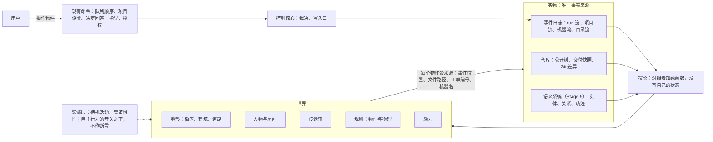

# 游戏世界与代码世界的映射：可行性、图灵完备与路径

日期：2026-10-02。状态：讨论资料，没有形成决定。服务的需求：[D30 游戏化的桌面客户端界面](../requirements/web-game-frontend.md)的后续方向。相关决定：[ADR-0008](../adr/0008-trajectory-and-graph-as-event-projections.md)（轨迹与图谱是事件的投影）、[ADR-0013](../adr/0013-event-log-and-single-write-path.md)（一份事件日志与唯一写入口）、[ADR-0021](../adr/0021-client-pixel-view-follows-v9-structure.md)（像素画面按 v9 的实体—组件—系统结构实现）。原型：[v8 设计说明](../prototypes/v8/design.md)、[v9 设计说明](../prototypes/v9/design.md)。参照来源的核对记录在第 9 节。

## 1. 用户的问题

2026-10-02 用户原话：

> 关于这个项目，我提到的一个方向，或者我们可以称之为可视化编程的方式，是我想了很久的问题。这个可视化并非是现在的低代码开发。我之前的想法是采用类似 3D 形式的一种编程语言，比如，面向对象编程，可以抽象成方块和组件，面向过程则在 3d 中，就像传送带或者过程组装。这种方式是为了可视化，也更好的理解抽象概念。而 yudao 项目，已经有了小人物形象。按照后续游戏的方式理解，如果我推进到全游戏方式，按类似的想法，是否可行呢？
>
> 这里我的困惑点，就是概念和规则的映射，在类似缺氧，异星工厂这类游戏中，游戏也能建造出自动化设备，但我不确定能不能图灵完备。第二点是规则，如果是 agent 编程的世界，我怎么做出验证的世界观能符合现有编程或者服务器或者代码世界的完整映射呢？也就是说，就像黑客帝国或者创战纪，无论如何，都需要真实世界的映射，我们好像再造一个新的柏拉图洞穴，我想要一个路径。

拆成三个问题：

1. **可行性**。Yudao 已经有小人与房间的像素世界。沿着「面向对象是方块与组件、面向过程是传送带与装配」的想法推进到完整的游戏，是否可行。
2. **概念与规则的映射**。《缺氧》《异星工厂》这类游戏能建造自动化设备，它们是否图灵完备；图灵完备能否说明游戏可以表达程序。
3. **与真实世界的对应**。agent 在世界里工作，这个世界怎样与真实的代码、服务器形成完整并且可以核验的对应，避免再造一个柏拉图洞穴。要一条路径。

## 2. 回答

- **这些游戏都图灵完备**。《异星工厂》的运算器与判断器、《我的世界》的红石、《缺氧》的自动化逻辑门与存储元件都造出过计算机（第 3.1 节）。图灵完备衡量的是「能不能算」，衡量不了「能不能读」与「对不对得上」。衡量一个世界能否表达系统，用第 3.2 节的三条标准：保持结构、可以回链、不说谎并且范围内不遗漏。这三条可以写成有限的表并且用测试核对。
- **柏拉图洞穴有两种**。模拟是第二个世界，有自己的状态，必须与第一个世界保持同步，会漂移，会撒谎。投影没有自己的状态，是事实的纯函数，从事件日志重放就能完整重建，画面上出现的每样东西在事实里都有。Yudao 已经站在投影这一边：ADR-0013 规定事件日志是唯一的事实来源，ADR-0008 规定轨迹与图谱是投影；原型 v8 规定「界面不自行计时推进状态，也不显示没有来源的数据」，v9 规定头顶的话「只来自事件已经带着的事实」，待机活动「不产生事实」并且有开关可以整体关闭。完整的游戏沿这条规则走，洞穴里每一处影子都有一条回到实物的通道（第 4 节）。
- **在 Yudao 里人不写代码，代码由部门写**。人写的是意图、边界、优先级、授权与决定。所以这个世界对人而言是「读与指挥」的语言，指挥方式与《环世界》《缺氧》这类殖民地模拟相同：设置优先级、划定范围、下工作单，角色自主行动（第 6 节）。「面向对象是方块」成立于地形层：仓库的结构画成城市，目录是街区、文件是建筑，角色走到它正在修改的建筑前工作（第 5.1 节）。「过程是传送带」成立于流程层：PRD、交付、放行作为包裹在部门之间流动，这已经是 v8 的画面；Stage 5 以后轨迹的五层在房间里装配（第 5.3 节）。用户亲手铺传送带的那一步在 Stage 6：组织定义可以由用户修改时，铺一条新管道就是提出一份新的组织定义，走受治理的采用路径。
- **传送带画到模块之间的依赖与部门之内的任务流转为止，函数内部的控制流以文字显示**。可视化编程六十年的历史里，通用的可视化语言没有在工业中取代文字，成功的全部在领域内，领域本身是流图，可见元素不超过几十个（第 3.3 节）。把一个函数的控制流铺成传送带，得到的是《异星工厂》里的 CPU：能算，没有人从传送带上读程序。
- **2D 与 3D 是渲染层的选择，与映射无关**。ADR-0021 规定世界与系统不依赖渲染，换成 3D 只换渲染。选 3D 的理由只能是映射里出现了需要第三个轴的量；第一个这样的量在地形层，建筑的高度表示文件的大小。
- **路径在第 8 节**：五步按依赖排序，每一步画一个已经存在的来源，每一步有自己的检验，每一步单独有用。

## 3. 图灵完备

### 3.1 事实

| 游戏 | 计算元件 | 造出过什么 |
| --- | --- | --- |
| 《异星工厂》 | 电路网络的常量、运算、判断三种运算器；传送带与机械臂本身也能组成逻辑 | 社区造出可以运行程序的 CPU |
| 《我的世界》 | 红石的中继器、比较器、火把组成逻辑门与存储 | 社区造出 CPU，并在上面运行程序 |
| 《缺氧》 | 自动化系统的与门、或门、非门、异或门、缓冲门、过滤门、记忆开关 | 逻辑门加存储，原理与上面两个相同 |
| 《Turing Complete》 | 从与非门开始造计算机，游戏本身就是这件事 | 玩家在游戏里造出自己的计算机并为它写程序 |

图灵完备很便宜：Rule 110 元胞自动机（Cook，2004）、PowerPoint 的动画与超链接（Wildenhain，2017）、《万智牌》的一局对局（Churchill 等，2019）都被证明图灵完备。所以「这个世界能不能算」几乎总是能。

### 3.2 图灵完备衡量不了的东西

图灵完备回答「这个系统能不能算出任何可计算的函数」。《异星工厂》里造出来的 CPU 是对 CPU 的遮盖：程序在传送带上，谁也不从传送带上读它。可视化要回答的是另外三个问题：

1. **保持结构**。世界里的每一种东西对应系统里的一种东西；世界里把两样东西接起来，对应系统里把两样东西接起来；对应关系在组合以后仍然成立。ToonTalk 做到了这一点：它是一门完整的编程语言，机器人是过程，用演示训练；盒子是元组；鸟与巢是消息通道；卡车派生进程；炸弹终止进程；形式基础是并发约束编程。它证明「把一门语言完整地做成动画世界」可以成立。
2. **可以回链**。从世界里的任何一样东西都能回到它所对应的实物：一条事件、一个文件、一张工单、一台机器。
3. **不说谎，范围内不遗漏**。画面上的每一处断言都为真；范围内的每一种事实都有画面，或者写明不画。

这三条可以写成有限的表并且用测试核对（第 4.3 节）。图灵完备既不能写成表，也不区分一个清晰的世界与一个遮盖的世界。

### 3.3 可视化编程的历史证据

| 做法 | 代表 | 结果 | 对 Yudao 的含义 |
| --- | --- | --- | --- |
| 通用的可视化编程语言 | Prograph | 没有在工业中取代文字。原因有三：密度（Deutsch 限制：屏幕上同时放不下超过 50 个可视元素，「你怎么写一个操作系统」）；命名与抽象在图上比在文字里费力；差异、合并与搜索没有文字方便 | 函数内部的逻辑留给文字 |
| 领域内的流图语言 | LabVIEW（仪器）、Max/MSP（声音）、Simulink（控制）、Unreal Blueprints（游戏逻辑） | 成功。共同点：领域的计算本身是流图，元件种类少，嵌套浅，每个元件在领域里有看得见的含义 | Yudao 的流程（PRD、交付、放行在部门之间流动）正是这种流图 |
| 直接操作 | Sketchpad、Smalltalk、Self 的 Morphic | 画面上的物就是实物本身时成立；两份来源各自保存再同步（UML 往返工程）失败，因为两份会分开 | 世界只能是投影，不能是第二份来源 |
| 教育与游戏里的编程 | Logo、Rocky's Boots、ToonTalk、Scratch、AgentSheets、Stagecast Creator、Human Resource Machine、TIS-100 | 映射忠实可以做到；小人可以忠实地表示执行语义（Human Resource Machine 的小人就是处理器）；规模上限在密度 | 小人与房间已经在做的事有先例 |
| 软件可视化 | CodeCity、Gource | 读结构成功：类是建筑，包是城区，高度是方法数；提交历史是生长的树，开发者是树上的小人。读逻辑没有成功的先例 | 地形层直接采用 CodeCity 与 Gource 的做法 |
| 用真实代码驱动的游戏世界 | Screeps、Else Heart.Break() | Screeps 的单位由玩家写的真实 JavaScript 驱动，世界按 tick 运行；Else Heart.Break() 里日常物品与计算机都带着可以修改的源代码。游戏本身就是代码的可视化 | 世界的每个物件背后是真实的事件、文件与机器 |
| 规则作为物件 | Baba Is You | 规则是地图上可以推动的方块，推动它就改变规则 | 用户可以改的规则做成物件，不可以改的规则做成物理（第 5.4 节） |

用户设想的两半各有先例：方块与组件对应 CodeCity，传送带对应流图语言与 Gource。两半都在「读结构」与「领域内的流」上成立；在「写函数内部的逻辑」上没有先例成立。

## 4. 柏拉图洞穴：模拟与投影

### 4.1 两种洞穴

每个界面都是洞穴：终端、编辑器、像素楼层都只给影子，文字本身也是运行中的进程的投影。问题的正确形式是影子怎样产生。

- **模拟**（《黑客帝国》）：第二个世界有自己的状态与规则，要与第一个世界同步；同步总有延迟与遗漏；为了好玩加进去的机制在第一个世界里没有对应物，于是影子说谎。
- **投影**：影子由实物经过固定的光源投出来，没有自己的状态；光源一样，影子就一样；实物没有的东西影子里没有；回放实物的历史就回放了影子。

### 4.2 Yudao 站在哪一边

Yudao 已经在投影这一边，证据都在现有文档里：

- ADR-0013：一份事件日志，唯一写入口，全部运行状态可以完整重放。ADR-0008：轨迹与图谱是事件的投影，重放可以重建。
- v8 设计说明第 51 行：「画面的每一个动作由查询结果中的状态或事件流中的事件决定。界面不自行计时推进状态，也不显示没有来源的数据。」第 151 行：「没有来源事件的项不显示。」
- v8 第 5.4 节与第 8.3 节的对照表：「事实 | 来源 | 画面 | 档位」20 行，「事实 | 来源 | 小人动作 | 房间变化 | 档位」54 行，来源列写事件类型或者快照里的状态。
- v9 第 153 行：头顶的话「只来自事件已经带着的事实（事件类型、载荷里的字段、事件说明），跟画面其余部分同一条规则：只显示已经查到的事实」。第 137 行：待机活动「不产生事实」，`ECS.config.autonomy` 是自主行为（待机活动、管道的惯性）的开关，关掉以后静止画面只由快照决定。第 104 行：「静止的画面因此只由快照决定，事件只决定动作的起点。」
- v9 第 180 行：引擎与画面代码里没有任何具体的部门名，去掉一个房间的声明画面照常运转，只写声明加一个新房间与一种任务，代码一个字符不改。

完整的游戏需要做的，是把这条已经在遵守的规则写成明确的约束，并把覆盖范围扩大到全部来源。

### 4.3 洞穴的出口：三条性质、三种检验

性质：

1. **世界没有自己的状态**。世界等于投影（事件日志、仓库快照、机器流）。装饰层单独声明，可以整体关闭，关闭以后画面只由事实决定。
2. **每个物件带来源**。事件位置、文件路径、工单编号、机器名；点开就是实物。v8 的资料页、请求详情、文件清单与 Git 差异已经是这些实物的文字视图。
3. **对照表完整**。对每一种事件（`harness/streams.py`：run 流 46 种、项目流 14 种、目录流 7 种）、每一条术语（`CONTEXT.md`）、每一种实体类型（Stage 5 语义系统的 9 种）各有一行，写画法或者写明「不画」。

检验，进入测试：

1. **重放一致**。同一段事件日志，实时得到的世界与重放得到的世界相同。v9 已经这样核对 19 个场景（ADR-0021）。
2. **回链存在**。随机抽取世界里的物件，它的来源在事件日志或者仓库中存在。
3. **覆盖核对**。枚举事件种类、术语与实体类型，对照表缺一行则测试失败。与语义系统设计说明的数据流核对是同一种做法。

装饰与断言分开：沿管道移动的包裹是断言（存在一条交接事件），走来走去是装饰（事实只有「空闲」）。装饰不带气泡、不带数字、不进入对照表的「画面」列，只在自主行为的开关之下。

### 4.4 真实世界是什么

Yudao 的真实世界有五个来源，每个已经有投影或者将要有投影：

| 来源 | 内容 | 现有投影 | 缺口 |
| --- | --- | --- | --- |
| 事件日志的 run 流 | 部门的每一步、工具动作、交接、询问、决定请求 | 房间、小人、管道、大厅的板 | 无 |
| 事件日志的项目流 | PRD、采纳成果、事项队列、部署版本、故障记录、授权 | 楼层灯、队列包裹、运维房间 | 规则作为物件（第 5.4 节） |
| 机器流与执行代理 | 机器、在线状态、动作回执 | 机房设备 | 无 |
| 仓库 | 运行工作区的公开树、交付快照、Git 差异 | 资料页的文件清单与 Git 差异（文字） | 地形（第 5.1 节） |
| 模型服务 | 模型访问定义、调用目标、用量、等待模型服务 | 管道停止、「上下文」覆盖层 | 动力（第 5.5 节） |

「服务器世界」是第 2、3 行：部署、回滚、故障记录显示在机房的设备上，Stage 4 运维部门把它画完整，v8 已经画出备份柜与监控屏。「代码世界」是第 4 行，是五个来源里唯一还没有画面的。

## 5. 映射：世界的五层

| 层 | 画什么 | 来源 | 用户在这一层做什么 | 状态 |
| --- | --- | --- | --- | --- |
| 地形 | 仓库的结构 | 公开树、交付快照；Stage 5 的实体与关系 | 看；点开文件 | 未设计 |
| 人物与房间 | 组织：部门、角色、上下文 | run 流 | 看；指导；回答询问 | v9，Stage 3 实施中 |
| 传送带 | 流程：交接、询问、返工、队列；Stage 5 的轨迹 | run 流、项目流 | 调整队列顺序 | v9 |
| 规则 | 可改的规则是物件，不可改的规则是物理 | 项目流、定义 | 改物件 | 页面已有，世界里未设计 |
| 动力 | 模型服务与上下文 | 目录流、请求事件、上下文清单 | 接线 | 覆盖层与模型管理页已有 |

### 5.1 地形：代码城市

- **画什么**：目录是街区，文件是建筑，建筑的高度是文件的行数，测试文件是检查站；交付快照之间的差异是建筑的新建、加高与拆除，回放时看到城市随放行版本生长（Gource 的做法）；角色读写文件时走到那栋建筑前（工具事件带着路径，v8 第 362 行已经让屏幕显示增删的行）。Stage 5 以后：实体的类型给建筑式样（模块、文件、接口、页面、数据表、外部服务），实体之间的关系是道路，依赖的方向是路的方向；关联在实体上的要求与事实是建筑上挂的牌子。
- **位置**：每个项目一片工地，与楼层并列；从楼层到工地的切换用 v9 列为下一步的「摄像机代替页面导航」。
- **来源**：运行工作区的公开树清单（执行环境的只读查询已经提供清单与摘要）、交付快照、项目流的采纳成果；Stage 5 的实体与关系写在项目流中。
- **密度**：每一个缩放级别可见元素不超过几十个：整片工地看街区，街区看建筑，建筑看接口。CodeCity 用包做城区解决了这件事。
- **回链**：点建筑打开资料页的文件与 Git 差异。
- **不画**：函数内部的控制流与变量；代码内容以文字显示。
- **检验**：从公开树清单与事件重放得到的城市与实时一致；随机抽取建筑核对文件存在；实体类型的每一种有画法或者写明不画。
- **这一层改变用户的哪个决定**：看到工程反复修改同一栋建筑（热点）或者一片街区从来没有检查站，用户据此补要求或者拆事项。

### 5.2 人物与房间

v9 已经画完：部门是房间，角色是小人，任务目录来自对照表，事件按五条规则落到角色身上，Stage 5 的角色数量来自快照。与地形层接触的地方只有一处：工具事件带路径时，角色从房间走到工地的那栋建筑前。这是 agent 的世界与代码的世界接触的地方。

### 5.3 传送带

现在的管道画部门之间的流转：交接、询问、返工、排队，等待模型服务时停止。Stage 5 的轨迹有五层（事项、交接、计划条目、角色任务、尝试），在房间里装配：中心角色的白板是计划条目（v8 第 399 行已经画出任务卡递到工具角色的桌上），尝试是桌上的一摞草稿，上下文的栏目是带刻度的容器（已用量与上限来自上下文清单）。边界：传送带画到部门之间的流转与部门之内的任务流转为止；地形层上的道路画模块之间的依赖；函数内部用文字。

### 5.4 规则：物件与物理

Baba Is You 的做法：规则是地图上的方块，能推动的方块就是能改的规则。Yudao 的规则分两类。

不可改的规则做成物理，用户看得见、推不动：

| 规则 | 出处 | 物理 |
| --- | --- | --- |
| 只有写入口写事实；模型与角色只提交提案 | ADR-0013 | 角色没有章。提案托盘通向盖章机，章盖下去包裹才进管道 |
| 上下文隔离：部门看不到其他部门的内部资料 | 项目表述 | 房间之间是墙，窗户只看得到管道口；跨部门询问走传信管 |
| 三部门成环直到达成目标 | 项目表述 | 管道成环，返工回流（v8 已画） |
| 工具许可：每个工具调用先经判断 | CONTEXT.md | 每个动作先经过门禁；需要批准的动作把决定单送到大厅的板（v8 已画） |
| 定义带版本，运行中不可修改 | ADR-0014 | 规则刻在墙上；换版本要排空整栋楼 |
| 执行权只有控制核心持有 | ADR-0012 | 每个 run 一把钥匙，在控制室 |

可改的规则做成物件，每一次操作都是一条现有的命令：

| 规则 | 物件 | 命令 |
| --- | --- | --- |
| 用户意图与 PRD | 卷轴（v8） | 事项的新输入、指导 |
| 队列顺序 | 大厅里排队的包裹，可以拖动 | 队列调整（v8 已列） |
| 执行位置与机器授权 | 楼层的门牌指向机房的某台设备 | 项目设置 |
| 常设授权清单 | 运维房间墙上的清单牌 | 登记运行环境（Stage 4） |
| 网络与 MCP 的登记 | 房间的工具面板（v8 已画） | 工具授权的保存（D36） |
| 部门默认与项目部门设置的模型 | 动力层的接线 | 模型管理的命令 |
| 决定请求的回答 | 大厅的板、纸与章（v9 已做） | 回答决定 |

Stage 6 把一部分刻在墙上的规则变成可以推动的方块：组织定义经过候选、独立评价、限定采用的路径修改（路线图第 5.3 节）。在那之前，墙上的规则推不动。

### 5.5 动力

《异星工厂》的电网是现成的类比，并且每一项都是事实：模型访问定义是发电机，部门默认与项目部门设置是接线，请求档位是功率档，上下文窗口与工作上限是容器的容量，压缩是清空容器，等待模型服务是停电（v8 已让管道停止），用量是电表。D09 规定用量只读记录、未知保持未知，所以电表没有数的时候显示「未知」，没有估算。

## 6. 用户在世界里做什么

Yudao 里人不写代码。人写意图、边界、优先级、授权与决定，部门按定义自主循环。这与殖民地模拟的指挥方式相同，每一项都对应一条现有的命令：

| 殖民地模拟 | Yudao |
| --- | --- |
| 工作优先级 | 队列顺序；修复事项始终排在前面 |
| 划定区域 | 执行位置、机器授权、网络与 MCP 的登记 |
| 工作单 | 事项（用户的新要求）、指导 |
| 批准与禁止 | 决定请求、一次性批准、常设授权 |
| 研究解锁 | 能力清单决定出现哪些覆盖层与页面（v8 借用《缺氧》） |
| 角色自主 | 部门自主循环，用户不直接控制角色 |

所以「3D 编程语言」在 Yudao 里的含义是读与指挥的语言。写代码的语言仍然是文字，由部门使用。用户亲手铺传送带的那一步在 Stage 6：组织定义可以由用户修改时，在世界里铺一条新管道生成一份定义候选，候选经独立评价才生效。

## 7. 这个方向可能错在哪里

1. **装饰吞掉事实**。游戏为了好玩会加机制：疲劳、心情、随机事件、不存在的资源。这些在事实里没有对应物，加进去影子就说谎。守则：装饰不作断言，在自主行为的开关之下；对照表只收断言；没有来源的机制一律不加。
2. **密度**。一个真实的仓库有几千个文件，不聚合就是噪声。守则：每级可见元素几十个；聚合级别只用已有结构（目录、模块、实体），不发明新的分组。
3. **代价与收益**。只有一个人看这个世界，模型从来不看它。每一层要写明它改变用户的哪一个决定（第 5.1 节末尾是地形层的回答）；写不出来的层只是装饰，不做。
4. **实时性**。角色几分钟做一件事，世界多数时候静止。v8 的回放（跳过没有关键事实的时段、单步、调速）与 v9 的流式文字已经覆盖这一点。
5. **两份来源**。地形层若另建一份「世界里的代码结构」并允许在世界里直接改代码，就成了 UML 往返工程。守则：地形只读；修改经部门，经事件回到地形。
6. **3D 的导航成本**。第三个轴带来旋转、遮挡与定位的成本。守则：第 8 节的判据；没有需要第三个轴的量时渲染保持 2D。

## 8. 路径

五步按依赖排序。每一步画一个已经存在的来源，有自己的检验，单独有用；渲染的选择与五步无关。

| 步 | 画什么 | 来源 | 依赖 | 检验 | 位置 |
| --- | --- | --- | --- | --- | --- |
| 0 | v9 的世界：房间、小人、管道、机房、大厅的板 | run 流、项目流、机器流 | 无 | 19 个场景回放一致；声明实验 | Stage 3 的像素画面工单（#176、#82、#177 至 #180），进行中 |
| 1 | 对照表升级为覆盖核对：全部事件种类、术语与覆盖层各有一行 | 同上 | 步 0 | 枚举缺一行则测试失败 | Stage 3，候选工单 |
| 2 | 地形：街区、建筑、检查站、随放行版本生长；角色走到建筑前；Stage 5 的实体给式样、关系给道路 | 公开树、交付快照、工具事件；实体与关系 | 步 0；执行环境的公开树查询 | 重放一致、回链、实体类型覆盖 | Stage 5 的界面一节，与语义系统同期 |
| 3 | 规则成为物件；上下文隔离与盖章机成为物理 | 项目流、定义 | 步 0；各命令已有 | 每个物件对应一条命令，命令清单覆盖核对 | Stage 4（常设授权、运维）与 Stage 5 |
| 4 | 传送带进房间：轨迹五层、栏目容器、部门账本 | Stage 5 的轨迹与上下文清单 | 语义系统 | Stage 5 的数据流核对 | Stage 5 |
| 5 | 用户铺传送带：组织定义在世界里编辑，生成定义候选 | 定义；Stage 6 的采用路径 | Stage 6 | 候选经独立评价才生效 | Stage 6 |
| 渲染 | 创战纪式的画法、摄像机代替页面导航、3D | 无 | ADR-0021：世界与系统不依赖渲染 | 行为测试不变；像素比较换成新的参照 | 任意时刻 |

3D 的判据：映射里出现需要第三个轴的量。地形层的高度是第一个；房间与传送带没有这样的量。

待用户决定：

1. 投影原则写成 ADR：世界没有自己的状态；装饰不作断言；对照表完整并进入测试。
2. 覆盖核对（步 1）放进 Stage 3 的像素画面工单，或者单独建一张工单。
3. 地形层写成需求记录，路线位置 Stage 5 的界面一节。
4. 传送带的边界：部门之间与部门之内画传送带，模块之间画道路，函数内部用文字。
5. 本专题加入[各阶段需求概览](../requirements/stage-requirements-overview.md)第 6 节的待讨论清单。

确认这五项用 `/grill-with-docs`，决定写成 ADR 与需求记录，再写设计文档。

## 9. 参照

访问日期都是 2026-10-01。只记录本文用到的事实，阅读范围是页面正文或者论文摘要与对应章节。

### 9.1 游戏

| 参照 | 用到的事实 | 来源 |
| --- | --- | --- |
| 《异星工厂》 | 官方 wiki 把常量、运算、判断、选择四种运算器定义为生成、比较或修改电路网络信号的组件；官方没有写「图灵完备」。社区项目：Hogdriver 2015 年用运算器造出哈佛架构计算机（4 个 16 位寄存器、160 字 ROM、80 字 RAM、27 条指令，运行求素数程序）；piriform 2016 年的 MK2 有 32 条指令、64 字 RAM | https://wiki.factorio.com/Combinator ；https://forums.factorio.com/viewtopic.php?t=15113 ；https://forums.factorio.com/viewtopic.php?t=23405 |
| 《缺氧》 | 社区 wiki 的 Automation 页列出 AND、OR、NOT、XOR、BUFFER、FILTER 六种门与 Memory Toggle 存储元件 | https://oxygennotincluded.wiki.gg/wiki/Automation |
| 《我的世界》 | 社区 wiki 的红石计算机教程；sammyuri 的 CHUNGUS 2：1 Hz、四级流水线、8 位数据、256 字节 RAM，运行俄罗斯方块、贪吃蛇等程序 | https://minecraft.wiki/w/Tutorial:Redstone_computers ；https://github.com/sammyuri/chungus-2-assembler |
| 《Turing Complete》 | 官方网站：「只给你一个与非门，其余由你造出」，目标是图灵完备的计算机；开发与发行署名 LevelHead | https://turingcomplete.game/ |
| 《Baba Is You》 | 开发者 Hempuli 官方页：规则以物理对象的形式存在于游戏世界中，操作规则就改变游戏的运作 | https://hempuli.com/baba/ |
| 《Screeps》 | 官方文档：脚本是普通的 JavaScript，每个游戏 tick 执行一次，全部玩家的主模块执行完毕才进入下一个 tick | https://docs.screeps.com/scripting-basics.html ；https://docs.screeps.com/game-loop.html |
| 《Else Heart.Break()》 | 官方网站：游戏的现实可以通过编程改变，大量日常物品与计算机可以修改；语言 Sprak，作者 Erik Svedäng；建筑与大型物件是静态的 | http://elseheartbreak.com/ ；https://github.com/eriksvedang/Sprak ；https://www.gamedeveloper.com/design/how-i-else-heart-break-i-turns-players-into-coders |
| 《Human Resource Machine》 | 官方页：给办公室小人编程解谜，办公室就是一台简单的计算机，收件箱与发件箱是输入输出，地板上的格子是内存，单累加器的哈佛架构，11 条指令 | https://tomorrowcorporation.com/humanresourcemachine |
| 《TIS-100》《SHENZHEN I/O》 | Zachtronics 自行设计的汇编风格语言；TIS-100 的参考手册列出 13 条指令 | https://www.zachtronics.com/tis-100/ ；https://www.zachtronics.com/shenzhen-io/ |
| 《Autonauts》《Desynced》 | Autonauts 用演示教机器人做事，另有积木式的编辑器；Desynced 用指令与连线组成的行为图给装了行为控制器的机器人编程 | https://denki.co.uk/games/autonauts/ ；https://wiki.desyncedgame.com/Behavior_Programming |
| 《环世界》《缺氧》的优先级 | RimWorld 官方 wiki：角色只做分配给自己的工作种类，手动模式下每种工作 1 至 4 级优先级，高一级全部做完再做下一级；《缺氧》社区 wiki：角色按「很高、高……」逐级选任务，同级按 1 至 9 的子优先级 | https://rimworldwiki.com/wiki/Work ；https://oxygennotincluded.wiki.gg/wiki/Priority |
| 《万智牌》图灵完备 | Churchill、Biderman、Herrick，arXiv:1904.09828（2019）：把任意图灵机嵌入合法对局，先手胜当且仅当图灵机停机 | https://arxiv.org/abs/1904.09828 |
| Rule 110 | Cook，《Universality in Elementary Cellular Automata》，Complex Systems 第 15 卷第 1 期（2004） | https://www.complex-systems.com/abstracts/v15_i01_a01/ |
| 《Rocky's Boots》 | Robinett 与 Grimm 设计，1982 年 The Learning Company 出版，让小学高年级学生用与门、或门、非门与触发器设计数字逻辑电路 | http://www.warrenrobinett.com/rockysboots/ |

### 9.2 可视化编程与软件可视化

| 参照 | 用到的事实 | 来源 |
| --- | --- | --- |
| ToonTalk | Kahn 1996 年 JVLC 论文：ToonTalk 建立在与 Janus 相似的并发约束语言上；对应表：方法对应机器人，元组对应盒子，通道的发送与接收能力对应鸟与巢，派生进程对应装了货的卡车，终止进程对应炸弹；训练机器人相当于定义方法体 | https://www.toontalk.com/Papers/jvlc96.pdf ；https://www.toontalk.com/English/computer.htm |
| CodeCity | Wettel 与 Lanza，VISSOFT 2007：类显示为建筑，包显示为城区，建筑高度是方法数，底面是属性数 | https://wettel.github.io/codecity.html ；https://wettel.github.io/download/Wettel07b-vissoft.pdf |
| Gource | Caudwell 的官方仓库：仓库根是树的中心，目录是枝，文件是叶，贡献者在修改文件时出现在树上 | https://github.com/acaudwell/Gource ；https://gource.io/ |
| Deutsch 限制 | comp.lang.visual FAQ 第 12 问（Lakin 撰写）：Lakin 为 Deutsch 对一份可视化机器语言报告的评论起的名字，大意是屏幕上同时放不下超过 50 个可视元素，「你怎么写一个操作系统」；FAQ 写明是转述 | http://www.faqs.org/faqs/visual-lang/faq/ |
| Myers 的分类 | 《Taxonomies of Visual Programming and Program Visualization》，JVLC 第 1 卷第 1 期（1990） | https://www.cs.cmu.edu/~bam/papers/VLtax2-jvlc-1990.pdf |
| Bret Victor | 《Learnable Programming》（2012 年 9 月） | https://worrydream.com/LearnableProgramming/ |
| Papert | 《Mindstorms》（1980）第 63 页：海龟画圆是 body syntonic 的，因为圆与儿童对自己身体的感觉与知识紧密相关 | https://dam-prod.media.mit.edu/x/2025/01/27/Mindstorms.pdf |
| Self 与 Morphic | selflanguage.org：简单、统一、具体、活性四条原则，设计者 Ungar 与 Smith；Maloney 与 Smith UIST '95：直接性指直接指着图形表示检查与修改，活性指对象持续响应用户动作与更新 | https://selflanguage.org/ ；https://bibliography.selflanguage.org/directness.html |
| 领域内的流图语言 | NI：LabVIEW 是图形化编程环境，用数据流语言 G，面向测试与测量；Epic：Blueprints 是基于节点界面的完整玩法脚本系统；Cycling '74：Max 中每个对象做一件事，连线把对象接起来；MathWorks：Simulink 是框图环境 | https://www.ni.com/en/shop/labview.html ；https://dev.epicgames.com/documentation/en-us/unreal-engine/blueprints-visual-scripting-in-unreal-engine ；https://cycling74.com/products/max ；https://www.mathworks.com/products/simulink.html |
| Prograph | 伯克利技术报告 UCB/CSD-04-1368（2004）：Prograph 被认为是通用可视化语言中商业上最成功的一个，面向对象的可视化数据流语言，研究始于 1982 年；原商业产品线在 1990 年代末退出市场，语言另有后续实现 | https://www2.eecs.berkeley.edu/Pubs/TechRpts/2004/Archive/CSD-04-1368.pdf |
| Scratch | 官方 About 页：2007 年由 MIT Media Lab 的 Resnick 团队开发 | https://scratch.mit.edu/about/ |
| AgentSheets、KidSim | Repenning 等 JASSS 2000：网格中的智能体用 IF-THEN 规则表达行为，规则可以通过演示生成；Smith、Cypher、Spohrer CACM 1994：KidSim 用图形重写规则，用户照常操作即被记录，后来演变为 Stagecast Creator | https://jasss.soc.surrey.ac.uk/3/3/forum/1.html ；https://acypher.com/Publications/CACM/KidSimCACM.html |
| Sketchpad | Sutherland 1963 年博士论文（剑桥技术报告 UCAM-CL-TR-574 重印）：用光笔直接在显示器上作图，光笔既定位也选取图元 | https://www.cl.cam.ac.uk/techreports/UCAM-CL-TR-574.html |
| PowerPoint 图灵完备 | Wildenhain，《On the Turing Completeness of MS PowerPoint》，SIGBOVIK 2017 | https://tomwildenhain.com/PowerPointTM/Paper.pdf |

## 10. 与现有文档的关系

- 本文引用 D30、原型 v8 与 v9、ADR-0008、ADR-0013、ADR-0021 与路线图，没有修改它们。
- v9 设计说明第 21 行列为下一步的四项（创战纪式的画法、摄像机代替页面导航、外包角色的呈现、预测与说服）在 v8、v9 中没有定义；本文把前两项归入第 8 节的「渲染」一行，外包角色随 D31，预测与说服随 Stage 5 的预测性探索。
