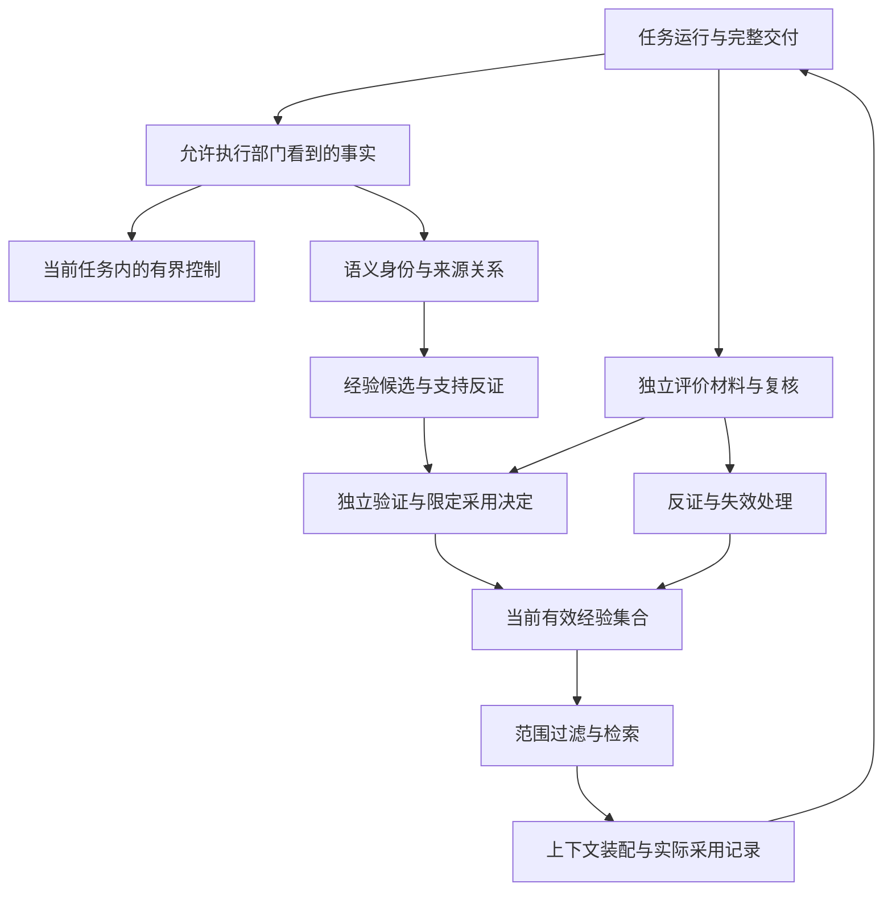

# 有界控制、语义与长期记忆：设计和一手调研

> 日期：2026-09-06。范围：第二阶段 2.2-2.4 的细节设计，并补充 2.1 所需的知识来源边界。
> 上位约束：[第二阶段计划](../stage-2-plan.md)、[总体架构](../system-architecture.md)。
> 当前第一阶段仍由另一会话开发。本文是设计与研究结果，不修改运行策略，不启动正式采样或经验采用。
> `M01-M12` 是本文稳定的来源编号。第 15 节逐项记录 URL、实际访问日期、阅读深度、支持判断与限制。

配套阅读：[离线证据与批次分析](offline-review-design.md)明确进入本模块的材料合同；[实验规约](experiment-protocol.md)明确比较和采用的证据；[可观测性设计](observability-design.md)明确用户如何查看决策、来源与失效。

用户进一步明确：[领域知识与领域引擎](domain-completion-design.md)主要支持专业理解和未定义部分补全。已有领域知识、当前任务决定及系统学习经验是不同来源；本文候选验证和限定采用的前置条件针对新学习经验，不阻止各部门依据适用成熟实践完成常规工作。

## 1. 本轮确定的设计方向

Yudao 的记忆能力以“使后续任务少犯一种已观察错误”为产品结果。持久保存、检索命中和模型写出反思都只是中间能力。
第二阶段按三个职责构建：执行在当前约束内选择行动，知识保存有来源的事实和经验，独立评价判断一次变化是否改善。
它们通过版本明确的材料协作，不需要形成三个新服务。

| 决定 | 采用理由 | 对后续实现的影响 |
| --- | --- | --- |
| 先用公开运行证据驱动一项局部控制 | CRITIC 的外部反馈机制比纯自述更接近本项目可核验要求 [M03] | 第一个控制动作围绕检查选择；不新增通用元控制 Agent |
| 候选经验先经过独立验证 | Reflexion 证明反思可影响后续尝试，但不提供本项目的跨任务采用与失效制度 [M01] | 候选、评价、采用决定分别保存 |
| 持久知识与当前上下文分别管理 | MemGPT 和 LangGraph 均区分上下文内状态与外置记忆 [M04][M09] | 保存不触发自动注入，检索结果还要经过适用性判断 |
| 语义图先提供来源追溯和影响查询 | 当前对象有明确交付和要求身份，首要问题是证据对应关系 | 直接来源关系优先；模型抽取关系保留不确定性 |
| 现有 Python、SQLite、文件工件作为默认承载 | 当前具备本地持久化与字节工件能力；SQLite 可做全文和有限图查询 [M12] | 不因“长期记忆”名称预选向量库或图数据库 |
| 成熟框架作为具体能力的候选实现 | LangGraph Store 可以单独使用；GraphRAG 则有独立索引和查询流水线 [M09][M10] | 比较具体接入收益和成本，不为引入框架重写三部门内核 |

这些决定支持长期演进。后续需要更强检索或部署能力时，更换的是有明确职责的实现；不保留过时格式、旧接口兼容层或第二套任务事实。

## 2. 先区分四种反馈速度

### 2.1 当前任务内的局部控制

输入是当前有效要求、公开检查回执、交付变化和剩余资源。
输出是一次有边界的行动选择，例如追加已知回归检查、请求澄清或停止无收益重试。
局部控制不产生跨任务知识采用权，不修改用户目标、总预算、质量条件和部门责任。

### 2.2 任务后的候选整理

输入是可用于开发的完整经历及已允许使用的评价材料。
输出是有适用条件、支持证据、反例和预期行为的候选。
此过程可以离线或批量运行，成本单列；不能在每次模型调用后默认增加一次反思调用。

### 2.3 跨任务的验证与采用

独立评价按事前确定的任务和比较口径判断候选，采用责任确定其范围及停止条件。
验证可能支持缩小范围、继续取证或拒绝候选。重复写入、检索频率和候选的自信程度不增加有效性。
长期记忆影响新的任务，是第二阶段必须证明的行为变化。

### 2.4 反证和外部变化后的有效性处理

已确认的错误、授权要求变化或依赖版本变化，可使经验停止后续使用或等待重验。
失效处理不必等待下一次批量提炼。它使用已有控制边界阻止新使用，保留已发生的输入和行动。
这四种反馈速度分别由任务状态、整理成本、评价证据和失效事实决定，不统一为一个不断自我修改的循环。

## 3. 端到端场景和数据流

贯穿场景仍是空输入行为曾通过检查，后续修复正常文本处理时又出现同类失败。
当前固定三轮离线样例只用于校准观察方法。下面描述的是后续完整能力的目标行为。

1. 事实整理确认三次交付、各次有效要求、真实检查、QA 决定及可比较环境。
2. 局部分析指出“同一公开边界检查先失败、后通过、再失败”；原因保持待验证。
3. 局部控制候选建议：返工涉及相关行为时，把仍然有效的已通过公开检查纳入下一次工程检查选择。
4. 经验提炼产生更窄的建议，说明适用任务族、触发事实、建议动作和何种反例会推翻它。
5. 独立比较判断该动作在新任务上能否减少无效往返，以及额外检查是否抵消收益。
6. 通过既定评价和采用决定后，新任务按当前要求检索并使用经验；实际注入和执行均有记录。
7. 后续任务改变了空输入语义，或相关经验产生错误建议，系统停止在受影响范围使用并展示影响任务。

图中的评价材料有独立可见范围。正式验收结果不会沿图反向泄漏给正在被评价的控制策略或候选生成者。
图谱、反思和报告都是派生内容；交付、原始 QA 和实际输入不由这些模块改写。

## 4. 局部控制：输入、选择与停止

### 4.1 控制问题先限定为下一次行动

第一个策略只回答“下一步该优先取什么证据，是否还有理由重试”。
输入来自既有公开事实与资源记录，输出保持为现有部门可以执行的行动；模型可以说明建议，但代码负责约束。
先采用能解释的一项策略，与固定流程比较。暂不引入需要估计整体价值函数的复杂搜索、强化学习或自动调参系统。

| 可观察情况 | 首选行动 | 行动结束时需要的证据 |
| --- | --- | --- |
| 当前交付有明确公开反例 | 围绕该要求修复并重新检查 | 新交付与新回执，不能复用旧快照的通过结果 |
| 相关公开检查曾通过，返工后可能受影响 | 在既定资源内追加该回归检查 | 选择理由、检查是否执行、发现的问题及额外成本 |
| 检查超时或环境无法启动 | 核实环境、超时来源，以及公开要求是否包含可验证时限 | 通常为环境问题或证据不足；若有效环境与计时可核验，且公开任务时限确已违反，可证明该时限要求未满足 |
| 同一动作重复得到相同无进展结果 | 停止该重复动作，取新的相关证据或请求澄清 | 说明哪个前提变化才允许重新尝试 |
| 要求对应关系改变或无法确认 | 取得有效要求和变更依据 | 另起可比较区段，不能称原问题已修复 |
| 只有模型自评不同、缺少反例 | 保留分歧，选择已有可靠检查 | 新外部证据或明确无法判断 |
| 无足够剩余资源完成必要检查与收尾 | 返回明确未完成或停止结果 | 停止原因、已发生消耗、尚缺哪些证据 |

CRITIC 的实验包含“已知答案错误才修正”的 oracle 设置 [M03]。
Yudao 的真实控制不能读取这种隐藏判定来决定是否追加检查；只有执行部门原本获准看到的事实才能触发行动。
这也是要将“什么触发了检查”与“检查最后发现了什么”分开记录的原因。
当前离线分析中的 `timeout` 表示评价资源限制，并未据公开任务时限建立反例，因此仍按证据不足处理；上述条件不改变现有实现口径。

### 4.2 预算是一项共享约束

每次行动前核对已发生消耗、在途预留、必要收尾额度和当前可分配余额。
新行动只能分配剩余预算；前一次失败、返工或记忆检索不能重置总预算。
模型调用的输入、输出、检查、等待及原任务预算分别按已有计量口径记录；缺少价格时不把成本填成零。

规则上优先保证当前承诺所必需的工程检查、独立 QA 和结束审计，再决定是否追加可选取证。
预留额度按任务和真实调用数据校准，不在研究文档中虚构固定比例。
候选若只能靠更高的总预算改善结果，报告必须说明它改变了资源条件，不能归因于更好的控制。

### 4.3 一次决策必须可复核

保留触发事实、当时可见信息、选定动作、未执行的主要替代动作、资源约束和实际结果。
“预计能发现什么”可以作为事前可证伪陈述；没有校准证据时，不要求模型填写看似精确的成功概率。
确定的主机回执决定检查是否执行，独立评价决定策略是否有效，二者均不接受模型自报替代。
控制器在没有新证据且没有可行替代行动时结束当前尝试，不能以持续反思掩盖无进展。

## 5. 语义系统：先把同一对象认清

### 5.1 最小领域对象

| 对象 | 为什么需要独立身份 | 来源边界 |
| --- | --- | --- |
| 原始任务与有效要求 | 判断做对了什么，以及要求是否改变 | 用户输入和有效产品决定，不由相似度重写 |
| 完整交付与检查 | 对应真正被测试的内容及条件 | 完整文件内容、检查程序、环境和主机输出 |
| 问题观察与轨迹 | 区分持续、修复、复发和不可比较 | 依据行为要求与复现条件形成分析 |
| 经历 | 将一段返工中的相关事实组织在一起 | 引用事件范围与交付，不复制成第二套任务状态 |
| 经验候选与经验版本 | 判断建议说了什么、适用哪里、曾依据什么 | 提炼来源、支持和反证可回查 |
| 评价与采用决定 | 判断谁以什么证据允许使用 | 独立评价和既定授权来源 |

内容哈希证明内容身份，不自动证明两个表述具有相同业务含义。
同名要求、类似报错、相同文件名或接近的向量位置，都不足以将两个问题合并。
要求未变的对应关系优先依据明确版本记录；语义模型只能提出对应候选，争议时保留分段。

### 5.2 直接关系和推断关系分别处理

直接关系包括“这次检查针对这份交付”“这项要求来自该有效决定”“这条经验依据这些经历”。
推断关系包括“两个问题可能属于同一错误家族”“经验可能依赖某环境条件”“此改动可能影响那项检查”。
推断保留生成者、来源、不确定性和复核记录，不因为写进图谱就取得事实权威。

首批只维护两条完整查询路径：从经验回到支持经历和原始证据；从要求或依赖变化找到需要复核的经验及使用记录。
图查询限制关系类型和展开范围，防止一次跨任务检索把大量无关历史装入上下文。
查询结果若被截断，必须显示覆盖范围；不能把只返回前几条的结果解释成“没有其他受影响经验”。

## 6. 知识图谱与检索各承担什么

知识图谱负责关联和追溯；全文检索、向量召回和重排负责从候选集合中找相关材料。
二者可以结合，但相关性分数不能代表有效性、授权或因果强度。

领域补全使用另一类相关查询：当前想法对应什么概念、当前阶段的缺口适用什么默认做法、哪里有成熟组件。它复用来源和适用性机制；下面“排除未采用”的条件只针对学习经验候选，外部已有知识依据当前情境与来源筛选，不要求先取得本系统经验采用决定。

一次检索按下列顺序进行：

1. 确定当前任务、部门、项目、有效要求和允许读取的知识范围。
2. 对学习经验排除未采用或已失效候选；对已有领域知识核对来源、适用条件与当前决定。两类均遵守可读范围；只读审计另有明确入口。
3. 在允许集合内进行确定匹配、全文召回及有必要时的语义召回。
4. 通过来源关系补齐必要条件、支持证据和冲突提示，限定展开数量和上下文预算。
5. 返回实际选中的适用知识、有效决定与学习经验及其依据，交给上下文装配再次核对；按需要保留未选择原因。

权限和有效性应当在召回前限制查询范围，在装配前再次验证。
先在全库检索再删掉无权限结果，会使日志、摘要或排序过程提前接触不该出现的材料。
LangGraph namespace 是组织和查询机制 [M09]；它不自行实现本项目的部门权限和经验采用制度。

对中文和代码混合材料，不能假定默认分词已经覆盖需求。
本机内存数据库探针使用 SQLite 3.50.4：FTS5 可用，同一字符串中查询“空输入”，默认 `unicode61` 未命中，`trigram` 命中。
探针为独立的 `:memory:` 数据库，两个 FTS5 表各只插入一条完整文本 `空输入应该正常结束`，查询均使用 `MATCH`，查询词为 `空输入`。
没有连接或改动项目事件库、业务数据或现有索引。下面的预期列是供后续复现核验的预期，不是事前登记的性能或收益预测。

| 分词方式 | 用于后续复现的预期命中行数 | 本次实得命中行数 | 解释范围 |
| --- | --- | --- | --- |
| `unicode61` | 0 | 0 | 该默认分词没有把连续中文文本中的这段子串作为独立匹配项 |
| `trigram` | 1 | 1 | 该三字符查询能命中这条文本中的对应子串 |

这只是一个校准例子。三字符切分的短查询、否定条件、版本号和标识符都要另测，不能据此直接确定最终检索算法。
首个小经验集合可先按明确范围和身份筛选，再用已有全文能力；向量服务只有在真实召回缺口被测量后才进入比较。

## 7. 经验候选：把解释写成可检验建议

“空输入必须正确”是当前任务要求，不应包装成系统学到的新经验。
经验描述的是在什么条件下采取哪种行动，会比既有行为更可靠或更省资源，以及这项判断依据什么。

一条候选至少包含下面这些业务信息，不预先要求通用字段平台：

- 适用的任务族、行为要求和关键环境条件。
- 已观察到的问题、建议动作及预期改善。
- 完整支持经历及彼此是否独立；同一任务的多轮不是多个独立任务。
- 已知反例、可能的其他解释，以及下一项能区分解释的实验。
- 相比当前做法新增的取证、上下文、调用和维护成本。
- 哪种变化会令它暂停使用或失效。

首个候选可以写为：在需要保持既有文本边界行为的返工中，显式保留已通过且仍有效的公开回归检查，可能减少同类问题再次出现。
它没有断言“模型遗忘是根因”，也没有允许读取独立评价保留的隐藏输入。
生成候选可以由确定规则、人工或 LLM 辅助完成；生成方式要记明，提炼者不签发自身有效性。

Reflexion 的文本反思是合适的候选表达参考 [M01]。
其同任务后续试验和有限记忆窗口不能直接承担本项目跨任务适用性、长期冲突与撤销机制。
Self-Refine 的可执行、具体反馈值得借鉴，但同一模型自评的停止信号不能代替 QA 或循环外评价 [M02]。

## 8. 从候选到采用的完整流程

| 环节 | 工作责任 | 能结束该环节的证据 | 失败时的处理 |
| --- | --- | --- | --- |
| 候选整理 | 知识模块 | 支持来源、适用条件、预期动作、反例齐备 | 不完整则保留待整理，不影响执行 |
| 比较准备 | 评价责任 | 冻结任务、基线、公开信息、质量条件和预算 | 比较条件不足则继续校准 |
| 独立验证 | 评价执行 | 在新任务上的交付、检查和完整成本 | 区分无收益、质量回归、环境问题和证据不足 |
| 采用决策 | 既定采用责任 | 可信评价和授权覆盖指定范围 | 拒绝或缩小范围；候选不能自行生效 |
| 正常检索与使用 | 知识读取与上下文装配 | 实际选中版本、注入内容及相关任务 | 无适用经验时使用当前基础流程 |
| 后续观察 | 评价与运维事实来源 | 新反例、条件变化、实际维护成本 | 暂停受影响使用并复核 |
| 失效和退役 | 有效性管理与控制 | 停止新增使用、处理在途任务、保留历史 | 尚未完成的影响处置明确显示 |

候选文本改变即形成新版本；旧评价不能自动授予新文本使用权。
同一经验在不同范围可以有不同有效性；一次范围内成功不能默认扩展到其他项目、部门或任务族。
验证证据不足时，状态保持“无法判断”。多轮反思不能代替缺少的新任务证据。
自动采用只执行外部已经授予的范围和条件，不新建候选自授权的通道。

## 9. 长期记忆的读取、更新和失效

### 9.1 学习路径中的三种保存对象

原始经历用于追溯，经验候选用于验证，有效经验用于后续任务。
它们可以使用同一持久化基础设施，但有不同的读取用途和权威来源。
已有领域知识与当前任务补全也可以使用该基础设施，属于专业基础，不被强行转换为经历候选；没有系统学习经验时，基础流程仍使用这些已有知识。
完整历史外置；上下文装配只携带当前职责需要的建议、适用条件和必要证据引用。

项目的有效状态与决策原因也具有独立用途，不需要包装成学习经验。演化式上下文以当前目标、实际实现及任务差异为工作层，以相关决定的简短原因和条件为依据层，以完整历史为按需证据层。方向或模块改变后重新核对摘要和引用；旧决定可以退出执行，同时保留其形成原因。具体范围、分支隔离和更新流程见[演化式开发设计](evolutionary-development-context-design.md)。

MemGPT 的分页取回和有限主上下文提供了成熟的设计理由 [M04]。
Yudao 的实际注入仍由当前部门权限和有效知识选择约束，不让模型直接重写活动经验或覆盖规则。
摘要是便于检索的派生物，必须能够回到原记录；多次摘要不能让来源和例外条件逐渐消失。

### 9.2 冲突处理

| 冲突类型 | 判断依据 | 当前任务中的使用方式 |
| --- | --- | --- |
| 新旧要求冲突 | 有授权的要求变更及生效范围 | 依新要求重新判断经验，不把放宽要求当成修复 |
| 同一范围内两条建议相反 | 各自证据、反例和评价 | 不能同时作为命令；等待消除分歧或选择有证据的限定范围 |
| 表述相似但适用条件不同 | 行为目标、环境和作用范围 | 保留不同经验，避免语义去重把条件合并 |
| 晚到事实纠正早先解释 | 事实发生时间、记录时间及来源 | 更新派生解释和有效性，保留当时为何采用 |
| 候选因共同来源显得支持很多 | 来源谱系和独立任务身份 | 合并支持统计，不能把重复记录当独立验证 |

最新时间戳、最高相似度、最多引用或更多模型赞同都不独立决定哪条建议正确。
若一条支持证据失效，先判断它对现有采用结论的重要程度；必要时暂停使用待重验，不级联删除所有相关事实。
LongMemEval 的知识更新、时间推理和拒绝作答任务提供了适合改写成本项目校准场景的测量方向 [M11]。

### 9.3 失效和实际分派之间的边界

失效被可信控制记录接纳后，后续检索及尚未获准开始发送的请求不再使用该经验。
装配可能早于真正发出请求，因此经验有效性核对、发送开始的裁决与失效接纳必须共享同一串行控制顺序，并记录该次采用的确定版本。
不能先单独检查有效性，再脱离该顺序发送；最后核对与发送开始之间发生的失效仍要参与同一次控制裁决。

仍在待发队列、尚未获准开始发送的请求可以撤销或重新装配。失效接纳在先，便拒绝开始发送；发送开始获准在先，则保留原上下文与裁决依据，并按在途、结果未知处理后续失效。
本地获准开始发送不证明外部模型已经收到请求；只有可核验的外部回执才能进一步确定接收或执行状态。该控制顺序不承诺本地裁决与外部接收具有原子性，也不能宣称已撤回外部可能收到的信息。
已知继续执行会产生损害时，按既有控制边界停止；外部动作结果未知时先核实，再决定后续处置。

失效结果至少回答：停止了哪些新使用，哪些请求仍可撤销，哪些已获准开始发送或已有可核验外部回执，哪些结果仍需复核，以及哪些关联任务受影响。
查询索引即使尚未更新，也不能使已失效经验重新获得使用权；索引候选必须回查权威有效性。
历史和发布证据保留供审计，过时实现直接退役，不建设旧格式兼容或自动状态转换流程。

## 10. 与现有实现的具体接入位置

本轮只读核对了 `harness/event_store.py`、`artifacts.py`、`context.py` 和现有阶段文档。
当前新分支已有独立 `harness.analysis` 校准模块；它提供完整交付复核与轨迹能力，尚未形成真实采集和长期知识采用。

| 当前基础 | 可以复用的能力 | 对应增量和边界 |
| --- | --- | --- |
| SQLite 事件库 | 有序任务事实及工件引用 | 后续从已确认接口读取；知识投影不伪造原任务事件 |
| 文件工件库 | 保存字符串和 bytes，按内容标识取回 | 保存候选、评价和知识版本材料，核对引用的真正内容 |
| 上下文装配 | 按部门选择来源并记录装配清单 | 在单独增量中加入有效经验读取和实际采用记录 |
| 离线分析模块 | 固定交付、主机复核、可比较轨迹 | 接入真实材料时保留同一路径，不复制一套观察逻辑 |
| 现有主机检查 | 工程与 QA 的公开执行回执 | 控制消费可见结果，独立评价材料另有范围 |

知识层可以建立可重建的关系和检索投影，原始事实仍来自既有来源。
采用与失效决定是新的领域事实，不是从文本相似结果中计算出来的临时任务状态。
具体持久化操作在对应增量实现时确定，当前不向第一阶段新增未经共同确认的事件字段。
完整交付的可搬移保存、只读重载和证据核验遵循[离线证据详细设计](offline-review-design.md)，本专题消费经核验的材料与来源，不另定义一套输入目录协议。

### 10.1 实现选择比较

| 方案 | 对当前需求的适配 | 实际接入成本 | 当前判断 |
| --- | --- | --- | --- |
| Python + SQLite + 文件工件 | 明确身份、来源关系、有效性和小集合检索 | 增加领域查询、索引与有效性事务；沿用当前运行环境 | 默认承载，先测真实查询与检索缺口 |
| LangGraph Store 独立使用 | 跨任务 namespace、JSON 文档、过滤、可选语义召回 | 新依赖、持久化后端与语义适配；仍需实现独立验证和失效 | 可以隔离比较，不要求采用图执行器 |
| 整体采用 LangGraph | 同时需要图执行、检查点和跨任务存储时更完整 | 改变当前状态和执行模型，扩大恢复与版本验收 | 第二阶段仅为记忆而整体改写的收益不足 |
| Microsoft GraphRAG | 大量非结构化经历的整体主题和关系归纳 | LLM 索引、社区摘要、向量、Parquet、环境和提示维护 | 作为全局分析实验，先不进入活动经验读写 |
| 专用图数据库 | 可能改善大规模关系遍历、团队查询和运维 | 新服务、备份、权限、部署及一致性责任 | 当前没有足够规模与查询证据支持预选 |

LangGraph 官方文档明确区分 thread 检查点和跨 thread Store；SQLite 检查点支持不能自动推导为某个长期 Store 已满足本项目需求 [M09]。
所读 Store 文档展示独立使用方式，也指出 namespace 前缀匹配、结果截断和后端排序差异。
采用该接口仍要做领域范围、分页完整性、顺序和有效性测试，不能仅凭 `put/get/search` 已存在就宣称记忆闭环完成。

GraphRAG 的标准索引包括实体关系抽取、社区发现、社区报告和向量嵌入；默认输出包含 Parquet 和向量存储 [M10]。
这些步骤针对非结构化语料归纳，不会自动代替 Yudao 的事实权威、候选采用和反证处理。
本次官方提交的 `graphrag` 包清单标为 3.1.2，Python 要求为 `>=3.11,<3.14`；当前工作树运行 Python 3.14.7。
这里指 `packages/graphrag/pyproject.toml`；仓库根清单的 `graphrag-monorepo` 为 0.0.0，用于整个开发工作区。
若做隔离实验，应明确独立运行环境和输入输出范围；本轮未安装，也未假定能直接加入现有依赖。

## 11. 论文机制如何转化为本项目实验

### 11.1 Reflexion：反馈可以成为候选，但同任务重试不是迁移证明

正文第 3 节分别描述 Actor、Evaluator、Self-reflection 及有限记忆；第 4 节在决策、问答和代码任务中采用不同反馈 [M01]。
其中一些设置允许围绕同一任务反复尝试，反馈可来自环境、启发式或模型；代码设置使用自行生成的检查。
这支持把反思当作候选建议，也提示必须记录“反馈来自哪里，在哪一次尝试中已可见”。

第 5 节明确指出局部最优、有限滑动记忆，以及非确定性、API、副作用和并发行为的检查困难。
实验表中也并非每个模型和任务组合都超过所列基线，因此本项目不会按论文 headline 预填收益。
对应实验比较固定流程、等额重试、保留原轨迹、保留有证据建议；控制其额外上下文和调用成本。

### 11.2 CRITIC：外部反馈有帮助，但必须计入取证代价

正文第 3 节明确“验证、获得反馈、修正”的循环，第 4.1 节记录工具、迭代和搜索结果缓存安排 [M03]。
外部查询可能随时间变化，固定或记录查询环境是可比较性的组成部分。
其中 CRITIC* 使用已知哪些样例错误的 oracle 条件；它只能作为受控分析上界，不能充当现实控制器的公平基线。

Yudao 先使用可确定的公开主机检查做相应实验，再比较是否需要模型辅助选择工具。
外评检出错误和控制策略能及时发现错误是两个指标，不能用前者自动证明后者有效。
追加取证可能改善质量而增加延迟，或者错误地修正原本正确结果；比较必须记录改善与退化两种变化。

### 11.3 MemGPT：解决有限上下文，不代替知识有效性

正文第 2 节区分主上下文、外部存储、队列管理和分页取回；上下文外内容只有被移入后才参与推理 [M04]。
第 3 节分别评价多会话聊天和文档检索，其中部分聊天比较让基线看到有损摘要，而 MemGPT 可分页查询完整历史。
这种可访问信息差异应在复现实验中说明；不能直接归因于更好的“思考能力”。

对应到 Yudao，应分别测量完整事实能否取回、检索能否召回需要的材料，以及获得材料后能否正确行动。
不能把记忆命中率直接写成软件质量改善，也不能把全文存储规模写成可用上下文规模。
本项目保留其有限上下文和按需取回原则，学习经验的活动版本仍受既定验证与采用制度约束；已有领域知识按来源、项目约定和适用性参与专业补全。

## 12. 评价隔离、未见任务与成本

实验分组、样本量依据、缺失分母和质量差异判据遵循[改善验证与选型实验规约](experiment-protocol.md)。下面补充记忆和控制特有的材料流转与泄漏面。

### 12.1 三组材料的角色

| 材料组 | 可以用于什么 | 谁能看什么 | 何时失去未见资格 |
| --- | --- | --- | --- |
| 开发与校准 | 调试观察、提炼候选、设计检索和停止条件 | 开发者及对应候选生成过程可读取 | 本就不进入正式未见统计 |
| 候选验证 | 比较和选择候选，确定有限采用范围 | 评价者读取明细；提议者只取得协议允许的结果 | 被用于继续修改或挑选候选后，不能冒充最终验收材料 |
| 最终验收 | 固定策略与经验后的独立综合比较 | 被评执行和提炼过程不能读取隐藏材料 | 明细揭示并参与系统修改后，转入开发材料 |

仅按文件夹分开不够，还要检查全文索引、嵌入、图谱摘要、实验日志和上下文缓存是否带入了保留材料。
同一任务的不同表述、代码变体和来源相同的派生样例按谱系分组，避免几乎相同的材料落入不同集合。
正式比较固定知识截点、候选版本、模型配置、工具环境和总预算。实验期间不把本轮独立评价结果再写入活动经验。
发生必须立即停止的失效事件时照常执行停止责任，并在比较报告中标明中断和协议偏离，不静默继续调参。

### 12.2 分开回答四个问题

- 观察是否正确：问题身份、交付绑定、错误放行和不可比较分类有没有真实反例支撑。
- 检索是否正确：需要的有效经验能否召回，不适用或已失效材料是否被排除。
- 行为是否改变：实际注入、行动和检查选择是否符合采用内容。
- 系统是否改善：在同口径任务上，质量、无效返工和总成本是否达到事前标准。

验证前三项不自动证明第四项。LongMemEval 的索引、检索、阅读分解可借鉴，但其对话问答目标不能替代软件交付评价 [M11]。
DSPy 的“围绕明确指标优化模块组合”适合作为候选搜索参考，指标和开发集仍由本项目事前确定 [M08]。

### 12.3 综合比较和统计单位

第二阶段继续比较四组：固定基础流程、仅局部控制、仅经验复用、两者组合。
任务与公开要求一致；运行顺序按事前安排交错，避免 provider 随时间变化与方案完全重合。
同一任务的多轮结果视为相关数据，汇总和不确定性以任务为单位；必要重复不能被当作新增独立任务。

质量条件、允许的差异范围、最低证据量和收益判据在正式采集前确定；有限样本支持的是带范围和不确定性的结论。
结果中保留失败、超时、缺失、弃用候选和不利任务，不只展示改善案例。
分别报告知识准备、候选失败实验、在线执行、独立评价、索引更新及失效处置成本。
纸面节省的上下文或调用数应与实际消耗核对；检索、反思和维护增加的开销不能被移出总成本。

## 13. 必须通过的失败场景

| 场景 | 应观察到的行为 | 不允许得出的结论 |
| --- | --- | --- |
| 同名要求含义变了 | 新的可比较区段，旧经验重新判断适用性 | 名称一样所以还是同一个已修复问题 |
| 只改检查或解释器环境 | 记录口径变化并独立复核 | 变化后的通过证明代码修好了 |
| 完整交付或检查输出缺失 | 证据不足，保留分母与缺失原因 | 没看到失败所以通过 |
| 模型说失败但没有可复核反例 | 保留意见与来源 | QA 已被证实错误放行 |
| 候选建议与要求相反但语义很相似 | 排除或标记冲突，不能获得执行作用 | 相似度高所以优先采用 |
| 多条支持来自同一次任务复制 | 来源归并，独立证据量不增加 | 更多记录表示更强经验 |
| 已失效经验仍在向量索引中 | 装配前有效性核对阻止使用 | 索引返回就表示当前有效 |
| 装配后、待发队列中的请求发生失效 | 撤销或重新装配尚未获准开始发送的请求 | 装配时有效所以可以继续发出 |
| 最后有效性核对后、发送开始获准前接纳失效 | 同一串行控制顺序拒绝开始发送并撤除采用 | 刚刚检查有效，所以失效不能阻止本次发送 |
| 发送开始获准在先、失效接纳在后 | 保留原输入与裁决顺序，记录在途或结果未知并核实外部回执 | 本地获准发送就证明模型已收到，或失效已经撤回外部材料 |
| 所有检索候选都不适用 | 按基础流程继续，记录未采用原因 | 没有经验就伪造一条建议 |
| 反思或回归检查耗尽预算 | 明确停止，报告额外成本与缺失交付 | 因为在学习可以增加总预算 |
| 最终验收样例出现在摘要或嵌入中 | 标记污染，重新安排独立材料 | 没直接读取原测试文件所以没有泄漏 |

失效校准必须包括：正确经验遇到新要求、被错误采用的建议、检索缓存落后、待发队列撤销，以及最后核对到发送开始之间的两种裁决顺序。
验收分别核对新任务采用、实际在途上下文和历史审计记录，不能只看经验列表上的“已失效”标签。
图形化验收对应[可观测性设计](observability-design.md)中的经验详情、采用与失效时间线及批次比较：用户能从一条建议进入支持反证，再到实际受影响的请求和任务。

## 14. 工作包和可并行范围

| 工作包 | 当前即可独立完成的内容 | 需要等待的事实 | 可核验交付 |
| --- | --- | --- | --- |
| K1 语义身份与来源查询 | 用公开固定材料验证身份、直接关系、来源追溯和范围变化 | 真实事件与交付接口稳定后才连接真实材料 | 两条来源/影响查询及错误对应反例 |
| C1 控制决策校准 | 在固定事实序列中核验下一步动作和预算限制 | 正式运行采用等待 2.1 的真实基线 | 决策表、停止场景和不依赖隐藏评价的记录 |
| K2 候选与有效性流程 | 人工构造候选、验证记录和反证，检查采用/失效机制 | 候选真实收益须由未见任务证明 | 候选、采用、冲突及分派前后失效的闭环样例 |
| R1 检索校准 | 明确范围、中文/代码检索、相反建议及过期知识的负样例 | 真实工作负载决定召回缺口和索引成本 | 召回、错误纳入、来源覆盖及成本报告 |
| C2 单项控制正式比较 | 评价协议和基线准备可先设计 | 第一阶段完整验收、真实采集与 2.1 基线 | 新任务质量与无效返工比较 |
| K3 跨任务经验正式比较 | 检索与采用边界可先校准 | 有效候选及独立比较材料 | 实际采用、未见任务收益和反例停用 |
| X1 四组综合验收 | 比较口径和失效场景可先冻结 | C2 与 K3 各自形成证据 | 组合贡献、相互干扰和全部成本 |

K1、C1、K2、R1 可以围绕独立材料并行设计，结果仍标记为校准，不称为系统已学会改善。
与第一阶段的真实接口通过单独工作包衔接；当前不修改其控制器、事件语义、真实 provider 或 Web。
首批选择能展示一条完整链路的范围，完成后再扩大查询、任务族和知识数量，不预先设计通用知识平台。

### 14.1 验收前需要确定而非暗设的事项

正式任务族及公开要求；经验适用范围的确认责任；可自动采用的范围；质量差异容忍度；正式样本及成本口径。
这些选择可以在离线校准后据证据确定，不阻塞当前关系查询、状态生命周期和检索边界设计。
模型辅助提炼如果没有明确可用版本和独立评价材料，先以人工候选完成流程校准，保留其来源标记。
隔离机制、真实执行授权和跨进程恢复仍按对应阶段验证，不能由本文的离线设计提前声明完成。

## 15. 一手来源登记

以下来源均在 2026-09-06 实际联网访问。论文摘要通过 arXiv 官方 API 读取，正文使用 arXiv HTML。
“全文选读”明确表示实际阅读所列章节，不声称已逐页复核全文、全部表格或附录；未复现实验结果。
官方 main 分支和在线文档具有时间性；GraphRAG 对关键维护和依赖判断额外固定提交。

### M01 Reflexion

- URL：[论文 v4](https://arxiv.org/abs/2303.11366v4)、[正文](https://arxiv.org/html/2303.11366v4)、[作者仓库 README](https://github.com/noahshinn/reflexion/blob/main/README.md)。
- 访问日期：2026-09-06；阅读深度：摘要、全文选读第 3 节方法、第 4.1-4.3 节实验设置与部分结果、第 5 节限制；官方 README。
- 支持判断：文本反思可作为可解释的后续尝试输入；Actor、评价和反思需要分责；反馈来源与记忆容量影响结果。
- 实验含义：不同任务使用不同评价反馈；部分收益来自围绕同一任务的多次尝试，不能等同跨任务泛化。
- 限制：作者明确局部最优、有限滑窗及非确定性/API/并发检查问题；本项目不沿用论文结果数字作为验收目标。
- 对应设计：第 4、7、11、12 节。

### M02 Self-Refine

- URL：[论文 v2](https://arxiv.org/abs/2303.17651v2)、[正文](https://arxiv.org/html/2303.17651v2)。
- 访问日期：2026-09-06；阅读深度：摘要、全文选读第 2 节方法与停止条件；未复核全部实验。
- 支持判断：生成、具体反馈、修正可以形成小循环，历史反馈可参与后续迭代。
- 限制：方法使用同一模型承担反馈和修正；反馈中的停止信号不具有独立质量权威。摘要中的跨任务平均改善不外推到 Yudao。
- 对应设计：第 4、7、11 节。

### M03 CRITIC

- URL：[论文 v4](https://arxiv.org/abs/2305.11738v4)、[正文](https://arxiv.org/html/2305.11738v4)。
- 访问日期：2026-09-06；阅读深度：摘要、全文选读第 3 节方法、第 4 节设置及 4.1 节问答实验、附录 A 限制。
- 支持判断：外部工具反馈可指导修正，取证和改写应分别记录，工具环境变化影响比较。
- 实验含义：正文区分普通 CRITIC 与有 oracle 的 CRITIC*；记录搜索缓存、有限工具交互及迭代条件。
- 限制：工具交互增加推理时间，反馈质量与工具覆盖限制可验证内容；不能拿 oracle 条件作真实策略结果。
- 对应设计：第 4、11、12 节。

### M04 MemGPT

- URL：[论文 v2](https://arxiv.org/abs/2310.08560v2)、[正文](https://arxiv.org/html/2310.08560v2)。
- 访问日期：2026-09-06；阅读深度：摘要、全文选读第 2 节方法、第 3 节实验概述及 3.1 节多会话评价、第 5 节结论。
- 支持判断：主上下文和外部存储分离，分页取回与上下文预算协同，保留完整历史与注入历史是不同动作。
- 实验含义：聊天一致性和文档检索是其目标；部分基线仅看到摘要，需区分信息可访问条件与控制策略贡献。
- 限制：本文未证明软件经验的有效性、独立采用或撤销；本项目不能直接采用模型自写活动记忆的权限方式。
- 对应设计：第 2、9、11 节。

### M05 Generative Agents

- URL：[论文 v2](https://arxiv.org/abs/2304.03442v2)。
- 访问日期：2026-09-06；阅读深度：摘要，未读完整方法与附录。
- 支持判断：原始经历、较高层反思和按需检索可承担不同角色，适合作为记忆分层的研究线索。
- 限制：论文目标是可信的人类行为模拟；摘要中的行为可信度不能证明软件交付正确性或生产治理能力。
- 对应设计：第 2、5、9 节；不据摘要选定检索权重或排序公式。

### M06 GraphRAG 论文

- URL：[论文 v2](https://arxiv.org/abs/2404.16130v2)。
- 访问日期：2026-09-06；阅读深度：摘要，未复核全部方法和实验表格。
- 支持判断：实体图与社区摘要服务于大型私有语料的全局问题归纳，是与单条证据取回不同的查询目标。
- 限制：关于答案全面性、多样性的实验结论不代表事实无误、因果关系成立或经验已获采用。
- 对应设计：第 6、10 节；具体实现成本另见 M10。

### M07 Voyager

- URL：[论文 v2](https://arxiv.org/abs/2305.16291v2)。
- 访问日期：2026-09-06；阅读深度：摘要，未复核正文实验与代码。
- 支持判断：可执行技能库和环境反馈可以成为跨任务复用的一种载体；外部知识变化不要求模型权重更新。
- 限制：实验环境是 Minecraft，不能直接外推为通用软件交付、权限治理或技能异常恢复。第二阶段不因此提前增加技能执行器。
- 对应设计：第二阶段经验向第三阶段稳定技能的交接边界。

### M08 DSPy

- URL：[论文 v1](https://arxiv.org/abs/2310.03714v1)、[官方 README](https://github.com/stanfordnlp/dspy/blob/main/README.md)。
- 访问日期：2026-09-06；阅读深度：论文摘要、官方 README；未安装框架或复现优化器。
- 支持判断：围绕明确任务指标组织可组合模型模块，比无限试改提示更适合定义候选搜索和比较责任。
- 限制：优化目标可能被过拟合；框架不自动提供本项目的材料隔离、外部授权及失效处置。具体优化算法需另读实现再选。
- 对应设计：第 8、12 节。

### M09 LangGraph Memory / Store

- URL：[Memory overview](https://docs.langchain.com/oss/python/langgraph/memory)、[Stores](https://docs.langchain.com/oss/python/langgraph/stores)、[checkpoint 包清单](https://github.com/langchain-ai/langgraph/blob/main/libs/checkpoint/pyproject.toml)。
- 访问日期：2026-09-06；阅读深度：官方文档的短/长期记忆、写入时机、namespace、检索与存储部分，以及包清单代码文件；未安装或运行该库。
- 支持判断：thread 状态与跨 thread Store 分离；Store 可独立使用，支持 namespace、JSON、过滤及可选语义搜索；记忆写入可以在任务内或任务后。
- 实现代价：所读清单版本 4.2.0 依赖 `langchain-core`、`ormsgpack`；持久 Store 还需选定后端，不能把内存实现作为持久化交付。
- 限制：前缀 namespace、分页截断和后端排序差异需适配；权限、来源可信、采用和失效是 Yudao 的领域责任。
- 对应设计：第 6、9、10 节。

### M10 Microsoft GraphRAG 实现

- URL：[固定提交 README](https://github.com/microsoft/graphrag/blob/f40e9a26ce62ba0b3fef8837d24aafdcc6e6c704/README.md)、[索引文档](https://github.com/microsoft/graphrag/blob/f40e9a26ce62ba0b3fef8837d24aafdcc6e6c704/docs/index/overview.md)、[包清单](https://github.com/microsoft/graphrag/blob/f40e9a26ce62ba0b3fef8837d24aafdcc6e6c704/packages/graphrag/pyproject.toml)。
- 访问日期：2026-09-06；阅读深度：官方 README、索引概览文档和 Python 包清单。官方 API 确认当前提交为 `f40e9a26ce62ba0b3fef8837d24aafdcc6e6c704`，提交日期 2026-08-24。
- 支持判断：标准索引包含实体、关系、社区和摘要，输出 Parquet 并写向量存储；适合隔离评估全局语料归纳。
- 实现代价：包清单版本 3.1.2，Python `>=3.11,<3.14`，含图处理、数据表、向量相关组件及模型接入依赖；与本机 3.14.7 不直接匹配。
- 维护状态原文："This project is largely in maintenance mode, and won't be accepting new PRs or implementing new features." 同段说明仍会按需修复和更新依赖。
- 成本原文："GraphRAG indexing can be an expensive operation"；README 同时说明演示代码不是 Microsoft 官方支持的产品。
- 限制：维护状态按本次固定提交陈述，不能推断所有后续版本；本文未安装、跑索引或测得本项目费用。
- 对应设计：第 6、10、14 节。

### M11 LongMemEval

- URL：[论文 v2](https://arxiv.org/abs/2410.10813v2)。
- 访问日期：2026-09-06；阅读深度：摘要，未读取全部基准样例或复现实验。
- 支持判断：分别评价信息提取、多会话推理、时间推理、知识更新和拒绝作答；把记忆拆为索引、检索、阅读可帮助定位缺陷。
- 限制：对话记忆问答与软件行动结果不同，不能直接把该基准准确率作为第二阶段验收；不据摘要采用具体最佳参数。
- 对应设计：第 9、12、13 节。

### M12 SQLite 官方能力

- URL：[FTS5](https://www.sqlite.org/fts5.html)、[WITH 与递归查询](https://www.sqlite.org/lang_with.html)。
- 访问日期：2026-09-06；阅读深度：官方文档选读概览、分词与递归查询说明；另做本机内存数据库能力探针。
- 支持判断：现有 SQLite 可以承载全文检索与有限层级/图查询，不因关系数据存在就需要专用图数据库。
- 本机观察：SQLite 3.50.4，`ENABLE_FTS5` 可用，递归 CTE 可执行；中文子串样例的 `unicode61` 与 `trigram` 召回不同。
- 限制：能力探针不代表性能、召回质量或部署一致性通过；需要使用真实查询规模、中文/代码材料和版本条件校准。
- 对应设计：第 6、10、14 节。

## 16. 本文的结论范围

目前可以确定模块责任、输入输出语义、可见材料、候选生命周期和验收方法，并开展互不影响第一阶段的设计及隔离校准。
是否使用向量召回、LangGraph Store、GraphRAG 或更复杂控制，仍由真实缺口和完整成本比较决定。
本轮没有运行论文基准、安装新依赖、改变模型或已有业务代码，也没有把校准结果升级为正式采用证据。
正式收益和经验采用必须等待可信真实经历、独立评价以及预先确定的比较材料；图形化轨迹、来源和失效视图随对应能力一起交付。

[M01]: #m01-reflexion
[M02]: #m02-self-refine
[M03]: #m03-critic
[M04]: #m04-memgpt
[M05]: #m05-generative-agents
[M06]: #m06-graphrag-论文
[M07]: #m07-voyager
[M08]: #m08-dspy
[M09]: #m09-langgraph-memory--store
[M10]: #m10-microsoft-graphrag-实现
[M11]: #m11-longmemeval
[M12]: #m12-sqlite-官方能力
