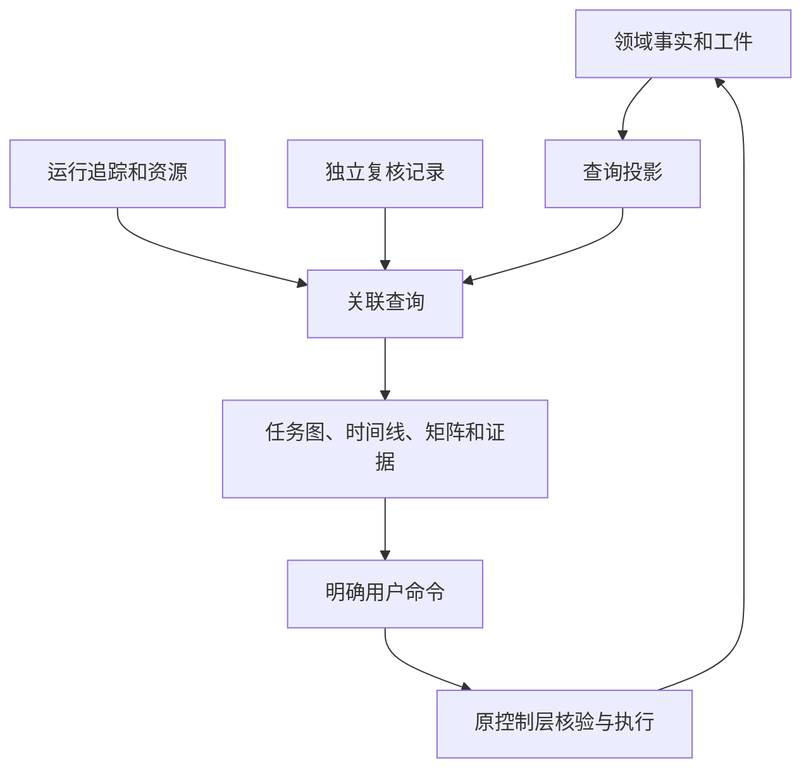

# 可观测性与图形化分析详细设计

> 日期：2026-09-06。覆盖第一至第四阶段的视图职责，当前只形成设计资料。
> 第一阶段三部门状态图是 MVP 必需交付，仍由原会话实现和验收；本文件不在本分支改造 Web，也不改变第一阶段已约定范围。
> 配套：总体架构、[离线证据设计](../archive/research/offline-review-design.md)、[组织与运行](organization-runtime-evolution.md)。
> 第一阶段范围按最新设计复核对齐：同任务持续输入、有效 PRD、事前计划、相互咨询与动作请求、prompt 编辑和部门历史压缩都随第一阶段交付；本分支不改另一会话 Web。

## 1. 用户要看清的四件事

研发者首先需要知道当前谁负责、停在哪里、发生过什么，以及手头结论有什么依据。第三、四阶段再逐步回答内部怎样协作、从哪里恢复、什么版本影响了任务。

可观测性跟随能力一起交付。日志、trace 和资源指标负责定位运行问题；领域事件负责说明任务责任、QA 决定和状态变化；独立评价负责说明交付质量及是否改善。三者相互定位，各自保留事实来源。

模型调用成功结束、工具返回成功、QA 放行和任务完成是不同层次的结果，界面不能用同一种绿色完成状态替代全部含义。

## 2. 视图分工与阶段归属

| 用户问题 | 主要视图 | 首次交付 | 后续扩展 |
| --- | --- | --- | --- |
| 产品、工程、质检现在谁在工作 | 三部门运行图 | 第一阶段 | 第三阶段按部门展开内部任务 |
| 为什么等待、返工或停止 | 任务时间线、当前责任与原因 | 第一阶段 | 等待外部条件、恢复位置、未知副作用 |
| 当时的目标与交付是什么 | 有效要求、完整证据详情 | 第一阶段基础证据 | 第二阶段完整封存和版本差异 |
| 新输入是否处理、计划和 prompt 是否生效 | 输入处理记录、有效 PRD、事前计划、采用 prompt 与压缩来源 | 第一阶段最新确认流程 | 第二阶段跨 run 的项目变更与采用 |
| 同一项目现在做成什么、接下来改什么 | 项目现状、变更任务与跨变更历史 | 第二阶段 2.E | 第三阶段持续并行与部署状态 |
| 同类行为有没有修好又复发 | 要求/检查与轮次矩阵 | 第二阶段 2.1-C | 按材料批次筛选与比较 |
| QA 与外评为什么不一致 | 评价对照及反例详情 | 第二阶段 2.1-C | 模型意见、反证与采用判断分别呈现 |
| 本次用了哪条经验、为什么 | 决策与知识采用时间线 | 第二阶段 2.2/2.3 | 技能、规则和组织版本影响 |
| 改动是否改善整个系统 | 批次比较与成本表 | 第二阶段 2.1-D/2.4 | 组织、协议和规则候选实验 |
| 中断后谁继续负责 | 等待与恢复详情 | 第三阶段 | 在途任务版本处置 |
| 新规则在什么范围生效 | 候选、有效版本与影响清单 | 第四阶段 | 撤销、反例与后续观察 |

同一控制台按任务和问题组织入口；不为每种内部模块单独建设管理后台。

## 3. 页面结构

任务列表用于扫描状态、责任部门、最近活动和停止原因。选中任务后保持其身份清晰，任务详情按“运行、要求与交付、分析”切换。批次实验和知识列表是跨任务入口，均能回到具体任务来源。

运行页上部显示当前状态、责任、已用资源和明确命令；中部是三部门图；下部是时间线与选中事件详情。布局采用固定轨道和稳定尺寸，运行状态改变不会使图中部门跳位。

第一阶段持续输入保留接收、待产品处理和已处理的区别；专家咨询与动作请求显示原工作、当前接收部门、返回结果和接续位置。prompt 折叠仅改变展示，编辑后显示明确作用域、待生效状态和实际采用版本。部门原始历史跨激活保留，查看压缩时可追到摘要覆盖范围及近期完整回合。运行限制按 D09 显示循环/步骤、超时和请求容量；provider 用量不显示成任务剩余 token 预算。完整交付封存若按本轮建议前移，其真实取回能力在第一阶段证据视图验收，第二阶段继续提供外评和跨版本分析。

分析页上部显示材料来源、评价范围和核验状态；中部是问题矩阵；选中单元格后显示当轮要求、交付、实际输入输出与 QA 对照。大段输出按需展开，不挤占扫描区域。

要求与设计详情按需区分用户明确要求、继承约定、领域默认和仍待决定的事项，并可追到重要补全依据。用户主要看到需要决定的取舍，常规默认不逐项弹出确认；一个已选平台或组件规范可以作为共同依据展示。详见[领域补全设计](domain-completion-design.md)。

第二阶段 2.E 提供项目入口，分别显示当前目标、已采纳代码、变更中实际实现/验证与待完成差异。选中一个变更任务可进入现有三部门运行图，返回项目后仍保留跨变更历史；重要决定可展开简短原因、原始依据与取代记录。每一步显示当前责任、等待条件和关键取舍依据，目标获准修改、QA 通过与项目采纳不能共用一个完成标记。

任务上下文详情列出本次真正采用的来源、作用域、版本及未纳入范围，被取代的历史不与当前决定并列成活动指令。分支切换和模块变化后的过时摘要可见，不能仅凭计划更新就显示能力已上线。QA 通过但基线已变化时显示尚未采纳及原因，不让旧结果覆盖项目状态。详见[原生项目演化设计](native-project-evolution-design.md)与[上下文设计](evolutionary-development-context-design.md)。

关系图只用于选中问题、经验或规则的局部来源关系。默认给出可排序的来源清单，用户需要理解连接时再展开图；不把全部历史放在一张网络图里。

## 4. 三部门图的状态语义

一个部门节点显示该任务中该部门当前的工作状态及最近一次有效激活。角色私有会话或文字自报不决定图中状态，状态来自已提交的领域事实。

连线表示实际发生的交接、Ask/React 或返工。尚未被控制层接受的模型提案仅属于待处理事实，不能提前画成已完成交接。线上的时间顺序以领域序列为准，耗时另据可靠时钟记录。

图中停止活动不代表交付通过。等待、暂停、取消处理中、失败和完成必须有可读文字及不同图标，不能仅凭颜色区分。最终显示的具体名称沿用第一阶段实际状态合同，不在后续设计中平行定义另一套状态机。

选中节点可以定位该次激活的有效要求、实际上下文来源、工具调用和资源消耗；默认不显示全部模型私有对话。接入端只提供被允许展示的字段，页面隐藏不等于服务端隔离。

## 5. 只读数据流和用户命令

创建、取消及后续恢复、采用、撤销都是命令。界面可以显示请求已经提交，最终状态必须等领域事实确认；网络请求成功返回不等于取消或恢复已经完成。

每个详情查询绑定任务、对象、评价和版本身份。切换任务后迟到的旧查询结果不能覆盖当前页；历史回看固定读取所选时点，实时更新不能悄悄替换正在核对的历史证据。

分页和筛选只影响展示。隐藏失败、未观察或已撤销项时，仍显示当前过滤条件及全体数量；导出应明确是当前筛选还是完整材料集合。

## 6. 实时、断线与历史回看

实时界面展示最后确认的领域序列和连接状态。事件重复按其身份去重；若发现序列缺口，先重新同步可确认快照和缺口区间，再恢复增量展示。具体 REST/SSE 行为沿用第一阶段经验证合同。

连接断开时保留最后已知状态并标明数据可能过时，不把所有部门改为失败。连接恢复不触发重新执行任务，不把浏览器订阅恢复等同于工作流恢复。

取消请求发出后可以出现迟到回执。已发生消耗继续记录，但结果是否推动流程由控制层决定；界面同时说明迟到结果和不再被接纳的原因。

异步阶段还需区分事件发生时间与采集时间。不同主机时间不同步时，不能按墙钟排序推翻任务责任的提交序列；跨任务耗时比较说明时钟条件。

## 7. 第二阶段矩阵和评价对照

矩阵行是有效要求与具体检查，列是交付轮次。每格显示观察结果及相对上一可比较观察的变化，鼠标悬停和键盘聚焦均可获取完整文字。

要求、检查或环境改变后另起比较区段，在区段边界提供变更依据。未观察、超时、不稳定及封存损坏保持可见；空白不能表示通过。

同一项目的不同变更任务与单次任务内的 QA 返工分别呈现。合法新增或替换要求显示为需求变化，仍有效行为的缺陷才按证据进入相应问题轨迹；工程自检、当次独立 QA 和系统配置评价各有来源与范围，不能合并为一个质量判断。

QA 记录显示当时决定、来源和受审对象。外评显示后来采用的方法、检查范围、证据与结论时间。错误放行必须有同一受审交付和有效要求的反例；仅文字意见不同显示为分歧。

“通过”旁边保留检查范围，不能让用户误读成所有可能输入都正确。只有本地声明 QA 的材料明确说明来源，校准结果不进入真实模型统计。

## 8. 成本与质量不压成一个分数

| 区域 | 应显示的量 | 解释条件 |
| --- | --- | --- |
| 当前任务资源 | 实际 token、调用、工具、已用/剩余预算 | 估计与实际分别标明；尚无回执的在途用量不能当零 |
| 时间 | 端到端经过时间、累计活动时间、等待与评价时间 | 并行活动不能直接求和为任务延迟 |
| 质量 | 预定检查结果、未观察范围、QA 反例和问题轨迹 | 不把部门自评分当独立质量指标 |
| 批次改善 | 任务级结果、比较方案、差值、不确定性与样本范围 | 多轮与重复评价不是独立任务 |
| 总体成本 | 准备、在线执行、独立评价及维护 | 缺失显示覆盖与已知部分，不报虚假的完整总价 |

错误预算属于运行可靠性目标，token 预算属于资源限制，允许的质量差值属于实验判据。三者分开展示，不能用节省 token 抵消未满足的交付要求。

## 9. 第三、四阶段的扩展合同

部门内部展开后，每个子任务显示父任务、责任人或职责、输入版本、状态、依赖、预算占用与可核验输出。默认折叠，只显示外层能判断责任是否履行的信息；失败时可展开到工具回执。

等待项显示等待对象、继续条件、超时责任和最后确认状态。恢复页区分可以自动继续、需要先确认外部结果和需要明确人工决定；按钮是否可用由服务端可恢复性判断支持。

运维视图分别展示平台运行和交付物运行。一次模型调用恢复正常不等于交付物恢复；故障需要连接用户可见症状、修复任务、部署身份和恢复检查。

版本页区分提出的候选、实验中的版本、限定采用的版本和已停止新增使用的版本。撤销详情显示原因、新任务停止采用时间及在途任务处置；旧版本历史保留用于追溯，不能将过去采用记录改成从未使用。

## 10. 界面验收场景

| 场景 | 必须核对的用户行为与证据 |
| --- | --- |
| 实际三部门直达和 Ask/React | 图与领域事件逐步一致，每次交接能定位来源 |
| QA 返工再交付 | 同一任务中能看清不同轮次和受审交付，不覆盖旧记录 |
| 正在运行时切换任务 | 新页面不会被旧请求或旧事件更新 |
| 断线、重复事件和缺口 | 过时状态可见，恢复后无重复节点和虚构交接 |
| 取消后结果迟到 | 显示实际消耗及接纳结果，不恢复已取消流程 |
| 要求变化、证据缺失 | 矩阵有明确边界和原因，不显示连续修复轨迹 |
| 同一项目三个变更与新会话接续 | 当前目标、已采纳代码和待实现差异可分辨，项目与三部门任务互相定位，历史原因按需查回 |
| QA 通过后基线已变化 | 项目保持原有效状态，尚未采纳的交付及原因可见，旧结果不能覆盖当前状态 |
| 多来源批次和成本缺失 | 分母、来源与已知成本覆盖可见 |
| 经验失效或规则撤销 | 来源、影响及在途处置可查询，历史不被改写 |
| 窄屏、键盘和长内容 | 图有列表替代；长标识可展开/换行；焦点顺序可用 |

未来界面实施需使用真实后端或明确标为校准的数据，通过浏览器交互与桌面/手机截图验收。近期离线报告通过不能替代这一项；本轮文档没有浏览器验收结果。

## 11. 成熟实现依据与选择

### V01 Grafana Traces in Explore

- 官方资料：[Traces in Explore](https://grafana.com/docs/grafana/latest/explore/trace-integration/)。
- 访问：2026-09-06；阅读相关章节：Span filters、Trace to logs、Node graph、Service graph。未运行 Grafana。
- 可借鉴：先过滤具体活动，再从 span 定位相关日志、指标或局部图；图形视图和事实详情互通。
- 不直接采用：Grafana 服务图的 RED 指标不定义 Yudao 部门责任、QA 放行或经验有效性。近期沿用现有原生 Web，后续需要集中运维查询时再评估接入。
- 访问说明：旧 Tempo 文档路径返回 404，以上是实际访问成功的现行入口，不把旧页列为已阅读来源。

### V02 Google SRE Monitoring Distributed Systems

- 官方资料：[Monitoring Distributed Systems](https://sre.google/sre-book/monitoring-distributed-systems/)。
- 访问：2026-09-06；阅读 White-Box/Black-Box、监控预期、The Four Golden Signals 相关正文。未执行外部实现。
- 可借鉴：用户可见行为检查与内部指标各有职责；延迟、流量、错误、饱和度帮助运维定位；告警应能指向需要处理的明确问题。
- 限制：四种运行信号不能替代任务正确性、经验收益或独立评价。显示更多监控曲线也不构成组织能力进步。

OTel、Langfuse 与 MLflow 的来源及边界见[证据评价调研](../archive/research/evidence-evaluation.md)。本文件规定视图如何消费这些事实，不因调研产品而提前替换第一阶段控制台。
