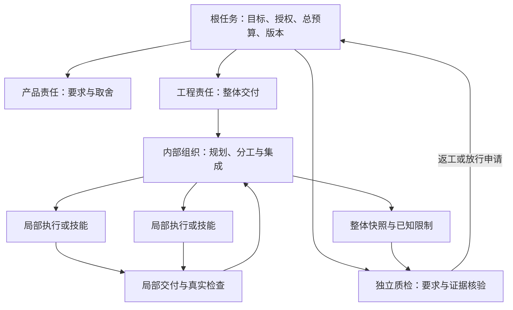

# 部门组织、持续运行与系统演化：研究与详细设计

> 日期：2026-09-06。状态：设计资料，尚未实施或验证本文拟议能力。
> 范围：第三阶段与第四阶段，以及可以提前完成的接口语义、故障样例和实验准备。
> 上位依据：总体架构、[第三阶段计划](../stage-3-plan.md)、第四阶段计划。
> 本文通过网络读取一手文档和论文，未安装或运行这些外部系统，未复现论文结果；来源、实际阅读范围和限制见第 12 节。
> 配套设计：[可观测性](../archive/research/observability-design.md)、[实验协议](experiment-protocol.md)。

## 1. 设计结论与依赖

后续组织能力应围绕可交付的工作单位扩展：外层管理目标、责任、预算与独立验收，内层使用单循环、评审、有限并行或可展开技能。部门名称和 Agent 数量只是表达方式，不是架构边界。

异步恢复应围绕未完成责任和外部动作结果扩展。保存对话、重建界面状态、恢复控制流程、重新执行外部动作是四种不同能力，不能用一个“支持 replay”概括。成熟引擎可以承担可靠等待和执行调度，Yudao 仍要决定哪些结果有效、谁有权继续、何时必须核实副作用。[O01][O02][O03][O07]

系统演化应从可比较的局部候选开始。系统提出新组织或规则，独立评价判断证据，版本控制依据已有授权限定采用。用户目标、工具授权、隐藏评价材料和通过标准始终位于被评系统的修改范围之外。[O10][O11][O12]

| 能力 | 可以现在完成的准备 | 真正实施与验收所需依赖 |
| --- | --- | --- |
| 部门内部循环、分型 | 任务责任契约、组织比较场景、预算守恒设计 | 第二阶段固定口径评价与稳定任务族，第三阶段父子责任能力 |
| 可展开技能 | 技能说明与适用性模板、正常和异常路径用例 | 已验证的稳定流程、完整过程证据与执行入口 |
| 部门协议 | 交接、接收、澄清、取消和迟到结果的语义样例 | 第一阶段真实事件与要求版本边界稳定后集成 |
| 异步恢复 | 故障矩阵、动作核实契约、成熟引擎比较标准 | 可持久责任、可查证外部环境、恢复时版本检查 |
| 运维 | 平台与交付物责任划分、指标定义、事件处理流程 | 真实发布对象、明确运行窗口和响应授权 |
| 组织与规则演化 | 候选档案、影响分析与对照实验方案 | 第二阶段独立评价、第三阶段稳定版本与撤销能力 |

本文不要求当前新增消息队列、工作流服务、向量库、Kubernetes 或常驻运维 Agent。选型决定需要通过第 10 节的故障场景和总成本比较；当前 Python 标准库、SQLite、文件工件和原生界面仍是已有基础。

## 2. 三层责任与权限

### 2.1 部门内部不是新的控制中心

根任务规定原始目标、当前要求、有效版本、总资源和停止条件；部门接收其中可承担的工作；内部单元完成局部成果。外层不依赖私有对话判断完成，只读取明确交付、证据、未解决事项与结束原因。

箭头表示责任和交付关系，不强制一项责任部署为一个服务。工程内部的审核能提前发现问题，但不能代替独立 QA。产品内部可以比较需求解释，但不能通过改写目标消除未满足要求。

| 责任 | 输入 | 输出 | 权限边界 |
| --- | --- | --- | --- |
| 根任务控制 | 用户目标、有效要求、合法命令、真实回执 | 有效任务状态、资源分配与结束决定 | 决定能否继续；模型角色不能自行覆盖 |
| 部门负责人 | 明确交接、当前交付、可用资源 | 接收决定、组织选择、整体成果和剩余问题 | 保持部门对外承诺，不能转移独立评价权 |
| 内部协调 | 被接收工作、已选组织版本 | 子任务、依赖、局部验收与集成成果 | 只在分配的权限和预算内工作 |
| 局部执行 | 具体目标、可读材料、隔离工作区 | 可取回成果、主机证据、失败或等待原因 | 不能改同级交付、总目标或隐藏检查 |
| 知识和技能供给 | 当前任务条件、候选使用需求 | 适用材料、来源、有效版本、限制 | 提供建议与有效性事实，不接管任务完成决定 |
| 独立评价 | 封存交付、固定比较标准和环境 | 质量、成本、回归与证据充分性判断 | 被评执行者不能修改材料或代签评价 |
| 运维 | 运行责任、用户可见症状、发布证据 | 告警、缓解、修复任务和恢复记录 | 在授权内处置，不自动改变功能要求 |

### 2.2 最小工作契约

一份可交付的工作说明需要回答下列问题，而不要求先设计通用 DSL。

1. 为什么做：对应哪个根目标和哪一版要求，明确纳入与未纳入范围。
2. 由谁负责：当前责任人、接收方及异常升级对象；未接收前仍由原责任人跟进。
3. 交付什么：成果位置、内容身份、公开验收条件与证据要求。
4. 可以做什么：工具、环境、数据和外部动作权限；明确哪些动作必须具备既有授权。
5. 如何结束：成功、失败、等待、取消和预算耗尽都产生可解释结果。
6. 如何继续：依赖、等待条件、恢复位置、动作核实方法及版本。

公开验收条件向执行者完整提供。为独立评价保留的隐藏样例放在不同访问范围内；“没有告诉执行者用户真正要求什么”不构成可靠评价。

## 3. 部门循环、分型与预算

### 3.1 首批只比较四种有限组织

| 组织 | 适合的工作性质 | 内部闭环 | 必须观察的额外成本与失败 |
| --- | --- | --- | --- |
| 单执行循环 | 目标集中、成果难拆分、往返少 | 执行、取证、修正、交付 | 无进展重复、检查缺失、上下文增长 |
| 执行加内部复核 | 已知遗漏多，复核可定位具体错误 | 初稿、局部复核、有限修正、整体交付 | 同源错误、空泛意见、复核代替真实检查 |
| 独立分工后集成 | 子成果边界明确、依赖少 | 分工、局部交付、冲突处理、整体核验 | 集成失败、重复劳动、并行写冲突、协调时延 |
| 有界探索再收敛 | 存在少量可比较方案 | 定义比较、有限探索、取证、选择与交付 | 候选越搜越多、比较口径变化、无收益扩张 |

初期组织由研发者预先选择，并保存选择依据。运行中遇到组织不适用时，允许停止局部工作并请求在既定范围调整；不能凭一次自述失败自动生成无限层次或换成未验证组织。

Magentic-One 的任务账本和进度账本说明了“总体计划”和“当前是否前进”分开维护的价值；其内外循环并不天然提供可信完成判定。Yudao 可借鉴这一分离，但进度需要结合新证据、新成果、已消除问题或已确认等待，不能仅由模型回答“有进展”决定继续。[O05][O13]

MetaGPT 的 SOP、结构化交付和订阅相关消息说明，跨角色协作可以围绕成果组织；Yudao 不照搬共享全部消息池，也不把各角色按 SOP 生成的文件自动视为已验证成果。[O06]

### 3.2 进展判断与循环结束

每次局部循环前，记录本次要消除的明确不确定性或交付缺口。结束时核对是否出现对应事实：可复核新成果、有效反例、修复证据、被接收的澄清或合法等待。单纯改写计划、重复同一工具调用、同一错误换一种措辞不能计作进展。

允许继续的理由必须与本次剩余目标相连。无进展累计达到本任务事先设定的上限时，先形成失败诊断和已知成果，再由父责任决定停止、澄清或在剩余预算内调整。计数不是唯一依据：明确不可满足的权限或外部约束应立即报告，不能等待循环次数耗尽。

内部复核意见应区分主机反例、来源明确的事实冲突、尚待验证的怀疑。工程采纳意见时关联修改后的交付和补充检查；“另一个 Agent 说没问题”只是一条意见。

### 3.3 根任务预算守恒

资源约束分别记录模型用量、执行调用、实际资金成本、并发、墙钟时间和递归深度。可累加消耗使用预算账，并发使用执行槽位，墙钟使用期限，深度使用层级上限；不能把不同量纲放进同一个相加公式。一个约束耗尽就产生对应停止或降速原因。

接纳新行动时，对每项可累加预算核对已结算消耗、未结算行动的预留和必要收尾额度，只有新增预留仍在授权量内才允许分派。父任务分配的是根任务剩余额度的一部分，子任务展开或重启不重新获得完整预算；未知用量结算前保留预留，不能重新分给别的任务。

硬性不超额还依赖外部执行能强制每次调用的用量或费用上界。只有估计而无可执行上限时，预留属于准入控制，不能证明最终消耗必然低于预算。实际回执超过预留时完整记录超额与原因，停止新增分派并进行已授权的必要收尾；不能截断用量或改写历史来维持账面不超额。外部账单尚未知的部分继续单列。

| 情况 | 分配与核算规则 |
| --- | --- |
| 并行启动 | 原子检查可用额度后预留，避免两个子任务同时认为自己拥有同一份剩余量 |
| 模型返回真实用量 | 以实际回执结算；估算和真实用量分别保留，释放未消耗预留 |
| 超时但真实用量未知 | 保留未结算项及可能的外部费用，不按零成本记账；核实后追加结算 |
| 请求取消后结果迟到 | 记录已发生用量，禁止迟到内容取得任务推进权 |
| 子任务提前完成 | 剩余额度回到父任务可用池，不能由子任务私自创建新工作花掉 |
| QA 与故障收尾 | 任务分解时为必要核验和副作用核实保留资源，不能把全部额度用于生成 |
| 长时间等待 | 持久保存等待，释放工作线程与执行槽；墙钟等待时间继续记录 |
| 恢复或版本接续 | 原任务预算账不清零；关联新任务复用资源需要明确剩余额度或新的外部授权 |

首批并发只覆盖独立只读工作和隔离目录内的独立写入。共享工件由明确集成责任写入，不能用多个 Agent 对同一工作区并发修改来模拟组织效率。

## 4. 可展开技能

### 4.1 技能是一段有证据的工作过程

技能描述应包含适用条件、不适用情况、输入输出、固定过程、必要检查、所需权限、版本、来源经历、资源边界、等待与异常出口。长期记忆提供适用依据，技能描述提供执行结构；两者都不能绕过根任务约束。

候选技能先来自重复且稳定的过程，不从一次成功自动提炼为默认技能。封装后的正常路径和展开路径使用同一过程版本，展开意味着显示并操控该过程内部步骤，不是失败后临时换成无限自由 Agent。

| 路径 | 输入和判断 | 结果 |
| --- | --- | --- |
| 正常使用 | 适用条件成立，必要输入与权限完整 | 执行既定步骤，保存中间回执和整体结果 |
| 前置条件不成立 | 输入格式、目标环境或依赖不符 | 拒绝本次技能使用，返回明确原因与可复用材料 |
| 步骤检查失败 | 能定位已失败步骤，前序结果仍可证明有效 | 展开当前技能，按事先定义的修正路径继续或报告失败 |
| 外部结果未知 | 操作已经发出，缺少完成回执 | 转动作核实流程；不能直接重新运行整个技能 |
| 依赖或版本被撤销 | 活跃任务发现适用性已受影响 | 暂停新分派，按第 8 节处理在途与接续 |

可观察证据覆盖：为什么选中技能、实际执行版本、已完成步骤、展开原因、复用哪些前序成果、新增花费、最终仍有哪些限制。技能入口的一次成功只代表此次执行，不能自动认定技能普遍有效。

### 4.2 技能比较

在同一任务族中比较原展开过程与封装技能。要求交付质量不低于事前约定，检查与外部副作用语义一致；收益可以是减少重复上下文、模型调用、人工定位步骤时间或协调耗时。只统计正常路径会高估收益，异常展开、适用性误判、维护和验证成本应计入。

首批适合选择一项已有稳定证据、外部副作用少的流程。发布类技能需要单独证明动作查询、取消与恢复能力，不能因为无副作用技能可恢复就推断发布技能也成立。

## 5. 部门间协议与持久交接

### 5.1 交接以责任接收为准

A2A 区分消息、任务、工件、订阅和取消，并允许对外隐藏内部组织。它提供互操作语义参考，但不替 Yudao 定义“接收工程交付”或“独立 QA 放行”。当前部门可以继续使用本地调用，只有真实跨进程或跨系统需求出现时再引入远程协议。[O04]

交接至少有提出和接收两段。发送方提出交付时保存有效要求、交付快照、检查证据、已知限制、待接收责任。接收方核对能否承担并明确接收、拒绝或要求澄清；只有接收决定生效后才改变责任归属。网络响应成功或消息已投递不能代替该决定。

| 协作动作 | 发起方提供 | 接收方必须回答 | 异常处理 |
| --- | --- | --- | --- |
| 提交交付 | 交付身份、要求版本、证据与剩余问题 | 接收范围、拒绝原因或需补充内容 | 超时仍由发送方负责跟进；可以查询同次交接状态 |
| 请求澄清 | 具体歧义、影响范围、已尝试依据 | 澄清决定及其要求版本影响 | 未解决前只做不依赖该答案的工作 |
| 要求返工 | 可定位问题、受审快照、对应要求 | 接收返工与计划中的可核验变化 | 口径变化单独标记，不把新要求记成原工程错误 |
| 提出范围变更 | 原目标、变化理由、影响与取舍 | 是否属于既有授权、哪些要求改变 | 失去有效性的在途成果进入重新核验 |
| 等待外部条件 | 等待对象、继续条件、责任人、期限 | 条件已满足或仍缺失的事实 | 重启后恢复订阅或低频核实；重复唤醒只推进一次 |
| 取消或停止使用 | 作用范围、原因与命令来源 | 已停止分派、仍在运行、外部未知结果 | 回执反映实际状态，不能一律显示已取消 |

### 5.2 重复、乱序和迟到

每次业务交接、动作和决定要有稳定身份，并关联所依据的任务代次、有效要求、交付和版本。重复投递可以返回该次处理的已有结果；重复消息的内容若不一致，应报告冲突而不是覆盖。

按每个任务的有效事实顺序处理推进，不用本机时间戳猜跨进程因果。较晚到达的旧要求结果只保留为历史事实，不覆盖新要求下的成果。订阅重连后先获取可确认的当前状态及已消费位置，再接收后续变化；订阅丢失不等于任务失败。

本地持久层应保证“接纳决定”和“新增待交付责任”不会出现只写入一半的状态。在需要跨进程投递时，采用同事务记录待发送事项、提交后投递、消费端去重的成熟模式；不引入分布式事务保证任意外部系统恰好执行一次。

## 6. 持久执行与失败恢复

### 6.1 四种能力分别命名、分别验收

| 能力 | 做什么 | 绝不隐含什么 |
| --- | --- | --- |
| 事实重建 | 读取事件和工件，重建当时与当前的领域状态 | 不调用模型或外部工具，不恢复执行权限 |
| 观察恢复 | 重连界面或通知订阅，补齐缺失变化 | 不触发任务继续，不重复原消息的业务副作用 |
| 控制恢复 | 加载合法版本、未完成工作、等待条件与资源账，决定下一项可做工作 | 不意味着每个外部动作都可以重试 |
| 动作恢复 | 查询已发出动作的真实状态，复用确认结果、受控重试或补偿 | 不把工具超时等同于未执行，也不保证通用 exactly-once |

Temporal 的 replay 使用执行历史校验命令以恢复工作流进展，活动可能根据超时与重试策略再次执行。[O01][O02] LangGraph 的 checkpoint 提供步骤边界与待完成写入恢复；其 time-travel replay 会重新执行所选 checkpoint 之后的节点，包括模型与 API 调用。`exit`、`async`、`sync` 的持久保证也不同。[O03] Yudao 的纯历史回看不得直接映射到会重执行 API 的入口。

AutoGen 的 `save_state`/`load_state` 教程展示了 Agent 与 Team 组件状态的保存和加载；它不证明进程在任意外部动作中断时都可准确续行。不能把“读回了同一段消息”作为第三阶段恢复验收。[O07]

进一步核对官方源码 `BaseGroupChat`：`save_state` 逐个调用参与者和管理器的状态保存方法，注释明确提示运行中保存可能产生不一致状态；`load_state` 拒绝在团队运行时加载，随后逐个恢复参与者和管理器。因此本项目的检查点需要定义一致的领域边界，不能把任意时刻的团队状态字典视为原子检查点。该结论来自代码与注释阅读，尚未经故障注入实验验证。[O14]

### 6.2 恢复所需的最小持久事实

需要持久保存：当前责任、有效任务与要求版本、已采用组织及技能版本、已完成成果、未完成动作、依赖、等待条件、取消请求、可继续权限、已消耗与预留资源、外部结果核实事项。

模型上下文摘要只能帮助继续推理，不能代替上述事实。恢复后的上下文按当前职责从事实重新装配，保留必要已确认成果及未解决事项，不能以恢复为由把所有部门的私有对话共享给一个 Agent。

### 6.3 外部动作契约

每类有副作用的工具在允许持久执行之前，要说明：动作身份、目标环境、请求内容、是否支持幂等键、如何查询外部状态、结果一致性窗口、重试前提、取消能力、补偿条件和处置责任。没有查询或可靠去重能力的动作，其恢复出口可以是人工核实，不能虚构自动恢复保证。

| 可证明的状态 | 允许的操作 | 禁止的推断 |
| --- | --- | --- |
| 尚未发出，且有持久依据 | 核对当前授权后首次执行 | 不把旧版本准备好的请求当成新版本已获准动作 |
| 已发出且确认完成 | 保存外部确认，核对有效性后复用结果 | 不因本地缺少某条日志重新执行已完成动作 |
| 已发出且确认未生效 | 在幂等性、当前授权和预算仍成立时重试 | “查不到”若处于外部一致性窗口内，不是确认未生效 |
| 已发出但结果未知 | 查询、等待明确外部状态、补偿或转人工 | 超时、连接断开、Worker 消失都不能证明没有发生 |
| 确认失败且有部分副作用 | 根据预定义补偿或修复流程处理 | 失败退出码不等于外部环境未变化 |

稳定业务动作身份与每次执行尝试身份分开：重试同一动作不能创建一个无法关联的全新操作。仅有本地去重记录也不够：若外部提交成功而本地回执未持久化，仍需查询外部状态或依赖外部幂等承诺。

### 6.4 中断后的续行步骤

1. 取得本任务当前执行所有权，确认没有另一个有效控制者继续分派。失去所有权的旧执行者不能提交推进决定。
2. 重建领域事实，核对要求、权限、预算和版本是否仍有效；发现撤销先执行第 8 节处理。
3. 对等待项恢复合法唤醒来源，对已确认成果重新核验内容身份，对未知外部动作建立核实责任。
4. 只选择依赖已满足、未重复完成、权限有效的工作继续；核实本身占用的预算和等待也可见。
5. 将恢复决定与真实动作回执追加保存，使界面显示恢复位置、依据和仍未解决事项。

控制者所有权可以由所选成熟工作流引擎落实。Yudao 必须保证迟到的旧控制者结果没有推进权；不能只依靠进程互斥锁假设跨重启、跨 Worker 全局唯一。

拒收旧结果还不足以防止旧 Worker 发出新的外部动作。每次动作分派都需通过可核验当前任务权利与执行代次的入口，外部系统支持时也校验对应权利或幂等依据。若旧 Worker 可以绕过入口，或者权利失效与外部接收之间仍有无法原子约束的窗口，就不能承诺无旧动作发生：停止继续分派，把可能发出的动作转入结果未知核实，并按已授权流程处置。恢复引擎自身的任务所有权不自动封锁任意外部系统。

## 7. 运维责任与用户可见状态

### 7.1 平台和交付物分别承担运行责任

平台运维关注模型调用、任务调度、事件持久化、工具环境和界面订阅是否可用。交付物运维关注发布对象是否满足面向用户的运行约定。模型供应商超时可能导致任务未完成，但不必然说明工程交付存在功能缺陷；交付物返回错误内容即使 HTTP 正常也属于用户可见失败。

正式接收运行责任前，需要提供发布对象和环境、已验证版本、运行窗口、用户目标、监测方式、响应者、可执行缓解操作、升级对象、恢复标准和结束责任的方法。发布成功与运维接收分别记录；没有接收者时原发布责任不能消失。

| 指标面 | 最小观察 | 使用者与用途 |
| --- | --- | --- |
| 平台可用性 | 有效任务能否被调度、事件能否持久化、模型与工具错误、等待队列 | 平台责任定位无法运行的原因 |
| 交付物可用性 | 从用户入口实际完成目标的成功率、失败类型、成功与失败时延 | 运维判定影响与恢复 |
| 资源容量 | 活跃执行数、队列等待、关键资源使用、预算预留与未结算量 | 调整分派，避免无效并行和资源耗尽 |
| 协作健康 | 无接收责任、过期等待、无进展往返、未知副作用持续时间 | 当前任务负责人处理阻塞 |
| 改善质量 | 固定任务族的质量、返工、总成本和采用后反例 | 独立评价判断组织或规则是否值得采用 |

SRE 的四个黄金信号是时延、流量、错误和饱和度；其价值是从用户症状出发，并结合内部信号定位原因。Yudao 不将每条模型错误都升级为人工告警，而是按实际影响、是否需要行动和持续时间处理。[O08]

错误预算基于具体服务的 SLO、统计窗口和服务事件分母，不是模型 token 预算。SRE 文档中的 99.9%、四周窗口和冻结策略是示例，不直接成为 Yudao 默认值；应在选定真实服务后预先约定。[O09]

### 7.2 故障处理链路

故障经历“症状出现、确认影响、建立响应责任、采取授权缓解、生成修复、独立检查、确认恢复、复盘”几个可追溯环节。紧急缓解可以先于完整根因分析，但必须保留采取理由、实际外部变更和待验证假设。

恢复完成依赖用户可见行为恢复及约定观察窗口，不以重启命令成功或日志恢复安静认定。若平台本身故障，运维观察应具备最基本的外部检查途径，不能完全依赖已故障平台自报健康。

复盘区分已确认原因、促成条件、尚待验证解释、修复动作和需实验的规则建议。规则维护从复盘获取候选依据，不能把事故中的临时处置自动写为长期有效规则。

### 7.3 图形化视图随阶段扩展

第一阶段三部门运行图继续作为总入口，不等第三阶段才做图形化。第三阶段在部门节点上按需展开局部任务、责任、依赖、等待、共享预算、技能步骤和未知副作用；第四阶段再增加组织版本和候选比较。

首屏应突出“谁负责、目前在做或等什么、交付是什么、哪些事项需要处理”。大量模型事件保留在时间线和证据详情中，不把它们全部混成一张拓扑图。

| 人工操作 | 命令提交后需要显示的实际状态 |
| --- | --- |
| 暂停分派 | 新动作停止分派，已运行部分、仍计费部分和外部未知结果分别显示 |
| 提供等待输入 | 输入是否满足本次等待与有效要求，是否触发继续，重复提交是否被识别 |
| 取消任务 | 取消已请求、已停止执行、正在收尾和待核实事项分别显示 |
| 恢复任务 | 使用的版本、可继续依据、恢复位置与被阻止动作 |
| 停止候选新增使用 | 生效范围、尚在旧版本的任务、需要紧急处置的任务 |

这些操作通过明确命令进入控制层；用户点击按钮不能直接写成功终态或修改历史投影。

## 8. 规则维护、候选生命周期与在途版本

### 8.1 三类规则分别维护

| 规则类别 | 示例 | 修改来源 |
| --- | --- | --- |
| 外部约束与评价权 | 用户目标、数据授权、工具授权、固定质量标准、独立评价边界 | 系统外部合法决定；不由被评候选修改 |
| 日常执行规则 | 取证顺序、上下文组织、局部分工、交接必需材料、技能组合 | 可由系统提出，经独立比较与授权后采用 |
| 运行事实与有效性判断 | 当时要求、实际回执、评价结果、某经验为何停用 | 事实追加保存；新判断关联旧材料，不覆盖原记录 |

基础规则维护首先是一项职责，负责理由、适用范围、来源、依赖、冲突、版本和退役。是否独立成部门取决于稳定工作量与持续责任，不以新增 Agent 名称证明自治程度。

规则候选可以由模型生成文本或结构化方案，执行授权由控制层核验可信决定。提案中的“已经批准”“测试均通过”只属于候选内容；它必须引用可取回且来源有效的独立证据。

### 8.2 候选完整档案

每个候选有一份可审核档案：要解决的重复问题、支持和反对事实、单一主要变化、预期因果机制、适用任务族、影响对象、基线与人工静态方案、实验和停止条件、独立评价来源、总成本、采用授权、实际版本、运行观察及撤销安排。

候选生成者能看到公开要求与用于开发的事实，但不能访问用于最终判断的隐藏任务。实验环境与生产事实分开标注；模拟 QA、人工样例、录制结果与真实执行不能混入一个效果分母。

| 生命周期环节 | 输入 | 必需输出 | 不通过或不确定时 |
| --- | --- | --- | --- |
| 问题登记 | 重复失败、协调成本、运行反例 | 可复查问题与范围，哪些解释尚未证实 | 留作观察，不自动制造一条规则 |
| 形成候选 | 问题及可变权限范围 | 局部差异、预期收益、潜在退化、影响链 | 越权候选拒绝；影响不清则补充分析 |
| 比较准备 | 候选、固定基线、任务与环境 | 预先确定比较口径、样本身份、停止与恢复安排 | 材料不足时不开展可影响生产的实验 |
| 隔离实验 | 获准范围与固定输入 | 基线、人工静态方案、系统候选的完整运行证据 | 保留失败与成本；不得只提交最好一次 |
| 独立评价 | 完整结果、隐藏任务与事前条件 | 通过、失败或证据不足，质量与成本分别呈现 | 失败不生效；证据不足不等于通过 |
| 限定采用 | 可信评价及已有授权 | 明确任务范围、版本、观察窗与停止条件 | 超出授权仍是提案，不产生执行权 |
| 运行观察 | 实际采用任务及反例 | 收益是否持续、适用性是否改变、在途影响 | 反例触发复核或停止新增采用 |
| 保留、扩展或撤销 | 完整观察与独立判断 | 下一有效范围、版本及处置结果 | 扩展需要对应范围证据；撤销保留历史 |

DSPy 说明可用声明式模块、开发样例和给定指标优化提示及流程；这一机制适合有限候选搜索，但“优化给定指标”不代表该指标足以判断用户任务质量。[O11] ADAS 的代码空间搜索说明组织候选可以由系统产生；其特定基准与模型上的改善不能直接推出 Yudao 的持续运行收益或无限自我改进。[O12]

### 8.3 普通版本更新

一个根任务在启动时选择组织、协议、规则与技能的确定版本组合，后续子任务继承该组合。模型供应商或工具环境变化也必须记录，不能静默把不同运行组合算作同一实验条件。

新版本默认仅供新任务使用。普通更新允许旧任务按原版本完成；界面同时显示新任务选择范围和实际在途版本。旧任务结束后退役旧运行实现，历史工件和评价继续可取回；不增加旧接口兼容层或旧执行状态转换流程。

版本稳定不等于授权永远不变。外部授权收回、已知严重错误或必要依赖失效时，应停止相关分派，而不能因为“任务固定版本”继续执行已明确禁止的动作。

### 8.4 紧急撤销与接续

撤销需要处理新任务选择、在途执行、外部环境和相关知识四个方面。恢复版本目录只是其中一步。

1. 记录撤销原因、可信来源、适用范围与有效时点，停止新任务选择被撤销版本。
2. 找出实际使用该版本的在途任务和已分派子任务，冻结受影响范围的新动作；暂停命令本身也持久保存。
3. 对在途动作逐项分类：未开始、已确认完成、可取消、正在停止、结果未知、已产生部分副作用。撤销不抹掉已发生资源消耗。
4. 查询未知外部状态并落实核实责任。已发生的发布、通知或其他外部动作不能仅靠回退本地版本自动撤销。
5. 整理可复用成果：重新核验内容身份、有效要求、工具环境和产生该成果的已撤销规则是否影响其可信性。相关不等于失效，历史通过也不自动等于可复用。
6. 使用已验证版本启动关联的新任务，携带仍有效的目标、已确认成果、未解决事项和明确剩余授权。原任务保留被中止原因，不能改写为在新版本下完成。
7. 对依赖被撤销版本的经验、技能与规则候选标记需要复核，阻止已明确失效的材料新增使用；独立事实继续保留。
8. 验证新任务选择、在途任务、外部环境与知识使用都达到预先定义的恢复条件，分别报告未完成项。

| 撤销时情况 | 处置与责任 | 接续依据 |
| --- | --- | --- |
| 根任务尚未分派 | 控制层停止旧版本选择 | 新任务按有效版本和原有效目标重新启动 |
| 子任务在只读查询 | 请求停止并记录已发生费用 | 结果即使迟到也只入事实；若要复用须重新判断有效性 |
| 隔离工作区已有成果 | 封存快照与产生版本 | 重新检查后可作为新任务输入，不继承旧通过决定 |
| 外部发布请求已发出 | 运维或动作责任人查询目标环境 | 确认实际部署版本；必要时执行获准恢复动作 |
| 旧版本控制者恢复上线 | 检查当前任务权利及撤销事实 | 无继续分派权限，回执只能追加历史或核实事实 |
| 依赖经验仍被检索选中 | 知识消费者核对当前有效性 | 已撤销材料不能进入后续装配，旧上下文保留审计 |
| 被撤销协议下双方均等待 | 先确定唯一当前责任和外部动作状态 | 关联新任务重新交接，不能在旧协议状态里热替换 |

Argo Rollouts 将分析模板、具体分析运行、成功、失败和不确定分开，并把分析结果关联继续、停止或暂停。[O10] Yudao 借鉴限定采用和观察原则；任务具有不同难度与持续时间，不能机械照搬流量百分比，也不能认为停止新任务选择就消除了在途影响。

## 9. 独立比较与验收设计

### 9.1 组织、技能和规则的共同实验单位

基本样本是有独立身份的任务案例或事先定义的运行窗口；多轮返工、同一任务重评、多次随机执行不能充当新增独立任务。组织比较保留同一任务在不同方案上的配对关系，并将随机重复用于描述波动。

比较组包括固定三部门或当前有效方案、研发者设计的简单静态方案、候选方案。固定公开要求、可用工具、授权、环境及总资源约束；若某条件无法固定，则单独分层报告，避免把模型升级、额外预算或任务变容易算成组织收益。

质量标准是先决条件。达到质量条件后再比较总成本、返工、无效往返、完成时延、运行故障和人工处置。不能用平均时延下降抵消已发现的错误放行，也不能把失败任务从耗时或成本统计中剔除。

候选生成、无效实验、失败重试、协调、技能展开、评价、观察与维护都计入完整成本。短窗口中样本不足以判断长期收益时，结论限定为观察到的范围，不宣称阶段完成。

### 9.2 可直接转为验收用例的清单

| 编号 | 场景 | 必须看到的证据 |
| --- | --- | --- |
| OR-01 | 独立两子任务完成后出现集成冲突 | 局部成功仍保留，整体未被误报完成，集成责任和额外成本明确 |
| OR-02 | 工程内部复核通过，外部 QA 找到真实反例 | 内部意见与独立反例分别保存，返工绑定准确快照与要求 |
| OR-03 | 两个子任务同时申请最后一份额度 | 最多一项获得对应预留，没有跨层预算倍增 |
| OR-04 | 技能中途失败并展开 | 已验证前序步骤可复用，未知副作用先核实，展开不重置预算 |
| OR-05 | 交接投递成功，接收决定前进程退出 | 原责任未丢失，恢复可查询同次交接并避免重复接收 |
| OR-06 | 等待期间重启且收到重复或旧版本唤醒 | 等待可解释，只有符合当前条件的输入推进 |
| OR-07 | 外部动作成功后本地确认前崩溃 | 恢复查证外部状态，不盲目重复动作，确认依据可查 |
| OR-08 | 任务取消后旧 Worker 返回成功 | 用量结算保留，任务不恢复活跃，迟到成果不自动放行 |
| OR-09 | 规则候选自行声明已批准并引用伪造结论 | 不能获得执行权，可信评价和授权来源可验证 |
| OR-10 | 无效候选或缺失测量 | 失败与证据不足分别呈现，不能以没有失败样本判定通过 |
| OR-11 | 候选采用后出现严重反例 | 停止新增使用，列出受影响在途、外部动作、知识与接续记录 |
| OR-12 | 平台恢复但交付物仍服务错误内容 | 平台恢复与业务恢复分开，用户入口检查继续失败 |
| OR-13 | 原任务按旧版运行，新任务已采用新版 | 界面显示实际版本，恢复不静默切换，比较统计不混同 |
| OR-14 | 旧版被撤销后恢复暂停任务 | 恢复检查阻止继续旧版，关联新任务只复用重验有效成果 |
| OR-15 | 旧 Worker 失去所有权后仍尝试发出外部动作 | 分派入口检查当前权利；外部无法拒绝旧请求时保留可能副作用与核实责任，不能只凭拒收结果宣称无动作 |

## 10. 故障场景与成熟实现选型

### 10.1 故障矩阵

| 故障点 | 容易出现的错误 | 领域处理 | 验收观察 |
| --- | --- | --- | --- |
| 工作已持久接收但还未发送 | 永久丢失应执行工作 | 待发送责任可重建，合法重投递 | 重启后可继续且无重复领域推进 |
| 已发送，尚无 Worker 接收回执 | 立即创建第二个无法关联的动作 | 用稳定业务身份核实或重投递 | 尝试可关联，外部去重前提明确 |
| 外部完成，本地尚未保存 | 重复发布或重复扣费 | 查询或外部幂等机制，未知时等待核实 | 实际外部动作数与记录对应 |
| 两个 Worker 同时认为拥有任务 | 双重分派和预算超支 | 有效所有权及过期执行者提交检查 | 旧控制者无推进权，已发生副作用仍查证 |
| 旧 Worker 失权后继续调用外部工具 | 结果虽被拒收，外部写入却再次发生 | 分派时核对当前权利，无法封锁的旧动作进入未知核实 | 实际外部效果被核对，权限检查与外部接收之间的窗口有明确限制 |
| 并行节点之一失败 | 重做所有已成功节点 | 复用可证明有效的结果，失败部分单独恢复 | 已成功节点不被无谓调用，整体仍未完成 |
| 模型输出无法解析 | 无界重试或丢失用量 | 保留原输出和用量，限定重试并计入预算 | 失败原因、次数、资源与停止依据一致 |
| 事件库或工件写入失败 | 界面声称已接收或已完成 | 不确认无法持久保存的领域决定 | 故障后持久事实与用户看到的确认一致 |
| 观察订阅断开 | 将失联认定成执行失败 | 恢复观察后补齐事件，不重发执行命令 | 实时与历史投影一致，无重复动作 |
| 版本更新遇到等待任务 | 用新代码解释旧控制状态 | 普通更新保持旧版；撤销走停止和接续 | 没有隐藏热替换，旧版终止原因可查 |
| 监测无数据或全是错误样本 | 把空分母或缺失价格记为成功、零成本 | 证据不足、未结算和缺失分别显示 | 采用流程暂停于缺失，不悄悄扩大范围 |
| 父任务停止而子任务失联 | 立刻宣称完全取消 | 停分派、传播取消、建立失联核实责任 | 用户可见仍未停止及未知结果 |
| 恢复命令与撤销命令并发 | 恢复已禁用版本 | 在同一有效控制顺序检查当前权利 | 恢复不绕过先已生效的撤销 |

### 10.2 选型比较与决策条件

| 候选 | 一手资料实际提供的能力 | 对本项目有价值的部分 | 仍需验证和承担的成本 |
| --- | --- | --- | --- |
| 现有 SQLite、工件与控制层 | 已有任务事实和可重建投影 | 保持领域事实统一，离线证据与当前界面继续复用 | 不据此假定已支持持久等待、所有权、活动重试和外部核实；不能自行扩成通用调度器 |
| Temporal | 执行历史、命令 replay、持久等待、活动超时重试与取消 [O01][O02] | 长等待、多 Worker、跨进程恢复和明确活动边界 | 服务部署、Worker 与代码约束、运行成本；外部动作幂等和业务版本权限仍由应用设计 |
| LangGraph | graph checkpoint、节点待完成写入、线程状态、持久模式和 replay [O03] | 单任务图式流程、子图及中断状态可检查 | 新依赖与图运行语义、持久后端、业务事件映射；模型/API 重执行和副作用边界必须独立处理 |
| AutoGen AgentChat | Agent/Team、组织协调、组件状态保存与流式过程 [O07][O13] | 有限组织方案的实验对照与实现参考 | 组件状态保存不能代替可靠执行；新增会话体系与现有部门上下文的成本 |
| A2A | 独立 Agent 间任务、消息、工件、订阅、取消等互操作 [O04] | 未来真实跨系统部门协议 | 不是内部业务完成模型；认证、远程失败、版本绑定和责任交接仍需实现 |
| Argo Rollouts | Kubernetes 渐进发布与分析运行 [O10] | 真实 Kubernetes 发布对象的限定流量与运行分析 | 本项目未确定 Kubernetes 交付环境；组织版本采用只参考模式，不直接引入控制器 |

恢复引擎的选择发生在 3.1 的实施准备：用同一窄场景验证持久等待、取消、中断位置、重复结果、未知副作用和版本撤销，记录故障行为及部署成本，再选一个满足责任边界的实现。比较期间的实验必须隔离，未通过的引擎实验不替换当前能运行的内核。

## 11. 开发准备交付与待决事项

本文已将工作语义、责任权限、失败行为与验收场景整理到可审核粒度。后续可以在不修改第一阶段运行时的前提下继续形成以下资料和隔离样例。

| 准备包 | 内容 | 完成证据 | 接入时机 |
| --- | --- | --- | --- |
| 组织比较样例 | 单循环、内部复核、分工集成各一个相同目标场景 | 固定要求、可检查成果、预期失败与成本账例 | 第二阶段正式基线形成后执行比较 |
| 交接协议样例 | 接收、拒绝、澄清、重复、迟到、取消的完整故事 | 每步当前责任、输入版本与允许动作可人工核对 | 第一阶段事件与要求接口稳定后映射 |
| 恢复契约与故障注入说明 | 本文 OR-05 至 OR-08、OR-13 至 OR-14 的中断位置 | 本地事实、外部状态、预期查询与禁止动作明确 | 3.1 成熟引擎隔离比较 |
| 技能档案样例 | 一项流程的适用条件、步骤、异常与展开 | 默认和展开路径使用同版本，检查与预算一致 | 第二阶段稳定过程形成后封装 |
| 运行责任样例 | 一个服务的交接、症状、缓解、恢复、复盘 | 指标有分母，响应与结束责任明确 | 3.0 确定实际持续运行对象后补齐实值 |
| 候选与撤销样例 | 一项无效候选、一项采用后出现反例的候选 | 实验、可信评价、范围选择、在途处置可追溯 | 第四阶段闭环接入前验证拒绝流程 |

仍需在对应阶段确定：持续运行交付物及环境、任务族和样本规模、SLO 与运行窗口、根任务资源上限、可自动执行的缓解和采用授权、外部动作的查询能力、恢复引擎及实际部署形式。这些选择依赖真实责任与测量，不影响现在完成文档和隔离样例。

## 12. 一手来源与阅读记录

访问日均为 2026-09-06。论文来源为作者提交的 arXiv 页面和正文；成熟实现来源为项目或厂商官方文档。本文中的工程方案是对资料与当前项目边界的综合设计，不是来源作者对 Yudao 作出的保证。

阅读深度分为：文档相关正文、论文方法与实验节选、论文摘要及编译说明；均不代表外部实现已经本地验证。网络访问成功表示当时返回页面内容，动态文档中的 `latest`/`stable` 会继续变化，实施时需固定实际软件版本重新核对。

实现源码通过官方 GitHub API 固定提交读取。首次直接 raw 地址读取失败且未取得正文，随后使用 GitHub Contents API 的 raw 媒体类型成功读取；没有用第三方转载代替源码。源码与部分官方教程的状态示例存在版本差异，具体实现判断以所读固定提交为依据。

| ID | 来源与可访问地址 | 实际阅读深度与关键章节 | 支持的有限结论与限制 |
| --- | --- | --- | --- |
| O01 | Temporal, [Workflow Execution](https://docs.temporal.io/workflow-execution) | 官方正文：What is a Workflow Execution、Replays、Commands and awaitables、Status；HTTP 200 | 执行历史与命令校验支持恢复控制进展。工作流的执行保证不能直接扩大为任意外部副作用恰好一次 |
| O02 | Temporal, [Activity Execution](https://docs.temporal.io/activity-execution) | 官方正文：Activity Execution、Cancellation、Asynchronous Activity Completion；HTTP 200 | 活动超时和重试、heartbeat 与取消、异步完成各有语义。取消请求不保证外部动作已停止，超时可能发生在动作执行以后 |
| O03 | LangGraph, [Checkpointers](https://docs.langchain.com/oss/python/langgraph/checkpointers)、[Persistence](https://docs.langchain.com/oss/python/langgraph/persistence) | 实际读取 `checkpointers.md`：Why use、Super-steps、Pending writes、Replay、Durability modes、Checkpointer libraries；原 `durable-execution.md` 返回 Persistence 正文；HTTP 200 | checkpoint 与 node writes 支持特定边界恢复；time-travel replay 会重执行后续节点。内存保存器不能跨进程重启；不同持久模式有不同窗口。不将旧链接名称当成实际阅读内容 |
| O04 | A2A, [Protocol Specification](https://a2a-protocol.org/latest/specification/) | 官方规范：Introduction、Terminology、Core Operations 中 Send/Get/List/Cancel/Subscribe；页面显示 Latest Released Version 1.0.0；HTTP 200 | 任务与消息分离、工件与长任务订阅、取消可能失败、访问按授权范围。未完整逐条审阅所有传输绑定，不声称已经完成 A2A 符合性验证 |
| O05 | Fourney et al., [Magentic-One](https://arxiv.org/abs/2411.04468)，[v1 正文](https://arxiv.org/html/2411.04468v1) | 摘要、4/4.1 架构与内外循环、实验设置与结果概述、6.2 Limitations 节选；HTTP 200 | 两个账本分离任务计划与进度，对 GAIA、AssistantBench、WebArena 有作者实测。作者明确准确率评价不足及成本/时延偏高；不证明任意任务上多 Agent 更好，未复现结果 |
| O06 | Hong et al., [MetaGPT](https://arxiv.org/abs/2308.00352)，[v7 正文](https://arxiv.org/html/2308.00352v7) | 摘要、结构化交付论述、3.1 SOP、3.2 通信概述与图 2、执行反馈说明节选；HTTP 200 | SOP、角色专业化、结构化工件和发布订阅是协作设计依据。软件基准结果不代表跨任务持续运维已验证，未把所有正文与附录视作精读 |
| O07 | Microsoft AutoGen, [Managing State](https://microsoft.github.io/autogen/stable/user-guide/agentchat-user-guide/tutorial/state.html) | 官方教程正文：Saving and Loading Agents/Teams、Persisting State；HTTP 200 | 展示组件状态与会话恢复。教程不证明任意 Worker 崩溃和外部动作边界的可靠恢复；未运行教程 |
| O08 | Google SRE, [Monitoring Distributed Systems](https://sre.google/sre-book/monitoring-distributed-systems/) | 官方书章：Definitions、Why Monitor、Symptoms Versus Causes、Black-Box Versus White-Box、Four Golden Signals、简化监测原则；HTTP 200 | 支持用户症状、四类信号和低噪声可行动告警。不能从平台健康自动推断交付物功能健康，未照搬服务阈值 |
| O09 | Google SRE Workbook, [Example Error Budget Policy](https://sre.google/workbook/error-budget-policy/) | 官方示例全文：Goals、SLO Miss Policy、Outage Policy、Escalation、Background；HTTP 200 | 错误预算关联服务目标、窗口和发布节奏。文中具体阈值是示例，不能与 token/资金预算混用 |
| O10 | Argo Rollouts, [Analysis & Progressive Delivery](https://argo-rollouts.readthedocs.io/en/stable/features/analysis/) | 官方相关正文：CRDs、Background Analysis、AnalysisRun/Template、Inconclusive Runs、Handling Metric Results 节选；HTTP 200 | 模板与具体运行分离，结果可成功、失败或不确定，不确定会暂停。它解决 Kubernetes 发布分析，不替 Yudao 定义任务级收益、授权与在途撤销 |
| O11 | Khattab et al., [DSPy](https://arxiv.org/abs/2310.03714)，[v1 正文](https://arxiv.org/html/2310.03714v1) | 摘要、引言中模块/编译器/训练输入/验证指标/teleprompters 说明及两个案例概述；HTTP 200 | 给定程序、开发输入和指标可优化 LM 流程。本文未精读全部优化器细节，未推断自动获得可信评价目标，也未复现作者提升幅度 |
| O12 | Hu et al., [Automated Design of Agentic Systems](https://arxiv.org/abs/2408.08435)，[v2 正文](https://arxiv.org/html/2408.08435v2) | 摘要、2 搜索空间/算法/评价函数、3 Meta Agent Search、4.1-4.3 实验与迁移节选、6 讨论；HTTP 200 | 作者以档案、代码生成和验证集搜索发现候选，并报告特定基准与模型迁移结果。ARC 子实验使用限定尺寸样本；代码空间的理论表达能力不等于发现能力、部署可靠性或开放式无限改善 |
| O13 | Microsoft AutoGen, [Magentic-One](https://microsoft.github.io/autogen/stable/user-guide/agentchat-user-guide/magentic-one.html) | 官方实现教程：Getting started、Architecture、团队组成与配置示例；HTTP 200 | 提供组织类、模型接入和多工具角色的可实现参考。本轮仅阅读，未安装、调用模型、运行浏览器动作或复现实验；不能将教程中的风险控制建议视为现成安全沙箱保证 |
| O14 | Microsoft AutoGen, [BaseGroupChat 源码](https://github.com/microsoft/autogen/blob/027ecf0a379bcc1d09956d46d12d44a3ad9cee14/python/packages/autogen-agentchat/src/autogen_agentchat/teams/_group_chat/_base_group_chat.py#L748)，[固定提交](https://github.com/microsoft/autogen/commit/027ecf0a379bcc1d09956d46d12d44a3ad9cee14) | 实际通过 GitHub API 读取提交 `027ecf0a379bcc1d09956d46d12d44a3ad9cee14`（2026-04-06）中 748-834 行 `save_state`/`load_state`；HTTP 200 | 运行中保存可能不一致；加载前检查团队未运行，随后逐个处理参与者与管理器。源码注明 v0.4.9 后按名字存状态且移除 `team_id`，与 O07 部分示例不同。本轮没有运行或证明保存/加载的崩溃原子性 |

### 12.1 论文结论如何进入工程决定

| 来源观察 | 本项目拟采纳的决定 | 还需要本地证明什么 |
| --- | --- | --- |
| Magentic-One 用内外循环维护计划与进度 [O05] | 分开记录总体责任和局部进展，重复与无进展可停止 | 相同质量条件下能否减少无效往返，协调成本是否抵消收益 |
| MetaGPT 强调 SOP 与结构化交付 [O06] | 部门按成果、要求版本和检查证据交接 | 结构化材料是否真正减少误解，缺失材料能否被明确拒收 |
| Temporal/LangGraph 有持久执行机制，AutoGen 组件保存有一致性边界 [O01][O02][O03][O14] | 将领域完成与基础设施续行分离，单独定义动作核实 | 指定引擎与持久后端在每个故障点的实际行为和成本 |
| SRE 用服务目标与运行证据管理可靠性 [O08][O09] | 运维承担明确责任，按用户影响处理故障 | 所选服务的观察分母、告警有效性和真实恢复证据 |
| Argo 用分析控制限定发布 [O10] | 候选通过后限定采用，证据不足暂停扩展，保留独立分析运行 | 任务难度差异、长任务与在途副作用情况下仍能可靠撤销 |
| DSPy/ADAS 展示有限自动优化 [O11][O12] | 候选生成与独立评价、采用权分开 | 隐藏任务上质量与总成本改善，失败候选拒绝与采用后反例处置 |

以上是开发设计依据，不是第二、三或四阶段完成证据。阶段完成仍取决于上位计划中的完整贯穿场景与真实验收。

[O01]: https://docs.temporal.io/workflow-execution
[O02]: https://docs.temporal.io/activity-execution
[O03]: https://docs.langchain.com/oss/python/langgraph/checkpointers
[O04]: https://a2a-protocol.org/latest/specification/
[O05]: https://arxiv.org/html/2411.04468v1
[O06]: https://arxiv.org/html/2308.00352v7
[O07]: https://microsoft.github.io/autogen/stable/user-guide/agentchat-user-guide/tutorial/state.html
[O08]: https://sre.google/sre-book/monitoring-distributed-systems/
[O09]: https://sre.google/workbook/error-budget-policy/
[O10]: https://argo-rollouts.readthedocs.io/en/stable/features/analysis/
[O11]: https://arxiv.org/html/2310.03714v1
[O12]: https://arxiv.org/html/2408.08435v2
[O13]: https://microsoft.github.io/autogen/stable/user-guide/agentchat-user-guide/magentic-one.html
[O14]: https://github.com/microsoft/autogen/blob/027ecf0a379bcc1d09956d46d12d44a3ad9cee14/python/packages/autogen-agentchat/src/autogen_agentchat/teams/_group_chat/_base_group_chat.py#L748
