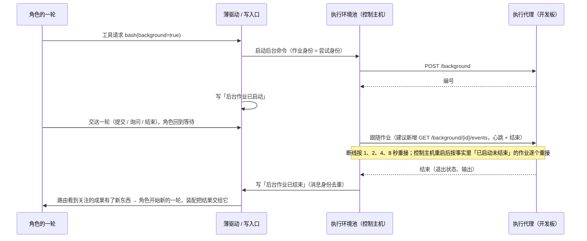

# 异步会话：Super-agent 怎么做、业界怎么做、Yudao 远程部署时放在哪

> 日期：2026-11-04。状态：调研，只出方案；没有改 Yudao 仓库，没有安装或运行任何第三方代码。
> 用途：接着 11-02 的 [DeepSeek Super-agent 与 Yudao 的异步框架](deepseek-superagent-async-framework.md)往深挖它的异步会话，对照业界，回答 Yudao 远程部署时异步会话放在哪一环、怎么做、第一步做什么。支持 [总体路线图](../program-roadmap.md)阶段三「断了接得上」、阶段四「自己转一周」，第 3 节道 05「动作与工具」上的远程执行代理与道 10「部署与环境」上的远程机器与开发板，以及 [D06 运行中追加输入](../requirements/in-flight-input.md)、[D29 远程执行环境](../requirements/remote-execution.md)。
> 一处说明：本文 11-04 写成时引的是旧路线图；11-10 路线图改成五个阶段以后，相关的是阶段三「断了接得上」与阶段四「自己转一周」，拆开部署在第 3 节道 10。
> 读法：第 1 节是结论，可以只读它；第 2 节是 Super-agent 的细节，第 3 节是业界，第 4 至 6 节是 Yudao。标注：〔源码〕读了实现；〔DSH 文档〕〔原型文档〕读了对方仓库里的文档；〔推断〕是我的判断，没有直接出处。

> 2026-11-05 补记：原先「内核不动」要等工单 #1456。它已于 11-04 22:11 合进 main（162b7c2），成果种类移到 `harness/definitions/outcome_kinds.json`，内核定义里的关注项只认字符串，名称的含义归路由实现 `harness/watched_outputs.py`（不在内核清单里）。这个前提现在成立。按 main 现状修订了第 5.2 节表与第 6 节第 3 条：作业结果做成关注项，不做成成果种类。

## 1. 结论

**Yudao 不缺持久执行，缺的是「后台作业结束能叫醒发起它的角色」这一条通路。** 只追加的事实、重放不调模型、按消息身份去重、派发编号、动作心跳与结果未知、事件流按位置续读，这些 Yudao 都已经定了（第 4.1 节），相当于自带了一套 Temporal 式的持久执行，恢复契约第 8 节也已定不引外部工作流引擎。Bender 说的痛点，落到 Yudao 上是四处具体缺口：后台命令只能轮询、结束没人收；后台作业活不过一轮、也活不过进程；长前台命令挡住插话；部门询问是同步的（第 4.2 节）。远程部署会把前三处都放大。

**推荐：不新造「会话」，把后台作业的结束当成一种「关注的成果」。** 总图第三节已有现成规矩：「你中途的指导是部门关注的成果：部门在等待时，指导让它开始一轮；在一轮工作中时，指导在下一步作为通知加入。」后台作业结束照搬这条。落点全在外圈：两种应用事件、一种成果种类、执行环境适配多一条跟随流、装配多并入一种通知，内核（写入口、裁决、边界、薄驱动）不动（第 5 节）。

| 问题 | 判断 |
| --- | --- |
| Super-agent 的异步会话怎么做 | 两层：DSH 本体给会话事件日志、「下一轮 / 下一步」两种投递、shell 超时转后台作业、异步子代理；Super-agent 加先存后做的副作用队列、幂等投递、槽位、后台 30 分钟上限、重启时带一段恢复说明重派。后台作业活不过进程，恢复靠提示词让模型自己去查 git（第 2 节，核实到源码） |
| 业界怎么做 | 六条共同做法：可续的事件流加持久列表；保存文件不保存进程；「空闲」是一等状态；插话在工具边界生效、中断另算；长命令转后台有上限、结束发通知；外部完成的等待要能先到后等（第 3.4 节）。Yudao 已经占了前四条，第五条只有一半（有后台命令，没有结束通知），第六条要靠本文的推荐 |
| 异步会话放在 Yudao 哪一环 | 外圈：应用事件、路由实现、装配实现、执行实现与执行环境适配、定义。不进内核，不改路由缝的出参 |
| 远程部署时怎么走 | 控制主机仍主动连执行代理，给后台作业补一条照 `GET /actions/{attempt}/events` 的跟随流；代理把后台作业记录落盘；控制主机重启后按事实里「已启动未结束」的作业重接，接不上就写「已结束（中断）」交还角色（第 5.3 节） |
| 要不要借 Super-agent 的代码或 DSH | 不借。另有一条新发现：DSH 的 ACP 服务端不支持终端与客户端文件操作，当 Yudao 的外包角色回执不全（第 2.6 节） |
| 第一小步 | 只在本机：后台作业的启动与结束写成事件、结束叫醒发起它的角色，一个能演示的验收场景；远程跟随流放第二步，在 Orange Pi 上验（第 6 节） |

**11-07 补：异步放在哪一层、总图怎么画、通信算不算模块**见第 9 节：都不进内核，也不新增模块；合同环里补三条，总图上补四句。

**要你定的三件事**（第 7 节）：后台作业结果算不算「成果」（这一点也要总架构师确认）；人在外面时要不要手机提醒（D30 现在定的是不主动推送）；ACP v2 删掉客户端终端与文件方法以后，外包角色怎么接（不急）。

## 2. DeepSeek Super-agent 的异步会话具体怎么做

先说清一件 11-02 那份没分开的事：它的「异步」有两层。**下面一层是 DeepSeek Harness（DSH）本体给的**：会话是只追加的事件日志、收件箱分「下一轮」与「下一步」两种投递、shell 命令超时转后台作业、子代理异步启动。**上面一层才是 dsh-superagent 自己加的**：SQLite 里先存后做的副作用队列、按消息身份的幂等投递、执行槽位、后台 30 分钟上限、重启时带恢复说明重派。这次两层都读了源码或本体文档，标注见每条末尾：〔源码〕＝读了实现，〔DSH 文档〕＝读了 DSH 仓库里的设计文档与包说明，〔原型文档〕＝读了原型的编号文档。

### 2.1 会话的生命周期

| 阶段 | 发生什么 | 依据 |
| --- | --- | --- |
| 创建 | 接单后第一次派工时建执行会话 `worker-<工单号>`，用 `dsh-superagent-worker` 预设；会话一旦建好就保留创建时的预设与模型，以后不跟着设置变 | 〔源码〕`src/executor/dsh.ts`、`src/app/sessions.ts`；〔原型文档〕003 |
| 一轮（turn） | 一次投递叫醒会话跑一轮；一轮里有多步（step），每步一次模型调用加工具；一轮结束时如果还有后台作业或子代理在跑，**不算结束**，工单继续占着槽位 | 〔源码〕`workerIdle`、`untilQuiet`（`src/executor/background.ts`） |
| 安静 | 后台作业与子代理全部结束、会话空闲，才向引擎报「这一轮结束」 | 〔源码〕`engine.turnEnded` |
| 交给人 | 报 `ready`、提问、`blocked`、`failed` 后立刻放掉槽位；这时子代理停掉，shell 作业可以留着（比如给人看的服务），留下的作业不占槽、不受 30 分钟限、结束也不叫醒会话 | 〔原型文档〕003「Background work and worker slots」；〔源码〕`stopSubagents`、`collectJob` |
| 等触发 | 报 `waiting` 或派工结束，工单进入 idle；订阅线程上来新消息就再叫醒同一个会话 | 〔原型文档〕003「Ticket stages」 |
| 结束 | 没 PR 的 `ready` 即结束；有 PR 的等它开的 PR 都关掉；派工结束时杀掉它的 shell 作业，不叫醒会话 | 〔原型文档〕003「How a Ticket ends」；〔源码〕`stopBackground` |

**一张工单一生可以有几次派工（Assignment），但只有一个执行会话**；重试、重启都是在同一个会话、同一个目录、同一个分支上开新派工，会话历史一直带着。〔原型文档〕003「Retry」

### 2.2 挂起与恢复：靠收件箱，不靠暂停

DSH 的会话没有「暂停」这个动作。会话空闲就是挂起，来消息就是恢复：

- 收件箱分两格：`queue` 投递进「下一轮」，会话空闲时叫醒它开新的一轮；`steer` 投递进「下一步」，会话正在跑时在下一次模型调用前被取走，空闲时同样开一轮。〔DSH 文档〕`docs/agent-lifecycle.md`；〔源码〕`src/app/delivery.ts` 的 `send()`
- dsh-superagent 给执行会话的新输入（人的跟进、CI 结果）都用 `steer`，所以会话在跑的时候，新消息最晚在**下一步**生效，不等这一轮结束。〔源码〕`deliverInput` 调 `sessions.prompt(..., 'steer')`
- 还有第三种 `inject`：只写进历史、不叫醒会话，用于「后台作业结束了」「后台作业被杀了」这类通知。〔源码〕`sessions.prompt(..., { inject: 'Background job ended' })`

### 2.3 长命令转后台

- 转后台是 **DSH 的 shell 工具自带的**，不是 dsh-superagent 写的：shell 的「前台」只是调用方在等结果，调用方只等 `timeoutMs`，到点就把进程句柄登记成后台作业，进程照跑。dsh-superagent 只是在自己的预设里把 `timeoutMs` 与 `maxTimeoutMs` 设成 5000，等作业的 `job_output` 等待上限也设成 5 秒。DSH 默认是 60 秒。〔DSH 文档〕`docs/subsystems/shell.md`「ShellExecution」；〔源码〕`cordis.patch.yml`
- 作业登记表（`ctx.jobs`）在进程内存里：有编号 `<种类>-<16 位>`、所属会话、输出环形缓冲；会话日志里只记 `job/registered` 和 `job/settled` 两条生命周期记录。〔DSH 文档〕`docs/subsystems/jobs.md`
- 作业结束会给所属会话送一条完成通知，于是会话被叫醒、在**同一个槽位**里接着干。〔DSH 文档〕jobs.md；〔原型文档〕003
- 后台时间上限：一轮结束后后台最多再跑 30 分钟，到点杀 shell 作业、报 `waiting`，报告里写最后的话和杀了哪些作业；子代理不杀。〔源码〕`BACKGROUND_LIMIT_MS = 30 * 60_000`
- 子代理也是异步的：`subagent` 工具调用立刻返回 `started subagent <id>`，结束时运行时往父会话送完成通知；**父会话不在线时不送，也不会为此把父会话恢复起来**。同一棵子代理树默认最多 8 个活的。〔DSH 文档〕`packages/subagent/tool-subagent/README.md`、`packages/subagent/subagent/README.md`

### 2.4 结果怎么回到原对话

两条路，都走「先存后做」的副作用队列（SQLite 的 `effect` 表）：

1. **执行会话 → 路由会话**：执行者用 `orchestrator_report` 报结构化状态；报告作为 `relay` 副作用排队，**按入队顺序一个一个**送进路由会话（失败的一条挡住后面同类的）。〔源码〕`src/app/sessions.ts` 构造函数里 `effects.handle('relay', ..., { ordered: true })`
2. **路由会话 → GitHub/飞书**：回复作为 `reply` 副作用进发件箱，同一工单发往同一对话的消息保序，失败退避 5 秒起、翻倍到 300 秒。〔原型文档〕003「Channel failure」；〔源码〕`src/app/outbox.ts`

副作用队列的几条规矩都核实到了源码（`src/app/effects.ts`）：在调用方的事务里 `INSERT ... ON CONFLICT(kind, key) DO UPDATE`，同种类同键只留一行、重复入队只换内容并保留排队位置；`Later` 表示暂时做不了（没空槽、处理暂停），重新排期但不记失败；连续失败 3 次才报系统问题；停机时等在跑的做完，没跑的留在 SQLite 里下次启动再跑。

### 2.5 断线与进程重启后怎么续上

| 情况 | 怎么续 | 依据 |
| --- | --- | --- |
| 投递重发 | 每条投递有固定的消息身份 `dsh-superagent:<请求号>`；投递前先读会话的**持久化日志**和收件箱，已有就不再投。所以副作用重试、进程重启都不会让会话收到两遍 | 〔源码〕`src/app/delivery.ts` 的 `holds()`、`send()` |
| 宿主进程重启 | 启动时按建单先后逐张核对：正在跑的派工记为「主机重启」中断，开新派工，第一条消息带恢复说明：「主机在这张工单进行中重启了。继续前先看工作目录、git 历史和 GitHub 状态。不要重复已经完成的外部操作。」等待、就绪、受阻、失败的派工原样不动，除非报告之后又来过输入 | 〔源码〕`DshExecutor.resume()`、`src/core/assignments.ts` 的 `RECOVERY_NOTE` |
| 会话日志本身 | DSH 会话是只追加的 JSONL 日志，单写者；`flush` 才是耐久边界。崩溃时停在半截的一轮会被补上「合成的收尾」：没发出的工具调用记 `TOOL_NOT_STARTED`，发出了没结果的记 `TOOL_OUTCOME_UNKNOWN`（提示模型只读或幂等的可以重试，有副作用的先核实或问人），再补 `turn/end {interrupted}`。**没有「从半截接着跑」这条路** | 〔DSH 文档〕`packages/session/session-persistence/README.md`「Resuming and crash recovery」 |
| 后台作业 | 进程没了作业就没了；日志里只剩 `job/registered`，没有 `job/settled`，文档明说「消费者不要编一个结束时间」 | 〔DSH 文档〕jobs.md「Session lifecycle records」 |
| 子代理 | 本地子代理在有持久化时可以「冷恢复」；但「已接收、还没写进子代理日志」的消息崩溃时会丢，不自动重放 | 〔DSH 文档〕subagent README「Known limitations」 |
| 未被会话吃进历史的输入 | 新派工开始前，先把会话收件箱里残留的旧副本删掉，再把上一次派工没被吃进历史的输入重发一遍，保证只有一份 | 〔源码〕`launch()`；〔原型文档〕003「Restart」 |

### 2.6 它做到了什么、没做到什么

做到的：**人永远能插话**（`steer` 下一步生效 + 长命令 5 秒转后台 + 给人留一个槽）；**后台作业不需要轮询**（结束自动叫醒）；**副作用与投递重启不重复**（先存后做 + 消息身份）。

没做到、或者靠模型兜底的：

- 进程一重启，后台作业就没了，正在跑的一轮被截断，恢复靠一段**提示词**让模型「自己去看 git 和 GitHub」，而不是按动作合同去查。
- 会话历史跨派工一直带着，「被截断的一轮」只靠合成收尾补齐，没有确定性的重放。
- 单进程、单机。作业、子代理、槽位都是进程内的；没有远程执行这一层，`006 部署` 里也只有一个跑在 `127.0.0.1` 上的 DSH 进程。〔原型文档〕006「What runs」
- 11-02 留下的问题「DSH 能不能当 Yudao 的外包角色」这次有了一半答案：DSH 自带一个 ACP 服务端（`packages/acp/acp`），支持 `session/list`、`session/resume`、`session/close`，**但明说不支持 `session/load`、终端和客户端文件操作**。Yudao 的外包合同要求外部 agent 把文件读写和命令交给客户端（Yudao）执行，好留下动作回执；DSH 不交，所以接进来也只能算「回执不全」的外包。〔DSH 文档〕`packages/acp/acp/README.md`

### 2.7 这次的阅读范围与一处更正

- 原型仓库这次 `git clone` 得到的唯一提交是 `8c32a9d`（2026-10-31 20:05 +0800，提交说明 `feat: add the dsh-superagent research prototype`），不是 11-02 那份写的 `6337fc8`；时间相同、只有一个提交，可能是仓库被重写过，也可能 11-02 那份记错了。本文以 `8c32a9d` 为准。
- DSH 本体读的是 `deepseek-ai/deepseek-harness` 主线 `8bd0733`（版本 0.2.2-alpha.3）的文档与包说明，没有读它的 TypeScript 实现；凡是〔DSH 文档〕的结论都是它自己文档说的。
- 没有安装、没有运行任何一方的代码。

## 3. 业界怎么做异步会话

Temporal 的事件历史、活动、LangGraph 的检查点，Yudao 在[组织与持续运行研究](organization-runtime-evolution.md)第 6、10 节已经读过（O01 至 O03），这里不重复。这次补的是**专门针对 agent 会话**的两类：一类是云端的后台 agent 产品，一类是持久执行运行时里给 agent 用的那部分，外加 ACP 协议本身。资料全部来自官方文档，2026-11-04 读取；由两个子代理分头读取后交回，ACP v2 的四条结论我另外核对了原文（第 3.3 节）。没有运行任何一家的代码，下面的数值都是对方文档写的。

### 3.1 云端后台 agent

| 产品 | 会话状态 | 长命令 | 结果怎么回来 | 断线、重启后 | 在哪跑、怎么插话 |
| --- | --- | --- | --- | --- | --- |
| OpenAI Responses 后台模式 | queued → in_progress → completed / failed / incomplete / cancelled；一次响应就是一次运行，不能挂起 | 整个响应就是异步单位 | 轮询 GET，或 webhook `response.completed`（只带 id）[O1][O2] | 流按 `sequence_number` 续：`starting_after=N`；只有建时 `stream=true` 的能续 [O1] | OpenAI 服务器；只能取消，不能插话 |
| Codex 云端任务 | 每个任务一台 VM；保存的 VM 状态在最后一次开始一轮后 7 天内可恢复 [X2] | 云端未写；本地 app-server 有 `turn/steer`（往正在跑的一轮加输入）和 `turn/interrupt` [X4] | 差异 → 提交或 PR [X1] | 你的电脑睡了任务照跑；线程是磁盘上的 JSONL，没人订阅 60 秒后卸载，再 `thread/resume` [X1][X4] | OpenAI 的 VM；可以追加要求 |
| Claude Code 云端会话 | 每会话一台 VM，可归档、删除 | 前台 Bash 缺省 2 分钟、最长 10 分钟，到点**转后台不杀**；无人值守时后台上限 30 分钟（传 `timeout` 最长 2 小时）[A2][A3] | 分支 / PR；订阅 PR 事件自动修 CI [A1] | 空闲几分钟 VM 暂停、文件保留；VM 被回收后对话历史恢复，**跑着的命令和子代理不恢复，并告诉模型哪些停了** [A1][A2] | Anthropic 的 VM 或自建 runner；runner 只向外轮询取活，租约 120 秒，过时重新派 [A4] |
| Claude Managed Agents（beta） | idle / running / rescheduling / terminated；做完回 idle 不是 terminated [M2] | 工具确认与自定义工具让会话以 `requires_action` 停下 [M1] | 事件流、`events.list`、webhook（只带 id）[M1][M3] | 没有游标：重开流以后列历史、按事件 id 去重 [M1] | `user.interrupt` + `user.message` 就是插话；排队中的事件 `processed_at` 为空 [M1] |
| Cursor Cloud Agents | agent：ACTIVE / IDLE / ARCHIVED；run：CREATING、RUNNING、**WAITING_FOR_BACKGROUND_WORK**、FINISHED、ERROR、CANCELLED、EXPIRED [C2] | 有专门的「等后台工作」状态 | PR 带截图、视频、日志 [C1] | SSE 用 `Last-Event-ID` 续，过保留期回 `410 stream_expired`，再读最终状态 [C2] | `delivery:"steer"` 回答 `steered` 或 `queued`；一个 agent 同时只有一个 run，否则 `409 agent_busy` [C2] |
| GitHub Copilot 云端 agent | 一个会话就是一次 Actions 运行；卡住一小时超时 [G5] | 准备步骤上限 59 分钟 [G4] | 签名提交、PR、请你审查 [G2] | 工作在 GitHub 上，电脑可以关；没写恢复机制 [G1] | 会话日志下的输入框，「做完当前工具调用以后」生效 [G2] |
| Devin | new / claimed / running / exit / error / suspended / resuming；空闲 30 分钟睡（API 建的 5 分钟），来消息自动醒 [D1][D4] | 未写 | 轮询状态 [D2] | 会话在 VM 上，关终端不停 [D6]；自建机器（Outposts）用比较交换认领加 `claim_deadline` 租约，过期回队列 [D5] | 发消息；可以 SSH 进 VM |

### 3.2 持久执行运行时里给 agent 用的部分

| 系统 | 长步骤异步 | 等人或等外部事件 | 中途插话 | 崩溃后 | 客户端续读 | 远程放置 |
| --- | --- | --- | --- | --- | --- | --- |
| Temporal | 活动异步完成：拿任务令牌或「工作流 ID + 活动 ID」，外部系统完成；心跳里带进度，重试时读回 [T3][T4][T5] | 工作流等 Signal 或 Update；OpenAI Agents SDK 集成里审批回调就等它 [T1][T11] | Signal（只发不等）、Update（有校验、可等结果；缺省同时最多 10 个）[T1][T10] | 重放事件历史；模型调用是活动 [T11] | `WorkflowStream`（实验性）[T11] | 每个 Worker 一个专属任务队列，把「同一台机器上的几步」钉在一起 [T7] |
| Restate | `ctx.run` 记进日志 | awakeable（一次性，HTTP 完成）、`ctx.signal`（可多次，**等待开始前到的也保存**）；等的时候挂起不占算力 [R1][R4] | 按会话键的独占队列；新消息到来「取消再重来」，没有不取消的插话 [R5][R6] | 日志重放；计时器、承诺都持久 [R1] | pubsub + SSE `?offset=` [R7] | 每个专家一个服务，按 URL 登记；模型的路由选择记进日志，重放不再调模型 [R8] |
| LangGraph（Agent Server） | 后台 run：`runs.create` 回 pending，`runs.join` 等 [L7] | `interrupt()` + `Command(resume=...)`；**被中断的节点从头再跑**，前面的副作用要幂等 [L1] | `multitask_strategy`：enqueue（缺省）/ reject / interrupt / rollback [L2][L4] | 检查点；`durability` sync / async / exit [L4] | `stream_resumable` + `Last-Event-ID`；客户端断开缺省**不**取消 run [L4][L5] | 队列 worker，没有按机器的亲和 [L8] |
| Inngest | `step.run` 结果记下，只重试失败的那步；单步最长 2 小时 [I3] | `step.waitForEvent`（按键匹配、带超时）；**等待登记之前到的事件匹配不到** [I1][I2] | 事件与信号 | 已存的步骤结果复用 [I3] | Realtime，重放未写 [I5] | 未写 |
| Cloudflare Agents | 长外部任务给 `callback_url` 然后休眠，或用 `schedule()` 轮询 [CF1] | 工具 `needsApproval`；Workflows 的 `waitForApproval()` | `messageConcurrency`：queue / latest / merge / drop / debounce [CF2] | 一个 agent 一个 Durable Object，空闲约 70 到 140 秒被逐出；SQLite 状态与计划保留，**进行中的请求、计时器丢掉**；恢复由你的代码决定，不是自动重放 [CF1] | 输出块存在 SQLite，重连重放 [CF2] | 按名字一个对象 |
| Bedrock AgentCore | `/ping` 回 `HealthyBusy` 表示还有后台活；`add_async_task` / `complete_async_task` [A1'] | 未写 | 同一会话再调用 | 一个会话一台 microVM，空闲缺省 15 分钟、最长缺省 8 小时就停，下次调用给新机器 [A2'][A3'] | 未写 | 按会话头钉在同一台 microVM |

（表中 A1' 至 A3' 是 AgentCore 的来源，和 3.1 节 Claude Code 的 A1 至 A4 区分。）

### 3.3 ACP：Yudao 外包角色用的协议正在变

这一条和 Yudao 关系最直接，所以我另外读了原文核对 [P6]：

- **v1**（Yudao 现在按它设计）：`session/load` 要求 agent 重放整段对话；`session/resume` 不重放；`terminal/create` 立即返回，之后 `output`、`wait_for_exit`、`kill`、`release`；运行中再发一条 prompt 怎么处理，v1 没规定 [P1][P2][P3]。
- **v2**（迁移指南原话：「v2 as a whole is still labeled draft」）：
  - 客户端终端方法 `terminal/create`、`terminal/output`、`terminal/release`、`terminal/wait_for_exit`、`terminal/kill` **全部删除**，终端变成 agent 自己的、只供显示的状态（`terminal_update`）[P6]；
  - 客户端文件方法 `fs/read_text_file`、`fs/write_text_file` **删除**，指南建议「需要时把客户端提供的文件工具经 MCP 暴露」[P6]；
  - `session/load` 删除，改用 `session/resume` 加 `replayFrom` [P6]；
  - prompt 任何状态都能发，agent 要么立刻插入、要么按序暂存，不能因为正在干活就拒绝；状态上报 running / requires_action / idle 外加一个 `background` 列表；`session/cancel` 不停后台工作，`session/close` 才停 [P4][P5]。

对 Yudao 的含义：外包角色设计第 4.4 节靠的是 v1 的「文件与终端交给客户端」，这样外部 agent 的读写和命令才经 Yudao 的工具、留下动作回执。v2 定稿以后这条路没了，要换成「Yudao 把文件和命令工具做成 MCP 服务交给外部 agent」。好处是 v2 的 `background` 列表与「任何状态都能发 prompt」正好就是异步会话需要的东西。这件事不急（v2 还是草案），但该记进外包角色设计的未决问题。

### 3.4 共同的做法

1. **可续的事件流加一份持久的「真相」列表。** 流都当成会丢、会重：OpenAI 按序号续，Cursor 与 LangGraph 用 `Last-Event-ID`，过期就回去读最终状态；Managed Agents 干脆没有游标，重列历史按 id 去重。Yudao 的只追加事件库加 SSE 位置，就是这一条。
2. **保存文件，不保存进程。** Claude Code、Codex、Managed Agents、Devin 都把工作区或 VM 文件快照下来；**没有一家承诺跑着的进程能活过重启**。Claude Code 的做法最值得照抄：回收后恢复对话，并明确告诉模型哪些命令停了。Yudao 的「从封存快照建工作区、执行机器不保存跨一轮的状态」与此一致。
3. **「空闲」是一等状态，和「做完」分开，来一条消息就醒。** Managed Agents 的 idle + `requires_action`、Devin 的 suspended → resuming、Cursor 的 IDLE，Cursor 还专门有 `WAITING_FOR_BACKGROUND_WORK`。Yudao 外环的「等待工作」「等用户」就是这个。
4. **插话是排队的输入，在工具调用边界生效；中断是另一个原语。** Copilot「做完当前工具调用以后」、Codex `turn/steer` 与 `turn/interrupt` 分开、Cursor `steered` / `queued`、LangGraph 与 Cloudflare 都要你选一种并发策略。这正是 D06 已定的做法（当前工具做完、下一次模型调用前；`/stop` 立即停）。
5. **长命令转后台，有硬上限，结束是一条通知；远程那一端只向外连、靠租约。** Claude Code 前台超时转后台、后台 30 分钟上限；AgentCore 用 `HealthyBusy` 表示「还有后台活别回收我」；Claude 的自建 runner、Devin Outposts、Cursor 私有 worker 都是对方向外轮询或认领、带租约。Yudao 执行代理「连接都由控制主机发起」方向相反，但心跳 + 时限 + 结果未知是同一个思路。
6. **外部完成的等待要能先到后等。** Restate 的 signal 在等待开始前到也保存，Inngest 的 `waitForEvent` 则会漏掉先到的事件。Yudao 把作业结束写成事实里的事件，天然属于前一种：先到的结束事件在事实里，角色什么时候来看都在。

## 4. Yudao 现在有什么、缺什么

### 4.1 已经有的（大部分「异步会话」的底子 Yudao 已经定了）

把业界那几件事逐条对到 Yudao 的文档与代码上，会发现 Yudao 的底层其实就是一套持久执行，只是没叫这个名字：

| 业界的做法 | Yudao 里对应的已定设计 | 位置 |
| --- | --- | --- |
| 执行历史 + 重放不重做（Temporal 的事件历史、活动结果入历史） | 一份只追加的事实；模型输出、工具回执都记成事件；重放读事件、不再调模型 | 总图第一节方程、第四节「模型」「投影」的缝 |
| 进程重启从持久状态续上 | 控制核心是按事件重放的状态机，重启丢掉内存里的会话，从已提交的事件恢复；启动时自动继续所有中断的 run | 总图第六节「进程停了又起」；恢复契约第 3 节 |
| 消息与命令的幂等 | 写入口按消息身份去重；命令带身份、重发不重做；派发编号与执行权编号挡住迟到的旧结果 | 总图第四节「写入口」「接口」的缝；执行环境设计 3.4、3.5 节 |
| 活动心跳与结果未知 | 远程动作 10 秒心跳、40 秒时限；超时记「动作结果未知」，先按动作合同自动核实，核实不出来交还发出它的会话由模型决定；迟到回执只记录 | D29、执行环境设计第 5 节、恢复契约第 4 节 |
| 跟随长任务的流可以断线重接 | 远程动作 `GET /actions/{attempt}/events`，断了按 1、2、4、8 秒重接，重接立刻给当前状态（照 Bazel `WaitExecution`） | 执行环境设计 3.6、5.2 节 |
| 客户端断线续读 | 页面事件流的每条 SSE `id` 就是全局位置，用 `Last-Event-ID` 续上，不漏不重 | 应用层与接口层设计第 5 节 |
| 运行中插话 | 新输入先存原文、确认接收；当前工具做完、下一次模型调用前处理；`/stop` 立即停 | D06、D01 |
| 后台命令 | `bash` 带 `background=true` 立即返回编号，之后用 `read_output` 读新输出、`stop_job` 结束；会话结束、事项暂停或取消时一起结束；重启后旧编号记为已结束 | 本机工具设计 `bash` 一行；执行环境设计 3.1 节；代码 `harness/environment.py` 的 `BackgroundJobTable` |
| 外部 agent 的会话恢复 | 外包角色经 ACP 接入；会话中断时先核实，能「载入以前的会话」就载入并告诉它结果未知，不能就重派、编号加一 | 外包角色设计 4.3、4.8 节 |

所以 **Yudao 不需要再引一个工作流引擎**，这一点恢复契约第 8 节已经定了（「不引入外部工作流引擎，Temporal 与 LangGraph 的成熟模式用于划分边界」），本文不重开。

### 4.2 缺的四处

**缺口一：后台作业结束叫不醒发起它的角色。** 现在后台命令只能轮询：模型得自己记着编号、过一会儿调 `read_output`（`harness/definitions/tools.json` 里 `read_output` 的说明）。模型忘了、或者一轮已经结束，结果就没人收。Bender 自己的自动驾驶配置就是证据：`docs/agents/autopilot-runtime.md` 写着用 omp 运行时「关闭后台命令，命令都在前台运行，测试结果能交回」。这正是 Super-agent 用「作业结束叫醒同一个会话」解决的那件事。

**缺口二：后台作业活不过一轮，也活不过进程。** 后台作业的记录在内存里（`BackgroundJobTable`），挂在按部门建的会话上（`harness/sessions.py` 用固定的 `DEPARTMENTS` 建会话，这正是架构排查找出的「部门名写死」的一处）；会话一结束、事项一暂停就全部结束。于是一个角色不能「起一个十分钟的测试，先交这一轮，测试结束再接着干」，只能在一轮里干等。远程机器上执行代理的记录也是「随执行环境的进程存在」，代理一重启就清空。

**缺口三：一个长的前台命令挡住插话。** `bash` 缺省时限 300 秒、最长 3600 秒；D06 定了「已启动的工具可以完成」，所以一个跑满一小时的前台命令期间，你中途的指导要等一小时才进得去。Super-agent 用「前台 5 秒自动转后台」解这个，但前提是缺口一先解掉，否则转到后台的结果又没人收。

**缺口四（以后再说）：部门之间的询问是同步的。** `ask_department` 工具的说明是「步骤循环暂停，直到对方部门回答」。部门内多角色的设计允许同时有几个询问，但发起的一方仍在等。这和 DSH 的异步子代理是同一类问题，本文只记下，不在第一小步里解。

远程部署让这四处都变重：控制主机在家里常开，执行在开发板上，你人在外面。命令更慢（板子上构建）、网络会断、哪一端都可能重启，「一轮里干等后台」与「轮询」的代价都被放大。

## 5. 放在哪一环、推荐做法

### 5.1 一句话

**不新造「会话」，把后台作业的结束当成一种「关注的成果」。** 总图第三节已经有一条现成的规矩：「你中途的指导是部门关注的成果：部门在等待时，指导让它开始一轮；在一轮工作中时，指导在下一步作为通知加入。」后台作业结束照搬这条：发起它的角色在等待时，作业结束让它开始一轮；还在一轮里时，作业结束在下一步作为通知加入。路由实现 `harness/watched_outputs.py` 的那条通用规则（「关注的成果有了新东西、部门在等待工作时，它开始一轮工作」）原样适用。

这样「异步会话」在 Yudao 里就不是一个新东西，而是三件已有的东西拼起来：一份事实里多两种事件、路由多认一种成果、装配多并入一种通知。会话（模型的对话）照旧可以随时丢弃、从事实重新装配，**不需要像 DSH 那样让会话常驻内存**，重启也不靠提示词兜底。

### 5.2 放在哪一环（对照总图第二节的三环）

| 改动 | 落在哪 | 环 |
| --- | --- | --- |
| 新增应用事件：后台作业已启动（谁发起：run、角色、派发编号；在哪台机器、哪个工作区；时间上限）、后台作业已结束（退出状态、输出工件、结束原因：自己退出 / 超时 / 被结束 / 中断） | 应用事件登记在 `harness/models.py` 的 `EventType`，不进 `kernel_events.py` 的骨架事件 | 可以整体重写（应用事件可以排空） |
| 作业结束经写入口写回，消息身份用「作业编号 + 结束」，重发去重 | 执行实现、执行环境适配；写入口本身不改，只是多一个写入方 | 可以整体重写 |
| 「后台作业结果」作为一个关注项，发起它的角色关注它（不进 `outcome_kinds.json`，见第 6 节第 3 条） | 定义（组织定义的 `watched`），路由实现 `_WATCHED_CHECKS` 里判断「有新东西」 | 定义 + 可以整体重写 |
| 一轮中途到达时作为通知在下一步并入 | 装配实现，和指导的并入同一条路 | 可以整体重写 |
| 后台作业的时间上限、每台机器同时跑几个 | 定义里的上限，边界照常核对 | 定义 |
| 后台作业不再挂在「部门会话」上，改挂在「run + 角色 + 派发编号」上 | `harness/sessions.py`、`BackgroundJobTable` | 可以整体重写 |

**不碰内核**：写入口、裁决、边界、薄驱动都不改；路由的缝里「这一轮怎么结束」的出参也不用加新值，因为角色照常以提交、询问、等你或结束来结束这一轮，「等后台」体现在它关注的成果还没到。需要总架构师确认的只有一点（见第 7 节）：后台作业结果算不算「成果」。

### 5.3 远程部署时这条通路怎么走

要点：

1. **所有连接仍由控制主机发起**，执行代理不需要知道控制主机地址（执行环境设计 3.6 节的规矩不变）。后台作业现在只有「读新输出」这条接口，建议照 `GET /actions/{attempt}/events` 补一条跟随流，心跳与 40 秒时限沿用第 5.1 节的数值。
2. **执行代理把后台作业的记录落盘**，和动作尝试一样保留 7 天（执行环境设计 3.4 节）。进程本身仍随执行代理结束，不做跨重启存活（「执行机器不保存跨一轮工作的状态」不变）；落盘只是让代理重启后能答出「这个作业被中断了」而不是「没听说过」。
3. **控制主机重启**：恢复时从事实里找「已启动、未结束」的作业。本机进程的：进程已随 Yudao 一起没了，写「已结束（中断）」，交还发起它的角色。远程的：按编号重接跟随；代理答「中断」或查无此作业时同样写「已结束（中断）」。这和恢复契约第 4 节「后台命令在重新启动以后记为已经结束」一致，只是把「记为已结束」从内存里的一句话变成事实里的一条事件，角色看得见。
4. **你离开时**：作业结束产生的事件照常进事件流，页面用 `Last-Event-ID` 续读就能看到；首页的「待你决定」与「离开期间的报告」（D30）也从同一批事实来。D30 已定「不主动推送提醒」，只在页面开着时发浏览器系统通知；异步会话本身不需要推送通道。人在外面想在手机上收到提醒，是另一件要你定的事（第 7 节），局域网以外访问仍按应用层设计第 6.3 节先加令牌与 TLS。

### 5.4 Super-agent 的做法这次借哪些、不借哪些

| 它的做法 | Yudao 借不借 |
| --- | --- |
| 作业结束叫醒同一个会话 | **借意思不借形式**：叫醒的是「发起它的角色开始新的一轮」，会话不常驻，结果经事实进来 |
| 一轮结束仍有后台作业就继续占槽 | **不借**：Yudao 的角色在等待时不该占着执行槽位；占的是执行机器上的「同时跑几个作业」上限，由定义给 |
| 前台 5 秒转后台 | **后借**：等缺口一解掉再做，做成定义里的一个参数（前台最长等多久），缺省先保持现在的 300 秒，不一步改到 5 秒 |
| 后台 30 分钟上限，到点杀掉并报告 | **借**：后台作业的时间上限进定义，到点结束进程树，结束原因写「超时」 |
| 人的消息永远有一个专用槽 | **借**（11-02 那份已列为做法③）：远程部署下执行槽位更紧，更需要 |
| 重启靠恢复说明让模型自己查 git | **不借**：Yudao 按动作合同核实，作业的结局写成事件，不靠提示词 |
| 消息身份 + 先读持久化日志再投递 | **已经有**：写入口按消息身份去重 |

## 6. 第一小步

**范围：只在本机进程，不碰远程。** 理由：远程执行代理的代码还没有（仓库里只有参数登记），通路先在本机立住，远程那一段只是多一条跟随流。

要做的（交给子架构师拆工单，本文不拆）：

1. 应用事件两种：后台作业已启动、后台作业已结束（第 5.2 节表里的字段），在 `harness/models.py` 登记，并在 `harness/definitions/event_sources.json` 写明来源（结束事件的退出状态属于主机测量）。
2. 后台作业改挂在「run + 角色 + 派发编号」上，不再挂在按 `DEPARTMENTS` 建的部门会话上；作业结束由执行实现经写入口写「已结束」，消息身份用作业编号。
3. 组织定义的 `watched` 里加一个关注项「后台作业结果」（发起作业的角色关注自己发起的作业），路由实现 `harness/watched_outputs.py` 的 `_WATCHED_CHECKS` 加一条判断「有新东西」。照 `guidance`、`defect_record` 的写法，**不进 `outcome_kinds.json`**：那一组只收由提议方式提交的正式成果，加载时会核对每一种都有提交类工具，作业结果由主机写入，放进去会被拒。（2026-11-05 按 main 上的 #1456 修订）
4. 装配把一轮中途到达的作业结果作为通知在下一步并入，和指导走同一条路。
5. 恢复：Yudao 启动时，事实里「已启动未结束」的本机作业一律写「已结束（中断）」。
6. 定义里加后台作业的时间上限，到点结束进程树，原因写「超时」。

**验收场景（可以直接写成试用用例）：**

- 工程在一轮里起一个约 2 分钟的后台测试，然后交这一轮；测试结束后，工程自动开始新的一轮，看到退出状态和输出，页面与回放里能看到「已启动」「已结束」两条事件和新的一轮。
- 同样起作业以后、结束以前关掉 Yudao 再开：事实里出现「已结束（中断）」，工程开始新的一轮并被告知作业中断、结果未知，模型自己决定是否重跑；不等你回答。
- 作业还在跑时你发一条指导：指导照 D06 在下一步进去，不等作业结束。
- 重放这三段事件，状态一致，重放不调模型。

**第二步（道 05、道 10）：** 远程执行代理按第 5.3 节补跟随流、落盘记录，在 Orange Pi AIpro 上验：控制主机重启、代理重启、断网各一次。**第三步**才是「长前台命令自动转后台」，做成定义里的参数，缺省先不变。

## 7. 要你定的事

1. **后台作业结果算不算一种「成果」。** 我的倾向是算：这样路由、装配、恢复都复用已有规矩，不加新概念、不改路由缝。反方意见是「成果」原本指部门交出来的东西（要求、交付、缺陷），后台作业结果只是工具的产出，混进去会让成果种类变杂。若不算，替代做法是在路由缝的「这一轮怎么结束」里加一个「等后台」，那就动了只能向后兼容的一环。这一点总架构师要先确认。
2. **人在外面时要不要手机提醒。** D30 已定不主动推送，只在页面开着时发浏览器通知。远程部署后你常不在页面前，「待你决定」可能一挂几小时。要的话是一个新需求（推送到哪、哪些事推），不要就保持现状。异步会话本身不依赖它。
3. **ACP v2（不急）。** v2 定稿后外部 agent 不再把文件与终端交给 Yudao 执行，外包角色要改成「Yudao 把文件与命令工具做成 MCP 服务」，否则回执不全。现在只需记进外包角色设计的未决问题。

## 8. 可能错的地方

- 第 3 节的大部分条目由子代理读官方文档交回，我只亲自核对了 ACP v2 迁移指南的四条；数值类的（时限、上限）以对方文档为准，可能已经变。Devin 的 v3 OpenAPI 没读到，Codex 云端任务是否限时没找到。
- DSH 本体只读了文档与包说明，没读实现；Super-agent 读了源码，但没有运行。
- 第 5 节的落点判断基于仓库 `cf0290a6` 的文档与代码。「应用事件可以不进内核」依据 `harness/models.py` 里「应用事件由应用登记」的注释与 `kernel-manifest.json` 的内核清单；如果写入口校验对新事件种类有内核侧的登记要求，第一小步会碰到内核，需要再查 `harness/validation.py`。〔推断〕
- 「后台作业不占角色的执行槽位」是我的建议，和 Super-agent 相反；理由是 Yudao 的角色在等待时本来就不该占槽，但这会让一台机器上同时跑的后台作业变多，所以要有按机器的上限。

## 9. 异步放在哪一层、总图怎么画、通信算不算模块（2026-11-07 补）

> 起因：Bender 11-07 语音里问了三件事。异步是在骨架里支持，还是在某个组件里支持？总图里要不要画？通信是不是重点模块，它又和业务无关？依据是 main `51593176`（2026-11-07 12:21）上的 `docs/architecture.html`，引用时写节名和原话。

### 9.1 结论

| 问题 | 立场 |
| --- | --- |
| 同步还是异步 | 底下只有一套异步，同步就是「发出去、在同一步里等结果」这个特例。模型看到的工具仍分前台和后台两种：前台等到时限为止，后台立即返回编号，结束时作为关注项回来。作业结束不打断角色：角色闲着就开一轮，正在一轮里就在下一步作为通知加入。能立即打断的只有 `/stop`（D06）。 |
| 放在哪一层 | 不放进骨架，也不放进内核。骨架只有总图说的「循环、边界、裁决」三样，现在的骨架已经足够承载异步，不需要改。要落成文字的不变量只有三条，都写在**合同环**（只能向后兼容的那一环）里的「动作」和「装配」两道缝上。代码改动全在外圈（第 5.2 节）。 |
| 总图里怎么画 | 不加新模块，不加新缝，也不加「等后台」这个状态。画成关注项机制的一种用法：第三节「中途的指导」那句后面加一句，第四节「动作」「装配」两张卡各补一两条规矩。 |
| 通信是不是重点模块 | 不是一个模块，也不该做成模块。Yudao 里有三种「通信」，各有各的位置：角色之间经事实，系统与外面经接口，跨机器经第六节那四道过网的缝。和业务无关的那部分是每道缝的传输适配，放在外圈的「模型与执行环境的适配」里；它的重点是合同（消息身份、超时、结果未知、按位置续），这些合同已经写在各张缝卡上。不要做消息总线。 |

### 9.2 为什么不放进骨架或内核

1. **方程本来就是异步的。** 第一节的方程是「事实t+1 = 事实t ⊕ U( f( P(事实t) ), 回执, 执行权, 派发编号 )」：每次只处理一条进来的东西，里面没有「等」。一轮结束是一条事实，十分钟后后台作业结束是另一条事实，两者之间系统什么都不用记。所以异步不是一项要给骨架加的能力，而是骨架本来就没有把两条事实绑在一起；需要补的只是让后来那条事实能叫醒该叫醒的角色，这件事归路由。
2. **总图第二节给了判定标准。** 「四层……单 agent、普通多 agent、产品 · 工程 · 质检、子组织都只换下面两层，任何一种要改上面两层，就是抽象没立住。」异步是一种轮转和调度上的做法。如果它要改「事实与裁决」或「循环」这两层，就说明抽象出了问题，而不是该把异步搬进去。
3. **代码现状和这一点一致。** main 上的内核清单（`harness/definitions/kernel-manifest.json`）列的 13 个模块里，没有一个提到 background 或 job；后台命令只出现在执行环境（`harness/environment.py`）和工具定义里。现在内核不认识后台作业，以后也不需要认识。
4. **放进内核的代价。** 内核环「只由你批准」，函数复杂度不超过 10，被故意改坏时必须报错。把某一种并发模型（比如「一轮可以挂起等外部事件」）写进内核，以后想换成任务池或别的轮转方式，就得改内核，这和 Bender 自己定的「不变的规矩在核心，变的放外圈」正好相反。

### 9.3 骨架要承认的最小不变量

这三条都不是新加的机制，是把现有规矩用到「回执比发起它的一轮晚到」这个情况上，写明白免得各处理解不一样。都写在合同环里，改动要总架构师批：

1. **晚到的回执只记录，不接纳为那一轮的结果。** 依据：第三节「重派与迟到的结果：重派先写事件、编号加一；旧编号只记录」，以及第六节「旧编号交回的结果只记录不接纳」。后台作业结束时，发起它的那一轮已经交了，派发编号是旧的。按现有规矩，结束事件照常经写入口成为事实，但不算那一轮的结果；下一轮由路由按关注项开始，装配把这条事实交给新的一轮。这样和现有规矩不冲突，正是需要的行为。写在「动作」卡上。
2. **后台动作属于一个事项和发起它的执行权，事项停了它也要停。** 依据：第一节「裁决与边界……保证一定会停」，第三节「任何状态都能到停止」。一轮结束后还在跑的进程不经过「每步先问边界」，所以不受那一关管。补救办法是两条：事项停止、暂停、取消，或者执行权转走时，它名下的后台动作一并结束（执行环境设计第 3.1 节已有「结束会话的后台命令」，要改成按事项与执行权来结束）；每个后台动作的时间上限来自定义，到点就结束，原因写「超时」。这条保证「一定会停」在后台作业上也成立。边界本身的代码不用改，结束进程由执行实现负责。写在「动作」卡上。
3. **装配并入的不只有指导。** 「装配」卡现在写的是「只读事实、定义与待并入的指导」。后台作业结束也要在下一步并入，所以这一句应该改成「待并入的通知（你的指导、后台动作的结束）」。按字段只增的规矩，这算向后兼容的改动。不写明的话，装配实现就是在悄悄扩大合同的意思，违反第四节「合同不能偷偷改」。

路由那道缝的出参（继续、询问、等你、核验、结束）**不加「等后台」**。角色想等后台作业，就照常交掉这一轮回去等待。它关注的东西还没到，外环的「等待工作」已经能表达这个状态。Cursor 有专门的 `WAITING_FOR_BACKGROUND_WORK` 状态，我不建议照搬：那样一轮会一直占着，第 5.4 节已经说了不借这一条。

### 9.4 总图上改哪几句（只是建议的措辞，改不改由总架构师定）

| 位置 | 现在 | 建议补上 |
| --- | --- | --- |
| 第三节，两环的关系 | 「你中途的指导是职能关注的成果：职能在等待时，指导让它开始一轮；在一轮工作中时，指导在下一步作为通知加入。」 | 后面加一句：「后台动作的结束同理：它是发起它的角色关注的东西，角色在等待时让它开始一轮，在一轮工作中时作为通知加入，不打断正在走的一步。自有角色在下一步加入；职能由外部 agent 做时，什么时候加入跟中途的指导一样，按外包设计说明里那条未决问题的结论办，没定之前等这一轮交回再带上。」（11-08 按 main 41fd4873 修订，见第 9.7 节；11-09 按 ce9c6883 改用「职能」，见第 9.8 节） |
| 第四节，「动作」卡 | 「每个动作有回执；结果未知时有核实办法……本机与远程同一份合同」 | 加两条：「动作可以在后台跑：回执晚于发起它的一轮到达时，照常写成事实，不作为那一轮的结果接纳」；「后台动作属于事项与执行权，事项停止或执行权转走时一并结束；时间上限来自定义」 |
| 第四节，「装配」卡 | 「只读事实、定义与待并入的指导」 | 「只读事实、定义与待并入的通知（指导、后台动作的结束）」。对外部 agent 做的职能，装配只给这一轮开头那一份，中途的通知怎么送进它的会话不归装配管，归外包派发（第 9.7 节） |
| 第二节，定义那一格 | 列了「上限」 | 不用改，后台动作的时间上限算在「上限」里；需要的话，在设计说明里写明有这一项 |

第一节的方框图、第六节的部署图都不加东西。第六节已经说清楚跨机器的部分：「要过网络的缝：写入口、动作、模型、接口四道。合同照旧，多出的只有超时与结果未知。」后台作业的跟随流（第 5.3 节）只是「动作」这道缝过网以后的具体实现。

### 9.5 通信：不做模块，按边界分开

我同意 Bender 说的「和业务应用无关」，但不同意把它当成一个重点模块。理由：

| 谁和谁 | 在 Yudao 里怎么通 | 位置与依据 |
| --- | --- | --- |
| 角色和角色、职能和职能 | 不直接发消息。提交成果，对方关注；询问也写在事实里 | 第一节「一份事实：……职能之间的询问也在这里」；路由决定谁开工 |
| 系统和外面（页面、命令行、评测、观察者、画面） | 只有命令、查询、事件流三种 | 第四节「接口」卡 |
| 控制主机和别的机器（执行代理、模型服务、远程成员） | 四道过网的缝，每道一份合同 | 第六节「要过网络的缝」；传输属于外圈的「模型与执行环境的适配」 |
| 外部 agent | 职能的角色选外部 agent（11-07 决策，11-08 改用「职能」的说法），经 ACP 接入，仍是「执行」的一种实现 | 第四节「执行」卡；外包设计说明第 1 节 |

为什么不做一个统一的通信模块（消息总线）：

1. **会多出第二份事实。** 总图第六节写着「控制核心是按事件重放的状态机，没有事件库之外的第二份事实」。总线一旦存消息、排队、重投，就成了另一份会和事实对不上的状态。崩溃以后以哪份为准，正是 Super-agent 要靠 SQLite 副作用队列加提示词去兜的那个问题（第 2.5 节）。Yudao 不用兜，因为它只有一份事实。
2. **会和关注项机制重复。** 「谁收到什么、什么时候开工」已经由「事实 + 路由 + 关注项」回答了。总线也会回答「谁收到什么」，两套规矩迟早会打架。
3. **真正与业务无关、值得共用的，是合同里那几条，不是模块。** 消息带身份、重发不重做；有超时；超时就是「结果未知」，要有核实办法；流按位置续，断线后重接。这几条已经分别写在「写入口」「动作」「接口」三张卡上。代码上可以给四个传输适配共用一个小库（比如带身份的 HTTP 客户端、1、2、4、8 秒重连），但它是外圈适配下面的代码，不在总图上占一个方框，也不是一道缝。

所以总图对「通信」的回答已经有了：第六节说缝过网络时合同不变，只多出超时和结果未知。我建议不新增「通信」模块。异步也不需要单独的通信层：作业结束本来就是「动作」缝的一条回执，经写入口成为事实，路由按关注项叫醒发起它的角色。

### 9.6 可能错的地方

- 第 9.3 节第 2 条说「边界代码不用改」，前提是事项停止时执行实现一定会收到通知，并把后台动作结束掉。我没有核对薄驱动在停止路径上会不会调用执行环境的「结束会话的后台命令」，只看了设计说明第 3.1 节写的「会话结束、事项暂停或取消时调用」。如果代码里这条路径缺了，那是执行实现的缺陷，不是内核要管的事，但第一小步要加一个验收场景：事项停止以后，后台进程已经没了。
- 「装配」卡改一个词，看起来很小，但它在合同环里，要总架构师批。如果他不愿改卡，退一步的做法是把作业结束当成事实里的一种事件，由装配实现从事实里读出来，不走「待并入」这条入参。那样合同不用改，只是装配实现要多认一种事件。

### 9.7 11-07 外包决策对本节的影响（2026-11-08 补）

main 上 11-07 有两次提交：`a794b96b` 记了决策，`41fd4873` 改了设计说明。改动定了两件事：外包不再是一种形态，而是部门详情里「由谁做」的一个选项（自有角色或外部 agent，质检不外包）；外包设计说明的未决问题里加了一条：「外部 agent 中途怎么收指导：会话进行中的指导直接送进去，还是等这一轮交回以后带上；循环图上给外包部门发指导时收件人这一行要写明是哪一种。」总图 `docs/architecture.html` 这两次都没改。

对本节的影响：

1. **结论不变。** 不进内核、不加模块、通信不做模块，这三条都不受影响。外包设计说明第 1 节仍写「外包派发……是执行契约的另一种实现」，外部 agent 用的工具仍走动作的缝，所以第 9.3 节前两条不变量（晚到的回执只记录；后台动作跟着事项和执行权走）对外部 agent 做的部门同样成立。
2. **第 9.4 节第一句要改。** 我原先写的「在一轮工作中时在下一步作为通知加入」默认是 Yudao 自己的步骤循环。部门由外部 agent 做时，一轮里的步骤在外部 agent 自己的进程里跑，Yudao 的装配只在这一轮开头给一次，「下一步」在 Yudao 这边不存在。后台动作结束碰到的正是新加的那条未决问题，所以这句改成：自有角色在下一步加入；外部 agent 做的部门跟中途的指导同样处理，没定之前等这一轮交回再带上。等这一轮交回再带上是保守的默认做法：ACP v1 没有规定运行中再发一条 prompt 怎么处理（第 3.3 节）。
3. **建议把那条未决问题放宽一点。** 现在写的是「中途怎么收指导」，建议改成「中途怎么收通知（你的指导、后台动作的结束）」，一次定清楚，免得以后为作业结束再开一条。可以供子架构师参考的事实：ACP v2（草案）规定 prompt 在任何状态都能发，agent 要么立刻插入，要么按顺序暂存，不能拒绝；v1 没有这样的规定。所以「直接送进去」要等 v2 定稿，或者先看具体某个 agent 怎么实现。
4. **「装配」卡那条要补一句边界。** 对外部 agent 做的部门，中途的通知怎么送进会话归外包派发（执行的一种实现）管，不归装配；装配卡只改「待并入的通知」这一个词，不要写成装配负责送进外部会话。

修订后建议交给总架构师的四处，见第 9.4 节表格（第一行和「装配」行已经按这一节改过）。交不交、什么时候交，由 Bender 定。

### 9.8 11-08 改名对本节的影响（2026-11-09 补）

main 上 11-08 的 `ce9c6883` 把结构词「部门」改成了「职能」：每个职能由一个角色做，角色可以是自有角色、外部 agent，或者指向另一份组织；默认的名字产品、工程、质检、运维不变；形态名改成列出它有哪几个职能，比如「产品 · 工程 · 质检」「工程」「产品 · 工程」。我拿这次前后的总图逐行比对过，改动只有措辞：第三节「中途的指导」那句改成「职能关注的成果：职能在等待时……」，第二节的「三部门」改成「产品 · 工程 · 质检」，第一节的「部门之间的询问」改成「职能之间的询问」。「动作」「装配」两张卡一个字都没改。

对本节的影响：

1. **结论和三条不变量都不变。** 改名没有动方程、三环、四层，也没有动任何一道缝的规矩。
2. **第 9.4 节的四处建议只改了措辞，已经改好。** 第三节那一行引的原文换成新说法，建议句里的「部门由外部 agent 做时」改成「职能由外部 agent 做时」；「装配」行同样改成「职能」。「动作」卡的两条建议原来就没写部门，不用改。我的建议句说「发起它的角色」，现在每个职能就是一个角色，正好和新说法一致。
3. **第 9.2、9.5 节的引文已经换成新原文。** 9.5 节表里的外部 agent 那一行改成「职能的角色选外部 agent」。
4. **还发现一处新的需要留意，但结论不受影响。** 角色现在也可以「指向另一份组织」，也就是子组织。子组织的结果是「交回」一份普通成果，照常裁决，不是后台动作，所以不走本文的作业结束通路。但子组织里面的角色起了后台作业，结束时叫醒的是子事项里发起它的那个角色，不会越过层级去叫醒上一层；第 9.3 节第 2 条「后台动作跟着事项和执行权走」在子事项上照样成立，用的是子事项自己的执行权。〔推断：由总图第三节「子事项有自己的事件流、冻结的定义与边界」推出，设计说明里没有直接写〕
5. **第 2 至 8 节没有改。** 那些是 11-04 写的，「部门」读作「职能」即可；代码里的名字（如 `ask_department`、`DEPARTMENTS`）照旧，改名的决定说代码随代码工单改。第 9.7 节是 11-08 的记录，保留当时的说法。

## 10. 一手来源与阅读记录

访问日 2026-11-04（UTC）。

**对方仓库（git clone 读取）**

| ID | 来源 | 实际阅读范围 |
| --- | --- | --- |
| S1 | dsh-superagent 原型 <https://github.com/deepseek-ai/dsh-superagent-prototype>，提交 `8c32a9d` | docs/003、006（开头）；src/executor/dsh.ts、src/executor/background.ts、src/app/effects.ts、src/app/delivery.ts、src/app/sessions.ts（开头）、src/core/assignments.ts（恢复说明）、src/limits.ts；cordis.patch.yml（执行者预设） |
| S4 | DeepSeek Harness <https://github.com/deepseek-ai/deepseek-harness>，主线 `8bd0733`（0.2.2-alpha.3） | docs/agent-lifecycle.md、docs/subsystems/jobs.md（会话记录、生产者合同）、docs/subsystems/shell.md（相关段）；packages/session/session-persistence/README.md；packages/subagent/README.md、subagent/README.md、tool-subagent/README.md；packages/acp/acp/README.md |
| Y | Yudao <https://github.com/bender2333/yudao>，`cf0290a6` | docs/architecture.html 全文；program-roadmap.md 第 2、3、5 节；requirements/in-flight-input.md、remote-execution.md、web-continuous-input.md、web-game-frontend.md（通知一条）；design/execution-environment.md 第 3、5 节；recovery-contract-and-fault-matrix.md；outsourced-roles.md 第 4 节；local-tools.md 工具表；app-and-interface.md 第 5、6 节目录与相关行；adr/0018；agents/autopilot-runtime.md 相关段；harness/environment.py（`BackgroundJobTable`）、sessions.py、watched_outputs.py（开头）、models.py（`EventType`）、definitions/tools.json（`bash`、`read_output`）、kernel-manifest.json、event_sources.json |

**官方文档（子代理读取；P6 本人核对）**

| ID | 标题与地址 |
| --- | --- |
| O1 | OpenAI, Background mode — <https://developers.openai.com/api/docs/guides/background> |
| O2 | OpenAI, Webhooks — <https://developers.openai.com/api/docs/guides/webhooks> |
| X1 | Codex Cloud — <https://learn.chatgpt.com/docs/cloud> |
| X2 | Codex cloud environments — <https://learn.chatgpt.com/docs/environments/cloud-environments> |
| X4 | Codex App Server — <https://learn.chatgpt.com/docs/app-server> |
| A1 | Use Claude Code in the cloud — <https://code.claude.com/docs/en/claude-code-on-the-web> |
| A2 | Configure cloud environments — <https://code.claude.com/docs/en/cloud-environments.md> |
| A3 | Claude Code tools reference — <https://code.claude.com/docs/en/tools-reference.md> |
| A4 | Self-hosted environments reference — <https://code.claude.com/docs/en/self-hosted-environments-reference.md> |
| M1 | Managed Agents, session event stream — <https://platform.claude.com/docs/en/managed-agents/events-and-streaming> |
| M2 | Managed Agents, session operations — <https://platform.claude.com/docs/en/managed-agents/session-operations> |
| M3 | Managed Agents, webhooks — <https://platform.claude.com/docs/en/managed-agents/webhooks> |
| C1 | Cursor Cloud Agents — <https://cursor.com/docs/cloud-agent> |
| C2 | Cursor Cloud Agents API — <https://cursor.com/docs/cloud-agent/api/endpoints> |
| G1 | GitHub, About agent management — <https://docs.github.com/en/copilot/concepts/agents/cloud-agent/agent-management> |
| G2 | GitHub, Managing agent sessions — <https://docs.github.com/en/copilot/how-tos/copilot-on-github/use-copilot-agents/manage-and-track-agents> |
| G4 | GitHub, Customize the agent environment — <https://docs.github.com/copilot/how-tos/use-copilot-agents/coding-agent/customize-the-agent-environment> |
| G5 | GitHub, Troubleshooting cloud agent — <https://docs.github.com/en/copilot/how-tos/use-copilot-agents/coding-agent/troubleshoot-coding-agent> |
| D1 | Devin, Create Session v3 — <https://docs.devin.ai/api-reference/v3/sessions/post-organizations-sessions> |
| D2 | Devin, v3 usage examples — <https://docs.devin.ai/api-reference/v3/usage-examples> |
| D4 | Devin, Usage — <https://docs.devin.ai/admin/billing/usage> |
| D5 | Devin, Outposts orchestration — <https://docs.devin.ai/cloud/outposts/orchestration> |
| D6 | Devin Cloud in the CLI — <https://docs.devin.ai/cli/cloud.md> |
| T1 | Temporal, Workflow message passing — <https://docs.temporal.io/encyclopedia/workflow-message-passing> |
| T3 | Temporal, Activity Execution — <https://docs.temporal.io/activity-execution> |
| T4 | Temporal, Asynchronous Activity completion (Python) — <https://docs.temporal.io/develop/python/activities/asynchronous-activity.md> |
| T5 | Temporal, Long-Running Activity pattern — <https://docs.temporal.io/design-patterns/long-running-activity> |
| T7 | Temporal, Task Routing — <https://docs.temporal.io/task-routing> |
| T10 | Temporal, self-hosted defaults — <https://docs.temporal.io/self-hosted-guide/defaults.md> |
| T11 | Temporal, OpenAI Agents SDK integration — <https://docs.temporal.io/develop/python/integrations/openai-agents> |
| R1 | Restate, external events (Python) — <https://docs.restate.dev/develop/python/external-events.md> |
| R4 | Restate, human-in-the-loop — <https://docs.restate.dev/ai/patterns/human-in-the-loop.md> |
| R5 | Restate, durable sessions — <https://docs.restate.dev/ai/patterns/sessions.md> |
| R6 | Restate, interrupt and regenerate — <https://docs.restate.dev/ai/patterns/interrupt-regenerate.md> |
| R7 | Restate, streaming responses — <https://docs.restate.dev/ai/patterns/streaming-responses.md> |
| R8 | Restate, remote agents — <https://docs.restate.dev/ai/patterns/remote-agents.md> |
| L1 | LangGraph, interrupts — <https://docs.langchain.com/oss/python/langgraph/interrupts> |
| L2 | LangSmith, double texting — <https://docs.langchain.com/langsmith/double-texting> |
| L4 | Agent Server API, create run stream output — <https://docs.langchain.com/langsmith/agent-server-api/thread-runs/create-run-stream-output.md> |
| L5 | Agent Server API, join run stream — <https://docs.langchain.com/langsmith/agent-server-api/thread-runs/join-run-stream.md> |
| L7 | LangSmith, background run — <https://docs.langchain.com/langsmith/background-run.md> |
| L8 | LangSmith, Agent Server scale — <https://docs.langchain.com/langsmith/agent-server-scale.md> |
| I1 | Inngest, waitForEvent reference — <https://www.inngest.com/docs/reference/typescript/v4/functions/step-wait-for-event.md> |
| I2 | Inngest, waitForEvent primitive — <https://www.inngest.com/docs/durable-execution/primitives/step-waitforevent> |
| I3 | Inngest, primitives and limits — <https://www.inngest.com/docs/durable-execution/primitives.md> |
| I5 | Inngest, Realtime example — <https://www.inngest.com/docs/examples/realtime.md> |
| CF1 | Cloudflare, long-running agents — <https://developers.cloudflare.com/agents/concepts/long-running-agents/index.md> |
| CF2 | Cloudflare, chat agents — <https://developers.cloudflare.com/agents/communication-channels/chat/chat-agents/index.md> |
| A1' | AWS, AgentCore long-running agents — <https://docs.aws.amazon.com/bedrock-agentcore/latest/devguide/runtime-long-run.html> |
| A2' | AWS, AgentCore isolated sessions — <https://docs.aws.amazon.com/bedrock-agentcore/latest/devguide/runtime-sessions.md> |
| A3' | AWS, AgentCore lifecycle settings — <https://docs.aws.amazon.com/bedrock-agentcore/latest/devguide/runtime-lifecycle-settings.html> |
| P1 | ACP v1 session setup — <https://agentclientprotocol.com/protocol/v1/session-setup.md> |
| P2 | ACP v1 prompt turn — <https://agentclientprotocol.com/protocol/v1/prompt-turn.md> |
| P3 | ACP v1 terminals — <https://agentclientprotocol.com/protocol/v1/terminals.md> |
| P4 | ACP v2 overview — <https://agentclientprotocol.com/protocol/v2/overview.md> |
| P5 | ACP v2 prompt lifecycle — <https://agentclientprotocol.com/protocol/v2/prompt-lifecycle.md> |
| P6 | ACP v2 migration — <https://agentclientprotocol.com/protocol/v2/migration>（本人核对：v2 整体草案；客户端终端与文件方法删除；`session/load` 改为 `session/resume` 加 `replayFrom`） |

建议的索引行（放进 `docs/research/README.md`，由 Bender 决定是否进仓库）：`| [异步会话与 Yudao 远程部署](yudao-async-sessions.md) | [总体路线图](../program-roadmap.md)阶段三、道 05、道 10，[D06](../requirements/in-flight-input.md)、[D29](../requirements/remote-execution.md) | 后台作业结束当成关注的成果；四处缺口；业界六条共同做法；ACP v2 对外包角色的影响 |`
