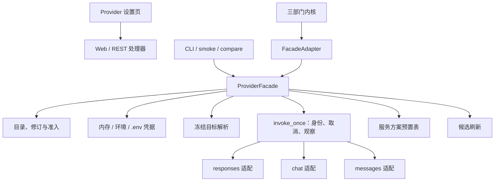

# Stage 2.7 统一 Provider 层、无配置启动与 OpenCode Go：执行报告

日期：2026-09-19。分支：`harness_1`。对应计划：[Stage 2.7 计划](stage-2-provider-plan.md)。设计：[Provider 说明](provider-layer-design.md)。需求：[D22](requirements/startup-provider-reload.md)、[D23](requirements/provider-layer.md)。

## 1. 结论

2.7.1–2.7.4 的代码与应用侧验收已完成：所有模型入口经独立 Provider 模块调用，无配置可启动并热生效，三协议适配就位，预置表、候选刷新与准入贯通，界面可用。真实 OpenCode Go 验收已用用户指定的 `muse-spark-1.3-contributor` 在 Responses 端点完成模型测试与三部门任务（DONE/released）；同一模型在 Chat Completions 与 Anthropic Messages 端点分别返回 503 与 403（区域限制），按用户「不得换其他模型」的约束未改用其他模型，这两个协议的真实覆盖记为受限。

## 2. 交付结果

| 工作包 | 结果 |
| --- | --- |
| 2.7.1 统一模块与原 Responses | 新建 `harness/providers/`（facade、store、credentials、resolve、invoke、responses、chat、messages、presets、discovery）；目录、凭据、目标解析、单次调用与取消统一；旧的 `provider_catalog.py` 与 `adapters/responses.py` 删除，调用方只经模块 |
| 2.7.2 D22 启动与热生效 | `python -m harness` 无参等价全默认 serve；缺文件/坏 JSON/空目录均可空态启动；界面保存、磁盘修改（约 1 秒轮询、内容哈希核对）、手动重载只影响新任务；凭据来源优先级内存 > 环境 > `.yudao/.env` |
| 2.7.3 多厂商接入与设置交互 | 协议移到模型访问定义，一条定义一条协议；Responses、Chat Completions、Anthropic Messages 三条适配各自完成工具调用/结果往返；Go 服务方案预置表带版本与来源；候选刷新只产生候选，模型测试通过才准入并可绑定。真实 Go 侧：用户指定模型 `muse-spark-1.3-contributor` 在 Responses 端点通过模型测试并完成三部门任务；Chat Completions 返回 503、Messages 返回 403（区域限制） |
| 2.7.4 冻结与综合验收 | Python 全量、Node UI、设置页真实 HTTP 流程与 1440/390 浏览器走查通过；证据位置见第 4 节 |

## 3. 模块结构

## 4. 验证证据

| 检查 | 结果 | 位置 |
| --- | --- | --- |
| Python 全量 | 988 passed、7 平台跳过 | `.yudao/stage-2-7-20260919/python-full.log` |
| Node UI | 39 passed、0 failed | `.yudao/stage-2-7-20260919/node-ui.log` |
| 三协议本地报文捕获 | 7 项通过：真实 HTTP 捕获请求体、工具配对、身份头、用量映射、缺 `max_tokens` 拒绝、不完整流可重试、Anthropic 路径不重复 `/v1` | `harness/tests/test_provider_protocols.py` |
| D22 专项 | 10 项通过：无配置启动、CLI 默认入口、结构合法保存、冻结快照、损坏文件保留上一有效版本、删除撤销、同尺寸改写、文件轮询、凭据来源链、密钥不泄漏 | `harness/tests/test_startup_reload.py` |
| 设置页真实流程 | 创建 Provider 201 → 未准入时 `provider_available=false` → 模型测试准入 → 绑定 200 → `provider_available=true`；无 `models_url` 时候选为 unknown 且给出原因 | `.yudao/stage-2-7-20260919/settings-flow.log` |
| 浏览器走查 | 1440 与 390 两档完整流程无横向溢出；准入徽章、状态条分项、绑定下拉标注正确 | `.yudao/stage-2-7-20260919/flow-1440.png`、`flow-390.png` |
| Go 真实候选刷新 | 对 `https://opencode.ai/zen/go/v1/models` 真实取回 37 个候选，三条预置协议提示分别命中 glm-5.1、gpt-5.6-luna、minimax-m2.7；不使用任何凭据、不落盘 | `.yudao/stage-2-7-20260919/go-public-discovery.log` |
| 无凭据 smoke | 退出码 2，逐部门指出缺少 `YUDAO_OPENCODE_GO_KEY`，未启动空壳运行 | `.yudao/stage-2-7-20260919/go-public-discovery.log` |
| 键盘与可达性 | 真实 Chromium 中 Tab/Enter 可激活“自定义连接”并进入表单；所有可见输入控件都有标签；390 与 1440 无横向溢出、无越界控件 | `.yudao/stage-2-7-20260919/keyboard-390.png` |
| Go 无效凭据错误分类 | 三个真实协议端点均返回 HTTP 401，统一判为非可重试 `provider_error`，不重试、不换 Key；responses 错误体带 `autherror`，chat/messages 未给出可识别代码时保持 `http_status` 回退，不编造原因 | `.yudao/stage-2-7-20260919/go-unauth-errors.log` |
| Go 真实模型测试 | `muse-spark-1.3-contributor` 在 Responses 端点通过：ok、admitted、实际返回模型同名、修订 2、准入已落盘、用量上报 | `.yudao/stage-2-7-20260919/go-real-muse.log` |
| Go 三部门真实任务 | `run_cc2724605f9f42c9`：DONE/released，11 次模型请求、0 重试、未用 fake；replay、逐步输入审计、上下文隔离、主机检查回执、完整封存、Git 版本与协作审计全部 verified；交付 `src/echo.py` | `.yudao/stage-2-7-20260919/go-muse-data/smoke-report.md` |
| 端点可用性诊断 | 同一模型：Responses 200 真实完成；Chat Completions 503 `Endpoint is unavailable`；Messages 403 `RegionError`（该模型在所在国家/地区不可用） | `.yudao/stage-2-7-20260919/go-muse-raw.log` |

## 5. 界面行为要点

- 状态条把配置、凭据、准入、额度分开呈现，未合并成一个总状态。
- 模型测试通过后写入准入事实，按目录修订判定是否陈旧；部门绑定变化不使已通过的模型测试失效。
- 未准入或结果陈旧的模型在下拉中标注原因且不可选择；已绑定但陈旧的现行绑定如实展示。
- 凭据不回填；页面 Key 默认只对本进程有效，勾选后才写入 `.env`。

## 6. 受阻与边界

- 真实 Go 验收已用用户指定模型完成 Responses 端点的模型测试与三部门任务；Chat Completions 与 Anthropic Messages 对同一模型分别返回 503 与 403（区域限制），按「不得换其他模型」的要求未改用其他代表模型，这两个协议的真实覆盖保持受限。
- 失败路径已用真实端点验证：无效凭据一律 401 非可重试，无凭据时 smoke 明确失败，均不启动空壳运行、不自动换 Key 或模型。
- 键盘可达性已在真实 Chromium 中验证：Tab/Enter 可完成“添加模型服务”入口操作，可见输入控件均有标签（隐藏的导入文件框补上 `aria-label`），1440 与 390 无横向溢出。逐字段的键盘输入流程未逐项录制。
- 其他订阅、OAuth、推理参数、额度查询维持后置；恢复与并行不得重建第二套模型接入路径。

## 7. 真实 Go 验收记录与后续条件

已执行：

1. 用户提供的订阅 Key 经进程环境注入，不写入仓库，也不进入任何证据文件（证据目录已检查不含 `oc_sk_` 前缀）。
2. `muse-spark-1.3-contributor` 通过模型测试并把准入落盘；独立进程的 smoke 读取同一份配置后创建三部门任务，`run_cc2724605f9f42c9` 完成到 DONE/released，11 次模型请求、0 重试、未用 fake，replay、输入审计、上下文隔离、主机检查回执、完整封存、Git 版本与协作审计全部 verified。
3. 同一模型逐端点探测：Responses 200 真实完成；Chat Completions 503（端点不可用）；Messages 403（区域限制）。

后续条件：若要在真实服务上覆盖 Chat Completions 与 Anthropic Messages，需要该区域可用的代表模型或服务方开放对应端点；在解除「不得换模型」约束之前，这两条保持受限，不用其他模型替代。
