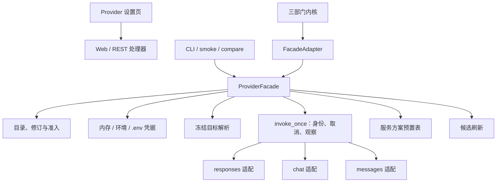

# Stage 2.7 统一 Provider 层、无配置启动与 OpenCode Go：执行报告

日期：2026-09-19。分支：`harness_1`。对应计划：[Stage 2.7 计划](stage-2-provider-plan.md)。设计：[Provider 说明](provider-layer-design.md)。需求：[D22](requirements/startup-provider-reload.md)、[D23](requirements/provider-layer.md)。

## 1. 结论

2.7.1–2.7.4 的代码与应用侧验收已完成：所有模型入口经独立 Provider 模块调用，无配置可启动并热生效，三协议适配就位，预置表、候选刷新与准入贯通，界面可用。真实 OpenCode Go 三协议验收因本机没有该订阅的 API Key 记为受阻，未用本地模拟结果冒充真实订阅通过。

## 2. 交付结果

| 工作包 | 结果 |
| --- | --- |
| 2.7.1 统一模块与原 Responses | 新建 `harness/providers/`（facade、store、credentials、resolve、invoke、responses、chat、messages、presets、discovery）；目录、凭据、目标解析、单次调用与取消统一；旧的 `provider_catalog.py` 与 `adapters/responses.py` 删除，调用方只经模块 |
| 2.7.2 D22 启动与热生效 | `python -m harness` 无参等价全默认 serve；缺文件/坏 JSON/空目录均可空态启动；界面保存、磁盘修改（约 1 秒轮询、内容哈希核对）、手动重载只影响新任务；凭据来源优先级内存 > 环境 > `.yudao/.env` |
| 2.7.3 多厂商接入与设置交互 | 协议移到模型访问定义，一条定义一条协议；Responses、Chat Completions、Anthropic Messages 三条适配各自完成工具调用/结果往返；Go 服务方案预置表带版本与来源；候选刷新只产生候选，模型测试通过才准入并可绑定 |
| 2.7.4 冻结与综合验收 | Python 全量、Node UI、设置页真实 HTTP 流程与 1440/390 浏览器走查通过；证据位置见第 4 节 |

## 3. 模块结构

## 4. 验证证据

| 检查 | 结果 | 位置 |
| --- | --- | --- |
| Python 全量 | 988 passed、7 平台跳过 | `.yudao/stage-2-7-20260919/python-full.log` |
| Node UI | 39 passed、0 failed | `.yudao/stage-2-7-20260919/node-ui.log` |
| 三协议本地报文捕获 | 7 项通过：真实 HTTP 捕获请求体、工具配对、身份头、用量映射、缺 `max_tokens` 拒绝、不完整流可重试、Anthropic 路径不重复 `/v1` | `harness/tests/test_provider_protocols.py` |
| D22 专项 | 10 项通过：无配置启动、CLI 默认入口、结构合法保存、冻结快照、损坏文件保留上一有效版本、删除撤销、同尺寸改写、文件轮询、凭据来源链、密钥不泄漏 | `harness/tests/test_startup_reload.py` |
| 设置页真实流程 | 创建 Provider 201 → 未准入时 `provider_available=false` → 模型测试准入 → 绑定 200 → `provider_available=true`；无 `models_url` 时候选为 unknown 且给出原因 | `.yudao/stage-2-7-20260919/settings-flow.log` |
| 浏览器走查 | 1440 与 390 两档完整流程无横向溢出；准入徽章、状态条分项、绑定下拉标注正确 | `.yudao/stage-2-7-20260919/flow-1440.png`、`flow-390.png` |

## 5. 界面行为要点

- 状态条把配置、凭据、准入、额度分开呈现，未合并成一个总状态。
- 模型测试通过后写入准入事实，按目录修订判定是否陈旧；部门绑定变化不使已通过的模型测试失效。
- 未准入或结果陈旧的模型在下拉中标注原因且不可选择；已绑定但陈旧的现行绑定如实展示。
- 凭据不回填；页面 Key 默认只对本进程有效，勾选后才写入 `.env`。

## 6. 受阻与边界

- 本机没有 OpenCode Go 订阅 Key，三个协议的真实 Go 代表模型验证未执行；本地 HTTP/流式捕获只能证明请求形状、身份头与配对逻辑，不能替代真实订阅验收。
- 未做浏览器键盘逐项驱动；走查覆盖布局、状态与错误提示，键盘可达性由现有控件语义与 Node UI 测试覆盖。
- 其他订阅、OAuth、推理参数、额度查询维持后置；恢复与并行不得重建第二套模型接入路径。
