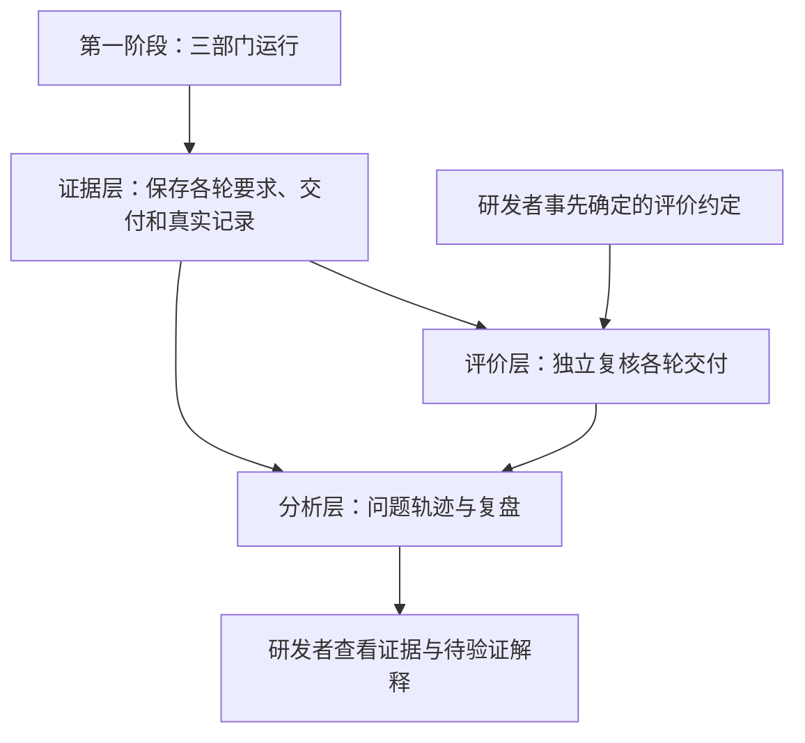

# 第二阶段设计草案：多轮返工的可信经历与独立评价

> 日期：2026-09-06。
> 状态：设计讨论稿。用户已确认首个观察场景为“多轮返工仍重复同类错误”；以下模块划分、评价方式与验收场景为本轮建议，尚未启动实现。
> 目标使用者：自治系统研发者。实现继续由 Grok Build 承担，当前不改变第一阶段正在进行的构建任务。

## 1. 本阶段要回答的问题

一次任务经过多轮返工后，研发者应该能够看清：

1. 哪个问题一直没有解决，哪个问题曾经解决后又出现？
2. 每轮工作依据什么有效要求，实际交付发生了什么变化？
3. 工程和 QA 当时的判断，与独立复核获得的证据是否一致？
4. 对重复问题有哪些值得验证的解释，还缺什么证据？

本阶段的产出是可复核的运行经历、问题轨迹和评价基线。成功意味着能可靠识别和描述重复问题，不意味着系统已经学会避免它。

第二阶段属于背景架构 D1 的观察工作。先把这个场景做完整，再决定是否扩大预测与观察的范围。第三阶段才根据证据调整局部执行，第四阶段再验证跨任务经验复用。

## 2. 首个端到端场景

使用一个有两项始终有效要求的小型软件任务：A 是“空输入不会崩溃”，B 是“正常输入结果保持正确”。两项要求及独立检查在采集结果前确定。

首个场景采用可以确定复现的行为检查，环境和输入受控，不依赖偶发外部服务。对存在随机性或不稳定性的检查，只有失败、通过、失败的记录还不足以证明修复与复发。

| 交付轮次 | 独立复核 A | 独立复核 B | 当时的 QA 决定 | 后续可支持的判断 |
| --- | --- | --- | --- | --- |
| 第一次 | 不满足 | 满足 | 因 A 返工 | A 是当前未解决问题 |
| 第二次 | 满足 | 不满足 | 因 B 返工 | A 在本次检查范围内修复，B 出现问题 |
| 第三次 | 不满足 | 满足 | 放行 | A 再次出现；该次放行与已复核的要求 A 不符 |

研发者应能从第三次 A 的失败回到第一次的复现证据、第二次的通过证据、各次交付内容、QA 记录和相关上下文来源。

此时可以形成“修复新问题时遗漏了已满足条件的回归检查”这一解释候选。但证据还不能直接证明模型遗忘、上下文污染或某段代码变动就是根因。解释须指出支持材料、其他可能解释和下一步验证办法。

验收先用已知结果的固定样例验证观察机制，再用真实三部门运行验证采集链路。固定样例不能冒充真实模型自然产生该行为。

## 3. 按三个职责层控制复杂度

| 层 | 职责与产出 | 权限边界 |
| --- | --- | --- |
| 证据层 | 从现有事件与工件整理一次返工经历，保存能重新取回的各轮交付 | 保存和引用事实，不代替模型解释原因，不改变原运行决定 |
| 评价层 | 按固定约定，在独立副本上复核指定交付，产生自己的检查证据与评价 | 不接受被评系统改写评价规则，不修改原运行或 QA 决定 |
| 分析层 | 串起同一问题的变化，展示分歧、缺失证据和原因假设 | 结论引用证据；不自动调整路由、预算或下一轮上下文 |

三层是职责划分，不要求新增三个服务或三个 Agent。先复用项目已有的 Python 控制层、SQLite、ArtifactStore 和检查执行能力。

采用已有的回归测试、独立评估、不可变产物和问题追踪模式：评价对固定版本执行，结果与运行记录分别保存，问题跨交付追踪。无需先引入新的工作流引擎、评价平台或记忆数据库。

## 4. 什么是一段经历，什么是一个重复问题

### 4.1 返工经历

首版以一次 QA 返工到下一次 QA 判断之间的工作作为一段经历，包括中间必要的 Ask/React。开始时的问题、有效要求、可观察的行动、交付及结束时的结果一起被引用。

若中途取消、超时或预算耗尽，这段经历仍然保留，明确其未完成或缺少哪类证据。缺少下一份交付时，不能编造一个“再次失败”的检查结果。

首次交付提供问题轨迹的起点。一次返工可能涉及多个问题，分析时分别跟踪各问题，不强迫一份 QAReview 只能对应一个问题。

部门内部每次工具尝试仍属于原始 trace，默认不各建一段高层经历。这样保留排查材料，也使日常复盘规模可控。

### 4.2 问题身份

一个问题由所违反的行为要求、可复现条件与观察证据识别。文件名、检查名称、QA 描述相似度都只能帮助定位，不能单独证明问题相同。

| 情况 | 必需证据 | 解释边界 |
| --- | --- | --- |
| 持续未解决 | 在可比较的相邻交付上，同一行为要求仍被同类反例违反 | 说明本轮没有消除已知问题，不据此认定根因没变 |
| 确认修复后再次出现 | 中间至少有一次同口径的通过证据，后续再次出现对应失败 | 可以称为已观察到的回归；中间未观测的具体发生时刻可能未知 |
| 新问题 | 新的行为要求或新的失败条件被证据确认 | 不能因为描述相似就计入旧问题 |
| 暂不能比较 | 要求、检查或环境改变，或关键产物缺失 | 保留原因，不强行算作修复或重复 |

上述“确认修复”要求检查具有足够的可复现性。非确定性场景若缺乏稳定性证据，只展示失败、通过、失败的观测序列，暂不计为已确认回归；不在本阶段随意设定一个重复次数就视为证实。

初版优先在同一任务、可比较的验收口径内跟踪问题。跨任务的“相同错误家族”可以成为归类建议，但需要独立确认，不自动合并为同一根因。

ProductSpec 更新后，先检查相关要求是否改变。已知没有改变且评价仍适用的要求可以继续追踪；改变或无法确认对应关系时，另起评价段并保留旧段。放宽验收要求不算修复了原问题。

## 5. 事实、评价与解释分开保存

| 概念 | 含义 | 本阶段的处理 |
| --- | --- | --- |
| 原始观察 | 实际执行、输出、检查、成本以及它们的来源 | 保留原始证据，不在事实中写入根因叙事 |
| 事前承诺 | 行动前已经明确记录的预期结果 | 引用当时记录；缺失就标记未记录，不能事后补成预测 |
| Episode | 一段返工经历中相互关联的事实与工件 | 由确定的边界整理；后续评价另行引用该经历 |
| 独立评价 | 固定评价约定对指定交付的复核结论 | 绑定交付、评价方法和环境，允许证据不足 |
| 问题轨迹 | 根据多轮评价串起的问题变化 | 属于可修订分析；修订保留依据，不覆盖原检查 |
| 经验候选 | 对多次经历提出的可检验解释 | 标明适用范围、证据和反证方法，不取得执行权 |

“预期应该满足某条验收要求”是目标；“模型预计这次行动会修好它”是预测，二者不混用。现有经历没有事前预测时，仍可做要求与结果的比较，但不能据此计算预测校准效果。

首版不要求各部门新增一轮解释或预测对话。增加这类提示本身可能改变返工行为，若以后采用，应作为明确的新执行版本评估，而不是称为纯记录。

看到某条要求进入了上下文，只能证明其曾被提供，不能证明模型理解或持续关注它；看到某次失败，也不能直接推出上下文污染。缺乏证据时，原因保持未知。

## 6. 独立评价的权力与可信度

QA 负责原运行中的返工和放行。外部评价负责回答“这份交付在本次评价范围内表现如何”。界面应分别显示原运行结果和后续评价。

原运行是 DONE，外评发现一个违反当时有效要求的可复核反例，这两项事实可以同时存在。外评追加自己的记录，不把原 DONE 改成 FAILED，也不替换当时的 QAReview。研发者根据结果决定后续处理。

可信度来自评价的来源、方法和控制边界：

- 评价约定由研发者在采集结果前确定；被评部门不能改动检查、隐藏样例或评价记录。
- 对可执行的软件行为，首先使用能复现的检查。模型可以辅助提出检查或归纳问题，最终报告区分主机证据、人工判断与模型意见。
- 对主观或缺少可靠检查的要求，允许人工复核和“证据不足”。所有检查通过也只支持检查覆盖范围内通过。
- 外评先基于交付与要求形成判断，再与 QA 结论对照。模型评价时，默认不预先提供 QA 的结论和私有对话。
- QA 与外评意见不同首先记录为分歧。只有证据明确违反同一有效要求时，才标记为已证实的错误放行；评价规则不一致或外评自身出错需要另行处理。

第二阶段默认在任务结束后，复核选中任务的全部可用交付。包含 DONE、PAUSED、FAILED，不能只分析成功任务或只看最终版本。取样口径先确定；因材料不完整而无法评价的任务也留在报告中。

评价在独立副本上执行，成本单列。它不能竞争正在运行任务的资源并把额外开销误算成原运行性能；首版可以串行离线运行。第二阶段的报告不自动进入下一次部门上下文。

## 7. 与第一阶段的交接

| 第一阶段已有基础 | 第二阶段使用方式 | 需补齐的衔接要求 |
| --- | --- | --- |
| 有序事件、ProductSpec、Ask/React、DeliverySpec、QAReview | 重建某个时点的有效要求和返工路径 | 经历能定位明确的事件范围，缺失事实可见 |
| 按内容哈希保存的 ArtifactStore | 存取交付和评价证据 | 每轮完整交付能取回并核对，不能只有文件列表或代码摘要 |
| 工具调用、检查回执、代码摘要 | 保存工程与 QA 当时据以判断的证据 | 原始命令、输出、受测对象及环境具有关联；模型说明不能冒充检查证据 |
| ContextManifest、模型信息 | 分析相关约束是否被提供及版本差异 | 明确哪些是实际请求证据，哪些只是装配声明；历史材料不能用当前规则重建后冒充原输入 |
| 当前 Web 四视图 | 增加问题轨迹与复核结果入口 | 原运行事实与后续分析有清楚的来源和时间 |

当前代码已有存储 bytes 的能力，但交付快照并未因此自动完整。完整封存是第二阶段首项衔接工作，实施前需核对第一阶段最终产物，不直接改动正在执行的 Grok 批次。

运行代码、部门规则、工具与模型配置、评价方法均需要可辨认的版本，才能比较不同批次。旧材料不完整时明确标为证据不足；不补造历史，也不为旧格式新增兼容层。

设计期间，第一阶段实施计划已将 Phase 5 校正为“停止审计与经验候选”：从已有结构化事实记录可审计候选，不增加独立 LLM 蒸馏、自动注入或候选评价系统。第二阶段复用这些事实和候选记录，在独立评价证据上形成问题轨迹与解释复核；不另造一份原始事实，也不赋予候选自动注入权。检查点恢复和更广的经验晋升仍是单独的后续设计议题。

上轮路线把长任务恢复列为第二阶段候选内容。本轮根据用户选择，将最小设计收束到返工观察：保存可复核交付是必需的，中断后继续执行保留为单独设计议题。这里区分三件事：事件重放恢复记录；重新执行评价产生新观察；恢复任务执行会继续产生业务行动。前两项不能冒充第三项，也不需要为本场景先引入分布式调度。

## 8. 研发者会看到什么

在现有 Web 控制台增加一个“返工分析”入口，以问题为行、交付轮次为列，呈现未解决、已验证修复、再次出现和不可比较的区段。一次点击可以查看该判断引用的要求、前后交付和复核证据。

任务详情同时展示原运行终态与独立评价状态。查看一个问题时，优先展示简短的问题轨迹、当时的 QA 决定和实际复核结果；原因假设置于单独区域，明确尚未证实。

跨任务汇总先提供可解释的数量和覆盖情况：

- 哪些已知问题在下一次可比较交付中仍存在；
- 哪些问题在有通过证据后再次出现；
- 经历多少次可比较返工才首次获得通过证据；
- 多少已放行交付存在经过确认的反例；
- 多少运行或交付因材料、环境或口径问题无法评价。

比例必须带分母和覆盖范围；未完成或无法评价不能当作通过，也不能静默删除。同一运行的多轮返工、同一份交付的重复检查都不算多个独立任务样本。先按任务展示轨迹，再按任务族和固定系统版本汇总，不建立一个混合“智能程度”的总分。

## 9. 分步验收

### 第一步：证明能够看对一条轨迹

用第 2 节的固定三次交付样例，验证能够发现 A 的修复与复发、B 的变化以及第三轮有反例的放行。所有结论可点回真实工件；原运行不被改写；重新读取记录不产生额外执行。

同时用反例验证分类边界：问题一直没修好、要求中途合法变化、交付缺失、检查环境失败、外评意见不同但没有可复核反例。这些情况应有不同解释，不能全部算成重复错误。

### 第二步：证明真实采集链路可靠

在第一阶段可信执行验收完成后，对真实三部门任务保留各轮交付并离线复核。覆盖成功结束和失败结束的任务。真实运行没有自然发生回归也如实报告，不靠注入成功或失败事件制造现象。

这一步验证快照、证据、上下文来源和报告完整性。它不要求立刻得出三部门优于其他结构的结论。

### 第三步：形成可用于后续比较的基线

选择一个任务族，先固定公开需求、独立检查、任务选择方式、环境、系统版本和报告口径，再采集一批运行。校准任务用于修改观察工具，独立评价任务用于评价；看过评价细节并据此修改系统的任务不再作为未见样本。

是否增加采样、需要多少独立任务、哪些差异足以支持后续策略变化，应在正式采集前确定。首版不照抄旧 S/T 实验的运行数量、抽样比例或分数阈值。

交付是一份包含完整问题轨迹、覆盖率、成本和待验证解释的基线报告。自动减少重复错误仍是后续阶段的评价目标，不作为观察系统本身的成功判据。

## 10. 本轮结论与后续设计议题

已确认：第一个研究场景是多轮返工重复同类错误。

本轮建议：采用三层职责；默认任务结束后独立复核各轮交付；以行为要求和复现证据识别问题；保留原 QA 决定；原因作为假设；所有经验候选不自动生效。

进入实施计划前，还需要围绕具体任务确定三件事：首个任务族与可执行验收要求，独立评价由哪些检查或人工判断承担，以及正式采样和结果解释口径。这些应通过一个具体任务展开，不先讨论通用字段或抽象配置。

主要依据：

- [第一阶段状态与路线建议](stage-status-and-roadmap.md)。
- [MVP 总设计](loop-system-mvp-design.md)与[实施计划](grok-implementation-plan.md)。
- [动态 Harness 架构](native-harness/dynamic-harness-architecture.md)第 7.4、7.10、8.1-8.4、18 节：评价来源、事实与解释、事前预测以及 D1 的观察范围。
- [旧三部门实验设计](native-harness/three-department-work-order-validation-design.md)第 12-14 节：独立检查、回归行为、校准与正式评价隔离；不沿用其旧实现或固定实验规模。
- `D:/codes/Obsidian/项目研究/Yudao/Loop system 原理资料.md` 第 47-61 行：独立性来自证据和错误相关性，复核分歧不能直接赋予新角色更高权力。
