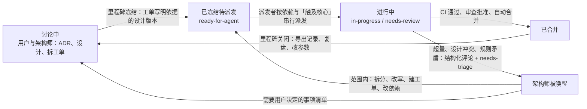

# 自主推进复盘纪要（2026-10-17）

用途：用户与架构师讨论「怎样实现这套流程规则」以及后续架构与需求设计的输入。本文只记录复盘的事实、已经做出的决定与待讨论的建议；规则文件、设计文档、CI 工作流的修改按 `CLAUDE.md` 先经用户确认再动。复盘的经过记在 `claude_jour.md` 2026-10-17 21:50 与 22:40 两条。

证据来源：`claude_jour.md` 10-01 以来的条目、`docs/CHANGELOG.md`、GitHub 的 381 张工单与 204 个 PR（REST 导出）、10-12 以来的 275 条工单评论、执行者日记 `agents_jour/`（#136、#138、#470、#481、#501、#543）。

## 1. 数字

| 项目 | 数值 |
| --- | --- |
| 10 月新建工单 | 192 张，其中修复类 68 张（集成层、测试分层、走查、客户端、流程、既有失败） |
| 未关闭工单 | 151 张：needs-triage 122、ready-for-agent 28、needs-review 1 |
| 10-07 至 10-14 写的 ADR | 8 份（ADR-0032 至 ADR-0039） |
| 10-12 以后改过的设计说明 | 24 份中的 18 份 |
| M0 两张父工单的拆分层数 | #466 → #469 至 #477 → #520 → #551 至 #561；#478 → #479 至 #485 → #542 至 #550 → #581 至 #583 |
| 执行者四小时没有产出、或由架构师判断一次会话做不完 | #136 两轮、#242、#316 两轮、#514、#138、#545；提前结束回合或停滞：#302、#332、#355、#380 |
| 集成层修复工单 | 约 27 张（#285、#287、#290、#316、#337、#338、#362、#387、#394、#410、#427、#430、#437、#439、#441、#445、#457、#463、#464、#498 至 #502、#507、#522、#574、#584） |
| 10-12 至 10-14 的合并 | 11 次，7 次没有审查者通过，其中 4 次在审查不通过以后 |
| 10-15 以后合并的 PR | 20 个，全部有审查批准，15 个零次要求修改 |
| M0 已关闭工单的平均周期 | 0.4 天 |
| 执行者时间去向（10-07 至 10-12，18 张工单 61 小时） | 等模型 50%，运行 pytest 28%；#470 第 1 轮 6 小时 32 分，#481 四轮 9 小时 11 分，#499 改 2 个用例 6 小时 24 分 |

## 2. 复盘结论

架构师会话被频繁召回，直接原因是三件事叠加：设计纠正与工单派发同时进行；工单按设计概念划分，与执行者容量没有对应；验证发生得太晚，测试与证据层耦合过高。流程角色与运行知识的缺口放大了这三件事。

### 2.1 七类触发原因（按出现次数）

1. **合并以后集成层才发现失败。** 10-14 以前执行者与审查者只按判断运行相关文件，集成层每 5 个 PR 运行一次。10-07 一天四次集成层失败，全部出在没人运行的测试上；M0 六张工单连续合并以后集成层 97 个失败，拆出七张修复工单，约 19 小时。CI 已在 10-14 接上；集成层进 CI 仍在过渡期。
2. **工单大小与执行者容量没有对应。** 25 个文件以上的工单稳定失败，拆分发生在失败以后，每次都是架构师读日志、跑探针、再拆。派发前没有大小核对。规则文本写「有无限的时间和资源」，运行配置是一轮四小时上限。
3. **设计在执行期间改动。** 10-07 改为网页界面，23 张工单正文过期，用户两次叫停；ADR-0038 改写 11 张；ADR-0039 改写 #473 至 #477 并拆出 #520；10-13 的外部审查又改 8 张。每次由架构师逐张改正文与依赖。
4. **工单的「只改」边界与代码的真实依赖冲突。** #501 只能改测试，修不了 `smoke.py`；#543 删接口字段让界面类型检查变红，界面归 #544，#544 又被 #543 阻塞；#562 的字段去留要架构师裁决。根源是 Stage 3 计划第 3 节「后端工单不被界面工单阻塞」，在单仓库、生成的客户端类型与 `extra="forbid"` 合同下不成立。10-16 以后拆出的 #582、#583、#552、#556 已在正文里改为「让类型检查通过的最小删除随后端工单」，规则文本未改。
5. **测试与证据层耦合过高。** 事件序列基准存完整工具说明与 token 估算，假模型脚本写死顺序与调用次数；一次合同改动牵动几十个测试文件与 40 份基准，同时进行的工单必然冲突。#470 第 2 轮、#480 第 2 至 3 轮、#481 第 4 轮都只是合并 main 与重建基准，合计约 3 小时。10-14 查明，#532 至 #534 已改，#541 补了比较信息的顺序。
6. **派发者代替了审查与合并判断。** 10-14 起由 main 的规则与两个 GitHub App 挡住。
7. **执行环境的知识只在日记里。** task 子代理停滞、模型提前结束回合、残留目录、PATH 写法、PYTHONUTF8、`gh.cmd` 引号，每条由某次架构师会话发现，换机器重新踩一遍；运行配置 10-13 才建立。

### 2.2 最深的一层

9 月的设计把用户开放的意图收窄成阶段状态机、登记命令、全局一个 run、先计划后写入；10-07 日记写了「离可迭代状态越来越远」，排序没有随之调整；10-12 用户读代码审计才发现偏离。纠正本身必然大，可以避免的是纠正与派发同时进行：M0 在 10-12 23:31 派发，次日 00:33 ADR-0038 就改写了其中的工单，10-14 ADR-0039 再改一次。

### 2.3 已经建好机制的部分

CI 在每个 PR 与 main 上运行单元层、模块层、两项固定检查、客户端检查与编译；main 的规则（只经 PR、squash、CI 通过、一个批准、新推送作废旧批准）；执行者与审查者各用一个 GitHub App；派发者规则；事件序列基准按关键字段比较；运行配置集中在 `docs/agents/autopilot-runtime.md`。这些从 10-15 起运转正常，不在讨论范围内。

## 3. 已经做出的决定（用户，2026-10-17）

- 采用「派发者唤醒架构师」机制，架构师用更强的模型。推荐做法：GitHub Actions 按工单加上 `needs-triage` 的事件启动架构师；派发者只改标签；同一时间一个架构师运行；规则、设计与 CI 的修改由它写成清单交用户，范围之内的拆分、改写、建工单、改依赖自己做。
- M0 的自主推进照常进行，不暂停，不预先重拆剩下的工单，不分诊停着等 #557 的工单。

第二轮讨论（同日晚，读完本纪要以后）的决定：

- 唤醒架构师用新标签 `needs-architect`，不用 `needs-triage`：`needs-triage` 有 122 张等前提条件的工单，人工会话把工单退回第一个队列也用它，两种含义混在一起会让被唤醒的架构师去处理不该处理的工单。
- 被唤醒的架构师可以修改设计说明中过时的、互相矛盾的内容，使设计与已有的决定一致，给它一定的空间；不能改规则；需要改规则或做新的决定时，在原工单写建议并标 `ready-for-human`。
- 被唤醒的架构师用用户的账号（`bender2333`），提交与评论签名 `claude-架构师`，与用户本人的操作区分。架构师的能力足够强，不像执行者与审查者那样用权限限制，遵守与人工会话相同的 `CLAUDE.md`。讨论中先提过的「工作流自带令牌、工单可写、代码只读」不采用。
- 需要用户决定的事项放在原工单（`ready-for-human`），不设固定的汇总工单。
- 工单的记录在里程碑关闭时用脚本从 GitHub 算出，派发者不逐张填写。
- 模型按工单类型分配先不做，等第一个里程碑的记录；现在只新建「触及核心」一个标记。

## 4. 建议的规则体系

### 4.1 结构：两个循环，四个队列

用户的改动只进入第一个队列，影响还没有冻结的工单；要改进行中的里程碑，先把受影响的工单退回第一个队列（标 `needs-triage`），再改设计，再放回。

### 4.2 六条规则

| 编号 | 规则 | 依据 | 实现位置 | 需要用户确认 |
| --- | --- | --- | --- | --- |
| R1 | 里程碑冻结：工单正文写明依据的设计说明与提交号；依据在 main 上变化时派发者不派发；设计讨论的结论注明生效里程碑；一个里程碑派发之前，它范围内已知的设计讨论先结束 | 2.1 第 3 条、2.2 | `CLAUDE.md` 自主推进一节；`docs/agents/dispatcher.md` 第 3 节第 1 步；`/to-tickets` 模板加「依据」一行 | 是 |
| R2 | 工单是一次执行者会话能做完的纵向切片：产品加测试文件不超过 25 个、不跨写入、决定、读取三层；切片包含让 CI 全绿的全部改动（后端、合同、客户端最小改动、测试、基准），界面新画面另成切片；架构师放出工单前在当前 main 上核对代码位置并列文件清单；执行者第一步复核清单，超量就写拆分建议交回 | 2.1 第 2、4 条 | `AGENTS.md` 执行者第 2 步；`docs/stage-3-plan.md` 第 3 节替换「后端工单不被界面工单阻塞」；`docs/agents/acceptance-evidence.md` 第 4 节加放出前核对；「无限的时间和资源」保留原意，补「一轮四小时，做不完按拆分建议交回」 | 是 |
| R3 | 架构师由事件唤醒：执行者与审查者遇到设计冲突、超量、规则矛盾时写结构化评论（发现了什么、建议怎么做、需要谁决定）并改 `needs-triage`；GitHub Actions 启动架构师处理当时全部 `needs-triage`；同一时间一个；需要用户决定的事项写到固定的一张工单 | 2.1 第 2、3、4 条；第 3 节的决定 | 新工作流 `.github/workflows/architect.yml`；`AGENTS.md` 共同要求加结构化评论的格式；`CLAUDE.md` 架构师角色加「被唤醒时的工作范围」；仓库 secret 放 API 密钥 | 是（工作流与密钥） |
| R4 | 核心文件的工单严格串行：工单带「触及核心」标记，派发者同一时间只派一张带标记的；并行只给客户端画面、评测、文档 | 2.1 第 5 条 | `docs/agents/dispatcher.md` 第 3 节第 1 步；`/to-tickets` 模板 | 是 |
| R5 | 验证全部在合并之前并且机械化：集成层进 CI 作为第二个检查；main 上的既有失败先修（#584、#569）；不稳定测试按缺陷修（#463）；派发者不再手工运行集成层 | 2.1 第 1 条 | `.github/workflows/ci.yml`；`docs/agents/dispatcher.md` 第 5 节删除；`docs/design/test-pyramid.md` 第 4.2 节 | 是（工作流） |
| R6 | 每张工单留一行记录：类型、模型、轮数、耗时、改动文件数、基准变化数、审查结论、架构师介入次数；派发者在工单关闭时写入；里程碑关闭时导出比较 | 2.1 全部；D38 判据「能度量」 | 复用 B6 的导出工具（#345、#413）；记录位置待定（`docs/evaluation/` 下一个文件，或工单评论） | 记录位置由用户定 |

### 4.3 让流程自己迭代的五处

1. **四个队列**（4.1）。用户的改动只进入第一个队列。
2. **模型按工单类型分配，分配表是参数。** 工单分三类：机械类（迁移测试、重新生成快照、同步文档）、实现类（新行为与合同改动）、诊断类（查明失败原因、拆分超量工单）。每类对应执行者模型，审查者与执行者不同家族，诊断类与架构师用最强的模型。表放在运行配置里。证据：小模型的 prewalk 在大工单上两轮四小时没有产出；oro 全程稳定；#514 这种没有生成规则的工单任何执行者都做不出来，属于诊断类。
3. **每张工单自动留一行记录**（R6）。
4. **每个里程碑关闭时一次固定复盘。** 架构师核对父工单时导出记录、与上一个里程碑比较、提出改动。改动产出按优先级：机械检查（进 CI 或测试）、参数（模型表、阈值、轮数上限）、规则句子。参数改动写进记录就生效，规则句子仍要用户确认。这条分界本身是规则修改。
5. **规则与参数分开放。** 现在七份规则文件里规则句子与参数混在一起，模型名、四小时、三轮、25 个文件散在运行配置、派发者规则与 omp 配置三处。参数集中到运行配置的一张表，规则文件只写不随数字变化的句子。

第一个完整的循环从 M0 关闭开始：M0 的记录是基线，M1 关闭时第一次比较。里程碑关闭时看三个数：平均轮数、架构师介入次数、修复类工单的比例。现在的基线：10 月修复类占 35%，十天里架构师介入约 10 张。

## 5. 待讨论：实现层面

1. **架构师工作流（R3）的具体做法。** 触发事件（`issues.labeled` 为 `needs-triage`，是否也接受评论里的呼叫）；运行器（`windows-latest` 与 CI 一致，便于跑探针）；并发组；模型与超时；它用哪个身份改工单（用户账号的 PAT，或第三个 App）；它能做与不能做的清单；需要用户决定的事项写到哪张固定工单；与用户手动启动的架构师会话同时存在时怎样避免改同一张工单（建议：工作流只处理带 `needs-triage` 的，处理完改标签，人工会话处理其余）。
2. **工单依据版本（R1）的写法。** 正文「依据」一行写设计说明路径与 main 提交号；派发者核对的命令写进派发者规则第 3 节；`/to-tickets` 模板加这一行。
3. **工单类型与「触及核心」（R2、R4、4.3 第 2 条）的标签名。** 现有标签都是英文（`needs-triage` 等），类型标签与核心标记的命名、以及写进 `docs/agents/triage-labels.md` 的位置。
4. **记录（R6）的字段与位置。** B6 工具已能从 GitHub 与集成层记录导出大部分字段，缺的是「架构师介入次数」与「基准变化数」；位置选 `docs/evaluation/` 下一个按里程碑追加的文件，或每张工单关闭时的一条评论。
5. **集成层进 CI（R5）的前提与运行时间。** 本机 `-n 4` 约 11 至 22 分钟，GitHub 运行器两核可能 30 至 40 分钟，作为与 `check` 并行的第二个检查；#463 的并行失败、#584 与 #569 的既有失败先消掉，否则 CI 随机变红。
6. **规则与参数分开（4.3 第 5 条）的文件结构。** 运行配置里加一张参数表（角色模型、一轮时长、要求修改次数上限、工单大小阈值、同时进行的核心工单数、集成层运行方式），`CLAUDE.md`、`AGENTS.md`、`dispatcher.md`、`shared-rules.md` 删去数字只留引用。
7. **里程碑复盘（4.3 第 4 条）写进 `CLAUDE.md` 工作流程第 6 步。**
8. **执行者结构化评论的格式**，与 `docs/architecture-issues.md` 登记的关系：工单评论给当张工单的处理，登记文件留跨工单的设计问题。

## 6. 待讨论：架构与需求设计

1. **M0 的设计基线冻结。** 依据是 ADR-0036 至 ADR-0039、`docs/design/department-loop.md`、`local-tools.md`、`department-guidance.md`、恢复契约第 4 节；剩余 22 张 M0 工单正文已按 10-16 的拆分写好。冻结到 #557 合并，期间的讨论结论注明生效里程碑。
2. **排队的设计讨论**（`docs/decision.md` 2026-10-13「下一次讨论的题目」）：LSP 与诊断、模型按需派生的通用子智能体、插件与钩子、技能（M5，#494）、浏览器与 computer use（3.2D）。顺序、各自生效的里程碑、结论先写 ADR 与设计说明、工单在 #557 之后拆。
3. **M3 以后的大工单**（3.2B、3.2C、3.2D、3.4A、#358、#100、#128）已改 `needs-triage` 等 #557 后重拆。重拆时按 R2 的尺度与纵向切片，不再按后端与界面分。
4. **测试与证据层剩下的耦合。** 基准瘦身完成；假模型脚本仍按顺序列出每一步、断言调用次数的旧测试没有迁移，`test-pyramid.md` 第 10 节只约束新写的测试。是建一张迁移工单，还是随改动逐个迁移。
5. **把自主推进流程当作一个系统写一份设计说明。** 角色、队列、信号（标签）、参数、记录、锚点各一节，配模块交互图；现有的 `dispatcher.md`、`acceptance-evidence.md`、`autopilot-runtime.md` 是它的规则与配置，缺一份总图。放在 `docs/design/` 并登记索引，还是放在 `docs/agents/`。
6. **D38 的五条判据对流程本身的应用**是否写进 D38，或单独一份需求记录。
7. **评测工作线的恢复前提**：派发机器上设置 `YUDAO_EVAL_BASE_URL` 与 `YUDAO_EVAL_API_KEY`（用户操作）。
8. **自举试点的前置**：度量基线先有（4.3），再让 Yudao 接手工单，否则没有对照。
9. **README 描述已实现的系统**，M0 的 #474、#556 合并以后改。

## 7. 第一批动作（顺序）

1. 把 #584、#569、#463 改为 `ready-for-agent`，排在 M0 工单之前（架构师，范围内，不需要确认）。已做（2026-10-17 晚）：三张加入 M0 里程碑并标 `ready-for-agent`，#584 补了任务评论。只改标签不够：#463 从 10-12 起就是 `ready-for-agent`，因为不属于任何里程碑，一直不在派发范围内。
2. R2 中合同改动工单的边界写进 Stage 3 计划第 3 节与验收证据规则（确认后改）。
3. R2 中执行者第一步的大小核对与一轮时长写进 `AGENTS.md`（确认后改）。
4. R3 的架构师工作流草稿交用户确认，同时建密钥。
5. R5 集成层进 CI，在第 1 条的三张工单合并以后（确认后改）。
6. R1 的冻结句与 R4 的串行标记写进 `CLAUDE.md` 与派发者规则（确认后改）。
7. R6 的记录字段与位置定下以后建一张小工单，复用 B6 工具。

不做的：暂停 M0；预先重拆剩下的 22 张 M0 工单；现在分诊 122 张 `needs-triage`。

## 8. 实现方案（2026-10-17 第二轮讨论）

第 7 节的顺序由本节取代。第 8.3、8.4 节列出的修改都要用户确认后才动。

### 8.1 对第 4 节建议的修正

1. 唤醒标签与待决事项的位置按第 3 节第二轮的决定。
2. 被唤醒的架构师与人工会话的架构师是同一个角色，遵守同一份 `CLAUDE.md`，用用户的账号，靠签名区分（8.4）。
3. 记录（R6）改为事后计算：轮数（`DELIVERY` 评论数）、审查结论、耗时、改动文件数、基准变化数（PR 中事件序列基准文件的个数）、架构师介入次数（唤醒工作流的运行次数）都能从 GitHub 算出；执行者的模型取运行配置在当时的版本。派发者不增加职责。
4. 工单大小上限（R2）起步定为 15 个手写文件，不算生成的客户端类型、接口快照、事件序列基准与日记。25 个是「超过就稳定失败」的线，上限不定在失败线上。「不跨写入、决定、读取三层」删去：执行者难以自己核对，又与「纵向切片从后端做到客户端」冲突。只留文件数这一个尺度，数字放进参数表，按记录调整。
5. 「触及核心」（R4）与工单依赖分工：依赖表示先后（一张用到另一张的结果），「触及核心」表示不同时进行。架构师不再为了避免同时改核心文件而串依赖链；以前每次重拆都要重接依赖，#543 与 #544 互相等就是这样来的。
6. 集成层进 CI（R5）的前提是 #584 与 #463。#569 在 `evals/` 下，CI 与集成层都不运行 `evals/tests`，这是另一个漏洞，在同一次 CI 修改里加进 `check`。运行时间先在 main 上手动触发一次量出来，不影响 PR；运行器的核数以那次运行为准。
7. 规则与参数分开（4.3 第 5 条）随第 2 批逐条做：第 2 批碰到的数字移进运行配置的参数表，其余以后碰到时再移，不单独重写七份规则文件。
8. M0 剩下的工单不补「依据」一行。派发者核对依据只对新规则以后放出的工单生效；M0 由冻结保证：#557 合并之前，M0 依据的设计说明只做一致性修正。

### 8.2 五批

| 批 | 内容 | 动什么 | 确认 |
| --- | --- | --- | --- |
| 1 | #584、#569、#463 加入 M0 并标 `ready-for-agent` | 工单 | 已做 |
| 2 | 规则文字（8.3）：R1、R2、R4，R3 的文字部分，运行配置的参数表 | 规则文件，一个文档 PR | 用户看 PR |
| 3 | 唤醒工作流（8.4）：草稿、凭据、用一张测试工单试运行 | CI 工作流 | 用户 |
| 4 | 集成层与 `evals/tests` 进 CI：手动量时间；#584、#463 合并以后改为 PR 必须通过；删除派发者规则第 5 节；更新 main 的规则 | CI 工作流、main 规则 | 用户 |
| 5 | 记录的导出脚本（复用 B6，#345、#413）建一张工单；里程碑复盘写进 `CLAUDE.md` 工作流程第 6 步 | 工单、`CLAUDE.md` 一句 | 用户 |

第 2 批在第 3 批之前：被唤醒的架构师按规则文件写的范围工作，标签与评论格式要先有。第 2 批只改文字，执行者下一轮读到就生效，撤回是还原一个提交。

### 8.3 第 2 批的规则修改

`docs/agents/autopilot-runtime.md`

- 新增第 7 节「参数」，一张表：执行者与审查者一轮的时长（4 小时）；同一 PR 要求修改的上限（3 次）；工单大小上限（15 个手写文件，不算的种类同 8.1 第 4 条）；同时进行的「触及核心」工单（1 张）；核心文件的范围（工具定义、控制核心、执行环境、事件序列基准，列出路径）；同一张工单唤醒架构师的上限（2 次，第 3 次交给用户）；架构师一次运行的时长与模型（第 3 批填）。第 3 节命令里的 `--max-time` 注明取自这张表。

`AGENTS.md`

- 共同要求中「有无限的时间和资源」一句保留原意，补：每一轮有时长上限（运行配置第 7 节）；一轮做不完时，提交并推送已完成的部分，在 PR 上写明做到哪里、还剩什么。
- 共同要求加「请架构师处理」的格式：第一行 `ARCHITECT: <一句话，卡在哪里>`，下面写发现（事实：文件与行号、命令与结果）、建议（拆分或修改的方案）、需要谁决定（架构师或用户）。执行者写在工单评论并加 `needs-architect`，结束这一轮；审查者写在要求修改的审查正文开头，由派发者加标签。当张工单的问题写评论，跨工单的设计问题仍登记在 `docs/architecture-issues.md`。
- 执行者第 2 步加开工前的三项核对：工单「依据」的设计说明在那个提交以后有没有改动；完成工单要改的手写文件是否都在「只改」之内、数量是否超过上限；正文列出的函数与字段在当前代码里能不能找到。任何一项不成立，按上面的格式交回，不先动手。执行中发现要改「只改」以外的文件、设计冲突或规则矛盾时，同样交回。

`docs/agents/dispatcher.md`

- 第 3 节第 1 步（派发）加两个条件：工单有「依据」一行时，运行 `git log --oneline <提交>..origin/main -- <设计说明>`，有输出就不派发，加 `needs-architect` 并把输出写进评论；带 `touches-core` 的工单，同一时间在执行或审查中的张数不超过参数表。
- 第 4 步（审查结论）：要求修改的审查正文第一行是 `ARCHITECT:` 时加 `needs-architect`，不交回执行者。
- 第 5 步（搁置）：`ready-for-human` 改为 `needs-architect`，架构师处理以后改为 `ready-for-agent` 或 `ready-for-human`。流程图随之修改。
- 「不到 3 次」等数字改为引用参数表。

`docs/agents/triage-labels.md`

- 加两个标签：`needs-architect`（等架构师处理；派发者与执行者加上；架构师处理以后改为 `ready-for-agent` 或 `ready-for-human`）；`touches-core`（改动核心文件；架构师放出工单时加上，派发者按参数表限制同时进行的张数）。

`CLAUDE.md`

- 工单规范加四条：「依据」一行（`依据：<设计说明路径>（main <提交>）`，写在 What to build 开头）；「只改」清单不超过大小上限，超过先拆；改接口合同的工单包含重新生成的客户端类型，以及让客户端类型检查与单元测试通过的最小改动，新画面、样式与文字另成工单；改动核心文件的工单加 `touches-core`，工单依赖只表示先后。
- 自主推进模式加两段：
  - 冻结：里程碑开始派发以后，它的工单依据的设计说明只做一致性修正；要改设计，先把受影响的工单退回 `needs-triage`（验收证据规则第 4 节），改完、更新依据以后放回。用户新的想法与设计讨论的结论注明生效的里程碑，只进入还没有开始派发的里程碑。
  - 被唤醒的架构师：由 `needs-architect` 启动，一次处理当时全部带这个标签的工单，遵守本文件的全部规则，与人工会话的区别只有三处：用户不在场，本来要先经用户确认的修改（规则文件、CI 工作流、新的决定）写成建议放在原工单，标 `ready-for-human`；设计说明中过时或互相矛盾的内容可以直接修正，使之与 ADR、决策记录和用户确认过的内容一致，同一次运行里更新受影响工单的依据与任务评论，修改写进 `docs/CHANGELOG.md` 与日记；提交与评论签名 `claude-架构师`。同一张工单第 3 次被唤醒时直接交给用户。
- 「修改已有设计文档之前先经用户确认」加一个例外，就是上面的一致性修正，由用户事后从日记与变更记录查看。

`docs/stage-3-plan.md` 第 3 节

- 「后端工单不被界面工单阻塞」改为：改接口合同的工单包含客户端类型与让客户端检查通过的最小改动；界面工单只做新画面、样式与文字，被它用到的后端工单阻塞。

`docs/agents/acceptance-evidence.md` 第 4 节

- 加：工单从 `needs-triage` 改为 `ready-for-agent` 之前，在当前 main 上核对「只改」清单与正文列出的代码位置，填写「依据」一行。

### 8.4 第 3 批：唤醒工作流

`.github/workflows/architect.yml`，一个任务：

- 触发：`issues` 的 `labeled` 事件，标签是 `needs-architect`，加标签的是 `bender2333` 或开发 App；另可手动触发。
- 一个并发组，不取消正在运行的。后到的运行处理当时全部带标签的工单，排队中被合并掉的运行不会漏工单。
- 运行器 `windows-latest`，与 CI 一致，便于运行探针。安装 Claude Code，按参数表的模型与时长运行。
- 身份：用户账号的令牌，与人工会话的架构师权限相同，文档与日记照常直接推送到 main。提交的作者名与评论末尾的签名是 `claude-架构师`，评论末尾附这次运行的链接。
- 不会循环唤醒：架构师处理完把 `needs-architect` 换成别的标签，自己不加这个标签。

用户要做的：建 Claude 的凭据与用户账号的令牌（建议只授权本仓库），放进仓库的 secret。

试运行时核实：Windows 运行器上 Claude Code 能否正常运行；一次运行的时长；签名在提交与评论里是否齐全。

与人工会话的关系：工作流只处理带 `needs-architect` 的工单，处理完换标签；人工会话做大的设计修改时，先停用这个工作流（`gh workflow disable architect.yml`），做完再打开。仓库是公开的，任何人都能在工单上评论，被唤醒的架构师只采信用户、执行者与审查者的评论。
