# 截图联系表 · 工单 #377

原型 v9 与真实系统的同一个页面并排。每张联系表六行：1440×900 与 1920×1080 两种窗口乘设备像素比 1、1.25、1.5；
每行左侧是原型 v9，右侧是真实系统，行尾附两侧按原始像素显示的局部。

真实系统一侧用端到端后端（`client/tests/e2e/backend.py` 的 default 预置：真实接口层、应用层与事件日志，
模型回答由 FakeAdapter 给出）；页面清单里的预置项目名在运行时换成服务端生成的项目标识。
机器、运行、工具与恢复四个页面在真实系统里当前是占位内容（由工单 #378、#380 填入），联系表照拍占位画面。

## 浅色

### 首页（含决定卡片）（home）

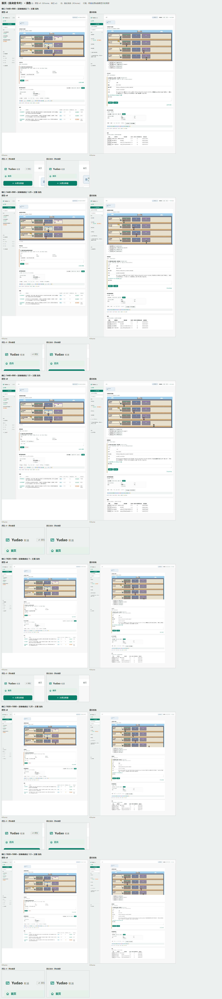

- 原型 v9 路由：`#/home`（档位 `ui`，用原型自带的示例数据）
- 真实系统路由：`#/home`（系统页，不选项目）
- 行数：6 · 图片体积：1.00 MB

### 机器（machines）

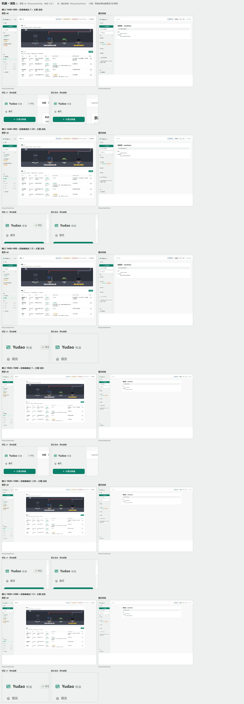

- 原型 v9 路由：`#/sys/machines`（档位 `3.2C`，用原型自带的示例数据）
- 真实系统路由：`#/sys/machines`（系统页，不选项目）
- 行数：6 · 图片体积：0.55 MB

### 运行（runtime）

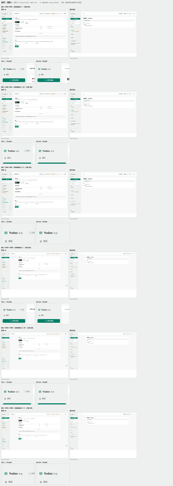

- 原型 v9 路由：`#/sys/runtime`（档位 `3.4A`，用原型自带的示例数据）
- 真实系统路由：`#/sys/runtime`（系统页，不选项目）
- 行数：6 · 图片体积：0.47 MB

### 工具（tools）

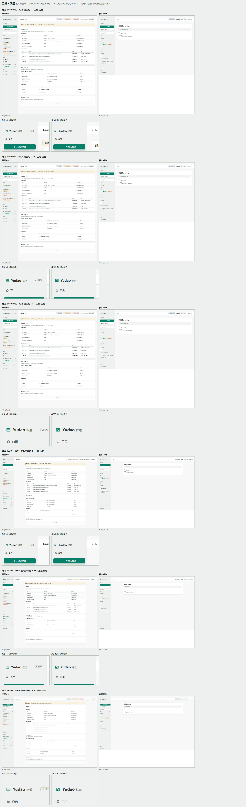

- 原型 v9 路由：`#/sys/tools`（档位 `3.2B`，用原型自带的示例数据）
- 真实系统路由：`#/sys/tools`（系统页，不选项目）
- 行数：6 · 图片体积：0.65 MB

### 项目概览与楼层（overview）

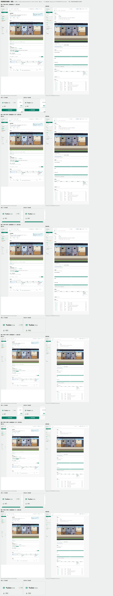

- 原型 v9 路由：`#/p/p-metro/overview?w=w-metro-transfer`（档位 `ui`，用原型自带的示例数据）
- 真实系统路由：`#/p/{project}/overview` · 预置项目「交付历史」
- 行数：6 · 图片体积：1.29 MB

### 部门工作间（dept）

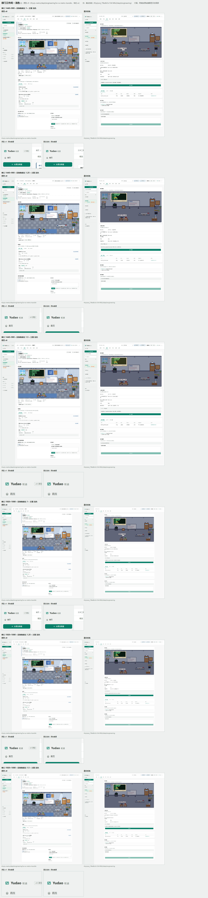

- 原型 v9 路由：`#/p/p-metro/dept/engineering?w=w-metro-transfer`（档位 `ui`，用原型自带的示例数据）
- 真实系统路由：`#/p/{project}/dept/engineering` · 预置项目「文本工具」
- 行数：6 · 图片体积：1.18 MB

### 资料（materials）

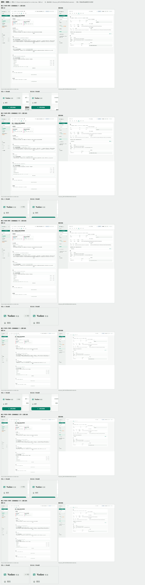

- 原型 v9 路由：`#/p/p-todo/materials?w=w-todo-due`（档位 `ui`，用原型自带的示例数据）
- 真实系统路由：`#/p/{project}/materials` · 预置项目「示例项目」
- 行数：6 · 图片体积：0.95 MB

### 观测（observe）

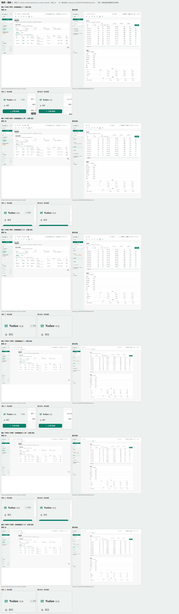

- 原型 v9 路由：`#/p/p-metro/observe?w=w-metro-transfer`（档位 `ui`，用原型自带的示例数据）
- 真实系统路由：`#/p/proj_33b55093785d438d/observe` · 预置项目「交付历史」
- 行数：6 · 图片体积：0.79 MB

### 项目设置（settings）

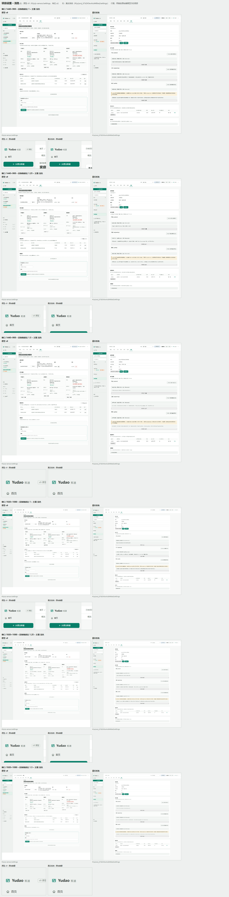

- 原型 v9 路由：`#/p/p-sensor/settings`（档位 `ui`，用原型自带的示例数据）
- 真实系统路由：`#/p/proj_67d243ec4cd440ed/settings` · 预置项目「示例项目」
- 行数：6 · 图片体积：1.02 MB

### 恢复（recovery）

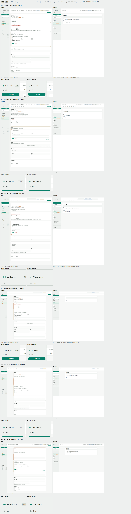

- 原型 v9 路由：`#/p/p-sensor/w/w-sensor-chart/recovery`（档位 `3.1`，用原型自带的示例数据）
- 真实系统路由：`#/p/proj_9d7acefeefe3488b/w/wi_8a5c69e796a34343/recovery` · 预置项目「文本工具」
- 行数：6 · 图片体积：0.71 MB

### 模型管理（models）

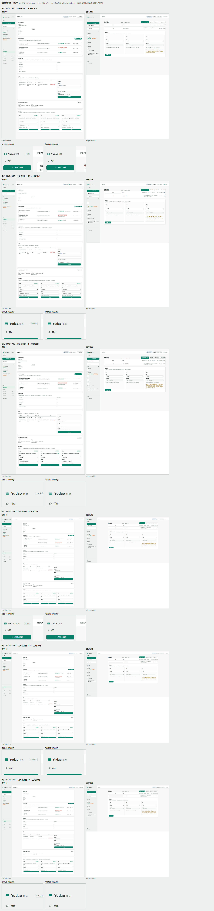

- 原型 v9 路由：`#/sys/models`（档位 `ui`，用原型自带的示例数据）
- 真实系统路由：`#/sys/models`（系统页，不选项目）
- 行数：6 · 图片体积：0.89 MB

## 深色

### 首页（含决定卡片）（home）

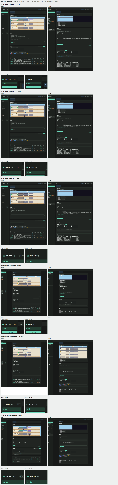

- 原型 v9 路由：`#/home`（档位 `ui`，用原型自带的示例数据）
- 真实系统路由：`#/home`（系统页，不选项目）
- 行数：6 · 图片体积：1.01 MB

### 机器（machines）

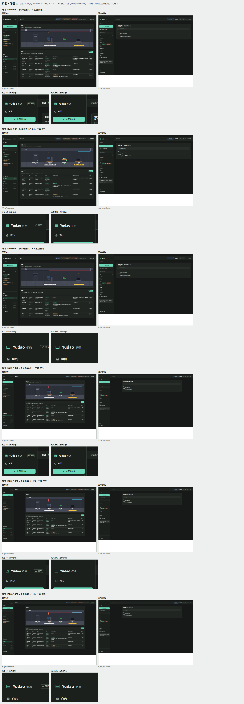

- 原型 v9 路由：`#/sys/machines`（档位 `3.2C`，用原型自带的示例数据）
- 真实系统路由：`#/sys/machines`（系统页，不选项目）
- 行数：6 · 图片体积：0.55 MB

### 运行（runtime）

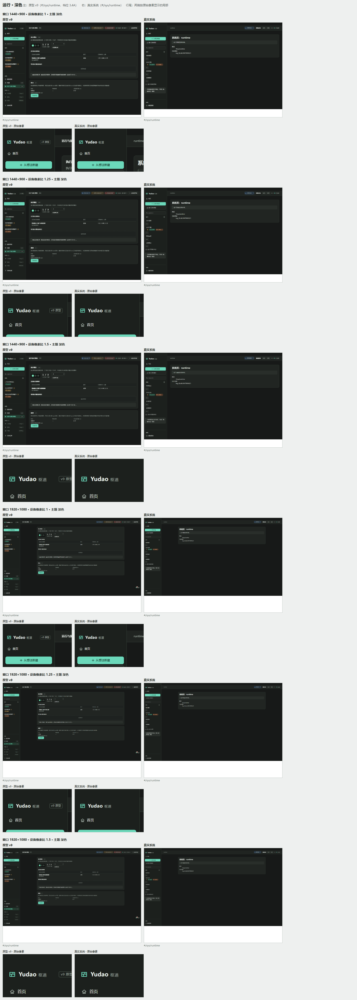

- 原型 v9 路由：`#/sys/runtime`（档位 `3.4A`，用原型自带的示例数据）
- 真实系统路由：`#/sys/runtime`（系统页，不选项目）
- 行数：6 · 图片体积：0.47 MB

### 工具（tools）

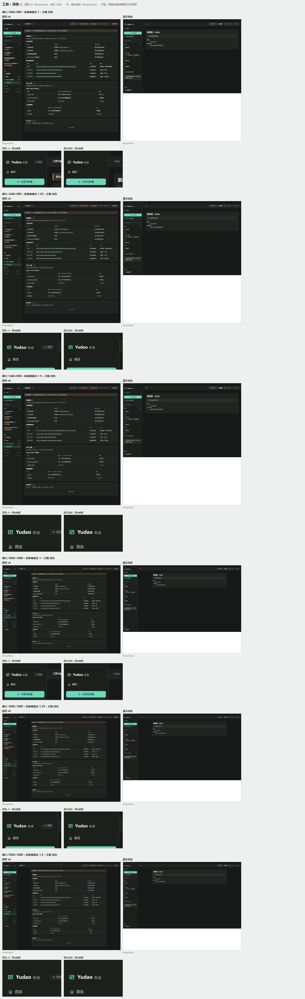

- 原型 v9 路由：`#/sys/tools`（档位 `3.2B`，用原型自带的示例数据）
- 真实系统路由：`#/sys/tools`（系统页，不选项目）
- 行数：6 · 图片体积：0.65 MB

### 项目概览与楼层（overview）

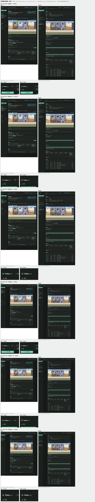

- 原型 v9 路由：`#/p/p-metro/overview?w=w-metro-transfer`（档位 `ui`，用原型自带的示例数据）
- 真实系统路由：`#/p/{project}/overview` · 预置项目「交付历史」
- 行数：6 · 图片体积：1.29 MB

### 部门工作间（dept）

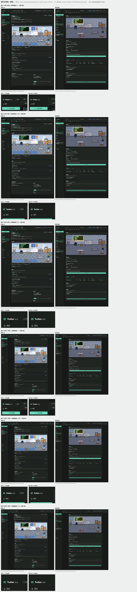

- 原型 v9 路由：`#/p/p-metro/dept/engineering?w=w-metro-transfer`（档位 `ui`，用原型自带的示例数据）
- 真实系统路由：`#/p/{project}/dept/engineering` · 预置项目「文本工具」
- 行数：6 · 图片体积：1.18 MB

### 资料（materials）

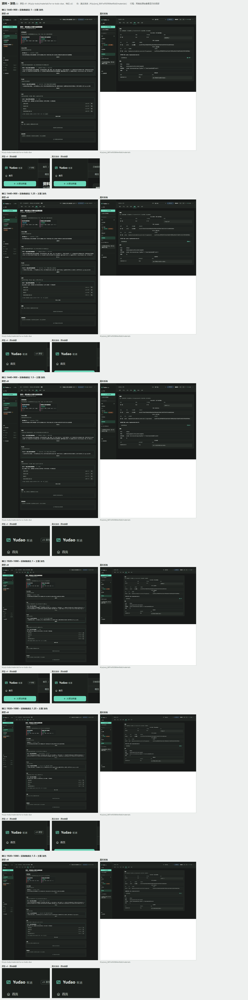

- 原型 v9 路由：`#/p/p-todo/materials?w=w-todo-due`（档位 `ui`，用原型自带的示例数据）
- 真实系统路由：`#/p/{project}/materials` · 预置项目「示例项目」
- 行数：6 · 图片体积：0.94 MB

### 观测（observe）

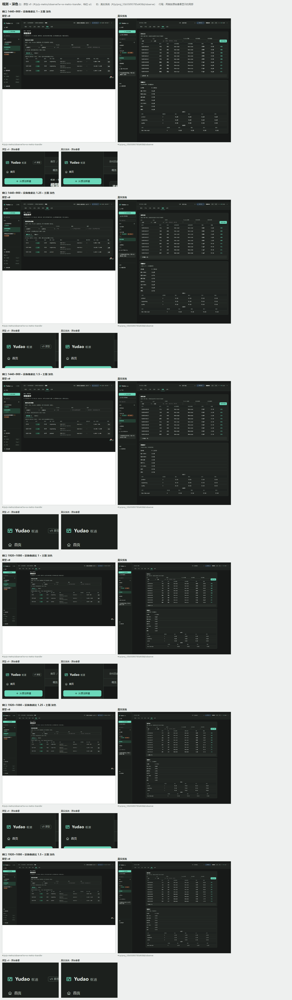

- 原型 v9 路由：`#/p/p-metro/observe?w=w-metro-transfer`（档位 `ui`，用原型自带的示例数据）
- 真实系统路由：`#/p/proj_33b55093785d438d/observe` · 预置项目「交付历史」
- 行数：6 · 图片体积：0.79 MB

### 项目设置（settings）

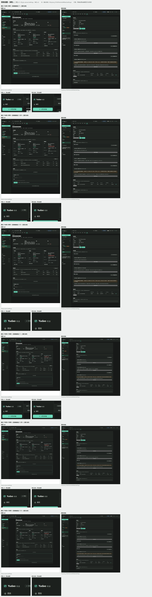

- 原型 v9 路由：`#/p/p-sensor/settings`（档位 `ui`，用原型自带的示例数据）
- 真实系统路由：`#/p/proj_67d243ec4cd440ed/settings` · 预置项目「示例项目」
- 行数：6 · 图片体积：1.02 MB

### 恢复（recovery）

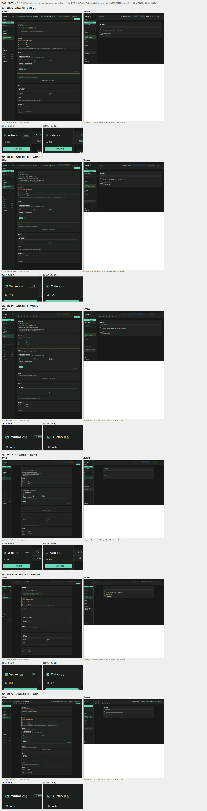

- 原型 v9 路由：`#/p/p-sensor/w/w-sensor-chart/recovery`（档位 `3.1`，用原型自带的示例数据）
- 真实系统路由：`#/p/proj_9d7acefeefe3488b/w/wi_8a5c69e796a34343/recovery` · 预置项目「文本工具」
- 行数：6 · 图片体积：0.70 MB

### 模型管理（models）

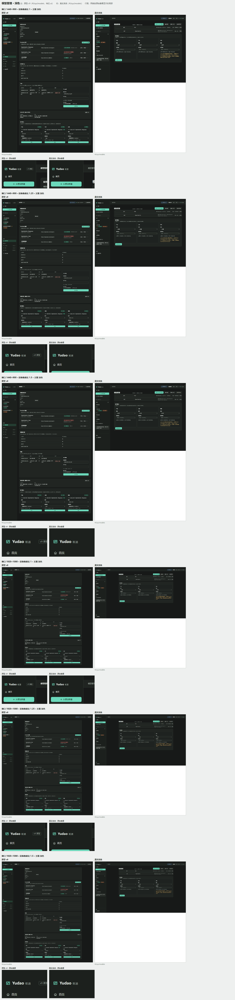

- 原型 v9 路由：`#/sys/models`（档位 `ui`，用原型自带的示例数据）
- 真实系统路由：`#/sys/models`（系统页，不选项目）
- 行数：6 · 图片体积：0.88 MB

## 重新生成

```
cd client && npm run build:pages
node scripts/build-page-contact-sheet.mjs --issue 377
node scripts/build-page-contact-sheet.mjs --issue 377 --pages home,models --themes light,dark
```

页面清单与截图矩阵：`client/scripts/page-contact-sheet-pages.ts`（单元测试 `client/tests/unit/page-contact-sheet.test.ts`）。
原始整页截图写在 `.tmp/contact-sheet-raw/377/`，被 git 忽略。
