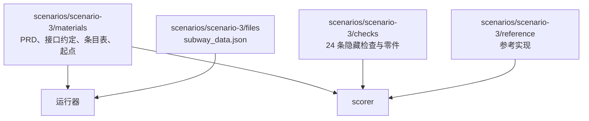

# 评测工具

本目录是与 `harness/` 分开的评测工具，只通过公开接口观察 Yudao（[评测场景设计](../docs/design/evaluation-scenarios.md)第 7 节）。本工单建立了场景 3 的评分器、材料与参考实现。

## 目录结构



- `scenarios/scenario-3/materials/`：需求原文（`prd.md`，PRD 的英文译本）、接口约定（`interface-agreement.md`）、需求条目表（`requirement-table.json`）、交给被测方的起点（`start/files/`）。这些是公开部分，运行时交给被测方。
- `scenarios/scenario-3/files/`：题目数据文件 `subway_data.json`，运行器放到起点。
- `scenarios/scenario-3/checks/`：隐藏检查。只有评分器读取，不进入被测方的运行目录，运行结束以后才复制到评分目录。
- `scenarios/scenario-3/reference/`：参考实现，只由评分器用来确认检查本身没有写错。
- `scorer/`：评分器，对一份交付运行隐藏检查并写出机器可读结果。
- `runner/`：OpenCode 一侧的运行器、指标收集与报告（`run_eval.py` 是入口）。它把材料起点复制到仓库之外的运行目录，运行 `opencode run`，从 JSON 事件流收集指标，再用评分器评分，最后写出机器可读结果与中文报告。
- `runner/yudao.py`、`yudao_metrics.py`、`yudao_report.py`：Yudao 一侧的运行器、指标收集与报告（`run_yudao_eval.py` 是入口）。运行器只经 HTTP 接口驱动 Yudao，只从 `run.export` 导出的事件日志观察它，不导入 `harness` 的任何模块。它在仓库之外新建数据目录启动被测的 Yudao，写入被测模型并经模型测试准入，建立项目、绑定三个部门、登记场景 3 的命令（`run_cli` 与 `check_data`，按接口约定第 5 节的命令行入口），以用户原始意图提交需求原文加接口约定，到时间上限时经 `work_item.cancel` 结束并标记超时；运行结束以后导出事件日志，取最后一次封存的交付交给评分器，并计算过程检查点与指标。
- `tests/`：评分器与运行器自己的测试，全部运行真实代码，不使用 mock。

## 材料版本

材料版本是 `scenario-3@2`。修改 PRD、接口约定、条目表、隐藏检查、运行环境或参考实现中的任意一项，版本号加一，新旧版本的结果不直接比较。

## 需求条目与检查

7 个需求条目与 24 条检查的对应见 `scenarios/scenario-3/materials/requirement-table.json`（评分器内的对应表在 `checks/command_checks.py` 的 `REQUIREMENT_TABLE`，两者一致）。检查分三类：单元 12 条、命令行 10 条、文件比对 2 条。

## 运行评分器

```bash
uv run python evals/scorer/scorer.py --delivery <交付目录> --result <结果文件>
```

`--delivery` 指向被测方交付的目录，其中应有一个 `src/` 子目录。评分器在评分目录中运行检查，隐藏检查、条目表与参考实现不进入交付目录。

## 运行评分器自己的测试

```bash
uv run python -m pytest evals/tests
```

## 运行一次评测

模型服务的地址与凭据只从环境变量读，不写入代码、事件、日志与提交：

```bash
export YUDAO_EVAL_BASE_URL=<模型服务地址>
export YUDAO_EVAL_API_KEY=<凭据>
uv run python evals/runner/run_eval.py \
    --model yudao-eval/<模型名> \
    --runs 3 \
    --runs-root <Yudao 仓库之外的目录> \
    --result docs/evaluation/scenario-3-opencode.json \
    --report docs/evaluation/scenario-3-opencode.md
```

Yudao 一侧用同一个模型、同一个环境变量：

```bash
uv run python evals/runner/run_yudao_eval.py \
    --model <模型名> \
    --runs 3 \
    --runs-root <Yudao 仓库之外的目录> \
    --result docs/evaluation/scenario-3-yudao.json \
    --report docs/evaluation/scenario-3-yudao.md
```

Yudao 一侧的运行器保证下面这些：

- 只经 HTTP 接口与导出的事件日志观察 Yudao，不导入 `harness` 的模块（`tests/test_no_harness_import.py` 检查这一点）。
- 被测的 Yudao 在仓库之外的数据目录上启动，每次运行新建一个数据目录，用默认的执行位置（控制主机上的本机进程）。
- 三个部门的部门默认绑定与项目部门设置都使用被测模型；模型先经 `catalog.model.test` 准入，报告记录模型服务实际服务的模型名。
- 项目不登记取回的来源与 MCP 服务器，部门没有这两类工具。
- 到墙钟上限时经 `work_item.cancel` 结束事项，标记超时，按最后一次封存的交付评分；没有交付时全部检查记为「没有做」。
- 导出的事件日志里出现材料目录的路径时这次运行作废，写进报告。

Yudao 一侧当前的起点缺口与模型行为记录在 `docs/architecture-issues.md`（本工单的登记）与报告的第八节：新建项目的空工作区没有放入题目数据文件的接口通道，题目提供的 `subway_data.json` 由被测工程按接口约定自行写出；被测模型在工程部门连续返回成功但没有输出项的调用，主机按 `no_tool_call` 暂停。

运行器保证下面这些：

- 运行目录在 Yudao 仓库之外，并且是 git 仓库。没有版本控制的目录被 OpenCode 当成全局目录，交付会落到系统临时目录而不是运行目录。
- 隐藏检查、条目表与参考实现不进入运行目录；它们在运行结束以后才复制到评分目录。
- 取回与搜索工具（`webfetch`、`websearch`）在运行配置里关闭，运行器另外检查 JSON 输出里没有这两类工具的调用。
- 消息用短指示加上材料附件（`prd.md`、`interface-agreement.md`、`subway_data.json`），不把需求全文放进命令行。
- JSON 输出里出现材料目录的路径时这次运行作废（`void`），不计入结果；这类运行在报告的第六节列出。
- 到达墙钟上限时结束进程，按结束时的目录评分并标记超时，不因为没有跑完而作废。

原始证据（交付副本、输出、评分日志）在 `.yudao/evals/` 下，不进入 Git。

## 运行器自己的测试

```bash
uv run python -m pytest evals/tests/test_opencode_runner.py
```


其中三项标记 `needs_model`，真实运行模型（每次数分钟），凭据不在环境变量里时跳过。

## 运行环境

场景 3 的运行环境是 uv 管理的 Python 3.13。评分器与隐藏检查在被测交付的目录之外运行，不在交付目录中写入除导出文件与探测脚本以外的内容。
