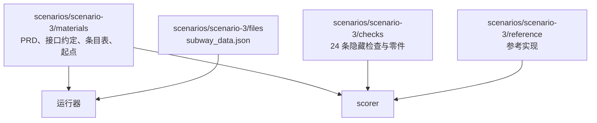

# 评测工具

本目录是与 `harness/` 分开的评测工具，只通过公开接口观察 Yudao（[评测场景设计](../docs/design/evaluation-scenarios.md)第 7 节）。本工单建立了场景 3 的评分器、材料与参考实现。

## 目录结构



- `scenarios/scenario-3/materials/`：需求原文（`prd.md`，PRD 的英文译本）、接口约定（`interface-agreement.md`）、需求条目表（`requirement-table.json`）、交给被测方的起点（`start/files/`）。这些是公开部分，运行时交给被测方。
- `scenarios/scenario-3/files/`：题目数据文件 `subway_data.json`，运行器放到起点。
- `scenarios/scenario-3/checks/`：隐藏检查。只有评分器读取，不进入被测方的运行目录，运行结束以后才复制到评分目录。
- `scenarios/scenario-3/reference/`：参考实现，只由评分器用来确认检查本身没有写错。
- `scorer/`：评分器，对一份交付运行隐藏检查并写出机器可读结果。
- `tests/`：评分器自己的测试，全部运行真实代码，不使用 mock。

## 材料版本

材料版本是 `scenario-3@2`。修改 PRD、接口约定、条目表、隐藏检查、运行环境或参考实现中的任意一项，版本号加一，新旧版本的结果不直接比较。

## 需求条目与检查

7 个需求条目与 24 条检查的对应见 `scenarios/scenario-3/materials/requirement-table.json`（评分器内的对应表在 `checks/command_checks.py` 的 `REQUIREMENT_TABLE`，两者一致）。检查分三类：单元 12 条、命令行 10 条、文件比对 2 条。

## 运行评分器

```bash
uv run python evals/scorer/scorer.py --delivery <交付目录> --result <结果文件>
```

`--delivery` 指向被测方交付的目录，其中应有一个 `src/` 子目录。评分器在评分目录中运行检查，隐藏检查、条目表与参考实现不进入交付目录。

## 运行评分器自己的测试

```bash
uv run python -m pytest evals/tests
```

## 运行环境

场景 3 的运行环境是 uv 管理的 Python 3.13。评分器与隐藏检查在被测交付的目录之外运行，不在交付目录中写入除导出文件与探测脚本以外的内容。
