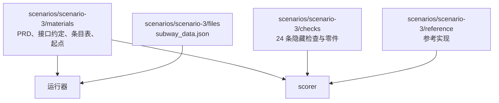

# 评测工具

本目录是与 `harness/` 分开的评测工具，只通过公开接口观察 Yudao（[评测场景设计](../docs/design/evaluation-scenarios.md)第 7 节）。场景 3 是从较长的 PRD 新建项目，场景 2 是在已有代码上加功能，场景 1 是网页应用（WebGen-Bench 000080 待办清单）。

## 目录结构



场景 2 的材料来自公开数据集 FeatBench：交付的起点是 `openai/openai-agents-python` 在任务基准提交上的仓库，材料里记录提交号，运行器检出它并按锁文件建立 Python 3.13 环境。

- `scenarios/scenario-2/materials/`：需求原文（`requirement.md`，FeatBench 的 problem_statement 原文）、需求条目表（`requirement-table.json`）、材料来源与运行环境（`manifest.json`）。
- `scenarios/scenario-2/checks/`：8 条 F2P（`f2p.json`）、331 条 P2P（`p2p.json`）、登记的排除用例（`excluded.json`）、隐藏测试文件（`tests/`，按交付里的相对路径存放）与清单模块（`pytest_checks.py`）。
- `scenarios/scenario-2/reference/gold.patch`：参考实现，FeatBench 记录的 gold patch。
- `scenarios/scenario-2/validate.py`：核对材料本身——套上参考实现应当 8 条 F2P 全通过且 P2P 失败 0 条，原样的仓库 8 条全不通过且 P2P 失败 0 条。
- `scenarios/scenario-1/materials/`：需求原文（`requirement.md`，WebGen-Bench 000080 原文）、接口约定（`interface-agreement.md`）、需求条目表（`requirement-table.json`）、材料来源与运行环境（`manifest.json`）。
- `scenarios/scenario-1/checks/cases.json`：8 条用例（新建、编辑、删除、标记完成、按完成状态筛选、搜索、页面导航、配色）。
- `scenarios/scenario-1/checks/richness.json`：10 项丰富程度清单（来源于 ArtifactsBench `88c968b` 1278 号题）。
- `scorer/judge.py`：多模态裁判（`ag/gemini-3.8-flash-high`），按 10 项清单为交付的代码与用例关键状态截图打分。
- `scenarios/scenario-1/reference/`：参考实现（Node.js 待办应用）。
- `scorer/ui_agent.py`：界面智能体，使用 Playwright 操作 Chromium 在浏览器中按可见内容执行用例并截图。
- `scorer/scenario1.py`：场景 1 评分器，启动交付服务、由界面智能体执行用例并记分。
- `runner/scenario1.py`：场景 1 在 OpenCode 一侧的运行器模块。
- `scenarios/scenario-3/materials/`：需求原文（`prd.md`，PRD 的英文译本）、接口约定（`interface-agreement.md`）、需求条目表（`requirement-table.json`）、交给被测方的起点（`start/files/`）。这些是公开部分，运行时交给被测方。
- `scenarios/scenario-3/files/`：题目数据文件 `subway_data.json`，运行器放到起点。
- `scenarios/scenario-3/checks/`：隐藏检查。只有评分器读取，不进入被测方的运行目录，运行结束以后才复制到评分目录。
- `scenarios/scenario-3/reference/`：参考实现，只由评分器用来确认检查本身没有写错。
- `scorer/`：评分器，对一份交付运行隐藏检查并写出机器可读结果。
- `runner/`：OpenCode 一侧的运行器、指标收集与报告（`run_eval.py` 是入口）。它把材料起点复制到仓库之外的运行目录，运行 `opencode run`，从 JSON 事件流收集指标，再用评分器评分，最后写出机器可读结果与中文报告。
- `runner/material_integrity.py`：两边的评分前核对共用的部分：按 LF 规范化字节流递归计算材料摘要并与 `materials/manifest.json` 的 `digests` 块比较，在输出文本里查找对任务上游仓库的访问。摘要重新生成也由它做。
- `runner/yudao.py`、`yudao_metrics.py`、`yudao_report.py`：Yudao 一侧的运行器、指标收集与报告（`run_yudao_eval.py` 是入口）。运行器只经 HTTP 接口驱动 Yudao，只从 `run.export` 导出的事件日志观察它，不导入 `harness` 的任何模块，也不引用被测方内部文件的路径。它在仓库之外新建数据目录启动被测的 Yudao，写入被测模型并经模型测试准入，绑定三个部门、运行器不登记命令，到时间上限时经 `work_item.cancel` 结束并标记超时；运行结束以后导出事件日志，取最后一次封存的交付交给评分器，并计算过程检查点与指标。场景 3 新建项目并带入起始文件夹，以用户原始意图提交需求原文加接口约定；场景 2 接入已有仓库（`project.onboard`）、确认初始 PRD（`decision.answer`，或者等人确认），再新建事项提交需求原文（见下面「场景 2 的运行」）。
- `scenarios/scenario-3/materials/manifest.json`：场景 3 的材料来源、运行环境与材料摘要（`digests` 块）。
- `baseline/`：omp 流程开发 Yudao 的基线数字。`collect.py` 抓取 Stage 3 里程碑下的工单、标签时间线与评论、合并请求、阶段父工单 #9 的集成层记录与运行目录里的运行输出，合成一个数据文件；`compute.py` 只读这个数据文件，算出每个工单的审查轮数、集成层失败归因、搁置原因、耗时与用量，写出中文报告。
- `context/`：上下文装配的离线回放（#912，[设计说明](../docs/design/context-assembly.md)）。只读事件库与工件库，把每一步交给模型的上下文当成纯函数 `view(events, rules) → request`：`measure` 测每一步的召回与浪费，`replay` 用新视图重放并做逐条规则的消融，`sweep` 扫参数取值，`verify` 核对视图与记录逐字节一致，`counterfactual` 用真实模型做反事实回放。用法见 [context/README.md](context/README.md)。
- `tests/`：评分器与运行器自己的测试，全部运行真实代码，不使用 mock。基线工具的测试读录制的数据文件，同样不使用 mock。`test_yudao_runner.py` 用 `harness/tests/event_sequences/` 里的系统事件序列驱动同一套 `run.export` 形状的判定逻辑；这些序列的事件头是 `adapter: fake`，不是真实系统导出，凡是需要真实导出才能核实的项记「未核实」。`test_regen_scenario3.py` 用 `runner/regen_scenario3.py` 从仓库内固定的历史 JSON（`data/scenario-3-yudao-historical.json`，提交 `aaa91883` 的旧版原文，不可修改）重算 `docs/evaluation/scenario-3-yudao.json` 与 `.md`，与已提交的文件逐字节比对；以已提交的新 JSON 为输入重算同样逐字节一致（幂等）。`test_no_harness_paths.py` 用 `ast` 扫描并折叠字符串拼接与 `os.path.join` 字面量参数，再比对被测方内部文件路径。`test_report.py` 核对多次运行的汇总是怎么算的：完成度与正确性进汇总，每个指标带噪声范围，一次运行时噪声范围写「未知」，费用全为 0 或为空时写「未知」。

## 材料版本

场景 3 的材料版本是 `scenario-3@2`，场景 2 的是 `scenario-2@1`，场景 1 的是 `scenario-1@2`。修改需求原文、需求条目表、隐藏检查、运行环境或参考实现中的任意一项，版本号加一，新旧版本的结果不直接比较。

评分之前运行器还要核对材料摘要：隐藏检查、条目表与参考实现的摘要登记在各自的 `materials/manifest.json` 的 `digests` 块里，算出来的摘要与登记值不同时这次运行无效，报告写明「材料摘要与材料版本记录不同」。摘要按 LF 规范化的字节流递归计算，跳过 `__pycache__` 与 `*.pyc`，因此在 Windows 与 Linux 签出上一致，测试或评分写下的字节码也不会让摘要失效。改动材料以后用下面这条命令重新生成摘要，随改动一起提交：

```bash
uv run python -c "import sys; sys.path.insert(0, 'evals/runner'); import material_integrity as m, scenario3; print(m.write_digests(scenario3.scenario_base(), {'checks', 'reference', 'materials/requirement-table.json'}))"
```

场景 1 的摘要生成：

```bash
uv run python -c "import sys; sys.path.insert(0, 'evals/runner'); import material_integrity as m, scenario1; print(m.write_digests(scenario1.scenario_base(), {'checks', 'reference', 'materials/requirement-table.json'}))"
```


## 需求条目与检查

场景 3 有 7 个需求条目与 24 条检查，对应见 `scenarios/scenario-3/materials/requirement-table.json`（评分器内的对应表在 `checks/command_checks.py` 的 `REQUIREMENT_TABLE`，两者一致）。检查分三类：单元 12 条、命令行 10 条、文件比对 2 条。

场景 2 有 6 个需求条目与 8 条 F2P 的对应，见 `scenarios/scenario-2/materials/requirement-table.json`。8 条 F2P 计入完成度与正确性；331 条 P2P 是原有功能测试，失败条数单独报告，不影响完成度（[评测场景设计](../docs/design/evaluation-scenarios.md)第 4.2 节）。隐藏测试文件以文件形态放在 `checks/tests/` 下，评分时盖掉交付里的同名文件，被测方改测试不改变评分。

场景 1 有 8 个需求条目与 8 条用例，见 `scenarios/scenario-1/materials/requirement-table.json` 与 `checks/cases.json`。由界面智能体在浏览器中按可见内容执行，每条最多 15 步，给出通过（1）、部分通过（0.5）、不通过（0）；找不到对应元素或入口时记为「没有做」（0）。此外，多模态裁判（`ag/gemini-3.8-flash-high`）按 ArtifactsBench 1278 号题的 10 项丰富程度清单（`checks/richness.json`）结合代码与各用例关键截图打 0 至 10 分（满分 100）。
## 运行评分器

```bash
uv run python evals/scorer/scorer.py --delivery <交付目录> --result <结果文件>
```

场景 3 的评分器把交付当作一个带 `src/` 子目录的项目。场景 2 的评分器针对一份仓库：`--delivery` 指向交付副本，评分器把隐藏测试文件盖上去，再用交付自带的 Python 3.13 环境运行 F2P 与 P2P 两份清单。OpenCode 一侧的交付自带虚拟环境；Yudao 一侧的交付没有虚拟环境，由运行器在评分副本里按材料的 `runtime.install` 建立（见「场景 2 的运行」）。

场景 1 的评分器针对一份待办应用交付：`--delivery` 指向交付目录，评分器启动服务并将端口通过 `PORT` 传入，服务就绪后由界面智能体在 Chromium 中执行 8 条用例并截图：

```bash
uv run python evals/scorer/scenario1.py --delivery <交付目录> --result <结果文件>
```

## 运行评分器自己的测试

```bash
uv run python -m pytest evals/tests
```

需要真实模型的用例带 `real_model` 标记，只在明确选择时运行：变量在环境里也不会触发它们，上面的命令不运行它们。三个变量（`YUDAO_EVAL_BASE_URL`、`YUDAO_EVAL_API_KEY`、`YUDAO_EVAL_MODEL`）都设置以后：

```bash
uv run python -m pytest evals/tests -m real_model                                    # 全部，单项最长 120 分钟
uv run python -m pytest evals/tests/test_yudao_runner.py -m real_model -k time_limit # 最短的一项
```

选择了而变量缺失时这些用例跳过，原因写明缺哪个变量。

场景 1 需要安装 Chromium：

```bash
uv run playwright install chromium
```

## 运行一次评测

每次评测在检出被测提交的专门 worktree 里运行，运行期间不切换提交；运行目录与原始证据在 Yudao 仓库之外。三次运行每次最长 120 分钟，整组要几个小时：用 `Start-Process pwsh -File <脚本>` 启动，不用会话里的后台命令（会话空闲、内存不足时后台命令会被结束）。

模型服务的地址与凭据只从环境变量读，不写入代码、事件、日志与提交：

```bash
export YUDAO_EVAL_BASE_URL=<模型服务地址>
export YUDAO_EVAL_API_KEY=<凭据>
export YUDAO_EVAL_MODEL=<模型名>
uv run python evals/runner/run_eval.py \
    --scenario scenario3 \
    --model yudao-eval/<模型名> \
    --runs 3 \
    --runs-root <Yudao 仓库之外的目录> \
    --result docs/evaluation/scenario-3-opencode.json \
    --report docs/evaluation/scenario-3-opencode.md
```

两个运行器都从模型服务的模型列表（`YUDAO_EVAL_BASE_URL` 加 `/models`）取被测模型报告的 `context_length` 与 `max_completion_tokens`：Yudao 一侧写进模型访问定义，OpenCode 一侧写进运行配置的模型限额（`models.<id>.limit` 的 `context` 与 `output`），两处是同一对数；列表没有报告这个模型时用 `--context-window` 与 `--max-output-tokens`，两者都没有时报错。报告与结果写明取值与来源。

场景 1 的运行命令（单次运行写到 `.tmp/` 或正式运行写到 `docs/evaluation/`）：

```bash
uv run python evals/runner/run_eval.py \
    --scenario scenario1 \
    --model yudao-eval/<模型名> \
    --runs 3 \
    --runs-root <Yudao 仓库之外的目录> \
    --result docs/evaluation/scenario-1-opencode.json \
    --report docs/evaluation/scenario-1-opencode.md
```

场景 2 用 `--scenario scenario2`，结果写到对应的 `scenario-2-opencode.json` 与 `scenario-2-opencode.md`。场景 2 运行目录就是检出好的仓库本身：建立环境需要 GitHub 与 PyPI，这一步发生在运行之前，评测运行本身不联网。

```bash
uv run python evals/runner/run_yudao_eval.py \
    --model <模型名> \
    --runs 3 \
    --runs-root <Yudao 仓库之外的目录> \
    --result docs/evaluation/scenario-3-yudao.json \
    --report docs/evaluation/scenario-3-yudao.md
```

入口的 `--scenario` 选场景：默认 3（上面那条命令），`--scenario 2` 是在已有代码上加功能（见下一节）。

### 场景 2 的运行

```bash
uv run python evals/runner/run_yudao_eval.py \
    --scenario 2 \
    --model <模型名> \
    --runs 3 \
    --runs-root <Yudao 仓库之外的目录> \
    --result docs/evaluation/scenario-2-yudao.json \
    --report docs/evaluation/scenario-2-yudao.md
```

一次运行分两步，都用 Yudao 的正常入口：

1. **接入已有仓库并建档。** 运行器在运行目录之外检出 `openai/openai-agents-python` 在材料基准提交上的代码，用仓库自己的锁文件建立 Python 3.13 环境（需要联网，这一步在评测之前），经 `project.onboard` 接入：新建项目、登记源目录、只读采集快照、开始建档事项。接入的目录保留 `.git`（快照记录 git 提交与是否有未提交的修改），不带评测材料（没有 `requirement.md`、没有隐藏检查），远端地址检出以后去掉。
2. **确认初始 PRD，再新建事项。** 建档给出初始 PRD 的确认请求以后，运行器经 `decision.answer` 选「确认」（基准版本取请求的版本），项目的基线从此采纳；随后 `work_item.create` 以用户原始意图提交需求原文（`scenarios/scenario-2/materials/requirement.md`），这一步是事项的开始。

- `--wait-prd-confirmation`：不经接口回答，等运行的人在浏览器的决定卡片里确认；运行器轮询决定请求的状态，被回答以后继续。`--prd-confirmation-timeout-seconds`（默认 600 秒）是等它的上限，到时限仍没有被回答时这次运行作废，报告写明原因；这个选项给需要在界面上确认并截图的那次真实运行用。
- `--onboarding-timeout-seconds`（默认 7200 秒）是等建档给出确认请求的上限，与建档 run 自己的运行时间上限相同（[接入已有项目设计说明](../docs/design/existing-project-onboarding.md)第 12 节第 5 项）。
- 建档与事项是两个 run，各自导出、分开保存：`onboarding-run-export.json` 与 `run-export.json`，建档的指标在 `onboarding-metrics.json`。建档的模型请求数、用量与耗时在结果与报告里单独成段，不计入事项的指标（第 5.2 节）。
- 时间上限（默认 120 分钟）从新建事项开始计算：建档用了多久不影响事项的超时判断。
- 评分环境：Yudao 封存的交付没有虚拟环境，运行器在评分副本里按材料 `manifest.json` 的 `runtime.install` 建立 Python 3.13 环境（需要联网），再用 `evals/scorer/scenario2.py` 与 `runner/scenario2.py` 的评分命令评 F2P 与 P2P；评分器不改。

Yudao 一侧的运行器保证下面这些：

- 只经 HTTP 接口与导出的事件日志观察 Yudao，不导入 `harness` 的模块（`tests/test_no_harness_import.py` 检查这一点），也不引用被测方内部文件的路径（`tests/test_no_harness_paths.py` 检查这一点）。
- 被测的 Yudao 在仓库之外的数据目录上启动，每次运行新建一个数据目录，用默认的执行位置（控制主机上的本机进程），以 `--no-browser` 启动（评测运行不在控制主机上开页面）。
- 起点：场景 3 每次运行新建一个只含题目提供的数据文件 `subway_data.json` 的起始文件夹，放在运行目录之外，经 `project.create` 的 `initial_directory` 带入；事项文字不另写起点文件的说明。场景 2 的起点是检出好的上游仓库，经 `project.onboard` 接入，见上一节。
- 三个部门的部门默认绑定与项目部门设置都使用被测模型；模型先经 `catalog.model.test` 准入，报告记录模型服务实际服务的模型名。
- 被测的 Yudao 以关闭取回的启动参数（`--no-fetch`）启动：这个实例的三个部门都没有取回工具（`fetch_url`、`read_external_source`），评测项目也不设置 MCP 服务器，运行中因此没有这两类工具的调用（网络与 MCP 设计说明第 5.1、12.4 节）。
- 每次运行的提交号在启动服务之前记下，结果逐次记录；各次不一致时顶层写明不一致并逐次列出。
- 到墙钟上限（默认 120 分钟，`--limit-seconds` 可覆盖）时经 `work_item.cancel` 结束事项，标记超时，按最后一次封存的交付评分；没有交付时全部检查记为「没有做」。
- 评分之前做三项核对，任一命中这次运行作废，写进报告：事件日志导出中出现材料目录的路径、场景材料的摘要与 `materials/manifest.json` 的 `digests` 块不同、事件日志导出中出现对任务上游仓库的访问（场景 3 的上游仓库是 `AGI-Eval-Official/PRDBench`，场景 2 的是 `openai/openai-agents-python`）。

### 五项过程检查点（第 5.1 节）

Yudao 一侧的过程检查点共五项，每项给通过 / 未通过 / 未核实三种取值：

1. 在冻结限额内以放行结束：阶段为 `DONE`，停止原因为 `released`，存在当前交付快照的质检放行，用量在冻结限额以内。`no_tool_call`、取消、超时、模型服务故障与进程退出都记未通过。
2. 质检放行绑定最后一次封存的交付：`qa.code_snapshot_hash` 等于最后封存的 `code_tree_digest`，`qa.delivery_spec_hash` 等于 `content_hash`，质检引用的每条回执 `activation_id` 在质检部门本次激活列表里；冻结的比例只在 `run_created` 的 `parameters_version` 可识别时按比例核对，导出中没有给出现值，读不到时本项记「未核实」。
3. 重放结果与记录一致：`replay.check` 返回一致；没有取到重放结果记未通过。
4. 质检没有误放行：放行而隐藏检查中存在失败条目记未通过；没有放行时本项不适用（放行不存在，隐藏检查的失败由评分报告单独写出）。
5. 放行记录附逐条覆盖、模型阅读与开环条件：放行记录缺逐条覆盖数据时写「未核实」不记未通过；覆盖比例小于 1.0、模型阅读条件数大于 0、开环条件数大于 0 记未通过。

### 用量的未知值

模型服务没有分项统计时，`usage.totals` 的那一项是 `None`，按「未知」写入报告，不进平均值、最小、最大与噪声，另计有效样本数与未知样本数及原因，只有来源明确上报的零才记零。取不到单价时费用同样是未知；OpenCode 一侧各次请求的费用全为 0 或为空时，这次运行的费用记「未知」，汇总里费用也写「未知」。

多次运行的汇总含评分器给出的完成度与正确性，每个指标给出噪声范围（同一版本各次运行的取值极差）；只有一次运行时噪声范围写「未知」，不写零。

被测模型在工程部门连续返回成功但没有输出项的调用，主机按 `no_tool_call` 暂停；这条模型行为的记录写进报告（`docs/architecture-issues.md` 里有登记）。

运行器保证下面这些：

- 运行目录在 Yudao 仓库之外，并且是 git 仓库。没有版本控制的目录被 OpenCode 当成全局目录，交付会落到系统临时目录而不是运行目录。
- 隐藏检查、条目表与参考实现不进入运行目录；它们在运行结束以后才复制到评分目录。场景 2 的运行目录是仓库，材料只把需求原文放进去，隐藏测试文件与两份清单都不进去。
- 取回与搜索工具（`webfetch`、`websearch`）在运行配置里关闭，运行器另外检查 JSON 输出里没有这两类工具的调用。
- 消息用短指示加上材料附件（`prd.md`、`interface-agreement.md`、`subway_data.json`），不把需求全文放进命令行。
- 运行配置的模型限额取模型服务的容量，与 Yudao 一侧的模型访问定义是同一对数（见「运行一次评测」一节）。
- 复制交付与评分目录时跳过 Windows 的保留设备名（`nul`、`con`、`prn`、`aux`、`com1` 至 `com9`、`lpt1` 至 `lpt9`，不分大小写，带不带扩展名都算），报告列出被跳过的文件。
- 每次运行的墙钟上限默认 120 分钟，`--limit-seconds` 可覆盖。
- 评分之前做三项核对，任一命中这次运行作废（`void`），不计入结果；这类运行在报告的第六节列出：JSON 输出中出现材料目录的路径、场景材料的摘要与 `materials/manifest.json` 的 `digests` 块不同、JSON 输出中出现对任务上游仓库的访问（场景 1 是 `mnluzimu/WebGen-Bench`，场景 2 是 `openai/openai-agents-python`，场景 3 是 `AGI-Eval-Official/PRDBench`）。
- 到达墙钟上限时结束进程，按结束时的目录评分并标记超时，不因为没有跑完而作废。

原始证据（交付副本、输出、评分日志）在 `.yudao/evals/` 下，不进入 Git。

## 运行器自己的测试

```bash
uv run python -m pytest evals/tests/test_opencode_runner.py
```


其中三项标记 `needs_model`，真实运行模型（每次数分钟），凭据不在环境变量里时跳过。


## omp 基线数字

`baseline/` 建立 omp 流程开发 Yudao 的基线数字，分抓取与计算两步。抓取经 `gh` 导出 Stage 3 里程碑下的工单、标签时间线与评论、合并请求、阶段父工单 #9 的集成层记录，再读运行目录里 `omp-` 与 `rv-` 开头的运行输出，合成一个数据文件；计算只读这个数据文件，写出逐个工单的数字与中文报告。

```bash
uv run python evals/baseline/collect.py --stage-parent 9 --runs-root C:/project/yudao-worktrees/autopilot/runs --data docs/evaluation/baseline-omp-stage3.json
uv run python evals/baseline/compute.py --data docs/evaluation/baseline-omp-stage3.json --report docs/evaluation/baseline-omp-stage3.md
```

抓取一次约 15 分钟（大量 `gh` 调用），中断以后重跑按工单编号续抓。基线数据文件与报告在 `docs/evaluation/`，测试读录制的数据文件，不调用 `gh`。

## 运行环境

场景 2、3 的运行环境是 uv 管理的 Python 3.13。场景 1 的运行环境为 Node.js、uv 管理的 Python 3.13 与 Playwright 安装的 Chromium。场景 3 的评分器与隐藏检查在被测交付的目录之外运行，不在交付目录中写入除导出文件与探测脚本以外的内容。场景 2 的评分器在交付副本的副本里运行，用交付自带的虚拟环境（`uv run --project <交付> --no-sync`），不重新建立依赖；Yudao 一侧的交付没有虚拟环境，由运行器在评分副本里按材料的 `runtime.install` 建立一次（需要联网）。场景 1 的评分器在交付副本里启动 Node.js 服务并通过环境变量 PORT 传入端口，由界面智能体经浏览器操作。
